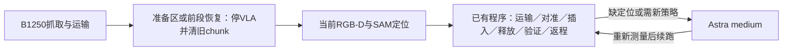
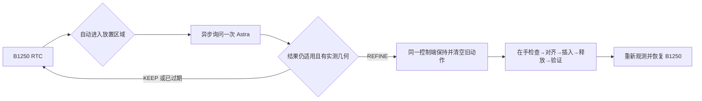

# B1250 RTC＋Astra：从异步建议到阶段交接

**2026-11-12最新：共享Harness V22／infra V56已部署。** 纯Agentic与VLA融合使用同一冻结包、同一任务验证／恢复及官方订阅接入；此前独立Astra V20与混合V18的分叉已收拢。VLA在准备区或前段恢复事件后停稳交权，Astra不逐chunk参与。

完整零输出、原生生命周期、双路线ARM只读与上线核验通过；未发START，完整物理抓放和初始摆放泛化仍待验。旧提示跨帧错配不是这次架构统一已解决的问题。当前结论见[共享双路线部署](#v22共享harness双路线部署2026-11-12)，以下旧版本证据保留。

## 历史V9—V13：一次异步建议（已由V17替代）

**最新现场：2026-11-12，V13已实际完成五次时序保持恢复及故障后停稳确认，但混合纠偏尚未生效。** 本条Astra等待29.1秒返回KEEP，返回时粗放置窗口已不适用；随后VLA候选目标触发右臂／躯干碰撞边界拒绝。下一步应按最新AGENTS补可靠移动／放置技能和明确阶段交接，不能只延长旧建议有效期；本轮为诊断与方案，未改部署。

V9的启动探针漏掉了实际授权后首条VLA计划下发路径，V11已补该路径和连续chunk验收。infra选项仍为 **VLA+Astra混合策略**；B1250负责整条任务，Astra medium只在放置机会出现时询问一次，不使用RLT，也不需要操作者标记阶段或画框。部署和软件回放不等于真实抓放成功。

一次获准的真实 API 测试总耗时 **18.303 秒**，请求部分 **16.577 秒**。因此这版验证的是“异步建议能否赶上放置并产生有效纠偏”，不是保证每条都会介入：等待期间 B 继续，错过窗口就丢弃。软件验收和真机只读检查通过不代表已经完成真机放置。

## 执行合同

- B1250 模型版本固定为 `81444e7071723c1fde8ca397a90f1bdd21868905b51c96252af0c54a3a8669d5`，30 Hz、H50、RTC D14/S16。保留原始训练任务提示，用户页面指令用于本条任务描述和 Astra 上下文，不静默改变 B 的提示。
- 控制端从实际关节反馈计算右手 FK，约30 Hz更新机会状态。当前实测孔口位姿优先；初始登记桶位姿只用于发起建议的空间参考。孔口局部坐标中半径20 cm、高度 −5～35 cm，加实测夹爪闭合，触发一次请求。这个宽区域不是运动许可；夹爪闭合也不等于抓到积木。
- 初始 SAM 搜索框来自本轮获准真实 Astra 对两张现场图的自动定位，绑定相机标定身份；连续 RGB-D 再计算几何。REFINE 返回的可见目标框会通过原定位接口更新搜索。不存在手动阶段按钮或手工画框要求；新布局能否保持目标追踪仍需现场验证。
- 发送两路当前图片、任务身份、当前实测手姿／夹爪、简短 B 轨迹摘要和可用几何，不发送整条 Harness 历史。不进入全 Harness 的 Python 工具多轮循环；同条单块任务不重复生成，失败也不重发。
- Astra 只给 `KEEP/REFINE`、孔口对称方向及是否先退到孔口上方。REFINE 不直接给电机命令；本地使用原有技能、IK、碰撞与输出限制。
- 响应返回后检查 owner、session、epoch、同次闭爪机会、是否仍在区域及夹爪状态；随后获取当前持物／孔口证据。控制线程消费交接时再读实际反馈，消除 RPC 到控制周期之间已经张爪的竞态。没有增加任意响应年龄阈值来卡住 B。
- 只有当前实测条件成立才保持 B、清空旧 chunk 并交给原控制 owner。局部未知／部分发布或验证失败时停止收尾，不盲目继续 B；局部放置验证后重新观测、重新请求 B，绝不恢复暂停前的旧 chunk。
- 原网页开始／停止仍是唯一授权入口。返回起点只标记待审核，不冒充放置成功；现有完整成功判据要求放置与复位证据，混合 B 返回不伪造 `withdraw_reset` 回执。

## 身份与部署

混合发布登记为 **F1 Harness VLA+Astra混合策略 V8**，内容 `7344a4c353ce`；infra 为 **F1infra VLA+Astra混合策略 V55**。混合包从已验证 V6 隔离派生；原 Astra 主线 V7 独立路由保留，不把两套感知／技能实现混装进一次运行。

已在现有现场任务结束并确认停稳后持共享控制锁完成部署；三端可开始、B1250精确版本在线，infra保留217条数据及审核。发布登记：[Harness](../../releases/registry.json)、[infra](../../../F1-4242/configs/release_registry.json)。本轮未发送真实 START。见[三端部署核验](../../artifacts/vla-astra-20261111/post-activation.json)和[策略路由核验](../../artifacts/vla-astra-20261111/route-verification.json)。

## 验收及适用边界

| 验收 | 实际覆盖 | 不代表什么 |
|---|---|---|
| 正式混合入口 | `run_task` → RPent HTTP → Unix → 原生混合 owner；保存的真实图片和 KEEP 响应；RTC 与反馈模拟，内存发布 | 不是第二次 API，也不证明真机动作 |
| 控制生命周期 | 原生 RTC 工作线程／动作消费、单 owner 交接、停止、迟到结果、RPC 后张爪竞态、重新 bootstrap | 不证明视觉能在运动中一直保持持物证据 |
| 完整技能回放 | 保存的真实 RGB-D＋实际 SAM 初始化、正式工具／规划／F1Owner／Ruckig，从抓取到复位；后续物理反馈模拟 | 不是新混合策略在现场已经成功 |
| 输出审计 | 搬运、抓取、恢复、整条软件输出四项通过；碰撞扫掠、速度、左臂固定及发布完整性 | 不替代真实接触、标定误差及插入验证 |
| 连续感知 | 原始时间戳50组连续 RGB-D，47份场景、45份同时含物体与孔口，实际 SAM，10.13秒 | 是初始静态桌面，不是运动持物序列 |
| 原生只读 | ARM 混合配置／准入／设备复核、FK与现有数值链误差0 | 没有启动 powered 混合 owner |
| B1250 shadow | 原 B 客户端真实450观测、28 chunks，15秒，零提交／发布、正常完成 | 不是混合真机执行 |
| Astra API | 一次获准 medium 请求；1695输入、584输出tokens，其中195推理tokens；初始场景正确 KEEP | 不是放置质量或稳定延迟统计 |
| infra | 67项任务服务回归、桌面实际保存及刷新后选项持久化、ARM导入 | 页面没有替用户点击开始 |

冻结验收回执与逐项证据哈希见 [release-validation.json](../../artifacts/vla-astra-20261111/release-validation.json)。127项候选相关回归、66项原生回归、7项混合入口测试存在重叠，不相加成独立测试总数。

首条现场重点看：触发时机、Astra 是否赶上窗口、采纳／丢弃原因、局部交接到首动作耗时、真实插入与松爪、B 恢复与最终任务结果。先取得这些数据，再决定是否要更早预取；不为等模型主动拖慢每个 chunk。

## V8首条启动失败与V9修复（2026-11-11）

北京时间17:24:42，`harness-6877c1c19240a0752594`选择的确为混合模式，13.942秒后异常结束。设备复核6.392秒，感知／规划服务3.313秒，其后等待owner2.628秒；owner与辅助服务并行，后两项按工作台分段统计。没有提交网页运动授权，没有进入VLA推理，也没有调用Astra。

真正错误为RTC的spawn子进程无法导入`websockets`，父进程在`policy.prepare()`读取IPC时得到ConnectionResetError，发生在bridge与recording初始化之前。上次零输出使用原B客户端依赖目录，混合正式RPC测试又模拟了RTC网络，因此漏掉实际混合包的原生依赖。这是部署验收缺口，不能归因于用户prompt、模型速度或网络超时。

另一条启动开销来自模板路径：旧候选本地目录名为`site`、远端却为`hybrid-7344a4c353ce`，预热进程按本地basename找远端目录，boot与numerical预热都失效。V9让本地／远端模板名一致，真实常驻boot两次复核1.317／1.243秒，数值预热socket实际就绪。原6.392秒为现场冷启动，采样不同，不能把差额直接宣称为整条任务或首动提速。

**V9只改依赖与模板接线，不改控制源码、限位、反馈检查、模型权重或提示。** 新包`086e3dbe9d09`锁定与已验证B客户端相同的`websockets==15.0.1`，安装进包内deps而非共享venv；安装器验证真实sync-client导入。infra保持V55、Astra主线仍独立V7。

V9补充沿实际native入口初始化WebHybridPolicyEngine／RTCPolicy，使用真实ROS图像与反馈、真实预处理及spawn通信，发出两次shadow B1250请求，返回32×16动作及50×10末端计划，耗时174.15／159.78ms。探针显式禁止浏览器授权及动作发布器，创建的动作发布器／提交数均为0；约3.96秒进入控制循环。探针没有执行动作，录制审计因有观测但无控制记录标记失败，这不是物理任务成功，也不将该记录作为训练数据。

67项原生／正式混合RPC回归通过；冻结V9重跑完整保存场景的正式工具／数值／F1Owner/Ruckig链路，四项输出审计通过，模型程序和后续物理反馈仍为回放／模拟。三端部署及预热就绪核验通过，没有发送START。原异常和“停止未确认”保留，下一次用户开始须由新owner取得实测停稳证明，未清掉历史故障来绕过恢复。

页面中文任务指令无需改；B1250仍使用训练配方固定英文指令。改变页面prompt不改变B1250模型条件，只影响任务描述及Astra上下文。首条真实混合运动、Astra能否赶上放置和实际效果仍待验，不把两次静止shadow响应当作长期性能结论。

证据：[故障分项](../../artifacts/vla-astra-runtime-fix-20261111/failure-analysis.json)、[冻结验收](../../artifacts/vla-astra-runtime-fix-20261111/release-validation.json)、[V9部署](../../artifacts/vla-astra-runtime-fix-20261111/post-activation.json)。

## V9两条现场：首计划下发前目标过期（2026-11-11）

两条分别为`harness-ad3ead1ae340ed04deeb`与`harness-c84ee83f2a5139a6c727`，结束原因为`runtime_wait:TargetExpired`，底层错误为`approved target stale`。停止均取得`measured_stationary`。原始control记录只有hold／ik_recovery_hold，不能将导出进程的零发布器统计误当成现场完全没有输出；这里确认的是零VLA策略动作发布。Astra回合和响应均为0。

| 现场 | B客户端完整请求 | 首个失败控制周期至发布检查 | 第一段计划 | VLA动作发布 |
|---|---:|---:|---:|---:|
| 09:39:50 UTC | 192.52 ms | 317.64 ms | 32点 | 0 |
| 09:40:36 UTC | 233.15 ms | 415.89 ms | 32点 | 0 |

冻结V9的`ControlLoop.__init__`用`not hasattr(engine, 'harness_bridge')`排除异步计划检查器；混合owner具有该bridge，又继承`preventive_boundary_recovery=True`。B计划采样返回`source=policy`，于是命中`_preview_policy_path`，在控制线程逐个检查32个路点及中点，共64次检查，然后才调用`owner.approve`。approve沿用周期起点时间，下发时按真实当前时间检查150ms目标有效期，因此长周期触发过期。上述318／416ms是完整周期到发布检查的间隔，原日志没有逐函数计时，不能将全部耗时精确归给碰撞检查。

最新条从网页请求到提交授权为7.416秒，其中启动复核1.401秒，后续包含owner初始化、实际反馈等待和任务准备；这些准备开销与B本身233ms请求分别统计。不能把整段启动等待解释为VLA推理慢，也不能通过改页面prompt解决控制线程阻塞。

V9原生探针禁止授权及发布器，只证明启动、真实观测与RTC通信；完整技能回放覆盖的是Harness技能输出。两者都未覆盖本次“混合授权→首个真实B计划→控制输出”分支，这是验收缺口。

修复需把混合B的计划检查接到后台RTC推理链，控制线程保留单目标和实际平滑输出保护，并正确处理计划／epoch身份、迟到和接续期限；不能只安装检查器而漏掉RTC返回链调用，也不扩大150ms时限。发布前补真实数值链＋内存传输的首发及连续chunk验收，覆盖停止、交接和旧计划丢弃。本轮完成日志与冻结源码诊断，未改运行源码／部署／prompt，未发START或新增模型请求。

逐条数据、原件哈希及诊断边界见[首发故障证据](../../artifacts/vla-astra-runtime-fix-20261111/v9-first-publication-failure.json)。

## V11后台接续检查修复与部署（2026-11-11）

按用户“修复并且部署”，从冻结V9隔离派生V11，包`de0f78b04681`。只修改`runtime.py`、`hybrid_runtime.py`及控制manifest：混合owner显式启用后台计划检查，RTC推理返回前消费绑定epoch／request的检查回执。采用已有B1250 RTC的接续检查合同：已提交前缀不重复扫描，后台检查首个新路点与中点；后续每个选中目标和实际Ruckig输出继续经过原限位／碰撞保护。未扩大150ms目标时效，未改模型、prompt或引入RLT。

两份现场首段B动作保持原值，后续测试段保留已提交前缀并保持该段末点，用于验证连续RTC接续；不是重新推理的整条抓放轨迹。ARM使用实际WebHybrid、ControlLoop、spawn检查器、F1Owner、Ruckig与碰撞模型；反馈显式模拟跟随内存提交，未导入ROS，也未创建硬件发布器。

| 加入原现场请求延迟的ARM回放 | 第一条日志 | 第二条日志 |
|---|---:|---:|
| 注入请求延迟 | 192.52 ms | 233.15 ms |
| 连续请求／后台检查 | 9／9 | 9／9 |
| 策略内存输出 | 239条 | 235条 |
| 控制周期P99 | 8.69 ms | 9.05 ms |
| 控制周期最大值 | 21.79 ms | 12.13 ms |
| 结束确认 | measured_stationary | measured_stationary |

两条均无`publication_failed`／RTC时序暂停。此前无网络延迟注入的独立回放各完成10次接续，最大周期24.39／10.92ms；保留原件，不以它们的49～69ms首发时间冒充现场首次动作延迟。V9现场318／416ms为失败周期，新数据为显式模拟反馈的ARM回放统计，不是同场景真实运动A/B。

冻结候选97项回归通过，包含后台检查完成前不可采用、拒绝不得下发、停止撤权、迟到丢弃、局部交接和重新bootstrap；原生集成入口60项通过，两者有重叠。保存真实RGB-D＋实际SAM、正式RPC／PyRUA／数值／F1Owner／Ruckig完整抓放复位回放通过，运输／抓取／恢复／整条输出四项审计通过；后续物理反馈仍为模拟。

安装包的实际native入口另以真实ROS观测和spawn通信验证，两次shadow B请求175.95／161.61ms，禁止网页授权和命令发布器。该探针到控制循环7.95秒，不能宣称本次已缩短全部启动等待；首次初始化开销仍存在。两次预热复核1.40／1.01秒，数值池就绪。未新增Astra付费请求。

确认当前任务已结束且实测停稳后，持共享控制锁切换；6000D协调器、F1包清单与infra三端核验通过，可开始且未运行。infra仍为V55，独立Astra路由保留当时已部署的V10；本次未发送真实START。软件准备已完成，下一条现场验证实际抓放、Astra窗口与局部纠偏效果。

证据：[冻结验收与433份证据绑定](../../artifacts/vla-astra-control-fix-20261111/release-validation.json)、[三端部署核验](../../artifacts/vla-astra-control-fix-20261111/post-activation.json)。

## V11现场：运动中输出间隔58.2ms（2026-11-11）

最新`harness-8cf8eedb6fca5fa62fa9`实际发布514条VLA控制，跨度5.114秒，完成10次请求与采用，Astra响应为0。此前首发目标过期不再是本条停点。随后`MovingOutputTimingFault`：目标年龄27.14ms仍在150ms以内，输出采样间隔58.17ms超过原50ms上限，且右臂轨迹仍在运动，因此撤权并锁存故障。

最后成功发布的碰撞检查27.87ms、发布总耗时29.67ms；下一周期输入／engine共3.17ms、目标采样与批准23.92ms，累积形成58.17ms采样间隔。B请求175～213ms、后台接续检查7.1～18.6ms，无RTC迟到事件。目标阶段23.92ms尚无逐函数细分，CPU调度／GIL等计算长尾原因未测，不能直接归因于网络或Astra。

“release both Grips”为底层手动入口通用文案，不是网页混合策略要求手柄操作。故障后网页停止未取得实测停稳确认，不能把撤权当成物理停稳证明。下一步定位真实采集／录制负载下输出线程长尾，并补故障后网页停止收尾；本轮只诊断，未改阈值、代码或部署。见[逐项证据](../../artifacts/vla-astra-control-fix-20261111/v11-moving-gap-failure.json)。

## V13恢复与停止确认候选：本地通过，连接阻塞未部署（2026-11-11）

用户已明确要求修复并部署，无需再次询问部署许可。代码从冻结V11隔离派生，未混入独立Astra V10的其他实现。V12在部署前复核发现需要将恢复与Astra acquire串行化，取消且不复用编号；冻结V13包`b6bc1697a6d3`，本节不表示已激活。

混合B的零发布输出时序故障此前未接入网页恢复，直接锁存并关闭owner；关闭后原STOP只能在成功发布回调里确认停稳，故一直未确认。候选按现有故障分类处理：只有原检查已证明反馈新鲜、实测与保持姿态合法且本周期零发布，才清空旧RTC计划、提高策略epoch并保持；沿现有200ms连续健康／静止证明后，用新观测重新bootstrap。等待期间STOP可撤销，旧epoch响应不能恢复动作；部分发布、真实反馈失联、碰撞和未知错误仍保留原停止。未放宽50ms输出间隔或150ms目标时效。

不可恢复故障后，端点关闭仍可只读采样。新的被动停稳证明要求当前反馈持续前进、足够新鲜且在原位置／夹爪容差内覆盖原停止窗口；它只更新STOP结果，不重开输出或授权。证据来源明确为`passive_feedback_after_owner_close`，publication_id为空，不伪造保持发布。运动、旧反馈或断续采样不能累计成停止证明。

冻结候选102项回归通过，原生集成入口62项通过，两组有重叠；包含运动时序故障、保持期停止、失联不恢复、迟到结果丢弃、硬故障后无输出的被动停稳，以及静止证明不能由移动／旧反馈产生。保存真实RGB-D与实际SAM、正式RPC／PyRUA／数值／F1Owner／Ruckig完整抓放复位回放通过，四项输出审计通过，反馈和硬件发布均为模拟。

真实ROS采集＋完整录制＋内存输出的ARM探针已准备，但上传阶段即被SSH握手超时阻塞，尚未运行；没有将裸内存测试冒充真实I/O负载测试。计算长尾的CPU／线程原因仍未测，也未据此修改调度参数。至少三次限时连接检查均失败；部署未启动，没有发送真实START或新增Astra请求。

诊断时本机19842／19843服务也已退出。为完成离线回放，仅在既有配置的空闲GPU上临时恢复SAM，验收后关闭该自有进程；未重启旧生产协调器、未清除原任务的停止未确认历史。连接恢复后先核对实际进程和新鲜停稳证明，再完成ARM负载／故障注入、安装与原生入口验收，最后持共享控制锁激活并三端核验。原部署脚本假定协调器在线，不可不核实就直接复用。

证据：[本地冻结验收](../../artifacts/vla-astra-timing-fix-20261111/local-validation.json)、[连接失败](../../artifacts/vla-astra-timing-fix-20261111/connection-check.json)、[接续条件](../../artifacts/vla-astra-timing-fix-20261111/resume-requirements.json)。

## V13 ARM验收与部署（2026-11-12）

机器人重新在线后，先用现有推理入口的`--model stageb1250 --check`恢复重启后缺失的8153转发，并核对B1250身份；没有启动机器人动作。冻结V13安装344份文件核验通过。原生WebHybrid入口、真实ROS观测、图像预处理和B shadow通信通过，两次请求171.77／158.42ms；首次进入控制循环7.92秒，启动总等待未在本次优化。两次常驻预热复核1.16／0.98秒，数值池就绪。

ARM负载验收使用真实ROS相机、完整录制、实际图像编码及原F1Owner／Ruckig／碰撞检查；动作发布器禁止创建，输出只到内存。反馈为理想跟随，计划为当前姿态附近的小幅模拟轨迹、请求等待200ms，不能称真实B抓放或物理恢复验证。V11对照在注入60ms卡顿后出现69.3ms输出间隔、锁存故障，停止未确认。V13第一轮测试桩在读取反馈时新造时间戳，晚于检查时刻，被真实反馈保护拒绝；该结果保留，不计通过。修正测试桩时间并加入真实编码后，20.31秒完成36次请求，经历一次注入卡顿与一次自然负载波动，两次均进入保持、丢弃旧epoch并用新观测bootstrap，最终正常停止。两次保持证明约0.33／0.32秒；这不包括随后等待新计划的时间。

该轮控制周期P99为12.85ms、最大48.12ms；最长碰撞检查墙钟47.57ms，同次线程CPU仅4.19ms，说明这次长尾主要包含线程未运行的时间，尚不能区分GIL争用与系统调度。未改变线程调度、50ms输出保护或150ms目标时效；本次部署修复的是符合零发布与新鲜反馈条件时的恢复和停止收尾，没有宣称消除了所有长尾。

本地102项回归、62项原生入口验收（有重叠）、保存真实RGB-D与实际SAM的正式完整技能回放和四项输出审计，以及上述ARM验证共同绑定冻结包。持机器人共享控制锁，从已离线的协调器切换V13；清理了本次验收自有SAM，再由正式协调器启动其常驻SAM。6000D／F1／infra三端核验通过，infra仍为V55，独立Astra路由仍V10；没有新增付费Astra请求或发送真实START。

旧`harness-8cf8eedb6fca5fa62fa9`的停止未确认与原件哈希保持。新协调器读取该历史，下一次用户点击开始时仍须取得新owner实测停稳证明，不把重启／部署当作旧任务停稳证据。真实动作、放置成功率及持续稳定性继续待现场验收。

证据：[冻结发布验收](../../artifacts/vla-astra-timing-fix-20261111/release-validation.json)、[ARM负载原件](../../artifacts/vla-astra-timing-fix-20261111/live-load-1794453153684218173/report.json)、[持锁切换](../../artifacts/vla-astra-timing-fix-20261111/offline-switch.json)、[三端核验](../../artifacts/vla-astra-timing-fix-20261111/post-activation.json)。

## V13现场：Astra未接管与候选碰撞拒绝（2026-11-12）

本条`harness-13d6b043f6666e2dfafc`从页面请求到结束93.7秒，授权后约79秒出现候选拒绝。已发布5455条policy控制；5次时序波动均保持后新观测bootstrap，最终不可恢复错误后由`passive_feedback_after_owner_close`确认实测停稳。V13恢复／停止路径已得到本条现场证据，但不能据此称抓放完成。

页面请求后22.07秒触发咨询，22.82秒发出请求，51.96秒模型返回（请求29.145秒），52.17秒标记`hybrid_review_unused: placement_window_ended`；91.06秒网页报告碰撞拒绝。Astra返回KEEP，理由是画面未见明确卡住／错位且没有可用几何，无法支持局部纠偏；输入确为`geometry_available=false`。没有acquire、refinement或本地放置技能执行。夹爪实测只在授权后6.79秒由开转闭，后续未回到开区间；“窗口结束”不能解释为已松爪或放置成功。

当前窗口只检查同owner／session／任务epoch／开合周期以及仍在粗区域闭爪，不是固定秒数TTL，更不是同一精放置状态。请求及REFINE补几何期间VLA均可继续，旧图定位框也未做运动传播。这避免直接执行旧绝对位姿，但可能错过窗口或丢失定位，不能保证一次慢咨询真正参与放置。

报错来自VLA目标预检查，后缀request144/action16被丢弃；碰撞对为右臂Link4与躯干Link5。模型净空约−0.0064mm，不是实测实体穿透量。冻结检查器以margin触发精细网格，外层preventive以0净空拒绝，存在已知边界不一致；本条未记录返回值的粗／细来源，也未完成精确拒绝姿态重建，因此尚不能认定本条是误挡。下一步同姿态复算、统一精细复核边界；确有包络侵入时由本地规划另找可行后缀，不能直接放宽保护或让模型猜绕行高度。

**建议方向，尚未实施：** B1250作为抓取／运输技能，粗区域仅预取语义方案；依据当前目标孔、持握与手／物体几何识别可接入放置路径的位置，复用现有owner／epoch交权，随后以新测几何执行对准、插入、释放与验证。SAM跟踪／投影维持对象，不把旧像素框直接当当前定位。正常已有方案本地连续完成，Astra负责新策略或无法消除的歧义；若实验强制每条Astra参与一次，未返回时就必须在放置入口等待剩余耗时，不能同时保证不停VLA与必然介入。不增任意质量门槛、不引入RLT。

本轮只读审阅日志／冻结代码并登记方案，0新增模型调用、未发START、未更换部署。证据：[现场审阅回执](../../artifacts/vla-astra-timing-fix-20261111/v13-onsite-review.json)。

## V17阶段交接与本地放置部署（2026-11-12）

用户确认复用Astra方案的后半段并授权部署。V17把VLA作为前段技能：控制端按现有自动区域／实测夹爪周期发布机会，任务端只发一次claim／acquire；控制周期核对机会、作废RTC epoch和旧chunk，完成原保持交接后才开始局部技能。不存在“等待模型时B继续走”的并行动作，也不再用KEEP／REFINE决定是否接管。

进入的是**放置准备区**，沿用已标定桶参考，新的自动孔口测量可更新参考；未增加操作者标记。粗范围可能提前触发，不能保证已经准确到孔上方或一定持物。交权后重新观察；本地 `place_held_block()` 可先完成剩余 `transfer_above_hole`，随后在手检查、align、insert、release、verify_placed和withdraw_reset。当前持物证据与本会话作用域允许外部VLA抓取接入，不伪造Harness抓取完成回执。感知阶段跟随实际局部技能，不再一直覆盖成transport。

有可用几何时先运行已有本地后缀；缺定位或现有恢复无法处理时进入原Astra工具循环。保留程序结果与合法续跑检查点，未知／部分发布不能重放。Astra图像／状态按当前任务取，动作前仍重测、规划与复核；停止VLA避免了B继续运动造成的观测错位，并不声称图像永不过期。返程由已有withdraw_reset完成，不切回B。B1250模型、30Hz／H50／D14／S16和原训练prompt保持，页面prompt仍是本条任务描述。

同时合入已部署V15的统一精细碰撞边界与OMPL运输搜索，保持原余量、限速和实时保护。V16候选安装检查发现依赖合并漏websockets，未激活即取消；V17保留RTC通信依赖及OMPL。包身份 `0b5b2296d675594ce1bbba7b07fc1cfda165fea6cc27b148882921e28dbc00c8`，6000D协调器与F1冻结包一致，独立Astra仍V15、infra仍V55。

验收及其边界：

- 冻结回归158项，规定原生集成入口62项（与前者重叠）；正式HTTP／Unix＋WebHybrid验证交权后policy禁用、chunk清空、模型工作期间不恢复VLA；晚到／撤权／窗口消失及持物准入反例通过。
- 正常完整抓放回放及无Harness抓取回执的外部持物后缀均完成，分别通过运输、抓取、恢复、整周期实际F1Owner／Ruckig输出审计。前段由保存程序替代VLA，后续持物、场景和执行反馈模拟；原生交权与完整后缀是分项串接验证，**没有一条实际VLA→物理放置成功证据**。
- 连续真实静止RGB-D＋匹配反馈按原采集节奏消费，实际本地SAM产生19/19可用场景，处理期间跳过30份旧样本，原时间戳保留；4.389秒。此项不是运动持物跟踪或新鲜实时相机的效果证明；逐帧时间、质量与模型诊断留在产物。
- F1实际ROS只读启动与B1250两次shadow请求通过，约174／154ms；命令发布器0、提交0、未发START。预热两次只读采集约1.45／1.16秒，数值池可复用。
- 持共享机器人控制锁，在前一任务已measured_stationary后切换；6000D／F1／infra三端核验通过。0新增付费Astra生成请求。切换前最新独立Astra条仍 `model_http_429`，外部API可用性未被本次验证或修复。

证据：[发布验收](../../artifacts/hybrid-stage-handoff-20261112/release-validation.json)、[三端核验](../../artifacts/hybrid-stage-handoff-20261112/post-activation.json)、[候选与完整原件](../../artifacts/hybrid-stage-handoff-20261112/candidate-0b5b2296d675)。下一步现场记录触发位置、交权后持物测量、首次局部动作、必要模型轮次、放置与返程实测结果；不能把一次工具返回或回到起点当作成功。

## V18静止等待新计划时序恢复（2026-11-12）

V17现场 `harness-cc5a0f485f928afe5386` 已执行VLA，发生两次运动输出超时并完成保持恢复；第二次恢复后刚进入 `ik_waiting_for_fresh_policy`，出现静止输出间隔71.0539ms、目标年龄13.5926ms。输出禁用、规划速度／加速度均零、selected等于上一已发布位置，本周期零发布。原恢复回调仅覆盖Harness保持来源，没有覆盖RTC `hold`，记录 `control_not_eligible` 后撤销授权。尚无阶段交权、无Astra生成请求，故障后网页已确认 `measured_stationary`。原件与提取见[现场审计](../../artifacts/hybrid-stationary-recovery-20261112/v17-onsite-review.json)。

V18仅改混合owner的静止时序回调：原运行时先核验新鲜反馈及实测／保持姿态，再对本会话授权中的空chunk、新计划等待状态，复用原 `stationary_timing_fault` 判据，保留不变HOLD与正在等待的新请求。本次超时周期不发布，下一周期仍经过全部原检查；旧epoch动作不会恢复，STOP后迟到新结果丢弃。反馈失联、不安全姿态、移动／已发布或其他控制模式不能借此续跑。没有调RTC D14/S16、控制限速、50ms保护或碰撞余量；V17阶段交接／本地放置程序保持。

验证结果：

- 修复前定向测试复现现场锁存；修复后覆盖71.1／80／55ms多次静止间隔、新请求正常完成／STOP后迟到、保持证明窗口重置、失联／不安全锚点。冻结163项回归与规定原生入口62项通过，计数有重叠。
- 冻结生产代码＋V17已有正式RPC回放驱动完成整条抓放、补验恢复与返程；四项实际F1Owner／Ruckig输出审计通过。初始连续RGB-D／SAM真实，模型程序及后续反馈／几何模拟；不是物理成功。
- 原节奏连续RGB-D／实际SAM检查通过，保留原始时钟；F1真实ROS只读启动、B1250 shadow通信及预热服务通过，零命令发布器。
- ARM原生真实相机／全录制／图像编码负载运行20.31秒，机械反馈和B响应模拟，动作只进入内存接收器，硬件发布器被禁止。注入一次运动停顿并恢复后，再在新计划等待状态注入71.1ms停顿，实际静止输出间隔89.9307ms；日志为 `stationary_output_timing_warning`、`retain_hold`、`task_interrupted=false`，之后正常采纳29个新计划并完成停止。见[发布验收](../../artifacts/hybrid-stationary-recovery-20261112/release-validation.json)链接的负载原件。
- 负载仍出现长尾：一次安全检查墙钟53.126ms、线程CPU4.349ms，最长保持结束回调8.170ms。说明该样本大部分墙钟时间未用于该线程CPU计算，不能单凭这项区分GIL、调度或其他等待；未宣称性能根因已解决，也未改线程调度参数。

发布包 `525054f294e5d062e9eb4546e4b32335bea46eeb31337658defb66ec7a8af02c` 仅改变混合runtime文件及控制manifest；以共享控制锁在旧任务已停稳时切换。三端核验通过，独立Astra仍V15、infra仍V55，未发START、0新增付费模型调用。见[部署核验](../../artifacts/hybrid-stationary-recovery-20261112/post-activation.json)。下一步验证物理持续VLA与放置交接，并继续分析调度长尾；Astra近期429与本条静止超时为不同问题。

## V18泛化试跑与共享恢复缺口（2026-11-12）

用户改变初始摆放后运行 `harness-2136d93866cc7a76e81a`，直接终止原因是 `model_http_429`，没有本条控制时序／碰撞硬故障。按开始计时约10.57秒授权，20.87–20.96秒进入准备区并交权；共19个RTC计划采纳、1068条policy输出。交权后只有保持，没有继续VLA。

已有放置程序确实被调用：21.67秒取得的仅为头部粗积木几何，held未知、无手物附件、无孔／fixture；`transfer_above_hole` 补观测后最终因 `insufficient valid depth` 在约23.90秒返回pending_review／no_motion，owner未接受或发布局部技能。随后取得两路新图请求Astra，5.44秒后HTTP429，整条33.04秒异常收尾并实测停稳。外层工具 `moved=true` 不是动作发布证据，本条不能据此说执行过局部纠偏。不能把held未知写成已确认抓空，也不能说Astra已经看过问题却拒绝重试。

当前独立Astra V20已显式采用ChatGPT订阅，混合V18仍用原API；最近API额度耗尽是用户在另一路确认的情况，本条仅保存429状态码，没有配额子码。模型接入分叉导致本条恢复升级请求无法完成；不把网络／服务拒绝记成VLA能力失败。[原件提取与哈希](../../artifacts/hybrid-shared-recovery-review-20261112/onsite-review.json)。

用户进一步明确：不论VLA／RLT是否参与，任务阶段、验证、失败／重试、停止与证据应由一个Harness共享，区别在执行实现、Astra调用频率和具体策略。当前实现尚有缺口：`run_hybrid`前段主要等待区域／授权／截止，非handoff路径会直接finish；恢复工具在交权后才安装。外部持物准入只覆盖运输／在手检查，recover_grasp／regrasp仍有原几何抓取前置回执，不能宣称任意VLA失败已可重抓。

下一步沿已有TaskEngine／SkillResult／PyRUA恢复合同接入VLA前段，输出真实发布状态、持物／目标证据和续跑点。明确抓空且目标有稳定支撑时可重新定位／接近／重抓；已经持物则继续运输，未知先补验，局部无法判断再交Astra；不能只允许到桶区域才退出VLA。真实失联、碰撞及未知／部分发布仍按原保护处理，不盲目自动重放。优先验收：换摆放抓空／无进展、实测已持物但没有几何技能抓取回执、停止或部分执行后迟到结果。此轮为诊断和方案固化，未更改控制代码、部署或认证路线，未发START／新增API请求。

## V22共享Harness双路线部署（2026-11-12）

**纯Harness是共同基础，VLA是前段执行实现。** 两条路线共用V20的抓持跟踪、原子规划、RPent工具、PyRUA条件程序、TaskEngine验证／续跑与日志；合入V18已验收RTC和停止修复。保留B1250模型、原训练prompt、30Hz／H50／D14／S16、碰撞和反馈保护。普通本地阶段无需新模型回合，定位歧义／新策略才请求Astra。

前段退出包含自动准备区、当前闭爪后的新测量明确抓空／脱离、闭合周期后张爪，以及30秒执行段预算。后者是有界调度，不把耗时伪装成语义失败，也不会把整条任务直接结束。交权使用原owner保持握手，作废RTC epoch与旧chunk，STOP或失联仍撤权，迟到计划不采纳。外部执行回执记录实现、作用域、任务身份、结束与释放状态；不写假approach／grasp成功。

`continue_external_task()`接入现有程序：闭爪先verify_grasp；未知走原recover_grasp及补验，明确抓空／脱离且有稳定支撑才使用已登记重抓预算；持物成立才运输。已经释放先verify_placed，证据成功才返程，不能再抓一次冒充补验。没有闭合／释放事实时由当前观察请求新接近策略。既有未知／部分发布、碰撞和失联保护不放宽。

两种模式都显式选择官方订阅、GPT-6-Astra标准档medium；原API配置保留，不在运行中自动换账号或盲重试。共同服务和预热数值/boot连接不再因策略路由切换而丢失。infra V56只改原配置选项和提示，不改布局：Harness Agentic／Harness＋VLA，纠偏0／1／2在两边均可选；任务指令和运行历史保持。重新抓取的原独立预算仍为1，不能把界面局部纠偏次数解释成无限重抓或模型调用次数。

同时合入已明确复现的基础缺陷修复：owner确认零发布后的规划／复核时间不消耗4秒观测获取预算，任务／技能总预算仍有界。再次观测失败或准备预算用尽保留原请求、no_motion及具体诊断；planner明确stuck的说明按模型来源展示，不冒充实测动作结果。

验收与身份：

- 最终V22冻结185项、原生62项（部分重叠），infra52项；真实Chromium验证混合配置选择2次纠偏后保存／刷新保持，禁止START。
- V22正式PyRUA→RPC→F1Owner／Ruckig完整抓放与返程回放、四项输出审计通过；初始保存连续RGB-D／实际SAM真实，模型程序及后续几何／反馈模拟，0新增模型生成。
- 外部抓取完整恢复回放在V21候选完成：移除替代前段的approach／grasp完成及尝试资格，再验证未知持物→观察恢复→运输→放置／返程；原生RTC交权单独通过。不能称一条连续的真实VLA物理成功。V22相应控制、恢复程序与感知代码内容未变，原证据保留原版本身份。
- 相同控制组件在ARM实际ROS相机／全录制负载运行20.305秒，2911条内存policy采样，模拟执行器／模型，故障为空并正常停止；禁止硬件发布器。连续保存RGB-D／SAM与预热检查沿用相同组件证据，不重复标成V22实测。
- V22两种模式的ARM只读boot通过；新增实际协调服务入口验收，隔离HTTP端口，两个官方订阅池目录GET均成功，明确禁止生成请求。上线再核验本机、F1、infra及所有0／1／2预算快照。

V21曾短暂切换，随后发现协调入口被旧bundle脚本覆盖、订阅预热池未启动；未把该次核验计为成功，冻结新编号V22修正。最终包`254ec71c4e2a69a847ed32a65273401385268076337da84ffc154a7ea90b1ae2`，infra `f1infra-shared-harness-V56`；两种模式同root、同site、同remote_bundle，旧包保留。部署没有发START，230条现场数据目录身份／审核、配置与预设核验保持。

完整机器证据见[最终发布验收](../../artifacts/shared-harness-20261112-v22/release-validation.json)、[最终三端／双订阅池核验](../../artifacts/shared-harness-20261112-v22/post-activation.json)与[infra部署](../../../F1-4242/results/deployments/f1infra-shared-harness-V56/deployment.json)。下一步仍是现场完整抓放、泛化初始位置和真实掉落恢复；并行原始RGB-D调查已把第一条问题进一步定位为旧提示框跨帧误分割；其SAM跟踪初始化修复及姿态估计问题独立推进，不能用共享架构交付代替物理能力改善结论。
