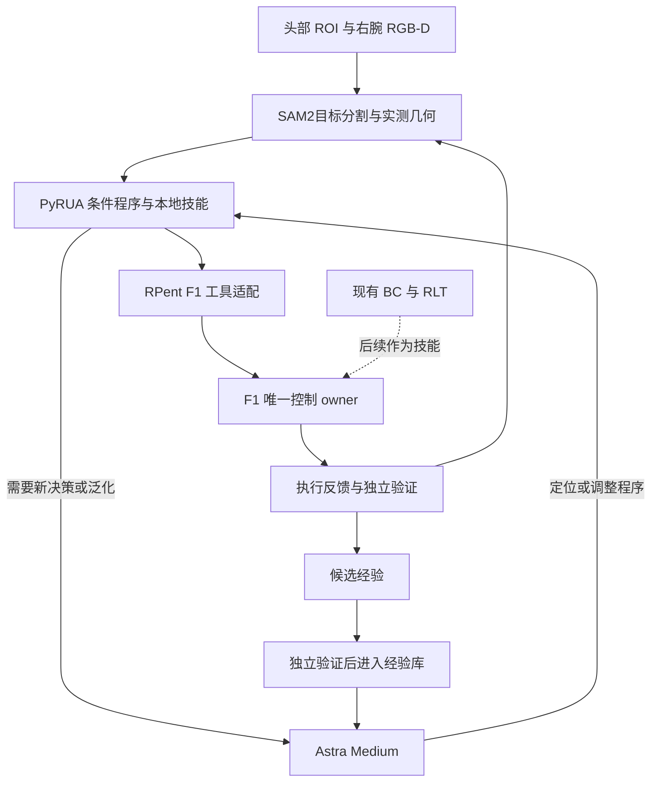
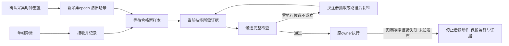

# F1 Harness 实施方案历史记录（截至 2026-11-12）

这份历史记录保留了单块插孔方案的演进、当时的实现顺序和验收推导。文中的“当前”“已部署”“下一步”均指各段所注明的时期，重查旧实验或发布决定时可按原章节定位证据。

自 2026-11-18 起，稳定的架构决定统一维护在[《F1 Harness 核心思路与设计原则》](../../docs/ARCHITECTURE.md)，实际部署与现场进展见[当前状态](../STATUS.md)。以下保留原稿正文及章节，文件链接按归档位置调整。

**目标是让可靠的本地感知与原子技能支撑Astra：普通单块分拣由PyRUA条件程序连续完成，新策略与无法消除的歧义才交给模型。** 2026-11-12用户明确准确性第一、效率第二；不能以少发图、小模型或高FPS替代目标身份、当前几何和真实执行证据。

**本轮已完成SAM3／3.1、现役SAM2.1 Tiny与YOLOE的真实图像和连续序列对照，已部署临时配方V24的限定实例SAM3初始化／重识别＋SAM2连续追踪，不额外叠加生成式本地VLM。** 选型和信息合同见第4.3～4.5节，实测数据与边界见[SAM运行说明](../../docs/operations/SAM_RUNTIME.md#2026-11-12真实数据模型对照与选型)。临时recipe仍须随真实结果升级或回退，当前部署与物理验收以[STATUS](../STATUS.md)为准。

## 当前架构与既有实施记录

**共享基础机制（2026-11-12，V22已实现并部署）：** 以纯Harness V20为共同基础，合入已验收RTC／停止接线；Agentic与VLA模式使用同一TaskEngine、SAM／几何、PyRUA恢复、模型配置与记录。VLA的chunk仍留在实时执行端；准备区、实测抓空／丢物／释放，或30秒执行段预算触发停稳交权。外部执行回执绑定owner／session／epoch／task，不伪造技能完成；verify_grasp／recover_grasp／regrasp或verify_placed按当前证据接入同一程序。无新状态机、无RLT，物理泛化待验。详见[部署复盘](20261111-vla-astra.md#v22共享harness双路线部署2026-11-12)。

**混合支线的阶段合同（2026-11-12用户确认）：** B1250承担前段抓取／运输，自动放置准备区先交权并清掉旧RTC；剩余流程直接复用SAM／几何、原子规划与 `place_held_block()`，必要时Astra处理定位或新策略。普通后缀与恢复本地续跑，模型等待时VLA停止，返程不切回B，无RLT；部署与物理验收见[当前状态](../STATUS.md)。粗区域只调度交接，不能代替实测持物和精对孔。

**2026-11-11用户确认的最高优先路线：先把可靠原子运动及抓姿到运输组合做扎实。** 后续代码改动以[AGENTS核心路线](../../AGENTS.md#harness_foundations-最重要的核心路线先把原子能力做扎实2026-11-11用户确认)为基准；思想补充为[用户问答](../../docs/archive/AGENTIC_HARNESS_QA_20261111.md)，对应文献与开源支持集中于AGENTS。通用规划器复用、证据驱动恢复与独立经验晋升沿已有接口实施，不再扩充固定路线作为主要泛化手段。重要未来措施见[TODO](../history/20261118-todo.md#核心路线重要未来路线)，下文旧阶段记录保留原适用时点。

**已确定采用 RPent＋PyRUA-Lean 作为编排主链，ASPIRE 提供经验验证方法；底层复用现有 F1 控制、推理和记录能力。** 首个目标是一种积木、一个匹配孔口的完整闭环：观察、抓取、调整朝向、对准插入、释放、验证，并能处理一次可恢复失败。BC 与 RLT 先保留接入合同，之后再比较它们作为技能的实际收益。

**2026-11-10主线按用户决定调整：保留已有控制、记录、停止和固定运输成果，优先补通用动作表达、主动观察与运行中重规划。** 不再以增加几个预置抓姿为主要修复路线；验收是冻结代码后改变摆放，观察Astra能否自行提出不同方案并完成任务。新任务统一使用Astra，固定程序作为内部执行技能；人类通过F1infra开始／停止完整任务，使用已接受的粗标定，操作见[完整真机运行](../../docs/operations/DIRECT_ROLLOUT.md)。

**按实际结果推进，不设工期。** 粗标定已经交付，开发运行明确保留 `precision_certified=false`；测量、估计和配置参数分别记来源，通过日志分析后修正。完整程序、软件回归和真机成功分开记录，当前事实只在[STATUS](../STATUS.md)维护。正式精度、20场景验收和混乱堆叠泛化仍是后续目标。

**2026-11-10 架构调整：** Astra 通过实测几何、只读规划预览、连续物体相对抓姿和 TCP 路点生成方案；已登记技能与成功示教是快捷方式，不再作为完整动作空间。正常运输保留固定程序，执行与成功判定仍由原控制与观测负责。接口和边界见[几何 Agent 说明](../../docs/GEOMETRIC_AGENT.md)。



## SAM 主线与粗细阶段

当前主线为**精简原子技能＋可续跑程序，常规视觉与抓持确认本地处理，关键卡点／泛化才交给Astra**，稳定要求见[AGENTS主线](../../AGENTS.md#harness_mainline-用户确认的方案主线2026-11-11)。V5已从V2合并SAM视频、质量告警、独立物体证据和`resume_pick`；发布验收与真机结果分别维护在STATUS。当前参考节奏与原控制保持，不新增中止阈值。

实施顺序为：规划／执行复核合同一致 → 运动跟踪与持物证据 → 阶段续跑及固定运输 → 最新图交接、终态与日志 → 完整零输出和真机验证。前三项已实现并随V5发布，模型交接与导出已修；在飞请求取消和用量留证仍单列未完成。静态回放、后续模拟反馈不能代替现场连续运动验收。

按用户决定，目标分割接入常驻 GPU SAM2，Astra 使用当前图给目标紧框，旧颜色框不作为默认目标或失败回退。抓稳后先固定运输，再在桶上方复核精确在手姿态；闭爪与自由提起使用不同到位判据。实现边界及操作见 [SAM运行说明](../../docs/operations/SAM_RUNTIME.md)，是否已部署仍以 STATUS 为准。

离线候选已将桶盖、孔口与锚点加入同一SAM提示接口：初始上下文提供注册实体ID，模型给相关框／正负点，静态区域合并图像请求，移动目标保留视频记忆。实际Astra提示与真实RGB-D已分段连通，但该场景接入原生owner后出现新的接近候选耗尽；应保留失败证据，继续真实模型消费几何反馈的改姿验证。此前手工提示场景的全流程成功不能作为此项通过，完整正式工具循环与连续运动视觉仍待验收。

后续改姿验收已补：模型读取TCP相对工具包络及具体碰撞位置，生成不同连续抓姿并通过原生预览；原参数在保存初始场景＋模拟随动下完成完整owner程序。碰撞诊断中的起止TCP与几何接口共用原生world系，避免模型只按TCP点而忽略夹爪／腕部体积。该项不改变限位／碰撞判定；成功对话仍需43秒，下一步在正式PyRUA程序内完成有界候选检查与可行后执行，减少逐候选模型往返，并补实际连续运动视觉验证。

正式入口接续已完成保存程序全程和输出审计，包含bwrap、HTTP／Unix及原生owner；实际Astra已在同入口执行批量候选和一次自由移动，但未找到后续抓姿，任务仍失败。已暴露初始几何变量供直接复用，保留连续失败姿态并精确去除与工具ledger相同的stdout，原始证据不删。接下来以该真实失败对话改善模型信息与候选策略，并接初始看图→SAM提示及运动视觉；不能把保存程序的成功替代实际模型闭环。[当前验收范围](20261110-sam-rollout.md#正式rpc完整程序与实际astra反例离线未部署)。

独立桶体定位现已接入离线候选：当前RGB-D锚点形成粗桶体参考与碰撞几何，接近／抓取／运输使用该参考；精确对孔与释放使用实测孔口，同阶段桶口碰撞模型与目标共用该参考，不把粗参考点当作孔口检测。原生候选提前检查接近后的抓取可达性，IK抽稀必须保留避免碰撞所需的中间点。同一真实初始场景已完成注册程序十阶段owner零输出回放，后续视觉和执行反馈为模拟，仍需完整真实感知与模型连接验收。模型上下文优先使用结构化预览结果，失败才展开几何；同失败的自动附图按阶段和策略去重，完整原始记录保留。

重复失败分两层处理：数值服务只复用完全相同输入下的确定性失败，不缓存成功授权，不量化位姿或关节，也不缓存超时／通信失败；规划器收到最近失败策略及次数，连续无进展时退出普通问答循环。新测量或参数变化继续正常计算，不把历史失败变成新的物理门槛。实际新模型的策略调整与连续真实视觉下的主动恢复仍需验收。

未知抓持恢复由显式授权的`recover_grasp`执行：正常提起后的证据不足可做一次保持闭爪的观察动作，空手／可能持物两种路径都检查；实测随动成立后继续固定运输，明确抓空使用重抓预算，仍未知则返回待处理。同一程序不为恢复再等待LLM；单场景原生owner与模拟后续反馈已有证据，完整连续真实视觉仍待验。粗插入目标与验收使用一致的显式深度带，当前离线候选从已有2mm插入到位容差派生，保持原12mm目标与真实孔口验证，不将这项开发容差称为精密或物理成功。

## 当前执行顺序

11月11日用户决定停用Astra Fast，开发与线上全部恢复标准档，保持medium；请求／实际档位继续留证，连接池与连接预热保留。小量对照确认固定前缀预热命中，但未建立稳定提速；用户随后明确排除去空格／紧凑编码接线。当前V1已具备批量候选、完整程序、有界恢复与owner自动收尾，后续以同质量下必要模型回合数／总等待为主要指标，验证Astra稳定消费这些能力，避免正常步骤逐轮确认。固定前缀缓存作为辅助，保持历史追加与现场状态独立，不能代替新的实测证据或保证消除请求等待。[费用、标准档部署与效率实测](20261111-api-cost.md)；[历史Fast对照](20261110-startup-transport.md#fast服务档位对照与部署)。

用户于2026-11-10确认先做连接稳定性、新鲜观测／预览合并和异常时一次带齐证据；抓后视觉由用户并行推进。经验复用后置到全流程稳定之后，再通过独立场景验证沉淀参数化程序和适用分支，争取减少熟悉场景的LLM调用。当前实现与真机验收分开记录，见[连接与交互复盘](20261110-startup-transport.md#连接与交互优化实现及部署)。

## LLM交互专项：与首轮故障修复并行的方案（2026-11-11，V2已部署）

**目标是让Astra稳定生成能消费真实反馈的条件程序，并只在需要新判断时再次介入。** 当前已有完整宏、持久Python上下文、批量候选及owner自动完成；本专项补接口合同、提示组织与反馈摘要，不重新建设这些能力。源码问题与上游依据见[交互复核](../../docs/UPSTREAM_REUSE.md#2026-11-11prompt与控制权交接复核)。

**用户已将四项修复交给另一个agent：同程序定位→可行预览→执行、在飞模型状态／取消／用量、实际SAM视频接线、响应前长等待诊断。** V2复用其`localize_and_pick`，共享合同／提示／当前决策摘要已部署；其余运行修复不在本包。用户授权最多5次验证，实际4次、约$0.28125，两次候选首轮显式接续，未知发布场景模型停止；Astra标准档＋medium保持。冻结代码与正式零输出通过，实际部署及质量边界见[STATUS](../STATUS.md)。

本版调整：正常程序和准确接口前置，完整几何／恢复规则仍保留在固定参考区；进一步按失败类型拆分说明后置，避免在有限调用预算内同时扩大语义删改。本次收益是省去正常执行确认回合，输入token仅降约4.8%；没有通过去空格或降低推理强度换取速度。

### 三个交付项及接线边界

| 顺序 | 本专项负责的具体措施 | 与并行修复的交接 |
|---|---|---|
| A：准确的F1调用合同 | 修正自动文档中的`**parameters`；消除LIBERO结果类型和无关0.30m限制示例；统一on-demand图片说明；将现有宏签名、实际返回字段及恢复语义纳入同一合同 | 对方接续程序与本专项共用签名、状态枚举和示例；不手工维护两套分支说明，不修改上游冻结原件 |
| B：单一prompt装配与完整示例 | 常驻前缀组织为目标与执行原则、F1接口／返回合同、三个完整条件程序示例；任务、当前证据、经验快照置于动态部分。当前失败的专用说明按真实失败类型附带，不把所有历史修复规则每次平铺 | 正常、候选拒绝、动作后缺证据三个示例调用对方的真实接续实现；代码按测量分支，不使用固定像素框／绝对关节轨迹，不删现有未知发布及恢复边界 |
| C：可信的当前决策摘要 | 从本次同scope可信工具回执投影当前阶段、已完成步骤、未解决问题、是否已运动及owner检查点；已解决失败移为历史；统一宏失败停点。保留原始ledger和完整几何供程序／诊断访问 | 执行状态和请求状态分开：对方负责请求等待、取消与费用，本专项负责动作事实及当前决策材料；摘要本身不授权运动 |

V2实际通过`prompt_contract.py`生成真实签名／宏合同，通过`planner_decision.py`投影可信回执，并接入`planner.py`／`planner_progress.py`；`task_runner.py`传递实际恢复预算并移走动态任务中的固定参考，`recovery_programs.py`补统一停点。复用上游成员筛选，保持上游原件未改；定位执行宏来自并行修复，未另写自动执行分支。

固定前缀先完成稳定组织；本阶段不新增付费定时预热。任务内继续追加已有对话，不逐轮改写旧工具结果或删旧图片。详细诊断按当前问题组织，避免为读取说明额外增加一次模型调用；不引入另一个LLM判断是否该调用Astra。用户取消的去空格／紧凑JSON不接入。

### 什么时候继续程序，什么时候交回Astra

| 当前真实结果 | 控制权归属 | 必须保留的证据 |
|---|---|---|
| 当前预览可行，已有程序包含对应后续动作 | 当前程序显式调用执行宏；owner仍按提交时实际状态复核 | 本次预览、实际动作提交与回执，不能仅打印planned就算执行 |
| 候选不可行，owner确认未发布，程序还有不同候选 | 既有有限候选程序继续检查 | 原始请求零发布证明、候选参数与失败原因 |
| 已知可恢复问题，当前授权／检查点和预算覆盖 | 既有恢复程序继续，完成后从正确阶段衔接 | 已完成步骤、实际恢复回执；不得重放之前的动作 |
| 需要重新理解图片、选择新观察策略或生成未覆盖的方案 | 将当前问题与必要证据交给Astra | 当前图像身份、缺失实体／几何诊断、已试方案、需解决的问题 |
| 动作结果未知／部分发布或STOP | 按现有owner查询、停止及恢复合同处理；撤权后不再调用模型 | 原请求身份与实际反馈；LLM、摘要或新请求均不能补造运动权限 |
| owner确认完整任务结束 | 已有自动finish直接结束 | 独立完成回执；不再询问模型是否成功 |

“失败才回LLM”据此细化为“需要新的模型判断才回LLM”：失败不必都回，成功也可能产生新的视觉判断需求。不能仅凭`needs_model_decision=false`或可行预览让host擅自补执行模型未提交的动作；条件分支须在本次显式程序或既有授权执行入口内。

### 分层验收与观测目标

1. **先做无付费接口验收。** 直接从真实方法／宏生成文档，关键示例经隔离PyRUA执行；覆盖准确关键字参数、实际dict字段、图片策略、各宏失败停点及摘要与ledger一致。数据来自真实生产合同，不能靠mock补出不存在字段。
2. **再做正式全链零输出。** 使用本次首轮失败记录及已有正常／恢复原件，沿正式入口到动作接收端，至少覆盖下表。保存模型程序重放只能验证接线，不算Astra已学会生成新程序。与对方四项修复合并后再冻结验收，原始硬件保护保持。
3. **最后才做小量标准档A/B。** 网络、模型档位、图像和场景成对保持一致，记录每轮调用原因；先按三类场景各一组对照发现明显退化，记录调用／费用上限与超时未知用量，不在未知结果上重试。小样本不宣称统计稳定或精度无损；初筛有效后再扩展重复和独立摆放。实际模型调用与真机动作分别留证。

| 场景组 | 关键验收 |
|---|---|
| 正常：初始几何可用；或缺提示但实测后默认方案可行 | 定位、预览、首个动作在同一生成程序中接续；无单独“是否执行”回合；正常技能间无确认回合；owner完成后无结束确认回合 |
| 可计算恢复：首候选明确零发布拒绝，后续候选可行 | 有界换候选由程序完成；未绕过预览；已运动后不得重新从抓取起点尝试 |
| 新判断／未知：候选耗尽、关键画面无法判读、动作后缺证据、STOP | 必要时确实交回Astra；现有观察恢复有效则继续；仍未知不当作成功；STOP后无新模型请求或动作 |

**目标而非当前结果：** 对程序可覆盖的正常分支，首动前1次模型调用；正常技能推进与结束确认0次额外调用。完整任务不硬限定1～2轮，必要的新图像／新方案保留。每次调用标明目的：初始理解、新视觉判断、新方案／代码纠错；同时统计重复读图、正常确认和重复失败等可避免回合，分类仅用于诊断，不成为新增运动门槛。

分别报告点击→首请求、每轮模型墙钟、工具／数值耗时、首动、完整成功时间、调用数和计费用量；模型等待与机械／工具时间分开。冻结代码后用独立摆放核对完成率、实体／姿态正确性和恢复行为，再报告重复样本P50／P95。当前首轮37.95秒尚未解决时，不承诺20秒首动；本专项首先验收不必要往返减少与任务质量保持。跨任务经验复用继续后置。

## 运行可观察性

离线候选的几何上下文现附本地抓姿建议：按当前方块坐标轴、尺寸和名义TCP生成有限种子，用原有几何预测与路径代价排序，同一几何等级先尝试不同朝向，再试同朝向的接触偏移。建议明确尚未通过原生IK、不能证明夹牢、不是穷举；Astra可以提出新的连续参数，执行仍经原有校验。模型优先消费结构化参数，避免逐轮重复猜数值；单场景已有保存程序全程证据，实际模型接续结果与未验范围见下段。

后续实际Astra已消费建议并完成一条离线全程，模型用量与总耗时下降，但首动没有改善。预览与提交必须分别绑定真实场景；两帧间朝向变化导致候选由可行转为拒绝，应完善候选对观测变化的适应和有界改策，不把过期预览强行复用为动作授权。连续运动视觉与变化摆放泛化仍需独立验收。

离线候选新增`pick_with_candidates`：Astra把本地建议或自己生成的连续抓姿组成最多6项的参数列表，由同一PyRUA程序逐项预览、可行即提交、成功后直接完成抓放返程。批次上限限制无效计算，不定义允许抓姿白名单；参数完全相同的候选不重复检查。只有原始接近请求由owner明确证明未发布且数值候选耗尽，才换下一项；已运动、停止、控制权变化或未知结果必须走原结果处理，不能拿后续恢复请求的零发布回执掩盖原来的运动。候选耗尽返回具体诊断，模型可改变策略，但受已有无进展预算约束。保存程序已全程验证，实际模型的新首动效率及连续运动视觉尚未验证，见STATUS。

任务页按阶段汇总真实事件，重复等待更新同一阶段；完整原件与默认关键日志分开。模型按请求身份保存脱敏后的实际输入、返回及工具结果，单独按需读取，旧记录缺失不补造。计时统一到网页开始基准，预连接不计为模型生成；[记录合同与验证](../../../F1-4242/docs/TASK_LOGS_20261110.md)。

规划输入通过结构化工具记录传几何，不能依赖会截断的stdout。抓取预览同时给出可选的后续放置预测：接近可行不等于夹持姿态适合插孔；已有实测孔口时可用于选姿建议，缺孔时仍可执行粗抓取／运输。预测附件与真实抓持分别记录，放置建议不授权动作，也不新增粗任务硬门槛。模型收到明确的碰撞对象、起点／终点／路径分类，再改变姿态或路径；原始工具记录完整保留，只有完全相同的打印诊断转为记录引用。

端点工具包络与盒状障碍冲突时，附带物体坐标系中的固定朝向脱离向量，匹配原障碍余量并复核该障碍下的平移后端点。它仅解释单个障碍，不证明夹爪仍能接触目标、整条路径可行或IK可解；不得作为碰撞起点的自动撤离命令。路径段冲突不伪装成端点偏移，抓姿调整后仍经过完整原生预览。该建议用于减少模型盲猜角度，不新增执行门槛。

模型无进展判断同时消费observe与inspect_plan／geometry_context返回的实测实体语义。新恢复的目标或孔口可以计为进展，即使该次路径预览失败；同阶段重复实体、提示accepted和完整状态标签不能续期。几何放置预测与原生运输数值可行性分别展示，前者不能被描述为完整可执行路线；运输数值建议已在离线预览接入：从预测抓取终点检查注册路线，直接路线失败不代表恢复后也不可达，不作为接近执行门槛。inspect_plan的嵌套建议与阶段可见性须进入模型ledger。初始定位使用已提供图像，在一个cell按相机提交所有可见缺失实体提示，再测量／预览；不先只框积木就空等桶孔。实际模型已通过一次离线全程，动态反馈模拟，效率及真实视觉连续性仍待验收。预测按执行阶段使用场景：粗抓取／运输不被精孔口估计回溯改写，对准才切换精孔口目标及对应障碍；腕图顶面投影只作排序，不能变成模型的执行前置筛选，真实持物验证与有界观察恢复保留。当前进度见STATUS。

多视角定位允许同一个Python回合连续提交头部与腕部提示。感知端按相机独立保留待处理提示，同一已展示图像的不同实体合并、同一实体更新；各相机遇到自己的下一份真实源帧才应用，不能共用单槽导致后提交的覆盖另一视角。提示接收只表示搜索指令到达，完整场景和运动依据仍来自随后的实际分割／深度计算。

## 单块泛化基础接口（2026-11-10 已实现）

本轮将模型只能调用技能名称的限制改为物体相对的参数化选择，继续复用 RPent Toolkit、PyRUA RobotBase/ArmToolkit 和已有 F1 规划／控制。当前支持单竖直方块的位置与平面朝向变化；不是任意物体、任意6D抓姿或通用路点规划器。部署和现场结果查 STATUS，不因软件通过预写任务成功。

| 层 | 已接通的行为 | 结果边界 |
|---|---|---|
| Astra → Python | `motion(name, pitch_offset_deg=…, variant=…)`；默认自动搜索 | 倾角连续可选 -45～45°，沿既有夹爪闭合轴转动；方块对称方向0～3，不是绝对关节角 |
| 原生规划 | 由当前物体位姿计算目标；原 IK、工具／持物扫掠、发布前重验证 | 全部候选拒绝并确认零发布时，模型可换参数；不把碰撞候选执行出来 |
| 接近→抓取 | owner记录实际到位与独立验证的抓姿，下一次新观测下保留该选择 | 方块90°坐标规范变化不会让抓取突然换方向 |
| 固定运输 | `place_held_block()` 连续运输、桶上方在手检查、精对孔、插入、释放验证及右移返程 | 正常运输不请求新模型回合；失败返回结果，从未完成阶段处理，不重放整段 |
| 按需视觉 | PyRUA `show`／`image`／`display`，分块跨隔离通道 | 头部沿用ROI，模型图可缩放；不以缩放像素替代标定几何 |
| 经验 | JSON参数候选＋RPent Markdown说明；独立验证后生成固定快照 | 只消费同标定的已验证参数偏好；新场景仍重新规划，未验证候选不采用 |

当前配方自动候选包含名义抓姿和30°倾角；Astra可以提出其他连续倾角及方向，经过相同规划检查。运输保持已有参考速度，插入参考速度为基础值的一半，返程参考速度20°/s。这两处是平滑输出轨迹检查发现切角后修正的速度配方，不是新增停止门槛，原物理限速保持。

未知抓持观察允许独立登记`recover_grasp`参考速度。当前离线候选采用10°/s：保存实际Astra反例的原关节参考插值通过，但约20°/s时平滑输出离开检查过的路径；同路径对照10°/s恢复两种附件假设的几何检查。该参数只调整观察动作的参考时间，不修改目标、正常抓取／运输速度、原输出限速或成功判据；未登记时保留原配方，不静默改变已部署配置。适用范围及完整输出回执见[恢复输出复盘](20261110-sam-rollout.md#恢复参考节奏与平滑输出一致性未部署)。

保存场景的完整机械序列已经通过；真实抓持、释放和泛化成功率尚待现场。原来的“精对孔没有可用路径”只适用于旧抓姿与旧配方，不再作为当前所有方案不可达的结论。使用步骤和测试顺序见[真机运行](../../docs/operations/DIRECT_ROLLOUT.md)，实现回执见[基础能力实验](20261110-agentic-basics.md)。

## 资源与原件留存（2026-11-10）

后台归档默认只收日志、索引和回执，原生pack/blob及已发布视频以F1为长期存储；6000D由唯一视频worker暂存处理，确认回传后清理。显式离线全量采集仍保留，不把metadata-only表示成完整本地归档。后台传输统一避让活动任务／控制及未知状态，失败与未确认材料保留；视频暂存预算16 GiB、空闲保留2 GiB。清理核验与量化结果见[Infra资源复盘](../../../F1-4242/docs/RESOURCE_OPTIMIZATION_20261110.md)。

图像复用限于同一完整帧身份与原字节的JPEG/PNG解码，上限64 MiB／24帧，输出只读；raw图像／深度继续原路径。新观测时效、几何验证、权限和控制判断均重新执行，不缓存动态结果。当前部署身份与现场边界以STATUS为准。

## 0. 当前优先级：启动效率与真实闭环并行推进

### 2026-11-10 通用动作主线与启动优化分工

动作主线让Astra根据当前物体、可观察性和执行反馈表达并修改方案；已有控制与固定运输继续复用。单块验收必须在冻结代码后变化摆放，检查方案是否随场景变化、主动观察能否消除不确定性、失败后是否从已知执行状态重规划；不能换一次摆放再由开发者补一条预置路径。

启动优化已与通用动作版本合包部署：静态碰撞模型加载与ROS准备并行，owner查询／控制使用分别复用的私有连接，Astra预连接及仅请求发送前的有界重试，关键阶段分别计时。真机未授权owner初始化旧6.22／4.04秒、新3.28／3.32秒，SSH复用查询中位约223→5.76ms；点击到首次发布及完整任务耗时仍待用户网页开始后测量。[优化交付与证据](20261110-startup-transport.md)。

### 2026-11-10 抓起后的固定运输与精对孔分开

已确认最新真实任务完成接近、抓取提起和在手检查。修复重点是让固定程序先完成运输，再由独立技能对孔；运输不再要求最终插孔朝向或提前通过下插扫掠。部署与剩余可达性结论以[当前状态](../STATUS.md)为准，不能把运输通过称为整次插孔完成。

显式登记 `transfer_policy=registered_transport` 后，PyRUA 正常顺序为抓持验证→运输→在手检查→对准→插入→释放。运输按实测在手偏移把物体参考点搬到当前孔口上方，优先使用成功示教的运输曲线、运输朝向与关节软参考；保留持物朝向直达、两侧绕行作为不同路线候选。旧绝对关节不直接发布，每条新路径仍经过原生 IK、本体碰撞和工具／持物扫掠。旧 `hole_aligned` 策略保留供历史对照。

独立 `align` 先在足够净空的位置调整朝向，再平移和下降至原精对孔目标；未来下插预检归属此阶段。纯数值规划中的候选本体碰撞会保留碰撞对／间隙，转向下一个已登记候选；未知错误、控制发布故障与已执行动作不走该分支。日志同时记录路线、路径段、障碍及工具／物体类别，全部候选失败仍如实待审。

保存实测输入已证明运输可行，但当前夹持变换尚未得到通过全部检查的插入路径；后续应核对实测夹持位置、工具包络和孔口坐标，并在必要时调整抓取位置或经过验证的重抓。不能用扩大限位、删除实体碰撞或假报放置成功代替这个问题。

### 2026-11-10 当前姿态补偿上线，进入完整现场试跑

当前包2e66bb10dd08已将原固定头外参改为实测姿态传播，boot和实时场景共用原手眼／模型身份；0.58°身体参考差异已在真实只读启动通过并保留告警。抓取容差2→8mm，空中15mm、插孔间隙和成功证据独立；用户直接从infra启动完整抓取、插孔、离桶复位。[实现、部署及限制](../../artifacts/measured-posture-rollout-20261110/decision.md)。

下一步以真实rollout首个失败与恢复为依据，优先验证闭爪、在手姿态和插孔，不再先扩大预计算研究。完整FAKE17.425秒与当前孔口定位通过不等于真机全程成功；正式精度、泛化、15秒与真实经验晋升仍待验证。

### 2026-11-10 已部署成果与当前阻塞

已将有界验证、普通采集等待、双视图投影重找、规划排序和避桶返程部署到infra实际入口；数值预热在真实F1验证并开启，冷3.717秒与热0.355/0.354秒为数值服务口径，不能代表整页启动时间。[本次部署与数据表](../../artifacts/verified-deployment-20261110/decision.md)给出完整身份、证据和限制。

当前优先级改为：复用原手眼与实测躯干姿态派生一致坐标链，解决固定头部外参的旧参考不匹配；然后验证接近后目标重获和闭爪，再验插孔/释放/离桶返程。新网页请求停在boot阶段约1.12秒，未进入owner；不能以此声称原四分钟缺观测现场问题已通过。异步预计算研究暂排在真实闭环之后，下方离线阶段记录保留原适用范围。

### 2026-11-09 机器人离线期间：修复、15秒目标和经验演进

当前增量：头部投影修复已冻结离线包fbef373c0a5c，未部署。抓取→转移预计算研究在当前实测在手复核后，中位计算503→59ms，预计算480ms另计；完整FAKE候选及1,852点自由空间输出通过。尚未接入并发worker或证明墙钟收益，下一步绑定父抓取成功/任务代次/单次消费与取消，不直接使用预测夹持作为实测，[研究与限制](../../artifacts/transfer-prefetch-study-20261109/decision.md)。

时间差归一现已在扩展对照后合入本地F1适配，离线候选75d7未部署；真实间隔/抖动、原watchdog和限速保持。16条原/归一对照26,855点、冻结控制两条3,648点输出通过，名义仍15.70虚拟秒。回放窗口边界错误另修，真实感知原本已正确保留跨边界样本。排序经验新增控制源码身份，代码改变后旧建议回退原顺序，不沿用旧检查。[具体证据与未验收范围](../../artifacts/timing-robustness-20261109/decision.md)。

静止边界的规划快照已能以JSON交给独立进程，精确保留原生状态、末点证书、profile/请求身份，实测反馈单列；三个路段516个预测点一致，源完整785帧保持。它不处理移动证书、不刷新时钟/权限、不引入等待门槛。延迟结果仍需复核：同状态起点平移额外1ms曾使输出差0.295°，离线dt亚纳秒尾差归一对照恢复一致，完整1853点通过，但尚未合入控制。应先验证时间数值处理及分离命令/反馈，再接持续采样的异步结果消费。[证据及边界](../../artifacts/stationary-handoff-20261109/decision.md)。

分段选择现已实际用于FAKE完整程序，按新状态重新计算后段；七个正常/布局/故障场景核对了转移与空爪返程11,150个实际模拟输出检查点。独立场景读取排序JSON后7→3次试算，计算4.059→2.454秒，输出逐项不变。**这仍不是线上owner接入**：模拟暂停时钟完成计算，物理反馈采用理想跟随；下一步必须解决持续运行控制器的状态交接，不能直接把同步实验代码移入实时循环。[本轮证据与限制](../../artifacts/simulated-consumption-20261109/decision.md)。

当前机器人由用户关闭，继续做源码实现、日志复算与离线验证，不启动机器人或切换线上服务。本轮优先修复接近后的感知等待与闭爪前恢复；完整闭环仍须包含放置后的离孔、向机器人右侧绕桶、到就绪姿态。软件通过不等于真机完成，最新事实见STATUS。

**输出预览放在规划侧，不能让提速变成更长启动。** 已完成原输出器静止初始化/给定时序的离线一致性验证，两条模拟逐点相同且重现桶边失败；尚未接入在线前瞻。下一步先绑定真实平滑器状态和未来参考时序，再复用不变几何/加速检查并做候选回退。目前每条预览加扫掠约8秒，不直接加入启动流程。详见[范围与证据](../../docs/operations/OFFLINE_REPLAY.md#原输出器的离线预览)；保留原控制保护，不通过更多任意执行阈值替代路线改进。

进程内运动状态分支已补齐离线基础：保留原生v/a/滤波与只读制动证书，12个分支后续5503点精确一致；它不产生运动授权，也不能通过现有RPC直接序列化。后续应先证明原技能间disabled保持边界的状态等价，或建立明确的状态交接，再用原语义/夹爪边界生成未来参考时序。不能把离线原生对象引用当作线上跨进程状态合同。

几何减负已实现第一项：完全相同矩阵的纯验证按值缓存，固定输入检查约1.87→0.79秒，原桶边失败位置保持。不缓存碰撞结论或传感器状态；完整模拟动作仍18.36虚拟秒，单条同步计算约2.03秒。后续仍需优化原生碰撞/候选计算和路径本身，不能将这项计算收益当作真实15秒已实现。

返程路径进一步允许登记比例0.33/0.5：保持原姿态离孔后，右移和朝就绪姿态转腕同时进行，并按旋转后工具外沿补足向右位移。默认关闭，独立重验证绑定目标；0.5配方完整模拟降至16.62虚拟秒，单条同步计算另约1.91秒，选定6条输出9782点通过。真正15秒、现场误差与完整物理闭环仍须验证，不能只用数值路径替代实测。

同一配方的到位重查调度随后减少0.30虚拟秒，当前名义16.32、同步计算另约1.95秒。只在有效几何证明因位姿变化而过期后，用新反馈提前安排计算；没有省略新证明或300ms停稳。首版每tick重查增加计算成本，已留证否决；候选5818a23ac776未部署。下一步审查零位移对准的重复等待，继续保留物体相对孔口的实测确认。[对照](../../artifacts/arrival-refresh-paced-20261109/decision.md)。

**等待与恢复分别建模。** 动作后验证每次最多等待2秒，两次仍无有效场景就返回具体感知原因；这是恢复调度期限，不是新的运动误差门槛。owner保留已完成动作的验证checkpoint，上层通过`robo.recheck(skill, verification_request_id)`重新取得证据，最多使用任务登记的局部修正次数，不调用IK或发布运动。验证前等新观测另有4秒返回期限，原任务总期限不延长。取消、任务变化和其他运动使旧checkpoint失效。Astra在模型调用前、响应后和工具返回后检查当前任务权限，STOP后不发起下一次模型请求；已发送到服务端的请求不声称可以撤销计费。

**闭爪前失败不等于抓空。** owner证明尚未发布闭爪目标、实测开度一致且目标原来确认为未夹持时，可保持、取新空爪证据、从实测起点resume抓取；预算耗尽返回失败，不误走整段重新抓取。已闭爪、部分/未知发布或持物未知不能使用这个入口。新抓取目标仍经当前工具/桌面/桶几何及IK检查。抓取复核不再借用方孔剩余间隙；指尖参照避免重复叠加手腕长杠杆。真实4.54mm残差是否需要反馈补偿、以及现有闭爪几何可接受的范围仍待独立证明，不通过统一改大容差宣布解决。

**目标丢失时重新找，而不是沿旧位姿移动。** 同一任务和采集身份内，上一份测量只用于把积木包围盒投影到当前实测腕相机图像，提供最长30秒的搜索提示；分割后的物体位置必须由当前RGB-D独立重算。搜索提示与2秒测量跟踪窗口分离，原始时间戳、几何准入、遮挡及多组件歧义判断不变。保存JPEG上的六帧重获支持此策略，但相机采用计划末点近似；不能称为原始动态RGB-D完整复现。

后续按真实帧索引、时间和实测FK抽样1,181张归档JPEG，原搜索和投影提示都能找到目标，没有测出策略收益；前述六帧不能解释线上持续丢失。分割层搜索框现按事务提交：整组移动后任何必要mask/身份检查失败，都保留上一份有效搜索框。失败原始RGB-D、反馈和搜索状态的有界诊断快照及同run导出已实现、未部署；独立后台写盘/存储，诊断故障不成为动作门槛。下一步诊断重放和现场复现，边界见[失败现场留证](../../docs/operations/SCENE_FAILURE_EVIDENCE.md)。

返程必须使用专门的阶段观测：放置已由owner独立确认后，只需当前桶/孔口、开放夹爪反馈和关节状态，不继续追踪已落桶积木。返程目标从原就绪姿态和当前桶体推导，先沿孔轴离开、越过机器人右侧桶边，再选有扫掠证明的返回路线。放置成功与复位成功分别保存；复位失败不能触发再次抓取或释放。软件已接入任务、规划/复核、baseline/Astra、归档与周期计时，保存场景服务链通过原生数值验证；真实阶段切换、配套候选与真机结果以STATUS为准。旧任务hash保留原scope，完整周期须显式登记withdraw_reset和原就绪关节/机器人右轴来源。返程新观测等待最多4秒；返程失败保留placement_success，只有reset_success也成立才算完整任务成功。

**15秒是完整正常周期的优化目标，不是超时中断条件。** 分开记录网页点击→首发回执、首次抓取动作→放置验证、放置验证→离孔/右移/复位；只有最后阶段也有实测结果，才报告完整抓放复位周期。当前没有这种成功样本。Astra正常路径一次编排固定Python程序，抓到后固定转移、精细放置、离桶复位不逐段请求模型；只有语义变化或可恢复失败才再次询问。旧示教五段在当前参考角速度下合计约6.43秒仅是关节参考时间下界，未计插入、夹爪、起点衔接、平滑、感知和停稳，不能当作15秒已可实现的证明。

| 顺序 | 优化对象 | 可复查的结果 |
|---|---|---|
| 1 | 消除无限视觉等待、STOP尾部调用及错误重抓 | 一次失败返回具体原因；恢复不重放已完成运动；旧请求不能复活 |
| 2 | 复用成功低位路径，闭爪前位置修正；离孔→右侧→home完整路径 | 保存场景全链数值与扫掠通过，原生生命周期通过，再做真机验证 |
| 3 | 固定正常程序、并行只读准备、静态几何/相机射线缓存，减少重复RPC | 同场景计时，不缓存测量、权限或碰撞结果；冷启动和周期分别统计 |
| 4 | 按实测阶段预算优化路径与停稳，最后才评估速度参数 | 多条完整成功运行的p50/p95；失败和恢复耗时单列，不以提速换误报成功 |

自由空间连续化先限定在已确认空爪的返程：通过显式登记将桶右侧和返程折点改为连续路点，离孔/最终/夹爪边界保留；默认关闭，不向所有技能推广。另可显式开启持物抬升/转腕协调：保持物体抬升端点与最终孔口目标，转移时提前完成0.33比例的旋转，原示教曲线和数值保护继续执行。必须检查原F1平滑后的实际模拟输出，参考路径通过不能代替动态输出检查。后续转移30/返程25参考配方的名义模拟18.36虚拟秒；更快30/30配方因桶边输出失败不采用。15秒未达，计算/感知另计，实际配置和验收以STATUS为准。

规划效率经验新增自动候选：成功规划也保存先前失败尝试，按请求/观测/配置/代码身份形成候选顺序JSON和人读MD，保留全部登记候选与原检查。当前只进入隔离区，尚未接入效率独立验证及执行发布；发现条的失败计算耗时不作为实际改善承诺。

**RSI分为事实、策略、验证三个层次。** 每次失败自动生成内容寻址的JSON事实：运行/原件哈希、技能、结果码、等待次数与时间范围。它们供诊断和离线回归选例，不作为已验证运动指南。候选策略用结构化JSON表达触发条件和已注册技能序列，Markdown用于人读说明，PyRUA执行的是受控编译出的程序，不能执行任意经验文本。独立验证既要求真实放置证据，也要求该场景确实按顺序执行并成功完成候选策略；无关的正常成功不允许晋升。验证通过后生成固定快照供下一次baseline/Astra读取，训练权重、控制代码和经验版本分开。

后续RSI自动化顺序是：失败归类→形成候选修复/策略→固定失败输入与反例回放→独立场景对照→晋升或驳回。现在已完成事实落库、触发字段和策略执行证据校验；自动生成程序、真实策略收益、多物体选取与受约束反馈补偿仍未完成。既有baseline插入恢复序列与首个经验模板相同，所以“读取到经验”不代表已经带来行为改善。

**整链路离线验证入口已补齐。** [完整回放](../../docs/operations/OFFLINE_REPLAY.md)将固定程序、owner、规划/复核与结果验证接起来，保存模拟输出及源配置身份；可验证动作后的有界等待和recheck不重放。真实相机、跨进程传输、控制平滑和现场响应另行验证，mock观测不能进入真实经验晋升。15秒优化先比较完整周期中占时最大的转移/返程路径，不以虚拟时间或单段数值可行替代实测周期。

**返程增加有限的渐进转腕候选。** 先离孔、向机器人右侧取得净空，再经登记折点到就绪；折点按当前侧方位置和就绪位姿计算，旋转分两段完成。原有直接/侧方下降路线可行时仍优先使用，原高位绕行保留为备选；每个候选都重新通过几何、IK、实际FK路径、新场景和到位检查，失败可以换候选。没有提高速度、减少四个停稳点或删除限位/碰撞条件。当前mock完整周期22.42→20.60秒，尚非15秒或真实动作结论；待现场验证后才评价周期收益。

### dd829实测后的执行改造（2026-11-09，已合并上线，实测待验）

此次实测说明数值可达和J6峰值不足以判断动作质量。下一版同时修复跨tick到位状态与低位接近路线：先把已通过的任务空间证明在请求/路点不变、反馈新鲜且姿态等价时连续用于停稳累计，再复用成功接近段的整体形态，使正常流程成为低位前伸、闭爪、抓后提升。四段高抬转向只是绕障备选；默认目标不要求小臂垂直桌面。

成功数据复用从少数姿态扩展到完整阶段，按当前目标重新定位，并比较全臂变化、手腕高度、路径长度和关节余量。同步检查工具/桶口模型、实测夹持关系与插入释放条件，明确实体碰撞和规划膨胀的区别；感知应支持可验证的视图交接和局部边缘，不要求所有抓姿都让完整顶面出现在腕图像。原头部朝向不稳定问题仍需保留修复，不能简单回退到旧拟合。

夹持后物体与夹爪相对变换固定，空中转腕不能独立把低倾角抓姿变成另一种夹持关系。若模型复核后确实需要换握，使用经过验证的支撑重抓流程；优先复现已有成功抓取/释放条件。实施前的证据和最新事实见[STATUS](../STATUS.md)。本节已形成独立候选，尚未激活或完成真机验收。

用户已返回并授权现场真机验证；继续保留保守路径要求，不执行未检查的大幅转腕或近桌试探。启动优化同时处理冷初始化和首发前观测/重规划两段，按实际分段记录判断，不拿不同模式、不同起始姿态的单次结果宣称稳定提速。各技能只依赖本阶段所需证据，张开夹爪接近时的抓持证据暂缺不能等同物体发生变化；真正持物后的附件与抓持证据仍必须成立。

### 可见孔口重新定位与桶体一致性

首次检测不到孔口时，按注册搜索范围恢复方孔，并联动三个桶盖特征的搜索框；外环深度测量区不反写成逐帧膨胀的识别框。当前RGB-D联合估计桶盖平面与方孔姿态，检查特征间距一致性，孔口目标与桶壁/桶沿使用同一刚体变换，桌面保持独立。未获得当前孔位前不能套用旧3D目标，观测域变化清空缓存；定位后的短暂遮挡继续使用已有阶段/时效/特征合同。

该实现沿用旧粗标定，仅恢复当前场景，不替代精度认证。真实RGB-D多帧与新孔位的数值全链已检查；新包动作结果由下一轮实测记录决定，见[STATUS](../STATUS.md)。

### 连续执行与示教适配的实现边界

新候选将稠密关节路径配上时间轴，由现有owner按周期取参考并执行原平滑/限速；不在每个采样点等待0.3°。夹爪切换前后和语义阶段末点才确认完成，位置/朝向使用阶段对应任务空间条件；异步通过证明在反馈仍新鲜、姿态等价时跨循环保留，取消/失鲜/偏离后失效。历史包的逐点合同只为回放兼容保留。

成功示教以带源记录哈希的JSON分段存储，保留末端曲线、七关节软参考与夹爪反馈时序。按当前起终点适配形状，旧绝对关节不作动作；夹爪仍使用当前驱动合同。离桌段受支撑面约束，沿法线单调提升，并以闭爪前段的求解FK重建预测附件；后续真实持物仍须重新测量。额外15mm工具膨胀在粗标定候选中记告警，实体重叠和原生限位/碰撞仍阻断；不是精度认证。

六份保存场景已通过全链IK和独立路径复核。当前新问题是可见桶口离开旧搜索区域：应先重新定位当前桶/孔口与障碍，再启用新动作候选。只恢复图像mask、不更新3D场景不能算解决。

### 2026-11-09 固定程序分段与连续抓取方向

按用户建议采用以下分段；当前已实现到真实抓持，固定转移仍在修，避桶回位与多物体循环尚未部署。正常路径由PyRUA固定程序推进，Astra用于选物、任务变化与已注册恢复决策，不在每个空中路径点调用模型。

| 阶段 | 执行方式 | 切换依据 |
|---|---|---|
| 接近、抓取、抓持确认 | 精细观测与本地纠偏；允许此阶段花更多时间 | 真实夹持、提起后证据和在手变换 |
| 夹持后到桶口上方 | 固定净空路线，已验证轨迹可复用；按当前桶位置实例化 | 抓姿、在手偏移、当前障碍与路线仍兼容；不复用旧执行权限 |
| 对准、插入、释放、放置确认 | 本地精细闭环，不凭规划描述判断到位 | 实测到位和放置证据；必要时有界撤离/纠偏 |
| 放置后复位 | 先沿孔轴离孔，再沿机器人基座定义的右侧净空走廊绕桶，最后到就绪姿态 | 物体已释放、工具已离孔；各段路径可达且无碰撞 |
| 下一块 | 刷新局部场景、选物，再执行同一程序 | 被碰动邻物位姿失效；新物体ID及阶段状态独立 |

固定程序复用的是路线形状、技能顺序和有效参数，不把“桶通常差不多在原位”当作位置测量。桶位置变化在已验证范围内只更新局部目标；超出范围重新求路线。加快净空段优先减少重复观测/模型往返和重新初始化，再优化轨迹连续性；速度仍由原控制器限速与实际跟踪决定。

抓姿选择须同时考虑后续插入的夹爪/桶沿净空。首条真实抓持暴露出仅保证抓起的20°俯仰会令后续插入不可行；不能把这种失败归为传输慢，也不应通过绕过后续检查强行转移。先在保存场景联合复算抓取、转移、插入与退出，再验证实测在手偏移。回位完成与放置成功分别记录，避免已放好但复位失败时重抓或重复释放。

### 2026-11-09 用户反馈后的处理原则

只读设备复核连接由infra调度持有，每任务仍重新取得设备回应/反馈并验证身份；运动owner与权限不复用。预热不可用且未派发请求时可走原冷入口，已派发后的未知结果不重复写同一运行证据。

启动按“准备、首轮模型、首次动作发布、结束封存”分别计时。控制端与辅助服务重叠初始化；Astra首轮直接携带工具获取的真实观测摘要，减少一次纯观察模型往返。性能目标属于优化指标，不增加任务硬中断。

启动已接入构建好的静态碰撞几何复用：源网格内容、库版本/架构与构建身份一致时加载已验证产物，各进程仍创建独立几何/距离请求状态并依据当前反馈检查。缓存缺失或损坏从原始资产重建，不把优化缓存变成额外运动门槛。静态几何复用已接入运行，真实进度及证据见STATUS；不由组件改善推算网页首动时间。

路径必须复用成功示教的有效几何信息，但抓姿还须兼容当前孔口与工具几何。接近和闭爪前检查预测抓持后的转移、对准、插入及释放；预测附件只用于候选选择，真实转移仍依赖独立抓持验证和实测在手变换。保留现有TCP、工具余量、原生IK与碰撞检查；不因旧示教成功就回放其绝对关节位置。

11月9日双相机原件对照确认头部小顶面拟合会产生错误朝向，新的候选优先使用已标定右腕测量方块，头部继续测桶口。位姿来自同一视图的完整几何估计，不拼接头部位置和腕部朝向。竖直桌面先验只在抓取前使用，实测闭爪后恢复实际姿态估计；两路均遮挡时保留证据不足。预抓候选同时核对目标顶面是否仍在右腕视野内，避免到位后立即丢失目标；投影在画面内不代表没有遮挡，下一阶段仍需真实新观测。

规划开始即记录绑定观测及关节参考，让“所有候选均失败”的运行也能按图像哈希导出原始RGB-D。阶段完整性分别记录：候选几何可行、原生数值可行、实际关节跟随、真实抓持及放置验证，不把数值通过写成物理成功。当前候选与部署身份以STATUS为准。

关节求解支持显式`wrist_center_nullspace`偏好：在保持末端任务的一阶冗余方向上让右腕J6趋向居中，由原受约束IK决定实际增量。该模式替换求解器中的旧姿态目标，历史成功姿态仍参与几何候选排序，日志分别标明两者。它不把55.5°实测停滞写成新的全局限位，也不直接裁剪关节命令；原关节/耦合腕限制、速度、收敛判据及实际FK扫掠保持。六帧数值结果支持减少边界饱和，真实可跟随性仍需现场验证。

接近目标及其发布前终点复核统一使用登记指尖参照，避免朝向变化引起的手腕杠杆位移被误当目标平移；原角差与实际整段工具扫掠仍检查，抓取/插孔继续采用接触精度。观测使用现有组合读取减少正常路径RPC，读图失败仍检查控制权和具体等待状态。

发布前复核区分三件事：原计划身份、最新任务目标、原候选实际FK路径是否仍可执行。新场景推荐的绕行点数量不属于旧计划身份；几何变化导致候选不可用时，在owner确认零发布与有效授权后进入既有有界重规划。实际工具/持物碰撞仍拒绝，旋转工具的外接矩形重叠先进行保守方向分离检查，不能直接把粗包围盒重叠当成碰撞；原规划余量与曲率补偿保留。

下一步按完整保存链路回放、baseline真实推进、Astra同场景对照的顺序验证，随后才晋升真实经验。所有实测结果和未完成范围见[STATUS](../STATUS.md)。下面11月6日条目保留当时背景，不能覆盖最新部署事实。

### 2026-11-06 最新修复顺序

**启动等待提升为P0，与动作停滞恢复并行。** 实测最近有动作baseline点击到首动约29–31秒；Astra准备约22秒后又等90秒，原因是网页剥离代理导致连接失败，并非模型推理90秒。另一处等待发生在结束后：同步导出原件曾阻塞下一次开始94–160秒。上述不同阶段必须分开计时，不用一个“运行中”状态掩盖。

**最新部署已修复代理传递、连接错误分类、两层辅助服务并行和网页闲置手动规划进程。** 整套动作仍未成功；实际提速随正常网页运行记录，不把估计收益或软件测试当真机完成。当前部署及回执见[STATUS](../STATUS.md)。11月9日连接已恢复，恢复/后台导出/路径先验与经验接线已部署；随后修复TIME_WAIT端口误判并激活0ab234dbe1be。用户明确要求沿用旧标定、精度后置，粗规划余量内参照深度差只告警。已授权助手通过infra START验证Astra执行和完整动作，当前事实与实测耗时以STATUS为准。

| 顺序 | 工作与依赖 | 完成标准及当前边界 |
|---|---|---|
| **P0-A 启动与模型连接** | planner专用代理/本地RPC绕过代理；连接、发送、读取超时分离；并行辅助服务；删除无手柄模式闲置计算；网页分阶段计时 | 上述首批已部署；新包真实首动耗时与Astra有效响应待观察，不自动重试未知模型请求。后续继续重叠owner与只读准备、按身份缓存静态模型；启动性能指标用于优化，不新增动作硬中断 |
| **P0-B 结束后可再次开始** | owner停止与机器人原件封存先完成；6000D复制/视频派生改为可恢复后台作业；按不可变run/manifest读取 | 复制慢不再占用新任务入口。候选已拆为机器人封存与独立后台复制；未导出、原件完整和物理终态分别记录。部署与真实耗时待验 |
| **P0-C 首抓到放置的进度与恢复** | 首抓观测按实际视野恢复；自由空间按实测EEF/工具/剩余路径判断推进；停滞返回结构化结果；接近/转移补checkpoint/resume及阶段撤离 | 同次任务中“无进展→保持→新观测→重算剩余段/撤离→继续”，不能等单技能吃完300秒或重发已执行段。候选已移除1°前置筛选，加入校准头部重捕获和实测停稳后的checkpoint恢复；实际全程待验 |
| **P1 成功动作先验** | 使用历史B1250成功ea906579的关节与录像分段，以共同FK/TCP建立抓前、抓取、提起、孔上姿态先验；候选按姿态、路径、可见性排序 | 先得到可复查的完整baseline动作，再比较Astra决策收益；不回放不同布局的绝对关节。旧对象/孔口坐标缺口明确重建，不等待RLT |
| **P2 真实经验消费** | 运行后产生事实/假设/候选；独立验证后冻结快照；baseline消费显式策略配置，Astra读取同源说明 | 日志证明匹配了哪条经验、引用哪个动作模板；缺证据不晋升。候选已接网页固定快照和运行复盘；baseline仅编译登记序列，目前无真实晋升经验 |

闭环验收沿完整流程进行，不增加分段授权：接近、夹取与在手确认、转移、对准插入、释放、放置验证。每个技能同时检查正常完成、观测暂缺、实际停滞、用户STOP及已有部分发布的恢复语义，避免逐个现场报错后才发现下游同类缺口。最终成功必须来自实际放置证据，不能由Astra文字或程序正常退出代替。

以下早期阶段清单保留实施背景；当前先后顺序以上表为准。

**当前交付目标是可执行、封存并复看完整单块任务的开发baseline；尚无这套Harness的完整真机成功证据。** 首轮使用一块方块、一个固定方孔、固定头部／身体姿态和登记工作区；一次网页任务的终点为插入、释放与验证，预算内最多两次局部修正和一次重抓。用户已撤销20mm试探／空载接近作为默认任务，以及单独shadow的前置要求。

11月6日后续修复按停止生命周期、几何一致性、零发布恢复及组合验证顺序实施。停止先取实测回执再关会话；方块四重对称贯穿目标与在手变换；空中粗定位与孔口精度分开，实际扫掠仍检查。提交前时效失效有可查询的零受理回执，最后发布前候选失效会清空已排队目标。部署和证据统一见[STATUS](../STATUS.md)，现场仍从同一infra入口一次启动全程。

先以固定、可审阅的 Python 技能程序跑通同一 RPent／PyRUA／owner 通路，再在相同场景切到 Astra medium 编排作对照。两者共享感知、技能、保护、验证器与记录；现有 BC／RLT 保留原入口，不作为本轮前置。此处的“固定技能基线”是实验条件，不是新产品 V 号；实际控制候选按权威登记分配版本。

### 0.1 首条真机运行前的优先级

| 顺序 | 必做工作 | 通过条件／交付 |
|---|---|---|
| **P0-A：运行通路** | 在 F1 原生 Python 3.12 装配 owner／网关／数值／验证服务的最小依赖；6000D 保留 planner／worker／感知环境；补齐真实 site 配置和独立启动入口 | 实际进程可启动、能力与身份可查询；无占位参数；启动／退出可复现，不替换现役 BC／RLT 入口 |
| **P0-B：执行生命周期** | 反馈更新脱离 POLICY 状态；闭爪阶段等待有效右夹爪实测到位；接管／取消／断连保持有完整终态；任务级人工辅助标记累计到结束 | 夹爪未到位不抬升；取消后用新鲜反馈证明停稳；旧请求不复活；人工接管后的完成不能记作自主成功 |
| **P0-C：粗标定与开发参数接入** | 绑定已接受的粗标定、实际 URDF／Link7、右腕对象相机、头部孔口相机及固定头身姿态；登记对象／孔口几何、夹爪、进给和障碍来源 | `development_coarse` 档案绑定任务、配置、源码与模型；估计值不冒充实测，进给量不冒充孔口有效深度；不要求先取得正式精密证书 |
| **P0-D：可用观测与后置判据** | 分离抓取／对准／插入／释放的观察条件；允许固定孔口在经过验证的遮挡阶段保持夹具绑定；抓取证据按阶段管理；测完整感知延迟 | 正常对准遮挡不被错当身份冲突；闭爪命令不冒充抓住；遮挡或无法确认返回待审；新鲜度达标而非直接放宽期限 |
| **P0-E：完整启动与结果封存** | 统一 owner／planner／观测的 run 与 task 身份，复用既有录制与日志收集；开发档案明确记录跳过单独 shadow | 辅助服务启动不代替浏览器 POST /start 授权；真实 rollout 保存阶段结果、视频／关键帧与实际反馈；人工辅助与自主成功分开 |
| **P1：首批现场开发 rollout** | 固定候选、场景与技能配置，网页点击一次“开始”运行完整任务；连续保留5条开发尝试 | 每次有结果包和明确失败阶段，不挑选成功条；首批失败同样保留，不把5条当稳定成功率证明 |
| **P2：同条件 agent 对照与有界恢复** | 同场景切换 `baseline`／`astra`，再对照已单独验证的恢复技能；报告任务时间、首次完成、恢复完成、人工介入和模型调用 | 定位收益来自规划还是恢复；保持完整计划的最大两次局部修正、一次重抓上限，不自动扩大预算 |

P0-A～E 按本节更新后的开发合同执行，不再把单独 shadow 或逐阶段重新授权 作为前置。完整程序包含已注册技能及有界恢复；未知状态结束并留证。源码已存在、进程已启动与实际任务完成分别留有证据。

**2026-11-05标定精度的最新决定：** 用户接受当前约8mm卷尺／视觉差异，要求重复检查后先交付粗标定，按后续真机rollout结果修正。该轮相机与固定开度指尖粗标定已完成，数据和适用条件见[标定接入合同](../../docs/operations/CALIBRATION_HANDOFF.md#当前粗标定交付)。上述正式精密几何标准保留为后续目标；本次粗标定交付不等同完整运行集成或精密插孔验收。

### 0.2 非标定软件收尾与现场边界（2026-11-05）

11月4日审阅发现的反馈、夹爪、正常遮挡、持物历史、shadow入口和记录缺口，已分别进入软件实现与针对性回归。控制端现在提供可信阶段上下文；感知分离抓取历史与停稳窗口，正常阶段切换保留已测持物证据，撤权、滑移或失效观测清除旧证据。

孔口遮挡只在授权阶段且当前独立固定夹具特征仍匹配时延续，并有遮挡期限；这不是无条件沿用旧孔位。固定单块可用颜色／连通域轻量检测，SAM2仍可用于提示分割；实际颜色、区域、夹具特征与端到端时效必须现场验证，合成检测速度不能代替实机准入。

服务装配固定Harness与原F1 owner源码，辅助服务和现场owner分开启动，异常时只清理自己启动的进程。真实评估录制复用原journal／payload及视频工具，统一任务、owner、epoch和实际发布身份；缺失图像、测量或发布证据不算自主成功，不进入BC／RLT训练。现场命令和配置职责见[装配说明](../../docs/operations/SITE_STARTUP.md)。

开发观测保留真实时间质量，不把接收时间配对伪装成源时钟已认证。头部重复源时间戳已有记录；程序使用新鲜反馈与静止观测合同处理有效样本，过期或证据不足仍拒绝。完整运行的实际安装状态和结果以[STATUS](../STATUS.md)为准；跳过 shadow 明确记为用户的运行选择，不写成已经通过。

### 0.3 现场顺序与交付边界

现场从 F1infra 任务页进入，按[完整真机运行](../../docs/operations/DIRECT_ROLLOUT.md)核对执行服务并准备完整任务，点击页面“开始”，由可信执行后端绑定当次任务并向原 owner 授权。辅助组与原 owner 由页面后端衔接，人类不需要按阶段开多个命令行窗口。程序连续推进观察、抓取、在手检查、转移、对准、插入、释放和验证；任务级失败可在有效授权和预算内恢复。接管、断连或原控制故障仍撤权；中途辅助单列，不能拼接成自主成功。

这轮交付包括：一个明确版本的候选包、可启动／停止的现场入口、运行前 readiness 报告、冻结场景配置、首批5条开发 rollout 的完整结果与失败分析。每条至少关联图像／视频、观测与标定身份、计划／提交／实际发布／测量、阶段耗时、终态及人工介入；自动待审与人工复核结论分别保留，不进入 BC／RLT 训练。

第一条完整结果证明链路能够运行；5条用于暴露重复性问题。原计划的独立20组、至少18次自主成功仍是后续正式验收，不能作为“开始采真实结果”的前置条件，也不能因缩小首轮目标就标记整个项目完成。

本轮后置：混乱堆叠、多形状／多物体选择、全工作空间与头身运动泛化、SAM3、推理强度扫描、经验自动优化、BC／RLT技能接入。若当下需要普通 BC 的真机 rollout，可继续使用既有入口，但不能将其结果记作 Harness 已通过。

<a id="04-门槛整改方案2026-11-06调查尚未实施"></a>

### 当前补充：先完成完整 baseline（2026-11-06）

停止保持目标漂移、候选计算时效与日志导出已有修复；空中推进仍残留1°关节误差的几何复核入口，最新真实运行因此停滞，不能记作完整解决。当前修复顺序以上表为准；接触和插孔精度仍独立。原任务网页与完整技能顺序保持，当前版本及物理未验收范围见[STATUS](../STATUS.md)，具体分级见[故障规则](../../docs/FAULT_POLICY.md)。

记录统一接入 infra 原生数据目录与播放器，Harness 只增加编排／场景证据，不另建录像体系。原件完整、任务结果、停止确认、planner镜像、视频和训练准入分开记录；视频或镜像失败不能反向中断已执行动作或隐藏原始录像。

### 0.4 门槛整改方案与实现边界（2026-11-06）

**整改前最新真实运行仍未提交首个技能：头相机源时间倒退被采集层永久锁存，正常新帧无法解除，30秒观测等待使整段baseline结束。** 上一轮修好的停止与收集在本次正常工作，50ms输出保护没有触发；不能把未触发当作静止恢复已通过真机验收。证据和当前部署见[STATUS](../STATUS.md)。

**需要统一坏帧、失效观测、候选拒绝、任务暂停和硬停止的影响范围。** 不能只把30秒改长，也不能删除时间身份检查让旧图继续使用。本轮已实现坏帧拒收与恢复、结构化等待、右腕只读证据、注册对称候选替代及动作后复看；578项Harness与35项原生组合回归通过。实际安装／页面切换与现场结果见STATUS，不能把软件通过当成物理任务成功。



| 问题 | 当前行为／事实 | 拟整改边界 |
|---|---|---|
| 源时间倒退、序号不递增 | ObservationBuffer写永久faults，后续好帧不清；本次未记录异常stream与倒退幅度 | 迟到旧帧拒收留证，不污染所有后续帧；真实时钟重置须新采集epoch，清相关配对／场景／跟踪并重新核对身份，禁止跨epoch混用。不能仅删除fault |
| 头部故障影响右腕 | 上轮只解耦明确duplicate_head等暂缺；本次更早的永久fault使右腕处理根本未运行 | 按相机／stream管理健康状态；独立右腕证据保留，共享时钟、坐标或标定异常仍使相关场景失效 |
| 观测等待30秒 | 本次146次读取后抛异常，整段程序结束 | 30秒作为等待进度告警，返回结构化等待／重建／待处理状态；继续受原会话、STOP和总任务预算管理，不无意义续期、不重新授权 |
| 各阶段都依赖完整scene | 抓取准备与后置验证都等待头部孔口、右腕物体同时合格 | 分技能声明依赖。首抓可使用右腕与已有独立路径净空证据；进入桶区和插入仍需当前fixture／孔口与在手关系。不能用固定桶坐标假定桶未移动 |
| 候选不可达／碰撞 | 纯时效已有有限重规划，其他许多数值拒绝及require()失败仍结束任务 | owner证明零执行后，换已有注册抓取／姿态／路径，再完整检查；危险候选拒绝与实际碰撞分开。替代耗尽待处理，未知发布不重试 |
| 动作后10秒缺证据 | 验证待审后固定程序结束 | 区分暂缺样本、抓空、在手不确定和明确插入失败；暂缺先观察，只有对应实测结果才进入注册恢复，不能未确认就继续松爪 |
| 性能开销 | 本次准备约26秒；发布最长21.27ms，碰撞检查最长20.48ms | 功能通路修通后按分项优化重复计算和准备；静止HOLD的50ms波动已按用户决定改为告警；实际运动的断流与物理检查保留 |

实际限位／碰撞、非法反馈、所有权／授权冲突、部分／未知发布与原始记录故障保留硬保护。帧不合格仍不能支持依赖它的动作，但不必因此永久污染整个任务。真实反馈与动作有效期不受资源预算放宽。

**执行顺序：**

1. **P0-A：采集身份与恢复。** 异常记录补camera、stream、序号、前后源时间、接收时间、内容／设备身份和epoch，保留有界异常样本；区分乱序、重复与真实重启。修单帧永久污染，给真实重启明确的流重建路径。先复现现有故障，再只读核对真实RGB／Depth，不盲改驱动。
2. **P0-B：等待与故障传播。** 用带原因、作用范围、可恢复性和恢复动作的结构化状态贯穿buffer、scene、owner、runner和页面。到观测提醒时间显示等待对象，不直接异常结束；不可自行恢复时显示待处理。保留总预算、STOP和权限边界。
3. **P1：技能证据与候选恢复。** 接近／抓取、在手检查、转移、对准／插入、释放分别声明所需证据；已有环境证据有效时减少无关依赖。零执行候选可换注册路径复检；实际运动故障、未知结果不套此分支。动作后暂缺观测与明确失败分开。
4. **P1：统一日志与页面。** 同时显示第一根因、等待对象、恢复状态及实际技能发布；超时不覆盖首因，停止确认与封存分开。本次没保存倒序原始stream信息，必须补齐这一诊断缺口。
5. **整包交付，一次完整rollout。** 用真实故障序列贯穿采集、场景、RPC、runner、owner和STOP做针对回归，并核对未授权真实观测。这是开发验证，不增加用户shadow或分段START；已知P0与相关P1合并交付，再从infra执行完整任务，不让用户逐个异常替我们探路。
6. **P2：实测性能与后续能力。** 有稳定动作证据后优化碰撞计算、冷启动和感知吞吐，再做Astra／baseline、BC／RLT及泛化对照。统计目标告警，合同失效走明确恢复路径。

**静止时序补充（用户取消硬中断）：** 网页harness_hold下已确认输出disabled、零规划动态及不变保持目标，且原实测／保持姿态检查通过时，50ms波动仅告警；已受理／正在计算不再触发任务中断。旧候选仍按原时效和几何合同验证，不新增长等待。停止确认竞态另列待办。

**本轮落地范围：** 单帧倒退／序号不增被拒收，后续超过已接受源时间高水位的新帧解除临时状态；明确ROS publisher替换对应新采集epoch并清除旧几何的接口已实现；当前机器人Jazzy/Cyclone无逐帧publisher_gid，真实自动触发尚未接通，不能声称驱动重启自动恢复已验证。同一publisher内没有设备重启证据的持续时钟重置，仍不能自动认作新时间轴，需调查或重建新任务采集，不能靠清fault恢复。异常元数据和最多16MiB样本用于追查，诊断样本额度不是动作门槛。

右腕独立场景仅用于抓持后置验证、verify_grasp／inspect_in_hand／reobserve；它没有孔位，不能准入转移、插入、释放。当前没有独立认证的右腕首抓净空走廊，首抓仍要求完整场景。数值层对接近、转移、对准枚举最多4个已注册方块对称姿态；owner拒绝后允许更换候选的技能仍限定接近与转移，并须证明零发布、当前／保持姿态安全，再使用新观测完整复检。暂缺动作后观测仅重跑验证，不重发运动，仍受原技能截止时间约束。P2冷启动、碰撞耗时及同publisher时钟重置的驱动级识别留待实测。

复用RLT“暂停动作与结束任务分开”的原则，不照搬手柄握手。RLT现有文档对源时钟倒退同样锁存，不能声称直接复制便能解决；新采集epoch恢复须明确实现。方案不预报物理抓持或插孔成功。

## 1. 方案选择与本轮范围

| 选项 | 与 F1 的匹配 | 判断 |
|---|---|---|
| RPent＋PyRUA-Lean | 工具注册、机器人对象、Python cell、运行审计可复用；需要 F1 backend/host 与明确执行边界 | **主运行链**，符合你偏好的执行方式 |
| 完整采用 ASPIRE | 经验发展与独立验证值得采用；现成任务、机器人 API 和 provider 与 F1 不同 | 首期固定源码，借用经验流程；不同时引入另一整套执行栈 |
| 另写通用 agent/机器人框架 | 会重复工具调度、代码执行、审计和现有控制能力 | 只写 F1 所需适配、场景合同和验证逻辑 |
| 直接由 LLM 逐帧调关节 | 云端响应、场景陈旧、机械约束都不适合放进这个回路 | LLM 只作阶段决策，实时执行归本地技能和控制端 |

三个上游在 `HARNESS/third_party/` 中独立检出，保留许可证和 Git 身份。固定提交及确切接口见[上游复用说明](../../docs/UPSTREAM_REUSE.md)，机器清单为 `HARNESS/configs/upstreams.lock.json`。固定源码不等于依赖、模型接口或 F1 适配已经通过运行验收。

实现位于 `src/f1_harness/`；DAgger 开发树新增 owner 适配，生产 release 尚未切换。BC／RLT 继续沿原入口运行。上游保持 clean，F1 注册通过可重建 overlay 完成。

## 2. 基于当前 F1 的判断

F1 生产控制、Windows 包与学习器有独立身份，实际运行状态以 [F1 STATUS](../../../tasks/F1_ComplexyToys/STATUS.md) 为准。本项目不复制动态版本结论，也不因新增 Harness 源码就视为部署。已有 BC 成功和 RLT 研究证据仍是后续技能对照的依据。

因此，HARNESS 先绕过“必须等待 RLT 学好”的依赖，验证几何技能和上层闭环；RLT 按原路线继续清洁数据、固定版本对照和连续性验收。已有成功 BC 是后续强基线，不能因为引入 agent 就舍弃。

| 现有能力 | 复用方式 | 尚缺的部分 |
|---|---|---|
| F1Owner、ControlLoop、IK、轨迹输出、碰撞与输入保护 | 保持唯一动作所有者；新增意图入口交给同一循环消费 | 通用语义技能入口、技能间切换与取消协议 |
| 原碰撞 gate 的机器人代理几何／CoM 检查 | 保留原检查，不改原硬边界 | 桌面、桶、邻近积木及夹持物的场景几何检查；原 gate 没有这些动态场景接口 |
| 不可变 Observation、硬件 mask、源时间戳 | 旁路导出一致观测；保留三相机原始合同和有效性 | 面向 Harness 的同步 RGB-D／状态快照与标定引用 |
| RTC、B1250、局部 RLT 与 H20 模型服务 | 后续封装为有起止条件和冻结模型身份的技能 | 多技能生命周期与任务级后置验证 |
| 原始 journal、录制、局部 durable receipt | 作为唯一原始执行证据，Harness 保存引用与解释 | 任务／技能 trace 与原件关联 |
| F1infra 状态、相机、数据审阅 | 初期只读，不重建数据工作台 | 统一 observation_id；独立 JPG GET 不能当同步帧 |
| RLinf 异步 runner、数据准入和 W&B | 保留原任务权威与运行环境 | 未来 Harness 经验到训练数据须另过准入 |

主要代码依据：`DAgger/F1/src/f1dagger/{robot_io,runtime,rlt_hil,observation,recording,status}.py`，`tasks/F1_ComplexyToys/src/f1_toys/rlt_async_workers.py`。现有 RLT `enter_actor()` 需要已观察到的真实手柄事件，`LocalPlacement` 当前每条一次；这些不是可由 agent 任意调用的多次技能 RPC。

## 3. 系统进程与接口职责

### 3.1 哪些东西放在哪里

| 位置／进程 | 职责 | 不获得的权限 |
|---|---|---|
| 6000D planner | 官方 OpenAI Responses API，Astra Medium；读取场景摘要、选技能、解释异常 | 不直接访问 ROS／电机输出 |
| 6000D episode worker | 执行 PyRUA cell，调用 RPent F1Toolkit，维护技能 trace | 不继承 API key，不持有机器人 publisher |
| 6000D perception worker | 高分辨率 ROI、分割、跟踪、点云、姿态与不确定性 | 不直接发动作 |
| F1 控制进程中的适配层 | 校验技能合同、仲裁控制权、执行有界动作、取消与保持 | 不把 LLM 生成代码装入控制循环 |
| H20 原模型服务／学习器 | 沿既有服务提供 BC／RLT，训练与 checkpoint 仍归原任务 | Harness 不另起一套 learner |

部署开始前再核对 GPU 与进程，既有任务的资源授权不是新 SAM 服务占卡授权。感知与 planner 不应阻塞 250Hz 目标输出循环；当前该频率是目标调度，不是硬实时保证。RTC 的 30Hz 动作网格与约 1.875Hz 重规划也不是 LLM 调用频率，详见 [F1 推理主文档](../../../tasks/F1_ComplexyToys/INFERENCE_RECIPE.md)。

### 3.2 最小新增能力合同

下面的语义接口已落到代码合同；源码／本地集成通过与 F1 实际部署分开记录。控制与图像服务分别监听 loopback，通过明确 SSH 隧道访问。

| 工具 | 输入／输出重点 | 能否运动 |
|---|---|---|
| `capabilities()` | 当前技能、模式、输入合同、控制 release、标定身份 | 否 |
| `observe()` | 一致快照 ID、源时间、state/mask、场景对象、观测年龄、图像引用 | 否 |
| `status()` / `events()` | owner、session/epoch、授权状态、技能生命周期、异常与断续 | 否 |
| `prepare_skill(intent)` | 参数、坐标系、可达性、前置条件与预计资源；只返回检查结果 | 否 |
| `submit_skill(intent)` | 有界技能请求；校验现场授权、新鲜观测、幂等 ID 与身份 | 通过全部门槛后 |
| `cancel_skill(request_id)` | 请求取消，返回控制端的停止／保持确认与原因 | 由原 owner 处理 |
| `skill_result(request_id)` | 执行状态、物理后置条件、证据、是否人工辅助、学习准入状态 | 否 |

当前 `SkillIntent` 绑定 `schema_version, request_id, session_id, owner_instance_id, task_id, task_hash, epoch, observation_id, scene_version, calibration_id, skill, budget_ms`。任务 hash 绑定允许技能、目标与恢复预算；首版不接受模型自填原始关节或任意数值运动参数。变换统一为米制、行优先 4×4 齐次矩阵 `T_parent_child`。观测带机器人 boot identity，不能跨主机直接比较单调时钟。

请求超时后先查询同一 `request_id` 的状态，不把未知结果重新当新动作提交。人工接管、连接重建、epoch 改变后不重放旧请求；同 ID 不重复执行。轨迹计算 worker 的迟到结果只能被拒绝，不能重新取得控制权。

技能结果分三层：`accepted/running/paused/completed/cancelled/preempted/rejected` 表示执行生命周期；`success/failure/pending_review/interrupted` 表示任务结论；`assisted/reward_known/training_ready` 表示帮助与学习准入。取消还需分别留证“已请求”“owner 已保持”“实测已停稳”，不能在仅发出取消时报告完成。**调用完成、命令发布、机械到位、积木插入是不同事实。** 图像判断可提供证据，不直接改写原任务奖励和人工评分。

### 3.3 Python 执行与硬件边界

复用 PyRUA 的代码 cell 与机器人对象；F1 适配层暴露受限技能，不暴露任意关节发布、文件、网络和凭据。上游使用进程内 Python `exec`，不能单靠其 sandbox 当强隔离。实现采用 bwrap 独立进程、只读运行库挂载、私有 PID／网络／设备空间与外部期限监督；无限循环外部终止已测试。planner 使用薄 Responses 调用循环，实际工具列表只有 `python` 与 `finish`，不启动具有通用 shell 的 Codex agent CLI。PyRUA 的 ArmToolkit、MCP、提示生成与统计继续复用。

RPent 的取消等待依赖 primitive 配合，现有实现可能无限等。因此执行端必须实现技能期限、撤销确认与既有 HOLD 路径；杀掉云端任务或 worker 并不证明机器人停下。所有运动继续经过同一 owner、绑定当前任务的显式网页授权和原保护。首期一个任务授权作用域只允许这一块积木；任务级抓空、方向不匹配等仅在授权仍有效且属于已验证恢复分支时继续。取消、接管、断连或控制保护导致权限撤销后，重新按原现场合同进入，不能用 LLM 自动解锁硬故障。

### 3.4 环境与夹持物检查是新增能力

当前碰撞 gate 主要检查机器人冻结代理几何与 CoM，未接入桶、桌面、散落积木和夹持物。**原 gate 通过不代表抓取／转移／插孔路径对环境无碰撞。** 真机验收前须补场景几何检查：带标定身份的桌面／桶模型、局部障碍和不确定性膨胀、持物后的附着几何、轨迹与撤退净空。沿用已有几何与运动求解能力，新增场景输入和校验合同，不替换原硬保护。

运动候选必须同时通过原机器人 gate 和新增场景检查，接触／插入仅限已定义的孔口区域和进给包络。碰动邻物、桶移动或在手滑动即使场景版本失效；无法建立可信包络时返回拒绝／待审。采样检查的分辨率、漏检边界与机械跟踪误差都需留证，不能只由 LLM 根据 mask 宣布通路安全。

## 4. 感知、ROI 与标定

2026-11-09感知恢复补充：Astra原始JPEG慢采样失跟反例已复现，当前实测FK投影恢复右腕26/26、头部有效提示29/29。头部备用通道接入有界搜索提示，当前深度仍重新求位姿；100项检查通过，源码未重新冻结，af389a不含此增量。该证据不证明原在线RGB-D唯一根因，[完整结论](../../artifacts/astra-mask-sequence-20261109/decision.md)。

### 4.1 ROI 应作为基线，但保留几何信息

沿用头部原图 `1280×720` 的 ROI `[307,28,1229,720)`，宽高 `922×692`。**BC 分支保持原 processor／mask／合同；几何分支从原图裁出高分辨率 ROI，不能拿已经压到 224 的训练图估计精细孔缘。** 右腕用于近距离对准和持物确认；左腕默认不进入 planner 常规输入，原始观测合同与记录仍按真实硬件保存。

ROI 减少杂物和像素量，预计有利于分割与传输，但速度／准确率收益须测量；过紧裁剪也可能丢失积木、桶缘或撤退空间。先验证现有 ROI 对“抓取—抬起—转移—孔口”全轨迹的覆盖，必要时仅几何支路扩大搜索区域，不能静默修改训练输入。

裁剪坐标与完整图像坐标有显式映射。原内参为 `K` 时，未缩放的 ROI 用 `cx' = cx − 307, cy' = cy − 28`，焦距不变；若缩放／补边，再按实际变换更新内参。深度对齐、畸变校正与裁剪的顺序写入标定元数据，并用独立点验证，禁止把不同分辨率的深度直接 resize 当作 RGB 对齐。头相机当前 RGB 为 1280×720、Depth 为 848×480，右腕当前 RGB-D 为 640×480。

### 4.2 A4 棋盘可以用，但要完成四层标定

现有产物 `Artifacts/F1-Harness-Calibration-20261104/checkerboard_A4_10x7_22mm.pdf` 可用于第一轮：A4 横向，**10×7 个方格、22mm 方格、9×6 个内角点**。按 100%／实际尺寸打印，关闭适应页面；贴到平直硬板，实测长边和跨多个方格的距离。纸张翘曲、打印缩放与反光会直接进入结果。

| 层 | 需要完成什么 | 怎样验收 |
|---|---|---|
| 相机内参／畸变 | 先读取设备参数，再用当前分辨率和棋盘检查；必要时重标 | 留出未用于求解的姿态检查重投影与尺度 |
| RGB-D 对齐 | SDK 的深度单位、畸变、RGB↔Depth 外参，检查桌面／孔缘 | 不同距离处深度与真实尺寸对照，记录空洞和边缘错位 |
| 相机到机器人坐标 | 头部相机到 base；base 到右臂原生参考系；右腕相机到实际 EEF／TCP | 多个工作区位置测量，检查完整坐标链及身体／腰部／头部姿态变化 |
| TCP／夹持与孔口 | 夹持中心、工具偏移、桶位姿、孔口法向／轮廓和物体在手内的姿态 | 用独立位置、方向验证可达点与孔口相对误差 |

建议采 20–30 张覆盖位置、距离和倾角的清晰图作为初始采集目标，避免只平移平行棋盘；实际是否足够由覆盖和留出误差决定。手眼求解也要有不同转轴，不能只转一条轴。相机安装变化会使对应固定外参失效；身体、腰部或头部姿态变化必须由完整坐标链更新，无法更新时拒绝沿用旧变换。桶移动只要求重估桶／孔口位姿，不自动否定未变化的相机内外参。已知尺寸棋盘不能自动给出相机到 base 的变换，还需要对应机器人位姿或经过测量的 base 参照。

算法复用 OpenCV `findChessboardCornersSB`、`calibrateCamera`、`solvePnP`、`calibrateHandEye` 等；选择眼在手上或固定相机的方程后再输入变换，不靠交换矩阵名称凑结果。当前原生 FK 的数值一致性不等于世界坐标与真实 TCP 已标定。[OpenCV 标定文档](https://docs.opencv.org/4.13.0/d9/d0c/group__calib3d.html)

**后续精密验收必须落到插孔余量。** 正式认证时测积木／孔口尺寸和实际可用间隙，再分配标定、分割、在手位姿、机械跟踪误差预算；可用 `e_xy + r·|δyaw| + e_tracking < c_effective` 作小角度预算，再以完整形状碰撞和多位置实测验证。当前开发任务不以取得该证书为前提：参数来源标为 measured／estimated／configured，绝对误差未认证则保留未知，碰撞余量和相对持物阈值不冒充绝对精度。

### 4.3 SAM 的作用与选择

**2026-11-12选型准则：先验证选对对象、掩码覆盖与遮挡后的身份延续，再比较首次可用几何和连续处理耗时。** SAM3／3.1优先进入对照；不因YOLOE较小就预判它适合精插孔，也不因SAM3的公开SOTA结果就宣布F1已通过。基于同一真实图和同一因果序列比较，给对框的SAM2分割与无框文字识别分开统计。

| 候选 | 本轮评估职责 | 采用边界 |
|---|---|---|
| SAM3图像模式 | 本地文字／示例初始化与必要重识别 | V24临时配方的限定积木初始化层；受测头部小块／手持块候选覆盖改善，但仍有背景与孔形错类，不能以最高分代替实例与几何 |
| SAM3.1 multiplex | 识别与多对象时序追踪 | 已实测；默认传播首输出等到处理第29帧，关闭缓冲后约89.52ms／帧。保留后续复杂遮挡／多物对照，不能将离线未来帧效果算作实时能力 |
| 现役SAM2.1 Hiera Tiny | 有目标提示后的分割和时序身份基线 | 已有工程可复用；不能单靠点框分割器消除首次语义定位需求 |
| YOLOE-26s-seg | 本地文字／示例识别对照；单独分割及作为SAM2初始化来源 | 不默认每帧双重分割；跟踪、遮挡和小目标质量决定是否可用，检测器框准不等于轮廓适合几何 |
| 额外生成式小VLM | 本轮不接入常规链路 | 当前需要的是定位和测量；SAM3已有文字概念定位能力。新的复杂语义可按需交Astra，避免再多一层图片描述与文本生成 |

官方能力依据：[SAM3与3.1](https://github.com/facebookresearch/sam3)、[YOLOE当前模型与提示接口](https://docs.ultralytics.com/models/yoloe/)、[SAM2](https://github.com/facebookresearch/sam2)。YOLOE视觉示例得到的是参考类别，不自动获得本任务实例身份；固定文字／示例编码可复用。新依赖先在隔离评测环境固定源码和权重，不原地升级生产环境。

**本轮结论：V24临时配方已接SAM3图像识别＋现役SAM2追踪，RGB-D／几何与当前证据继续承担数值化。** SAM3暖态RGB→2D数值JSON中位71.15ms；一次SAM3初始化后，SAM2后续99帧中位27.48ms、100帧都有mask且抽样身份稳定。没有独立GT，不能称100%准确；这里SAM3、SAM2不同GPU分别测试，不是全服务时延；V24后续同GPU服务、连续RGB-D与正式零输出已另行验收，详见运行说明。SAM3.1前向同样100帧非空，未在这段单块数据体现足以替换现役追踪的准确性优势。YOLOE约4.9ms但存在可见错类与掩码覆盖问题，暂作备选。详细对照、默认值差异和未验范围见[SAM运行说明](../../docs/operations/SAM_RUNTIME.md#2026-11-12真实数据模型对照与选型)。

本地管线仍为：**同源RGB-D与实际反馈 → 定位／分割／实例关联 → 深度配准与轮廓／可见面 → 真实坐标、姿态候选与支撑关系 → 当前任务阶段所需几何。** 物体、桶体、孔口分别表达；孔的轮廓是空区域边界，不能拿桶盖mask的中心当孔中心。已有尺寸、可见面和对称性参与拟合，但不能强制所有积木直立；任意物体6D模型不是当前前提。

必须复用历史反例检验：旧图提示只能在其原帧初始化后传播；同类别候选不能用最高分自动冒充指定实例；遮挡／缺深度保留unknown，不当掉落；明确脱离／张爪使持物证明失效；可见面改变与对称姿态需正确处理，不能把mask分数变成毫米误差或物理成功。当前代码的方形物体几何不因换识别器而自动扩展成任意形状。

当前已做同图静态实体合批、image特征缓存、同源帧缓存和双相机并行；这些不是待重新实现项。可继续减少主图静态batch与video的重复传输，并按现有阶段区分动态积木／持物监测和桶孔精测。其他孔承担桶定位锚点，不能直接删除；桶或相机移动时更新其几何，粗参考不替代插入前精测。深度配准、标定／FK、当前持物与放置证据保持。

### 4.4 给 LLM 的观测包

以下是待完善的信息合同；V24仍需首轮Astra图像提示，历史图退出后续请求尚未实现。目标是默认发送结构化摘要：目标候选 ID／形状、位置姿态与不确定性、孔口匹配、遮挡与支撑、可达性结果、当前握持状态、上次技能结果、允许的下一技能、观测年龄和标定版本。必要时附 **带对象 ID 的 ROI 概览和目标／孔口局部图**；不把三路原始视频逐帧上传。

语义不明、遮挡导致几何多解、失败解释有歧义时才请求局部视觉证据；目标消失或 ROI 边缘截断时允许扩大视野。对象被触碰、夹起、桶移动或镜头移动后，使相应缓存失效，重新观测；不能以节省 token 为由沿用旧坐标。

摘要从现有observation／ledger投影，保留原实体与观测ID、单位／坐标系、测量时间、来源、可用维度、当前阶段、动作是否实际发布及已试策略。数值未知就明确unknown；详细点云、完整矩阵、所有历史诊断留在本地按需查询，不重复堆进每轮模型输入。纯数值路径拒绝先提供具体碰撞／限位与几何；身份不清或新场景需要模型看图时及时给出，不为省图拒绝必要证据。

已验证程序能处理当前目标时，初始化可零模型调用；新任务需要组合技能时，一次文字＋当前JSON请求得到完整条件程序；后续新策略按实际需要介入，不设机械的一次调用上限。抓持确认、正常阶段边界、已知恢复和可确定终态由本地程序处理。原图可按观测ID调取，旧图退出常规上下文后仍保留证据和工具调用对应关系。

### 4.5 用一次方形积木分拣说明各层职责

这是目标信息合同；V24已部署限定实例SAM3初始化＋SAM2追踪，但零模型初始化、历史图按需退出等仍未完成。已有技能不等于完整真机任务已成功。模型配置与识别／追踪职责保持可替换，后续以实际准确性、恢复与时延决定升级。

| 实际阶段 | 本地负责 | 给Astra什么、何时需要图 |
|---|---|---|
| 看到桌面与桶 | 感知找积木、桶及相关孔口；关联任务实例，RGB-D求物体与桶的当前几何 | 任务文字＋对象表；两个候选无法区分或首次语义不清时给带ID的当前图 |
| 决定怎样抓 | Astra选择／组合条件程序，本地给出可执行抓姿及运输接续预览 | 当前姿态、支撑、可行性、具体失败与已试方案；不要求模型从像素猜绝对坐标 |
| 接近与闭爪 | PyRUA连续调用技能，owner用当前测量规划、复核并执行 | 正常不产生新模型回合；未知发布查询原请求，不能重发动作 |
| 正常提起 | 连续追踪同一物体，结合实际手部运动与支撑脱离建立持物证据 | 成立／未知／明确抓空及证据来源；单张图中位于两指间不能直接称抓稳 |
| 带物运输 | 本地通用规划避开当前桶与障碍，保留持物关系，已知恢复本地续跑 | 需要新抓法／路线时给当前几何和失败；确需理解新障碍再附图 |
| 桶上方对准与插入 | 更新精孔口轮廓／法向、在手偏移，算相对误差并执行受限动作 | 一般只在本地纠偏；孔口身份或可见面歧义才请求新判断 |
| 释放、确认、返程 | 以新图和实际反馈确认脱手／放置，再避桶返程；保存事实与原件 | 确定完成直接收尾；命令结束、模型自述或非空mask均不能替代成功证据 |

这保留[PyRUA官方示例](https://dagroup-pku.github.io/PyRUA-Lean/docs/getting-started/how-it-works/)的核心：分割与几何结果在程序内计算、分支和续跑，`show()`按需触发；F1的深度、标定和物理验证继续由现有组件提供，不借用仿真成功标志。

## 5. 技能执行、精细操作与失败恢复

### 5.1 第一批技能

| 技能 | 责任 | 后置条件 |
|---|---|---|
| `observe_scene` / `select_object` | 建立场景、匹配孔口、选无遮挡可抓候选 | 目标／孔口身份明确，误差与可达性合格 |
| `approach_grasp` / `grasp` | 既有 IK／轨迹下接近并闭爪 | 抬起后持物证据成立；闭爪命令不等于抓到 |
| `inspect_in_hand` | 估计物体相对夹爪姿态，检查滑动与遮挡 | 夹持变换可信，或返回需重抓 |
| `transfer_above_hole` | 自由空间转移到孔口上方 | 处于有净空的预插入位姿 |
| `align` / `insert` | 本地视觉纠偏和受限进给 | 位置、姿态与进入深度通过验证 |
| `release` / `verify_placed` | 在满足释放条件后松爪，再检查稳定状态 | 积木通过对应孔口，夹爪不再持物，无外部支撑依赖 |
| `retreat` / `reobserve` / `regrasp` | 有边界的恢复和重新规划 | 回到可解释、可继续的稳定状态 |

这些是逻辑技能划分，可以把已验证的连续步骤封装为一个 PyRUA 方法。LLM 不需要每执行一个小动作再调用一次；每个技能内部有本地检查和终止条件。

完整放置任务取得放置验证及所需返程终态后，由主进程向owner请求完成回执，确认后直接收尾，不为生成成功描述再调用一轮模型。部分任务、失败、待执行请求和STOP不使用成功捷径；清理只复用已收到的同一session回执，新任务使旧回执失效。该路径已通过保存真实初始RGB-D／SAM的正式工具链离线回放，运动后反馈模拟，实际部署与真机验收以STATUS为准。

精确对准需要物体在夹爪中的偏移。若 `T_base_object_goal` 为物体目标位姿、`T_eef_object` 为在手测得的变换，则 `T_base_eef_goal = T_base_object_goal · inverse(T_eef_object)`。调用现有 IK 前还须用已验证的 `base→右臂原生参考系→EEF/TCP` 链转换目标，不能把 base 坐标直接冒充 IK 原生坐标。只把夹爪中心放在孔中心会遗漏偏心抓取与角度偏差。夹爪挡住关键面、旋转范围不够或姿态不可达时，使用固定重抓台重新放置／抓取；首期不假设能完成任意空中翻转。

### 5.2 没有触觉，关节反馈能做什么

可以把位置跟随误差、低速时的变化、夹爪状态和图像残差作为**接触异常候选证据**。目前已确认的记录以位置为主，不能假设有可信电流／力矩／速度；先核对驱动字段、量纲、时间戳和有效性，再增加被动采集。

第一阶段记录 `q_reference/q_submitted/q_measured`、真实间隔、姿态与速度条件，建立无接触误差分布。位置偏差还可能来自摩擦、重力、背隙、限速和控制滞后，不能把一个角度阈值解释为接触力。反馈只用于要求停稳、复看或撤退的辅助判断，不让 LLM 盲目增加推力。若以后有可信力矩／电流和动力学模型，再评估残差观测器与受限接触搜索。

首个插孔版本以视觉对准＋小步有界进给为主。找孔或螺旋搜索只有在净空、误差范围、退出条件和实际反馈经过现场验收后才能启用；柔顺结构／硬件顺应性可以降低难度，软件位置命令不能冒充力控制。接触、夹持滑动和控制跟踪异常分开统计。

### 5.3 恢复不是重复原动作

运行时故障按[故障分级与有界恢复](../../docs/FAULT_POLICY.md)处理：实际反馈／硬保护故障撤销权限，数值不可达拒绝候选，临时缺帧等待新样本。当前已实现的首次发布前纯时效重规划仅覆盖接近抓取与转移，各最多追加 2 次，必须由 owner 证明零发布并绑定新观测、新请求及同一授权 epoch；不覆盖已执行动作或反馈失联后的自动恢复。

观测等待30秒只提示，整个执行共用300秒预算；各运动技能与重规划共用原整项300秒截止，不再另设统一30秒或转移90秒截止，原通信 watchdog、反馈新鲜度、动作有效期和限速保持。测试性能目标、跨相机跨度诊断及已接受的粗标定身份按各自合同解释，不另设一票否决动作的测试门槛。下表说明任务级恢复策略，现场验证范围以 STATUS 为准。

| 发生什么 | 首个处理 | 何时交回 planner／人工 |
|---|---|---|
| 抓空或夹持不稳 | 撤到已验证净空，重新分割，换抓取点 | 候选耗尽／反馈不可信 |
| 碰动邻近积木 | 让受影响对象位姿失效，重新观察局部 | 稳定支撑或可达性不明 |
| 姿态不匹配 | 保持净空、估计在手姿态、调整方向 | 需要重抓／可达范围不足 |
| 插入无进展／疑似卡住 | 停止进给，按已验证路径撤离并复看 | 不明确是否接触、退出路径不可信 |
| 视觉不能确认是否插入 | 换局部视角或等待稳定后再测 | 保持 `pending_review`，不盲目松爪 |
| 控制断连／人工接管／硬故障 | 原控制端撤销权限并处理保持 | 新授权与原恢复合同满足后再继续 |

建议初始任务预算设为最多 2 次局部修正、1 次重新抓取，作为待验的任务级配置；不是放宽硬件阈值。每次失败必须产生新证据或改变假设，相同证据下不无限重放。恢复次数、耗时和人工帮助完整计入结果。

## 6. 一个完整的积木例子

**设想场景：** 方块在杂乱积木边缘，目标为桶上的方孔。数值姿态和以下失败均是说明性例子，不是本项目已运行记录。

1. 本地感知在头部 ROI 内找到方块 A、圆柱 B 和遮挡 A 的小块 C；桶的方孔 H 已有几何模型。输出 A 的方向候选、遮挡、抓取净空与测量不确定性。
2. Astra Medium 读取结构化场景和一张必要的局部图，选择 A，生成“抓取→检查在手方向→到 H 上方→对准插入”的技能程序。若 C 使抓取无可行解，改选其他积木或安排已验证的移障技能；首期可直接返回需要整理，不能假装已有移障能力。
3. 浏览器显式 POST /start 授权这一块的任务。RPent F1Toolkit 把有界技能交给 F1 owner，原 IK、碰撞、轨迹和反馈仍负责具体运动。Harness 得到的是请求身份与生命周期，不是关节控制权。
4. 抓取后抬起到可观察位置。腕图确认持有 A，但发现它在夹爪内偏转；`inspect_in_hand` 更新 `T_eef_object`，下一阶段使用新变换计算目标，避免依赖抓取前的方块角度。
5. 到 H 上方后，本地 `align` 持续更新孔缘与积木投影，按标定误差与间隙条件执行小步纠偏。这个循环不逐帧等待 LLM，也不调用 BC／RLT。
6. 第一次插入进展不足，图像显示一角搭在孔缘。技能立即终止进给，记录“孔缘疑似接触、深度未达到、关节残差仅辅助”，撤到已验证净空，重新观察；不将它描述成已测出接触力。
7. 已验证恢复规则能够处理时，在原任务预算内修正方向再试；原因仍不清楚才让 Astra 看错误摘要和局部图重新规划。若触发硬保护，则按现场恢复流程停止本任务自动接续。
8. 第二次插入后，视觉／深度显示积木越过孔口，释放并撤离，再次观察确认积木未挂边、夹爪空置。任务记录“成功、一次恢复、是否人工辅助、总用时、全部模型与标定身份”。视觉遮挡时保留待审。
9. 经验 worker 生成候选：“此类偏心夹持应先检查在手方向；孔缘无进展时先退回再重估”。它只能进入 inbox。后续在独立位置／朝向上验证成功且未增加误判，才成为下一次可用经验。

## 7. 经验与 skill 如何积累

区分三种资产：**运动技能代码**（有控制合同和测试）、**程序性经验文本**（条件、方法、证据）、**BC／RLT 权重**（训练与部署身份）。总结文字不等于机器人学会了新运动，也不等于模型参数已更新。

复用 RPent MemoryManager 的只读库、inbox、校验与合并机制，借用 ASPIRE 的“提出→独立验证→收录／驳回”。PyRUA 上游不会自动把跨回合经验接好；首期把已验证经验快照通过现有 `guides-dir` 注入，固定内容 hash，在 run 中登记。上游 `merge_memory` 对部分 scope 并不以任务成功为充分门槛，我们必须在合并前增加独立验证。

每条经验至少包含：适用形状／夹持方式／孔口、触发证据、前置条件、建议技能及参数范围、停止／回退条件、标定／控制版本范围、正反例引用、验证集合、成功与失败计数、状态。不要把一条偶然成功写成通用定律，也不能把物理偶然性藏进大段 prompt。

失败结束后异步总结，不阻塞下一次观察；候选草稿不得直接进入下一次执行指南。验证集合按场景／轨迹划分，不能把同一次录制相邻帧拆成训练与验证；最终保留集也不用于反复调经验。近期不采用向量数据库：小规模经验先以 RPent 文件索引＋明确条件筛选，容量和检索问题出现后再评估。

## 8. 推理强度与执行效率

### 8.1 先固定 Astra Medium，测实际任务收益

当前默认固定 Python `baseline`，完整任务模型 API 调用为零。Astra 对照通过已实现的薄 Responses driver 调用官方 `gpt-6-astra / medium`，再由 PyRUA 执行注册技能；配置见 `HARNESS/configs/planner.example.toml`。模型身份、medium、图片与工具往返沿用已有无动作证据，每次真实模型用量写入本次 run。

没有已验证的“本 F1 积木任务，Astra low／medium／high 完成率与延迟”数据，不能给出可靠百分比。测试时计算量研究表明收益与题目难度、预算分配有关；这是采用事件触发推理、按失败难度分配预算的依据，不能换算成机器人成功率。[Scaling LLM Test-Time Compute Optimally](https://arxiv.org/abs/2408.03314)

可控谜题研究也观察到高复杂度下推理模型失效，提醒我们长思考不是正确性的保证；其模型、任务和时间与当前 F1 不同，不能直接给 Astra 排名。[The Illusion of Thinking](https://arxiv.org/abs/2506.06941)

首轮只固定 medium 做可复现基线。闭环稳定后再在**同模型、同工具、同视觉表示和同场景组**上比较不同强度；是否升到 high 依据实际收益，不能让硬件异常被一次更长的 LLM 思考掩盖。

### 8.2 速度优化顺序

1. **减少不必要的 LLM 串行等待。** 已验证程序连续执行自由空间与局部对准，只有开始、异常分支或语义歧义调用 planner。
2. **本地感知复用。** 对稳定物体跟踪，发生交互即局部失效；使用高分辨率目标 crop，避免三路全图重复编码与上传。
3. **预计算确定部分。** 空闲时准备桶孔几何、候选可达性与已验证指南；执行前仍以新鲜观测核对，不发布预测中的动作。
4. **按实测瓶颈优化。** 分别测感知、LLM、工具等待、机械运动、验证与恢复，先看哪些等待真正在关键路径。

主指标是完整任务秒数与单位时间自主成功数，不能用 token/s 或纯模型延迟替代。总耗时用实际阶段区间计算，并行部分不能重复相加。一次更长的合理规划如果减少重抓可能更快；在确定场景中多次冗余思考则可能更慢。

每次记录：完成／待审／失败／中断、人工辅助、首次成功率、恢复后成功率、端到端 P50/P95、LLM 调用次数与耗时、输入／输出／可见推理用量、感知耗时与图像字节数、轨迹实际时间、误判成功次数、失败分类。成功率比较给出样本数和区间，不把 5 次顺利演示当作泛化能力。

## 9. 开源与小组件清单

| 组件 | 首期决定 | 复用点与限制 |
|---|---|---|
| [RPent](https://github.com/RLinf/RPent) | 固定源码，作为主链 | Toolkit、机器人合同、记忆存储；取消和晋升要补 F1 边界 |
| [PyRUA-Lean](https://github.com/DAGroup-PKU/PyRUA-Lean) | 固定源码，作为主链 | RobotBase、Backend、cell、审计、planner；需小型 F1 registry/host 补丁 |
| [ASPIRE](https://github.com/NVlabs/ASPIRE) | 固定源码，参考流程 | 经验提出和独立验证；现成 verifier／任务 API 不能直接用于 F1 |
| OpenCV／NumPy | 几何基线 | 标定、轮廓、变换、位姿与数据计算；复用独立环境已有合适版本 |
| Orbbec SDK／librealsense | 复用既有相机栈 | 内参、深度单位和对齐；优先由现采集端导出，避免重复占设备 |
| SAM2／SAM3 | 后续选一个独立 perception 服务 | 实例分割与跟踪，不能替代标定与位姿；先固定 F1 对照再选型 |
| [Open3D](https://github.com/isl-org/Open3D) | 点云需要时加入 | 平面／点云检查，简单形状不必先依赖完整 3D 框架 |
| [FoundationPose](https://github.com/NVlabs/FoundationPose) | 泛化姿态候选，首期暂缓 | 有合适模型／参考与 GPU 条件后单独评估，不承诺对小积木优于几何 |
| AprilTag／ChArUco | 可选标记方案 | 桶位姿或遮挡条件需要时使用；已有棋盘足以开始采集 |
| 现有 F1 IK／Ruckig／控制锁 | 继续原实现 | 不复制、替换或在 Harness 再叠一套轨迹滤波 |
| 现有 journal／RLinf／W&B／Why&How | 按原职责复用 | 原始证据、训练和阅读各有权威入口；不建新数据后台 |

Contact-GraspNet、通用 MoveIt／cuRobo、向量数据库、另一套任务队列不是首期必选。需要时根据实际缺口、依赖与许可单独引入；三个主仓库开源不代表其模型权重和第三方许可相同。SAM 不同上游 fork 的依赖也不能混装，详细边界见[上游说明](../../docs/UPSTREAM_REUSE.md)。

## 10. 阶段计划与双线推进

按 A–G 区分交付与正式验收，没有工期估计。粗标定已由另一线程交付；当前开发任务直接使用明确接受的粗标定档案进入完整运行，单独 shadow 保留为可选诊断能力。

| 阶段 | 产物 | 通过条件 |
|---|---|---|
| A 核心环境 | Python 3.11 环境、uv.lock、配置、F1 overlay、入口、凭据隔离 | 可复建、上游 clean、worker 无凭据 |
| B 离线闭环 | FakeBackend、真实 Astra medium、隔离 PyRUA、trace、失败恢复 | 正常／抓空／插入失败／取消／超时可复现 |
| C 真实只读 | ROS 原生旁路采集、RGB-D 元数据、图像引用、反馈 | 设备与时间来源明确；错误或缺失数据拒绝 |
| D 感知及标定 | 原 ROI、OpenCV 几何、SAM2 分割跟踪、粗标定接入及精密报告工具 | 开发参数有来源、身份和适用条件；精密误差与留出验收单独记录 |
| E 控制与技能 | RPent HTTP、Unix mailbox、原 owner 适配、几何／IK／验证服务 | 原保护与身份检查生效，旧动作、接管及断连处理正确；按用户决定跳过单独 shadow |
| F 经验闭环 | 候选、独立验证、RPent 记忆晋升、固定快照 | 未验证不得读取为指南；失败不得晋升 |
| G 单块真机 | 网页授权后抓取、姿态确认、插入、释放、恢复与封存 | 达到以下真机标准 |

默认恢复预算为最多两次局部修正、一次重抓。先采用移动→实测停稳→新观测→下一有界动作；模型不参与连续纠偏。成功需匹配孔口、插入、脱离夹爪与稳定的证据，缺项返回待审。

**现场验收固定 20 组独立、可达的位置／朝向，至少 18/20 自主完成。** 允许预算内恢复，人工帮助单列；已知误报成功不可接受。至少一条真实经验须经独立场景验证并在后续运行中读取固定快照。离线危险故障注入不能替代真机成功，也不为测试主动制造碰撞。

记录首次成功、恢复成功、人工介入、待审、总耗时、LLM 调用及感知耗时。该标准只覆盖声明的一种方块及其匹配方孔；扩展堆叠、形状与 BC／RLT 对照另行冻结实验。

RLT 继续由[原任务 TODO](../../../tasks/F1_ComplexyToys/TODO.md)管理，Harness 不启动新训练或替换 actor。GPU、机器人时段和部署均遵守原任务的实际资源边界。

## 11. 工程组织、复现与审阅重点

```text
HARNESS/
  API.MD                       已有本地凭据，忽略且不公开
  AGENTS.md                    稳定协作规则
  README.md                    人类导航
  docs/
    IMPLEMENTATION_PLAN.md     本方案
    UPSTREAM_REUSE.md          上游来源、适配与限制
  agent/
    STATUS.md                  唯一当前事实
    TODO.md                    待办与阶段门槛
    experiments/               日期复盘，服务 agent 接续
  configs/
    upstreams.lock.json        上游源码提交，不是完整依赖锁
    planner.example.toml       官方 API＋medium 设计配置，无密钥
  scripts/
    bootstrap_upstreams.py     只检出／核对源码
  third_party/                 三个独立 Git 检出，根仓库忽略
  artifacts/                   机器回执与运行产物，根仓库忽略
```

在 6000D 的 `/home/user/projects` 中核对源码：

```bash
python3 HARNESS/scripts/bootstrap_upstreams.py
```

新工作区缺少源码时运行同一命令加 `--fetch`。脚本不安装依赖、不初始化子模块、不下载模型、不调用 API；已有 dirty checkout、不同来源或不同 HEAD 会拒绝改写。核心环境使用 Python 3.11，传递依赖固定在 `uv.lock`；感知环境单独固定在 `perception/uv.lock`。模型通过 Responses API，依赖中的 CLI 有锁定版本但不作为通用执行代理启动。

人类阅读使用 Why&How 的[实施方案](http://192.0.2.1:4243/?doc=harness-implementation)与[上游复用](http://192.0.2.1:4243/?doc=harness-upstream-reuse)，正文始终读取本目录原件。`API.MD` 和 agent 运行材料不在网页读取范围；认证加载器只在 planner 进程读取密钥，不把凭据文件作为模型上下文。

审阅时重点看四项：**最小任务是否接受“一种积木＋一个孔口”；是否接受先几何闭环、再接 BC／RLT；是否接受保留 F1 唯一控制端并新增技能入口；是否接受候选经验经过独立验证后才进入执行指南。** 其余如 SAM 版本、依赖解析和几何方法，通过阶段实测决定，避免在缺少数据时过早锁死。


### 形式化经验与候选交付补充

每次失败先进入证据JSON及候选程序JSON，Markdown只作人类视图；源码登记程序通过受限编译器生成PyRUA助手。候选仍隔离，实际recheck/resume请求关系与完整周期验证已接入ExperienceStore v3，真实独立验证尚待现场；细节见[经验程序说明](../../docs/EXPERIENCE_PROGRAMS.md)。不把日志重复次数、离线反例通过或恢复功能已存在，计作真机学习收益。

完整返程软件与配置已冻为f2627810a86a，未部署。当前8.00→7.11秒返程优化只属离线原生数值候选，不在该包中；15秒目标与真实抓放复位验收保持不变。

2026-11-09补充：形式化经验验证增量已通过923项离线回归，源码尚未重新冻结；f2627810a86a不包含本次v3增量。真实经验晋升、闭爪残差纠偏与15秒完整周期仍待证明。

2026-11-09后续：最新源码及完整返程配置已重新冻结为7834018e3c76，替代f262作为待部署候选；线上仍8f1d。964项全回归及解包后的214项针对检查（含60项原生假传输）有回执，真实闭环未验。包内包含有限验证/取消传播、返程观测、目标接触退出、形式化经验验证和封存跟随诊断；不包含未验证的反馈补偿或实验关节捷径。[冻结候选](../../artifacts/preclosure-correction-20261109/candidate-prepared.json)。

闭爪纠偏的离线反事实进一步明确合同：语义目标保持原物体相对抓取位姿，驱动参考可以在原限制下调整，但实际到位始终对原目标验证。恒定偏差模型下两次半步可由4.54mm降到1.13mm，反向偏差则可能先增到6.80mm；所以路径通过不能替代新反馈改善检查，无进展/恶化时不连续加码。此处仍是候选设计，不是已启用功能，不把预测反馈写成现场证据。

返程观测补充：固定头相机按真实图像时间检查机身参考，当前空爪/右臂状态另取最新实测反馈；不将旧关节时间改新。重复头帧与无关腕采样错误并存时只等待新帧，不重置停稳历史。该增量与当前经验源码共通过931项Harness及60项原生假传输，仍未部署。

空爪重抓补充：源码已实现张爪保持→目标接触退出→净空调整→重抓／提起，原失败场景27点原生规划与复核通过；实际接触退出证明及阶段合同见[故障策略](../../docs/FAULT_POLICY.md)。948项Harness、60项原生假传输通过，仍未部署，不代替4.54mm实际跟随纠偏或真机成功。

### 静止对准与验证恢复的最新实现

已重验证且全部目标与当前保持指令完全一致的align，可复用owner实测静止窗口，再经当前几何和新场景确认；不再重复执行零位移轨迹。对准0.48→0.12、名义完整15.96虚拟秒，计算另约1.95秒。非恒定/证据变化回原流程，缺反馈/取消撤权保持。故障回放还修复align补验证成功后旧needs_correction仍阻止插入的问题；成功才清理，持续缺观测仍待审。8条模拟和12335个输出细分点通过，候选6ef618b42810未部署。[证据及边界](../../artifacts/stationary-alignment-recovery-20261109/decision.md)。

### 请求拒绝进入工程审阅

离线候选8b8f11bcbd2e为prepare/submit拒绝新增可选结构化证据，绑定请求上下文、恢复状态和此前发布事实；独立有界诊断队列不会占用必须记录队列，失败不替换原错误。failure_corpus按原时间戳关联结果，新增工程JSON/人读MD，不将拒绝误当成物理失败或自动创建恢复动作。

24项新增检查、1191项完整回归、564项解包及60项原控制假传输通过；正常/短缺/持续缺观测三条整链及4385点输出检查通过。正常15.96虚拟秒与前版798帧模拟输出一致；无新提速结论，无部署或真实经验晋升。[本轮范围](../../artifacts/admission-diagnostics-20261109/decision.md)。

### 单次查询内的障碍投影复用

离线候选ef28d79013d6仅修改geometry：桶多块障碍共用坐标系时，复用本次点集投影与包围范围，最多32项，超出正常计算；没有跨调用缓存或碰撞判定缓存。8项新增边界检查、1199项回归、572项解包通过；正常/孔口平移/短缺观测三条完整模拟及5354点输出检查通过。固定失败轨迹183个原拒绝保留，正常798帧输出不变；单条同步计算约1.65秒、运动仍15.96虚拟秒，真实15秒未达成。[证据与限制](../../artifacts/projection-reuse-20261109/decision.md)。

### 参考推进配方与输出路径约束

同一ef28候选离线比较自由空间参考40/50/60，原输出限速30及接触阶段保持。40配方五例8607点通过，正常15.70虚拟秒、同步计算约1.67秒；50/60程序完成但分别500/702个实际模拟输出点进入桶模型，已否决。运行源码和标准部署配置未变，试验站点独立绑定身份，不能用模拟配方代替物理验收。下一步优先输出状态预测和候选路线选择，不继续盲目提高参考速度。[完整决定](../../artifacts/reference-lead-20261109/decision.md)。

### 当前状态驱动的离线计划前缀预测

维护工具segment_preview复用原生平滑器状态分支，输入当前已提交状态、计划和声明50Hz时序，不读取未来样本；原回放新增可选--preview-segments，在各自由空间段首次参考前生成及审计预测。三例9段550个输出与后续模拟精确相同，源完整输出保持，四个已知首失败提前命中。8项新增原生、8项分支和19项维护检查通过，运行包仍ef28、未部署。

目前只覆盖到下一参考边界，不预测实测停稳和跨段时间；预测11–17ms，三段几何审计1.37–2.13秒，因此不能直接接入在线启动关键路径。后续先补边界覆盖、审计成本和真实状态/场景/取消合同，不以新等待门槛取代计划质量改进。[当前实现与边界](../../artifacts/segment-preview-20261109/decision.md)。

### 原判据并行审计与启动代价

离线新增分块维护工具，保持相同0.1度细分、原生及环境检查，9项边界/错误检查与三组原生对照通过；预热后中位审计约减半，原失败位置全部保留。双进程初始化另约2.19秒，因此不直接加入网页冷启动；线上池生命周期、取消、场景/控制状态身份和参考边界后覆盖仍需实现与验证。运行包、默认配置和虚拟15.70秒周期均未改变，无物理提速结论。[本轮结论及范围](../../artifacts/parallel-sweep-20261109/decision.md)。

### 路点后平滑输出的条件预测

离线可选继续发布同一路点参考的固定尾段，不预测机器人实测到位或下一段。三组1149个适用输出精确匹配，其中新增尾段599个；此前遗漏的814个失败点得到覆盖，旧两组500/702个全部失败位置保持。条件失效后的301个假设延续不计作实际行为，源完整程序/输出及运行包ef28未变。

11项原生预测与28项维护检查通过。扩展三组审计预热并行约1.65–1.72秒，初始化另2.19秒；只作为离线候选检查，不接入控制环或网页冷启动。下一步绑定状态/profile/场景及取消合同，再实现规划侧有界候选消费，不能把预测尾段当真实停稳证明。[证据与限制](../../artifacts/boundary-hold-preview-20261109/decision.md)。

### 同状态候选推荐与反例提前拒绝

离线候选比较绑定控制状态/profile、完整场景及原计划，只推荐当前条件路段；取消或输入变化后废弃，不修改已发布计划。名义/孔位+10mm两例转移及返程主段拒绝60/50并推荐40，短离孔段允许60，不能将其提升为全局速度门槛。前段改变后，后续推荐须重新绑定新的起始状态。

原扫掠发现首反例即可否决候选，通过候选仍完整检查；两例单次串行9.41/9.48→5.78/5.74秒，推荐/首失败保持，四条完整模拟源输出不变。9项候选原生、11项预测原生、29项维护检查通过；运行包ef28保持。当前开销仍大、仅同进程绑定，线上规划工作进程/取消和owner消费尚未实现，不直接加入启动关键路径。[完整判断与经验JSON](../../artifacts/segment-candidates-20261109/decision.md)。

### 排序建议的离线独立消费

2026-11-09实际PlanService补充：完整登记顺序直接排序，省去随后被覆盖的启发式计算；损坏顺序记录警告并回退原排序，不构成运动门槛。117项检查、保存场景原生12次配对计算及两次坏建议回退通过；接近/转移路径保持，中位各省12/52ms，完整FAKE17.43秒。冻结离线包af389a81f602，未部署或晋升真实经验，[证据](../../artifacts/planning-order-runtime-20261109/decision.md)。

复用既有planning_scope生成有来源的段候选排序JSON/人读MD，回放在启动时冻结读取；它只调整尝试顺序、保留全部候选，每个推荐仍做当前状态/场景完整检查。错范围、损坏或冲突建议回退原顺序，优先候选失败继续剩余登记候选；不把经验可用性新增为任务硬门槛。

名义发现运行生成三条建议，孔位+10mm/积木+2mm独立对照试算7→3、单次5.72→3.50及5.83→3.46秒，推荐全部1861/1846个检查点与源输出保持。22项原生、41项维护及一发现/四验证模拟通过；运行包ef28保持，未部署或晋升真实经验。约3.5秒成本仍需优化，线上工作进程、状态/取消和实际运动消费另行验证。[来源、独立验证与限制](../../artifacts/segment-preferences-20261109/decision.md)。

### 可预热、可取消的本地数值工作进程

离线AuditPool复用原JSON消息上限和服务环境过滤，只运行独立数值审计；每个进程一个在途请求，回复绑定代次/批次/请求/上下文/job与序号。取消、超时、进程或协议错误后回收整组、丢弃部分结果，显式重启才开新代次。16项本机假计算生命周期和41项维护检查通过，三组原生对照保持5419点及全部失败。

同两数值进程复用9批次，预热中位1.73–1.83秒，初始化另2.157秒，最终均回收；运行包未变。后续先与离线候选/排序经验组合，再补父服务死亡回收、不可变资产/真实状态绑定和在线消费；不能将独立审计速度当作任务加速或序列化真实控制器的证明。[本轮回执与边界](../../artifacts/audit-workers-20261109/decision.md)。


### 预热进程与候选排序组合

离线回放新增可选预热审计，每波最多两个64点块，首反例保留有序停止，成功候选仍查全部点；当前源状态/计划/场景变化或取消废弃结果。两独立布局排序后约3.45→2.46秒、源动作保持，17项进程、45项维护、11项原生候选及七条完整回放通过。

冷启动另约2.15秒，逐任务建池实测比串行慢；服务预热须置于任务开始之前并跨任务复用，不能把初始化藏在计时之外。父服务死亡回收、不可变资产、实际控制状态交接与owner消费仍未完成；推荐尚不改变动作，运行包未变。[完整成本和边界](../../artifacts/candidate-workers-20261109/decision.md)。


### 父进程死亡与预热创建线程

本地数值worker新增Linux内核父死亡SIGKILL，独立启动器在模型导入前登记并复核父PID，exec后再核对信号；无多线程preexec_fn。由于内核绑定创建线程，服务必须在主线程预热，再开放任务请求，不能用短命请求线程建池。

初始化/空闲/挂起/暂停四类故障注入、两组原生模型加载后的父强杀退出和实际回收均通过，23项生命周期、45项维护、11项原生候选及5419点判定保持。仅保证已登记数值worker，不保证任意后代进程；系统孤儿回收仍依赖init/subreaper。后续不可变资产与真实规划状态/消费未完成，未部署。[证据与边界](../../artifacts/audit-parent-lifecycle-20261109/decision.md)。


### 预热数值资产身份

离线可选模型/infra依赖快照复用F1清单，独立复制并内容寻址，三处开发差异明确记录，不当旧发布身份；请求/回复/排序经验scope携带asset_id。加载时完整内容校验，之后以内核变更通知失效，不支持通知时每次完整核验。metadata-only反例与逐块重hash的性能退步已留证，完整比较恢复约4.05秒、冷启动另约2.24秒。

95项针对检查、两条完整回放及5419点原判据保持；快照不是整个运行环境容器，不替代控制源码/环境身份。下一步必须补实际规划状态及发布前候选消费，前段改变后重算后段，而不是继续把未消费的推荐当执行闭环。[实现与证据](../../artifacts/audit-assets-20261109/decision.md)。

## 规划交接：命令与反馈分别留证（2026-11-09）

条件预测入口已分离完整发布回执和传感器反馈。它解决的是异步规划前的数据语义，不代表生产 owner 已消费异步结果。完整运行的当前证据见[状态](../STATUS.md)。

- `publication` 保留 owner 的完整发布回执、命令序号、16维命令和对应平滑器采样时间；原生输出位置必须与该命令一致。真实发布回执的时间与离线虚拟采样时间分别保留，不相互比较。未重新发送的恒定夹爪沿用其原发布时间，不要求每拍重发。
- `feedback` 独立保留16维测量、各字段源时间、接收时间及采样时钟域。允许命令与测量不同，不能将实测值改为命令以制造“已到位”。预测不判定反馈足够新鲜或可用于抓取，实际动作与到位仍遵循现有现场合同。
- 预测行只保存 `previous_submitted16/reference16/submitted16`，明确标为 `predicted_command`；没有预测的 `measured16`。扫掠证明仅覆盖条件命令路径，不证明跟随误差、抓取、接触或物理到位。
- 旧理想跟随回放入口保留原schema用于历史对照；新完整回放的预览、候选比较和FAKE消费均传独立证据。旧排序建议因源码身份变化自动回退，不制造任务中断。

下一步在控制器持续采样时接收异步结果：重新检查会话、代次、原计划、当前状态/场景和取消，确保仅消费一次。不能凭这个预测数据结构直接刷新旧快照时间、跳过当前场景复核或取得运动权限。


## 计时与异步范围的明确区分（2026-11-09）

基础几何计划原来就由owner异步调度外部服务，并在首次发布前按当前场景重验。本轮墙钟离线回放验证了这条路径：正常17.47秒、规划延迟和取消的旧结果处理、持续缺观测约12秒验证后返回待审。新增平滑输出候选的异步消费仍未实现，两项能力不能混称。[阶段账本与失败证据](../../artifacts/wall-clock-replay-20261109/decision.md)。

15.70虚拟秒不含暂停时钟期间的计算，17.47墙钟秒从双方就绪开始，冷启动另计；两者均没有真实相机、网络和Astra耗时。后续优化比较须使用同一配方的墙钟/输出联合验证，优先减少转移与避桶返程耗时，不能把规划预热费用藏到START之前后再宣称总任务达标。


## 离线预计算接缝（2026-11-09补充）

同运行approach→grasp已在FAKE完整程序实现：独立进程使用源观测与预计到位起点准备候选，真实技能请求进入后按当前状态重新检查；owner仍要求接入后的新观测和原发布授权。未就绪、场景或代次失配回退正常规划，取消结果不消费。不是生产已交付能力，证据见[预计算回放](../../artifacts/grasp-prefetch-runtime-20261109/decision.md)。

抓取接触输出审计已完成：两种流程均按到位→闭爪→抬升顺序执行，原生约束通过；支持面起步同样出现约0.0008mm模型下探，严格扫掠未全通过。保留失败并区分模型误差和真实接触，不新增现场中断门槛，见[诊断](../../artifacts/grasp-output-audit-20261109/decision.md)。

继续处理进程预热/模型与代码身份。当前计算重叠收益约0.25秒，但独立进程冷启动另约2.23秒，不能算作点击开始总等待改善。持物转移的候选必须经实测在手变换复核，预计附件不作为事实或授权；单槽和已验证程序不接受模型任意控制代码。

固定配方数值进程的离线复用接口已实现：原生首次启动约2.26–2.28秒，后续任务进入毫秒级；每次新scope/token，正常结束清空候选，计算未结束就关闭租用时回收进程。既有协调器和完整离线任务序列均已消费，抓取预计算的实际网页接入仍待完成；基础数值预热接线见后文。复用只保留固定模型/配置，不复用观测、授权、实际姿态或上一任务的候选，见[进程复用证据](../../artifacts/warm-grasp-reuse-20261109/decision.md)。

完整序列四轮模拟完成、一轮取消、取消后再开通过；就绪后仍17.27–17.33秒，首次预热2.348秒另计，不算真实15秒达标。每轮重建模拟初始状态，不能据此声明取消后的真实姿态可直接续跑。完整转移/返程输出通过，抓取严格支持面诊断保留失败，见[完整序列结果](../../artifacts/warm-grasp-sequence-20261109/decision.md)。

网页每次冻结会改变task ID、纠偏预算和owner目录，不能要求整个Task字节相同来复用。后续接口已调整为固定数值模型/几何配方，每轮新建PlanService并实际验证该轮Task、配置与坐标链；这些业务身份不复用。原网页冻结函数的两个新任务已完成离线全流程，当时真实网页服务预热尚未接线；最新基础数值服务进展见后文。

多轮离线回放还需释放时钟回调对上一轮globals的引用；已通过诊断复现46.3ms GC导致57.1ms采样间隔故障，在所有控制对象关闭后做跨轮清理并单列耗时。没有调高watchdog、停用GC或据此认定真机同源，见[网页身份与GC修复](../../artifacts/warm-web-binding-20261109/decision.md)。

实际基础数值服务已新增可选预热入口：supervisor通过既有受管生命周期持有固定模型，逐run私有代理绑定新Task；源/资产不符或worker不可用走原冷入口，取消中的计算不交给下一轮。原生本机热入口0.183/0.182秒、冷入口2.040秒，第一次预热2.240秒单列，3组各6个返回值一致。现有配置未开启、未部署，远端身份与断连待验；此接线不包含离线专用的抓取预计算程序，也不代表完整周期已达15秒，见[数值服务预热](../../artifacts/numerical-pool-20261109/decision.md)。

感知搜索历史须等对应几何验证完成再提交。本地固定颜色已补齐该边界及排他裁图上界：坏深度不再带偏下一帧搜索、无效视图派生缓存不复用，失败快照绑定分割配置；107项检查和解析RGB-D反例通过。原真机动态故障未复现，不能因此宣称接近后缺观测已现场修好，见[追踪提交修复](../../artifacts/scene-tracking-commit-20261109/decision.md)。

上述源码已整合为离线实验包7ab579193fc7，299文件与协调脚本身份核对；普通1329、原生补跑70、假控制60项检查通过。正常完整FAKE约17.50秒，接近后持续缺观测经2次只读补验证约14.57秒待审，未闭爪。包未部署、参考40实验site未改作现场默认；严格支持面反例和真实精度/全程仍未验收，见[候选整合记录](../../artifacts/integrated-candidate-20261109/decision.md)。


## 每次发布前的零输出回放（2026-11-10 用户补充）

每次功能或修复发布，先用保存运行数据验证正式接口启动与完整技能链；动作必须到达只记录的接收端，不能输出到硬件。覆盖最近失败、正常完整流程和停止收尾，冻结代码后保存可复查回执，不让现场点击替代接口集成检查。

执行约定与工具入口统一见 [AGENTS](../../AGENTS.md#每次发布前的全流程零输出验收2026-11-10-用户明确要求)。模型、相机、反馈替代项逐项标注，真实任务成功仍由真机证据判断。这是发布前验收，不新增真机运行门槛。
