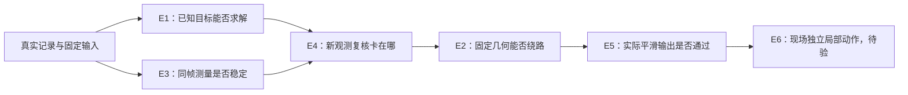
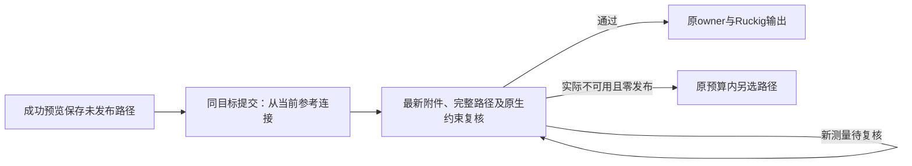

# F1 Harness：用本地数据分层验证原子能力

**11 月 18 日，F1 Harness 方孔测量接续与持物补观测 V50 已部署。** V49 直立真机已经运到桶上方，侧移后测到方孔。V50 在这次实录上修复了对准取帧和持物补观测。对准首发、插入、释放及避桶复位仍缺独立真机结果。[发布登记](../../releases/registry.json)

旧版抓取首发与辅助相机的关系见[V40 现场复盘](#v40-首动前相机复核与现场耗时)。判断哪些现象在 V50 有证据、哪些仍需用新布局验证，可先读下文，再按[真机验收指标](../../../Claude-advice/HARNESS/review-acceptance.md)对照。

## V50 冻结基线与现场证据

| 场景 | 当时观察到的结果 |
|---|---|
| V42 的可选左腕图 | 原请求在 V40 零发布并撤权。V42 在同样的两帧、同一路径上完成控制器内存首发。覆盖的是这次左腕图变化，其他可选流组合仍需逐项验证。 |
| V46 直立抓取 | 11 月 18 日的运行 `web-98a9157409134e989e3e51e652ac739f` 复用了抓取程序，整轮 Astra 请求为零。抓稳后的两次运输候选均在首发前失败。零模型调用已有单段真机证据，完整任务的成功率和用时仍待测。 |
| V49 持块侧移 | 现场运行 `web-bbdcbca9fac34a7d85ce450fd7043911` 完成运输和侧移。第 149 帧同时测到方孔、积木和手内位姿。0.96 秒后的第 152 帧缺少方孔测量，错过对准首发。 |
| V50 回放同一现场 | 第 149 帧解出 24 个对准路点，第 152 帧保留候选。三个持物姿态缺失帧均可查询并发起原地补观测。归档缺少后续同期完整场景和关节样本。另一个模拟场景扫过 18 段并在内存中首发，两项回放均为零硬件输出。 |
| V50 冻结验收 | 3,217 项测试通过。正常、抓空恢复、方孔遮挡三次零输出回放分别走完 10、12、12 个阶段。部署回执验证了 V50 的身份。 |

6000D 留存原件的目录为 `HARNESS/artifacts/alignment-measurement-v50-20261118/`。下表保留冻结身份，供复核源文件与接收端。现场启动仍由操作者在 4242 任务页逐次授权。

| 原件或控制依赖 | SHA-256 |
|---|---|
| V50 bundle ID | `757512d19af84178eacc62999b63bc72e98b7b1b0ee2ec4bd9420ec4fb585563` |
| `bundle-final/manifest.json` | `0a6a4642133593d37afb36d0eada091a55c3c7242e9aadb8e486cbc26712e25f` |
| 随冻结包交付的外部控制端 `control/F1_RELEASE_MANIFEST.json` | `8c0d2f850dec41017c8095eedc46edd7e481685649c5dd1595387afea712e861` |
| 外部 DAgger 控制源码 `control/src/f1dagger/harness_compute.py` | `c6bc63c0cf3e43735f5a12db4bf7cf93c2d72cda6399f737cb512e3f7f2d45ea` |
| `bbdc-frozen.json` | `807f29d7c739f8f6be3c781bd850ca81ffac25e354eac0356ca58f8bacc5977a` |
| `independent-native-first-publication.json` | `3250ed82d6534b38e30d58e3fafe9b47f0ea827deddde3f7f4bc1c8881657ccd` |
| `release-validation.json` | `c07ca0ea1714d8f509c9657e955052b65971ec3d1d176ddd49198a96b8f1d5be` |
| `post-activation.json` | `43ea1ac0c22d484573a661cebf43de0a0b6fa06175724215d8710e68abfbe7ef` |

### 11 月 25 日与 Claude 首轮建议的对照

分支从包含两次审阅合并的 `e16517d` 接入 V50。对照冻结清单校验了 168 个 Harness 运行文件和 259 个冻结测试文件。其中 422 个与冻结原件逐字节一致，5 个沿用公开仓库的设备、路径、连接或测试凭据占位。外部控制和上游依赖按上述身份配套。[逐文件核验清单](../../releases/v50-public-source.json)

| 条目 | V50 已具备的行为 | 下一步怎样验 |
|---|---|---|
| H-01 可选相机 | 特定左腕流变化已有 V40 原输入回归。运输中部分观测来源切换也会重新扫过原路线。通用分支仍可能将可选流增减判成相机身份改变。 | 用原请求覆盖已通过的左腕场景，再单独改变其他可选流、必需的几何来源和共有流身份，记录是否重扫、是否撤权。 |
| H-02 观测准备 | `remote.py` 的单次观测准备上限仍是 4 秒。 | 建立历史基线后实施 15 秒窗口，用现场超时记录验证是否取得新观测、是否仍交回 Astra。 |
| H-03 只读补验 | `engine.py` 和 `owner_bridge.py` 仍按动作修正预算判断能否再次补验。 | 分别验证只读补验上限 6 次与原动作修正上限，再统计真机因验证不可用而结束的次数。 |

本次在 6000D 用分支源码和项目依赖运行了全部 24 个新增或更新的测试文件，479 项通过、0 失败、0 跳过。另一次针对对准、持物、观测准备、复核与传输的检查为 185 项通过，覆盖与前一组有重叠。项目目录检查通过。这批测试用于核对源码同步。历史 S0–S9 漏斗、固定布局对照和 M0 真机结果按后续 A-2 与现场报告分别登记。

## 合并前分层实验结论

**已完成首批分层实验，并补上V32正式持物运输、完整停止链及厂家MOVJ／MOVL对照。** 最新现场的两个持物起点都通过正式规划、新观测复核和实际F1Owner／Ruckig内存输出；完整停止链的软件撤权、不重放和停稳确认通过，平滑制动及物理停止仍未证明。

**厂家候选生成值得对照，本轮结果支持保留现有规划链。** 同一旧持物场景中，两个长目标的MOVJ虽返回成功，却被当前环境检查拒绝；MOVL没有完成，返回前缀还包含当前限位不允许的关节。短上移两者通过。厂家库能生成运动路径，不代表已处理本任务的桶、工具、持物和控制约束。

首批按 **E1 → E3 → E4 → E2 → E5** 运行：V31的12个已知目标、3种设置共36/36次求解通过；V32消除受测未发布请求引起的同帧变化，原五组复核候选全部通过。用户随后现场已抓住并上抬，运输中因腕相机USB断开停止；这些真实进展与下文模拟跟随分开记录。上述实验未改运行算法；后续已按真实等待问题修改源码，见文末“抓后等待修复”。本轮没有重新部署或发机器人动作，当前运行事实以[STATUS](../STATUS.md)为准。

## 版本、数据与实验约束

- V31冻结bundle：`4c9bbfb99ac60174bd3927cd0da1e87c20166efd5ee62bfde732466f862e2be2`。运行依赖从冻结包及其绑定清单恢复，未导入正在修改的工作区运行代码。
- V32对照bundle：`85d2ab249bce196fd0f2fdacf62185aa154154b99e758e6c80f91a8c22523af7`。首批补E3/E4，追加实验验证正式持物运输与完整停止链；不将V31的其他结果自动归给V32。
- 原始[实验计划](../../artifacts/local-capability-study-20261117/experiment-plan.json)保留设计时状态；实际完成范围以本报告、[首批汇总](../../artifacts/local-capability-study-20261117/execution-summary.json)和[追加汇总](../../artifacts/local-capability-study-20261117/followup-summary.json)为准。[数据清单](../../artifacts/local-capability-study-20261117/data-inventory.json)列出10组来源，[现场分层计数](../../artifacts/local-capability-study-20261117/failure-stage-audit.json)保留原日志事实。
- 6000D数值／输出实验使用CPU并限制BLAS线程为1，不连接硬件；追加SDK通过已固定主机密钥的SSH在ARM独立进程调用纯数学库，仅返回路径，未调用ROS、控制器或动作发布。全部实验没有GPU、SAM重跑、Astra调用或训练。墙钟耗时是单次诊断记录，不是等预算或独占机器的性能基准。
- 旧成功、V25/V29/V31以及已用于修复的数据都属于开发回归集。相邻帧、同一场景的多目标和重复求解不能算独立布局；本轮独立物理留出集为空。

发现旧冻结回放目录的F1-4242链接会指向活动工作区后，实验建立独立依赖快照，按bundle与infra绑定逐项核对。E1/E4各核验118份依赖；原文件和原始观测保持不变。原生限位、腕部耦合、自碰撞和适用的环境检查按原配置执行，没有为通过实验扩大容差。

## E1：已知可达目标的数值正对照

从旧成功`ea906579`选6个实际关节样本，从V29实际接近的发布至到位区间选6个，按累计右臂关节弧长覆盖运动过程。目标由冻结机器人模型的FK产生；挑战试验从另一实际起点求解，并把目标右臂配置置于该起点的真实完整身体配置中。这个构造明确保证模型内存在目标解，不冒充独立测得的世界系真值。

| 模式 | 结果 | 墙钟中位数／最大值 | 最大位置残差 |
|---|---:|---:|---:|
| 同起点自解，Cartesian | 12/12 | 0.004／0.076秒 | 0 |
| 跨起点，Cartesian | 12/12 | 0.750／1.640秒 | 0.397毫米 |
| 跨起点，端点求解＋OMPL | 12/12 | 1.032／1.656秒 | 0.00177毫米 |

非活动关节和夹爪均保持。OMPL组12次均实际进入搜索；其中一个解非常接近关节边界，虽未越界，也说明“数值成功”不等于姿态自然或余量充足。

**结论范围：** 这12个受测目标没有暴露基本FK/IK接线或求解失效。未加入桌子、桶或附件，也未验证图像目标、外参精度、平滑输出与物理抓取。E1首批未调用厂家SDK；后续在ARM独立数学进程完成的MOVJ／MOVL对照见下方追加实验，不将其计入E1的36次求解。

证据：[汇总](../../artifacts/local-capability-study-20261117/e1-ik/summary.json) · [输入](../../artifacts/local-capability-study-20261117/e1-ik/inputs.json) · [驱动](../../artifacts/local-capability-study-20261117/e1-ik/run_e1.py)。两次实验环境准备错误保留在`setup-attempt-*`，不计作生产求解失败。

## E3：固定同帧，隔离估计阶段的影响

使用6个真实缓存测量包：正常静态帧0/7/14，窄面帧0/4/8。固定mask、对齐深度、内外参、原时间和相同前缀历史，各分支使用独立实例；反转执行顺序重算，六组结果完全一致。

V31机制实验调用冻结`object_from_mask`及源码提取的实际分支。`observe`切到`move_tcp`会同时改变表面距离参数3→1.5毫米、取消直立先验，以及历史面配准的使用方式；不能把全部效果归因于某一个参数。

| 正常静态样本 | 位置估计变化 | 方块对称对齐后角差 |
|---|---:|---:|
| 0 | 4.040毫米 | 3.865° |
| 7 | 4.500毫米 | 3.898° |
| 14 | 5.674毫米 | 6.104° |

第14帧原始角差177.69°包含方块坐标轴的180°等价，以上按冻结`align_square_pose`对齐；不解释成实物大幅旋转。正常帧observe结果与原记录的位置差为0，角差约`2.8e-5°`；三个窄面样本在两分支均失败，没有补造姿态。

**结论范围：** 证明阶段分支可以在真实缓存输入上引入超过旧5°门槛的估计变化。这是测量原语和分支机制实验，尚非完整scene_pipeline、实时分割或连续运动追踪验收。V31原两次5.036°／6.270°事件缺当时mask和完整估计器历史，未定量复现原事故。

证据：[同帧结果](../../artifacts/local-capability-study-20261117/e3-perception/result.json) · [对称分析](../../artifacts/local-capability-study-20261117/e3-perception/symmetry-analysis.json) · [源码身份](../../artifacts/local-capability-study-20261117/e3-perception/frozen-source-audit.json)。

### V32：从真实请求状态派生上下文的配对补验

使用各自冻结的真实`TaskEngine.status()`，固定同一实测状态，仅加入未发布的`pending move_tcp`，再运行相同六份输入的测量子链。没有强行把V32的phase改成move_tcp；要验证的是请求为何会改变估计。

| 同输入对照 | V31 | V32 |
|---|---|---|
| 待执行请求前后phase | observe→move_tcp | observe→observe |
| 正常三帧位置／角度变化 | 复现上表 | 全部0毫米／0°，pose逐元素一致 |
| 三个窄面样本 | 均失败，部分失败原因随请求变化 | 均失败，请求前后估计参数及失败一致 |

模拟`running`但未发布的请求也保持原phase；正对照中已有发布事实才切换阶段。V32的物体先验另依赖有效夹爪反馈；窄面样本原夹爪有效标志为false，仍保持，不把数值0当作实测开爪。六组逆序独立重算一致，两个版本全部导入模块与各自manifest匹配。

**此项修复在受测组件范围通过。** pending请求和发布谓词为重建的组件输入，未运行真实准入／发布、完整相机选择或追踪。V31现场原mask缺项仍在，不能称原事故已逐像素复现或真机感知已稳定。

证据：[V31/V32对照](../../artifacts/local-capability-study-20261117/e3-perception/v32-comparison/summary.json) · [最终完整性核查](../../artifacts/local-capability-study-20261117/e3-perception/v32-comparison/final-check.json)。

## E4：完整新观测复核，不跳过前置条件

七个输入分别为V31现场五条已经解出的候选及其真实下一观测、V29一个通过的接近候选及其真实下一观测、一个显式改变标定身份的负对照。直接调用完整冻结`revalidate_candidate`，数值后端为真实实现；未绕过前置检查。

| V31冻结代码所复核输入 | 通过 | 实际进入FK／路径扫掠 |
|---|---:|---:|
| V31现场五条候选 | 0/5 | 0/5 |
| V29接近正对照 | 1/1 | 8个FK路点＋8次扫掠 |
| 标定身份改变负对照 | 按预期拒绝 | 身份检查退出 |

V31的五次拒绝分别为一次桶来源变化、两次来源／对象集合恢复、两次物体姿态变化。全部在实际新场景路径检查前退出，重现现场分类；因此这五次失败不能计为RRT搜索失败，也不能据此宣称五条路径在新场景中安全。

**结论范围：** 覆盖完整候选复核函数；未调用服务构造时的启动准入、RPC或owner发布。原时间戳保留，离线时钟从原复核事件加主机计算耗时推进。V32补验使用完全相同的旧候选和新观测，不与V32重新规划产生的路径混算。

证据：[完整结果](../../artifacts/local-capability-study-20261117/e4-revalidation/results/summary.json) · [输入](../../artifacts/local-capability-study-20261117/e4-revalidation/inputs.json) · [执行身份](../../artifacts/local-capability-study-20261117/e4-revalidation/execution-audit.json)。

### V32：原五条候选全部进入并通过实际几何复核

逐字节复制E4的七组输入，只切换冻结实现与相应绑定依赖；旧目标、旧候选、原下一观测和原时间都不重算。

| 输入 | V31通过 | V32通过 | V32实际扫掠 |
|---|---:|---:|---:|
| 两条接近候选 | 0/2 | 2/2 | 各8段 |
| 三条world观察候选 | 0/3 | 3/3 | 各3段 |
| V29正对照 | 1/1 | 1/1 | 8段 |
| 标定身份负对照 | 拒绝 | 仍拒绝 | 身份检查前段退出 |

五条原失败全部调用真实`forward_pose`、`forward_path`及环境扫掠，合计25段通过。标定身份变化仍被`revalidation_scope_mismatch`拒绝，修复没有把身份检查取消。70个实际导入模块与V32／隔离依赖匹配，118份native依赖与V31快照字节相同。结论是**这些固定候选在相应真实新观测下的完整粗阶段复核通过**，不是重新规划成功、实际发布或物理动作成功；全部通过凭据仍为`precision_certified=false`。

证据：[逐候选配对结果](../../artifacts/local-capability-study-20261117/e4-revalidation/v32-comparison/comparison.json) · [完整身份与时钟审计](../../artifacts/local-capability-study-20261117/e4-revalidation/v32-comparison/execution-audit.json)。

## E2：同目标、同环境、同附件，比较数值找路

使用V25真实持物起点`web-e941d2a9802d49ca81f6af5b0027ead7`第一次运输请求的观测、完整关节状态和附件。每个目标分别用原生Cartesian连接及端点求解＋OMPL；固定相同环境和碰撞边界，OMPL种子为20261117。

| 诊断目标 | Cartesian | OMPL | 墙钟耗时，Cartesian／OMPL |
|---|---|---|---:|
| 原注册运输目标 | 工具扫掠拒绝 | 通过，实际进入搜索 | 0.876／3.392秒 |
| 注册桶壁包络中心 | 工具扫掠拒绝 | 通过，实际进入搜索 | 0.854／3.362秒 |
| 保持朝向上移20毫米 | 通过 | 通过，实际进入搜索 | 0.123／0.855秒 |

**这个受测持物状态里，OMPL确实补上了直接连接找不到的路径。** 原目标和桶中心目标各返回9个目标点，短上移返回3个。全部6例的环境与附件相同；独立复核检查了三对起点、终点、完整身体和环境，167条逐报告运行时代码身份与V31匹配。

必须保留以下范围：

- 这里只比较同目标的数值求解，未跑正式`_solve_route`的全部模板与姿态先验。正式运输还会传入原记录的运输姿态偏好，因此不能把这里的结果称为生产运输已成功。
- 桶中心和短上移是明确的诊断目标干预，不是新增孔测量、已经实现的区域规划或学会的策略。原目标也能由OMPL求解，本组数据不支持“只要改桶中心就修好”的解释。
- 保留两种方法各自的生产预算，不能由表中单次耗时比较算法效率。三个搜索来自同一持物状态，不是三个独立布局的泛化成功率。
- 工具拒绝未记录具体首个阻挡段／障碍，不进一步猜测是桶壁、目标还是几何误差；保存几何本身尚无独立真值。
- 本项没有做新观测复核、owner授权或实际平滑输出，数值成功不能直接用于硬件执行。

证据：[汇总](../../artifacts/local-capability-study-20261117/e2-planning/summary.json) · [独立复核](../../artifacts/local-capability-study-20261117/e2-planning/review.json) · [驱动](../../artifacts/local-capability-study-20261117/e2-planning/run_e2.py)。

## E5：经过实际F1Owner与Ruckig的局部输出

本项使用E4通过的V29八路点接近候选，先重新完整复核，再将真实轨迹采样器、F1Owner和Ruckig接到内存传输。初始关节来自原full22实测反馈，夹爪来自原观测；新内存owner以零速度初始化，不重建历史内部滤波状态。后续为延迟一个控制周期的理想跟随，虚拟周期20毫秒。

完整动作按原候选的任务空间到位证据和settle结束；中断分支在中段调用实际`F1Owner.hold`，并按原静止窗口核对。输出逐段按最大0.1°细分审计原生限位、自碰撞和环境扫掠。它不覆盖完整Web／Engine STOP生命周期，也不证明真实机械跟随或抓取。

| V31组件分支 | 实际内存输出 | 输出细分扫掠 | 终态与虚拟时间 |
|---|---:|---:|---|
| 原接近动作完整执行 | 206帧 | 603个样本通过 | 原语义路点／夹爪到位，4.10秒 |
| 中段owner hold | 104帧 | 311个样本通过 | 1.76秒触发，300毫秒静止窗口成立，2.06秒结束 |

两支完整发布、非活动坐标保持、原限速及扫掠检查通过；最高命令差分速度16.182°/秒，最小原生自碰撞间距16.931毫米。76个源模块身份核验无不符。

**Hold的静止窗口通过，不等于平滑停止通过。** 补充动态审计发现`hold`直接重置滤波速度并固定最后命令，触发前约15.201°/秒，下一周期命令速度为0；命令差分加速度约760°/秒²、jerk约38,004°/秒³，高于正常轨迹配置100／600。完整接近分支对应峰值约89.33／600，后者仅有浮点尾差。这个补充检查不包含在原汇总的`passed`谓词内，不能被“通过”一词覆盖。

这是软件命令差分，不是实测电机加速度，尚不能由此判断实际STOP行为。首批只确认V32冻结`robot_io.py`及hold方法与V31字节一致，未运行V32输出；下方追加完整停止链实验补齐了软件链验证，仍不改变物理停止策略。

首批未验证持物运输输出。下方追加实验另用最新V32真实持物输入，沿正式候选生成、姿态先验与完整复核验证输出；没有把本节空手接近结果外推给持物路径。

证据：[最终复核入口](../../artifacts/local-capability-study-20261117/e5-output/final-review.json) · [最新输出汇总](../../artifacts/local-capability-study-20261117/e5-output/summary.json) · [独立动态审计](../../artifacts/local-capability-study-20261117/e5-output/dynamics-audit.json)。`attempt-1`保留空关节容差造成的驱动TypeError；`attempt-2`保留以旧命令锚点初始化而非实测关节的旧结果及更正说明，二者均由本次最终运行替代，不计作生产故障。

## 追加：最新现场输入与正式持物运输

用户本次现场运行`web-ef2c4aefe83f4aae968d64e5d6ef66e0`已完成接近、抓取、视觉持物确认及12厘米分段上抬。随后正式运输确有发布，但尚未到达，右腕相机USB断链后结束；没有对孔、释放、返程或完整成功。按110份run的事件时间核对，它是本轮最新记录，未按文件修改时间猜测。[现场摘要与输入定位](../../artifacts/local-capability-study-20261117/followup-onsite/summary.json)。

补验沿冻结V32的正式`PlanService.plan_skill`自动选路线，成功求解实际消费生产运输姿态先验，再用真实后观测调用完整复核。后续实际F1Owner／Ruckig接内存输出；初始反馈为原实测关节，输出后的跟随明确模拟，不拿旧录像冒充新候选运动后的反馈。

| 原真实起点 | 正式候选 | 新观测复核 | 内存输出／细分扫掠 | 到位 |
|---|---|---|---:|---|
| 上抬后的运输请求 | 自动路线1，14点 | 原正式复核观测358 | 213帧／1168样本 | 原语义到位＋300毫秒settle通过，虚拟4.24秒 |
| 抓后低位运输请求 | 自动路线1，18点 | 同一零动作窗口后真实观测207 | 289帧／1669样本 | 原语义到位＋settle通过，虚拟5.76秒 |

这两条成功路线都是Cartesian候选，未使用OMPL。审计覆盖原生关节／腕耦合限制、自碰撞，以及工具／持物对已注册环境的连续扫掠；不扩大称为整臂mesh对全部环境的检查。两起点来自同一次运行，不能算两个独立布局的泛化结果。

低位请求在现场曾耗时25.95秒后求解失败，本机冻结实现重算约7.19秒找到候选。这说明该固定模型与目标存在可行候选，不能反推现场拒绝错误或物理不可达；机器、负载和求解预算消耗仍需与实际数值进程对照。现场规划等待与预览复用问题没有因本轮离线通过而宣称修好。

V25旧持物输入也补了正式规划：原旧请求先因当前Task新增字段而身份不匹配，另存当前schema重绑定对照，只改派生请求的task_hash，几何、目标、关节和预算保持。正式入口依次尝试四个模板，再由OMPL生成12点候选，约24.22秒，成功求解实际带有生产姿态先验。该旧条缺后续真实完整观测，只记正式规划通过，没有补造fresh观测或执行输出。

三条选中求解均保留生产姿态先验；两条完整输出的命令速度／加速度／jerk符合原30／100／600配置，仅有浮点尾差。实验装配中V25最初缺离线OMPL导入路径，原失败保留，按冻结版本恢复依赖后重算，未计作OMPL算法失败。证据：[正式运输完整汇总](../../artifacts/local-capability-study-20261117/followup-transport/final-review.json)。

## 追加：完整停止链的软件合同与动态边界

使用真实冻结`WebHarnessPolicyEngine → TaskEngine → OwnerBridge → SupervisedControlLoop → F1Owner／Ruckig`，从生产`queue_web_control`入口送STOP；传输、时钟与后续反馈为实验替身，不开HTTP／RPC或机器人连接。使用V29保存的接近几何与实测起点，在V32重新规划和完整复核。

五例分别覆盖运动中STOP、反馈持续漂移／过期、STOP后规划Future才返回、approve后publish前同周期STOP，以及反馈额外落后一周期。共407条内存输出、574次原生／工具环境审计通过。撤权、清空旧候选、一次捕获保持目标、拒绝迟到完成、重复旧技能／旧START不重放均成立。

正常分支按原300毫秒窗口确认停稳；持续漂移600毫秒及旧反馈320毫秒时没有误报，恢复新鲜稳定反馈后才确认，距STOP共1240毫秒。这验证软件对反馈的使用，不是机械响应模型。重复旧START可返回历史幂等ack，但当前owner仍未授权；不能把旧ack的`motion_authorized=true`误当当前重新授权。

**完整链也没有平滑制动。** 正常STOP的命令差分加速度约805.9°/秒²、jerk约40,510°/秒³；反馈额外落后一周期时，`hold_measured_right`让首个停止命令相对最后发布后退最多0.32237°，差分峰值约1611.9／120,889。当前普通轨迹配置为100／600，这些动态结果不包含在软件合同的`passed`中。它们不是实测电机加速度，也不证明停止距离或持物稳定性。

如后续需要平滑停车，应在同一owner内保留当前速度／加速度，审计制动段后再固定HOLD；撤权、迟到拒绝和不重放保持。它会改变物理停止策略，本轮没有实现或部署。证据：[完整链汇总](../../artifacts/local-capability-study-20261117/followup-stop/summary.json) · [独立动态审计](../../artifacts/local-capability-study-20261117/followup-stop/dynamics-audit.json) · [历史回执语义](../../artifacts/local-capability-study-20261117/followup-stop/receipt-semantics.json)。

## 追加：厂家MOVJ／MOVL实际对照

本次确实调用了F1当前ARM `libKine.so`，不是只看头文件。库SHA仍为`7f03a33964123d2b37d249a51cbdb748c54f5445021ac10e128b27f349dc4d83`，C接口与PointSet布局按当前头文件核对；每例在独立数学进程生成内存轨迹，未修改安装配置或写远端文件。动态链接仅系统数学／C++库，未见ROS或网络控制导入；实验未调用控制接口。

复用E2同一持物场景三个目标的已知关节终点：MOVJ使用相同关节起终点；MOVL先用SDK自身FK构造原生笛卡尔目标。SDK DH对应长段参数为314毫米，当前URDF为311毫米，相差3毫米；这不是本轮测得的实物尺寸。当前单位阵frame_chain是URDF-world约定，不能拿它充当SDK转换。因此所有返回点都重新交当前模型审计，并另查当前URDF的EEF／TCP终点误差。

| 目标 | 厂家MOVJ及当前检查 | 厂家MOVL及当前检查 |
|---|---|---|
| 原运输目标 | 返回成功，2436点；当前环境拒绝126原段，端点达到原容差 | 返回失败，425点是失败前缀；其中238原段被当前限位拒绝 |
| 桶中心诊断目标 | 返回成功，2419点；工具扫掠125段、手臂环境碰撞340段被拒，端点达到原容差 | 返回失败，434点是失败前缀；其中246原段被当前限位拒绝 |
| 短上移20毫米 | 返回成功，118点；全部路径及原终点容差通过 | 返回成功，66点；全部路径及原终点容差通过 |

共5898个原SDK点，未删除、重排或裁掉失败段。复用冻结`joint_path_to_validate`按0.1°加密检查，包含当前HAL／腕耦合限位、原生碰撞、手臂mesh对环境及工具／附件扫掠；单次接口最多100点，审计以连续分块保留跨块连接，失败后继续检查其余原段仅为诊断，不能拼成可执行路径。关键六个检查模块在V31/V32中逐文件相同。

原目标MOVJ首个拒绝发生在原点966对应段，`arm_R_Link7`与`wall_x_low`的模型间距约−0.0567毫米；桶中心MOVJ首拒绝为工具扫掠。这里是模型碰撞判定，未发生实物碰撞。短上移的当前EEF残差分别约0.000014／0.008517毫米，按原0.5毫米／0.005弧度容差通过；这同样不是物理精度。

**本组对照不支持把厂家MOVL／MOVJ直接替换现有找路。** E2的两个长目标已由OMPL通过同环境数值检查，厂家候选在这些输入上没有带来可接受的替代路径。MOVL的模型／TCP合同还不同，速度参数也仅为诊断设置，不是等速性能比较或生产控制profile。可以保留为可替换候选后端，不能绕开当前检查，也不能由单一场景排名推出普遍优劣。

证据：[当前SDK身份](../../artifacts/local-capability-study-20261117/followup-sdk/current-sdk.json) · [六例原始调用汇总](../../artifacts/local-capability-study-20261117/followup-sdk/generation-summary.json) · [全部路径与终点复核](../../artifacts/local-capability-study-20261117/followup-sdk/audit/summary.json)。短上移MOVL原生stdout与JSON标记挤在同一行，旧解析回执与原日志保留；从原JSON恢复结果，没有重跑或改SDK返回值。

## 下一阶段：局部物理验证

后续采用同输入的修复版对照与独立新采集，两个用途分开：旧事故回归回答“修复是否消除了这个反例”，新布局局部动作回答“能力是否可迁移”。不通过放宽门槛、模拟成功反馈或增加模型提示代替这两个问题。

E6现场计划按以下顺序，每次只完成一个局部目标并保留终态：

1. **空手观察移动：** 以当前实测场景规划短距离world目标，记录目标、实际TCP位移、停稳新RGB-D及复核原因，判断“可动”和“新视角有用”是否同时成立。
2. **已确认持物的短移动：** 保留当前附件关系，执行经过同一正式链验证的短上移／侧移，独立检查实际持物、终点误差、余量和重观测，隔离接触抓取与运输能力。
3. **持物移动到桶上方区域：** 固定已通过的抓持起点，单独验正式运输的完整找路、复核、平滑输出与到位，不把精对孔和释放混入本次结果。

本轮已补两条正式持物运输的内存输出审计，用户这次也已取得抓取／上抬的现场证据。下一次先确认右腕相机能连续产生新帧，重点单验运输到位，再逐步接对孔／释放；具体方向、距离和目标由当次实测几何与原控制约束决定，以上20毫米仅为离线诊断目标，不能直接复制为现场指令。硬件动作仍由用户在已有入口现场开始／停止，本实验未发送START。

每次保存原RGB-D、mask、估计器前缀状态、完整反馈、候选、复核输入、实际输出与独立结果。失败记录停在哪一层；成功同时记录输入范围和结果依据。连续帧不充当独立成功次数，缺少物理真值时只报告一致性，不报告绝对精度。

## 重现与产物保留

本轮只新增实验驱动、快照和报告，没有修改运行算法或部署。每个实验目录保存驱动、冻结来源、输入身份与结果；首批和追加实验分开留证，原V31结果与首批汇总不覆盖。广泛连续感知评估、更多独立持物布局、多种子、完整物理停止及新布局泛化仍未由这些小样本实验代替。

数值与输出驱动使用`HARNESS/.venv-numerics/bin/python`；E3使用`HARNESS/.venv/bin/python`，初始结果记录NumPy 2.4.6。环境设置`OPENBLAS_NUM_THREADS=1 OMP_NUM_THREADS=1 MKL_NUM_THREADS=1 PYTHONDONTWRITEBYTECODE=1`。E3/E4/E5提供`prepare`和`run`入口；E2以`--goal original|bucket_center|short_up --strategy cartesian|joint_search`选择一例。重现应使用新的产物目录并重新绑定驱动身份，保留已有结果；这些是冻结实验驱动，不是生产或硬件运行入口。

## 抓后等待修复（2026-11-17，源码候选，未部署）

**将慢的共同原因收敛到候选接续与计算预算，而不是继续加快已经只用0.65秒的抓持验证。** 本轮接续已有预览复用、超时和复核补丁，修正真实输入暴露的缺口；仍使用同一PlanService、数值服务、owner、原请求与截止时间，没有增加另一套恢复流程。

**原子能力在这里是“完成一次可信的带物移动”。** 预览成功只留下带来源的未发布路径；提交从当前控制参考连接，按当前附件和环境重新检查，再沿原owner执行。允许复用计算，不复用旧运动许可；实际碰撞、附件丢失、STOP、未知或已发布请求继续按原合同处理。

### 已实施的修改

- **预览到提交复用：** 精确浮点缓存之外，沿已有候选缓存保存一次性预览。绑定任务、配置、权限、目标、参数、相机身份及夹持状态；实测16维与owner上一条输出目标明确区分。保留右臂候选，更新当前身体／非活动关节参考并重新计时；当前连接段、FK路径、工具／持物扫掠、原生关节／自碰撞及右臂场景碰撞均重新检查。`joint_path_to_validate`仅检查固定路径，不做新IK或OMPL搜索。
- **复核保留路径：** 同一物体仍被持有、附件仍存在时，新附件变换交给完整重扫；不是看到矩阵变化就丢弃整条候选。附件出现／消失、身份或夹持事实改变仍拒绝；新附件或新障碍使路径相交也拒绝。保留原请求和期限，STOP及晚结果不能重启。另补已有任何发布回执时不得返回首次发布流程的防御检查；该竞态是注入反例，不称V32现场已发生。
- **预算与错误：** 原生Cartesian／joint上限仍为7／15秒，warm客户端17秒、外层数值客户端18秒。每条路线、每段运动及预测后缀共用请求剩余预算，允许缩短原生搜索，不再于末秒重启完整预算。超时／断连关闭原lease，尽力撤销结果使用权，禁止同会话自动重试或冷回退；保留具体数值诊断与前序候选失败，未知异常不再只剩`HarnessError`类名。
- **候选顺序：** 保留前两条已有排序Cartesian候选，失败后再尝试现有OMPL。删除“至少剩18秒才能进入搜索”的固定等待预算判断；剩余时间传到同一原生求解器，不能扩张请求期限或将超时写成物理不可达。没有增加运动模板、放宽几何或控制限值。

### 真实输入与顺序对照

两对V32成功预览与提交的目标／参数相同，但实测关节、owner参考及新物体测量确实不同，不能称为完全相同物理输入。预览与提交16维参考最大差约0.83°，不是通过舍入输入假装缓存命中。原始时间、请求、原候选和新观测见[原序列分析](../../artifacts/latency-repair-20261117/analysis-replay.json)及[两对输入](../../artifacts/latency-repair-20261117/preview-inputs.json)。

同驱动、同正式输入的单次CPU对照发现：低位V32原顺序7.164秒，首次失败便OMPL为7.872秒；上抬后分别5.439与6.848秒。原顺序两例均由variant1成功，提前OMPL两例改用variant2。故没有采用“越早RRT越快”的假设；这四次计时不当作稳定性能基准，也不外推成ARM现场秒数。[原顺序](../../artifacts/latency-repair-20261117/order-comparison/v32/) · [提前OMPL对照](../../artifacts/latency-repair-20261117/order-comparison/early/)。

最终顺序的同输入复算为7.230／5.424秒，两例恢复variant1且均未调用OMPL，没有将上面的性能退步合入候选。冻结后的预览复用与实际输出如下；提交耗时只包含重新绑定，不包含右列新观测复核，也不等于首个物理动作延迟。

| 真实预览／提交对 | 原预览计算 | 提交重新绑定 | 提交新增搜索 | 完整fresh复核 | F1Owner／Ruckig内存输出与细分审计 |
|---|---:|---:|---:|---:|---|
| 持物world上抬 | 4.416秒 | 11.16毫秒 | 0 | 2.772秒，7路点，含原生固定路径检查 | 228帧／959样本，通过 |
| 上抬后运输 | 5.676秒 | 19.34毫秒 | 0 | 4.497秒，14路点，含原生固定路径检查 | 214帧／1172样本，通过 |

两个新障碍负对照均拒绝。输出审计保留原速度／加速度／jerk上限30／100／600，包含每0.1°细分的限位、腕部耦合、自碰撞、右臂mesh环境、工具与持物扫掠；首状态来自真实记录，后续为上一周期输出的理想反馈，不能称现场成功。两条原到位判据通过；未串接完整网页任务授权、RPC与动作后视觉。完整软件回归2877项通过，原跳过的70项另在原生环境全部补验；原控制链集成62项通过。测试源码前后校验无变化。[候选复核](../../artifacts/latency-repair-20261117/preview-replay/final/) · [实际输出审计](../../artifacts/latency-repair-20261117/owner-replay/) · [原生补验](../../artifacts/latency-repair-20261117/native-followup/report.json) · [owner合同](../../artifacts/latency-repair-20261117/owner-regression-summary.json)。

V25困难输入保持原249222毫秒预算和几何，沿此前已明示的Task schema hash兼容适配，最终11.865秒成功：前两条Cartesian失败后OMPL通过。没有对应合法fresh数据，故不计入输出或物理成功。[统一候选结论](../../artifacts/latency-repair-20261117/candidate-final-review.json) · [独立源码与输出核查](../../artifacts/latency-repair-20261117/independent-final-check.json) · [本轮资格与接续范围](../../artifacts/latency-repair-20261117/qualification.json)。

### 结论边界与下一步

旧日志能够证明内层客户端10秒与原生15秒的预算冲突，但缺少当时底层详细错误，不能断言首条25.95秒失败全由超时引起。Unix服务器的socket超时本身不会中断同步求解；本轮预算是合作式检查，不能抢占正在执行的原生C调用，也不能保证30秒预览严格实时返回。关闭lease撤销的是结果使用权，后端忙时不复用该worker。[预算链与测试](../../artifacts/latency-repair-20261117/analysis-budget.json)。

当前部署仍为V32，本候选未分配发布V号、未切换机器人、未发送START。后续发布须将最终源码与另一边夹爪修改共同冻结，沿完整任务正式入口做零输出验收，再验证ARM耗时与现场收益；本轮局部数值／输出回放不能替代完整任务发布验收。现场至少记录抓持确认到首次上抬／运输时间、真正新搜索次数、固定路径复核次数、最终到位及腕相机持续新帧；同次运行相邻观测不算独立泛化布局。

## V35联合发布：实测夹爪、候选复用与局部经验（2026-11-17）

**联合V35已部署，现场不再是上文实验时的V32。** 两条主线连同原生数学预算适配一起冻结；V33和V34候选均未激活，分别因合并范围扩展、原生预算接线补齐而取消，旧冻结原件保留。V32可回退。实际F1Owner／Ruckig、碰撞模型和运动限速保持，改动的两个控制数学文件只传播剩余规划时间并保留原7／15秒上限。

**夹爪规则现在已接通，但真实抓持正例仍待用户验证。** 新读者被动接收右夹爪外部CAN-FD，排除命令回环；原混合0–100字段不再充当独立实测。闭合实际发布后，当前目标位于本次夹持区域，实测受阻开度持续稳定，可先建立本地抓持证据；SAM继续检查身份和提起随动。沿用300毫秒稳定窗口和已有反馈时限，不写死0.72。空闭到100不能单靠稳定证明夹物；18仍是旧配方的张开目标。实测开夹即使遇到坏图也清除旧持物，命令18与实测闭合冲突时不得伪造已松开；头部返程使用当前头帧时刻。CAN原始窗口留在本地，给Astra的是精简数值摘要。

| 联合包验收 | 结果与适用边界 |
|---|---|
| 软件与原生合同 | 3029项通过，含另环境补齐70项原生测试及82项控制生命周期／预算测试。未改打包工具因隔离目录符号链接单独在物理源码目录验收；不是隐藏运行失败 |
| 完整正式入口回放 | 正常10阶段／2545条内存输出；抓空恢复14阶段／3233条输出，实际输出审计通过。初始真实输入，后续反馈模拟，零硬件动作 |
| 两对真实预览／提交 | 提交新增搜索均0；重绑11.13／19.00毫秒，完整fresh复核2.60／4.47秒；两个新障碍负例仍拒绝 |
| 持物路径输出 | 426条F1Owner／Ruckig内存输出、2059个细分检查通过。上抬OMPL本次路点数不同于前次442条结果，不能当同一路径重复统计或现场耗时 |
| 最终ARM连续观测 | 27次处理、22份局部场景，5次身份歧义；完整场景0。959条独立CAN无缺序号，开夹没有contact／held假阳。处理p50 301毫秒、p95 331毫秒；没有真实夹物正例 |
| 部署检查 | 364份包文件、13份site文件校验；6000D、机器人19843及4242均可开始，原生预算检查通过，未发START |

**经验链已由“只存探索”补到局部程序候选。** 已将真实`web-ef2c…`的接近→抓取→verify_grasp成功前缀追加到生产库，保留其后运输失败记录；候选`df90213f…`明确标为`owner_measured_segment`，不是Astra在发现时生成并执行过的源码，也不是预写的扶正策略。下一独立运行须执行精确候选源码并由真实owner回执验证，成功后才能晋升；届时匹配条件下可先本地执行、无需Astra，局部抓稳不会误判整任务完成。当前待验证1、晋升0，尚无真机复用收益结论。

- [冻结资格与完整证据](../../artifacts/gripper-transport-v35-20261117/release-validation.json) · [激活](../../artifacts/gripper-transport-v35-20261117/activation.json) · [三端后验](../../artifacts/gripper-transport-v35-20261117/post-activation.json)
- [完整回放](../../artifacts/gripper-transport-v35-20261117/full-validation-pinned/validation-summary.json) · [运输实际输出](../../artifacts/gripper-transport-v35-20261117/planning-integrated-qualification.json) · [ARM感知范围](../../artifacts/gripper-transport-v35-20261117/v35-perception-qualification.json)
- [生产候选登记](../../artifacts/gripper-transport-v35-20261117/experience/production-registration.json) · [原生数学源码比对](../../artifacts/gripper-transport-v35-20261117/control-source-comparison.json)

下一次现场先验证正常抓取：记录首动、抓持成立的实际依据、抓后首次上抬／运输、真正新搜索及固定路径重扫次数、到位与相机连续性；再看独立经验是否晋升。正常流程稳定后再启动横躺探索，不提前写扶正脚本。

## V36现场复核通信修复（2026-11-17）

**结论：这是观测字段跨层集成遗漏，不是碰撞门槛或求解无解。** V35两条实际运行均已生成approach_grasp候选，随后客户端在发送复核请求前抛出`IPC message too large`；异常日志只保留ValueError导致误指向规划。两条均没有首次动作发布。V36仅修传输、存档与具体诊断，未修改SAM、候选排序、轨迹求解或物理限制。

**11月17日冻结时仅完成离线验收。** 原部署仍为V35；反向SSH握手超时，已登记备用Tailscale地址主机密钥一致但拒绝现有公钥，未发现其他已授权认证来源。待连接恢复后完成ARM只读往返、安装完整性、启动复核与空闲三端切换；由用户开始实际任务。

### 现场根因与修复范围

| 原运行 | 原完整复核请求 | V36请求 | V36反向proof | 结果 |
|---|---:|---:|---:|---|
| `web-ed3b53b979b243d4b6a9a169ad64924e` | 72,765B | 25,303B | 8,684B | 原异常真实复现，正式复核通过 |
| `web-9b88e86fda204c528e9bd22aa9afe75b` | 72,874B | 25,261B | 8,690B | 原异常真实复现，正式复核通过 |

两份观测各携带64条CAN样本，每份约24.4KB；原IPC上限65,536B保持不变。使用原EvidenceStore保存完整窗口，以内容哈希、观测／相机时间、来源及序列区间绑定引用；接收端恢复后再消费原始观测。HTTP跨主机返回保留完整CAN，Astra只收到数值摘要。历史无引用观测的序列化与哈希不变。实际改动为contracts、scene_evidence、live_scene、owner_bridge、gateway及remote六个模块；没有增加新的物理准入门槛。

现场CAN均表示张开，未出现held=True误报。两次模型均先收数值，再明确请求一次图像批次；当前证据不能确定SAM初始定位候选为何不足，未据此改阈值。`9b88…`已选入候选经验验证，但适用性检查发现object_pose为空而退出，未调用候选动作；重新定位后的候选接续仍待完善，本轮没有将其包装为已学习／晋升。

### 为什么上版验收漏掉

V35正常／抓空完整回放分别记录28／36份观测，但都没有CAN实测窗口。独立窗口与规划链分别测过，缺少双完整观测经过正式复核通信的组合验收。本轮以两条真实失败包执行UnixClient→PlanService.dispatch→原生FK与4段几何扫掠→反向proof，既复现旧异常，也验证新包完整通过。不能再以单独夹爪测试或离线直接调用复核方法代替正式通信边界。

### 冻结验收与后续

V36冻结身份`0ee44b3b5c471bc89419d24bfdf11377cc4fbffabdb8ea277997917a7196f6a6`，原生控制清单与V35相同。

- 软件2906项、原生70项、控制生命周期82项，共3058项通过；另70项可选原生测试在主软件环境跳过，已由独立原生组补验。
- 两条真实请求保留原始／最新观测各64样本，完整内容、时间和proof哈希一致；零新增搜索、零硬件输出。
- 正常10阶段／2535条实际F1Owner/Ruckig内存输出，抓空恢复14阶段／3259条输出，完整扫掠与发布审计通过。后续机器人／场景反馈模拟，不构成真实抓持或插孔结论。
- 11月17日冻结时，ARM新版本现场观测往返脚本已准备，尚未执行；部署资格与现场任务结果仍未完成。没有发送START。

证据：[冻结离线汇总](../../artifacts/observation-rpc-v36-20261117/offline-qualification.json)、[真实失败完整RPC回放](../../artifacts/observation-rpc-v36-20261117/field-rpc/qualification.json)、[全流程零输出](../../artifacts/observation-rpc-v36-20261117/full-validation-pinned/validation-summary.json)、[连接检查](../../artifacts/observation-rpc-v36-20261117/robot-access-check.json)。

### 2026-11-18 ARM 验收与发布

364 份发布文件及 13 份配置与冻结清单一致。ARM 采得两份真实双路 RGB-D 观测，各自的 64 条 CAN 样本经 HTTP 与内部 RPC 完整恢复，仅含双观测的内部请求为 7,948 B。采样时夹爪张开。首次诊断启动遗漏 RPent 导入路径，使用正式服务的依赖路径重跑通过。[ARM 验收](../../artifacts/observation-rpc-v36-20261117/arm-observation-qualification.json)

6000D、机器人端及 4242 页面已切换并登记 V36，SAM 就绪，两个订阅池返回 200，独立 VLA 8153 不可用。此次部署硬件动作输出为零，后续真实任务验证实物抓持与运输等待。[发布回执](../../artifacts/observation-rpc-v36-20261117/post-activation.json)

## V38 经验接续与遮挡复核

同一条真机记录在 V38 重放。补定位后宿主执行同一份抓取候选源码，依次完成接近、抓取、验证，重复抓取为零。该回放使用原有反馈。经验仍需在独立真机运行中取得与原源码绑定的抓持证据才能晋升。[经验接续与源码绑定](../../artifacts/anchor-recovery-v38-20261118/field-program-frozen-source.json)

运输记录显示机械臂到达第 26 个路点。之后 22 次观测中 18 次有新鲜持物证据，3 次持物未知，1 次只有局部环境。对孔仍需独立取得当前方孔的位置；锚点故障会传到需要它的阶段。[运输回放](../../artifacts/anchor-recovery-v38-20261118/transport-endpoint-replay.json)

上次被拒绝帧的三角孔分割面积与现场一致。单帧重算后，积木与三角孔掩码重叠 2 像素，积木与原测距外圈重叠 232 像素。冻结版本改用原掩码判断身份。另两张运输后帧的 U 槽外圈有效深度全在桶盖掩码以外，深度约 0.33 米，运输前约 0.54 米。三角仍可见，U 槽的桶盖深度确实丢失。移动积木的历史视频跟踪状态未归档，回放对该物使用原图和单帧框。[冻结分割与深度对照](../../artifacts/anchor-recovery-v38-20261118/field-mask-replay.json) · [上次头部及双腕原图包](../../artifacts/anchor-recovery-v38-20261118/field-images/camera-images.zip)

用户调好的左腕静止时能同时看见方孔和三角孔。人工框提示的单帧 SAM 分割分别为 3,550 和 1,918 像素。该帧拍摄时积木仍在桌面，持块进场后的遮挡和左腕三维手眼精度仍待验证。[左腕分割叠图](../../artifacts/anchor-recovery-v38-20261118/field-images/manual-left-1794967058960051907/left_wrist-apertures.png)

正常和抓空恢复两条完整零输出回放均通过，共 10／14 个阶段。机器人端只读采样的 27 组真实 RGB-D 中，17 组返回可消费的局部场景，10 组右腕积木分割需要新提示。实际部署三端通过，现场完整抓放、净节时和候选晋升由下一条真实记录检验。[冻结验收](../../artifacts/anchor-recovery-v38-20261118/release-validation.json) · [部署回执](../../artifacts/anchor-recovery-v38-20261118/post-activation.json)

## V39 左腕补观测与接近恢复

11 月 18 日 10:42，V38 完成抓取、运输、持物确认后，方孔与桶锚点被右夹爪部分遮挡。10:52 的倒块测试在预抓末点停稳，续接时没有新的物体姿态。这两条记录分别用于检验新的视觉及恢复链路。

左腕保持操作者调好的姿态。本地视觉从同步左腕 RGB 找方孔边缘，按桶盖上的三角孔和圆孔配准到头部，使用头部当帧的 RGB-D 测桶盖平面并还原方孔位姿。几何不充分时只返回有来源的二维候选，Astra 明确索图时才附图。两组同时有头部独立可见方孔的真实对照中，迁移所得孔中心相差 1.04 和 1.19 像素；这是图像复核，插入精度仍由现场验证。[同步原图与对照](../../artifacts/left-view-recovery-v39-20261118/cross-view-controls.json) · [左腕数字与图像接口回放](../../artifacts/left-view-recovery-v39-20261118/left-field-replay.json)

接近发生停滞后，工具保留原请求身份、已发布事实及实测断点。10:52 回放从停住的状态预览回到上次看清积木的位置，当前夹爪附近缺少深度，原生规划拒绝了这条观察移动。程序随后消费独立新帧，明确告诉 Astra 哪个物体仍需补定位及可续接的请求。回放没有重复抓取，没有补造运动后的反馈，也未产生扶正经验。[冻结恢复回执](../../artifacts/left-view-recovery-v39-20261118/stalled-view-frozen.json)

## V40 移动桶位与分段对准

V39 在 ARM 的原始观测中暴露了一个旧位置依赖。桶在头部图像中移动了约 30 像素，19 组有完整相机身份和同步几何的记录都没能用左腕补孔。V39 只做了候选验收，现场继续使用 V38，随后冻结了修正后的 V40。

V40 用两路图中三角孔与圆孔确定当帧平面映射，通过实测方孔的边长和它到三角孔的物理距离判断身份。两路图的圆孔完整边缘也参与拟合。之前同一批 19 组合格 ARM 输入均能重建方孔，另外 5 组缺帧、8 组头部源时间戳重复。两组能直接看到方孔的独立头部图像，对照中心分别相差 0.87 和 1.78 像素。[同批 ARM 对照](../../artifacts/relative-aperture-v40-20261118/previous-arm-cross-view.json) · [独立可见方孔对照](../../artifacts/relative-aperture-v40-20261118/cross-view-controls.json)

右手已运输到桶上方时，当前对准和随后插入分别规划。预计插入畅通的候选排在前面。若阻挡只出现在预计插入阶段，控制器仍可执行已通过原生碰撞检测的当前对准段。插入须使用对准到位之后的新观测重新检查。当前对准段碰撞、实测持物未知、旧观测重用于插入都保留各自的拒绝原因。[冻结阶段回归](../../artifacts/relative-aperture-v40-20261118/alignment-stage-regression.xml)

10:52 的倒块回放沿用 V39 已查明的阻塞事实。V40 保留首次接近动作的发布记录，用新帧复观，并在积木姿态仍不明时将换视点及原断点交给 Astra。无人为编写的扶正动作，也没有独立的现场扶正成功记录。[倒块冻结回放](../../artifacts/relative-aperture-v40-20261118/stalled-view-frozen.json)

新一批 ARM 只读采样共 30 组，22 组用当帧左腕和头部数据重建了方孔；其余 8 组中，6 组头部时间戳重复，1 组头部关节反馈与画面不同步，1 组缺相机帧。以上是现场采样的孔位可用性，插入是否成功须在真机运行中统计。[新采样逐组结果](../../artifacts/relative-aperture-v40-20261118/live-cross-view-replay.json)

10:42 运输结束后 2.51 秒和 3.45 秒的两组实录均能从左腕补出方孔。旧记录未存左腕光学坐标系名称和相机参数身份，回放用后来同一设备的现场采样补齐这两项。两组原始观测各自的持物状态都为未知。将两组孔位分别配合同次运行较早和较晚的持物证据，四种离线组合均能规划当前对准；其中两条平滑输出在模拟跟随下通过了全段碰撞复核。该实验验证了这一段可以求解，同步持物与孔位证据、到位及实际插入仍由现场运行验证。[两组原始输入、时间差及轨迹](../../artifacts/relative-aperture-v40-20261118/align-field-report.json)

## V40 首动前相机复核与现场耗时

11 月 18 日 12:26，已定位积木的历史抓取候选在补齐桶的障碍位置后，求出了 3 路点的直接接近路径。求解时的观测 109 带有头部和右腕 RGB-D，首发前的观测 118 另有一张左腕 RGB。两组必要相机的身份字段逐项一致，桶的位置都来自头部深度配准。V40 比较全部相机流的集合，报相机身份改变并撤权。此请求的动作发布数为零，控制器确认停稳。经验程序随后只上报授权变化，丢失了已有的具体原因。[控制器原始记录](../../runs/workspace/web-5329da48dda549d8ab7e8921e88597cd/collected/owner/harness/trace.jsonl) · [规划进程终态](../../runs/workspace/web-5329da48dda549d8ab7e8921e88597cd/planner/failure.json)

从点击开始到结束共 52.75 秒。抓取前的头部搜索区域没有识别到桶参照，历史抓取程序等待当前障碍几何；记录中的局部深度也不完整。Astra 第一轮明确索取一张头图，第二轮给出新的定位提示，随后接回同一候选程序。两轮响应合计 29.28 秒。本条没有产生可晋升的抓持成功经验。[计时](../../runs/workspace/web-5329da48dda549d8ab7e8921e88597cd/timing-report.json) · [经验审核](../../runs/workspace/web-5329da48dda549d8ab7e8921e88597cd/experience-review.json)

复现固定了原请求、两帧观测和已求出的路径。V40 原样复现拒绝，在唯一改变是移除复核帧中的可选左图时通过。V42 保留该左图时，正式技能服务复核、控制器首条动作内存发布均通过。原三路点轨迹的 76 帧平滑输出通过 140 次细分检查；发布后的跟随反馈为模拟。最新这对真机输入检验了以前分开验收左腕测孔和正常抓取时遗漏的组合，即左图首次出现在抓取求解与首发之间。[V40 原输入](../../artifacts/optional-camera-revalidation-v42-20261118/field-request-v40.json) · [单变量对照](../../artifacts/optional-camera-revalidation-v42-20261118/field-request-v40-control.json) · [V42 原请求回放](../../artifacts/optional-camera-revalidation-v42-20261118/field-request-frozen.json)
