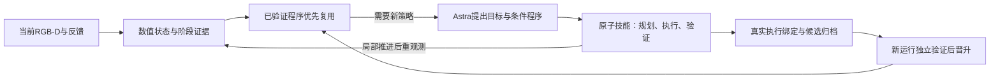

# F1 Harness 状态页归档（2026-11-18）

这份快照保存了 V38 上线时的状态页，以及此前各版本积累的现场诊断、回放和发布回执。文中的“当前”“下一步”按各段版本和日期解读。

追查旧判断时按原标题定位。日常接续请读[当前状态](../STATUS.md)和[待办](../TODO.md)。本次整理的[源码恢复方法与产物清单](../../../../Artifacts/WorkspaceReports/harness-layout-20261118-111301/README.md)单独保存。下方保留原正文，证据路径按归档位置调整。

**2026-11-18，F1 Harness 经验接续与分段观测 V38／infra V56 已部署。** 4242、机器人和 6000D 已核对，可从任务页开始。Astra 使用 gpt-6.2-astra high。上次运行的抓取候选在补定位后能接回原源码，运输可以用末路点到位和新鲜持物证据确认。[三端部署回执](../../artifacts/anchor-recovery-v38-20261118/post-activation.json) · [冻结验收](../../artifacts/anchor-recovery-v38-20261118/release-validation.json)

上次真机在 V36 运行了 118.7 秒，7 轮 Astra 用时 52.6 秒，抓后 9.1 秒开始运输。V38 现场数据回放中，运输到位后的 22 条观测里 18 条确认持物，4 条证据不足。原补定位代码接回同一抓取候选，三步只有一次抓取。独立真机验证和本版耗时待测。[接续与遮挡复盘](../experiments/20261117-local-capabilities.md#v38-经验接续与遮挡复核)

用户手工调整的左腕能看到方孔和三角孔。V38 动作使用头部与右腕 RGB-D，左腕当前用于录像与观察。无动作现场采样的 27 组数据中有 10 组右腕积木分割需要新提示，17 组返回局部场景。下一条实测关注首抓、运输后能否直接进入对孔，以及右手持块时左侧视野是否仍有效。

## V32最近一次真机及当时诊断

**2026-11-17：V32最新正常真机已完成接近、抓取、抓持验证和12cm分段上抬，开始运输后因右腕相机USB断开停止。** 内核同刻记录uvc `-71`及USB1-2断开，驱动绑定右腕000000000002；不是Astra放弃或最终运输碰撞拒绝。尚未完成对孔、释放和返程，不能记为完整成功。实际部署仍为状态与恢复贯通V32／infra V56；后续等待问题已形成源码候选，尚未部署或重新启动任务。

**抓后慢主要在规划接续。** 总时长158.00秒，首发布回执33.60秒，5轮模型共32.74秒，图像0／2／0／0／0。抓持验证仅0.65秒；抓取完成后约74秒才上抬、103秒才开始向桶运输，包含25.95秒失败求解、候选预览和成功预览后的重复求解／复核。用户提出的夹爪实测角度稳定性快判在当前部署尚未接入；当前0–100字段混合命令回填与CAN更新，不能把稳定100直接当作独立实测抓持。用户已澄清0.72–0.73只是示例；18是旧配方张开／释放目标，100是闭合目标。

**下一步先处理右腕连接可靠性，完成等待修复与并行夹爪改动的共同冻结／全流程验收，再验证现场收益。** 5次真实模型请求确含历史失败／探索，但无已学程序复用，不能将本次进展归因于经验加速或准确率改善；本次归档2个失败与5个探索片段，成功程序仍为0。详见[本条复盘](../experiments/20261110-sam-rollout.md#v32正常真机运输中相机断开与抓后等待2026-11-17)、[时间与相机证据](../../artifacts/v32-normal-20261117/timing-camera-analysis.json)、[历史消费](../../artifacts/v32-normal-20261117/history-analysis.json)。

## 原子能力追加验证（2026-11-17）

**抓后等待源码修复，未部署：** 接续已有补丁，实现成功预览一次复用、当前参考重新连接、附件更新后同候选完整重扫、剩余预算逐段透传及RPC超时撤销结果使用权；保留原请求／期限／STOP与未知发布不重放。两对真实输入提交新增搜索均为0，最新原生复核与442帧F1Owner／Ruckig内存输出、2131个细分样本通过；后续反馈模拟。提前OMPL反而慢0.7／1.4秒，最终保留前两条已有快速候选后再搜索。[修复及验收](../experiments/20261117-local-capabilities.md#抓后等待修复2026-11-17源码候选未部署)。软件回归2877项、70项原生补验与62项原控制集成通过；完整任务候选冻结发布验收、ARM与现场收益待验证。

已用本次真实低位／上抬后两个持物起点补齐冻结V32正式规划、生产姿态先验、新观测复核和F1Owner／Ruckig内存输出：502帧输出、2837个细分扫掠及原到位通过。V25旧输入在显式schema适配后由正式OMPL求解出12点，缺后续真实观测，未执行输出。后续反馈均模拟，同次运行的两个起点不算独立布局泛化；现场规划等待及预览复用仍未由本实验修复。[分层实验与追加复盘](../experiments/20261117-local-capabilities.md) · [追加证据汇总](../../artifacts/local-capability-study-20261117/followup-summary.json)。

完整Web停止链5例软件合同通过，漂移／过期反馈不误报停稳、迟到结果与重复旧请求不重放；HOLD仍重置速度，物理停止与平滑制动未证明。厂家MOVJ／MOVL已在ARM独立数学进程完成6例，5898原点经统一检查：短上移两例通过，两个长目标MOVJ碰撞拒绝、MOVL失败并含当前限位违例，支持继续保留现有找路。未改生产、未部署、未发硬件动作；下次现场重点为腕相机连续新帧与持物运输到位。

## V32发布时的验收与能力边界

| 共同链路 | 已实现并验收 | 现场仍需验证 |
|---|---|---|
| 事实与阶段依赖 | 请求意图不再提前改变实测阶段；持物历史与当前有效性分开。world观察按当前路径复核，桶／孔来源切换不直接否决；首次预测与实际抓取共用支撑关系 | 运动中的定位精度、换相机、遮挡与持物真实性 |
| 候选执行与恢复 | 运动技能统一消费owner发布事实；零发布普通失败继续不同候选，成功预览复用计算并重新核验当前路径。诊断、`moved`与`no_motion`一致，部分／未知发布不重放 | 正常抓放、真实抓空恢复、首动等待与实际抓姿 |
| 进展与经验绑定 | 不同请求的同名成功分段计进展；内部重试完整绑定程序。相关历史先匹配再限量，坏可选经验降级，归档与审阅独立补做 | Astra是否改变策略、实际成功程序发现、独立晋升与无模型复用 |

- **冻结与输出：** 2890项pytest通过，综合验收绑定802份文件。精确控制依赖下，正常10阶段／2541条内存输出、抓空恢复14阶段／3262条输出及实际输出审计通过。最新真实失败的world请求保留原参数、预算和两次原观测，132条输出、189个细分扫掠样本通过，TCP上移34.7845mm；发布后的反馈明确模拟。[完整流程](../../artifacts/contract-repair-20261117/full-validation-pinned/validation-summary.json) · [原失败观察动作](../../artifacts/contract-repair-20261117/owner-world-frozen/qualification.json)。
- **真实感知：** 当前新采8秒／64快照，按原源时间处理37份、全部得到完整粗几何，跳过27份过时样本；使用历史逐实体搜索先验。无提示分支39次均返回身份歧义，不能称全场景自主零图识别。最新99秒失败运行仅保存17份稀疏快照，回放为11份完整粗场景＋6份腕部局部场景，不存在该99秒的连续RGB-D录像或连续追踪验收。[感知范围](../../artifacts/contract-repair-20261117/perception/qualification.json)。
- **历史与部署：** 生产库真实失败和探索可召回，成功程序候选／晋升仍为0；冻结经验跨层106项通过不代替真实学习。V32 bundle为`85d2ab249bce196fd0f2fdacf62185aa154154b99e758e6c80f91a8c22523af7`，协调器、生产SAM和导出审阅源已核对，双订阅池200，6000D／机器人／4242均可开始；未发送START。诊断SAM已回收，独立VLA8153仍不可用，混合物理路线另验。[生产history](../../artifacts/contract-repair-20261117/production-history.json) · [激活](../../artifacts/contract-repair-20261117/activation.json)。

以上保留发布前软件资格；物理进度由顶部最新真机更新。完整整改与反例边界见[V32复盘](../experiments/20261110-sam-rollout.md#v32共同合同修复冻结验收与部署2026-11-17)。readiness只表示入口和依赖就绪，不表示物理任务成功。

## V31审查时的历史状态

以下保留整改前的判断；其中“当前／尚未修复”描述当时状态，现状以上方最新发布为准。

**2026-11-17：V31正常真机仍未跑通，现已完成跨层合同审查。** 当前部署仍为V31／infra V56；最新真机99.23秒、7次技能请求全部零发布。审查覆盖感知、原子规划、执行恢复、模型进展、经验与导出，确认问题分布在共用接口之间；本轮只增加隔离反例和审查记录，没有改运行代码或再次部署。

**新增反例说明还会在后段卡住，不能只修本次角差。** 相同场景多请求诊断会改变可规划结果；recover_grasp漏掉零发布恢复，两个候选宏提前放弃剩余方案；同名成功分段动作可能被算作无进展。持物历史与相机切换、抓稳后再补验、独立桶定位与孔遮挡存在组合冲突；内部重试的身份缺失又可能阻断成功程序验证。新增后段反例均为模拟输入运行真实模块，不冒充最新真机已发生的故障。

**整改收敛为三条共同链路：事实与阶段依赖，候选执行与恢复，进展与经验绑定。** 沿现有owner、回执、检查点和PyRUA修通，不另建调度框架或逐技能白名单。按同帧／同目标对照和连续正式零输出验收，再交现场；原生碰撞、限位、STOP与未知发布不重放保持。实际图片0／2／0／0、旧图不重发、历史已注入均仍成立；成功程序0、横躺探索与物理精度未验。[完整审查与验收项](../experiments/20261110-sam-rollout.md#全链路共同合同审查2026-11-17) · [审查证据索引](../../artifacts/system-contract-audit-20261117/audit-summary.json)。

## V31现场失败：本轮确证

| 项目 | V29上一条 | V31最新一条 |
|---|---|---|
| 总时长／模型时长 | 60.75秒／33.41秒 | 99.23秒／34.28秒 |
| 模型轮数／图像 | 5轮，0／0／2／0／0 | 4轮，0／2／0／0 |
| 实际发布 | 34.82秒首动，完成接近 | 7次请求全部零发布 |

初次抓取宏44.81秒：4次提交共21.32秒、6个不同参数预览16.20秒，其余为观测／通信。一条成功预览后同参数提交3次；两次轨迹已解，却因桶的测量来源切换／孔恢复被拒。两次对应积木变化仅0.60／0.99mm，桶变化仅0.59／0.35mm。第3轮Astra保持姿态上移35mm换视点，三次轨迹都解出，前两次因物体估计变化5.04／6.27°被拒，第三次因孔重新出现被拒；第4轮结束。

复核代码与V29同SHA，属于上一轮漏闭环的旧合同。V31支撑修复仅在已完成接近的selected_scene生效；新初始输入的17条路线诊断为9条工具／目标包络、4条工具／桶包络、3条IK未找到解、1条预测抓取支撑起点，其中支撑拒绝正好淘汰已解出的30°接近。17条并非17个唯一抓姿。纯数值原输入复现保留，未发布动作。

历史确实进入4个真实模型请求，但读取不能证明策略改善；当前失败自动归档7个incident、3个探索cell，0成功程序。模型工具反馈还存在顶层`moved=true`与内部`no_motion=true`冲突，源于PyRUA将stateful调用计作moved；Astra最终仍明确说before motion，是否受该字段误导未知。旧验收使用原初始RGB-D与模拟后续反馈，没有覆盖本条真实测量来源／阶段切换的组合，不能据此继续声称正常基线可用。

## V31发布时的修复、离线验收与边界

以下为上线前已做的修复和验收，物理结论由上方最新现场结果更新；支撑与阶段复核仍未整体闭环。

| 部分 | 已部署与验证 | 仍需证明 |
|---|---|---|
| 大观测通路 | 原RGB-D＋SAM生成约1.98MB场景，以4,835B同源引用通过IPC；owner／规划恢复完整深度，HTTP与模型仅给有界状态。6000D完整链及ARM职责范围通过 | 连续真机运动下的感知精度与稳定性 |
| 接近与抓取 | 同抓姿先直接连接，再试历史路线；预抓接近点可按原分离诊断细化。保留已完成接近的支撑来源，原当前物体／桌面测量不改，原生保护不变 | 本条仍为30°，实际TCP旋转约48.5°；0°直伸可行性未证明 |
| 少空转 | 静态任务读取不触发观测；缺测返回数据。明确零发布拒绝附当前数值，失败不覆盖原回执，旧图不重发 | 真实Astra首动轮数及总时长，不能用mock模型回放代替 |
| 历史与学习 | 旧0731 trial及完整审阅兼容；生产374文件只读前后不变，同scope召回真实失败／探索；正式请求记录历史ID与输入哈希 | 是否改变策略、成功候选提炼、独立晋升和零模型复用分别待验 |

- **完整流程：** 正常10阶段／2523条F1Owner＋Ruckig内存输出，抓空恢复14阶段／3211条输出，全部实际输出审计通过；初始RGB-D与SAM真实，后续反馈模拟，耗时不含实时Astra。[回放](../../artifacts/repair-v31-20261117/full-validation/validation-summary.json)。
- **本次失败输入：** 接近205／抓取156／运输286条输出，全部环境与原生检查、6个语义边界通过；真实下一观测的9个FK与9个扫掠复核通过。后续持物与反馈明确模拟。[运动](../../artifacts/repair-v31-20261117/motion-qualification.json)。
- **感知与软件：** 18/18源时间节奏的真实静止RGB-D＋SAM观测可用，31个过时源样本按最新帧策略跳过，零错误；2811项独立pytest与94个原生子测试通过。测试包装长socket路径和ARM多余coordinator依赖已分别纠正，未改冻结runtime或扩大ARM依赖。[感知](../../artifacts/repair-v31-20261117/perception-qualification.json) · [软件](../../artifacts/repair-v31-20261117/software-qualification.json)。
- **经验：** 生产真实失败可读取；正式测试请求验证历史注入、一次明确图像批次与旧trial兼容。模型回复为模拟，未证明真实策略改善或成功晋升。[生产只读](../../artifacts/repair-v31-20261117/production-history.json) · [请求绑定](../../artifacts/repair-v31-20261117/frozen-model-contract-result.json)。

实际部署bundle为`4c9bbfb99ac60174bd3927cd0da1e87c20166efd5ee62bfde732466f862e2be2`，管理单元`f1-harness-workspace-v31.service`；ARM安装、当前相机／反馈、两订阅池和6000D／机器人／infra入口通过，页面`can_start=true`。隔离SAM19844已回收，生产19842保持；未发送START或真机动作。[发布后核验](../../artifacts/repair-v31-20261117/post-activation.json)。

## V29历史：现场失败与旧发布验收

以下为V29运行时的事实与边界；当前修复和部署以上方V31为准，旧验收不能抵消实际现场失败。

| 部分 | 已实现与验收 | 真实边界 |
|---|---|---|
| 感知与身份 | SAM3无语义身份时不再把任意SAM2框当积木；跨相机关联与遮挡恢复留源。6个原RGB-D关键帧全部测得正确目标位姿，原运动RGB遮挡后1.201秒恢复 | 341帧运动序列缺连续深度；全场景零图首次识别、独立毫米精度未证明 |
| 数值与局部观察 | 平面占比只作质量提示；分别保留身份、精确pose、当前局部环境。姿态未知或桶孔缺失时，可按本段证据调用world观察运动；实际输出与原控制共用有效工具余量 | 旧9帧／同步开爪4帧仍有窄面或竞争面，pose保持未知；未知持物不当空手，深度空洞不填成自由空间 |
| 执行与恢复 | 已确认抓空与当前证据有效性分开；零发布搜索不耗物理重抓预算。静态task读取不触发视觉，默认宏去除重复预览 | 最新首动34.823秒；显式state读取仍被大IPC载荷中断，抓取被桌面支撑起点拒绝，几何查询随后超时；正常基线未通过 |
| 历史与程序 | V29处理器已自动处理最新运行：1条失败、4个探索cell；本次首请求真实消费旧V27失败与探索摘要，下次同scope可读新事实 | 成功程序候选0、晋升0；不同instruction继续隔离，不把历史归档或读取称为学会 |

最新运行`web-0731f656c8614760a4a02d0f48230f3a`的5轮分别是：状态异常截断取图、重取两图、定位并连续接近／抓取规划、查几何超时、结束。只有第3轮带图，计数为0／0／2／0／0。默认+30°抓姿来自本地候选选择，Astra没有指定竖臂；名义0°的两条历史示教重定向路线受阻，不证明保持当前姿态直伸不可行，该候选尚未试。桌面拒绝是模型测得起点越过原1mm支撑容差约0.307mm，不是实物碰撞证据。[时序](../../artifacts/v29-normal-20261117/latency-analysis.json) · [运动](../../artifacts/v29-normal-20261117/motion-analysis.json) · [IPC重现](../../artifacts/v29-normal-20261117/ipc-analysis.json) · [历史消费](../../artifacts/v29-normal-20261117/history-analysis.json)。

- **冻结软件：** 2771项独立pytest用例、另94个原生子测试通过；包括2639项常规通过、70项数值环境补验及62项生命周期。详见[软件验收](../../artifacts/base-repair-v29-20261117/software-qualification.json)。
- **完整正式零输出：** 正常10阶段、2383条F1Owner／Ruckig内存输出，51.355秒；首次抓空恢复14阶段、3092条输出，65.553秒。实际输出审计通过。初始保存RGB-D与SAM真实，模型提示回放、后续场景与反馈模拟；耗时不含实时Astra，不能当真机任务速度。[全链汇总](../../artifacts/base-repair-v29-20261117/full-validation/validation-summary.json)。
- **局部观察：** 原11/10真实输入刻意隐藏可得pose后，20mm目标产生19.876mm实测FK位移；完整与中断各150条内存输出通过。后续反馈理想模拟，没有动作后真实RGB-D，不声称现场视角改善。[完整输出](../../artifacts/base-repair-v29-20261117/local-output-isolated/complete-audit.json) · [中断不重放](../../artifacts/base-repair-v29-20261117/local-output-isolated/interrupted-audit.json)。
- **感知与生产历史：** 新布局15帧保留原精确pose／held／stationary，并增加同源局部环境；旧9帧与开爪4帧保留真实不足。7个感知模块、15份报告及36条原观测与冻结合同绑定。生产历史14项核验通过，旧原件和corpus不改写。[感知资格](../../artifacts/base-repair-v29-20261117/perception-qualification.json) · [生产历史](../../artifacts/base-repair-v29-20261117/production-history.json)。

发布身份为 **F1 Harness 局部观察与执行恢复 V29**，bundle `c4d46b2d94f10246d9caf443355f6d90968bf00cf15d01d10bdcea91bc8b15db`；管理单元`f1-harness-workspace-v29.service`。ARM独立安装、纯数值、当前相机／反馈只读启动及6000D／F1／infra三端、双订阅池核验通过。诊断SAM19844已回收，生产19842保持；原控制、URDF和运动限值未改。见[manifest](../../artifacts/base-repair-v29-20261117/coordinator-c4d46b2d94f1/manifest.json)、[安装](../../artifacts/base-repair-v29-20261117/release-install-receipt.json)、[激活](../../artifacts/base-repair-v29-20261117/activation.json)与[发布登记](../../releases/registry.json)。

## V27现场与V28取消：历史背景

以下保存V29上线前的判断与证据；其中“当前／继续准备”只描述当时状态，现部署以上方为准。

**2026-11-17：V28候选已取消、从未激活；继续准备F1 Harness 局部观察与执行恢复 V29。** 当前线上仍为V27，两条路线共用，infra V56保持。V28已修语义种子回退跟错对象、跨视图关联、抓空证据／重抓预算、静态任务读取和重复预览，并接通失败历史消费；冻结包及隔离ARM安装保留供复核。

**V27首条正常摆放测试失败，原子技能尚不稳定。** 接近后从腕相机切到头相机，积木估计位置跳约150mm，抓取目标反而抬高148.6mm，原图证实真实空抓。已确认漏抓又因后续测量抖动退回未知，重抓被拒；不是本条硬碰撞阻止执行。首动56.776秒，较此前V25正常参考慢13.543秒，其中静态任务读取触发观测超时及多一次模型调用约9秒。详见[现场分析](../experiments/20261110-sam-rollout.md#v27正常摆放空抓延迟与经验消费核查2026-11-16)。

**V28软件与旧场景全链通过，但新采现场RGB-D暴露了发布缺口。** 当前SAM已正确跟踪目标，可见顶面窄，9/9帧不能形成抓姿；腕部原因又被头部“未见目标”覆盖。更关键的是`move_tcp(world)`仍被完整目标pose绑住，无法先换视角取证。因此没有上线V28；V29继续补数值诊断和独立局部观察运动合同，保留pose未知与原碰撞／持物约束。旧场景正常10阶段、抓空恢复14阶段及输出审计通过，2527项软件、70项原生及94子测试、62项生命周期、ARM只读检查均留证，但不抵消当前缺口。未发送START。上游复用与适配修复见[源码对照](../../docs/UPSTREAM_REUSE.md#2026-11-17正常空抓后的源码对照)。

## V27基线：实现与能力边界（V28修复前）

| 部分 | 已实现／离线验收 | 尚未证明或仍保留的边界 |
|---|---|---|
| 数值优先接口 | LLM须明确请求视觉才发图；消费过的图片不重发。旧stdout／计算结果从常规历史中退出，当前数值、发布事实和恢复依据保留，原件继续归档 | 全场景零图首次识别尚未完成；桶盖／精孔仍可能需要明确视觉提示。不是删除全部历史或成功证据 |
| 阶段与局部推进 | 抓取免于未来运输未解及插入参数的一票否决；`move_and_reobserve`逐个预览Astra给出的局部目标，首个可行即执行并重观测 | 桶体仍是相关障碍；未知空间不当作自由空间，部分／未知发布不重放。任意新摆放下的成功率未验 |
| 原子规划与失败反馈 | 接近及单目标`move_tcp`可用同一原生关节搜索；姿态、坐标、预览、发布前复核和实际输出检查共用合同。普通部分场景失败返回结构化结果；IK、原生端点和路径搜索分别报告 | 两条现场固定目标仍未找到有效IK，最佳拟合只是诊断，不能直接执行。Astra仍须改变目标、接近方式或观察策略 |
| 当前几何与支撑操作 | 头部特定时序坏帧可沿用同作用域内独立测得的静态桶体，保留原时间和证据；新增支撑间距／轴角、`support_contact`与`release_supported`，松爪后以新证据补验并清旧阶段 | 静态记忆不生成精孔、不修复相机驱动源时间戳。支撑几何不等于力觉，姿态角还不是独立扶正成功判据 |
| 程序经验 | 源码／离线已实现普通网页真实观测冻结、自包含源码绑定、新运行验证／晋升及Astra前复用 | **生产后台exporter仍旧版，程序归档／验证／晋升未生效；本条跨运行快照空，候选0。** 同布局独立运行不证明泛化；自然语言claim不等于扶正成功 |

两条横躺目标的最优IK位置残差为51.11／72.20mm；在记录的身体姿态和绑定URDF下，目标分别超出宽松臂长半径上界33.67／54.76mm，尚未进入端点碰撞检查或OMPL。原先“终点清空”只指工具包络，不是IK可达证明；这不是SAM分数拒绝，也不能推成整个任务不可达。原容差和碰撞合同保持，详见[真实候选反馈回放](../../artifacts/closure-20261116/horizontal-joint-v27/report.json)与[模型可达性诊断](../../artifacts/closure-20261116/horizontal-reach-diagnostic-v2/report.json)。

经验链与公共恢复合同分别见[程序经验](../../docs/EXPERIENCE_PROGRAMS.md)和[故障与恢复](../../docs/FAULT_POLICY.md)。持物后接续只消费本次末尾成功验证及当前owner状态；运输失败保留旧阶段时不重放尾段，失权后不排队新动作。

## V27验收与发布身份

- 常规套件2497项通过；原环境跳过的70项在冻结数值环境补跑全部通过，另有94个子测试。62项原生假传输生命周期通过。测试有交叠，不汇总为物理能力成功率。[主套件](../../artifacts/five-issues-20261113/closure-20261116/final-source-tests.xml) · [原生补验与导入身份](../../artifacts/closure-20261116/v27-native-skips/result.json) · [生命周期](../../artifacts/closure-20261116/native-diagnostics-final.xml)。
- 冻结V27完整正式RPC链69.36秒、12次技能调用，包含抓持缺证恢复、完整放置和返程；3289条实际F1Owner／Ruckig内存输出，4项输出审计通过。初始保存RGB-D与SAM真实，模型使用保存响应，后续场景／反馈模拟，零硬件输出。[离线汇总](../../artifacts/harness-closure-20261116-final/validation-summary.json)。
- 按原记录节奏消费连续RGB-D，18／18次几何可用、0错误，处理p50／p95为239.61／264.18ms；取最新可用样本共跳31个，原始时间戳未改。这是保存的静止序列，不是运动追踪、毫米精度或现场成功证明。[连续感知](../../artifacts/harness-closure-20261116-final/continuous.json)。
- ARM独立目录已安装并核对358个bundle文件及13个site文件；纯数值／假owner协议和当前相机／反馈只读启动准入通过；随后已激活V27。[安装回执](../../artifacts/harness-closure-20261116-final/release-install-receipt.json) · [ARM数值](../../artifacts/harness-closure-20261116-final/arm-numerics.json) · [只读启动](../../artifacts/harness-closure-20261116-final/workspace-boot-probe.json) · [原生准入](../../artifacts/harness-closure-20261116-final/fresh-native-site-readiness.json)。这些检查未启动硬件owner或动作，三端与双订阅池已由[部署回执](../../artifacts/harness-closure-20261116-final/post-activation.json)确认。

框架身份为 **F1 Harness 阶段恢复与程序经验 V27**，bundle为`f24308333d976f3676b3fef25b17a53750d5830a7ef7dc71d955c954c8ca6a12`；[不可变manifest](../../artifacts/harness-closure-20261116-final/bundle-final/manifest.json)、[严格协调器派生身份](../../artifacts/harness-closure-20261116-final/coordinator-derivation.json)与[发布登记](../../releases/registry.json)分别记录代码、执行目录和发布状态。实际管理单元为`f1-harness-workspace-v27.service`；回退基线V25及其原配置保留，未替换BC／RLT模型。

## 历史记录：2026-11-13及之前

下文保留当时的审计、待办与部署事实；其中“当前／尚未实现”只描述对应日期，已被上方V27实施状态覆盖。旧现场失败和原始证据不改写。

**2026-11-13阶段解耦与局部动作程序已进入开发源，未部署。** registered_transport 的未来运输无解改为建议，不再否决当前抓取；抓取不检查未来插入深度／参考高度。新增通用move_and_reobserve，消费Astra提出的局部目标，逐个预览、首个通过即执行并重观测；未知发布不重放，补观测失败保留已完成运动回执。150项定向＋62项原生假传输通过，未跑本候选正式全链／ARM，未发硬件动作。部分场景下的局部障碍表示、head时间戳根因、支撑松爪／重抓、程序独立验证与自动复用、感知物理精度仍未闭环；不能作为全部修好或可验扶正的交付。线上V25不变。

**2026-11-13五项审计：主要缺口在阶段依赖与恢复接口，不能统一归因于SAM。** 抓取仍受全场景、未来运输与插入参数检查约束；通用局部推进→重观测尚未实现，任务合同仍限于抓放／接近，支撑放回和零模型程序复用仍缺。已把用户的全技能推进原则写入AGENTS、项目Skill和公共模型说明，未改变线上V25，也未放宽实际碰撞检查。SAM静态／短序列证据不能证明毫米精度；同步、姿态抖动与连续运动结果仍待验，详见[审计与实施顺序](../experiments/20261110-sam-rollout.md#五项问题复核与全技能推进原则2026-11-13)。

**2026-11-13最新横躺V25现场：48.30秒、4轮模型32.87秒，零任务运动发布，Astra最终主动stuck。** 默认抓姿与6个几何建议预览被拒后，Astra提出3个新抓姿；第一项遇到头部重复源时间戳引发的object-only场景，普通preview抛`full_scene_required_for_motion`，后两项未检查，硬预算未耗尽。不是模型一开始认定横躺不可抓，也不是已执行抓取失败。开发源已统一部分场景预览回执，并允许宏有界刷新同一候选；真实保存观测复现、80项定向及62项原生假传输检查通过，未部署。采集时间戳根因、候选路径可行性及正式全链／ARM仍待验，见[本条复盘](../experiments/20261110-sam-rollout.md#v25横躺新方案被部分场景预览异常中断2026-11-13)。

**自主探索与程序经验infra开发中，仍未达到用户要求的扶正真机验收条件。** 用户明确要求不预写扶正解法，由Astra探索后沉淀复杂Python逻辑，之后相似场景无需模型。当前源码新增Astra候选源代码元数据、封存归档及按标定隔离的未验证建议读取；修正无checkpoint不等于零发布后不能换方案的提示，并移除残留“首次自动发图”表述。95项定向检查通过，包含实际隔离worker，零硬件动作；未部署，线上仍V25。

**剩余关键链路：通用接触／支撑放回与松爪、局部扶正测量验证、实际生成程序的执行关联、独立验证晋升、无模型自动复用。** 当前release只允许insert后执行，不能支持桌面放回／重抓；不能以候选归档代替学习闭环。下一步先补这些原子接口及物理结果合同，保持扶正策略由Astra提出。验收须包含无人工路线提示的首次探索和新摆放下的程序复用，正式零输出／ARM通过后才部署，由用户网页START做现场测试。详细边界见[经验说明](../../docs/EXPERIENCE_PROGRAMS.md)。

**2026-11-13最新真机与运输复算：V25已连续完成接近、抓取、抓持验证，运输零发布失败；本轮候选尚未部署。** `web-e941d2a9802d49ca81f6af5b0027ead7` 三轮模型5.35／11.11／6.80秒，只有第二轮携带明确申请的两图，之后图像退出。运输不是SAM低分拒绝：四模板受关节约束／计算预算限制，最后搜索未找到有效终点。原多起点优化收敛同一碰撞分支，改为各seed保留冗余姿态后原目标运输输出通过；仅将目标改为桶中心、保留旧搜索也通过。

**区域目标与实际平滑输出仍需收敛，不能宣称原子技能全部稳定。** 原参考点与桶中心相差19.4mm，当前是单一精确位姿目标，尚无目标区域。两条通过候选分别206／163条原生平滑输出，理想反馈运输4.12／3.26秒；中心＋新搜索的另一条路径在平滑输出时被场景扫掠拒绝。原目标运输后的align仍被桶沿模型拒绝。97项Harness、22项原生数值、62项假传输生命周期通过；未跑本候选正式全链／ARM，未发START，V25运行身份不变。见[本轮复盘](../experiments/20261110-sam-rollout.md#v25运输目标与搜索复算2026-11-13)及[输出对照](../../artifacts/atomic-boundaries-20261113/center-output/report.json)。

**2026-11-13：数值优先与按需视觉 V25已部署，infra V56保持。** 默认不发图，LLM须明确说明数值不足并请求相关视图才发送；消费过的图像退出后续请求。精确重复反馈去重、历史回执摘要和默认预览失败后的本地候选接续已接入，物理修正与零发布搜索提示已分开。当前完整“只保留最新状态”尚未实现，早期独有输出继续保留。

冻结132项、保存三轮请求转换、正式完整零输出及四项输出审计、ARM只读启动、三端与双订阅池核验通过；未发START。初始RGB-D／SAM真实，保存模型程序及后续反馈模拟，尚无本版真实Astra行为／延迟和真机成功结论。独立VLA8153端口不可用，混合路线未完整就绪；Astra入口正常。管理单元`f1-harness-workspace-v25.service`保留原代理与故障重启，V24可回退；见[验收](../../artifacts/numeric-first-20261113/release-validation.json)、[部署](../../artifacts/numeric-first-20261113/post-activation.json)与[完整能力审查](../../docs/SAM_RUNTIME.md#v25数值优先与能力验收2026-11-13)。

**下一步：本地全场景初始化与来源留证，然后抓前误拒复算及安全接近→重观测闭环。** 当前SAM3仅限定积木初始化，桶盖／孔型仍依赖提示；各原子技能不能称真机稳定，最新7预览全拒仍未修。不能把本版发送策略当成零图自主识别或规划能力已完成。

以下保留此前运行和恢复记录，当前服务与部署以上方为准。

**2026-11-13最新V24现场：57.34秒、三轮模型37.73秒，零抓取／放置发布。** 定位后默认预览失败，随后6个抓姿均被模型碰撞检查拒绝；第三轮仅finish(stuck)，硬预算未耗尽。三轮重复携带相同首轮两图，反馈累计至第三轮36,161输入tokens；按需图像／摘要精简未完成。当前几何是否误挡尚未复算，不能称物理无解；只读审计未再部署，见[本条复盘](../experiments/20261110-sam-rollout.md#v24三轮现场旧图重复与抓取候选耗尽2026-11-13)。

**2026-11-13：任务入口断连已恢复，V24保持。** 原SSH反向转发超时使协调器退出，缺少进程重启管理；现由用户级systemd管理原V24进程，故障退出10秒后重启服务，不自动续跑机器人任务。首次恢复遗漏原代理环境，导致订阅刷新／模型连接失败；已补齐同源代理，官方刷新返回200，两条订阅池、SAM及6000D／F1／infra连接均核验通过，页面可开始，未由Codex发START。[恢复回执](../../artifacts/workspace-reconnect-20261113/restoration-verification.json)。

当前管理单元为`f1-harness-workspace-v24-network.service`，配置在[管理记录](../../artifacts/workspace-reconnect-20261113/managed-service.json)。它是本次登录会话的transient user service，尚未配置服务器重启后自启；后续部署先停管理单元，勿重复启动协调器。`subscription_refresh_failed_reauthorize`现把所有非200刷新归为重新授权，真实错误分类仍待修；本条凭据可刷新，不需要重新登录。

**2026-11-12：SAM3识别＋SAM2追踪临时配方 V24已部署，两条路线共用，infra V56保持。** 限定积木实例的初始化／空追踪重识别使用SAM3，正常帧继续SAM2；未配置实体、点提示和语义候选歧义沿原SAM2明确回退。旧V23可回退，识别与追踪保持可替换；真实结果决定后续升级，不把离线选型定为永久方案。

38项冻结回归、100帧实际服务、连续真实RGB-D、完整零输出与四项输出审计、ARM只读启动及三端／双订阅池核验通过；**未发送START，真机抓放／遮挡恢复仍待验。** 连续RGB-D为静止记录，完整流程后续反馈模拟；首次Astra看图及历史图携带尚未优化。见[SAM运行说明](../../docs/SAM_RUNTIME.md#v24部署验收与临时配方边界)、[发布验收](../../artifacts/sam3-recipe-20261112/release-validation.json)与[部署回执](../../artifacts/sam3-recipe-20261112/post-activation.json)。

## V23基础与离线选型（由V24接续）

**2026-11-12：观测关联与零发布续跑 V23已部署，两条路线共用，infra V56保持。** 基于已完成的共享V22合入旧图初始化SAM跟踪：模型等待期间目标移位后，先在模型实际所见图上建立跟踪，再以当前RGB-D重建几何，避免旧框把桌面阴影当成积木。V22已包含本轮预算／回执保留及明确stuck提示，V23完整保留共享恢复、VLA及两条订阅入口；标准档＋medium不变。

真实失败图像对照、实际失败回执／耗时复现、冻结接口回归、正式全链零输出及四项输出审计、ARM只读启动与三端／双订阅池核验完成；**未发送START，真机完整抓放与脱手恢复仍待验。** 全链后续场景／机械反馈模拟；独立按源时间节奏的连续复查在用户催上线后未再运行。8.71°估计变化、进一步减少终态模型调用、moved语义，以及最新V22放置证据不足仍待接续。见[同一复盘V23节](../experiments/20261110-sam-rollout.md#v23观测关联与续跑部署2026-11-12)。

## 感知选型依据（2026-11-12，原离线结论）

按用户“准确性第一、效率第二”完成SAM3／SAM3.1原始权重的ModelScope下载校验，以及12张真实图、同一连续100帧的SAM2／YOLOE／SAM3组合和SAM3.1对照。建议下一步接SAM3初始化／重识别＋现役SAM2追踪，保留RGB-D、实例／几何与当前证据，不加生成式本地VLM。SAM3暖态2D数值JSON中位71.15ms，组合后续追踪27.48ms；SAM3.1关闭缓冲的前向实验89.52ms。模型阶段与全服务时延分开，非空100帧不等于100%准确。

SAM3改善部分小块／手持图候选覆盖，但仍错认孔形和背景；SAM3.1默认首传播结果使用到第29帧，不能直接视作实时。离线选型阶段未替换生产；随后限定实例接线与连续RGB-D／全链已随V24完成，见页首。测试GPU已释放，复杂遮挡／实例歧义与物理回归继续；完整结论、默认值差异、可视证据与分拣例子见[SAM运行说明](../../docs/SAM_RUNTIME.md#2026-11-12真实数据模型对照与选型)和[当时的实施方案第4.3～4.5节](../experiments/20261112-implementation-plan.md#43-sam-的作用与选择)。

以下为此前阶段记录，版本与完成状态以本页上方为准。

**2026-11-12：Harness共享恢复与VLA执行 V22／infra双路线 V56已部署，替代独立Astra V20与混合V18。** infra中选择“**Harness Agentic**”或“**Harness＋VLA**”；两条路线使用同一冻结运行包、任务验证／恢复、停止与显式官方订阅接入，Astra仍为标准档＋medium。任务prompt保持，RLT未接入。

**185项冻结回归、62项原生检查（部分重叠）、52项infra测试、完整零输出回放与四项输出审计、ARM双路线只读启动和三端／双订阅池核验通过；未发START。** VLA抓空／明确丢物可在桶外交权，30秒前段预算也会交回共享程序诊断；先清旧动作、停稳，再验证并续跑。零发布重规划不再消耗观测获取预算，并保留原失败回执。旧提示跨帧错配的感知修复尚未合入本版，完整真机泛化仍未验证，软件验收不能代替物理成功。见[实现、证据与边界](../experiments/20261111-vla-astra.md#v22共享harness双路线部署2026-11-12)。

## 并行原子能力修复与此前现场

**2026-11-12原子能力修复进行中，尚未部署本轮改动。** 原始RGB-D核对修正了此前第一条的归因：模型所见图中积木横躺，规划所用新帧中积木已立放并换位置；旧提示框在新图上分割到了桌面阴影，随后形成入桌约3cm的假物体。现有SAM在所见旧图初始化、再跟踪新帧的离线对照已找到真实积木；不能再把这条直接归为横躺物体配准误差。

观测预算／原回执保留与明确stuck终态提示已合入共享V22并验收部署；旧图初始化SAM接续仍在独立源码分支，未合入V22，须补正式全链、连续真实感知与发布。接续以最终共享V22身份重新冻结，不能覆盖两条路线配置。证据在 `artifacts/atomic-foundations-repair-20261112/`，两条失败与完整边界继续汇入同一复盘。

**2026-11-12最新两条Astra V20现场：横躺80.8秒、立放85.2秒，均零抓取运动发布；订阅模型正常，无429。** 横躺登记物体相对桌面下沉约3cm，默认／六个替代抓法全拒；具体几何误差来源待原RGB-D重拟合。立放预览及owner规划成功，却因估计旋转变化8.71°被复核丢弃；后续4秒观测预算错误计入5.35秒规划／复核，立刻截断原本可重试的零发布结果。该软件缺陷已用冻结源码和实际回执离线复现。

**目前原子抓取不能称稳定，本轮未改代码或再部署。** 先修预算与回执接续，再用真实输入定位横躺几何和姿态估计；不简单调大门槛、不降低碰撞保护。完整真机抓放／脱手恢复仍未通过，部署仍Astra V20／混合V18。见[同一复盘](../experiments/20261110-sam-rollout.md#v20两条现场横躺几何冲突与立放续跑预算缺陷2026-11-12)；以下订阅接入与回放通过不代表上述现场问题已解决。

**最新混合现场与用户方向（2026-11-12）：V18已交权，但局部可用几何不足后请求Astra遭HTTP429，整条结束。** 19个RTC计划／1068条VLA输出；交权后VLA未继续，0局部技能发布，最终实测停稳。混合仍旧API，独立Astra V20订阅未被本条使用；不能把本条终止直接归因于VLA泛化。用户明确所有执行方式共享同一任务验证／恢复；当前仅后半段复用仍不完整，下一步统一前段失败交权与外部实测阶段准入。见[诊断与具体缺口](../experiments/20261111-vla-astra.md#v18泛化试跑与共享恢复缺口2026-11-12)。本轮未改代码／部署。

**2026-11-12：Astra「ChatGPT订阅备用接入 V20」已部署，混合 V18／infra V55 保持。** 用户确认原 API 额度耗尽，并亲自完成 Harness 官方登录授权；当前仅 Astra 路由显式使用 ChatGPT 订阅用量，仍为 GPT-6-Astra、标准档＋medium。原 API 配置保留，混合策略没有切换订阅；不做运行中自动换账号或未知请求重发。

**真实订阅看图／工具结果往返与正式全链零输出已通过，三端及实际订阅池核验通过；未由 Codex 发 START。** 原429请求的两张实际图像经过冻结适配层复验；完整链的模型SSE程序与后续反馈模拟，初始连续RGB-D／SAM真实。此结论只证明接入及受测软件链，不能宣称真机抓放／脱手恢复成功。用户要求先跑一遍再讨论运动与后续优化；罕见额度错误的大型恢复工作暂缓。见[同一复盘](../experiments/20261110-sam-rollout.md#v20chatgpt订阅备用接入与部署2026-11-12)及[部署核验](../../artifacts/subscription-release-20261112/post-activation.json)。

**2026-11-12：混合策略“VLA静止等待恢复 V18”已部署，替代V17；独立Astra V15／infra V55保持。** 修复V17现场在时序保持恢复后、等待新VLA计划期间再次静止超时被误判为不可恢复的问题。只对原控制已确认零发布、禁用且不变的保持输出继续等待；原反馈／碰撞检查、50ms输出保护和RTC D14/S16不变。阶段交接、本地放置、无RLT及页面prompt保持。

163项冻结回归与62项原生检查（重叠）、正式全链零输出／四项输出审计、连续RGB-D／SAM、ARM负载和三端核验通过。ARM注入71.1ms停顿、实际采样间隔89.9ms时保持且不中断，随后正常采纳29个新计划并停止；实际相机／录制负载真实，模型、反馈和动作接收端模拟。**未发START，真机持续运动／完整放置仍待验；计算长尾和Astra近期HTTP429未由本次根除。** 见[现场根因与V18证据](../experiments/20261111-vla-astra.md#v18静止等待新计划时序恢复2026-11-12)。

## 此前现场与部署记录（当前混合V18）

**2026-11-12最新现场：V15首轮模型请求返回HTTP 429，尚未进入任务轨迹规划。** 本条全程41.99秒，Astra首次请求27.62秒后被拒，0成功模型响应、0技能接受／任务规划／首动作发布；只有保持输出，最终实测停稳。错误响应细分类与Retry-After未留存，不能确定临时限流或额度原因。当前接入对非200直接结束、页面统称“任务规划失败”，服务恢复和提示需补；本次不证明V15运输成功或失败。见[同一复盘429节](../experiments/20261110-sam-rollout.md#v15首条模型429与框架能力边界2026-11-12)。部署仍Astra V15／混合V13，本轮仅诊断调研。

**2026-11-12：F1 Harness 原子运输与关节搜索 V15 已部署到原 infra 的 Astra 路由，混合策略保留 V13／infra V55。** 旧四路线耗尽后，本地使用 OMPL 关节搜索继续运输；统一原生精细碰撞边界、路径抽稀检查与右臂本体环境检查，保留原10mm余量和30°/s限速。标准档＋medium不变，三端核验通过，未发送START。当时登记在 AGENTS 的设计依据见[原子技能与控制](../../docs/ARCHITECTURE.md#原子技能与控制)。

**原V10实际失败输入已通过正式PyRUA→RPC→F1Owner／Ruckig的运输接续，另一个保存场景完成完整抓放回放。** 失败输入的运输段19.23秒完成，其中约15.79秒为规划与复核至首输出；1678份实际软件输出细分检查通过，自碰撞／右臂环境最小净空分别4.20／13.52mm（已扣原余量）。冻结ARM求解三次5.40–10.22秒通过；V14因7秒计算超时取消，V15给完整细分检查15秒有界预算，数值RPC16秒，不修改控制watchdog。见[发布验收](../../artifacts/atomic-motion-release-20261112-v15/release-validation.json)及[三端核验](../../artifacts/atomic-motion-release-20261112-v15/post-activation.json)。

**这仍不是完整真机成功。** 真实失败输入包含原始起点和持物关系；回放中已完成抓取阶段重建，后续时间身份、场景及执行器反馈模拟。正常全链初始连续RGB-D／SAM真实，后半程模拟；取消后迟到计划不发布、只读启动零命令发布器已核验。多摆放／附件泛化、该姿态运输到精对准接续、完整真机抓放与真实脱手恢复仍待验，详见[同一复盘部署节](../experiments/20261110-sam-rollout.md#v15原子运输部署与arm补验2026-11-12)。

**2026-11-11混合策略 V11 已部署至infra V55的“VLA+Astra混合策略”入口。** 已修复V9首条动作下发前目标过期：后台RTC检查接续，逐目标及实际平滑输出仍保留原保护。B1250＋一次Astra medium、自动区域触发、无RLT，页面prompt不变。原Astra主线独立保留V10。

两条失败首段B计划在ARM原控制／碰撞／Ruckig链重放，加入193／233ms请求延迟后各完成9次接续和正常停止；控制周期最大22／12ms，硬件输出为0。冻结候选97项回归、完整技能回放与四项输出审计、原生真实B通信及三端部署核验通过，未发送START；实际放置与Astra介入效果仍待现场，初始化总等待尚未优化。见[同一混合复盘](../experiments/20261111-vla-astra.md#v11后台接续检查修复与部署2026-11-11)及[部署核验](../../artifacts/vla-astra-control-fix-20261111/post-activation.json)。

**V11最新现场仍中断：已发布514条VLA控制、运行5.1秒并接续10次，随后运动输出间隔58.2ms超过原50ms上限。** 前周期碰撞检查27.9ms、下一周期目标阶段23.9ms，目标年龄27.1ms正常；Astra未调用。计算长尾原因待定位，故障后未取得网页实测停稳确认；该问题由下方V13恢复逻辑接续，连续真机运行尚未通过。见[同一复盘最新现场节](../experiments/20261111-vla-astra.md#v11现场运动中输出间隔582ms2026-11-11)。

**2026-11-12：混合策略输出恢复与停止确认 V13 已部署，替代V11；infra V55、独立Astra V10保持。** ARM真实相机／录制／图像编码负载的20秒零输出验收完成两次卡顿保持、新观测重规划和正常停止，原生B通信与三端核验通过。模型计划及反馈在负载测试中明确模拟；真实连续运动／放置仍待验。旧停止未确认原件保留，下次网页开始先取得新owner实测停稳证明。计算长尾仍存在，未放宽原50ms／150ms保护，见[同一复盘部署节](../experiments/20261111-vla-astra.md#v13-arm验收与部署2026-11-12)及[三端核验](../../artifacts/vla-astra-timing-fix-20261111/post-activation.json)。

**V13最新现场（2026-11-12）：** 五次时序恢复与故障后被动停稳确认实际工作；Astra29.1秒返回KEEP且粗放置窗口已结束，未接管。约39秒后VLA候选因右臂Link4／躯干Link5模型净空−0.0064mm被拒；尚未证明实体碰撞或误挡。后续按原子能力主线统一碰撞复核、补可用放置技能并明确VLA阶段交权；本轮仅诊断与方案，部署仍V13，见[现场复盘](../experiments/20261111-vla-astra.md#v13现场astra未接管与候选碰撞拒绝2026-11-12)。

## 原 Astra V10 历史现场与修复依据（现由V15接续）

**V10最新现场仍停在运输规划，未发布运输运动。** `harness-1c799a0f37d3359cd9b4`全条111秒；抓稳验证后0.184秒接受运输，8.034秒四候选全拒绝。运输窗口826条控制均为保持；抓稳后99份测量91 True／8未知／0 False，4次短隔离均对应真实反馈过期后恢复，500ms采样误隔离和清理unknown_request未再复现。本轮3次模型共51.72秒，第二轮直接利用V10交接几何提路线，没有再单独读字段。

**本次确认规划实现还有三个问题：边界精细复核不一致、抓姿与运输未衔接、路线恢复预算含义过宽。** 原输入数值复算与现场四拒绝一致；其中variant2的凸包净空−0.058mm触发拒绝，同姿态原三角网格扣相同10mm余量后却为+0.704mm，存在一个已确认的保守误挡点；离线只修精细复核触发后，下一个路点仍进入原10mm保护包络（exact净空−1.601mm），整条仍不可执行。抓前已有`direct_transfer_unresolved`提示但宏仍抓起；模型后来只尝试保持腕姿上抬26.67cm，首段在J6=60°限位被拒。本次corrections=1映射成同原因至多一次不同恢复的软提示，模型一次后结束，与该提示一致；硬无进展预算未耗尽。详见[同一复盘最新现场节](../experiments/20261110-sam-rollout.md#v10首条现场运输零发布与路径规划缺口2026-11-11)。本轮只读调查和离线数值复算，未改生产代码或部署、未发START。

**2026-11-11：持物连续性与请求接续 V10 已按用户授权部署，替代 Astra 路由 V7。** 粗任务采样间隔仅告警，当前新测量仍核对持物；提交前明确拒绝保留可查询的零发布回执，只有这类明确拒绝才允许本地补观测续跑。未知执行仍查原请求、不重放；清理错误单独留证并撤销任务授权，保留原业务终态。运输失败的几何直接进入下一轮策略上下文，标准档＋medium、原infra入口及真实控制保护不变。

**实际改善已在本次失败数据复现，完整物理任务仍未通过。** 原308份测量重算，held有效126→290份、隔离后重确认86→4次；原提交帧:580恢复为有当前测量支持的held=True，没有把held永久锁定。正式零输出正常全链通过；原持物场景的“提交瞬间未知”注入能补观测并完成原上移提案，481个实际软件输出扫掠样本通过，但上移后的运输仍被拒绝。后续机械／视觉反馈是模拟，不能据此宣称现场脱手恢复或完整抓放成功。

包`7f46fb6282e2`与验收源码一致，真实只读启动命令发布数0，6000D／F1／4242三端核验通过，未发送START、未新增付费模型生成。混合策略与公共协调器保留V9；登记按`active_strategy_versions.astra=10`、`vla_astra=9`解释，公共`active_version=9`不是Astra版本。详见[发布验收](../../artifacts/continuity-release-20261111/release-validation.json)、[三端核验](../../artifacts/continuity-release-20261111/post-activation.json)、[同一复盘实施节](../experiments/20261110-sam-rollout.md#v10持物连续性与请求接续实施和部署2026-11-11)。下一步仍是实测抓取／运输路径、真实脱手恢复和轻量监测，不能拿测试计数代替现场证据。

### V7现场诊断及发布历史（由V10实施节接续）

**2026-11-11 V7首条现场：已确认抓取成功，整任务未完成。** `harness-4bbf285facd216c87162` 的grasp与verify_grasp均success，0.295秒后本地接受运输；四条路线6.89秒全部数值拒绝、零运输发布。全条220.95秒，4轮模型等待173.52秒。最终`cancel_skill: unknown_request`是清理异常，覆盖了“运输失败、替代移动未提交”的实际停点。

**上一轮修复仍不完整：500ms采样间隔把质量告警再次变成持物隔离。** 现场样本间隔中位566ms，历史能恢复但发生86次三帧重确认；替代move_tcp预览帧held=True，下一提交帧相隔599ms又变unknown，相对原夹持位置偏差仅0.20mm、夹爪仍100。冻结代码与保存观测已复现“间隔隔离→提交前拒绝未留终态→误报submission_unknown→清理unknown_request”。先统一质量告警／当前持物与请求回执合同，再从实测持物状态解决运输路线。见[同一复盘](../experiments/20261110-sam-rollout.md#v7首条现场抓稳后运输与提交接续失败2026-11-11)；本轮只读审计与离线复现，未改运行代码、部署或发送START。以下为发布时证据。

**2026-11-11：按用户“部署上线吧”，F1 Harness 持物证据与条件恢复 V7 已上线，替代V6。** 坏样本保留历史但暂停当前持物证明；明确脱离证据使运输停稳，桌面目标可按原预算重抓续跑。横躺可见面映射、跨RPC候选拒绝、重复证据进展判断与运输期轻量留证已修；标准档＋medium和原infra入口不变。6000D／F1／4242三端均核对为V7、可开始且未运行，本次没有发送START。

真实抓稳日志中，坏配对后可用3份新配对重确认，161份原unknown样本恢复持物可用；四份真实横躺RGB-D中，登记物体入桌从约29.5mm降为0.83–1.00mm。正式RPC／PyRUA／F1Owner／Ruckig的正常全链和模拟落桌重抓全链均通过逐请求实际软件输出审计；模拟悬空脱手停稳后拒绝追抓。**这些不是现场脱手恢复证明；最新横躺六候选仍无可执行抓法，原四条运输路线仍受数值约束拒绝。** 发布包`f66e36ee051f`与验收快照完整文件映射一致，真实只读启动复核为零命令发布。见[发布验收](../../artifacts/architecture-repair-release-20261111/release-validation.json)、[三端核验](../../artifacts/architecture-repair-release-20261111/post-activation.json)。结果与边界见[同一复盘](../experiments/20261110-sam-rollout.md#v6之后架构修复实施2026-11-11)及[机器回执](../../artifacts/architecture-repair-20261111/repair-validation.json)。下方保留V6原现场诊断。

**2026-11-11最新横躺场景：V6全条168.88秒，4轮Astra等待153.81秒，没有运动技能发布，最终stuck。** 模型已收到两路实际图像，先运行完整宏，再取推荐候选，最后提出连续80°抓姿；失败分别为抓高超登记物体、工具碰桌和限位下IK不收敛。不能归结为模型没有返回或完全没有换抓法。

**本条暴露抓前几何仍强制直立：** 可见面固定下移6cm、物体长轴保持世界竖直，横躺场景中的登记底部落在实测桌面下29.49mm。候选预览的正常数值拒绝又穿透RPC成为异常，第一项即中断本地候选循环。连续抓姿／空中移动接口已有，但桌面承托放置→松爪→重抓尚未闭环。先修物体姿态与支撑轴、规划拒绝回执，再验证侧抓后直接转正；需要时补通用承托放置，不增加几种固定抓姿。[横躺场景复盘](../experiments/20261110-sam-rollout.md#v6横躺场景零动作与直立几何假设2026-11-11)。

本轮仅核对原件与冻结代码并登记诊断，0新增API、未发START、未改运行代码或部署；仍为V6。此前运输与持物生命周期问题继续保留如下。

## V6前一条抓稳后运输失败

**2026-11-11交接核查：V6又有一条更新的抓取前零动作失败，尚待深审。** 北京时间15:18:04开始的`harness-24db6a08bae238098ce9`共168.88秒，四轮模型153.81秒，接近预览先后因抓高、扫掠和IK拒绝，模型最终stuck，owner没有技能接受或动作发布；终态error且measured_stationary。仅快查日志，几何根因未重演。与下面已彻查的抓稳后故障分开，详见[新agent交接](../HANDOFF.md)。

**此前已彻查的`harness-a2c007a6ba0fa5ba5bb1`已抓稳，抓取后106.70秒没有推进，主要是两段故障叠加：** 运输规划先失败；等待模型期间，RGB-D配对错误`unverified_pairing`清掉已测持物历史，之后手臂静止无法重新建立提起随动证明。170份后续样本未恢复held，夹爪保持闭合、手物相对位置变化最大0.699mm，无记录支持明显滑落。R2–R4模型等待80.46秒，三次本地在手补验13.75秒。冻结代码已复现坏配对清历史，尚未修复。本轮只读审计，0API、不发START、不改线上代码。[V6现场复盘](../experiments/20261110-sam-rollout.md#v6首条真机运输规划与持物历史丢失2026-11-11)。

**当前部署仍为V6，标准档＋medium；下一步优先修持物状态生命周期、运输路线及无进展模型交接。** V6复核等待从前条11.25/13.59秒变为0.99/1.31秒，告警策略已实际推进；抓后SAM持续视频跟踪且非空，当前主因不在SAM消失。运输没有执行，终点法向修复仍未真机验收。按用户补充，历史抓稳必须与当前有效性分开：坏样本暂不可用，真实取走／滑落要停止运输并重新定位重抓，不能永久锁定held=True；新动作必须基于当前有效观测。模型响应慢和浏览器历史瞬断仍独立待查。

## V2现场诊断（历史，修复状态以上方为准）

V2首条真机已接近并抓起，未运输。全程191.89秒中6轮模型等待106.53秒，主要被运动后视觉拒收／抓持缺证据打断；恢复中已证明随动，随后短暂反馈失效和历史路径起点不一致造成停滞。原始失败保留，不能因V4离线通过改写成真机成功。

## V2发布与并行候选记录

**2026-11-11：F1 Harness 条件程序交互 V2 已部署，替代V1，内容身份`bb3d9c513006`。** F1专属接口说明修正参数／结果类型／图片合同，固定提示前置完整条件程序，回执区分当前阻塞与已解决失败；复用并行修复提供的`localize_and_pick`接续。标准档＋medium保持，原控制、标定和物理参数未改；6000D、F1和infra均确认V2可开始。本轮未发送START，真机由用户测试。

**本轮授权最多5次，实际4次API，估算费用$0.28125。** 同一现场输入下旧提示仍停在预览；两次新提示均首轮调用定位→预览→执行宏。隔离PyRUA验证可行时提交首动作、预览拒绝时零提交、未知结果不重放；第四次模型读取未知发布回执后选择stuck结束。模型请求耗时旧33.49秒，新12.96／27.23秒，输入8348→7949 tokens；样本小且缓存状态不同，不宣称稳定提速或20秒首动。

2088项软件回归通过、70项环境跳过；冻结104项与原控制60项通过。两条正式RPC/PyRUA＋实际初始SAM完整零输出回放的2272／2518条软件输出全请求审计通过，后续观测／机械反馈模拟。真实只读启动通过，仍需现场完整成功与变化摆放验证。**另一agent负责的在飞取消／用量、视频配置和长等待诊断未随本包发布。** 完整几何／恢复说明仍保留于固定参考区，按失败类型进一步拆分说明后置；[对照结果](../experiments/20261111-api-cost.md#条件程序交互v2四次受限验证与部署)、[发布验收](../../artifacts/llm-contract-20261111/release-validation.json)。

**执行／SAM并行收尾：** 本轮未写模型输入输出、F1状态字典或请求生命周期；定位执行宏已由上述V2复用。额外隔离回放完成12次技能、2502条内存输出全审计，43项宏／60项原控制通过，0新增API、未发START。SAM候选实际右腕47／头部31个不同源帧连续tracking，尚未部署；静止数据感知中位162→230ms，不宣称提速。后续从V2合并，详见[交接](../../docs/EXECUTION_SAM_HANDOFF.md)。

## V1现场诊断（已由V2接续，未修项以上方为准）

**2026-11-11首条V1真机尝试：用户取消，0次运动技能提交，未形成动作闭环。** 用户确认当前冻结包`d9d8b5efa52a`标记为V1。首轮模型37.95秒，随后6.75秒定位／预览得到完整几何和15个可行路点；程序停在预览，又进入第二轮LLM，至少等待25.85秒后用户停止。主要卡点是模型响应等待与预览后未衔接执行，不是本条SAM无法识别或IK无解。

**纠正此前视频启用结论：** V1服务支持streaming，但两路调用配置缺少`sam_streaming:true`，实际仍逐帧SAM。28份感知采样中位367ms，成功预览后未见视觉持续阻塞；存在短暂反馈／重复帧失效，不能据此宣称分割精度全部通过。另发现STOP结束planner后在飞模型请求可能继续，第二轮用量回执缺失，费用未知。本轮只审计、确认V1身份和更新记录，没有修改线上代码、调用新API或发送START。

下一步先修“定位→可行预览→显式执行宏”的同程序衔接、模型请求状态／取消后用量留证、SAM实际视频调用和网页真实阶段；用本条记录回归后另发新版本，不原地覆盖冻结V1。[首轮诊断](../experiments/20261110-sam-rollout.md#v1首轮无动作与模型等待2026-11-11)、[机器摘要](../../artifacts/v1-first-rollout-20261111/summary.json)。

## V1发布核验（以下通过范围不等于真机闭环）

**2026-11-11：F1 Harness SAM2＋有界技能闭环 V1 已部署激活**（`d9d8b5efa52a`，替代标准档包 `f765db843bf2`）。Astra 标准档＋medium 保持；SAM 桶孔分割、双视角提示修复、有限换姿、抓持验证／主动恢复和固定运输程序已随包上线；视频跟踪代码已打包但调用配置未启用（首条审计纠正）。6000D、F1及infra均返回可开始，新SAM确认streaming=true；本轮没有发送START，真机由用户测试。

冻结代码的两条完整零输出回放均完成12次技能调用，2183／2310条实际软件输出全请求审计通过；2067项Harness回归通过、70项环境条件跳过，另60项原控制通过。F1实际ARM按实时节奏消费历史连续RGB-D，15轮全部接收、0错误，3轮质量告警没有阻断；真实只读启动同步0.45秒＋复核回传1.23秒，不是网页首动耗时。

**当前剩余验收：真实抓持随动、连续运动视觉、转移／插入／释放及变化摆放。** 回放的初始RGB-D／SAM真实，后续机械反馈与持物观测模拟，不能代替真机成功。新采49份当前RGB-D和206组关节反馈，当前方块靠近右腕且主视角遮挡；测试前放回可见桌面区域。操作见[infra完整运行](../../docs/DIRECT_ROLLOUT.md)，本次证据见[发布复盘](../experiments/20261110-sam-rollout.md#sam2有界技能闭环v1部署2026-11-11)。下方“未部署”段落均为发布前历史证据；当前身份以本段及[发布登记](../../releases/registry.json)为准。

## 发布前记录

**2026-11-11：按用户决定，开发默认与线上任务全部恢复 Astra 标准档＋medium，包 `f765db843bf2` 已部署激活。** 仅在当前 `4c95226a2d2d` 冻结源上把服务档位从 fast 改为 default；下述未部署的感知／规划候选没有随包发布。切档核验时6000D、F1与4242均可开始，连接预热HTTP 200，SAM就绪；切档期间未发送START、未新增付费模型生成。[费用、部署与缓存建议](../experiments/20261111-api-cost.md)。

该包39项连接／档位检查通过；保存真实初始场景的十阶段owner零输出回放完成，935条内存输出及运输／返程审计通过，模型程序和后续反馈为替代实现。附加bootstrap检查28通过、3失败，三项均在前包复现，来自开发测试要求的未部署`search_entities`接口；没有计作通过。真实机器人只读启动通过，完整真机任务仍待现场。

**随后按用户要求完成模型效率小对照，线上未改变：** 13条完成响应确认标准档＋medium，已知费用约$0.4864；另1条完整失败历史请求90秒读取超时、用量未知且未重试。无损JSON编码两组输入token减0.7%／3.6%，决策相同但无提速；固定前缀预热实际命中，生成10.3／9.5秒，预热7.5秒另计。相同输入／近全缓存的交替测试中流式未稳定提速，主要等待发生在响应头到达前。43份历史输入保留检查、8个本地守卫分支和单图定位检查通过，不能称全场景精度或完整模型任务验收。用户随后明确取消去空格／紧凑编码接线；下一步聚焦当前V1调用已有完整程序的稳定性、必要模型回合数和响应前等待，固定前缀作为辅助优化。[测试与最新决定](../experiments/20261111-api-cost.md#标准档效率对照保持medium与原始图像)。

**2026-11-11：用户已确认机器人开机；新候选仍未部署。** 关节插值抽稀修正已实现，13项定向／60项原控制通过；同失败场景完成12次技能调用，接近路点10→11，但2117条实际软件输出的总审计仍失败：接近1088细分样本有126个环境相交，其余阶段通过。尚不能称可直接跑新版完整动作；接下来区分剩余关节参考／平滑输出偏差，同时可取回缺失运动RGB-D补连续视觉验收。本轮未连接或启动真机。[本轮收尾](../experiments/20261110-sam-rollout.md#关节插值抽稀修正与剩余输出反例2026-11-11)。

**2026-11-10：粗任务质量告警修正包 `4c95226a2d2d` 已部署激活。** 视觉处理超过500ms和连续静止历史不足不再单独阻塞；观察、规划、复核、owner接收及首发共用策略。时间戳和实际静止状态不改写，实时反馈、身份、限位／碰撞及动作后成功证据保留。已完成的重复分割／串行锁和额外睡眠修正随包发布。[本轮复盘](../experiments/20261110-sam-rollout.md)。

上述包按当时用户指令直接部署，最终冻结包未重跑完整owner／原生控制／连续感知全链路，不能称最终验收通过。安装核对324文件／13配置，当时未发START。用户现已重新授权离线测试；下述新候选与旧发布回执分别记录。

**最新实际Astra两轮完成程序，但输出审计发现接近路径反例，未部署：** 2调用／18,679 tokens／68.09秒，首位移27.11秒（离线输出起点，非网页点击）；初始真实RGB-D与SAM、运动后反馈模拟。模型直接调用`pick_and_place()`，未使用新候选列表。3233条输出中接近阶段有31个区间侵入目标积木包络；10路点之间笛卡尔扫掠通过，但同路点关节插值731样本中43个失败，偏差在平滑前已存在。不能称全程验收通过或把时延下降归因于候选助手；下一步修路径抽稀对关节插值的保持，再重放同一反例。[最新反例](../experiments/20261110-sam-rollout.md#实际astra两轮执行与关节插值反例未部署)。

**最新离线候选把换抓姿和可行后执行合入同一PyRUA程序，未部署：** 有限候选逐个预览，可行即提交；只有原始请求的owner零发布拒绝可以换下一个，已运动或恢复中的请求不从头重放。正式入口实际初始SAM回放中，前两个候选不可行、第三个执行并完成抓放返程；2049条软件输出全请求审计通过，44.82秒为保存程序模拟全程，非真实Astra或网页首动指标。48项程序／规划器、60项原控制和1项实际owner拒绝回执消费检查通过，0新增API。后续连续运动视觉与变化摆放仍未验；下一步验证实际模型使用新程序的首动效率。[本轮证据](../experiments/20261110-sam-rollout.md#同程序有限换姿与控制端拒绝回执未部署)。

**最新离线候选修正工具旋转扫掠的保守误拒，未部署：** 对粗包络重叠自适应细分，每段保留原物理余量和曲率上界。两帧真实观测中原接近几何由一帧拒绝变为两帧通过，但同一抓姿后续IK仍在约0.951mm停滞；姿态偏好消融也未解决，不能称跨帧选姿全部修通。两个保存候选经实际初始SAM／正式工具链完成全程，1913／2038条软件输出审计通过；运动后反馈模拟，138项定向／60项原控制通过，0新增API。下一步优先把局部失败后的换姿接入同一程序，验证首动与变化摆放。[本轮证据](../experiments/20261110-sam-rollout.md#跨帧保守扫掠误拒与剩余ik反例未部署)。

**最新候选去除已完成任务的多余模型收尾，未部署：** 放置／返程终态经owner确认后直接结束；失败、未知和STOP不自动报成功。正式RPC／PyRUA及实际初始SAM回放12技能调用完成全程，1885条软件输出审计通过；保存模型程序、运动后反馈模拟。补清理重复finish回执，任务结束仅一次；165项定向／60项原控制检查通过，0新增API。下一步聚焦首动和跨帧选姿；连续运动RGB-D仍缺失。[本轮证据](../experiments/20261110-sam-rollout.md#owner完成回执自动收尾与重复结束清理未部署)。

**数值候选修正末端误差停滞检测，未部署：** 关节仍微动不再被视为求解持续进展；同一失败候选6.05→0.45秒，48候选35.19→6.40秒且判定全部一致，保留3个可行解。原到位容差、碰撞与限位不改。保存程序经实际初始SAM／正式owner完成全程，1878条输出审计通过，动态反馈模拟；16项数值／36项工具／60项原控制通过，本轮0新增API。模型收尾由上段接续，首动、跨帧选姿和连续运动视觉仍待验。[本轮证据](../experiments/20261110-sam-rollout.md#末端误差停滞检测与原生候选提速未部署)。

**最新候选已接入本地抓姿建议，未部署：** 物体轴／尺寸生成有限种子，几何预测后优先不同朝向，保留连续模型提案和原生校验。同一保存场景的原生选姿4候选／20.09秒降至2候选／7.51秒，几何建议另0.58秒；不是网页或模型耗时对照。所选参数经实际SAM、正式RPC/PyRUA及owner完成保存程序全程，1876条软件输出全请求审计通过，运动后反馈模拟。36项定向／60项原控制检查通过，本轮0新增API。实际Astra消费结果见下段；下一步处理首动、IK无进展计算及变化场景，连续运动RGB-D仍缺失。[本轮证据](../experiments/20261110-sam-rollout.md#本地几何建议与不同朝向优先离线候选未部署)。

**最新实际Astra已消费建议并完成离线全程，未部署：** 4调用／69,099 tokens／92.78秒，4442条软件输出全请求审计通过；前次单条成功为7调用／199,307 tokens／143.48秒，非重复统计。首位移仍43.84秒，较前次39.63秒没有改善。预览至提交的物体朝向变化2.76°，第一次提交被拒后模型改变接近方向并完成全程；两场景交叉检查证明改方向也非普遍可行，下一步聚焦观测变化下的候选稳定性与IK计算。初始真实RGB-D／SAM、运动后反馈模拟，不能称真机、连续运动视觉或泛化通过。[最新证据](../experiments/20261110-sam-rollout.md#实际astra消费本地建议与跨帧反例未部署)。

**前轮离线修复，尚未部署：** 发现并修正双相机定位提示共用单槽、同轮后一个覆盖前一个的问题。保存真实Astra定位调用经过隔离PyRUA／RPent进入实际SAM，50份原始RGB-D的完整积木＋孔口场景从单槽故障注入的0份恢复到44份；时间戳未改，非实时运动验收。由新场景驱动的保存程序完成正式owner全程，2233条软件输出全请求审计通过，运动后反馈模拟。[本轮接线证据](../experiments/20261110-sam-rollout.md#双相机提示覆盖与正式工具感知回放未部署)。

**实际Astra选姿已产生完整模拟编排，恢复输出反例本轮已修复到离线候选：** 前次3次medium调用／7次预览／12次技能调用后，恢复动作平滑输出与桶壁模型相交，独立审计拒绝。现确认原关节参考176点通过，偏离发生在输出平滑；同路径参考节奏对照后，显式恢复10°/s候选完成原失败抓姿全程及2061条输出全请求审计，94项定向／60项原控制通过。目标及其余技能速度、碰撞与限位保持；本轮0新增API、未部署。下一步接同一会话实际SAM及模型执行，并补连续运动RGB-D、变化摆放验证，不能把保存程序成功当真机或模型稳定泛化。[恢复输出证据](../experiments/20261110-sam-rollout.md#恢复参考节奏与平滑输出一致性未部署)。

本轮离线补充端点碰撞的具体几何调整信息：重跑前次12个真实模型候选，5个端点冲突获得物体坐标脱离向量，4个路径冲突和3个IK失败仍按原结果返回。5个平移数值探针仅1个接近通过、放置仍受阻，说明提示有用但不能替代完整选姿。117项定向及60项原控制检查通过；保存旧模型程序的新全程2238条输出全部审计通过，与上方新实际模型选姿的失败审计分开，均未部署。

用户授权恢复真实数据回放验收，机器人关闭期间不连接控制端、不发动作。已实现SAM视频记忆适配与源身份绑定、2D跟踪与几何提交解耦、闭爪后的运动投影提示；真实RGB-D的50份快照产生47份有效场景（45份完整物体＋孔口、2份仅物体），3份重复源帧如实拒收。58项针对性回归通过。历史运动RGB的681个抽样帧均有视频掩码，查看12个关键帧发现旧逐帧框分割在释放后漂到桌面，视频仍跟住积木；这不是逐帧人工标签或全流程任务验收。[本轮离线证据](../experiments/20261110-sam-rollout.md#离线修复视频跟踪与真实数据回放未部署)。

离线候选继续补齐：粗持物位置随动与精确朝向分离；新增单个PyRUA程序衔接抓取、验证、运输与放置；规划器按工具实测回执限制连续无进展交互，停止重复推理时保留具体失败和owner检查点。148项相关回归通过，包含真实隔离worker；三条历史工具记录已重放，换姿可行条与抓起条未被预算提前截断。模型返回仍为历史记录／测试替身，未新调用API，也不代表新的真机结果。

离线抓持链继续推进：新增闭爪稳定后“物体留在原处、手已移动”的连续实测判断；owner在正常提起过程中消费已生成的证据，确认抓空即停止剩余提起、等待实测保持，再按任务预算重抓一次，确认随动则记录并继续。没有新增静止等待门槛。203项定向回归、60项原控制假传输集成通过；53a4真实117条证据重放仍为抓持／抓空均未获证明，没有补造缺失提起画面。

离线工具链已合并`inspect_plan`：一次观测请求后，owner对同一场景与关节反馈返回几何／预览，执行仍绑定新观测。部分场景保留可用物体并明确返回缺失实体；真实dddee的obs111现在准确指出缺孔` square-hole-1`，不再只报object_and_hole_pose_required。159项定向／60项原控制假传输通过，未测新模型耗时或新真机结果。

离线桶孔SAM候选已接通：正负点／多实体提示、模型初始上下文中的注册实体ID、孔口与桶盖上下文掩码；同图多提示合并一次HTTP请求，移动积木可保留视频记忆。215项相关检查通过；同一50份真实RGB-D仍产47场景／45完整场景，图像分支中位388→157ms，混合分支约155ms。桶盖重叠修正后孔口估计相对前候选最多变化约1.05mm／3.09°，没有独立真值，不能称精度提升。手工审核提示不冒充Astra自动定位，[证据](../../artifacts/offline-closed-loop-20261110/fixture-sam-verification.json)。

离线候选已实现独立桶体参考：用当前SAM锚点与深度更新桶体，粗接近／抓取／运输不再要求精确方孔；对准／插入／释放仍使用实测孔口。正常50份RGB-D有45份完整场景；移除方孔掩码的故障注入仍得到45份独立桶体参考。同一实际场景的正常／无孔两分支通过原生IK，生成相同22个接近路点。149项定向检查、60项原控制假传输通过，非全流程成功。

完整owner零输出回放已推进至十阶段完成：同一实际SAM初始场景，后续反馈／物体随动明确模拟。原抓姿继续抓取不可达，加入原生接近→抓取预检选取另一可行抓姿；修正IK抽稀丢失必要路点，以及精对孔目标与桶口碰撞模型使用不同参考的问题。没有放宽碰撞或IK容差。已检查的1402条模拟owner输出、运输／返程2756点及抓取437点通过相应审计；不等于连续真实视觉、实际Astra或真机闭环验收，见[完整回放修复](../experiments/20261110-sam-rollout.md#原生候选衔接路径抽稀与精对孔参考修复未部署)。

模型输入继续收紧：可行的初始预览保留结构化ledger，不重复打印整份几何；失败保留几何与缺失实体并主动附图。同阶段同策略失败不因请求／观测ID变化而重复自动附图。78项相关检查及2项真实RPC/PyRUA假相机启动通过；历史dddee有效预览反馈消融为9306→1275字节，非实际token／耗时收益。

离线候选新增纯规划失败复用与模型失败历史：只有全部数值输入完全相同才复用确定性失败；位姿／关节不取整，超时／通信故障和成功计划不缓存。真实保存场景首次规划7.48秒，同输入新请求0.57秒、跳过3项失败且可行路径重新计算一致；合成移动1mm后重新计算7.57秒。模型看到最近3项失败策略与重复次数，3轮无进展检查仍保留。169项回归、15项模型反馈检查、60项原控制与2项本机RPC通过；新候选同场景十阶段owner零输出再次完成。均未使用真实新模型响应，详见[失败复用验收](../experiments/20261110-sam-rollout.md#纯规划失败复用与模型失败历史未部署)。

离线候选已接通未知抓持主动恢复：同一PyRUA程序最多一次闭爪观察，确有证据后直接运输，仍未知则返回。正式owner回放发现并修正语义原因前缀漏匹配，以及插入目标边界比已有到位容差更严的合同问题；粗任务深度带显式绑定既有2mm到位容差，默认与精密分支不变。保存真实初始场景的恢复分支12次技能调用完成返程，始终未知分支4次调用后待处理；后续观测与附件为模拟。观察179点、抓取437点、运输／返程2642点实际软件输出审计通过，239项相关／60项原控制检查通过，均未部署。[主动恢复证据](../experiments/20261110-sam-rollout.md#未知抓持主动恢复与插入深度合同离线候选未部署)。

实际Astra提示已接入保存真实RGB-D：两次真实medium调用共2853 tokens，分别11.15／2.92秒；第一轮只返回头部六实体，第二轮补右腕积木。通过正式坐标映射后，图像／混合SAM均得47场景、45完整场景与桶体，3份重复源帧拒收；混合分支中位228ms，非实时全任务耗时。随后将该真实模型提示生成的初始场景接入原生owner，默认接近候选因桶壁／目标接触扫掠拒绝；后续真实模型重规划如下。反例保留在[实际模型提示与复盘](../experiments/20261110-sam-rollout.md#实际astra提示真实rgb-d与接近反例未部署)。

实际Astra改姿已产生原生可行解，并进入完整owner模拟：旧反馈下3轮6候选全拒绝；新增TCP相对工具包络与碰撞起点／终点／路径段诊断，未改碰撞结论，61项相关／60项原控制检查通过。模型在新反馈下3轮6次预览中的第5个候选可行，原参数传给注册PyRUA程序后12技能调用完成返程，1325条实际软件owner输出全请求审计通过。初始图像／SAM／模型真实，后续随动和反馈模拟；模型成功对话仍43.44秒、28965 tokens，不宣称提速。完整正式RPC／PyRUA模型循环、连续真实运动视觉和物理抓持尚未通过，未部署。[重规划与全程回执](../../artifacts/offline-closed-loop-20261110/astra-replanned-cycle-summary.json)。

此前模拟恢复成功场景的1469条实际软件owner输出已补齐全部请求覆盖：新增接近820、对准978、插入130、释放23个插值检查点，与既有抓取／观察／运输／返程审计合并通过。该审计不适用于上述新的Astra场景，也不证明真实视觉恢复或物理成功。

当前部署仍是逐帧SAM和HSV孔口，新视频／桶孔SAM仅在离线配置启用。最新53a4缺失完整提起原件，本地仅有日志和部分存帧；历史RGB不能冒充这条的RGB-D验收。未知抓持主动恢复已有软件及模拟owner证据，但连续真实视觉恢复、实际Astra完整工具循环与感知→owner闭环仍未完成。失败计算复用不等于模型已学会改变策略；单场景原生完成与输出审计不覆盖新的姿态和视觉估计差异。现场根因与本轮失败回执均保留在同一[复盘](../experiments/20261110-sam-rollout.md)。

## 前次状态（由本轮更新接续）
**2026-11-10：授权合同与完整回放修复包 `4f661135dc19` 已部署。** ce5ff条误把嵌套任务代次与缺失顶层字段比较的问题已修；启动／每轮模型共用真实scope。按用户要求将每次发布前历史数据全流程零输出验收写入AGENTS，本轮实际执行并提前发现、修复插入深度的亚微米数值边界。[复盘](../experiments/20261110-sam-rollout.md)。

历史场景10阶段全部通过，935条实际F1Owner/Ruckig输出只落内存；转移／返程1900点输出扫掠通过。另有真实RPC启动看图框选、保存ce5ff状态重放、冻结171项与控制60项；324文件／13配置及三端可开始核对，SAM在线。模型为替身、动作反馈模拟，未发送START；这些不证明真实Astra/SAM全程及真机抓放成功。下一步现场验证完整任务，保留实际失败数据持续回归。

## 前版启动等待修复（被上方授权合同修复接续）

**2026-11-10：SAM启动衔接修复 `1d8d42cf5771` 已部署。** 修复用户0339条“无目标提示却等待几何→预算尾端误报网络故障→Astra未启动”的链路；首次缺提示立即交给Astra看图，真实网络失败／身份变化仍终止。F1infra静态V54保留明确停稳回执，总体任务失败不改写。[本轮复盘](../experiments/20261110-sam-rollout.md)。

冻结148项、原控制60项及浏览器12项通过；真实HTTP反例已复现并纠正，323文件／13配置与零发布者只读启动通过。SAM在线，6000D／F1／infra均可开始；本次未START，完整真机闭环仍待验证。前包0339实际Astra与SAM请求均0，不能算分割能力失败或已经跑通。

## 首次 SAM 部署（被上方启动衔接修复替代）

**2026-11-10：SAM与抓持恢复包 `66cb138fd9ca` 已部署激活，配套 F1infra Astra任务入口 V53。** 目标采用当前图紧框＋常驻GPU SAM2，短暂坏帧可复核恢复抓持证明；抓稳后先固定运输、桶上方再检查姿态，自由提起使用已有15mm判据。保留 Astra Fast／medium、常驻连接与日志更新。[本轮复盘](../experiments/20261110-sam-rollout.md) · [使用说明](../../docs/SAM_RUNTIME.md)。

五张保存帧几何通过；F1真实图像往返15次中位70.74ms、P95 130.70ms。核心冻结1758通过、原控制60通过，最终SAM进程父子关系、GPU就绪、323文件／13配置与三端可开始已核验；未发送START。初版漏接SAM启动已由最终单文件修正版替代，不能把前版协调器在线算SAM上线。真实Astra选框、完整抓放返程和泛化成功率仍待现场，Harness产品V号未分配。

## 前版启动优化（已保留）

**2026-11-10：Astra Fast 对照包 `e754583399ce` 已部署激活。** 接续214f，修改planner默认服务档位及请求／实际档位日志，并修复部署核验发现的TLS失败后连接槽位未释放；模型保持gpt-6-astra、medium，原控制、感知、连接池和F1infra V52保持。Harness产品V号仍未分配。

39项定向检查、319文件／13配置核对及真实零发布者只读boot通过。初版274abb在只读预热中出现持续PoolTimeout，未启动任务，已由最终包替代；本地代理复现旧版失败并确认修复。合成图像／工具协议标准档两轮3.036／2.275秒，Fast两轮2.428／2.090秒，实际返回均确认对应档位；小样本不能证明稳定提速或20秒任务目标。本轮未发START，下一步由用户同场景实跑比较首发与全程。[Fast验证及回退](../experiments/20261110-startup-transport.md#fast服务档位对照与部署)。

## 前版连接与交互优化

**2026-11-10：连接与交互优化包 `214f9b98aa14` 已部署激活。** 常驻连接提前准备并跨任务复用；首轮新鲜几何＋预览，本地一次处理只读观测过期，异常自动提供主／腕图及失败诊断。保持原控制与感知，F1infra仍为V52。[实现、证据及限制](../experiments/20261110-startup-transport.md#连接与交互优化实现及部署)。

319文件／13配置、零发布者只读boot、私有连接池HTTP200与三端可开始核验通过；110项定向和60项控制集成通过。合成协议两轮均复用连接约2.16／2.63秒，非真机任务速度。最终全量1741通过／70跳过，14项失败均在基线复现；未混入用户正在处理的视觉代码。本轮无START，真实首发及全程改善待现场。经验复用按用户决定后置到全流程稳定，Harness产品V号仍未分配。

## 历史：前版日志与最新真机基线

**2026-11-10：阶段日志与LLM记录包 `b31578e71a07` 已部署激活，接续感知恢复包 `358ec09cd6b4`。** 配套F1infra V52只保留主视角，阶段等待合并，模型完整输入／返回／工具结果按需读取；统一点击起点计时，保留控制与感知修复。[本轮验证与边界](../../../F1-4242/docs/TASK_LOGS_20261110.md)。

部署验证316文件／13配置、只读boot和双端可开始通过，部署时未发START或模型生成；1729项冻结测试通过，6项并行抓取恢复测试在前版同样失败、未混入本包，70项原生跳过。用户随后真实运行7ae12已产生7轮完整模型交互：首发布回执38.18秒，全条92.47秒因抓后深度不足待处理；首动前三轮模型占26.24秒，抓后恢复四轮36.08秒。[最新耗时与优化方向](../experiments/20261110-startup-transport.md#最新实测38秒首发与92秒待处理)。尚无完整放置成功，Harness产品V号仍未分配。

## 前版感知恢复与动作主线

**2026-11-10：初始感知恢复包 `358ec09cd6b4` 已部署并激活，保留前版启动优化。** 修复局部提示框裁断、模型启动前重复观测与超时误分类，接通Astra看图→重新框选→新RGB-D→继续；RPent状态回收不再阻断提示工具。[本轮根因与对照](../experiments/20261110-perception-recovery.md) · [使用与能力边界](../../docs/GEOMETRIC_AGENT.md)。

保存的四张有效腕部帧由0/4恢复为4/4；其中两张双路有效帧生成积木＋孔口场景，另外两张仅物体验证。冻结包1727项通过／70跳过，原控制集成60项；真实只读boot通过、315文件／13配置核对，6000D／F1／infra均可开始。本轮未发送START、未调用模型生成；这些结果不等于新真机完整闭环。

**最新用户实跑仍属前包71f：f1d32接近／闭爪后，在提起末路点因8.162mm末端残差超过整段grasp的8mm标准而 `motion_stalled`，已确认停稳；没有0.3°关节门槛，闭爪后checkpoint不可续跑。** 不能把这条算新包效果，也不能再把所有失败归为初始几何。下一步在Astra验证分割自动恢复／模型重新定位、抓取推进及固定运输；完整插孔返程、主动移动视点与泛化留出测试仍待验。BC/RLT V47保持，Harness产品V号未分配。

## 前部署71f的实测与诊断（历史，感知入口缺口已由上文修复）

**2026-11-10：连续几何与启动优化合并包 `71f39c40951a` 已部署，但最新用户运行b312在17.34秒终止，未进入Astra推理或运动发布。** 准备阶段由上次7.81降至6.46秒；随后初始目标观测连续两轮各4秒失败。定位到辅助函数定义后的状态摘要隐式观测与task_runner显式初始观测重复，前者失败被摘要捕获；这一流程缺陷尚未修复。[动作能力](../../docs/GEOMETRIC_AGENT.md) · [逐段实测与根因](../experiments/20261110-startup-transport.md#用户首条实测17秒失败的逐段审计)。

**合并冻结包1618项通过／70跳过，原控制与初始化66项通过，真实只读boot复核通过。** F1 314文件／13配置核对，保留通用动作、主动看图与原控制。最新用户运行owner内部启动2.89秒、实际重叠模型加载1.45秒，Astra预连接HTTP200；本次失败是初始感知无法形成有效目标，不能归因于模型连接，也不能把组件提速当作任务已修通。

真机无授权owner交替四轮：旧版初始化6.22／4.04秒，新版3.28／3.32秒；两次实际重叠静态加载1.49／1.46秒。相同新版owner上真实SSH查询由每次开进程中位224／223ms降到复用后5.75／5.76ms。诊断owner全部退出、控制锁释放，网页可由用户直接开始；这些数据不等于点击至首动作或完整任务时间。

**最大未验证项仍是抓姿的可观察性与真实完整任务。** 默认候选在最新保存场景仍令腕部顶面出界；新版预览已暴露这一反馈，Astra 有工具改变方案，但还没有真实选出更好方案的证据。下一步在 infra Astra 模式验连续方案→抓取→固定运输→插孔→返程；双视图全失后的主动视点恢复、其他形状和堆叠另待实现／验证。BC/RLT V47保持，Harness产品V号未分配。

## 上一部署后的真机反例（历史事实）

**2026-11-10：参数化基础包 eddc6d42c4d5 已部署，但发布后的真实任务仍未闭环。** 最新用户 Astra 运行完成接近，未进入抓取；默认规划选 +30° 抓姿，右腕J6实际3.50→50.23°，腕图顶面出界／头部遮挡与动作后观测失效相互关联。随后第二次模型连接超时，不能把网页最终网络错误当成唯一原因。[本轮部署及真实复盘](../experiments/20261110-agentic-basics.md#发布后真实运行复盘压腕感知恢复与模型连接)。

**已生效的是等待有界、停止确认和启动提速；抓姿质量与视觉恢复仍未解决。** 最新点击至首次发布回执18.51秒，接近运动4.11秒，补证据2次／4.025秒，停止确认0.281秒。原0.3°关节条件未阻断本次0.402°最终误差。固定运输、插孔释放返程、显式参数换方案及真实经验消费这次均未验到；已验证经验快照仍为空。

**当前主线按用户决定调整为：保留已有控制、记录、停止和固定运输成果，优先补通用动作表达、主动观察与运行中重规划。** 验收冻结代码后改变摆放，检查 Astra 能否自行提出不同方案并完成任务，不再以增加几个预置抓姿为主要修复路线。启动与连接优化已实现并冻结独立候选，尚未部署；本轮未发START。BC/RLT V47保持，Harness产品V号未分配；操作说明见[完整真机运行](../../docs/DIRECT_ROLLOUT.md)。

## 11月10日启动与 Astra 连接优化：已合入当前部署

静态碰撞模型加载与ROS／反馈发现并行，完成后重新读取反馈绑定；owner私有通信复用进程与SSH连接，查询和控制分通道；Astra提前建立连接、复用HTTP客户端，连接阶段最多重试一次，发出模型请求后不自动重放。补充代理、TLS、模型响应与初始化分段诊断。[实现与证据](../experiments/20261110-startup-transport.md)。

早期独立候选c75ba6b44810的1610项、原控制60项及真实Astra合成图协议验证保留。部署时以已经上线的通用动作包3a700f7b6673为基线，仅合入尚缺的9个启动／通信源文件并更新控制manifest，冻结为71f39c40951a；物理配置、标定和通用动作能力保持。当前仍无优化后真机点击到首动作数据，18.51秒仍是最后确认的现场值。

## 前轮部署记录（当前部署以上文为准）

**2026-11-10当前资源收尾包736326a61a6f已激活，接续6cae7b00a8b4的固定运输与精对孔拆分。** 新包只接入启动诊断、报告与日志增量，6000D服务使用独立冻结源码；下述运输验证属于前版且保持。 301文件／13配置核对、真实只读boot和infra双端可开始通过，数值预热ready。搬运不再要求插孔朝向或提前通过下插路径，成功示教运输与不同备用路线已登记；纯规划碰撞拒绝可换候选，原控制保护保留。[本轮复盘](../../artifacts/registered-transport-20261110/decision.md)。

**同一实测抓起场景：旧4候选全部失败，新默认运输通过原生IK及F1Owner/Ruckig输出164帧／832次密扫。** 3.28秒是理想跟随的模拟输出时间，非真机耗时；新策略没有挡住原已成功的接近／抓取几何。全量1389通过／70原生跳过、60项原控制假传输通过，最终诊断字段补丁73项通过；未发送START或调用模型API。

**完整插孔仍未修通，不能把运输上线当全程验收。** 本条保存的在手变换下，四方向／五个成功姿态seed检查未找到通过全部检查的插入端点；唯一有IK解方向的工具模型仍与桶壁重叠约0.633／3.706mm。此为模型几何，不是实测撞击或全局不可达证明。下一步核对夹持位置、工具包络和当前孔口，再决定抓取位置／重抓；BC/RLT V47未切换，Harness产品V号仍未分配。

## 11月10日资源收尾：已激活

用户恢复发布后，定向冻结并激活736326a61a6f，接续6cae7b00a8b4。新增owner八阶段计时、报告汇总和任务详情上游游标；运输、感知和控制物理配置沿用前版，没有混入当前工作区并行修改。303文件／13配置远端核对，冻结Harness123项、控制80项及真实只读boot通过；服务和数值预热ready，零命令发布者，没有启动owner或任务。

6000D协调服务与后台导出均从独立冻结目录加载，继续使用原runs与experience；前版也保存独立冻结回退，重启不会偷偷加载开发树改动。配合F1infra V51，线上82事件记录无新增日志时响应47,872→1,659 B；完整读取与增量续读内容身份通过，不宣称CPU或整个任务提速。

资源优化到此收尾；后续只在正常任务中读取启动分段，明显阻塞再针对性修复，不继续增加日志缓存。[部署及边界](../../../F1-4242/docs/RESOURCE_OPTIMIZATION_20261110.md#第七轮任务响应修复与授权发布收尾)，[激活回执](../../artifacts/resource-closeout-20261110/activation.json)。真实运输／精对孔与完整闭环仍待现场验证，BC/RLT V47保持。

## 前轮：压缩帧复用（保留在当前包）

**2026-11-10压缩帧复用已部署4877918583fe，接续2e66bb10dd08。** 仅四个图像读取文件变化，控制源码、姿态补偿、8mm粗抓取和标定保持；300文件／13配置核对，真实只读boot通过，infra双端可开始，数值预热ready。[本轮复盘](../../artifacts/resource-reuse-20261110/decision.md)。

**JPEG同帧两次读取离线中位2.98→1.60ms，缓存限64 MiB／24帧；raw RGB／深度保留原路径。** 全量1374通过／70原生跳过，最终策略70项针对检查通过。三类已核验副本清理27.61 GiB，后台导出仅收元数据，原件和视频留F1；整体数据见[Infra资源优化](../../../F1-4242/docs/RESOURCE_OPTIMIZATION_20261110.md)。

**没有发送START或调用模型API，尚无完整真机任务验收。** 既有数值预热保持，不把组件收益当全程提速；下一步仍核对接近后RGB-D、实际抓持、插孔与返程。BC/RLT V47未切换，Harness产品V号未分配。

## 前轮：当前姿态补偿与粗抓取（配置保留在当前包）

**2026-11-10当前姿态补偿与粗抓取已部署2e66bb10dd08，替换e808。** 300文件/13配置远端核对，infra双端可开始；原约0.58°身体参考差异已在真实只读boot中完成补偿并转为告警。头部搜索、物体几何、孔口、插入验证和返程使用对应图像的实测姿态，原手眼与标定原件保持。[本轮部署复盘](../../artifacts/measured-posture-rollout-20261110/decision.md)。

**抓取／重抓位置容差2→8mm，空中15mm保持，对孔与插入独立判断。** 本轮117项针对检查、60项原控制假传输通过；全量1369通过/70跳过，两条旧长等待预期更新后72项补跑通过。完整FAKE接近至离桶复位17.425秒控制周期、19.983秒墙钟；6组当前真实RGB-D方孔定位通过。以上不证明实际夹持与插孔成功。

**用户可从infra开始完整rollout，尚未现场完成验收。** 本轮未发START／调用模型，数值预热ready；下一步优先审阅真实接近后观测、8mm粗抓取实际效果、在手姿态、插孔及返程。保留硬件限位、碰撞、反馈与取消保护；既有后台元数据导出改动保留，原件留F1。BC/RLT V47未切换，Harness产品V号未分配。

## 前轮：有界等待部署（身体参考阻塞已由上方补偿接线替代）

**2026-11-10已按用户要求部署并激活e80834ac69df，替换8f1d6b1ebf2b。** 机器人299文件及13份真实站点配置核对，infra双端连接通过；有界验证、普通采集4秒预算、双视图投影重找、规划排序及避桶返程已上线。此前离线结论不能算现场修复，本次代码和配置一起迁移，[部署复盘与前后数据](../../artifacts/verified-deployment-20261110/decision.md)。

**数值预热已在实际F1验证并启用：冷3.717秒，热0.355/0.354秒，18次FK/IK结果一致，子进程全部回收。** 首预热4.026秒另计，不是网页总启动时间；本次87项等待/取消回归和60项原生假控制通过。未启用实验中的抓取/转移预计算，未调用模型API、未由部署工具发送START；BC/RLT V47未切换，Harness产品V号尚未分配。

**真机闭环仍未通过：旧头部外参对应的躯干参考与当前相差约0.58°，本次只读boot检查被原0.5°条件拒绝。** 切换后网页收到的新请求约1.12秒失败于此，未启动owner或planner；不是旧四分钟验证等待复现。下一步复用既有刚性手眼派生当前坐标链并视觉复核，再验接近→抓取、4.54mm残差及完整插孔复位，不能只放宽阈值；真实目标重获、15秒和经验晋升仍未证明。

## 前轮：转移预计算研究（离线历史）

**2026-11-09完成抓取→转移预计算可行性研究，尚未接入并发执行。** 预测只进入独立求解场景，接入按当前实测在手变换重新生成目标并完整复核；名义/1mm偏移/J6扰动通过，20mm在手偏移/50mm孔位变化/缺在手证据拒绝。三组交替中位503→59ms，预计算480ms另计，[完整证据](../../artifacts/transfer-prefetch-study-20261109/decision.md)。

**候选已走完一次完整FAKE，转移/返程1,852点输出通过。** 虚拟15.70秒不包含计算；新旧目标最大差约0.000006°，不称逐值一致。该回放仍重算当前约定，仅验证候选路径，未证明墙钟提速或实现单槽/取消接线，不能把研究函数作为运行API。

**上一轮头部投影修复已冻结离线包fbef373c0a5c，299文件核对，未部署。** 相对af389a仅scene_pipeline变化，100项感知检查保留；转移研究脚本不在运行包。实际闭环、15秒、真实经验晋升与4.54mm残差仍未完成；机器人/API保持未使用，生产8f1d6b1ebf2b、BC/RLT V47保持。下一步复用独立worker接转移预计算，再做联合墙钟/取消验证。

## 前轮：逐帧失跟与备用视图重找

**2026-11-09复现Astra失去目标的一类机制，并补头部投影重找。** 原始JPEG前40秒每路1199帧：右腕连续/约5Hz均找到目标，约1Hz则26/40持续丢失；实测关节FK加最近物体投影恢复26/26，头部有效提示29/29找到目标。[逐帧证据与限制](../../artifacts/astra-mask-sequence-20261109/decision.md)。

**头部备用通道已在源码接入同一有界提示，100项相关检查通过。** 新旧pipeline解析RGB-D反例由双视图均缺目标变为头部当前深度重获；旧位置只用于找像素，过期/换scope/闭爪不沿用，缓存绑定提示且重复帧不冒充新证据。首次两项测试夹具失败保留，未放宽生产判据。

**本增量尚未重新打包或部署，af389a81f602不包含它。** 原运行没有足够动态RGB-D重建，采样轨迹是假设，尚未证明唯一现场根因或抓取成功。当前完整FAKE17.43秒仍不是15秒真机闭环；4.54mm残差、物理插孔复位和真实经验晋升待完成。无机器人/API，生产最后确认8f1d6b1ebf2b、BC/RLT V47保持。

## 前轮：规划排序消费

**2026-11-09修正实际规划的排序建议消费，冻结离线实验包af389a81f602。** 有效顺序不再重复计算被覆盖的评分；损坏建议告警后回退默认排序，不再把效率建议变成技能硬中断。候选排除、原生IK/扫掠和错误传播保留，117项相关检查通过，[本轮证据](../../artifacts/planning-order-runtime-20261109/decision.md)。

**原生对照路径保持，完整墙钟FAKE17.43秒。** 接近/转移各三组新旧交替计算，中位分别省12/52ms；损坏建议的实际原生回退也得到相同物理计划。299文件核对，相对7ab仅两个Harness源文件变化；入口到报告22.11秒，不能当15秒已完成或真机收益。

**未部署、无机器人/API或真实经验晋升。** 动态RGB-D、4.54mm残差、物理插孔复位和15秒仍待证明；本轮没有解除前轮严格支持面模型反例。生产最后确认8f1d6b1ebf2b、BC/RLT V47保持。下一步优先当前状态的规划衔接与感知恢复，不让候选JSON/MD自动改运动。

## 前轮：源码整合与完整离线候选

**2026-11-09当前源码已整合封存为离线实验包7ab579193fc7。** 299文件核对，10个Harness源码变化；控制源码、标定和参考40回放配方保持，6000D协调脚本另存身份。普通1329项、原生补跑70项与94个subtest、假控制60项通过。未部署、未改实际配置、未分配产品V号，[整合证据](../../artifacts/integrated-candidate-20261109/decision.md)。

**完整墙钟FAKE：正常17.50秒完成，接近后持续缺观测14.57秒待审。** 故障条只执行接近，经2次只读补验证结束，没有闭爪或重放运动；正常转移/返程1,943点输出通过。抓取459点检查仍有严格支持面模型反例约0.000797mm，不报全部通过、不新增现场门槛。

**真实闭环与15秒仍未完成。** 新包是离线候选，不是现场发布；无机器人/API/训练/真实经验晋升。动态RGB-D故障、4.54mm实测残差、插孔复位及远端预热需现场证据；下一步继续连续感知/恢复输入与实际规划消费。生产最后确认8f1d6b1ebf2b、BC/RLT V47保持。

## 前轮：感知追踪提交修复

**2026-11-09修复分割通过、几何失败后的追踪污染。** 本地颜色搜索框在几何验证成功后提交，失败不带偏下一帧；被否决视图的派生缓存同时清理。另修正排他裁图右/下边界少1像素。解析RGB-D反例已复现旧失败并验证恢复，正常四帧场景结果保持，107项相关检查通过，[证据](../../artifacts/scene-tracking-commit-20261109/decision.md)。

**失败快照补充分割配置身份。** 新重放拒绝拿不同阈值/配置冒充原始输入；旧快照仍明确身份/时序不足。原真机条head/right边距为20/80，不能把1像素反例说成其直接根因；原动态RGB-D故障尚未复现。

**真实闭环与15秒仍未完成，源码未部署/未冻结新包。** 机器人保持关闭，无API、训练或真实经验晋升。数值服务预热的本机证据如下；当前优先继续连续感知/恢复诊断与实际规划消费。4.54mm实测残差和真实插孔复位仍待现场，生产最后确认8f1d6b1ebf2b、BC/RLT V47保持。

## 前轮：实际数值服务预热入口

**2026-11-09实际数值服务预热入口已实现，未部署。** 网页supervisor可选持有固定模型，每run独立socket与新Task租用；不可用回退原冷启动，计算中撤销丢弃迟到结果并禁止该worker再次复用。80项服务/网页和60项原生假控制检查通过，[实现与证据](../../artifacts/numerical-pool-20261109/decision.md)。现有配置未开启，本次源码尚未冻结新包，94c1不包含此改动。

**原生服务本机对照：热入口0.183/0.182秒，冷入口2.040秒。** 首预热2.240秒另计，两个新Task与原冷服务各6个FK/IK返回值完全一致，子进程全部退出回收。使用保存场景及明确的离线测试包；没有SSH、ROS、机器人或API，不是实际网页全启动或完整动作计时。

**真实闭环与15秒仍未完成。** 真实supervisor远端生命周期/发布身份待验，抓取预计算仍属离线专用接线；动态RGB-D、4.54mm残差及真实插孔复位待现场。生产最后确认8f1d6b1ebf2b、BC/RLT V47保持。下一步应继续感知失败的可重现输入与实际规划消费，不能把单服务提速当完整闭环完成。

## 前轮：网页Task兼容与离线回放GC

**2026-11-09修正网页Task与预热复用的身份差异。** 每轮新Task/预算/owner路径实际重建PlanService并校验当前配置，模型可复用。用原网页冻结函数生成的最终两轮均模拟完成，33项辅助检查通过。[接入及回放修复](../../artifacts/warm-web-binding-20261109/decision.md)。

**解决离线跨轮GC造成的时序失败。** 46.3ms二代GC与57.1ms间隔故障重叠；租用结束解除上一轮globals引用，控制外清理单列计时，GC/watchdog保持。最终最大采样间隔20.10/20.19ms；转移/返程3,884点通过，抓取严格支持面反例保留。

**真实闭环与15秒仍未完成。** 就绪后约17.246秒，初次预热2.363秒另计；实际网页supervisor预热尚未接入。当前修的是配置冻结/规划接线和离线生命周期，不证明真机时序已修复。动态RGB-D、4.54mm残差和真实插孔复位待现场。运行源码/部署包未改，生产最后确认8f1d6b1ebf2b、BC/RLT V47保持，无机器人/API。

## 2026-11-09 完整离线复用序列

前轮五轮中四轮模拟完成、一轮按预期取消；取消后新任务完成，候选和session/owner/request均隔离。转移/返程7,767点通过，抓取严格扫掠保留原模型级反例，见[当时结果](../../artifacts/warm-grasp-sequence-20261109/decision.md)。该轮仍使用相同Task模板；新网页task ID兼容与GC修复以上方新证据为准。

## 2026-11-09 预计算跨任务复用

固定任务/配置/数值模型进程可空闲复用，开始/结束清空单槽候选，每任务新scope/token；代码/资产变化或配置失配回退正常规划。完成计算后取消结果被丢弃且空闲清理，可复用模型；直接关闭仍忙的租用则回收进程，见[接口检查](../../artifacts/warm-grasp-reuse-20261109/decision.md)。完整离线五轮证据见页首，网页尚未接入。

## 2026-11-09 抓取接触输出诊断

原流程458点、预计算446点的闭爪顺序、原生约束和闭爪目标检查通过；两者抬升初始都有约0.0008mm模型下探。严格扫掠保留失败，不解释为真实碰撞，不新增执行门槛。11项诊断测试及两份103文件身份核对通过，见[诊断结论](../../artifacts/grasp-output-audit-20261109/decision.md)。

## 2026-11-09 抓取预计算的实际离线消费

接近源计划和源观测保留，预计终点只用于独立worker求解。接入时重建当前目标约定、检查新首段原生约束和整条工具几何，原owner随后取得新观测重验才发布；单槽/单次消费、运行与代次隔离，失配或未就绪回退正常规划。生产没有这个开关，仅FAKE墙钟入口显式启用。

两条正常17.246/17.267秒，后台计算与接近重叠约0.246秒；故意迟到17.507秒对照原17.517秒，取消条1.889秒含观察尾段。全部自有数值进程回收。初次CLI拼写、源身份审计与取消断言失败保留；修复后另跑，不改原件。接触阶段输出审计后续已完成，结论见页首；下一步预热复用，再评估持物转移的真实在手变换接缝，不能把预测附件或旧授权带入下一任务。

## 2026-11-09 抓取预计算接入可行性

保存抓取轨迹在重新建立当前目标约定、首段原生检查及原完整几何重验后，4种小变化通过；物体5mm/epoch/夹爪/过期/排除候选5种失配拒绝。4组交替各3次、共24次计算对照：复用44–46ms，新求解291–303ms，约0.25秒潜力，见[原型与证据](../../artifacts/prepared-grasp-study-20261109/decision.md)。

这轮没有异步预计算或owner消费，不算墙钟提速；原候选生成/初始化成本另计，平滑输出尚未审计。0.2345°起点扰动不是实际4.54mm闭爪残差修复。接下来仅在同运行approach→grasp接缝准备一个有界候选，当前请求/场景复核，失配回退正常规划。生产/运行源码保持，无机器人/API/部署，15秒和真实闭环未完成。

## 2026-11-09 到位历史复用对照

在研究进程中保留当前到位检查/300ms窗口，仅复用本次发布后逐值相同的反馈。24项条件检查、三条完整模拟和5,729个转移/返程输出点通过；虚拟15.60秒，但墙钟原17.4269→实验17.4074仅19.5ms，未建立有意义收益，不合入运行代码。原owner源码哈希保持，独立数值进程均回收，见[结论](../../artifacts/arrival-history-20261109/decision.md)。

夹爪边界包含夹爪反馈等待，不能把全部3秒删除。当前几何/夹爪未到位、取消/旧epoch/部分发布仍不推进。下一步转向下一技能计算重叠与当前状态复核；感知故障、4.54mm残差及真实全程仍未验，生产8f1d6b1ebf2b保持，无机器人/API/部署。

## 2026-11-09 返程捷径与阶段账本

六条保存场景完整模拟及11,294个转移/返程输出检查通过；关节直返15.70/15.74、斜向离桶15.66–16.06虚拟秒，对照15.70。最佳仅省0.04秒，未修改默认或晋升经验，见[研究结论](../../artifacts/joint-return-study-20261109/decision.md)。

原墙钟正常运行受理到结果17.1455秒分解为：发布前1.9482、执行到位14.3943、到位后0.2409、无发布技能0.3814、技能间隙0.1807；总控制17.4668另含首受理前时间。10个300ms登记停稳窗口包含在执行中，不当作可直接删掉的3秒。三个仅夹爪变化的边界机械臂命令不变，但没有物理停稳/夹牢证明。下一步改查独立臂/夹爪到位证据与计算重叠，不继续反复搜索已无收益的返程捷径。未部署、无机器人/API，15秒未完成。

## 2026-11-09 墙钟与独立规划进程回放

回放按实时间隔继续原F1Owner采样；规划独立进程复用64KiB JSON IPC、过滤环境与父死亡回收。第一版同进程原生线程造成101.22ms间隔，是离线夹具的GIL争用，不能推断生产同样错误；进程版20.10–20.28ms，未改watchdog。正常/慢规划各7次重验及6个运动请求，原owner接受结果一次，后台计算时分别108/316拍继续。

正常阶段：接近2.128、抓取3.895、转移3.895、插入1.285、避桶返程4.879秒；总体比虚拟15.70多约1.77秒。冷规划进程另约2.24秒，不能隐藏启动成本。持续缺观测22.77秒待审含12.00秒验证，控制仍采样；原失败JPEG/动态RGB-D没有新增真机证据。

三项辅助调度检查、五条原生FAKE场景与独立输出审计完成；其中取消零路径点不冒充碰撞验收。所有子进程回收，归档源码和原回执核对。脚本和离线工具变化，不重新冻结包94c1或修改线上；候选经验未晋升。下一步集中真实关键路径的离线优化，新输出候选接入须保留当前状态/场景/代次与取消，不重做已存在的基础异步规划。

## 前一轮：命令/反馈分离（以下保留当时结论）

**2026-11-09命令/反馈分离已接入离线预览、候选和FAKE消费，未部署。** 原生发布回执与真实反馈分别保留，预测只产生命令，不重置平滑器或推断到位。68项检查通过，新旧名义785帧输出完全相同；[结论与证据](../../artifacts/command-feedback-20261109/decision.md)。

**四例输出扫掠6436点通过，持续缺观测两次补验证后待审。** 新接口三条适用条件内937个预测命令匹配，未适用的假设尾段不计证明。新增共享模块冻结实验包94c1d66eb2b1，297项核对，相对75d7只增加该模块；参考60实验站点只用于FAKE选择，不能直接部署。生产最后确认仍8f1d6b1ebf2b，BC/RLT V47未切换，机器人关闭，无API调用。

**真实闭环与15秒仍未完成。** 名义15.70虚拟秒不含本轮串行候选约6.24秒，不能作为真实耗时。异步结果消费仍未实现；下一步完成控制持续采样期间的结果接收、当前状态/场景复核和单次消费。动态RGB-D、4.54mm残差、实际插孔和避桶复位仍待现场。

## 2026-11-09 命令与反馈分离的离线交接

完整发布记录包含上一命令与原时间，感知反馈另保留16维及源/接收时间；采样时钟与真实发布回执时钟分开。注入0.2345°关节和7单位夹爪偏差仍保留原生v/a/滤波、命令不变，不能解释为已经补偿误差。扫掠仅审计命令路径，旧排序因源码变更回退，不增加实际动作门槛。

首次加载被旧源manifest正确拒绝，失败原件保留；重新打包、核对297项并另建实验站点后完成四条。旧/新名义15.70、偏孔15.86模拟成功，持续缺观测9.52待审，补验证无新动作且无插入/释放请求。没有真实经验晋升；模块没有在线身份认证、运动权限或异步接收实现。

## 前一冻结候选：时间差处理（以下保留当时结论）

**2026-11-09时间差数值处理已合入本地控制适配，冻结候选75d7dfebe4ea，未部署、V号未分配。** 保留真实调度间隔，只归一亚纳秒浮点尾差；原watchdog/限速/故障锁存不变。296项包核对，相对ef28仅控制适配与派生manifest变化，离线配置身份已同步。

**16条选定原/归一对照26,855点输出审计通过，冻结控制模块两条另3,648点。** 47项原生、60项原控制链假传输和13项排序经验检查通过；真实抖动仍改变输出，经验scope新增控制源码身份，旧建议回退而非阻断。[结论与保留失败](../../artifacts/timing-robustness-20261109/decision.md)、[机器汇总](../../artifacts/timing-robustness-20261109/summary.json)。

**真实闭环与15秒仍未完成。** 离线优化配方名义15.70虚拟秒，抖动15.739秒，未自动改部署默认；真实感知/计算另计。生产最后确认仍8f1d6b1ebf2b，BC/RLT V47未切换；机器人关闭，无API调用。异步结果消费、动态RGB-D、4.54mm残差和真实插孔复位继续待做。

## 2026-11-09 时间差对照与离线候选

48组原生时间原点/真间隔对照8,256点，归一算法在同整数间隔下精确一致，19/21ms真抖动仍改变输出；原超时/时钟倒退/活动包不解除故障保持。八场景原/归一对照中，正常/布局/短缺观测均模拟完成，持续缺失两条待审；26,855点只覆盖转移和空爪返程的实际模拟输出扫掠，不能当接触/物理验收。

回放夹具原先删掉300ms前样本，却要求至少覆盖300ms，导致两条抖动试验geometry_not_ready；真实感知已保留跨边界样本，只修夹具。原名义两条帧保持，修正抖动两条15.739秒。loader路径失败、原生包在非机器人主机拒绝boot身份、草稿沿用旧manifest导致拒绝均保留；未取消检查，以离线加载/正确派生身份完成。

新冻结控制模块两条输出与实验包装完全一致，名义15.70/抖动15.739，3,648点通过。原生包不能冒充F1开机环境；用同哈希离线Harness和实际冻结控制模块验证，没有原生设备启动结论。候选配置沿旧粗标定与任务，控制复用回执明确为离线派生、原V47历史保留；优化参考40配方未自动写入部署默认。

排序scope增加control_source_sha256，五模块源码身份独立于profile/模型；算法改变后旧经验或缺身份建议回退原顺序，不产生新运动门槛。无真实经验晋升、部署或API。下一步分离命令/已发布夹爪/物理反馈，再做持续采样下的异步结果接收，不能只用旧时间平移预测。

## 2026-11-09 静止状态跨进程与时间平移反例

规划专用JSON保留原生弧度p/v/a/滤波、度数位置、原profile/边界/使能、已结束证书末点及独立测量，原时钟不变；移动状态/未结束证书不适用，不作为新的动作门槛。三份消息最大18,933字节，独立解释器核对控制源码/factory/profile/context后重建，203/108/205点预测精确，源名义785帧与此前一致。12项含非零时长终点fallback和旧时钟超时检查通过；最初IPC限制和fixture修改getter副本的失败均保留。

保持期间连续125次健康采样、原生状态不变；平移2.500s完全一致，2.501s却产生最多0.295°输出差。仅将dt亚纳秒尾差归一的离线包装恢复三段一致；整链仍15.70虚拟秒、785帧时间相同，但输出较原算法最大改变0.052881°，1853个转移/返程点通过。归一处理仅实验脚本，未合入DAgger/生产适配；旧候选排序经验不用于该新算法对照。

下一步先扩大真实时间间隔/布局对照，再考虑适配代码；分离已提交状态、已发布夹爪和实测反馈，并实现持续采样、取消/代次/新场景复核后的单次结果消费。不能直接把旧快照更新时间当作异步交接完成；没有真实经验晋升或15秒结论。

## 2026-11-09 分段选择实际消费与独立排序复用

FAKE专用采样接缝绑定请求/epoch/原计划/当前平滑状态，完整审计后选择转移40、短离孔60、返程主段40；原参考上限60、实际输出限速30保持。后段从前段改变后的状态重新求解，原JointProposal不变；名义384、偏移孔位392个后续输出与事前预测精确一致。模拟动作确实改变，生产owner消费仍为false。

七例六次模拟完成、一次持续缺观测两次补验证后待审，无插入/释放；11,150点只涵盖转移和空爪返程扫掠。首个持续缺失试验仅注入4次，预期待审却恢复成功，原失败保留；改为100次持续注入后另跑，未修改恢复规则。45维护与18原生检查通过，18含11项导入的旧候选检查，新增消费检查7项。

独立孔位布局读取名义运行生成的三条排序建议，全部重新检查，试算7→3，4.059→2.454秒，793帧参考/发布/模拟反馈及时间保持。没有真实经验晋升、付费API、部署或机器人动作。下一步重点是实际控制器持续运行时的状态交接，不能让模型计算暂停虚拟时钟的假设进入生产；当前预览还假定测量等于输出，需要明确区分控制状态和传感器反馈。

## 2026-11-09 数值资产快照与热路径失效

已有117项F1依赖清单加显式缓存扩展共118项/57.1MB，复制而非链接。三处清单差异逐项记录，严格准备默认拒绝，本次明确离线开发快照；URDF/映射/网格本体无差异。子进程校验内容/spec根，asset_id绑定初始化/请求/回复，经验scope同步加身份；运行Python/控制源码仍原发布机制，不声称冻结全部环境。

metadata-only先后漏掉同长度修改和新增文件，两次失败保留。逐块hash虽正确但七候选7.463秒，未采用为提速方案；旧实现已另存。最终内容校验加inotify写入/替换/新增/异常失效，不支持通知时全量核验；两条全链源输出和15.86虚拟周期保持，七候选4.052秒、初始化另2.244秒，推荐与反例相同。三组5419点/0、500、702失败位置保持，预热审计约1.72–1.83秒。

57维护、27生命周期/身份、11原生候选通过，无部署/机器人/付费API。下一步集中实际规划服务状态交接与发布前候选消费；避免继续只积累不进入执行的诊断能力。真实视觉、闭爪误差和持物插孔仍等待现场证据。

## 2026-11-09 预热工作进程父死亡处理

audit_worker_launch在独立子进程内以PR_SET_PDEATHSIG登记SIGKILL、检查创建方PID，再exec数值worker；后者复核退出设置。注册前死亡竞态不执行目标程序，注册后由内核处理。只允许Linux主线程预热，原map独占/取消/回收保持；无preexec_fn，不影响机器人运动门槛。覆盖worker自身，不延伸到未注册的任意后代进程。

23项生命周期含初始化/空闲/忽略TERM挂起/SIGSTOP四类父强杀，每类两worker均由隔离subreaper实际wait；错误父PID与短命线程初始化拒绝覆盖。另两组真实原生模型空闲/暂停实验，四worker均SIGKILL回收，之后新进程可重新加载。45维护、11原生候选通过；三组5419密集检查点及0/500/702失败位置相同，正常复用后回收。源码/依赖身份留证，运行src仍ef28，未部署/无机器人/无API。

下一步补常驻数值资产身份与规划侧真实状态交接，再验证源计划发布前的候选消费。父死亡处理只完成生命周期一部分，不能代表在线服务已常驻或物理闭环成功。

## 2026-11-09 预热候选与排序经验组合

新增可选candidate-audit-workers，默认0；进程只做原生几何审计。每波至多两个块、各最多64点，块内首反例早停，路径顺序合并；无完整证据不推荐，native错误不当碰撞。绑定提前结束模式、当前平滑/场景/计划状态与取消，正常/异常回收，强制父进程死亡仍待补。

孔位+10mm不使用排序时7次试算，串行5.808→预热4.086秒，3034个有序前缀点相同、额外投机2点；排序后孔位/积木两布局各3次，3.467→2.476、3.436→2.442秒，1861/1846个通过点全部新查。各池冷启动2.15–2.19秒，计入后均比同配置串行慢，不接入每次START关键路径。新源码身份重新生成离线JSON/MD，独立消费；旧快照未改，真实晋升0。

一发现/六对照完整模拟通过，逐帧源输出保持，推荐40/60/40尚未控制执行。17进程/45维护/11原生候选检查通过，运行src与ef28不变。下一步进程崩溃回收、服务预热和真实控制状态交接，再设计可在源计划发布前消费的候选；本轮不将预热收益计作物理周期缩短。

## 2026-11-09 可取消的本地预热审计工作进程

AuditPool复用ipc的64KiB JSON帧和安全服务环境，专用子进程只初始化NumericalDispatcher；独立模型及运行目录，未创建owner/ROS发布/模型认证。每进程一个在途块，最多1024块/批、64点/块；消息绑定generation/batch/request/context/job摘要与序号。取消、超时、异常或错误身份关闭整个池并回收所有自有进程，不重放未知请求；重复start不破坏旧池，并发请求明确busy不排队。

16项本机假计算进程检查包括忽略SIGTERM的挂起、半帧、旧重复结果、初始化取消及重启；第一次受限环境12项socket发送PermissionError保留，获准仅本机IPC后通过。三组原生保存场景各三轮交替串行/工作进程，5419点及所有失败一致；中位3.457/3.308/3.227→1.833/1.747/1.725秒，初始化2.157秒，最大job49250字节。同两PID复用9批后均wait回收，运行src/ef28保持。

本组件只审计已构造检查块，没有序列化真实平滑器/授权；取消由调用方提供回调，模型资产仍需不可变审核工位。父服务死亡回收、与排序候选组合、真实预热/状态/取消和owner消费仍待实现；不能把独立审计速度直接计作完整任务节省。

## 2026-11-09 排序JSON/MD生成与独立消费

维护工具segment_preferences复用planning_lessons.planning_scope，补控制profile、维护源码、阶段/条件范围；提案绑定发现运行/推荐摘要，JSON机器建议与人读MD对应，不产生动作权限。回放可选入口启动时冻结文件摘要，scope/代码/配方不符或损坏/冲突建议只回退原顺序，不中断；所有登记候选保留，推荐方案每次仍按新场景完整审计。

名义发现运行生成三条建议，孔位+10mm和积木+2mm分别交替执行baseline/preferred，均由7次试算降到3次，推荐40/60/40保持；单次比较5.720→3.497、5.825→3.459秒。两个推荐方案全部1861/1846个稠密点重新执行，源动作15.86/15.72虚拟秒及逐帧输出保持。新增12项纯排序与2项原生消费/回退/取消检查，合计11项候选原生、11项预测原生、41项维护通过；一发现/四验证模拟来源和文件摘要一致。

真实经验晋升仍0，排序只在离线消费，不能推出已学会物理恢复或更快的真机任务。当前约3.5秒比较开销仍大，下一步预热数值进程、状态交接与取消，再考虑线上消费；不把旧段状态下的后续推荐用于已改变前段的执行。

## 2026-11-09 同状态推荐及有反例时提前拒绝

维护工具segment_candidates在同一采样边界比较条件路段，绑定session/owner/request/task/epoch/标定、原计划摘要、完整观测/full/held、profile和原控制位置/v/a/滤波/限幅/证书身份。取消、预算或上下文变化不返回推荐，native异常不伪装成碰撞或成功；绑定限于进程内，取消只在原生调用之间检查，线上IPC和强制终止未实现。

名义和孔位+10mm两例推荐40/60/40（转移/离孔/返程主段），没有修改实际提案。初版比较耗时9.412/9.485秒；保留原件并引入首失败拒绝后5.778/5.742秒。两例原首反例保持，推荐候选全部稠密点保持，只省去已否决路径的2077/2132个后缀点；partial clear、缺失/错请求/乱序计数不接受。四条完整模拟中源输出各785/793帧与原版本逐帧一致，运行src与ef28身份保持。

9项候选原生、11项预测原生及29项维护通过，普通环境20跳过均单独原生执行。JSON/MD只作工程经验、不晋升真实策略；当前约5.7秒成本仍不宜放入线上。下一步利用已有排序经验减少试算，补真实状态/场景/取消交接与整链候选消费；一段提速后不能套用旧起始状态下的后续推荐。

## 2026-11-09 路点后的条件平滑输出预测

segment_preview可选保持同一参考的固定尾段（本轮100帧/2秒），默认0保持旧前缀；不读取未来实测/发布时间，不推进下一段，不证明物理到位。合同标明请求、参考、时钟、不发生STOP/hold/reset/fault及段切换；全采样预算不足返回错误。维护回放只生成诊断，源输出/时刻不变，运行模块与ef28冻结身份核对保持。

三组9段共1450个预测，实际条件成立的1149个精确匹配，剩余301个假设延续不计实际证明。新增599个匹配尾段输出覆盖此前遗漏的814个失败点，使50/60全部500/702个旧失败位置复现；40通过。三组5419个条件扫掠点原生串/并行三轮对照一致，串行中位3.43/3.30/3.23→预热1.72/1.68/1.65秒，初始化另2.188秒。下一步有界候选比较与规划服务状态/场景/取消合同；不能以此增加控制环等待或宣称真机提速。

## 2026-11-09 原判据的并行几何审计

两个独立原生数值进程分块执行同一稠密查询，块首沿用上一实际插值检查姿态，保存跨块运动段及浮点差；不减少密度、不共享可变FK数据、不改原生或环境判据。可复用sweep_blocks维护模块的9项检查覆盖边界、原检查保留、失败传播、缺失/乱序/计数和非法输入。首次随机测试未制造浮点反例，已改显式1.0→0.1；算法保持，失败与修正说明留证。

三组各三轮交替串行/并行对照：40/50/60中位2.106/1.667/1.397→1.087/0.830/0.696秒，1141/907/752个检查点与0/227/161个前缀失败完全保持。初始化2.189秒另计，不将其隐藏在启动之外，也不把前缀失败数冒充完整输出失败数。没有运行源码/包/默认配置变化；工程JSON/MD未晋升真实经验。下一步补边界后输出覆盖，再处理规划服务预热/取消与场景身份，避免增加执行等待。

## 2026-11-09 当前状态驱动的计划前缀预测

维护脚本segment_preview复用原生output_branch，只接收当前已提交平滑器状态、计划及声明50Hz时序；保留v/a/滤波/制动证书，不读取未来输出/观测/到位时间。只覆盖转移与空爪返程的常夹爪参考段，到下一个登记参考边界即结束；无实测到位、后续停稳或跨段预测。

可选回放入口在每段首次参考前生成预测并用已有计划观测/场景审计，再继续原程序作独立比较。三例9段550个reference/submitted/measured预测逐帧相同，完整源输出与上一轮三例也完全相同；40前缀1141点通过，50/60的转移与返程首失败时间/位置均命中，总2800点审计。预测合计11.4–16.5ms，但审计1.37–2.13秒，因此仅离线诊断，不新增在线等待或门槛。第一版40预测原件与最终三例分开保留。[工具范围与下一步](../../artifacts/segment-preview-20261109/decision.md)。

## 2026-11-09 参考推进与实际输出切角

仅试验plan中transfer_above_hole/withdraw_reset参考速度30→40/50/60，所有其他配置与原输出profile字节保持。三条均程序完成，虚拟周期15.70/15.66/15.56；50/60却在转移及返程有500/702个输出扫掠失败。首失败独立分解为工具与桶模型，工具附加余量0，持物检查通过；不能将它归为任意精度门槛，也不能凭限速合规和程序成功采用。

40配方追加方块+2mm、孔口±10mm和align短缺四例，完整15.72/15.86/15.66/15.78秒；含正常五例8607点通过。短缺一次recheck继续，同步计算5.675秒含约4秒等待；正常同步单条1.668秒。没有源码、包或线上变更，实验JSON/MD保存两个失败反例，零真实经验晋升。下一步优先实际平滑输出感知的候选规划／状态预测，不继续盲目加快参考。[工程判断](../../artifacts/reference-lead-20261109/decision.md)。

## 2026-11-09 障碍坐标系投影复用

完整模拟profile定位桶多块障碍反复转换同一角点。现在_points_clear按精确pose字节复用本次投影/包围范围，最多32项，超出继续原计算；不保留跨调用状态，不缓存障碍边界/判定。8项新增检查覆盖独立逐障碍等价、分离轴、精确接触边界、微小位姿变化、修改输入、容量和原错误顺序。

隔离首轮7282次点集查询五轮中位0.636→0.371秒；正式实现两组完整几何固定查询1778/2113次分别0.636→0.483、0.752→0.584秒，旧183个失败位置完全保持。正常全程序同步计算单条1.928→1.655秒，虚拟15.96及798帧输出/发布时间相同；完整周期计时不是配对统计，不能将微基准收益当物理加速。正常、孔口+10mm、短缺观测三例通过，5354个输出细分点通过。[改动、限制与后续](../../artifacts/projection-reuse-20261109/decision.md)。

## 2026-11-09 请求拒绝诊断与工程经验

prepare/submit拒绝保留阶段、已完成技能、恢复计数、任务/epoch/观测及此前发布事实；只记录不改变原错误、权限、mailbox和预算。独立64项可选队列不占用必须记录队列容量；去重、丢弃、错误反例有覆盖。由于异步队列会重排文件追加顺序，failure_corpus用原始时间戳关联前一结果；时间缺失或相同不猜关联，新旧拒绝回执去重。

明确注入旧align成功后needs_correction残留，实际engine拒绝insert后自动形成一项工程JSON/MD、零可执行恢复候选，重复审阅幂等；不将注入当新真机发现。正常输出798帧及虚拟时刻与6ef一致；正常15.96秒、短缺一次recheck后16.04秒、持续缺观测两次后待审。3条4385个转移/空爪返程输出细分点通过，未改变动作配方或原控制profile。全套第一次受限socket失败、第二次测试目录过长导致7项Unix路径错误，改默认短临时路径1191通过；原回执保留。[说明与后续](../../artifacts/admission-diagnostics-20261109/decision.md)。

## 2026-11-09 静止对准与补验证交接

align计划全部目标精确等于当前保持指令、原重验证有效且未发布动作时，可复用owner实测静止窗口；仍异步检查当前实测几何，再取新场景确认。没有新运动参考、保持输出不变且结果明确no_motion；计划变化1e-12、反馈/夹爪变化、几何失败、前置失效会回原流程，取消/缺反馈仍撤权。20项针对检查、原restart/owner检查通过，静止窗口算法抽成内部复用，不赋予新授权。

名义对准0.48→0.12、整周期15.96虚拟秒；3个平移15.98/16.04/16.00。缺观测注入发现旧engine在align补验证成功后仍保留needs_correction，插入被拒；现只有成功align清理该状态，3项成功/待审/失败反例通过。短缺场景一次recheck后16.04完成，持续两次后待审、不插入释放；返程/转移故障分支保持。8条输出12335点通过。首次回放因模拟器把wrapper首参数当intent报错，已改唯一类型识别；首51ac候选的恢复失败原件保留，新6ef候选才通过完整矩阵。

两条故障模拟进入既有审阅器，各一条诊断建议、一个合并策略；正式登记因discovery_identity_or_mode_missing未决，零真实晋升。当前失败corpus仅采技能结果/验证等待/升级/停滞，编排准入拒绝尚需补留证，不能只让经验库看见“补验证成功”。运行模块与维护回放脚本均已更新，未连接/部署/付费调用。[改动、证据和下一步](../../artifacts/stationary-alignment-recovery-20261109/decision.md)。

## 2026-11-09 到位几何重查调度

有效几何异步返回时若位姿变化超过原等价范围，旧实现统一再等100ms。首版直接重查名义16.46秒，但36→66次几何计算、同步1.914→2.271秒，额外开销超过运动节省，未采用。当前版用新反馈的已有stop_delta等价范围提前安排重查，几何失败/上下文不符仍原100ms；同一时刻最多一个future，重复时间戳不推进。新几何证明和300ms到位窗口仍必需，取消/切段/停滞清理调度状态。

名义16.32秒、同步1.949秒、36次检查；三种平移16.34/16.40/16.36，短缺场景16.40完成，持续缺场景两次补验证后待审。6条输出9726点通过；各例参考停稳点不变，阶段时刻改变后锚点及原生重算参考最大差0.0000931度，不宣称逐字节一致。新增3项调度反例/正常检查；全回归1144/解包478/原生假传输60通过。首版受限socket失败原件保留，获准仅本机IPC后通过；候选及工程JSON/MD未晋升为真实经验。下一步审查无位姿变化的align重复动作等待及阶段边界等价性。[对照与限制](../../artifacts/arrival-refresh-paced-20261109/decision.md)。

## 2026-11-09 协调返程的登记候选复核

复用同一放置末态比较0.33/0.5旋转比例各4个登记候选，8条原生参考可行；五条完整程序及9,132个转移/返程实际模拟输出细分点通过。核对旧计划后确认16.62秒方案已经自动选择直接回位0，强制优先0没有收益。0.5的折点1/2/3完整分别16.70/16.86/16.58虚拟秒，0.33的折点3为16.70秒；最短参考不一定对应最短平滑执行。

折点3仅在同一场景单次快0.04秒，两帧优势不足以替换当前配方。保留16.62名义基线，候选包/部署/控制均不变；没有新增全回归或真实经验晋升。工程决定JSON+MD绑定原件和“不采用弱收益方案”的原因，后续优化转向阶段衔接、平滑跟随与同步开销。汇总首轮错误比较了含不同站点路径的完整source_files字典；已保留失败脚本并改为逐文件身份核对、站点重定位及仅允许候选顺序/旋转参数与相应审阅摘要变化。[证据与决定](../../artifacts/return-variants-20261109/decision.md)。

## 2026-11-09 离孔后右移与转腕协调

从最新模拟的放置末态探查7个右移段旋转比例，均经工具扫掠和原生求解；参考时间4.984最低至3.669秒。原探查适配器首轮未继承ReturnGeometry被类型检查拒绝，修正适配后才产生上述数值结果，失败原件保留。运行只登记0/.33/.5，默认0；离孔目标/姿态保持，右移段转向原就绪方向，并按旋转后的工具外沿补充向右位移，不缩小原余量。独立重验证重建同一配方，旧提案不能在改配置后继续。

完整模拟：默认18.36、比例.33为17.14、比例.5为16.84；.5配返程30度/秒参考为16.62，返程4.78秒。原控制profile仍30/100/600，接触/夹爪阶段不变；四条输出检查全部通过。选定快配方的方块+2mm/孔口±10mm为16.66/16.70/16.60；短缺观测补验证后16.70完成，转移持续缺观测两次recheck后待审，不继续插入释放。选定6条共9782个输出细分点通过，仅覆盖所测合成场景。

默认几何提案保持，独立原生重算的参考差最大2.63e-8度，平滑输出差0.000271度，时刻/周期相同，不宣称全默认逐字节一致。名义同步函数单次约1.914秒，不含在虚拟运动内。新增14项检查；未改原控制/任务/标定，未部署/调用模型。工程决定绑定旧失败与新配方：旧30/30失败不是普遍速度上限；改善来自路径/转腕方式，非删除碰撞检查。JSON与人读MD保存在本轮产物，未晋升真实经验。

## 2026-11-09 精确矩阵验证缓存与计算减负

geometry.transform将原有限值/齐次行/旋转正交/右手系检查按完整float64字节复用，LRU最多256项。返回的仍是当前调用输入视图，不缓存物体姿态、深度、碰撞判定或权限；原位修改、微小位姿变化、非法矩阵均重新检查，失败不入缓存。10项新增反例/有效值检查通过，限位、碰撞函数和容差保持。

对完全相同的旧输出扫掠查询做三次交替对照：混合配方2180点，几何函数中位1.870→0.790秒；30/30配方2113点，1.735→0.741秒。全部判定和183个失败位置相同，计时不含原生机器人碰撞/IK/相机。两条新完整模拟均完成程序，混合输出逐点相同；30/30独立重算参考最大差7.3e-9度，经平滑后最大差0.000449度，不能宣称所有重算逐字节相同。新输出独立审计仍完全复现原失败位置，30/30继续不采用。

混合整条同步函数合计3.457→2.031秒，为不同版本各单条测量；虚拟动作18.36秒不变，不能将其称为真机任务提速。初轮受限环境22项/解包1项因本地socket权限失败，限定本机假传输重跑1127/461通过，原件保留。运行包仅geometry变化，控制manifest/任务/粗标定不变；无连接、部署、模型调用或新经验晋升。在线预览的状态/时序合同与剩余原生碰撞开销继续处理。

## 2026-11-09 运动状态分支与原制动轨迹保留

新增维护组件output_branch，限定已完成sample、无未提交提案/故障的原ApprovedArmOutput与RadianArmTrajectory。复制所有可变Python/numpy状态；Ruckig原生Trajectory不可pickle，通过只读视图保留已存在的制动证书，后续沿用原适配器的只读采样方式。单线程样本边界调用，不复制owner/授权/传输，不导出可跨进程恢复的状态，不在真实控制环接入。

8项原生数值检查通过：运动状态连续、强制走原制动fallback时保持动量并与原输出完全相同、分支变更不影响源状态/证书、重复分支、未提交提案/待采样参考/未解决故障拒绝。对前轮两条完整模拟，在抓取/转移/返程各取两个分支，共12例（10例仍运动），后续5503个14关节输出逐点相同；未重新检验机器人/任务环境，失败30/30配方仍不准入。

分支复制0.045–0.069ms，纯平滑器后续计算5.5–44.3ms；这是单次本机数值测量，未计机器人碰撞/环境扫掠，也不是首动或真实任务提速。12例源状态均保持；已有引用时序来自归档，未来阶段时序/IPC状态合同/规划回退仍待实现。原运行源码及冻结包未变，未重复运行整包回归。[回执](../../artifacts/output-branch-20261109/summary.json)、[范围](../../docs/OFFLINE_REPLAY.md#运动中途的数值分支)。

## 2026-11-09 原输出器预览的一致性与开销

维护工具output_preview以原F1Owner/Ruckig、内存传输、明确静止初始化和已给参考时序生成输出，最多5000样本、默认15秒协作式计算预算；不接受未来实测/已发布输出作为预测输入，禁用参考时保持自己计算的输出。12项输入、超时、部分发布和未来输出隔离检查通过。preview_replay_output核对历史源码/配置身份，拒绝无法重建保持历史的恢复运行；不是在线状态克隆，也不是独立预测未来阶段时刻。

30/25配方918点与30/30配方896点均与历史实际模拟输出完全一致（最大差0）；分别2180/2113个细分环境检查，前者全部通过，后者重现同样183个桶边失败。将原审计扫掠提取为共用维护函数，原审计两条复算的checks/每个失败位置与旧回执相同。源码只变维护脚本/测试，运行包及原控制不变，没有新增真机、模型或部署验证。

单条输出预览约2.61–2.66秒，随后扫掠约5.13–5.40秒；不能直接串入首动关键路径。分析器显示主要成本为逐点原生机器人碰撞检查及工具/物体几何检查，FK不是主要瓶颈；带分析器计时不与上述普通计时相加。下一步绑定真实起始平滑器状态和前瞻参考时序，再做规划侧检查复用/加速与候选回退，不通过重置运动状态或删除原检查获得速度。[完整回执](../../artifacts/output-preview-20261109/summary.json)、[使用与范围](../../docs/OFFLINE_REPLAY.md#原输出器的离线预览)。

## 2026-11-09 分阶段参考速度与输出反例

新增reference_velocity_by_skill_deg_s，仅允许transfer_above_hole与withdraw_reset覆盖；抓取/接近/插入/夹爪节奏保持base。数值必须有限正数并使用timed_reference，非法或被忽略的配置提前明确报错。规划、到位复核和独立重验证使用同一速度选择，原提案anchor与时序也绑定，改配方不能继续旧提案。没有更改原控制器限速/加速度/jerk或恢复授权。

五组名义对照：base20.72、仅转移30为19.56、仅返程30为19.08、两段25为18.76、两段30为17.92虚拟秒。但两段30的输出在返程有183个细分样本未通过桶几何；首处单障碍复算确认bucket，非限速或任务未结束。该配方及其后续布局结果不能作为可用加速。失败原件与decision.json绑定配方/任务/控制profile，只作合成工程经验，不进入真实经验快照。

改为转移30/返程25：名义18.36，方块+2mm/孔口±10mm为18.40/18.46/18.22；返程短缺观测一次补验证后18.44虚拟秒完成，转移持续缺观测两次补验证后待审。6条混合配方输出审计共11,706点通过，采样峰值约30度/秒，原本地profile仍30/100/600。接触阶段、动态相机、物理响应及连续加速度/jerk未由此证明。

当前在线运行重验证仍检查参考FK路径，尚无完整平滑输出预测或在线环境监视。这是本轮明确暴露的缺口：后续应将输出预测/候选配方回退放在规划侧，不以更多任意执行阈值掩盖问题。15项新增速度合同检查通过；候选294文件/9配置，未分配产品V、未部署、未调用模型。

## 2026-11-09 协调持物抬升与转腕

在两个保存的持物场景中探索32个抬升转腕比例/方孔对称候选，4个通过原生求解及0.1度FK扫掠。采用0.33比例：转腕时补偿EEF平移，保持原计划的物体抬升端点；后续仍按原示教曲线重定向到同一孔口目标，夹持物与工具全路径继续检查。源码仅登记0/0.33，非零不能与旧固定staging路线混用，默认0；原始/最新观测重验证会重建该配方，改配置不能复用旧提案。

9条整链模拟：原默认23.60、连续返程22.14、协调转移20.72、协调转移配25度抓姿20.78；同示教抓姿的方块+2mm/孔口±10mm分别20.74/20.82/20.50，均完成。25度在原方案中转移不可解，此方案完成，但稍慢于保留示教抓姿。短缺场景一次recheck后20.80虚拟秒完成，另有4.001秒真实验证等待；持续短缺两次recheck、12.002秒验证等待后待审，没有继续插入/释放。

对默认、两种协调抓姿、三种布局与两种故障共8条实际模拟输出审计，18,396点通过，采样峰值29.9994度/秒低于本地30度/秒profile。只覆盖转移/空爪返程扫掠，不是接触、相机、连续加速度/jerk或物理闭环证明。原默认周期/发布时刻不变，但返程目标约1.84e-12度数值差经平滑后最大0.000302度，故不宣称默认输出逐字节一致。

回放器现在按实际结果统计all_results_synthetic，原生失败默认false保留；另从FAKE engine、模拟事件和模拟发布确认执行来源，不再让失败条被汇总标记冒充为全synthetic。7项来源检查及正常/数值失败两条真实脚本回放通过，旧报告原件不改。[来源修复](../../artifacts/replay-provenance-20261109/summary.json)。候选294文件/9配置，未分配产品V、未部署、未调用模型。

## 2026-11-09 抓姿与完整周期对照

原示教俯仰及显式10/15/20/25/30/35度配置共7条模拟，全部使用相同顺序偏好/连续返程/原限位与输出profile。固定工具接触点、原示教曲线与软姿态参考，只在独立配置改变抓姿；示教原件不改。示教与20度均完整22.14虚拟秒；10度在接近前几何lookahead拒绝，直接保存输入复算确认为grasp_has_no_placement_route；其余4条到转移时数值候选耗尽，没有更快完整解。

证据进一步说明必须联合抓姿/持物升高/转移求解，不能只按接近短选抓姿。15度候选1在肩关节边界失败，25–35度各候选的首抬升目标均不收敛；不据此修改原限位。所有失败也保留原件。此历史研究中的模拟汇总不一致已在上述新回放器修复，旧报告未改。详见[七例结果及限制](../../artifacts/grasp-pitch-cycle-20261109/summary.json)。

## 2026-11-09 自动规划顺序建议

补充维护比较器：核对发现原件、完整10项技能、owner放置证据、任务/标定/代码/全部配置、顺序实际采用和逐帧模拟输出。只有排序差异及离线路径重定位可放行；planner中fixture之外字段也不能悄悄改变。方块+2mm/孔口+10mm各原顺序与建议顺序两条完整模拟，共4次，规划各省0.746/0.736秒，虚拟周期23.62/23.70不变。19项比较器+18项建议检查通过，未再重复运行未改动的全运行回归；无真机晋升/部署。证据只支持两种合成布局、每组单次计时，不支持真实泛化或统计性加速。

PlanService将最多4次登记候选尝试附在既有geometry_trace中，最终计划成功也保留此前原生拒绝及实际计算耗时。任务/标定/fixture/源码摘要、epoch、观测及请求一并绑定；诊断摘要故障不拒绝有效计划。run_review从原件生成隔离的planning-candidates JSON与人读MD，保留所有候选，不产生动作权限/放宽限位/自动修改控制。

完整模拟自动产生转移候选1优先的建议，原拒绝计算约0.748秒；这是单条失败开销，不是未来可兑现的加速。建议标明synthetic、未验证、不可执行；真实Astra/baseline旧日志缺少尝试信息，结果均为0条建议，没有补造。重复审阅不重复计数，错误身份/顺序/耗时/缺诊断有反例覆盖，已审阅原件篡改不得产生新建议。

新增18项检查、相关76项通过；完整回放输出的指令/测量/时刻与旧默认逐帧一致。包294文件/9配置，相对077仅新增planning_lessons并修改skill_services/run_review，未改owner或原控制。效率候选真实独立验证与发布消费仍待实现，已有恢复程序晋升合同保持；真实晋升为0。[说明](../../docs/EXPERIENCE_PROGRAMS.md#规划失败也能留下可复用建议)。

## 2026-11-09 可选连续返程与输出验证

`return_route.continuous_transit`必须为显式布尔值，启用时要求timed_reference。仅`right_of_bucket`和`return_bend`可标记为连续路点；标记从登记几何提案传到计划、owner合同和独立重校验，不能把离孔、最终点或夹爪动作改成无确认。普通配置仍保持原4个返程停稳点，新选项为2个；没有改控制实时循环、Ruckig参数或接触技能。

启用配置仅在`artifacts/continuous-return-20261109/preferred-order-site`供离线验证，包含上轮软排序；冻结候选标准站点保持默认关闭，部署未切换。原名义/3个平移回放与启用回放对应，名义全部关节参考路点完全相同。四组模拟周期分别22.14/22.16/22.26/21.92秒；计算等待、真实感知与物理跟随不计入虚拟周期，不能用这些数字承诺真机速度。

短暂/持续返程验证丢失均额外完成输出和保持复核；已确认放置保留，无法确认复位时不报完整成功。此注入仅作用于验证器场景交付，不是底层相机断流。源码6模块变化，293包文件/9配置绑定，原控制manifest、任务和粗标定不变。新增16项边界/配置/重验证反例，既有捕获和重放能力保留；不重复将解包测试计为新的真机验收。后续继续联合姿态/路径优化及动态感知验证。

## 2026-11-09 整周期候选顺序与耗时预算

完成12次真实原生数值/F1Owner平滑/模拟观测的整程序回放。接近/转移四种顺序分别对照后，全部回退到相同路径（接近3/转移1），不是8种独立可行姿态。逐候选确认其他接近路径被场景拒绝，转移0/2/3分别在J6/J2/J7限位处不可解；不能以更换顺序缩短实际运动。

准备了仅调整软排序的离线配置，保留全部候选和原检查。名义单次转移规划1.886→1.172秒，少0.714秒，模拟输出逐帧相同；名义与3种模拟平移均完成，名义转移/返程输出2,811个细分点复核通过。没有统计性能/真机改善结论，未部署或晋升经验；运行代码及82a包不变。[证据](../../artifacts/cycle-branches-20261109/summary.json)。

参考运动14.382秒加13个登记停稳3.9秒已超过15秒，且尚未计平滑/感知等开销；下一步必须联合优化抓姿、持物转移、右移返程及必要的阶段衔接，不能只省计算或放宽限位。[预算与下一步](../../docs/OFFLINE_REPLAY.md#整周期候选与15秒预算2026-11-09)。

## 2026-11-09 失败快照离线重放入口

新增维护工具`scripts/replay_scene_failure.py`，读取原始字节并核对哈希，恢复本地固定颜色搜索框，分别调用实际分割和单帧几何。录制→封存导出→解包→重放往返通过；17项新增检查与既有相关检查共42项通过，独立CLI解析构造样例已留证。结果保留原始时间/匹配反馈、输入和代码身份/库版本，缺数据明确报告；禁止覆盖输出，不启动机器人或模型。

没有恢复完整时序状态，原mask配置身份仍需从运行装配核对；单帧几何不能证明抓持/放置，也不允许经验晋升。旧五分钟运行仍缺原始故障RGB-D，未因工具通过而宣称根因完全复现。本轮未改运行模块、控制或部署，候选仍82a623f2c0f0，原1000/349回归不重复计作本轮测试。[说明](../../docs/SCENE_FAILURE_EVIDENCE.md#离线重放入口)、[本轮回执](../../artifacts/scene-failure-replay-20261109/checks.txt)。

## 2026-11-09 被拒绝场景的有界留证与同任务导出

LiveSceneObserver保存失败尝试的原始RGB-D/CameraInfo、源/接收时间、匹配反馈、原生末端、阶段身份及分割前搜索状态；原始时间不刷新，字段未取得时保留缺失。只在已授权任务失败时提交，正常阶段推进不消耗预算。本地分割器提供prompt快照，远程worker不支持时明确为空。没有完整时序历史，重放仍需对应mask配置和代码。

单网关最多8份、同身份/原因最多2份、总预留64MiB、等待队列1份；缓存字节引用先固定，写盘后台执行。诊断blob使用独立命名空间，不与正常观测文件写入竞争。缓存淘汰、队列忙、写盘/目录错误与预算耗尽只影响诊断，不成为动作门槛；scene_timing报告状态。关闭等待最多1秒，后台未完成不能称已封存。

原归档器新增`owner/scene/failures`，按owner/session/task ID/task hash筛选封存时已完成的不可变快照，原owner必需证据优先。各快照的capture_complete/export_complete独立于原scene.complete，诊断缺失不会伪装成正常或改变任务结果。真实导出脚本的跨任务隔离、部分文件、预算不足、缺blob和封存后篡改反例通过；没有新增infra任务入口或修改视频分类。[使用说明](../../docs/SCENE_FAILURE_EVIDENCE.md)、[回执汇总](../../artifacts/scene-failure-capture-20261109/summary.json)。

新候选82a623f2c0f0共293文件/9配置，比f6ef仅改collect/live_scene/mask_service并新增scene_failures；原控制manifest、完整返程任务和粗标定字节保持。产品V未分配，未部署/未连接机器人/未调用模型。后续用真实新快照复现目标丢失；旧运行缺失深度仍无法补造。

## 2026-11-09 搜索状态事务与真实RGB序列对照

配置化分割器先按主孔位置移动整组搜索框，再检测必要特征和遮挡/重叠。旧实现遇到后续必要特征缺失、身份重叠或segmenter异常时会抛错，却保留前半段搜索框移动，下一帧无法从上一有效位置恢复。现在只在该分割调用完整通过后提交prompt更新；正常平移仍提交。该事务只覆盖分割层，后续深度/几何验证不等同这一调用，不能泛称所有无效scene都回滚像素跟踪。[修复汇总](../../artifacts/mask-transaction-20261109/summary.json)。

从实际Astra的JPEG pack按原始索引/哈希、相机接收时间和实测编码器抽取1,181帧，另外25个采样因反馈无效/偏差超过50ms未用于投影。用实测FK投影最近测量，搜索提示最长30秒且不刷新；旧搜索和带提示搜索在全部采样都找到像素目标，**没有测出提示策略收益，也没有复现线上持续丢失**。这替代了“少量近似相机JPEG重获足以解释线上问题”的推断；不同压缩、采样频率、启动搜索状态及原RGB-D交付仍待证。新事务修复的因果证据是独立分割反例，不拿这段像素回放冒充其真实收益。[真实序列对照](../../artifacts/mask-transaction-20261109/recorded-search.json)。

最新f6ef候选292文件/9份配置通过，唯一包内变化为mask_service.py；旧2f96包及历史回执保持。缺失失败瞬间完整RGB-D和搜索状态是当前复现缺口，后续补有界故障快照与正式归档后再做动态重放，不把缺深度的JPEG包装成RGB-D。

## 2026-11-09 原控制输出与有界验证恢复

完整回放新增`--follower approved-output`：真实F1Owner/Ruckig、本地30°/s、100°/s²、600°/s³配置、内存传输，再接理想执行器。保持完整原发布回执，并区分新运动参考、平滑输出及保持发布；没有ROS或物理驱动，也未确认本地配置与现场最新配置一致。名义全程、接近后短暂缺场景、返程后短暂缺场景均完成；接近后持续缺场景六次等待合计12.001秒，两次recheck后待审，未继续抓取。

新增独立输出审计确认所有发布完整、左臂不变、采样最大关节速度约22.21°/s，recheck零新参考且保持指令不变。重建规划时场景，对转移/空爪返程的实际模拟输出进行0.1°细分原生/环境扫掠：名义2,811点、三个完成例合计8,434点通过。接触阶段、真实相机、跨进程、STOP/封存不在此新检查覆盖范围；4例均来自同一保存场景。没有新增全回归计数，运行源码仍对应此前978/60/235回执。[运行方式](../../docs/OFFLINE_REPLAY.md)、[矩阵](../../artifacts/output-replay-20261109/matrix.json)。

旧失败保持切换的独立编码器对照中，J6指令变化0.2343°，随后有限窗口实测变化0.04386°；不同关节响应比不同，不能用来辨识耦合、摩擦或力，但足以提示“补多少就动多少”的恒定单位增益假设不可靠。自动残差补偿仍未启用。[保持响应](../../artifacts/preclosure-response-20261109/hold-response.json)。转移直关节捷径已排查：早期直达被工具/夹持物扫掠拒绝，最佳通过方案只节省约0.249参考秒、细分检查约2秒，因此没有接入在线关键路径。[转移对照](../../artifacts/transfer-shortcut-20261109/probe.json)。

## 2026-11-09 渐进转腕返程与候选回退

72个有限笛卡尔折点候选的离线搜索中，46个通过数值求解；将三种登记折点接入既有候选0–3合同，0保留原返程。原路线需要above_ready或几何被拒时，优先短折点；原本直接/侧方下降可行时仍优先原路线。每条候选独立经过几何、原生IK/实际FK扫掠和新观测复核；拒绝可换下一候选，身份/配置错误不被吞掉。不是在线搜索72条，也不是任意关节轨迹回放。[搜索](../../artifacts/return-candidates-20261109/cartesian-search.json)。

名义完整mock程序通过，返程参考8.003→6.196秒，速度20.0535°/s与四个300ms停稳不变；完整虚拟周期节省1.82秒。积木+2mm、桶/孔口±10mm三种模拟平移均全程通过；返程验证短暂缺场景一次recheck后完成，持续缺场景两次recheck后pending_review，保留已确认放置且不误报返程成功。所有recheck零重规划/零模拟动作输出。六例来自一份保存场景，未代表六个实测布局；四条名义/平移参考路径额外完成0.1°细分模型复核。[整程序与回归汇总](../../artifacts/return-candidates-20261109/summary.json)、[稠密路径检查](../../artifacts/return-candidates-20261109/dense-return.json)。

新候选2f96e5da017f的292文件、9份配置及235项解包检查通过，原控制manifest/任务hash/粗标定不变；14项新反例纳入978项Harness回归。未连接机器人、未部署、未付费调用；4.54mm跟随残差、真实全程、经验晋升与15秒目标仍未完成。源码已变化，旧候选783的本地身份检查不能拿来验证新源码，回放使用新的local-inspection。

## 2026-11-09 完整程序与动作后验证恢复

新增维护入口`scripts/replay_full_owner.py`，使用真实PlanService配置验证、固定技能程序、TaskEngine、OwnerBridge、VerifyService以及原生IK/FK/碰撞检查；关节跟随和物体/观测为mock，Engine为FAKE。七个案例断言通过：名义全程、接近/放置验证/返程后的两次场景交付丢失、抓取后的持续交付丢失，以及模拟积木+2mm/孔口+10mm平移。它们来自一份保存场景，不是七条真实rollout。[入口说明](../../docs/OFFLINE_REPLAY.md)、[回执汇总](../../artifacts/full-owner-replay-20261109/summary.json)。

三条短暂故障均通过一次recheck完成，recheck零规划、零模拟动作输出；抓取持续缺场景共六次2秒验证等待，实际验证等待约12.00秒，两次recheck后返回pending_review，不进入转移/释放。验证器交付通道被单独置空，owner live scene保持有效；因此不能宣称已复现/修复真实相机目标丢失。名义全程22.42虚拟秒，其中转移5.76、返程9.56；数值工作期间虚拟时钟暂停，真实计算耗时单列。已保存候选、模拟输出、全trace和源配置摘要，不能用于真实经验晋升。

本轮未连接F1、未部署、未调用模型。运行源码与964项回归/214项解包检查对应版本不变，因此不重复宣称新增全回归；七个新增检查只证明上述同进程模拟范围。完整相机/进程/平滑控制/停止封存链路和真实闭环仍待验证。

## 2026-11-09 有界纠偏反事实与配套候选

固定原场景、分离语义目标与驱动参考，用两次0.5增益反馈更新进行了四种响应假设的原生试算。恒定旧偏差时预测指尖残差4.537→2.268→1.134mm；偏差消失时两步也收敛，但偏差反向时第一步会增至6.803mm，机械不动时仍4.537mm。八条驱动参考路径按0.01°细分均通过原限位/机器人碰撞/既有抓取阶段环境检查，不能据此宣称物理纠偏有效。自动补偿未接入，也未新增运行门槛；下一步若实现，必须保留原物理目标，每步用新反馈确认改善，恶化/无进展不得继续累加。[反事实报告](../../artifacts/preclosure-correction-20261109/hypotheses.json)。

已重新冻结离线候选7834018e3c76，共292文件，9份配置身份通过；原控制manifest、粗标定、任务hash及完整返程要求保持。新包包含当前全部已实现源码，不包含上述纠偏假设或实验关节捷径。解包后214项针对检查通过，覆盖观测/返回/接触退出/经验/跟随诊断及60项原生假传输；导入路径和摘要确认实际执行的是解包源码。964项全回归沿用同一源码上轮结果。本轮未连接机器人、未部署、未调用模型。[冻结验证](../../artifacts/preclosure-correction-20261109/frozen-verification.json)、[回执](../../artifacts/preclosure-correction-20261109/candidate-prepared.json)。

## 2026-11-09 成功抓取跟随对照与自动诊断

按每个右臂编码器时间匹配此前最后一次完整关节发布，成功B1250的两次闭爪前300ms中，同一登记工具参考点的指令/反馈差中位数分别6.41/7.37mm；本次闭爪前静止末秒为4.542mm。历史窗口仍在运动，不能把动态跟随差当恒定偏置，也不能把成功episode当每次闭爪都成功；该工具参考点的历史物理标定未证明。证据说明固定2mm跟随差不等价于实际夹持裕量，下一步应分离目标跟随、物体相对夹爪的可抓判据及闭爪后验证，不因这份对照直接放宽阈值。[对照报告](../../artifacts/grasp-tracking-comparison-20261109/report.json)。

每次封存复盘现自动生成独立跟随诊断JSON：绑定trace/control/observation摘要、请求/epoch/task，区分完整发布与局部发布、夹爪真实主题发送与计划携带值；编码器按独立时间戳去重，冲突/失效明确记录，不从控制循环重复行推断停稳。三条旧失败在独立目录复核，实际停滞条得到27个独立右臂反馈、目标已提交且没有该请求的闭爪主题发布；另外两条没有motion checkpoint，不编造跟随问题。旧失败候选身份及经验review不改，当前仍零真实晋升。[自动诊断](../../artifacts/grasp-tracking-comparison-20261109/automatic-review.json)、[964项回归](../../artifacts/grasp-tracking-comparison-20261109/full-regression.txt)。

返程阶段内拉直也已评估：保留原above_ready终点的直线碰桶；最后ready直线仅省0.085秒，0.1°细分的原生检查耗时约1秒，因此不加入运行关键路径。先前7.11秒候选仍是不同转弯方案，尚未接入；15秒目标未达。[阶段对照](../../artifacts/grasp-tracking-comparison-20261109/return-stage-probe.json)。本轮未连接机器人、未部署、未付费调用模型。

## 2026-11-09 重抓目标接触退出

保存失败场景中的重抓已通过原生规划、路径复核、owner证明结构及五个名义到位检查：张爪保持→不转腕退出目标接触→净空调整→闭爪抓取→提起，共27点。此前起步即regrasp_approach_sweep_blocked，现在只有确认空爪、明确目标身份、最近接触面向外、不增加接触侵入、终点恢复净空的路径才可生成；桶/桌面/邻物与原生限位/碰撞继续检查。[原生结果](../../artifacts/contact-departure-20261109/native-plan.json)、[复核](../../artifacts/contact-departure-20261109/native-revalidation.json)。

张爪/退出/净空调整使用已配置的自由空间终点合同，最终闭爪仍用抓取合同；后续放置预检明确绑定真正闭爪点，不能误用退出接触点计算在手偏移。17项新反例及绑定检查加入948项Harness全回归，60项原生假传输重新通过。原生复算冻结物体几何，复核时间与到位反馈为明确的虚拟值；未证明真实撤离不会带动物体、真实抓持恢复成功或4.54mm跟随偏差已消失。下一步仍需闭爪偏差纠正和完整周期优化。[汇总](../../artifacts/contact-departure-20261109/summary.json)。

## 2026-11-09 返程观测轮询与跟随残差复算

修复返程头相机帧未更新、无关右腕采样故障并存时的历史反复清空：重复轮询只等待，不重处理旧帧，也不刷新时间。跨腕/头切换按camera+stream匹配帧身份；放置确认视为同任务内阶段变化，仍在发布前核对完整context，过渡中旧场景不入库。固定头相机保留图像时刻的机身参考检查；当前空爪/右臂状态另取真实新反馈，200ms反馈要求未放宽到500ms。[汇总](../../artifacts/return-phase-20261109/summary.json)。

931项Harness与60项原生假传输通过。新增测试用合成RGB-D、真实scene pipeline及本地Unix RPC覆盖阶段切换和重复轮询，未冒充真实相机/owner跨进程全链验收。原生反事实复算还表明：从记录末姿态重规划可解，但在固定跟随偏差假设下指尖仍差4.539mm；重抓离开段仅由目标自身几何拒绝。没有自动启用反馈补偿或放宽几何条件；下一步必须处理实际闭爪残差及有证据的目标接触撤离，而非重复同一目标。[反事实复算](../../artifacts/preclosure-residual-20261109/replan-counterfactual.json)。

## 2026-11-09 闭爪残差证据与形式化经验验证

原始control journal与原生FK复算确认：停在闭爪前index13，下一点14才闭爪；最后目标与实际发布差小于3e-11°，平滑器已结束，78个末秒反馈样本各关节变化最多0.0063°。仍有约0.234°最大关节跟随偏差，腕原点误差1.99mm、登记指尖4.537mm。排除“参考还没发布完”作为该停点原因；物理偏差来源未知，同目标重试没有已证实的纠偏效果。[证据](../../artifacts/preclosure-residual-20261109/report.json)。

形式化候选已接入ExperienceStore v3：自动登记失败来源，按实际recheck/resume请求、原checkpoint、实测保持、作用域和完成结果验证；完整周期任务还需要返程结果。晋升前重新计算回执，固定快照保留程序身份。新增49项检查纳入923项全回归；没有改owner/控制，原生60项不重复运行。三条旧真实失败登记两条待验证策略，执行经验快照仍为空；这些程序本来就是内建恢复，不宣称新增行为或真机收益。[登记](../../artifacts/formal-verification-20261109/saved-failures-registration.json)、[回归](../../artifacts/formal-verification-20261109/full-regression.txt)。

本轮未连接机器人、未调用模型、未部署。下一步继续处理闭爪前实际残差/重抓离开目标及动态返程观测切换；15秒与真实完整闭环仍未证明。

## 2026-11-09 返程候选冻结与经验程序

已冻结未部署候选 **f2627810a86a**：包含完整返程任务、登记就绪姿态/右轴、有限验证恢复与形式化恢复助手；289个包文件及9份配置校验通过，离线准入检查通过。874项Harness回归通过；原生60项假传输结果沿用上轮（本轮未改owner/控制）。新候选未接入线上，实际部署仍8f1d6b1ebf2b。[候选及边界](../../artifacts/full-return-candidate-20261109/candidate-prepared.json)。

**返程效率有新离线候选，尚未进入运行包。** 直接右移后关节回home在约11%处碰桶，0.5°/0.1°采样一致拒绝；61条中间姿态候选中找到可行绕行，原限速和四个停稳不变，参考返程8.00→7.11秒，并用0.1°采样复核。它只有原生FK/工具扫掠/机器人碰撞的数值证据，没有真实耗时结论，当前运行包仍保留原返程。15秒仍未达到。[搜索](../../artifacts/return-optimization-20261109/joint-search-results.json)。

失败后自动生成证据JSON、登记程序候选JSON和人类MD；baseline恢复助手已由受限编译器生成。三条真实日志生成两条候选与八项工程诊断，重复审阅不重复计数，未晋升、未改变经验执行快照。形式化候选接入实际请求关系验证与独立晋升仍待完成，不能称为RSI已提升真机能力。[设计与剩余步骤](../../docs/EXPERIENCE_PROGRAMS.md)、[真实日志复盘](../../artifacts/learning-programs-20261109/saved-failures-review.json)。

## 上一轮离线候选（后续源码进展以上为准）

**2026-11-09离线修复：候选70b3d2865255已生成，未部署，线上仍8f1d6b1ebf2b。** 用户关闭机器人后，本轮不连接F1、不START、不调用付费模型。已实现有限视觉验证等待、具体感知原因返回、只验证不重放的recheck、STOP后的模型取消传播、抓取/插孔容差分离、闭爪前checkpoint恢复、腕相机搜索提示和配准静态射线缓存。

**834项Harness回归、60项原生假传输集成通过。** 原生集成不启动ROS；独立绑定URDF/FK与保存原生误差一致，6个此前被拒的抓取/重抓候选现在全部通过路径复核；未重算IK或做真机测试。六张保存JPEG的投影搜索重获采用计划末点近似，仅作策略证据。合成640×480配准中位27.59→23.16ms且逐像素一致，不代表真机周期提速。三条失败已落入独立诊断事实库；经验验证补上实际策略序列和触发证据，真实晋升仍为0。

**尚未闭环，15秒未达标。** 4.54mm实测指尖残差还需验证修正效果，重抓离开目标接触区、持物后的真实插入、离孔右移复位和重复完整运行仍待完成；不能将“可resume”当作修正已成功。下一步先补剩余动作合同与完整保存链路验证，机器人恢复后再部署配套版本验证。[候选与边界](../../artifacts/offline-closure-20261109/candidate-prepared.json)、[离线回归](../../artifacts/offline-closure-20261109/full-regression.txt)、[失败与耗时](../../artifacts/offline-closure-20261109/saved-run-reports.json)。

## 当前线上失败诊断（下述为8f1d实测，未被离线通过覆盖）

**2026-11-09最新实测：8f1d6b1ebf2b的连续接近已成功，仍未闭爪；Astra另卡在接近后的视觉验证。** 两条baseline分别34.39/46.67秒，接近完成；抓取误用了孔口剩余间隙1.695mm，首条指尖残差4.54mm未达条件，第二条新目标/路径误差约1.80–2.38mm在发布前被拒。重抓第一条还被目标积木自身扫掠拒绝，实际未发送闭爪100。不能只把1.695改成2mm就宣称解决，应分离抓取/离桌/插孔阶段条件与未闭爪恢复。

**最新Astra运行274.77秒后由用户取消，已实测停稳。** 首次API响应7.61秒、约23.77秒接近末点到位，之后24轮10秒验证等待；感知持续缺有效积木目标，具体原始帧/跟踪状态原因待进一步复现。owner把等待留在工具内部，Astra未收到恢复决策所需的错误；STOP之后还尝试了一次无响应回执的模型请求，需修取消传播。该条未进入grasp，不是同一个1.695mm触发点。

当前部署仍8f1d6b1ebf2b，前轮上线内容保留：孔口/桶体同步定位、低位示教和连续推进；原生产BC/RLT V47及旧粗标定保持。本轮只读审计、保存输入复算，未改控制源码/部署/发START。优先修感知重定位与验证等待升级，再统一抓取阶段和恢复语义，同场景做baseline/Astra对照。当前Astra仍只编排固定单块任务，尚无多物体动态选物接口或真实晋升经验。[本轮汇总](../../artifacts/grasp-handoff-audit-20261109/run-summary.json)、[复核误差](../../artifacts/grasp-handoff-audit-20261109/diagnosis.json)、[上线回执](../../artifacts/fixture-relocalization-20261109/post-activation.json)。

## dd829停滞与高抬绕行的诊断历史（修复进度以上方为准）

**2026-11-09最新实测：f35d9b3f934d运行dd829仍停在接近末点，尚未抓取。** 62.76秒结束，准备7.88秒、首发事件15.76秒；两次保持/重新观察/resume后仍motion_stalled，最终实测停稳、导出完整。已定位到位状态衔接bug：任务空间验证反复通过，但只在异步结果返回那一tick生效，随后0.3°关节分支清空300ms停稳累计。本次提交均在原关节/耦合腕范围内，不是IK超限；修复方案待实施。

**用户指出的绕行已由成功示教对照证实。** 旧成功B1250抓取前主要前伸87mm、手腕高度略降；本次实测最高抬升214mm，J1/J3/J5跨度约115°/152°/142°。当前65°抓姿、竖直预抓、腕部顶面视野条件和后退/抬升/转向模板造成这条路线；J6居中已生效但没有解决整臂效率。当前仅抽取少数成功姿态，未复用完整成功接近轨迹。[失败诊断](../../artifacts/trajectory-review-20261109/latest-failure-audit.json)、[实测对照](../../artifacts/trajectory-review-20261109/demo-comparison-summary.json)、[轨迹图](../../artifacts/trajectory-review-20261109/approach-comparison.svg)。

**下一步方案：先统一跨tick到位状态，再以成功低位前伸轨迹重建路径、审查孔口工具几何/统一15mm余量，并联合优化整臂。** 不继续仅围绕65°四段模板调IK。当前用户要求分析和解决方案，本轮未修改控制代码、未部署、未发START；真实插孔、避桶复位、多块及经验晋升仍未完成。

## 上一轮软件修复与部署记录（已被上述实测补充）

**2026-11-09：朝向/抓姿联合修复已部署到infra，当前独立Harness包f35d9b3f934d/direct，前版ede8103cae60可回退。** 已接入右腕优先位姿、保留预抓视野、闭爪前放置几何检查、腕部居中冗余求解和零候选失败RGB-D留证。旧粗标定、BC/RLT生产控制V47和infra后端V43保持；本轮没有START或付费模型调用。

**798项Harness回归、60项原生零输出组合及8项原生求解针对检查通过。** 六份最新保存场景均完成接近→抓取→转移→对准→插入→释放数值计算，J6最大值从60°降至35.76–37.22°，保留原硬限位、耦合腕约束及实际FK扫掠。独立旧记录完成感知回放，双路均遮挡时仍证据不足。新包278文件核验、新鲜只读准入、infra反向入口与零动作预热服务均通过；这些不是实际抓持插孔成功。[全链汇总](../../artifacts/wrist-redundancy-20261109/chain-summary.json)、[激活回执](../../artifacts/wrist-redundancy-20261109/post-activation.json)、[双相机证据](../../artifacts/yaw-crossview-20261109/view-comparison.json)。

**下一步是新包的实际跟随、抓持后重估及插孔验收。** 最新真实结果仍是旧包b3ce3f的零发布待审，已实测停稳、导出完成；此前仅9b1f069da1a8真正抓起过方块。新包尚无动作结果，避桶右移回位、多块循环和真实经验晋升仍未完成，不能把六帧数值回放称为六次真实成功。

## 首次抓持的历史基线（当前部署以上方为准）

**2026-11-09：首次真实抓持已由9b1f069da1a8完成；当前部署为ede8103cae60及独立direct站点。** 用户返回现场并重新授权操作后，经infra启动baseline `harness-50ebda1d360c540fac2f`；接近停滞后保持、重新规划并成功，方块实际夹起。转移候选被拒，尚未插孔、释放或完成全程；已确认实测停稳，原件导出完成。生产BC/RLT控制V47、infra后端V43及旧粗标定保持。

**本轮准备10.62秒，点击到收到首条实际发布记录17.59秒，总运行50.53秒，模型调用0。** 这是单次baseline结果，不能代表重复稳定性或Astra耗时。只读连接复用和静态碰撞几何缓存已接入；缓存只保存构建资产，不保存场景、反馈、权限或碰撞结果。完整776项Harness及60项原生组合通过，278文件部署核对一致。

**当前卡点是抓姿与后续插入几何不兼容。** 保存真实在手姿态复算表明，三种转移路线的四个方块朝向均在预检后续插入时被桶沿/夹爪几何拒绝；不是LLM思考或关节偏差等待。用户已按提示取下方块、放回桌面并确认手离开；新候选这轮没有首发，当前空爪。优先联合选择抓姿和固定转移路线，再补孔口精细放置、避桶右移回位与连续多块。真实已验证经验仍为0。[本轮回执](../../artifacts/pregrasp-routing-20261109/rollout-summary.json)与[完整复盘](../experiments/20261105-full-development.md#2026-11-09-首次真实抓持与分段程序调整)。

## 前一候选及失败历史（当前以页首为准）

**复核修正候选b8e8f2a19db5已安装到独立目录，尚未激活；线上仍ede8103cae60/direct。** 候选将纯观测过期改为同一零发布请求等待新场景、完整复核，不重做IK或延长原期限；复核只比较新语义终点并检查冻结实际FK路径，避免检查一条不会执行的新路线。第一段若只因目标积木的规划余量被拒，可在连续不逼近、无几何接触、段末恢复完整余量的证明下离开；其他障碍、后续路径及原控制检查不变，不把未知持物证据改写为空爪。790项Harness和60项原生零输出集成通过。

保存的6795失败输入原生对照中，热复核约111→76ms，第一份通过23段；第二份约84ms通过25段，包含目标余量离开证明；冷调用仍可能过期，交由新观测恢复，第三份7.36°朝向变化仍拒绝。它们是保存输入回放，不能当作本次真机成功。[原生对照](../../artifacts/revalidation-precontact-20261109/bench-b8e8f2a19db5.json)。

**最近实际运行已变为harness-b3ce3f69999825fcced8，14.54秒、零动作、实测停稳且导出完成。** 原ede810的四个接近候选均为scene_sweep_blocked。保存观测中的方块位置变化约4mm，方块对称对齐后朝向与上一场景约差40°；尚不能断言是复位造成真实转动还是估计误差。诊断显示当前65°抓姿的接近终点/转向扫到桶壁、桶沿及目标；扩大少量净空绕行无可行路线，不能用目标余量修正绕过桶碰撞。60–80°水平接近候选也未找到完整可行链；竖直接近有几何可行候选但原生IK仍有拒绝。此轮没有由本agent再次START，未改线上参数或放宽原限位。[最新规划诊断](../../artifacts/revalidation-precontact-20261109/latest-plan-diagnosis.json)、[方向对照](../../artifacts/revalidation-precontact-20261109/vertical-route-diagnosis.json)。

已读取新头部/右腕画面：方块在桌面、夹爪张开，画面内无人手；右腕顶面可见。与旧头部图肉眼比较不足以支持约40°真实转动，优先核对头部小顶面朝向与右腕几何证据，再针对可信位姿联合选择抓姿、接近方向及后续插入。不能把旧场景的65°方案当作通用成功程序，也不能将单帧图像判断替代姿态测量。全程、避桶复位、多块循环及经验晋升仍未完成。

另发现零候选规划失败的导出盲点：owner尚未记录完整规划输入时，scene manifest的required为空，原生视频/反馈完整不等于失败规划RGB-D已导出。原始gateway blobs仍应按记录哈希取回；需补规划派发输入留证与导出覆盖，不能改写旧manifest为已完整保存场景。

ede8103cae60固定65°抓姿、接触参考58.9mm，直接抬升转移优先方块对称分支2；只排序已注册候选，不跳过排除、几何或IK。保存初始场景用最终配置复算接近26点、抓取11点、转移20点、对准2点、插入3点、释放1点、离孔3点均通过；这些用预测在手变换，不能称为真机放置成功。777项Harness检查通过。

首个站点把可选transfer_staging_pose设null，触发unfilled检查，harness-9761efb081e20d0d4457在准备阶段失败；未授权技能发布。已另建不可变`f1-square-full-ede8103cae60-direct`站点，省略该字段；新鲜只读设备复核后的原生完整配置准入通过。失败原件保留，没有修改门槛掩盖配置错误。

用户复位后harness-6795aa6c6232cb39da9a运行38.16秒，三个零发布接近请求分别被revalidation_measurements_expired、revalidation_actual_path_sweep_blocked、revalidation_object_or_hole_changed拒绝，最后measured_stationary，未首动。此时优先稳定首抓观测/实际路径复核，然后继续固定转移验证；不反复盲START。[这轮结果](../../artifacts/fixed-transfer-direct-20261109/rollout-summary.json)、[最终配置原生重放](../../artifacts/fixed-transfer-20261109/registered-program-replay.json)、[新鲜站点检查](../../artifacts/fixed-transfer-direct-20261109/fresh-native-site-readiness.json)、[实际激活](../../artifacts/fixed-transfer-direct-20261109/activation.json)。

用户的四阶段程序方向已写入实施方案；放置后右移绕桶回位和多物体循环仍未实现，完整闭环及经验晋升仍未完成。

## 已部署的静态几何缓存和预抓距离选择

缓存使用源网格内容、原生库/架构和适配源码身份绑定；原子提交、完整性检查失败回原算法重建，每个进程独立创建原生对象。原生两次独立进程验证冷构建30次miss，随后30次hit；热网格装配0.485秒，CollisionGate总构建1.676秒，33组碰撞/距离/最近对结果一致。2eec0edb76a3为先前缓存中间包，现由9b1f069da1a8继承；没有替换全局infra冻结源码。

预抓在原8cm目标扫掠被拒时可选明确登记的6cm，先选直接可行路线，再尝试原绕行；后续复核绑定同一选中距离。抓取点、提起高度、工具余量和物理保护未缩小。旧用户Astra条eb91四候选拒绝；原生保存场景新路径3点通过，随后上述baseline取得真实抓持结果。

[缓存原生对照](../../artifacts/mesh-cache-integration-20261109/native-cache-1.json)、[安装](../../artifacts/pregrasp-routing-20261109/release-install-receipt.json)、[激活](../../artifacts/pregrasp-routing-20261109/activation.json)、[转移分段诊断](../../artifacts/pregrasp-routing-20261109/transfer-diagnosis.json)。

## 剩余启动开销与遮挡诊断（11月9日历史候选，缓存部署已由上文替代）

两次独立原生只读/数值剖析中，碰撞模型构建3.504/3.494秒，设备查询0.676/0.671秒，配置加载约0.06秒；旧真实运行的手动IK预热约48毫秒，不是分钟级等待主因。只复用MJCF仍需2.414秒，主要剩余开销在静态碰撞网格重建。上述不含ROS反馈建立、owner、感知或模型规划，不当成网页首动测量。

批量三角形构建的33组数值结果虽一致，却比原构建慢，已否决。使用Coal自身二进制几何读写的独立候选，将网格子步骤从2.050秒降到0.486/0.468秒；33组距离、碰撞判断、关节标记及最近碰撞对一致，包含强制精细网格对照。**仅诊断候选，尚未接入运行或部署**；接线须绑定源几何/库/架构身份，验证缓存完整性，损坏回源重建，每个owner/数值进程独立计算状态，保留原碰撞/CoM及当前反馈检查。

完整RGB轮廓候选也未准入：最新6帧与独立Astra 11帧重放，后者朝向跨度约39.3°，截图可见手部遮挡轮廓；高轮廓重合度不能证明真实完整边界。未改线上位姿估计、角差或桌面余量。下一步优先接入已证实有效的静态几何复用，再解决可见边缘/观测交接与接近后抓持；全程仍未成功。没有START、owner或动作，没有API调用。线上继续9a6b0c43b37b。

[启动剖析与候选决策](../../artifacts/owner-startup-profile-20261109/summary.json)、[缓存数值对照](../../artifacts/owner-startup-profile-20261109/cache-mesh-comparison.json)、[遮挡候选否决](../../artifacts/yaw-diagnosis-20261109/silhouette-decision.json)。

## 只读启动复核已接入infra（9a6b0c43b37b）

调度服务现持有独立只读Fast DDS连接；没有owner或动作publisher。每次开始仍冻结独立任务，重新取得设备回应和反馈，再执行原标定/模型/身体参考验证并保存新回执。正常准备复用连接，服务未就绪且尚未派发请求时可走原冷路径；已派发后结果未知不重复写同一运行证据。请求绑定run路径/task hash/唯一ID，失败原件仍取回。

沿真实WorkspaceProcesses路径进行三次只读准备，复核及下载分别1.267/1.020/0.958秒；随后关闭只读worker，原冷路径3.358秒完成。四份任务/请求身份独立，前三份复用同一采集实例，第四份为新实例。该测量不含owner、感知、Astra和动作阶段，因此不能称为总首动改善。

750项Harness回归、60项原生组合通过；274文件核对无差异，新包已激活且只读worker就绪。没有调用START、启动owner或机器人动作；UI仍保持用户原有模式。下一步继续处理朝向估计、技能连续性和剩余owner初始化开销，完整抓持插孔仍未验收。

[真实只读启动路径](../../artifacts/boot-integration-20261109/workspace-boot-probe.json)、[部署/只读就绪](../../artifacts/boot-integration-20261109/warm-readiness.json)、[回归](../../artifacts/boot-integration-20261109/regression.txt)。

## 只读连接复用组件基础（已由上述集成部署）

已将设备复核拆为可复用的只读ROS会话与每请求独立证据窗口。连接、订阅和客户端可保留；反馈、CameraInfo采样和设备回应每次重新取得，输出绑定独立请求ID。采集失败不读取旧成功结果；服务类型变化拒绝复用，关闭释放节点。原单次启动函数继续使用同一实现，标定/设备/模型/身体参考验证不绕过。

真实有限采样5次全部完成，连接建立约0.297秒，后4次采集0.313–0.340秒。随后3次走完整原标定验证流程，含写回执耗时0.505/0.321/0.312秒，均通过，回执仅写临时目录并清理，没有进入运行任务。完整736项Harness回归及33项针对检查通过，覆盖旧结果不能填补缺反馈/缺新设备回应及profile变化等条件。

此收益仅为只读组件，不是网页首动耗时；当前线上仍c97ef15c756b。下一步接入由infra调度持有的只读服务生命周期，完成并发/退出/冷回退及每任务身份验证后再部署。无START、无机器人动作、无模型调用。证据：[组件验证](../../artifacts/boot-session-20261109/summary.json)、[真实复核原件](../../artifacts/boot-session-20261109/native-receipts.json)。

## 当前调查：朝向候选与启动发现（未更改线上）

朝向拟合的新候选已被独立旧记录否决：射线投影到实测平面后，e204六帧较稳定，但另一条Astra记录出现约24°偏转。13项合成旋转/像素网格检查通过，仍不足以证明现场边缘可见性；候选仅保留在实验产物，运行源码已恢复并核对与c97ef15c756b一致。接下来检查可见边缘支持，不通过简单平滑或放宽5°限制掩盖问题。

只读DDS交替对照：Fast DDS两次取全设备/相机/反馈（0.695秒、3.020秒）；Cyclone两次收到图像参数和关节，但设备服务无回应，8秒超时。不能把owner的Cyclone配置直接搬给启动复核。记录支持冷发现有波动；下一步是设计/验证可复用的只读发现连接，保持每任务新鲜测量及设备身份核对，不缓存旧运动许可。

本轮没有START、机器人动作、模型调用或新发布包。证据：[朝向否决记录](../../artifacts/yaw-diagnosis-20261109/decision.json)、[只读发现对照](../../artifacts/boot-discovery-20261109/comparison.json)。线上继续c97ef15c756b，完整闭环未完成。

## 观测衔接与接近目标参照（c97ef15c756b，已部署）

已使用现有组合RPC直接取得观测与控制端状态，正常读取省去前置status往返；读取失败仍查询权限/epoch/等待原因，未知提交不重放。组合结果补齐观测readiness，不能因减少RPC漏掉需处理故障。此改动没有改动时间戳、新鲜度或任务期限，实际秒数收益待实测。

e204第三次失败的手腕目标差19.653mm、登记指尖差0.582mm、朝向差4.687°：方块朝向重估使手腕绕指尖移动，原复核混淆了手腕与接近目标参照。现仅接近技能按登记指尖比较目标/实际FK终点，保留5°角差、原位置预算及全部实际工具扫掠；接触/插孔仍用原条件。不是扩大插孔容差，也没有改TCP或降低路径。

三条原始候选完整原生FK与扫掠重放：第二、第三条各3个实际路径点通过；第一条6.578°朝向变化仍拒绝。729项Harness回归、60项原生组合通过，272文件校验无差异；空闲调度已切换，未发START、无真机动作或模型调用。回放使用归档时钟，proof中的elapsed_ms=0不作性能数据；报告另记真实计算wall_elapsed_s。

[完整复算](../../artifacts/observation-handoff-20261109/replay-fixed-result.json)、[回归](../../artifacts/observation-handoff-20261109/regression.txt)、[部署激活](../../artifacts/observation-handoff-20261109/activation.json)。下一步集中查小顶面朝向稳定性及冷初始化长尾；全程真机验证仍遵守用户离开期间的限制。

## 本轮继续：启动长尾与阶段证据（已部署，未动作验收）

接近前的两帧夹爪均实测处于已登记张开范围、目标无在手变换时，`held=False ↔ None`不再单独废弃接近候选；不改写原观测，不把未知写成抓持成功。夹爪闭合、反馈无效、真实抓持、附件变化及接触/转移阶段仍按原条件复核。错误诊断新增具体变化字段，保留False与None的区别。

对e204原始三次复核回放，第二次仅held证据变化的场景比较已通过；第一次约6.58°朝向变化仍拒绝，第三次后续目标变化仍待解决。因此这是已定位一类误拒的修复，不能宣称整条链路已打通。新包350eb99f0bd2已安装并切换infra；272个文件核对通过，718项Harness回归与60项原生组合通过。仅重启空闲调度服务，没有发送START，真实收益待验。

启动分段已封存：用户Astra样本准备18.32秒、首次发布事件收到42.57秒；两条baseline分别准备12.05/13.58秒、收到首次发布23.93/17.80秒；最新e204准备17.70秒且没有发布。不同模式及起始姿态不能当同条件加速比，事件收到也不等于视频首动。下一步先缩短重复观测/重规划，再定位设备与owner冷启动长尾；不缓存旧授权或旧场景。

部署：[激活回执](../../artifacts/stage-evidence-20261109/activation.json)、[文件核对](../../artifacts/stage-evidence-20261109/remote-files-verified.json)。

证据：[启动分段](../../artifacts/stage-evidence-20261109/startup-comparison.json)、[原始场景回放](../../artifacts/stage-evidence-20261109/saved-scene-replay.json)。真实全程按用户当前限制暂不执行，后续阶段的代码和离线验证继续推进。

## 历史：最新改动与边界

最新抓取回放定位到工具离桌14.889mm与既有15mm余量相差0.111mm；已实现积木高度范围内选择可行抓取点，不修改TCP或降低桌面余量。两份真实保存场景原生IK均生成抓取/提起8点，最新5014实机e204尚未首动：三次零发布重规划分别遇到朝向变化约6.58°、held=False变None、目标变化，耗尽次数后待审。停止measured_stationary、原件export=completed；网页已恢复用户原Astra选择，没有额外调用模型。

- 控制端与辅助服务重叠初始化；Astra初始观测经工具获取后进入首轮请求，仍执行技能前新观测和owner复核。
- 采用历史成功抓取俯仰和当前侧水平预抓；保留TCP与抓取点。头部竖直桌面先验覆盖准备、接近及实测夹爪仍张开的抓取前段；实测闭爪后撤去先验，不能冒充在手姿态。
- 旋转工具AABB重叠后做方向分离判定，保留原规划余量和连续旋转曲率补偿。保存最新场景证实原粗包围盒误拒；并未关闭碰撞检查。
- 新场景路线变化按最新目标与原候选实际FK扫掠判断；原计划身份仍单独绑定。几何不可用进入原有零发布有界重规划，未知/已发布请求不重放。
- 重复头部帧与已知分割/表面拟合质量不足统一等待新证据；保留原时间戳及新鲜度规则，不用旧帧冒充新观测。
- 前一包5014部署回执：[安装](../../artifacts/rollout-height-20261109/release-install-receipt.json)、[激活](../../artifacts/rollout-height-20261109/activation.json)。Harness产品V号仍未分配。

以下段落保留此前诊断背景；当前部署与完成度以上述摘要及本轮复盘为准。

## 历史：用户最新优先级：沿用旧标定，精度后置，先验证执行闭环

用户确认沿用旧标定`coarse-aea05cd220e75f10`，桌子和机器人姿态未主动改动。三个桶参照像素偏移约1.2–2.9px，深度比旧样本近8.1–12.0mm，超出原8mm判断；相同算法重算旧数据能复现原参照。桌面与桶盖在旧外参下同时重建偏移约9–10mm，不能仅归因于桶移动。固定棋盘的同名角点也有像素变化；部分棋盘PnP只作诊断，未作为新标定或运动依据。

用户随后明确要求沿用旧标定，精度问题后续调整，优先修复Astra、启动/再次开始、停滞恢复及归档。0ab234dbe1be显式配置coarse_margin_warning：原8mm参照深度判据与已有15mm粗规划余量之间的偏差只告警，不改旧外参、孔口或参照数值；缺深度、目标遮挡、像素失配及超出规划余量仍不能伪造成有效场景。保存的当前RGB-D三处参照均以明确告警通过；精密模式不接受这一策略。完整动态工位重定位是后续改进，不再阻塞本轮开发主线。

已部署的诊断将每个anchor的像素/深度实际值、偏差、有效点数与原因写入scene_timing；执行设置和旧标定未改。TCP TIME_WAIT问题有真实本地socket复现；cb416发生时未保存端口所有者快照，故不宣称排除了当时其他占用。真实快速连续重启仍需下一次运行留证。

[本轮验证汇总](../../artifacts/deploy-rollout-20261109/verification-summary.json)、[安装](../../artifacts/deploy-rollout-20261109/release-install-receipt.json)、[激活](../../artifacts/deploy-rollout-20261109/diagnostics-activation.json)、[参照深度对比](../../artifacts/deploy-rollout-20261109/fixture-depth-report.json)、[桌面/桶盖对比](../../artifacts/deploy-rollout-20261109/surface-comparison.json)、[28项感知](../../artifacts/deploy-rollout-20261109/fixture-tests.txt)、[38项启动](../../artifacts/deploy-rollout-20261109/restart-tests.txt)。真实原件为`web-1757706af8ac4e82a404efe8a9bd33a3`；无成功经验晋升。Harness产品V号仍未分配。

## 11月9日 infra姿态接口对照：当前卡在实际跟随与恢复路径

用户要求自行用infra姿态设置核对。两侧底层均为`robot.adapter.RosTransport`：角度制`JointState`发布到`/motion_ctl/joint_ctl`，反馈来自`/hal/joint_states`；infra生成关节姿态轨迹，Harness先走视觉/IK和技能状态机。没有发现两侧使用不同单位或第6关节编号的证据。

在原停滞姿态，助手按授权通过infra原姿态API重试右腕J6=60°，56次新鲜反馈为55.4956–55.4960°，原infra约5.7秒后报未跟随并保持。再向范围内部设50°，0.838秒到位，反馈50.170°。两次均停止并释放控制权，未修改生产代码、驱动增益或限位。此结果支持问题集中在该姿态/目标的跟随，不支持将原因直接判为线缆卡住；55.5°不能据此登记为全局硬限位。用户未看到明显机械阻挡。

下一步优先让接近/恢复路径避开已证实无法跟随的腕部目标，并复核小顶面姿态噪声与跨视图切换引起的零发布重规划失败；保留旧标定，不将约20mm末端偏差直接放宽成到位。驱动安装启动参数为mode=3、impedance_type=1，未修改；具体内部截断/力矩/负载原因仍未确定。证据见[接口对照](../../artifacts/infra-harness-interface-20261109/comparison-summary.json)与[本轮复盘](../experiments/20261105-full-development.md#2026-11-09-恢复实测与infra同目标对照)。

## 本轮候选：恢复、路径与数据闭环

- **进度/恢复**：严格关节到位不满足时，按EEF及配置指尖误差、工具/持物扫掠复核自由空间点，不再先比较1°。新鲜反馈连续2秒无可测进展时结束当前技能为 `motion_stalled`，保持后确认实测停稳；只有绑定当前任务/epoch的checkpoint可从新观测重规划。默认与插入纠偏共享两次预算，已发布请求不能走零发布重试，STOP清除checkpoint。2秒是局部恢复触发，不是限位保护或整任务超时。
- **感知/路径**：腕部mask或可见表面不足时可使用登记头部视图重新测量，切换视图不拼接在手跟随证据。保存头图识别1340像素目标；真实深度重建待验。历史ea906579只提供软关节姿态/朝向偏好，不回放旧绝对位置。四个注册对称候选按路径长度、历史朝向、预估腕视野排序，仍逐个通过原IK/碰撞；保存场景顺序为1、0、3、2，首候选几何路长0.528m，对照0号0.617m，不是实测运动收益。视野投影不等于无遮挡。
- **数据/经验**：原件先在机器人静止源上封存并固定哈希，再独立复制/视频派生；后台复制不持新任务的控制锁，支持中断重试。下一任务不必等大文件传完，但仍要完成停止和原件封存。两种planner启动都固定经验快照；baseline只编译登记策略，Astra读取同源MD内容。结束复盘保存事实JSON，只有观测到成功恢复才自动提候选；失败诊断不自动晋升。当前无真实晋升条目，首个已支持经验序列与baseline默认插入恢复一致，不宣称新增学习效果。

[候选身份](../../artifacts/closed-loop-20261106/candidate-prepared.json)、[675项回归](../../artifacts/closed-loop-20261106/regression-ready.txt)、[60项原生组合](../../artifacts/closed-loop-20261106/native-ready.txt)、[6项数值检查](../../artifacts/closed-loop-20261106/native-numerics.txt)、[保存场景排序](../../artifacts/closed-loop-20261106/saved-candidate-ranking.json)、[保存图与网页配置冻结](../../artifacts/closed-loop-20261106/saved-mask-and-freeze-ready.json)、[连接阻塞](../../artifacts/closed-loop-20261106/network-check.json)。中间候选f371b6d6e3b4未上传，后续以d78cf0780452为准；Harness产品V号尚未分配。

上述连接阻塞已于11月9日解除，安装和首次START证据见本页开头。Astra真机任务2ca6已完成模型与工具调用，但显式observe一次遇到scene_expired便退出。已统一Astra只读observe与技能入口的有界观测等待，共享原任务期限，不改旧帧时间或重发动作；59项远程等待/授权检查通过，1fd9a75dc0c1已激活，ddce任务完成接近路径index0–11，在index12实测停滞后返回motion_stalled；Astra实际调用resume，两次零发布复核因物体姿态变化被拒，随后表面识别暂不可用，任务待审。infra确认measured_stationary、export_state=completed，can_start=true；没有抓取或经验晋升。

## 历史：最新P0：Astra连接与启动/收尾等待

Astra运行d685准备21.81秒，授权后90.24秒首次连接失败；0技能提交/首次发布。实际supervisor有代理，但planner继承的白名单去掉代理。无认证TLS对照为直连5.02秒失败、代理0.127秒成功；没有模型用量回执，旧账单不能据此判为零。新版本仅planner继承代理/CA，本地RPC始终绕过代理，worker仍独立最小环境；连接5秒与读取90秒分离，具体故障和阶段耗时进入网页。

baseline近期首动约29–31秒，其中冷准备约23秒、授权后规划/观测约5.4秒；更早两条约39秒和46秒。新版本复用已有两层并行启动能力，合并启动回执下载，并在明确harness-web下不创建无消费者的ManualPlanner。79项启动/网页/装配针对检查、14项manual模式检查、59项原生组合通过。实际冷启动收益未测，不把owner整段12秒算作已省。

以下为上一部署ba93时的待办背景，软件实现已由上述候选替代，现场验收仍未完成。原件复制在同一调度线程占用入口，近期额外94/160秒；需先拆机器人不可变封存与后台复制，不能简单detach现有持锁collector。另一条fixed运行26680在首抓前右腕mask不确定，未提交动作；这与上次停滞姿态导致目标失去视野相关，但重捕获路径还未实现。动作进度/恢复仍按下节待办执行，经验闭环没有因本轮启动修复而接通。

[分段审计](../../artifacts/startup-astra-20261106/latency-audit.json)、[Astra根因](../../artifacts/startup-astra-20261106/astra-audit.json)、[安装](../../artifacts/startup-astra-20261106/release-install-receipt.json)、[激活](../../artifacts/startup-astra-20261106/release-activation.json)、[269文件与infra核对](../../artifacts/startup-astra-20261106/release-verification.json)、[配置保持](../../artifacts/startup-astra-20261106/site-preservation.json)。运行仍使用完整单块目标和原几何配置；仅发布身份变化。后续顺序见[当时的修复顺序](../experiments/20261112-implementation-plan.md#2026-11-06-最新修复顺序)。

## 历史：最新轨迹与恢复审计

本次25点接近路径完成index0–15约15.6秒，index16持续约127.7秒；用户STOP后0.670秒确认实测停稳。248条时序告警均未中断任务，说明50ms整改在本条生效。尚未夹取，不能将原件记录的completed理解为任务成功。4512组三路RGB和8359条control已完整收回；视频派生状态本轮未查。

当前几何baseline没有使用历史成功轨迹先验；路线为固定规则的外退、抬高、转腕、预抓，数值候选取首个可行解。历史B1250成功记录ea906579的实测关节和本次明显不同。恢复只覆盖部分显式失败，缺少已运动请求的停滞结果、阶段撤离和checkpoint/resume；阻塞中的技能也使Astra无法介入。

经验候选／独立验证／晋升API已实现，但infra启动未传快照、baseline不读经验、结束没有自动提案；仅找到合成样例，未找到真实晋升经验。此次[诊断候选](../../artifacts/trajectory-review-20261106/run-lesson-candidate.json)用于工程复盘，**未晋升、未被运行时应用**。下一步优先补进度与恢复合同、成功姿态先验，再接网页经验消费；完整[复盘](../experiments/20261105-full-development.md#2026-11-06-最新真实轨迹成功案例与经验接线审计)和[原始审计](../../artifacts/trajectory-review-20261106/latest-rollout-summary.json)。

## 历史：最新纠正：运动中50ms门槛（4a5231ee172b）

用户指出之前“取消测试型门槛”并未覆盖运动中的50ms硬中断。此判断属实：e456保留了这一分支。该版本真实运行 web-69e0…6c8ddcaf 已推进路径点0至3，随后在输出间隔52.263ms、目标年龄33.837ms时撤权；没有到抓取，不是0.3°到位问题重现。

新包将明确的纯时序故障改为零发布丢弃＋告警；保留同请求／epoch／点，在下一周期新鲜反馈和原安全检查后恢复。实际限位／碰撞、反馈失联、目标过期、控制权失效和部分／未知发布不走恢复分支，BC／RLT生产控制保持。

[59项原生组合](../../artifacts/moving-timing-20261106/native.txt)通过，[实际52.263ms故障样本分类](../../artifacts/moving-timing-20261106/saved-classification.json)通过；[安装](../../artifacts/moving-timing-20261106/release-install-receipt.json)、[切换](../../artifacts/moving-timing-20261106/release-activation.json)和[269文件／网页核对](../../artifacts/moving-timing-20261106/release-verification.json)。扩大检查75项通过、1项旧RLT音频事件断言失败，相关源码与前包相同，见[限制](../../artifacts/moving-timing-20261106/audio-test-limitation.json)，不记成全部通过。真实新包动作尚未验收。

仍保留的任务条件：接触／插孔的到位与几何证据、RGB-D配对及标定身份、首发前新观测、整任务300秒预算、停止实测证明。它们没有被全部注释；需要变更时区分任务完成标准和真正的物理保护，不能再笼统声称“只剩限位”。

## e456交付（2026-11-06 停止、推进与数据；已被上述包继承）

- [642 项 Harness 回归](../../artifacts/tracking-data-20261106/regression-release.txt)、[57 项原生组合](../../artifacts/tracking-data-20261106/native-release.txt)、[27 项 infra 数据检查](../../artifacts/tracking-data-20261106/infra-tests-release.txt)。均不代表真实动作成功。
- [保存反馈原生 FK 复算](../../artifacts/tracking-data-20261106/native-tracking-replay.txt)：0.340868°／0.970 mm，路径检查通过；一次计算 231.6 ms，因此计算时长不再冒充反馈年龄。实时反馈仍必须在 200 ms 内，结果仅适用于同请求／epoch／路径点及仍等价的实测姿态。
- [最终安装](../../artifacts/tracking-data-20261106/release-final-install-receipt.json)、[调度切换](../../artifacts/tracking-data-20261106/release-activation.json)、[实际 infra 与269文件核对](../../artifacts/tracking-data-20261106/release-verification.json)、[数据页及原帧读取](../../artifacts/tracking-data-20261106/infra-data-verification.json)。中间 c6c7 候选仅安装，未激活。
- 停止时仅一次建立保持目标，后续测量不再拖着命令目标漂移；实测停稳仍独立确认。
- 空中接近／转移／撤离：严格关节到位不满足时，在显式1°跟随范围内异步复核当前末端误差与工具／持物扫掠；不跳过路径点，不改变接触／插孔判据。计算途中当前姿态变化会使结果失效。
- 规划输入年龄不再直接终止完整任务的候选计算；执行前仍要求规划后的新场景复核。技能共用原整项300秒期限，取消统一30秒及转移90秒硬截止；每秒保留路径点误差和剩余预算诊断。
- 导出固定日志终点，超大事件改为可校验原件引用；保持日志按阶段变化记录。原始录制完整时，即便 planner 镜像不完整也可生成视频，派生失败不覆盖原件状态。新收集器同时保存 owner 实际引用的 RGB-D 与内参原件，缺失单独报告；最近失败运行[40个引用全部补验取回](../../artifacts/tracking-data-20261106/scene-audit-result.json)。

## 31da历史交付（已被上述版本替代）

- [631项Harness回归](../../artifacts/stage-recovery-20261106/release-regression.txt)、[56项原生组合](../../artifacts/stage-recovery-20261106/native-final-56.txt)通过；覆盖实际异步writer的NumPy事件、零发布阶段变化重试、START日志失败拒绝、STOP日志失败继续保持、新owner停稳证明、服务异常退出恢复和跨运行IPC隔离。
- [最终安装](../../artifacts/stage-recovery-20261106/release-install-receipt.json)、[最终服务切换](../../artifacts/stage-recovery-20261106/release-activation.json)、[实际infra及269文件核对](../../artifacts/stage-recovery-20261106/release-verification.json)。60fd为中间包，期间用户启动的0c558失败原件保留；最终31da暂未声明真机成功。
- [两条运行诊断及原件哈希](../../artifacts/stage-recovery-20261106/diagnosis.json)、[残留socket实证](../../artifacts/stage-recovery-20261106/stale-owner-socket.json)及[统一复盘](../experiments/20261105-full-development.md)。

## 当前修复与真实边界

| 路径 | 本轮行为 | 边界 |
|---|---|---|
| 单帧倒退／序号不增 | 拒收异常帧，接受高水位之后的新帧时恢复；记录camera、stream、前后时间、源身份与epoch，留最多16MiB异常样本 | 不重标旧图时间；样本配额仅限制诊断保存 |
| 采集epoch重建 | 已实现明确publisher／设备重启凭证下重建接口，清旧帧及几何；软件回归通过 | 当前ROS无逐帧publisher_gid，该自动触发未接通。无凭证的持续重置仍需停止后新任务重建采集，不能把单帧倒退当重启 |
| 观测等待 | 30秒提示；网页显示当前技能、等待原因；整个执行共享300秒预算，提交前耗尽返回待处理 | owner权限、STOP、反馈新鲜度与动作期限不续期 |
| 头部短暂坏帧 | 独立右腕场景支持抓持后置验证、verify_grasp、inspect_in_hand、reobserve | 首抓仍要求完整环境场景；没有孔口证据不能转移、插入、释放 |
| 数值候选不成立 | 接近、转移、对准最多4个注册方块对称姿态，各自完整几何／IK／路径复检，耗尽待处理 | 非通用绕障搜索，不放宽物理边界 |
| owner首发前拒绝 | 实测／保持姿态安全且证明零发布的接近／转移可换姿态；最多追加2次请求，重新绑定观测并复检 | 已发布、部分／未知发布、权限或参考变化不能重放 |
| 观测／场景导致的零发布失效 | 已登记运动技能可废弃候选、重新观察并最多追加2次；不消耗未发生的重抓／纠偏次数，共用原技能期限 | 新路径必须重新检查；最后发布前拒绝会清空已排队目标 |
| 动作后暂缺新证据 | 每轮10秒验证暂缺时只重新验证，同一请求与原动作后时间下界保留 | 原技能截止仍生效；未确认插入不松爪 |
| 静止时序与实际运动 | 已验证的harness_hold及撤权后hold／ik_recovery_hold仅告警；STOP跨本任务epoch收尾关联真实停稳后关会话 | 实际运动断流、限位／碰撞、反馈失联和未知发布仍停止后续动作 |

## 现场验收与剩余工作

1. 从[infra任务页](http://192.0.2.7:4242/#tasks)保持固定技能baseline；上次停止未确认时，开始先重新准备并核对新owner实测停稳。新推进合同已部署，真实完成范围仍需本次现场运行确认。
2. 自由空间实测推进的软件及保存反馈检查已完成；下一步取得新版本首条真实抓持／转移／插孔及停止证据，不能用历史失败替代新版本验收。
3. 冷启动与结束后等待已按用户决定升至P0，首批优化已部署，实际提速待测；不是继续留在P2。碰撞计算长尾、采集源识别、复杂堆叠、精密误差认证、经验真实独立验收、Astra对照和BC／RLT技能接入仍未完成。

## 交付与证据

- 本次[594项Harness回归](../../artifacts/chain-repair-20261106/regression.txt)、[44项原生组合](../../artifacts/chain-repair-20261106/native-tests.txt)、[27项最终生命周期检查](../../artifacts/chain-repair-20261106/final-lifecycle-tests.txt)、[原生FK保存路径复算](../../artifacts/chain-repair-20261106/saved-replay-native.txt)。
- [最终安装](../../artifacts/chain-repair-20261106/bundle-final-install-receipt.json)、[切换回执](../../artifacts/chain-repair-20261106/workspace-activation.json)、[269文件与实际infra核对](../../artifacts/chain-repair-20261106/deployment-verification.json)。中间候选9061872e63ad仅安装、未激活；复算相关源码与最终包逐文件哈希一致。历史42／578／35项结果只说明各自旧包范围。

- [578项Harness回归](../../artifacts/gate-repair-20261106/final-regression.txt)、[35项原生组合](../../artifacts/gate-repair-20261106/native-regression.txt)、[最终ROS回调针对检查](../../artifacts/gate-repair-20261106/final-ros-callback-tests.txt)。原生组合覆盖零发布候选替代、已有发布不得重放、unsafe anchor撤权，以及原STOP／反馈／时序分支。
- [交付汇总](../../artifacts/gate-repair-20261106/delivery-summary.json)、[实际infra状态](../../artifacts/gate-repair-20261106/infra-state-after.json)、[新包安装](../../artifacts/gate-repair-20261106/ros-bundle-install-receipt.json)、[最终真实只读检查](../../artifacts/gate-repair-20261106/ros-native-startup-check.txt)、[切换回执](../../artifacts/gate-repair-20261106/workspace-activation.json)。Harness产品V号未分配，按独立开发内容身份定位。
- [当时的整改方案](../experiments/20261112-implementation-plan.md#04-门槛整改方案与实现边界2026-11-06)、[故障边界](../../docs/FAULT_POLICY.md)、[待办](../TODO.md)、[完整复盘](../experiments/20261105-full-development.md)。
- 整改前最后失败为4222包web-84364d5b34044cd88774a473ddee53ec：3838条保持、0技能接受／发布，源时间倒退锁存后30秒超时；50ms输出保护未触发，撤权后约782ms实测停稳，977组图像封存。原始[控制审计](../../artifacts/gate-audit-20261106/control-audit.json)与[感知审计](../../artifacts/gate-audit-20261106/perception-audit.json)保留，不回填成新包成功。
