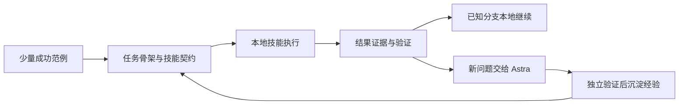

# Harness Agentic 问答：抓取验证、恢复分工与自进化

记录日期：2026-11-11 · 来源：用户提供的问答全文 · 状态：讨论存档

这份问答围绕积木分拣讨论一个共同问题：如何用可观测证据判断技能是否完成，再决定本地恢复、调用 Astra，或把经验沉淀为程序与策略。原回答的主张是以技能契约连接各层，以事件触发模型决策，并分别积累逻辑经验与接触控制能力。

用于回看架构思路和后续讨论。下文保留完整问题与既有回答，仅整理段落、标题、表格和代码排版；其中建议不自动变成本项目的已确认方案，实际实现与验收仍以项目当前记录为准。

原稿中的论文名称、数值、模型能力描述及“已读原文”等表述均来自所贴回答，本次未重新检索核验。原稿 Sources 只有名称、没有实际文献链接；原有 † 未核验标记照录。代码是示意，原稿中的 `track_id=[target.id](http://target.id)` 含粘贴链接标记，使用前应恢复为 `track_id=target.id` 并按实际接口改写。



## 问题（原文）

我最近在做harness agentic相关的工作，尝试用sam2/3对图像进行分割，在用pyrua-lean这一套codebase来做具体的执行和分支，总体的架构是参考rpent这一套，只让astra/llm在关键或者异常的部分进行决策，来调用各种底层已有的能力，现在具体遇到的问题更多的是工程上的点，比如说如何定义有没有抓住积木（我的demo是单手在一堆积木里面各种形状中，放置到一个积木桶里面，上方有对应形状才能通过的盖子），以及失败和异常恢复应该交给底层还是astra

更进一步来说我想让vla/rlt 作为其中的原子能力并入到我的harness系统里面，比如说只在关键的对齐对准阶段调用astra来执行具体的微调，但是怎么权衡这个时间和接入频率呢？我一直在思考怎么让harness跟底层/vla rlt这些解耦呢？我底层要是做的复杂了，那不又是基于rulebase的传统范式了吗？我做这个的意义就是希望不像传统vla采集一堆数据去做后训练微调，希望给几条成功范例，就能让astra/llm有更强的泛化能力，但是我现在仍然卡在一些基本的工程问题上，我想达到的理想效果是harness能够有泛化性，但是长时间；在特定任务多轮次下来可以吸收经验，完成自进化吸收错误经验，逐步pyrua-lean的模式以代码的模式变得更快更好 因为这种情况下不需要astra加入了 ，就跟rl的思维一样

结合最新的工作和开源项目跟我说说思路，讲清楚我应该怎么去思考这一类问题

## 回答（原文排版）

先查清你提到的几个代码库和这半年的新工作，再给你整理思路。

我已经查清楚了：你提到的几项都是今年下半年的新工作，原文也读完了。接下来补上 RLT 的具体接入方式，以及 ASPIRE、SEAR、PyRUA-REAL 这类"自进化成代码"的工作，然后整理成完整思路。

先对一下名词：rpent 我按 RLinf 的 RPent（论文是 Harness VLA）理解，pyrua-lean 是北大等的 PyRUA-Lean，astra 是 GPT-6 Astra，RLT 是 Physical Intelligence 的 RL Token。下面引用的工作我读的都是 arXiv 原文，链接在最后。

### 核心判断

你列的几个问题是同一个问题的不同侧面：系统怎么知道一步做成了没有。"抓没抓住"既是技能的后置条件，也是恢复的触发器，还是自进化的 reward。它不准，后面几件事都立不住，这也是这半年 harness 类工作共同暴露的短板。

围绕它有三个结论：

"交给底层还是 astra"不是一次划死的分工，而是一条会移动的边界。新情况先由 astra 在线处理，被验证成功的处理方式离线沉淀成代码，代码带着守卫条件独立运行，守卫不成立时退回 astra。astra 在线是探索，沉淀的代码是利用，这正是你说的 RL 思路。

这不等于退回 rule-based。判别方法是看任务名词出现在哪一层。

代码能沉淀逻辑，沉淀不了接触。过孔这种配合问题，代码和 astra 目前都做不好，这才是 RLT 的位置。

### 1. 抓取判定：带证据的后置条件，不是一个 bool

分三个时刻判：闭合瞬间看"夹到东西了吗"，抬起后看"东西跟着走了吗"，运输途中看"掉了没有"。信号按成本和可靠性排：

夹爪开度最便宜也最硬：闭合后没有闭到底，且开度落在这块积木的预期范围内。PyRUA-Lean 的 set_gripper 返回的就是"手指是否停在东西上、开度多少"†；OpenRUA 里 agent 自己写出来的判定也是指间距读数加相机视图。

视觉做第二道：抬起后跟踪同一个 mask，看它是否随末端上升、原位置是否空了。Harness VLA 把空抓定义为"夹爪闭合但物体没有随末端移动"，并明确要求不能只凭视觉上的接近下结论。

腕力或电流对你的 demo 大概率没用：积木只有几十克，容易淹没在力估计的噪声里。这是我的推断，需要你实测。

astra 看图判断最贵也最不可靠，只适合在前两个信号矛盾时做仲裁。GPT-6 Astra 的评测记录了它凭视觉或自述误判完成，比如鸡蛋没放正却报告放好。SEAR 里有一轮实验，agent 自写的验证器在 699 次 rollout 里 91% 判错†，又被同时当作停止条件，这一轮得分 4.6%，没用它的两轮是 15.5% 和 23.6%。

返回值要类型化：EMPTY / SLIPPED / WRONG_OBJECT / MULTIPLE / BAD_POSE 加证据，因为怎么恢复取决于失败类型。从积木堆里抓，抓错和带起两块都常见，用 mask 的跟踪 id 核对。

```python
# 示意，接口名按你的代码库改
g = robo.set_gripper("close")
if g.width <= W_CLOSED + EPS:  # 闭到底：空抓
    return Grasp("EMPTY", evidence=g)
robo.move_delta(z=LIFT)
m = robo.segment(track_id=[target.id](http://target.id))  # 同一个 mask 是否跟着上升
if not m.found or abs(m.z - (z0 + LIFT)) > TOL:
    return Grasp("SLIPPED", evidence=(g, m))
return Grasp("OK", in_hand_yaw=match_contour(m, hole), evidence=(g, m))
```

对你的 demo，"抓成什么姿态"比"抓没抓住"更关键，因为能不能过孔取决于积木在手里的朝向。两个做法（我的建议）：

抓起后把入孔的那个端面转向相机，分割出轮廓，与孔的轮廓比对算出相对转角。

更朴素的办法：先把积木放到一块空地上让它落成稳定姿态，按俯视轮廓重新抓一次。

两者都是把对准从接触问题提前变成几何问题。

### 2. 恢复归谁：按诊断所需的信息分层

| 情况 | 归谁 | 例子 |
|---|---|---|
| 安全类 | 控制器，不经过任何模型 | 力超限、碰撞 |
| 类型已知，修复方式已知，不改计划 | 代码内重试，设上限 | 空抓后重新分割再抓，最多 3 次 |
| 类型未知、重试耗尽、信号矛盾、需要改计划 | astra | 带起两块；积木滚出视野；要先拨开压在上面的 |
| 不可逆动作之前 | 代码多做一次检查，不过再问 astra | 松手入桶前确认形状与孔对应 |

两头都有证据：

PyRUA-Lean 和 RPent 用同样的原语和 VLA，只是把分支和重试写进代码。700 个任务上成功率从 63.1% 到 71.7%；在两者都解出的任务上，每集 LLM 调用从 17.0 降到 8.7。

它有个容易被忽略的消融：工具调用版只改成"按需看图"而不把判断下沉，成功率反而从 83.0% 掉到 68.5%。省下的调用来自判断在代码里完成，不是来自少看。

Show-Harness 去掉失败恢复插件后成功率从 96% 降到 72%，并指出误差集中在精细抓取和放置，规划不是主要瓶颈。

边界会移动是关键。astra 每处理一次新失败，除了当次的动作，还应该产出一条记录：失败特征、适用条件、修复策略。ASPIRE 的技能条目就是这个结构，Harness VLA 的全局记忆存的也是"成功规则"和"失败模型"。记录验证通过后变成代码里的新分支，于是同一种失败第一次归 astra，之后归底层。

### 3. 这是不是退回 rule-based，泛化从哪来

区别不在有没有规则，而在三点：谁写的，有没有守卫，失败了去哪。

传统做法：人写任务特定的规则，规则默认自己正确，覆盖不到就失败。

你要的做法：人只写任务无关的部分（原语、契约、验证器、安全限制）。任务特定的逻辑由 astra 生成并接受执行结果检验，沉淀下来的每段代码带守卫，守卫不成立就退回 astra。

一个可操作的检查："积木"”桶"”星形"这些词出现在哪一层。出现在你手写的底层里，是 rule-based；只出现在 astra 生成的代码和记忆里，底层只认 mask、位姿、开度，就不是。

把底层抽象做扎实是泛化的前提。CaP-X 在 12 个模型上的结论是，提供人设计的抽象时性能上升，去掉就下降（这条我只看了摘要）。

但张力是真实的，沉淀出来的代码确实会过拟合。SEAR 里相机一挪，代码策略掉到 9%，VLA 还有 69%†。RHO 在物体替换上的失败，追溯到搜索过程自己加进去的手调抓取时序。所以泛化靠三样东西保住：

astra 这条慢路径始终在。

代码里的对象引用是语义的而不是坐标。Harness VLA 存成功轨迹时，会把具体坐标换成符号化的感知查询。

守卫。

几条成功范例的用法也在这里。范例不是让 astra 模仿轨迹，而是让它抽出任务骨架：阶段、每阶段的子目标、判定条件、恢复方式。GPT-6 Astra 评测里的"知识包"就是这些内容加可执行 helper，在 RoboDojo 上把成功率从 15.6% 提到 29.7%，再加闭环到 54.2%。同一篇也说知识包基本是任务特定的，迁移有限。

对你来说泛化的单位是形状：骨架里形状是参数，新形状靠分割和轮廓匹配绑定。检验方法是留出一两种形状完全不给范例。

### 4. VLA/RLT 怎么接，频率怎么定

对准阶段不要让 astra 做闭环微调。 证据比较一致：

GPT-6 Astra 评测里，插头插入在三个平台上 0/11。

PyRUA-REAL 的网线插入始终依赖在线 agent，不带 agent 的程序做了十天没成†。

Galbot 的评测里，手内旋转 astra 的到位率是 0.51%，RL 是 76.9%。

接触需要几十赫兹的闭环，astra 一次调用是秒到几十秒。让它看图给小修正可以用来跑通第一批成功，但那是探索手段，不是终态。

astra 在对准阶段该做三件事：决定何时切入，给出目标，决定何时放弃。给目标的形式也有讲究：让它输出关键点之间的几何约束（积木这条边与孔那条边平行），由底层求解，比输出数值增量稳。RoboHarness 的工具集就是这类约束。

先量间隙。 毫米级的话，手内转角估计加轮廓匹配，再加下压时的柔顺和小幅搜索，很可能就够，不需要学习策略（我的判断，没在你的硬件上验证）。亚毫米级，或者要倾斜晃动才能过，再上 RLT。

RLT 的接口和你的设想同构：

它冻结 VLA，在其表征上训一个小 actor-critic，只接管任务的关键阶段，其余仍由基础 VLA 做。

actor 以 VLA 的动作为输入并被约束在它附近，所以是修改而不是替换。

切入时机训练时由人指定，之后让 VLA 学着预测。

奖励只是每集结束时人标的成功或失败。

最少 15 分钟真机数据，关键阶段最多提速 3 倍，螺丝任务成功率从 20% 到 65%。

RLinf 文档里有复现，和 RPent 同一个组织。VLA-Precision 是另一种做法，直接更新动作头的 LoRA。

这意味着 harness 要为它提供三样东西：把机器人摆到切入姿态（Harness VLA 叫 re-staging），每集的成功标签，reset。ENPIRE 说明这三样可以交给 coding agent 写：它让 agent 写 reset 函数、奖励函数和训练代码，奖励用几分钟的人工成功/失败示范校准，插针任务的奖励基于视觉对齐、末端高度和力估计。

所以自进化有两个载体：逻辑沉淀成代码，接触沉淀成小策略的权重，两者共用同一个验证器。

频率用事件驱动，不用时钟驱动。 Galbot 评测里有句话值得记住：控制器频率和推理速度是两个独立的量。astra 只在四类事件上被调用：阶段边界、守卫不成立、不可逆动作之前、重试耗尽。

审查粒度： GPT-6 Astra 评测里，审查 VLA 的提议时每 4 步审一次比逐步审省 63.5% 的 token，成功率还略高。Galbot 的混合模式里 85.6% 的执行步直接来自 π0.5，astra 只改 14.4%。

不是越少越好： Show-Harness 全程强制动作分块后成功率掉到 74%。

委托不等于免审： 动作交给 VLA 后审查成本还在，除非有便宜的守卫替你看。VLA 先验差时混合还不如 astra 直接做，RoboLab 上是 92% 对 98%。

一个粗判据： 这一步失败的概率乘以失败的代价，对比一次调用的延迟。空抓可逆且重试便宜，用代码重试；松手入桶不可逆，值得多一次检查。

利用空闲时间： 把调用放在运输途中异步做，不要让机械臂停下来等（我的建议）。

别被仿真数字误导： 仿真评测大多在模型思考时暂停物理，延迟成本被藏起来了。GPT-6 Astra 评测的真机人形实验里，约 90% 的时间在等推理。

### 5. 解耦：只约定技能契约

harness 和底层之间只约定一样东西，技能契约：

前置条件：什么状态下可以调用

参数：语义引用（对象 id、孔 id），不是坐标

终止条件和预算

后置条件的验证器，返回类型化结果和证据

统计：成功率和耗时，由日志自动更新，astra 选技能时能看到

Harness VLA 的 vla_act(prompt, max_chunks, stop) 是这个形状的最小版本。契约背后是脚本、运动规划、VLA 还是 RLT，harness 不关心，换实现不动 harness。

感知同样是技能，SAM3 的文本提示让"蓝色星形积木"成为语义引用。ENPIRE 提到它对小物体或有歧义的物体会给出错误 mask 或没有 mask†，他们用两个视角防误报。

### 6. 自进化：按 RL 来搭

对应关系：策略是代码库加记忆加小策略权重，优化器是离线运行的 astra，reward 是验证器，数据是结构化 trace。

和你的理想最接近的是 11 月 4 日刚挂出来的 PyRUA-REAL：

权重不动，只迭代程序和经验库（事实、记忆、实现三层）。最终程序可以冻结，运行时不调用语言模型。

冻结程序的井字棋单循环中位数 8.99 分钟。在线 PyRUA-Lean 要 4.6 到 5 倍，在线的 GPT-6 Astra 基线要 9.9 到 11.5 倍。

在线时 agent 思考占执行时间的 63% 到 90%。

叠积木的单循环随修订从 285 秒降到 156 秒†。

RPent 的 Flash 模式是更简单的版本：纯回放存下来的计划，LIBERO-Pro 上 72.6%，在线高推理是 78.5%（论文自己说这个数偏乐观）。

沉淀按成本从低到高分层，先做前面的：

统计和参数：每种形状的抓取开度、转角容差、各技能成功率。不需要 LLM。

文本记忆：环境事实、失败模型、成功规则。

计划骨架：成功的原语调用序列，坐标换成感知查询。

代码技能。

小策略权重。

三条纪律，都来自别人踩过的坑：

验证器独立于被验证者。 写进记忆的"成功"必须来自独立信号。Harness VLA 只在环境报告成功时才发布成功轨迹，而你在真机上没有 benchmark 判定，验证器就是全部。入桶判定值得用硬件做硬：桶下放个秤，或孔口装个光电门，比任何视觉判断都可靠（我的建议）。

晋升要过验证，且能降级。 ASPIRE 要求一个新开的 verifier agent 独立复现成功才入库；PyRUA-REAL 用只能否决、不能修改的评审 agent。库是会有害的：SEAR 里 GPT-5.6-sol 不用库 46.9%，用自己的库 42.4%。所以每条技能要持续统计在线成功率，掉了就降级。

什么能编译要有判据。 SkillCompiler 不是机器人论文，但判据通用：输入输出能显式表示、流程明确、前置条件可观测、效果可独立验证、实现有界，才编译成程序；否则留给模型。

预期要放对：终态不是零 astra。SEAR 的实机结果是 astra 在线 88%，冻结代码 41%，代价是单集 12.8 分钟对 3.8 分钟。合理的目标是 astra 调用数收敛到一个由环境新颖度决定的底噪。

从第一天起画三条随轮次变化的曲线：成功率、每集耗时、每集 astra 调用数。开发期成功率和冻结程序成功率要分开报，PyRUA-REAL 的 91.1% 是前者。

### 建议的顺序

 先做抓取和入桶的验证器，人工标一百次左右，单独算它的误报和漏报。

给每个技能补上契约和类型化返回，把已知失败的重试下沉到代码。

加手内重定位，量间隙，再决定要不要上 RLT。

全程记结构化 trace，画三条曲线。

最后做离线沉淀，从统计和记忆做起，代码和权重放后面。

† 这些数字来自原文后半部分的摘要级提取，我没有逐字核对，引用前请对一下原文。另外这些基本都是今年下半年的预印本，评测条件各不相同。

### Sources:

RPent 代码 和 架构文档，论文 Harness VLA PyRUA-Lean（代码），PyRUA-REAL Has GPT-6-Astra Achieved Embodied Intelligence?，Galbot 的 GPT-6 Astra 评测 RL Token 博客，论文，RLinf 复现，VLA-Precision ENPIRE（代码），ASPIRE SEAR（代码），RHO OpenRUA（代码），Show-Harness，RoboHarness（代码） CaP-X，SkillCompiler

已读完 RPent、PyRUA-Lean/REAL、RLT、SEAR 等近期工作的原文，并整理成抓取判定、恢复分层、VLA/RLT 接入、解耦、自进化几块思路。这次只是分析，没有写代码或文件；部分数字来自原文的摘要级提取，未逐字核对。

要我把抓取判定和技能契约写成你那套代码风格的骨架吗？
