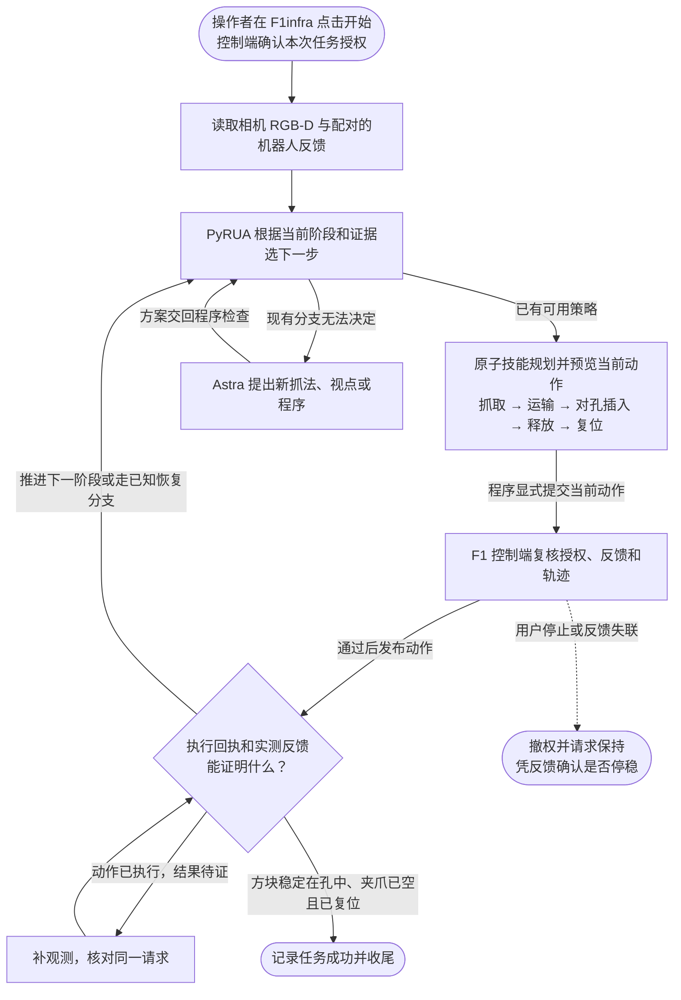

# F1 Harness 核心思路与设计原则

F1 Harness 要让机器人把一件事连续做完。感知给出当前目标和环境的测量，少量原子技能负责找路、执行和验证，PyRUA 程序把它们接成任务。熟悉的场景由本地程序继续推进。需要新抓法、新视点或新策略时，才把具体问题交给 Astra。

这份文档是项目核心设计的唯一正文。判断一项改动该放在哪一层、需要谁作决定、怎样证明结果时读这里。任务背景见 [F1 任务状态](../../tasks/F1_ComplexyToys/STATUS.md)，Harness 当前部署和真机验收结论见工作区的 `HARNESS/agent/STATUS.md`。

## 单块抓放工作流程

以工作台默认的 Harness Agentic 路线为例。机器人先接近方块并抓取，确认夹住后才运到桶上方，对孔、插入、释放，再避开桶复位。下面的闭环在每个阶段都会用到。

例如，确认抓空后，程序可以重新定位，再按预算重抓。放置成功则要看到方块稳定留在指定孔中，同时确认夹爪已空。若动作在首发前被拒，只有控制端确认零发布后才能换方案重试。部分发布或发布状态未知时，先查原请求。操作者点停止或控制反馈失联时，由控制端处理撤权与保持，停稳另凭反馈确认。

本次运行留下的证据也可形成[候选经验](#程序与经验)。只有在独立运行中验证通过并冻结的程序，后续任务才会在条件匹配时直接复用。

## 职责与交权

**已有程序凭当前证据，能否决定接下来做什么？** 如果能，程序就执行已获授权的下一步。每次接近、闭爪或运输都再等一轮模型，会拉长等待，也会让模型依据的画面逐渐失效。

| 情况 | 谁决定下一步 |
|---|---|
| 目标明确、已有技能可用，或发生已知可恢复故障 | PyRUA 根据工具回执选择分支，RPent 将调用交给 F1 技能。任务阶段、已完成动作和剩余预算沿同一程序传递。 |
| 需要选择新目标、改变抓法或观察策略，已有分支无法消除歧义 | Astra 获得当前阶段、实测证据、原请求发布状态、已试方案和可用工具。工具按实际签名提供坐标系、单位和结果字段，Astra 据此提出新抓姿、路径或条件程序。 |
| 动作将发布，或用户停止、控制反馈失联 | F1 的唯一动作发布者（控制 owner）核验授权、当前反馈、限位和碰撞，处理发布、取消和停止。只读预览、模型建议与网页刷新均不产生运动授权。 |

接入 VLA、BC 或 RLT 时，策略可以接管一段动作。观测、成功证据、恢复预算、日志和停止仍归同一任务。前段抓空或掉物也可以触发交权。先停稳、清掉旧动作，再凭带来源的反馈判断从哪里接续。[几何工具与技能接口](GEOMETRIC_AGENT.md) · [上游复用边界](UPSTREAM_REUSE.md)

## 观测与重规划

**先判断测量是否足以支持眼前这个动作。** 抓取要认准积木、支撑面和沿途障碍。运输要知道持物关系、目标区域和路径净空。到桶上方才需要精确孔口和在手朝向。一帧中抓姿拟合失败，仍可能留下足够的对象身份和实测表面，用于规划换视点。未观测空间保持未知。

感知优先保证身份和几何准确，再优化速度。SAM 等组件可随真实输入表现替换。跟踪从提示实际对应的帧开始，用当前 RGB-D 和按采样时刻配对的反馈重建几何。默认给 Astra 数值。只有它指出数值无法消除的具体歧义并请求看图，才附对应图像和帧身份。[感知与追踪配方](operations/SAM_RUNTIME.md)

分割分数、拟合误差、画面处理延迟和静止历史不足用于排序、告警或补观测。候选受阻时，能换一条已检查的方案就继续。信息不足时可规划一段能看清目标的运动，停稳后重测。确认原请求零发布后才能换方案重试，已完成的动作只补验或续后段。部分发布、未知发布先查原请求，STOP 或撤权后由 owner 处理。判断始终使用原任务的请求身份和预算。[故障与恢复规则](FAULT_POLICY.md)

## 原子技能与控制

“原子”指调用者可以交给技能一个清楚的目标，并得到可信的结果。例如“把手中积木运到桶上方”可以在技能内部选路、求解逆运动学（IK）、协调肘腕、检查整条轨迹并验证到位。让 Astra 逐个猜绝对路点，会把一个可复用的运动能力拆成反复问模型的步骤。

直接路径和成功示教作为起点，必要时由成熟规划器在授权自由度内搜索。选抓姿时就看它能否接上运输，抓后再用实测持物偏移复核受影响的后段。预览、提交前复核和实际平滑输出使用一致的坐标、模型、障碍与工具余量策略。供排序的额外余量在复核时也按提示处理。候选耗尽只说明本次搜索未找到可行路径。

持物需要独立反馈。闭爪后的实测开度在已知夹物区间稳定，可支持本地快判。正常提起时还可检查同一物体随手移动并离开支撑。命令回填、空闭稳定都不足以证明夹住实物。短暂坏帧保留之前抓稳的记录并标明当前未知，实测开夹、明确滑落或身份改变会使相应证明失效。精确在手姿态留给确实需要它的放置阶段。

## 程序与经验

PyRUA 保存当前阶段、工具回执和待补的证据。已知恢复写成可以续跑的分支。可行预览只有经过程序显式提交才会执行。零输出找路和实际动作修正分别计入对应预算，同一输入反复尝试又没有新信息时，应把未解决的问题交回 Astra。

经验从真实执行中提取，记录适用条件、相对参数、原请求、结果证据和失效条件。失败与探索可供下次决策参考。候选程序要在独立运行中按其声明的目标验证，才可晋升、冻结并在相似场景直接复用。适用范围扩大到新布局时另行验证，反例可以触发降级。[经验程序与晋升规则](EXPERIENCE_PROGRAMS.md)

横躺积木扶正是这套设计的检验题。开发者提供观察、接触、支撑操作、结果验证与程序保存的能力，把具体策略留给 Astra 探索。分别记录谁提出方案、实物是否扶正，以及后续独立运行能否仅靠保存的程序完成。这样才分得清工程修复、自主发现和经验复用。

## 怎样验证

| 要回答的问题 | 对应证据 |
|---|---|
| 这项技能能否在当前约束下工作？ | 用真实起点、目标和持物偏移检查完整路径、最终平滑输出与到位回执。记录失败原因及未覆盖的布局。 |
| 整个程序能否接续？ | 走正式入口回放正常流程、抓空恢复和停止。核对实际输出接收记录、阶段与请求身份，注明哪些后续观测和反馈由模拟提供。[完整回放](operations/OFFLINE_REPLAY.md) |
| 实物任务是否成功，哪里在等？ | 现场分别记录抓持、运输、放置、返程和人工介入。区分首个实际动作、抓稳到开始运输、每次模型调用理由与总用时。放置成功须有释放后物体位置和空爪证据。 |
| 一条经验能否复用？ | 分别比较无经验、有候选提示、运行冻结程序的结果、耗时和必要模型调用。说明运行是否独立、布局是否变化。 |

能力建设先解决可靠的带物移动及抓姿与运输衔接，再验证放置与恢复，随后才比较调用成本、经验和学习策略的收益。具体待办在工作区的 `HARNESS/agent/TODO.md` 维护。

## 单块分拣示例

1. **看见方块。** 头部与腕部观测提供对象身份和当前几何。有把握时直接选抓法。如果两块外形相近而数值无法区分，可由 Astra 明确请求对应画面。
2. **抓起并接运输。** 接近、精调、闭爪在同一程序中推进。抓持证据成立就从当前姿态接向桶上方。若证实抓空，则沿原请求的恢复分支重新定位。
3. **对孔、释放、返程。** 到桶上方再测在手朝向和孔缘。释放后复看物体与夹爪，确认放置再右移避桶、复位。若动作已完成但被遮挡，先补观察。运行只登记证据实际支持的结果。
