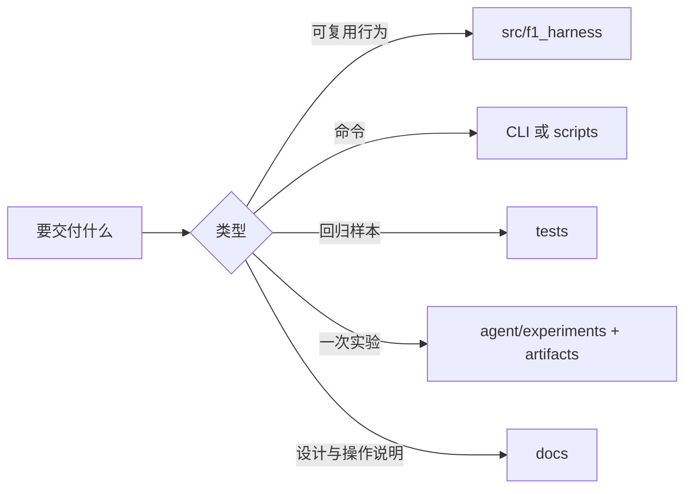

# HARNESS：代码、实验与文档的归属细则

这份文档收纳从 [AGENTS](../AGENTS.md) 移出的三组细则原文：代码与实验放在哪里、实现与执行边界的完整条文、文档与证据的维护规则。内容未改，仍然有效；AGENTS 只保留摘要和入口。

改代码之前读“代码与实验归属”；涉及运动、授权、故障恢复或运行门槛时读“实现与执行边界”；整理文档或更新状态时读“文档维护规则”。

## 代码与实验归属

改动前先找到正式入口、现有实现和调用它的测试。遇到同类失败，先用原请求或固定输入复现，再决定是改现有合同、补一个回归样本，还是开展新的实验。按职责落在以下位置。

| 要交付的东西 | 放在哪里，怎样接回项目 |
|---|---|
| 跨入口复用的行为 | `src/f1_harness/` 中负责该能力的模块。网页、CLI、回放和预热通过包内接口复用逻辑。保留已有参数、错误、取消及重试语义；调整模块时核对打包清单和旧调用者。 |
| 可反复运行的命令 | 先扩展已有 CLI 或 `scripts/` 下对应命令。入口负责参数、调用和输出，共用实现留在包内。有独立用途才增加脚本，以操作命名；版本、场景和运行编号作为输入。维护入口见[开发导航](../README.md#源码与配置)。 |
| 平台实现与配置 | 机器人端入口放 `native/`，感知环境及依赖锁归 `perception/`，共享示例和依赖身份归 `configs/`。跨工程能力由原所属项目维护。 |
| 回归与现场样本 | 复用 `tests/` 的对应套件。小型可分发样本放 `tests/fixtures/`，记录来源和预期；真实大输入留在原处，验收清单记路径、内容哈希和使用它的用例。报告中分别列出通过、缺输入和环境限定跳过。 |
| 一次实验或临时探针 | 按[实验索引的记录规则](../agent/experiments/README.md#记录规则)找到同一问题的复盘。一次性驱动、配置快照和机器输出归该实验的 `artifacts/` 子目录；第二个独立调用者出现时，核对既有脚本后再提取共用部分。 |
| 现场原件、经验与发布 | `runs/` 保存逐次运行原件，`experience/` 保存实际学习数据，`releases/registry.json` 维护框架身份。冻结包、回放输入和验收回执保持登记的路径与内容身份。空间整理须先查消费者、登记和恢复方法，按原件、可再生成输出分别处置。 |

## 实现与执行边界（完整条文）

- 优先复用已固定身份的上游源码与现有 F1 能力；先查现成接口，再做任务适配，不复制一套通用模型、机器人或控制框架。
- 项目初始接入默认只读与离线。日志、保存观测、几何计算及接口模拟通过，不代表控制网关、模型调用、标定或硬件动作已经实现。
- 真实运动继续由实际控制所有者负责授权、锁、通信与保护。2026-11-05用户明确改为 infra 点击开始／停止，不需要手柄或终端 Enter；网页开始绑定本次任务与运行，由独立 Harness web owner 消费，不伪造 F710 包或物理 START。纯读取、辅助服务启动和刷新不能授权运动；旧手柄入口仍独立保留，不复用旧授权或绕开原控制保护。
- 模型输出是待校验的计划或建议；不能直接冒充可信硬件状态、成功判据或已执行动作。执行与反馈分别留证，失败、保持、取消和恢复不得合并成成功。
- 故障按[故障分级与有界恢复](FAULT_POLICY.md)处理：实际限位／碰撞、反馈失联、未知或部分发布及原件记录故障保留原硬保护；候选不可达应改变路径后重新校验，不能绕过执行检查。只有 owner 证明零发布且满足明确时效条件的请求才允许有界重规划，不能把反馈恢复解释为自动重新授权。
- 测试验收、性能诊断或派生产物阈值不得直接成为动作的一票否决项。新增运行门槛必须注明对应物理失效、适用阶段、故障等级、证据与恢复方式；耗时预算不替代通信 watchdog、反馈新鲜度和原限速。已接受的粗标定开发身份按其合同执行，不重新引入未约定的精密认证门槛。
- 修改网页 owner、授权或故障恢复时，除 HARNESS 自身回归，还运行 `scripts/check_native_integration.py`。它使用真实 DAgger ControlLoop、owner、WebHarness 与任务引擎，传输为假实现、不启动 ROS 或机器人动作；单独的 HARNESS pytest 不覆盖这段跨工程生命周期。至少覆盖无手柄授权、发布前静止时序等待、反馈失联撤权、未知／已发布不重放和停止处理，真实动作验收另外记录。
- 修改参考速度、连续路点或转腕时序时，原生参考路径通过与程序返回成功不足以证明方案可用。对受测配方审计实际F1Owner/Ruckig输出的环境扫掠、发布完整性和原限速，绑定控制profile与场景身份；输出检查失败的方案不得作为已验证提速或部署配方。此为由真实代码反例支持的配方验收，不把诊断耗时另加为运动中断门槛；现场profile和物理误差仍需单列验证。
- F1 RLT 可沿原任务并行推进，资源、数据准入、训练身份和部署状态仍以原任务为权威。HARNESS 的阶段推进不隐含切换模型、启动训练或替换生产控制。
- 每次训练包括预检与恢复都遵循根规则接入 W&B，分类和 run 身份明确；没有发生训练时，不创建虚假的训练结果或在线监控结论。

## 文档维护规则

- 每个决定、配方和实验问题由一份正文维护。设计取舍改架构原件，操作合同改对应专题，版本实施与结果归日期复盘。README 和 Why&How 直接指向原件；对公开阅读器中的操作链接核对实际渲染后的目标。
- 更新 STATUS 时替换受影响的当前结论，写清证据属于回放、上线核验还是独立真机。已完成待办的结果写入对应复盘，从当前 TODO 移出。尚待证实的旧事项保留依据和重新启动条件。
- 大段历史归档时保住全文、时间和证据，按新目录修正相对路径，将原来指向已迁章节的引用改到历史位置。日常交接只链接历史，不再追加整页版本流水。
- 收尾时在 HARNESS 根运行 `python3 scripts/check_project_layout.py`。本机涉及证据路径的整理再加 `--with-evidence`。代码改动另从正式入口运行相应用例；这项检查只约束维护工作。
- 使用准确文件名 `AGENTS.md`；不另建 `agent.md`、`agents.md` 或第二份 Current／Latest 正文。
- 每份 Markdown 标题与必要 metadata 后先用 2–3 个短段说明结论、影响和阅读时机；详细命令、参数和证据后置。人类文档不复制 agent 运行流水。
- 明确区分方案、实现、离线通过、集成通过与实际部署；每一项事实有适用版本和证据。旧结论注明被替代关系，原件与历史失败记录保留。
- 教学阅读复用 6000D 的 Why&How 4243。只登记公开人类原件并限定读取范围；`API.MD`、agent 运行材料和原始产物不纳入网页，不另建站点或占用 4242。
