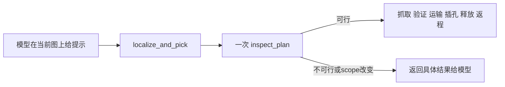

# 执行宏与 SAM 视频接线交接

**交接已接续（2026-11-11）：执行宏与SAM视频现已合并至V5并部署；以下“候选／未部署”描述保留为当时证据。** 最新代码范围、部分观测与持物修复、真机待验内容见[STATUS](../agent/STATUS.md)，不再按旧V1隔离包部署。

本轮完成显式执行宏与 SAM 视频候选，未修改模型链路或状态字典。收尾确认另一 agent 已将执行宏与模型合同发布为条件程序交互 V2；SAM 视频调用配置仍未部署。后续必须从 V2 接续，不用本轮隔离的 V1 验证副本覆盖线上。

新宏将定位、预览与可行后的完整任务放入同一个 Python cell。真实历史 RGB-D 的视频调用已得到跨帧 tracking 记录；完整零输出回放使用保存程序和模拟运动后反馈，不代表实际 Astra 已自行选择该宏或真机成功。



## 模型侧调用（另一 agent 已在 V2 衔接）

`localize_and_pick` 已由 `compile_library()` 定义，`install_recovery_helpers()` 的现有机制会安装到持久 Python workspace；本轮没有改它的提示词或 helper_names 元数据。调用方应将其加入自己的能力说明／元数据，并在初始任务执行分支明确调用：

```python
# hints_by_camera 来自当前展示的图，坐标沿用现有归一化合同。
# 示例结构：{'right': [{'object_id': 'square-1', 'box_normalized': [...]}],
#             'head': [...实际可见的孔口与桶体提示...]}
result = localize_and_pick(hints_by_camera, **approach_parameters)
print(result)
```

- 所有可见实体提示先按相机提交，再获取一次场景／预览；不要在两路提示中间等待观察。
- 预览 `planned=True` 且 `current_scope=True` 后调用现有 `pick_and_place`；执行仍获取新观测并由 owner 复核。预览本身依旧只读。
- 不可行或 scope 改变时返回待处理和诊断，不自动重试；模型可继续使用已存在的有限候选程序。
- 未知／部分执行、STOP、抓取失败不从头重新定位或重放。若接近已经执行，应使用原有阶段恢复入口，不能再次调用初始宏。
- 未读取或修改模型的 F1 状态字典，也不通过工具 `moved` 字段判断机械臂是否运动。

实现：[recovery_programs.py](../src/f1_harness/recovery_programs.py)。针对检查：[test_localize_and_pick.py](../tests/test_localize_and_pick.py)。回放驱动新增仅供离线测试的 `program=localize_and_pick`，不修改线上模型协议。

## SAM 配置合并

候选配置：[masks-video.local.json](../artifacts/v1-followup-20261111/masks-video.local.json)。相对冻结 V1，仅在 `views.head` 与 `views.right` 都显式添加 `sam_streaming: true`，保留 `sam_streaming_objects: ["square-1"]`；桶盖与孔口继续批量图像分割，原标定、几何阈值与控制保护不改。

同一批50份真实历史快照：V1没有tracking回执；候选右腕47个不同源帧、头部31个，分别保持同一stream，frame_index跨帧递增。两配置均得到47份场景、其中45份完整，3份重复源帧被拒收。顺序回放感知中位162→230ms，视频在这组数据中更慢；它提供时序记忆，不能据此承诺提速或精度提升。

发布时必须更新现场配置身份并验证实际tracking记录；服务health的streaming=true不足以通过此项。不得直接改冻结V1目录。候选尚未切入线上。

## 明确没有改动的部分

- `planner.py`、`planner_context.py`、`planner_feedback.py`、`planner_geometry.py`、`planner_progress.py`。
- `task_runner.py`、`astra_programs.py`、`adapters.py`、`remote.py`、`contracts.py`。
- `model_pool.py`、`model_transport.py`，以及模型／推理档位、API凭据、VPN／代理设置。
- 模型请求与响应、提示词、状态字典、裁剪、停止后的API用量留证与UI阶段展示。
- 线上 `workspace.local.json`、冻结 V1、机器人发布器、标定与运动阈值。

另一 agent 的修改已观察到落在 planner、planner_progress、task_runner，本轮保留且未覆盖。[本轮修改范围与哈希](../artifacts/v1-followup-20261111/scope-receipt.json)记录了各文件前后状态。中间一次回放完成后源码又被并发修改，输出审计因此拒收；正式证据改用冻结 V1＋本轮执行宏的隔离副本，不把并发检查失败写成通过。

请求生命周期／费用回执与网页可见性仍是待办，按用户要求本轮暂不碰模型相关部分。V2已接入宏，后续SAM配置从V2合并，冻结验收后另登记版本。

## 本轮隔离验收与后续接续

43项执行宏检查与60项原控制检查通过。隔离V1＋本轮宏及视频候选，经正式RPC／PyRUA／owner完成12次技能调用，2502条内存输出全请求审计通过；仅1条保存程序响应，0新增付费API，未发START。53.54秒是模拟链路耗时，初始RGB-D及SAM真实、运动后反馈模拟，不代表真机或模型延迟。

[输出审计](../artifacts/v1-followup-20261111/isolated-cycle/cycle-audit.json)、[回放](../artifacts/v1-followup-20261111/isolated-cycle/sim-f40c03da1b/report.json)、[视频连续源帧](../artifacts/v1-followup-20261111/video-continuity.json)。V2两次真实模型已选择该宏，另见[模型专项](../agent/experiments/20261111-api-cost.md#条件程序交互v2四次受限验证与部署)；本轮独立证据不代替其冻结验收。
