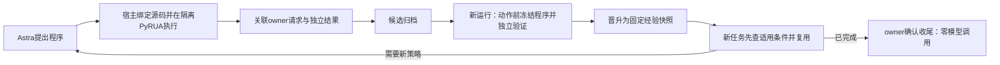

# 失败经验：证据、程序与执行快照

**2026-11-17：V29的跨运行失败历史已实际进入Astra请求，尚未形成成功程序或真机扶正策略。** 最新正常摆放失败自动归档了1条失败事实和4个探索cell；程序候选、晋升仍为0。开发者不预写扶正路线，候选提交、整条运行成功或另一个模型赞同都不能替代实际执行与独立结果证据。

通用局部推进、重观测和支撑释放也已加入开发源。支撑几何、对象三轴与法线夹角可供Astra选择动作，尚不是独立的“已经扶正”成功判据；当前程序验证目标只有抓稳和放置。新任务由owner在动作前保存实际初始观测与试验身份，独立运行可验证固定程序；它不证明换布局也有效，审阅也不能替旧run补造身份。当前冻结、部署及现场边界以[STATUS](../agent/STATUS.md)为准。

本页同时说明原有登记恢复程序与新生成程序的证据合同。JSON保存事实、源代码和身份，Markdown供人审阅；运行读取固定已验证快照，经隔离PyRUA和原owner执行。只保存在建议区的文字或未验证代码不会自动改变动作，也不更新BC／RLT权重。后文日期实验保留其当时结论，不代表新框架已通过同样的真机验证。

## Astra生成程序的当前闭环

`skill_candidate`包含`title/claim/source`。源代码只允许函数定义，以纯条件`applicable(scene)`和`run_skill(robo)`为入口；装载阶段禁止装饰器、默认参数或注解产生副作用。仅提交元数据仍不执行；显式指定`execute_candidate=true`且普通`code`为空时，由宿主生成固定调用包装，在新的隔离命名空间执行该份精确源码。它不继承此前cell变量或助手定义；复杂策略需要把所依赖的函数一并保存，仍通过公共robot API调用原技能。

宿主记录源码、实际包装代码及每次backend输入／结果的内容摘要、调用顺序、请求ID和起止事件。封存后重新关联owner的受理、发布、技能结果及作用域，确认成功属于这次程序调用；程序自己返回`success`、只定义未调用、另一段程序完成任务、修改原件或重复审阅都不能构成执行证明。自动封存登记只接受有实际绑定且达成已支持目标的候选；缺失发现运行身份时保留归档及具体未决原因。

独立验证和晋升由宿主`review_agent_programs`接口完成，不作为模型工具开放。普通网页新运行先由owner在首个动作受理前追加`program_trial_frozen`：保存当前完整Observation、RGB-D内容摘要、原始时间、任务指令和owner／session／epoch。探索身份来自这份实际初观测；验证身份还绑定执行前选定的候选摘要及其发现原件。只换run名称或时间不会改变场景内容摘要，同一布局的新运行也仅声明`validation_scope=independent_run`、`generalization_proven=false`。既有显式留出场景合同仍要求原件原有的`scenario_id`、`scene_manifest_sha256`和`heldout=true`，不回填旧记录。

封存先登记发现候选；只有验证身份原本已冻结且同一份源码确实产生独立测量结果，才自动审阅并晋升。验证不复用发现run、原件或控制作用域；晋升前再次重算源码绑定与结果证据，真实放置还须有owner放置证明。没有这些证据时保留候选及原因，不能因一次运行结束而宣称学会。失败验证保留原回执，之后另一次独立成功可以重新验证。

`program_reuse.py`已接入Astra任务首次模型请求之前。它优先从本次固定快照选取同标定、形状、目标、获准技能范围和完全相同用户任务指令的已晋升程序，并重新读取当前数值场景；旧记录缺指令只匹配空指令。未晋升程序只有原发现源码实际绑定成功、仍可复核且自包含，才可在新任务中冻结为一次独立试验。一个已调用策略的未解决结果连同已完成阶段交Astra，不重跑原程序、不再自动试另一条；未知发布先查询，不能当作未执行。已验证抓稳程序完成后，可接已有本地放置后缀；只有owner实测确认已支持的完整目标完成才以零模型调用收尾。混合路线交权尾段仍走其既有接续，不能把独立Astra入口的自动复用当作所有入口都已实测。

实际使用顺序是：第一次点击开始，由Astra探索并实际执行它提交的候选源码，达到已支持目标后封存登记；下一次相同任务指令的独立运行，宿主优先验证适用的冻结候选，失败则把当前事实交回Astra；验证通过后，之后的新运行从固定快照自动复用。每次开始仍由用户触发，框架不自动重启真机任务。首次数值观测缺失时先交Astra获取观测，owner在真正首个动作前登记探索原件，不把缺失观测伪装成验证资格。

当前目标集合是`verify_grasp`与`placed`，验证回执及晋升材料中的`program_goal`限定了实测结论。自然语言`claim`和任务指令不是验证器；指令匹配防止跨任务误用，不能证明已完成“扶正”语义。对象姿态角、`support_observed`和一次支撑释放成功均不自动构成“扶正经验”的独立证明；还需明确相对支撑法线的目标角度和误差条件、无人工路线提示的探索及独立实测。当前没有这类真机成功、晋升或收益记录，不能因抓稳或放置成功就声称学会扶正。

## 下一次运行怎样判断经验是否起作用

三层分别报告，不用一个“已学习”标签代替。最新V29原件已证明跨运行注入；本轮开发源增加实际请求绑定事件，部署状态仍看[STATUS](../agent/STATUS.md)。不为解释经验额外请求模型，不要求模型自述因果。

| 层级 | 可核验依据 | 不能由此推出 |
|---|---|---|
| 已检索并进入请求 | `experience_advisory_read`及实际request内容；新增`model_experience_input`绑定请求ID、scope、失败／探索ID与内容摘要 | 模型必然使用了它，或下一次必然更好 |
| 实际策略发生变化 | 对照真实Python源码、host primitive参数、owner受理／发布及结果；区分框架候选选择和Astra明确提出的新参数 | 仅凭时间先后把变化归因于历史，或把不同布局的结果称为因果改善 |
| 成功验证并晋升复用 | 候选自包含源码的真实执行绑定、新运行独立结果、晋升回执；之后再验模型调用前的固定程序执行 | 探索cell归档、一个failure条目或自然语言总结等于已学会程序 |

相同任务指令和标定等scope才召回对应记录，旧图框与坐标只作历史原件，不能当当前定位。失败事实保留“报告错误码、并非已确认物理原因”的属性；程序经验继续沿原独立验证合同，不因增加请求日志而放宽晋升。

## 材料各自做什么

| 材料 | 内容与作用 | 能否直接改变动作 |
|---|---|---|
| 失败事实 JSON | 原始 owner trace 的内容摘要、请求、阶段、错误码、重复次数 | 不能；错误码不自动代表物理原因 |
| 准入工程审阅 JSON / Markdown | 被拒绝请求、阶段/恢复状态、原始时间顺序及此前发布事实 | 不能；不据此生成撤离、重放或绕过条件的程序 |
| 跟随诊断 JSON | 每次封存后关联trace、控制发布与独立编码器时间；记录目标/提交/反馈差、测量变化及夹爪主题发送 | 不能；不推断接触力、不自动改抓取阈值或重发动作 |
| 候选程序 JSON | 固定 schema、触发条件、登记操作、owner checkpoint 条件、已有任务预算 | 尚不能；候选与执行快照隔离 |
| Astra源代码候选与执行绑定 | 精确函数源码、宿主包装／RPC回执、实际owner请求及发现结果 | 显式候选执行走隔离worker；默认复用须先独立验证、晋升并固定快照 |
| 规划顺序候选 JSON | 成功计划之前各候选拒绝原因/耗时、原请求、任务/标定/配置/代码身份及保留全部候选的新顺序 | 不能；离线对照不代替真实独立验证，不自动进入运行快照 |
| 候选 Markdown | JSON 的人类阅读视图、发现运行与待验证项 | 不能；不作为编译器输入 |
| 内建助手／已验证程序的 Python | 调用已注册的 `robo.skill`、`recheck`、`resume`，没有原始关节发布接口 | 可用于已授权任务，仍由owner判断当前条件；内建助手不冒充新学会的方法 |
| 固定经验快照 | 已验证策略、来源和独立验证回执 | 只在运行开始时固定读取，不在动作中悄悄改变 |

## 已登记的恢复程序

- `verify_completed_motion`：结果为待审且 owner 提供验证 checkpoint 时，只补新观测和验证，不重放已完成运动。
- `resume_known_progress`：明确 `motion_stalled`、实测保持已确认且有 owner 续接 checkpoint 时，从新实测状态继续。抓取的这个入口仍只允许 owner 已证明的闭爪前状态。
- `insert_reobserve_realign`：插入失败后撤离、重新观察、对齐，再插入。不能跳过撤离，也不能凭经验直接放松插孔条件。

这些是源码内建、已经有针对检查的恢复程序，不是由本轮日志自动学会的新动作。候选里引用同一程序意味着“此失败可能适用这项机制”，不意味着发现日志已经验证机制有效。重复运行日志按原始 trace 摘要去重；重复审阅一次不会算作再次验证。

通用`move_and_reobserve`按Astra给出的不同局部目标逐项预览，缺场景时在整份候选列表内刷新同一项一次；首项可行运动完成后重观测，补观测失败保留已完成运动回执。`move_tcp(..., support_contact=True)`只为当前持物接近登记支撑面提供原数值／扫掠检查；`release_supported`以新的未持物、静止和支撑几何证据确认松爪结果，不宣称放入孔。后验缺证据只补验，成功后清理旧抓持阶段及旧运动checkpoint，保留任务预算。它们是通用接口，不含横躺扶正路线。

## 用这次 Astra 长等待举例

后续逐帧审阅补充了一条有证据的工程经验：只在约5Hz图像上测试会漏掉慢采样失跟。该失败记录按约1Hz重放出现26次持续丢失，实际反馈FK投影恢复26/26；头部备用提示也已接入源码。JSON保存逐帧/新旧反例，Markdown解释适用范围；没有同期完整RGB-D，不晋升为“已解决现场根因”的恢复策略，[证据与限制](../artifacts/astra-mask-sequence-20261109/decision.md)。

原始记录显示：接近末点已到位，但持续缺少动作后的有效场景，随后用户停止。事实库保存等待24次及原始证据；候选引用 `verify_completed_motion`，建议使用新的补验证接口。

这份旧记录不能直接晋升：当时的旧版本没有把可恢复结果及时交回 planner，也没有发生补验证后的自主抓放成功。新的程序需要先证明取消、不重放、请求身份与预算正确；之后用另一个场景证明实际触发、实际调用补验证、任务完成，才能成为“已验证经验”。

对于抓取路径误差、真实4.54mm残差等尚未明确解决的情况，当前系统保留工程问题，不把它们总结成“放宽门槛即可”。这些证据要用于定位相应阶段的几何、控制跟随或观测原因。

封存复盘还自动生成独立的`tracking`诊断，绑定同一请求的epoch/task及三个原件摘要。它区分参考是否已提交、编码器是否持续变化，以及闭爪命令是否真正有完整主题发送；重复反馈时间戳不算多次测量，矛盾值不平均处理。历史复盘保持原件与候选身份，补充诊断另存，不凭新增诊断自动晋升恢复程序。成功示教中的动态跟随差也不能代替当前物体相对夹爪的捕获范围；需分别验证。

## 之后的 RSI 工作

本节保留2026-11-09登记恢复程序体系的验证路线；它不覆盖上文新生成Python程序的执行绑定与自动复用。两类材料共用原件与独立验证原则，验证器身份分别记录。

1. **已接线，待真机验证**：形式化候选进入 ExperienceStore 隔离区；v3 验证器识别实际 `recheck`／`resume` 请求关系，晋升前重算验证回执。旧序列候选继续原 v2 合同，不冒充已通过 v3。
2. **离线反例已覆盖，现场待验**：旧 epoch、跨 session／owner／task、未停稳、未发布、未证明闭爪前状态、没有验证 checkpoint、重复请求、撤权、证据缺失与无关动作不得被误认作成功恢复。补验证还须匹配原到位时间，且新请求没有再次发布动作。
3. 独立场景记录成功率与耗时，再固定快照；保留之前快照供对照。没有相应证据时，不宣称“每次失败都会让下次更好”。
4. 效率策略与恢复策略分开验证。返程路径缩短只有数值证据时，记录为离线候选；真实完整任务的耗时改善另行计量。

完整周期任务的经验验证也要求放置之后完成 `withdraw_reset`；只放入桶、没有返回就绪不能验证整任务收益。发现运行原件按内容摘要绑定，复制到另一目录不算独立验证；真实模式仍要求独立场景、留出身份和 owner 放置证明。候选与其一次验证回执固定保存，拒绝后不能改写原回执冒充成功。

晋升后的 RPent Markdown 前言包含登记程序 JSON、程序摘要和验证身份；baseline 只识别固定结构，不执行正文。Astra 读取同一固定快照。当前三种程序本来就是内建恢复，因此晋升首先增加适用证据与来源，不能把相同代码称为学会了新动作。后续实际改善要通过独立场景的成功率和耗时对照说明。

该历史实现主要在 `recovery_programs.py`、`program_verifier.py`、`memory.py`、`learning_review.py` 和 `run_review.py`；[当时真实失败登记回执](../artifacts/formal-verification-20261109/saved-failures-registration.json)显示两条待验证、零条真实晋升。生成程序新增的绑定、独立审核和读取路径分别在`program_experience.py`、`memory.py`与`program_reuse.py`，不能沿用这份旧回执证明其现场效果。

## 规划失败也能留下可复用建议

以前一次技能若最终计划成功，中途失败的候选容易从结果审阅里消失。现在PlanService在既有计划事件中附上有界尝试记录：每项的候选编号、原生拒绝诊断、实际计算耗时以及最后得到计划的候选。失败诊断或配置摘要读取异常只使这份记录缺失，不新增动作中断条件。原任务、epoch、观测、标定、fixture和本地运行源码身份一起保存，计划成功明确不等于执行成功。

正常结束审阅会从原owner trace生成`planning-candidates/<内容摘要>.candidate.json`和同名Markdown。操作固定为`prefer_registered_candidates`：先尝试本次可行候选，其余登记候选全部保留，限位/几何/任务预算均不改。只有有拒绝后又得到计划时才提建议；不从旧日志缺失的信息编造尝试顺序。重复事件与重复审阅按内容去重，身份不符的诊断列为无效，旧运行审阅原件变化先拒绝再处理新增建议。

本轮完整原生/平滑模拟在约0.748秒的失败尝试后选中转移候选1，结束时自动提出`[1,0,2,3]`。这与上轮人工对照发现的顺序一致，但不等于再次测得0.748秒收益：该数字只是本条失败候选花费，未来场景可能仍需尝试其他候选。建议明确标为synthetic、未验证、不可执行；旧Astra与baseline日志缺少此新诊断，读取后均为0条建议，未补造真实学习成果。

这条效率建议目前没有进入RPent已发布经验或线上Planner配置；下述独立模拟已在试验副本实际采用。后续发布必须核对原代码/任务/标定及配置，仅应用已声明的排序差异，用独立真实场景确认实际采用、完整任务、取消/回退和规划耗时对照。保留原始fixture摘要，不把修改后的配置冒充原配置。现场真实晋升仍为0；已有恢复程序的独立验证与快照合同保持原样。

新增18项检查和相关76项针对检查通过；1051项全回归、解包391项通过（含原生60项假传输）。完整默认模拟周期仍23.60秒，指令/测量/时间逐帧未变，未连接机器人或调用模型。[自动候选与证据汇总](../artifacts/planning-lessons-20261109/summary.json)。

### 独立离线对照已接通

维护工具 `scripts/compare_planning_order.py` 对发现条、原顺序条和新顺序条进行交叉核对。新顺序必须真正首先尝试建议候选，全部登记候选仍保留；任务、标定、运行代码、执行配置和完整动作输出保持一致。仅允许顺序差异及离线owner路径重定位，不能混入其他planner或数值配置变化。十项技能必须自主完成，包括放置证明和返程。

将发现条的场景分别平移方块2mm、孔口10mm，四次原生F1Owner/Ruckig模拟均完成。两组配对转移规划为1.892→1.146秒、1.914→1.178秒，实际少约0.746和0.736秒，模拟指令/反馈/时间逐帧一致。虚拟周期仍23.62和23.70秒；模拟时钟不计规划等待，不能把计算节省误写成运动提速。这是同一保存场景的两个合成布局，每组一次计时，不是统计性或真机收益。

输出始终标明 `synthetic=true,publishable=false,promoted=false`，没有修改运行配置或经验快照。19项比较器检查及18项规划建议检查通过，覆盖未完成任务、建议未采用、其他配置变化、原件变动和发现条复用等反例。[最终比较回执与范围](../artifacts/order-validation-20261109/summary.json)。真实验证、正式发布和运行消费仍待完成。

### 失败经验也必须容纳“程序成功但输出不合格”

阶段速度试验提供了这样的反例：30/30参考配方完整模拟17.92秒、原限速合规，但独立输出审计发现返程进入桶模型。程序的成功结果不能独自验证效率经验。这份结论按任务/代码/配方/profile、原件摘要和输出审计保存为隔离的[工程决定JSON](../artifacts/phase-speed-20261109/decision.json)及同目录Markdown；它不是已注册的恢复程序，不会被RPent快照自动执行。

转移30/返程25的替代配方在六条模拟输出检查中通过，名义18.36虚拟秒。当前只支持所声明的合成场景，不把25度/秒推广成普遍安全阈值，也不将模拟证据晋升为真实经验。后续效率验证必须同时考虑实际输出可行性、完整任务和耗时，不能只奖励更短数字。

后续协调返程给出了更具体的经验：保留离孔，在右移段提前转腕并补足工具外沿后，同样30/30参考的名义模拟降至16.62秒，选定6条输出检查通过。变化的是路径配方，旧失败仍存在，因此不能总结成通用速度上限。新[工程决定JSON](../artifacts/return-coordination-20261109/decision.json)及[人读原因](../artifacts/return-coordination-20261109/decision.md)绑定旧失败与新的代码/配方/验证；可复用内容是已注册算法的`rotation_fraction=0.5`参数，不是让agent执行自由Markdown运动代码。

这仍是工程实现与合成验证，没有自动晋升RPent真实经验或让线上策略自行改配置。真正RSI消费须继续通过适用场景、独立真实验证和固定发布身份；本记录不能替代这些步骤，也没有更新BC/RLT权重。

经验也应保留“不改”的证据。协调返程后的五条完整对照显示原排序已选直接路线，手动优先没有收益，另一折点只在单条模拟快两帧；因此[工程决定](../artifacts/return-variants-20261109/decision.json)保持配置，配套[人读解释](../artifacts/return-variants-20261109/decision.md)记录适用范围。它防止后续agent重复同一组无明显收益的搜索，但没有成为运行时动作规则，也不能把微小单次差异总结成普遍更快的技能。

到位重查研究补充了一个计算开销反例：直接每tick重算令几何检查36→66次，新增计算超过虚拟运动收益；不能只奖励虚拟时钟减少。后续用已有反馈等价范围安排重查，保持36次检查，名义16.62→16.32秒。新的[工程判断](../artifacts/arrival-refresh-paced-20261109/decision.json)同时绑定被否决版本与通过的配套输出证据，明确计算调度不等于放宽到位条件。这仍是工程实现和合成验证，不是已发布的真实RSI经验。

静止对准的完整故障回放又发现一类工程错误：补验证成功后，旧纠正状态未清理，下一步插入仍被拒绝。修复在任务状态机完成，不能把“遇到拒绝继续插入”写成经验去绕过；现只有成功对准清理该状态。两条新模拟失败通过原审阅器产生同一恢复策略的诊断建议，但正式登记因缺discovery身份/模式保持未决，零晋升。[本轮工程记录](../artifacts/stationary-alignment-recovery-20261109/decision.md)。当前failure_corpus尚未覆盖所有编排/准入拒绝，应补齐该层留证后再谈每次失败的完整吸收。

### 准入拒绝的后续实现

上述留证缺口已在离线候选8b8f11bcbd2e补齐。prepare/submit拒绝会记录任务/epoch、观测、技能、阶段、已完成步骤和恢复计数；拒绝本身没有新增运动，但请求此前是否发布单独保留。原控制错误不改，诊断队列独立、有界、可丢弃，不成为新的动作门槛。

异步写日志不能靠文件行号判断事件先后。审阅在原时间戳完整有效时关联前一技能结果，缺失或相同时不推断；前一结果与拒绝相邻不证明物理原因。新诊断与旧skill_not_admitted回执去重，后者仍能单独入库。

例如明确注入“align已成功、needs_correction仍为true”，下一步insert被engine拒绝，会产生工程问题及人读MD，要求检查恢复状态转换；不会生成insert_reobserve_realign，也不修改经验快照。正常状态已由上一候选修复，本次注入只是检验经验链路能够发现这类缺陷，不是新真机结果。[结构化原件与验证](../artifacts/admission-diagnostics-20261109/summary.json)。

### 计算优化也须保留失败反例

投影复用候选ef28d79013d6通过单次查询内的精确中间值复用减少重复几何计算，不缓存碰撞判定。两组固定查询五轮对照都保持全部结果，旧速度方案中的183个桶边失败仍在原位置被拒；正常整链798帧模拟输出及发布时间一致。工程结论保存在[JSON](../artifacts/projection-reuse-20261109/decision.json)与[Markdown](../artifacts/projection-reuse-20261109/decision.md)，没有晋升为真实经验，也不是让模型跳过碰撞检查的策略。

这一轮可复用的研发经验是：先定位重复中间计算，再比较完全相同的正常/失败输入，最后验证完整输出。单条完整计算约1.93→1.65秒与固定查询的五轮统计口径不同，不能混成保证收益。真实RSI独立验证和运行快照消费仍保留原合同。

### 参考速度并不是执行器速度，也不保证空间路径

后续参考推进研究再次提供了“程序成功但输出不合格”的反例。原输出限速30°/s保持，转移/返程参考40使完整模拟15.96→15.70秒，五例8607点输出通过；参考50/60则分别500/702点失败。首失败分解到工具与桶模型，工具附加余量0，不能总结成“去掉余量就能更快”。[工程JSON](../artifacts/reference-lead-20261109/decision.json)及[人读结论](../artifacts/reference-lead-20261109/decision.md)绑定通过和否决原件，限制在当前路径/profile/场景，不生成普适速度阈值或真实晋升。

对应研发方向是让候选路线考虑实际平滑输出和当前控制状态，减少切角；不能只根据计划路点、程序完成或更短数字学习“加快参考”。当前40只保存在离线试验配置，线上没有消费这份建议。

### 从失败原件验证预测能力

参考50/60的已知输出失败，已用新的“当前原平滑器状态＋计划”离线前缀预测重新检查。预测在各段首次参考之前生成，不读后来轨迹；随后独立比较550个模拟输出，全部精确一致，转移/返程四个首失败位置提前命中。原状态及整条源输出保持，[工程JSON](../artifacts/segment-preview-20261109/decision.json)和[人读边界](../artifacts/segment-preview-20261109/decision.md)保留这一证据。

这说明这些失败可由已知计划和当前控制状态提前发现，不代表完整在线预检已经实现。预测只到登记参考边界、几何审计还需1.37–2.13秒；后续停稳/时序、动态场景与实时取消均待补。它仍是维护诊断，不进入RPent执行快照，不把模拟预测包装成真实经验晋升。

## 离线输出候选反例如何成为工程经验

当前段候选比较绑定原平滑器状态、profile、计划和完整场景，记录每个候选的稠密检查或首个反例及耗时，再输出JSON/人读MD。两种保存场景均提示转移/返程主段40、短离孔段60；这不是“全局限速40”的经验，也未进入运行快照。前段方案改变后，旧状态下的后段推荐必须重算。

首反例足以否决该候选，准备推荐的方案仍须完整检查；原生计算失败不能自动总结成环境碰撞。工程经验是选择方法与适用边界，不是自动改阈值或生成裸关节程序。独立真机验证、整链消费、真实晋升依然未完成。[本轮证据与形式化工程决定](../artifacts/segment-candidates-20261109/decision.md)。

## 已发生的离线排序经验消费

段候选比较现可从一个发现运行自动生成三条有来源JSON和对应MD，再在另一布局启动时固定读取。它复用planning_scope绑定配方、标定及源码，并限定控制profile和路段；只调整登记候选的顺序，不能复用旧碰撞判定或删除其他候选。损坏/错范围/冲突建议回退原顺序，优先候选失败仍继续尝试。

孔位+10mm和积木+2mm两条独立对照，试算从7次降到3次，比较约5.7→3.5秒；推荐方案的全部1861/1846个稠密点都重新检查，源模拟动作不变。这证明排序建议在离线环境被实际消费并减少重复计算，不证明真机成功率或周期收益；真实经验晋升仍为0，原运动恢复候选的独立验证不能由此替代。[JSON、MD与独立回执](../artifacts/segment-preferences-20261109/decision.md)。

## 数值资产也属于经验范围

候选排序经验新增numerical_asset_id，必须对应当前数值进程实际校验的模型/infra快照。旧范围无该身份时回退登记顺序，不伪造兼容或复用旧碰撞结论。快照中的开发差异明确保留，不能通过经验晋升将未验证资产变成生产认可。

本轮记录了metadata漏检和逐块全文hash造成开销的工程反例，形式化决定保留“初始化内容核对＋变更失效，通知不可用时完整核验”；这属于工程改进，不是机器人学会了恢复。[JSON与人读判断](../artifacts/audit-assets-20261109/decision.md)。

## 推荐进入模拟动作后的独立复用

分段选择已在FAKE完整程序中实际执行，后段按新状态重新计算，不能沿用旧轨迹后段建议。由名义执行生成的三条隔离JSON及人读MD，在孔位+10mm独立场景固定读取；试算7→3、计算4.059→2.454秒，793帧参考/输出/模拟反馈与时间完全一致，选中候选全部新查。冷启动另2.283秒，不是实时周期节省证明。

这一步证明“排序经验→新场景检查→模拟动作”的衔接，而非真实RSI晋升。真实owner状态交接、原始RGB-D和物理闭环仍未完成；程序执行采用FAKE专用采样接缝，不能直接成为硬件权限。完整证据及失败预期保留见[分段消费报告](../artifacts/simulated-consumption-20261109/decision.md)。

## 规划状态与时间也是经验适用范围

静止状态跨进程重建已通过三个段516点对照，但同状态延迟起点1ms仍可能改变原生预测。这一反例说明“路径相同、关节相同”不足以复用旧动态检查；真实调度间隔、数值算法身份、控制状态和当前场景也必须属于证据范围。

时间差归一只作为隔离工程实验，完整1853点通过而部分输出改变，尚不晋升或上线。旧算法产生的排序建议没有用于这次新算法比较；更不能将失败总结成“容许0.295°就可以继续”。[工程JSON](../artifacts/stationary-handoff-20261109/decision.json)与[人读解释](../artifacts/stationary-handoff-20261109/decision.md)保存反例和下一步，不修改真实经验快照。

## 控制源码变更后的排序失效已实现

时间差处理合入本地控制后，scope新增control_source_sha256；回放从五个控制模块实际文件身份组成此字段，与profile/数值资产分别记录。13项排序检查包含“相同profile与资产，但控制代码改变”及缺字段旧建议：均保留全部候选并回退登记顺序，不阻塞任务，不沿用旧碰撞判定。旧JSON/MD与原发现结果保留，不伪造兼容。

新算法八场景原/归一对照与冻结模块验证属于工程证据，未形成真实机器人策略晋升。新复用回执明确离线派生，保留V47真实历史；静止快照的在线接收还没接通。[工程决定](../artifacts/timing-robustness-20261109/decision.json)及[范围解释](../artifacts/timing-robustness-20261109/decision.md)。

### 命令预测不能生成测量经验

新的条件预测保留发布回执与真实反馈两份证据，预测行标记`predicted_command`，没有预测的传感器值。关节或夹爪跟随偏差只作为原始反馈保留；命令路径扫掠通过不能写成“实际已到位/抓牢”。排序scope同时绑定此预测适配源码，接口或语义变化后旧建议回退原登记顺序，仍需新场景检查；这一规则不新增执行中断门槛。真实经验仍须独立现场验证，不能用理想跟随回放晋升。
