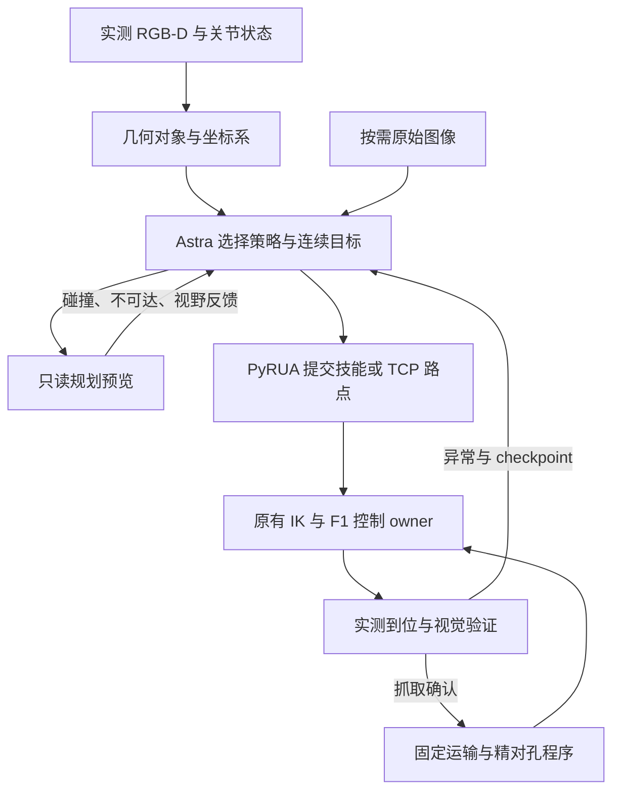

# Astra 几何工具与固定技能的分工

本轮将 Astra 的动作空间扩展为物体相对抓姿、接近方向和 TCP 路点。注册技能与成功示教继续提供快捷路线；遇到新朝向或路线失败时，模型可以读实测几何、预览新方案并修改参数，无须先由开发者登记一个新编号。

F1 仍用现有 IK、控制 owner、限速、碰撞检查、停止和记录系统。PyRUA 是模型编写和运行 Python 工具程序的环境，本身不学习抓取策略，也不替代机器人运动学。真实泛化效果仍须现场验证，源码接通不代表插孔成功。

日常入口为 infra 的 Astra 任务，确定性程序在其内部执行；当前部署身份见 [STATUS](../agent/STATUS.md)。下文新增的同场景合并预览与缺失实体诊断仍为离线候选，尚未上线，证据见[SAM与交互修复复盘](../agent/experiments/20261110-sam-rollout.md)。

## 工具与坐标合同

| 能力 | 接口 | 关键语义 |
|---|---|---|
| 规划上下文 | `robo.geometry()` | 当前 TCP、物体、孔口、名义抓姿、障碍物、观测身份 |
| 合并检查（离线候选） | `robo.inspect_plan(name, **parameters)` | 一次观测请求；owner用同一场景及反馈计算几何与预览，返回各自绑定的观测身份 |
| 只读检查 | `robo.preview(name, **parameters)` | 返回可行性、几何失败、路线和腕部视野；不提交、不改变任务进度 |
| 连续抓姿 | `motion('approach_grasp', grasp_tcp_pose=..., approach_direction_object=..., approach_distance_m=...)` | 物体相对 TCP，支持连续位置和三维旋转；后续抓取继承实际选择 |
| 连续路径 | `motion('move_tcp', target_tcp_pose=..., target_frame=..., via_tcp_poses=[...])` | world／object／hole 坐标系，经原控制链执行自由空间运动，不改变夹爪 |
| 图像检查 | `robo.show('right')`／`robo.show('head')` | 几何估计失败仍可看图；图像不自动成为运动证据 |
| 目标重新定位 | `robo.locate_object(camera, box_normalized=[left,top,right,bottom])` | 根据刚显示的完整相机图给出0到1比例的搜索框；只更新分割提示，随后用新 RGB-D 求几何 |
| 快捷程序 | `place_held_block(withdraw=True)` | 抓取确认后先运输到桶上方，再检查在手姿态、对准、插入、释放验证与离桶返程 |

矩阵为按行展开的16个 SE(3) 数值，平移单位米。`world` 是 geometry 返回的原生世界系，不是 IK 内部坐标或图像坐标。`grasp_tcp_pose` 是物体到 TCP 的变换；`approach_direction_object` 从抓取点指向预抓位置。中间路点与终点使用同一个声明的坐标系。

离线候选返回`entities`和`missing_entities`：积木仍可见而孔口缺失时，保留积木位姿并明确指出缺少孔口，不能用`locate_object`重复框积木来修孔。缺失碰撞几何用`obstacles=null`表示，不能当空障碍列表。当前桶位姿仍依赖孔口观测，按技能进一步解耦桶定位与精对孔、SAM孔口恢复尚待完成。

旧 pitch／variant 参数继续兼容，但不能与完整抓姿同时传入。没有注册候选可行，只证明那些方案失败；模型可以产生新的连续方案，由同一个求解器复核。预览不缓存可直接执行的关节指令，执行时仍重新绑定观测、任务和授权。

## 方块任务怎样运行

1. 初始几何可用时，Astra 在同一个 Python cell 中读取几何、预览接近方案、按需看图。几何缺失时仍进入模型，由它看图并用 `locate_object` 重新定位，再 `observe` 获取新测量。默认方案虽然 IK 可行，也可能让目标离开腕部视野。
2. 根据反馈调整物体相对抓取点、方向或接近向量，重新预览。历史成功姿态用于偏好排序，不限制模型只能选择那些路线。
3. 提交接近；到位后抓取、验证夹持。完整抓姿绑定到 owner，抓取阶段不能悄悄切回名义姿态。
4. 常规场景直接调用固定运输程序。若运输零发布失败，Astra 可生成自由空间 TCP 路点；到桶上方后仍检查在手状态并调用对准、插入、释放验证。
5. 确认放置后走离孔、右移避桶、复位。规划成功、到位、抓住和放置成功分别留证。

自由移动会使旧的接近、对准和插入结论失效，不能拿移动前的对准结论授权松手。确认零发布的规划失败恢复原任务进度；动作停滞则在 owner 确认保持后，用原 checkpoint 和原目标从新实测状态继续，未知发布不重放。

## 经验与恢复

已验证经验仍存为 RPent 管理的 Markdown 加结构化元数据，运行开始固定快照。物体相对抓姿可作为经验候选，经独立场景验证后供下次选择；场景特定的 `move_tcp` 路点不直接晋升为通用参数经验。

早期颜色分割方案遇到局部搜索框裁断唯一目标时，会扩窗重搜。出现同色歧义时，保留失败记录，交给 Astra 判断，再用新 RGB-D 定位。搜索框须按原相机的裁剪、缩放与畸变还原，机器人位姿由深度和标定求得。排查现役识别与追踪链路请查[SAM 感知配方](SAM_RUNTIME.md)。

恢复链为：不提交新运动→换视图／重新框选→新几何→继续原阶段。提示不跨任务或采集身份，也不把旧场景充作重新定位后的结果。已有验证 checkpoint 的阶段只补验证，不重放完成动作。提示要求在既有局部修正次数内改变方案，无进展则 `finish(status="stuck", summary=...)`，页面显示待处理；通信、授权或未知动作状态仍单独报告错误。模型网络使用已有7890代理环境，仅在确认源站请求尚未发送的连接阶段重试一次。

## 当前边界

- 感知仍针对当前单方块及匹配孔口；连续姿态接口不代表已识别任意物体、翻倒块或混乱堆叠。
- 完全丢失双视图几何时，可看图与补观测，但尚无独立验证过的自动视点撤离策略。新 TCP 工具仍需要可信场景，不使用旧障碍物坐标盲动。
- 最新保存场景中，默认候选仍有腕部顶面裁切。新版预览能报告它，模型有工具改变方案；尚未证明真实 Astra 已选出更好方案并完成全程。
- 原生输出审计使用内存传输和理想跟随，不能据此报告真机成功率、实际耗时下降或插孔精度改善。
