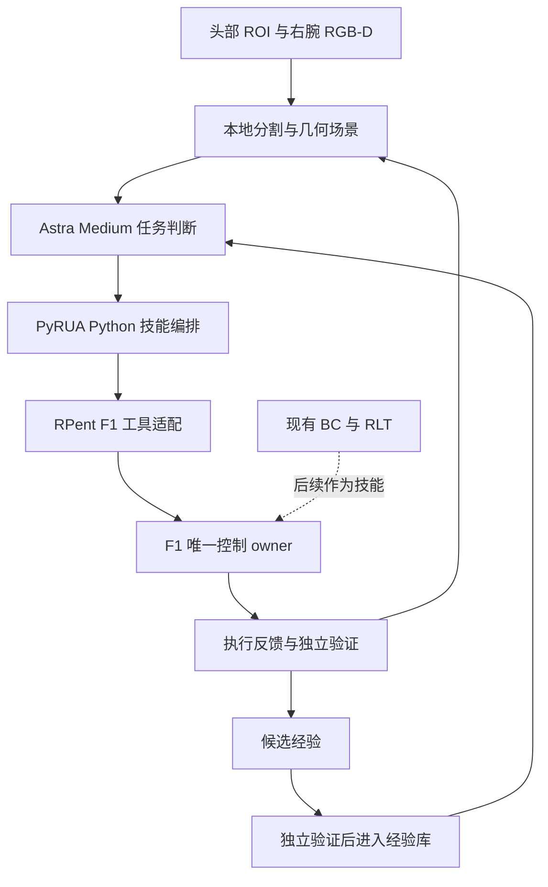

# F1 Harness 实施方案：从单块插孔到混乱积木分拣

**建议采用 RPent＋PyRUA-Lean 作为编排主链，ASPIRE 提供经验验证方法；底层复用现有 F1 控制、推理和记录能力。** 首个目标是一种积木、一个匹配孔口的完整闭环：观察、抓取、调整朝向、对准插入、释放、验证，并能处理一次可恢复失败。BC 与 RLT 先保留接入合同，之后再比较它们作为技能的实际收益。

本文是供审阅的实施设计，当前交付是工程组织、固定上游源码与方案文档；机器人适配、模型调用和标定尚未完成。当前事实在 `HARNESS/agent/STATUS.md`，后续实验记录在 `HARNESS/agent/experiments/`，人类文档不累计逐次运行日志。

**最快的验证路线是先做只读回放，同时准备标定，再做受控单块闭环。** 按一位熟悉现有栈的工程师持续投入、现场每天能配合的条件，预计第 1–2 个工作日看到只读编排，第 3–5 日得到首轮几何验证，第 7–12 日安排首次单块现场闭环尝试；通过验收的时间取决于实际误差和失败结果。混乱堆叠与稳定泛化是后续阶段，不能用框架能运行代替任务成功。



## 1. 方案选择与本轮范围

| 选项 | 与 F1 的匹配 | 判断 |
|---|---|---|
| RPent＋PyRUA-Lean | 工具注册、机器人对象、Python cell、运行审计可复用；需要 F1 backend/host 与明确执行边界 | **主运行链**，符合你偏好的执行方式 |
| 完整采用 ASPIRE | 经验发展与独立验证值得采用；现成任务、机器人 API 和 provider 与 F1 不同 | 首期固定源码，借用经验流程；不同时引入另一整套执行栈 |
| 另写通用 agent/机器人框架 | 会重复工具调度、代码执行、审计和现有控制能力 | 只写 F1 所需适配、场景合同和验证逻辑 |
| 直接由 LLM 逐帧调关节 | 云端响应、场景陈旧、机械约束都不适合放进这个回路 | LLM 只作阶段决策，实时执行归本地技能和控制端 |

三个上游在 `HARNESS/third_party/` 中独立检出，保留许可证和 Git 身份。固定提交及确切接口见[上游复用说明](UPSTREAM_REUSE.md)，机器清单为 `HARNESS/configs/upstreams.lock.json`。固定源码不等于依赖、模型接口或 F1 适配已经通过运行验收。

本轮不改生产机器人、模型、RLT 数据或冻结发布。后续运行代码建议位于 `src/f1_harness/`，按 `contracts`、`f1_adapter`、`perception`、`verification`、`experience` 分模块；模块在实际实现时创建，不用空壳冒充完成度。

## 2. 基于当前 F1 的判断

截至本方案核对，F1 任务权威状态记录控制 **V46** 已部署，Windows 配套安装与现场连续性仍待验；学习组件 **V47** 是另一身份，不能当作控制版本。已有 B1250 直接成功记录，局部 RLT 也有人工辅助成功和真实更新证据，但尚无可靠的自主能力提升结论。具体运行状态随任务推进变化，以 [F1 STATUS](../../tasks/F1_ComplexyToys/STATUS.md) 为准。

因此，HARNESS 先绕过“必须等待 RLT 学好”的依赖，验证几何技能和上层闭环；RLT 按原路线继续清洁数据、固定版本对照和连续性验收。已有成功 BC 是后续强基线，不能因为引入 agent 就舍弃。

| 现有能力 | 复用方式 | 尚缺的部分 |
|---|---|---|
| F1Owner、ControlLoop、IK、轨迹输出、碰撞与输入保护 | 保持唯一动作所有者；新增意图入口交给同一循环消费 | 通用语义技能入口、技能间切换与取消协议 |
| 原碰撞 gate 的机器人代理几何／CoM 检查 | 保留原检查，不改原硬边界 | 桌面、桶、邻近积木及夹持物的场景几何检查；原 gate 没有这些动态场景接口 |
| 不可变 Observation、硬件 mask、源时间戳 | 旁路导出一致观测；保留三相机原始合同和有效性 | 面向 Harness 的同步 RGB-D／状态快照与标定引用 |
| RTC、B1250、局部 RLT 与 H20 模型服务 | 后续封装为有起止条件和冻结模型身份的技能 | 多技能生命周期与任务级后置验证 |
| 原始 journal、录制、局部 durable receipt | 作为唯一原始执行证据，Harness 保存引用与解释 | 任务／技能 trace 与原件关联 |
| F1infra 状态、相机、数据审阅 | 初期只读，不重建数据工作台 | 统一 observation_id；独立 JPG GET 不能当同步帧 |
| RLinf 异步 runner、数据准入和 W&B | 保留原任务权威与运行环境 | 未来 Harness 经验到训练数据须另过准入 |

主要代码依据：`DAgger/F1/src/f1dagger/{robot_io,runtime,rlt_hil,observation,recording,status}.py`，`tasks/F1_ComplexyToys/src/f1_toys/rlt_async_workers.py`。现有 RLT `enter_actor()` 需要已观察到的真实手柄事件，`LocalPlacement` 当前每条一次；这些不是可由 agent 任意调用的多次技能 RPC。

## 3. 系统进程与接口职责

### 3.1 哪些东西放在哪里

| 位置／进程 | 职责 | 不获得的权限 |
|---|---|---|
| 6000D planner | 官方 OpenAI Responses API，Astra Medium；读取场景摘要、选技能、解释异常 | 不直接访问 ROS／电机输出 |
| 6000D episode worker | 执行 PyRUA cell，调用 RPent F1Toolkit，维护技能 trace | 不继承 API key，不持有机器人 publisher |
| 6000D perception worker | 高分辨率 ROI、分割、跟踪、点云、姿态与不确定性 | 不直接发动作 |
| F1 控制进程中的适配层 | 校验技能合同、仲裁控制权、执行有界动作、取消与保持 | 不把 LLM 生成代码装入控制循环 |
| H20 原模型服务／学习器 | 沿既有服务提供 BC／RLT，训练与 checkpoint 仍归原任务 | Harness 不另起一套 learner |

部署开始前再核对 GPU 与进程，既有任务的资源授权不是新 SAM 服务占卡授权。感知与 planner 不应阻塞 250Hz 目标输出循环；当前该频率是目标调度，不是硬实时保证。RTC 的 30Hz 动作网格与约 1.875Hz 重规划也不是 LLM 调用频率，详见 [F1 推理主文档](../../tasks/F1_ComplexyToys/INFERENCE_RECIPE.md)。

### 3.2 最小新增能力合同

下面是拟新增接口，不是现有已上线 API。工具名和版本将在实现时固定到 schema；不把尚未存在的端口或 CLI 写成可用命令。

| 工具 | 输入／输出重点 | 能否运动 |
|---|---|---|
| `capabilities()` | 当前技能、模式、输入合同、控制 release、标定身份 | 否 |
| `observe()` | 一致快照 ID、源时间、state/mask、场景对象、观测年龄、图像引用 | 否 |
| `status()` / `events()` | owner、session/epoch、授权状态、技能生命周期、异常与断续 | 否 |
| `prepare_skill(intent)` | 参数、坐标系、可达性、前置条件与预计资源；只返回检查结果 | 否 |
| `submit_skill(intent)` | 有界技能请求；校验现场授权、新鲜观测、幂等 ID 与身份 | 通过全部门槛后 |
| `cancel_skill(request_id)` | 请求取消，返回控制端的停止／保持确认与原因 | 由原 owner 处理 |
| `skill_result(request_id)` | 执行状态、物理后置条件、证据、是否人工辅助、学习准入状态 | 否 |

每个 intent 至少有 `schema_version, request_id, run_id, session_id, epoch, observation_id, skill_id, skill_version, parameters, frame_id, calibration_id, budget_ms`。单位、四元数顺序、变换方向必须由合同固定，工具拒绝无单位或过期坐标。机器人端用自己的单调时钟计算期限，不能跨机器直接相减 monotonic。

请求超时后先查询同一 `request_id` 的状态，不把未知结果重新当新动作提交。人工接管、连接重建、epoch 改变后不重放旧请求；同 ID 不重复执行。轨迹计算 worker 的迟到结果只能被拒绝，不能重新取得控制权。

技能结果分三层：`accepted/running/paused/completed/cancelled/preempted/rejected` 表示执行生命周期；`success/failure/pending_review/interrupted` 表示任务结论；`assisted/reward_known/training_ready` 表示帮助与学习准入。取消还需分别留证“已请求”“owner 已保持”“实测已停稳”，不能在仅发出取消时报告完成。**调用完成、命令发布、机械到位、积木插入是不同事实。** 图像判断可提供证据，不直接改写原任务奖励和人工评分。

### 3.3 Python 执行与硬件边界

复用 PyRUA 的代码 cell 与机器人对象；F1 适配层暴露受限技能，不暴露任意关节发布、文件、网络和凭据。上游使用进程内 Python `exec`，不能单靠其 sandbox 当强隔离。计划使用 episode 独立进程、受限挂载／网络、外部期限监督；具体容器或进程隔离方式在只读阶段验收后锁定。

RPent 的取消等待依赖 primitive 配合，现有实现可能无限等。因此执行端必须实现技能期限、撤销确认与既有 HOLD 路径；杀掉云端任务或 worker 并不证明机器人停下。所有运动继续经过同一 owner、现场真实 START、人工优先和原保护。首期一个任务授权作用域只允许这一块积木；任务级抓空、方向不匹配等仅在授权仍有效且属于已验证恢复分支时继续。取消、接管、断连或控制保护导致权限撤销后，重新按原现场合同进入，不能用 LLM 自动解锁硬故障。

### 3.4 环境与夹持物检查是新增能力

当前碰撞 gate 主要检查机器人冻结代理几何与 CoM，未接入桶、桌面、散落积木和夹持物。**原 gate 通过不代表抓取／转移／插孔路径对环境无碰撞。** P3 前须补场景几何检查：带标定身份的桌面／桶模型、局部障碍和不确定性膨胀、持物后的附着几何、轨迹与撤退净空。沿用已有几何与运动求解能力，新增场景输入和校验合同，不替换原硬保护。

运动候选必须同时通过原机器人 gate 和新增场景检查，接触／插入仅限已定义的孔口区域和进给包络。碰动邻物、桶移动或在手滑动即使场景版本失效；无法建立可信包络时返回拒绝／待审。采样检查的分辨率、漏检边界与机械跟踪误差都需留证，不能只由 LLM 根据 mask 宣布通路安全。

## 4. 感知、ROI 与标定

### 4.1 ROI 应作为基线，但保留几何信息

沿用头部原图 `1280×720` 的 ROI `[307,28,1229,720)`，宽高 `922×692`。**BC 分支保持原 processor／mask／合同；几何分支从原图裁出高分辨率 ROI，不能拿已经压到 224 的训练图估计精细孔缘。** 右腕用于近距离对准和持物确认；左腕默认不进入 planner 常规输入，原始观测合同与记录仍按真实硬件保存。

ROI 减少杂物和像素量，预计有利于分割与传输，但速度／准确率收益须测量；过紧裁剪也可能丢失积木、桶缘或撤退空间。先验证现有 ROI 对“抓取—抬起—转移—孔口”全轨迹的覆盖，必要时仅几何支路扩大搜索区域，不能静默修改训练输入。

裁剪坐标与完整图像坐标有显式映射。原内参为 `K` 时，未缩放的 ROI 用 `cx' = cx − 307, cy' = cy − 28`，焦距不变；若缩放／补边，再按实际变换更新内参。深度对齐、畸变校正与裁剪的顺序写入标定元数据，并用独立点验证，禁止把不同分辨率的深度直接 resize 当作 RGB 对齐。头相机当前 RGB 为 1280×720、Depth 为 848×480，右腕当前 RGB-D 为 640×480。

### 4.2 A4 棋盘可以用，但要完成四层标定

现有产物 `Artifacts/F1-Harness-Calibration-20261104/checkerboard_A4_10x7_22mm.pdf` 可用于第一轮：A4 横向，**10×7 个方格、22mm 方格、9×6 个内角点**。按 100%／实际尺寸打印，关闭适应页面；贴到平直硬板，实测长边和跨多个方格的距离。纸张翘曲、打印缩放与反光会直接进入结果。

| 层 | 需要完成什么 | 怎样验收 |
|---|---|---|
| 相机内参／畸变 | 先读取设备参数，再用当前分辨率和棋盘检查；必要时重标 | 留出未用于求解的姿态检查重投影与尺度 |
| RGB-D 对齐 | SDK 的深度单位、畸变、RGB↔Depth 外参，检查桌面／孔缘 | 不同距离处深度与真实尺寸对照，记录空洞和边缘错位 |
| 相机到机器人坐标 | 头部相机到 base；base 到右臂原生参考系；右腕相机到实际 EEF／TCP | 多个工作区位置测量，检查完整坐标链及身体／腰部／头部姿态变化 |
| TCP／夹持与孔口 | 夹持中心、工具偏移、桶位姿、孔口法向／轮廓和物体在手内的姿态 | 用独立位置、方向验证可达点与孔口相对误差 |

建议采 20–30 张覆盖位置、距离和倾角的清晰图作为初始采集目标，避免只平移平行棋盘；实际是否足够由覆盖和留出误差决定。手眼求解也要有不同转轴，不能只转一条轴。相机安装变化会使对应固定外参失效；身体、腰部或头部姿态变化必须由完整坐标链更新，无法更新时拒绝沿用旧变换。桶移动只要求重估桶／孔口位姿，不自动否定未变化的相机内外参。已知尺寸棋盘不能自动给出相机到 base 的变换，还需要对应机器人位姿或经过测量的 base 参照。

算法复用 OpenCV `findChessboardCornersSB`、`calibrateCamera`、`solvePnP`、`calibrateHandEye` 等；选择眼在手上或固定相机的方程后再输入变换，不靠交换矩阵名称凑结果。当前原生 FK 的数值一致性不等于世界坐标与真实 TCP 已标定。[OpenCV 标定文档](https://docs.opencv.org/4.13.0/d9/d0c/group__calib3d.html)

**验收必须落到插孔余量。** 先测积木／孔口尺寸和实际可用间隙，再分配标定、分割、在手位姿、机械跟踪误差预算。只看到很小的像素重投影误差不足以承诺毫米插入；在未测间隙前不杜撰“1mm 必达”。对近似刚性积木可用 `e_xy + r·|δyaw| + e_tracking < c_effective` 作小角度误差预算，真实验收仍用完整形状碰撞与多位置实测。

### 4.3 SAM 的作用与选择

本地管线：ROI → 候选分割／实例 ID → 对齐深度 → 点云与轮廓 → 形状／姿态候选 → 可抓取与遮挡关系。孔口单独建模轮廓和法向，必要时给桶建立一次性标记或几何模板。mask 或 2D bbox 本身不足以给出准确 6D 位姿、抓取方向或插入间隙。

优先做固定积木的 OpenCV／深度几何基线，用它验证标定和技能。分割需要提高遮挡与实例鲁棒性时，首选评估 **SAM2 的提示分割＋视频跟踪**；当确有文字概念检索或复杂实例发现需求时再对照 **SAM3**。若固定上游已有可用的 SAM3 服务适配，先测它也合理，但不能因此跳过 F1 数据对照。二者只选一个常驻分割服务，避免重复驻留和依赖冲突。[SAM2 官方项目](https://github.com/facebookresearch/sam2)、[SAM3 官方项目](https://github.com/facebookresearch/sam3)

积木几何简单时，用轮廓、平面、已测模型和对称性枚举即可起步；任意物体 6D 姿态不作为首期要求。对立方体等对称体，允许一组等价姿态，避免把 90° 对称差错判为失败。FoundationPose 等后续候选见组件表。

### 4.4 给 LLM 的观测包

默认发送结构化摘要：目标候选 ID／形状、位置姿态与不确定性、孔口匹配、遮挡与支撑、可达性结果、当前握持状态、上次技能结果、允许的下一技能、观测年龄和标定版本。必要时附 **带对象 ID 的 ROI 概览和目标／孔口局部图**；不把三路原始视频逐帧上传。

语义不明、遮挡导致几何多解、失败解释有歧义时才请求局部视觉证据；目标消失或 ROI 边缘截断时允许扩大视野。对象被触碰、夹起、桶移动或镜头移动后，使相应缓存失效，重新观测；不能以节省 token 为由沿用旧坐标。

## 5. 技能执行、精细操作与失败恢复

### 5.1 第一批技能

| 技能 | 责任 | 后置条件 |
|---|---|---|
| `observe_scene` / `select_object` | 建立场景、匹配孔口、选无遮挡可抓候选 | 目标／孔口身份明确，误差与可达性合格 |
| `approach_grasp` / `grasp` | 既有 IK／轨迹下接近并闭爪 | 抬起后持物证据成立；闭爪命令不等于抓到 |
| `inspect_in_hand` | 估计物体相对夹爪姿态，检查滑动与遮挡 | 夹持变换可信，或返回需重抓 |
| `transfer_above_hole` | 自由空间转移到孔口上方 | 处于有净空的预插入位姿 |
| `align` / `insert` | 本地视觉纠偏和受限进给 | 位置、姿态与进入深度通过验证 |
| `release` / `verify_placed` | 在满足释放条件后松爪，再检查稳定状态 | 积木通过对应孔口，夹爪不再持物，无外部支撑依赖 |
| `retreat` / `reobserve` / `regrasp` | 有边界的恢复和重新规划 | 回到可解释、可继续的稳定状态 |

这些是逻辑技能划分，可以把已验证的连续步骤封装为一个 PyRUA 方法。LLM 不需要每执行一个小动作再调用一次；每个技能内部有本地检查和终止条件。

精确对准需要物体在夹爪中的偏移。若 `T_base_object_goal` 为物体目标位姿、`T_eef_object` 为在手测得的变换，则 `T_base_eef_goal = T_base_object_goal · inverse(T_eef_object)`。调用现有 IK 前还须用已验证的 `base→右臂原生参考系→EEF/TCP` 链转换目标，不能把 base 坐标直接冒充 IK 原生坐标。只把夹爪中心放在孔中心会遗漏偏心抓取与角度偏差。夹爪挡住关键面、旋转范围不够或姿态不可达时，使用固定重抓台重新放置／抓取；首期不假设能完成任意空中翻转。

### 5.2 没有触觉，关节反馈能做什么

可以把位置跟随误差、低速时的变化、夹爪状态和图像残差作为**接触异常候选证据**。目前已确认的记录以位置为主，不能假设有可信电流／力矩／速度；先核对驱动字段、量纲、时间戳和有效性，再增加被动采集。

第一阶段记录 `q_reference/q_submitted/q_measured`、真实间隔、姿态与速度条件，建立无接触误差分布。位置偏差还可能来自摩擦、重力、背隙、限速和控制滞后，不能把一个角度阈值解释为接触力。反馈只用于要求停稳、复看或撤退的辅助判断，不让 LLM 盲目增加推力。若以后有可信力矩／电流和动力学模型，再评估残差观测器与受限接触搜索。

首个插孔版本以视觉对准＋小步有界进给为主。找孔或螺旋搜索只有在净空、误差范围、退出条件和实际反馈经过现场验收后才能启用；柔顺结构／硬件顺应性可以降低难度，软件位置命令不能冒充力控制。接触、夹持滑动和控制跟踪异常分开统计。

### 5.3 恢复不是重复原动作

| 发生什么 | 首个处理 | 何时交回 planner／人工 |
|---|---|---|
| 抓空或夹持不稳 | 撤到已验证净空，重新分割，换抓取点 | 候选耗尽／反馈不可信 |
| 碰动邻近积木 | 让受影响对象位姿失效，重新观察局部 | 稳定支撑或可达性不明 |
| 姿态不匹配 | 保持净空、估计在手姿态、调整方向 | 需要重抓／可达范围不足 |
| 插入无进展／疑似卡住 | 停止进给，按已验证路径撤离并复看 | 不明确是否接触、退出路径不可信 |
| 视觉不能确认是否插入 | 换局部视角或等待稳定后再测 | 保持 `pending_review`，不盲目松爪 |
| 控制断连／人工接管／硬故障 | 原控制端撤销权限并处理保持 | 新授权与原恢复合同满足后再继续 |

建议初始任务预算设为最多 2 次局部修正、1 次重新抓取，作为待验的任务级配置；不是放宽硬件阈值。每次失败必须产生新证据或改变假设，相同证据下不无限重放。恢复次数、耗时和人工帮助完整计入结果。

## 6. 一个完整的积木例子

**设想场景：** 方块在杂乱积木边缘，目标为桶上的方孔。数值姿态和以下失败均是说明性例子，不是本项目已运行记录。

1. 本地感知在头部 ROI 内找到方块 A、圆柱 B 和遮挡 A 的小块 C；桶的方孔 H 已有几何模型。输出 A 的方向候选、遮挡、抓取净空与测量不确定性。
2. Astra Medium 读取结构化场景和一张必要的局部图，选择 A，生成“抓取→检查在手方向→到 H 上方→对准插入”的技能程序。若 C 使抓取无可行解，改选其他积木或安排已验证的移障技能；首期可直接返回需要整理，不能假装已有移障能力。
3. 本地真实 START 允许这一块的任务。RPent F1Toolkit 把有界技能交给 F1 owner，原 IK、碰撞、轨迹和反馈仍负责具体运动。Harness 得到的是请求身份与生命周期，不是关节控制权。
4. 抓取后抬起到可观察位置。腕图确认持有 A，但发现它在夹爪内偏转；`inspect_in_hand` 更新 `T_eef_object`，下一阶段使用新变换计算目标，避免依赖抓取前的方块角度。
5. 到 H 上方后，本地 `align` 持续更新孔缘与积木投影，按标定误差与间隙条件执行小步纠偏。这个循环不逐帧等待 LLM，也不调用 BC／RLT。
6. 第一次插入进展不足，图像显示一角搭在孔缘。技能立即终止进给，记录“孔缘疑似接触、深度未达到、关节残差仅辅助”，撤到已验证净空，重新观察；不将它描述成已测出接触力。
7. 已验证恢复规则能够处理时，在原任务预算内修正方向再试；原因仍不清楚才让 Astra 看错误摘要和局部图重新规划。若触发硬保护，则按现场恢复流程停止本任务自动接续。
8. 第二次插入后，视觉／深度显示积木越过孔口，释放并撤离，再次观察确认积木未挂边、夹爪空置。任务记录“成功、一次恢复、是否人工辅助、总用时、全部模型与标定身份”。视觉遮挡时保留待审。
9. 经验 worker 生成候选：“此类偏心夹持应先检查在手方向；孔缘无进展时先退回再重估”。它只能进入 inbox。后续在独立位置／朝向上验证成功且未增加误判，才成为下一次可用经验。

## 7. 经验与 skill 如何积累

区分三种资产：**运动技能代码**（有控制合同和测试）、**程序性经验文本**（条件、方法、证据）、**BC／RLT 权重**（训练与部署身份）。总结文字不等于机器人学会了新运动，也不等于模型参数已更新。

复用 RPent MemoryManager 的只读库、inbox、校验与合并机制，借用 ASPIRE 的“提出→独立验证→收录／驳回”。PyRUA 上游不会自动把跨回合经验接好；首期把已验证经验快照通过现有 `guides-dir` 注入，固定内容 hash，在 run 中登记。上游 `merge_memory` 对部分 scope 并不以任务成功为充分门槛，我们必须在合并前增加独立验证。

每条经验至少包含：适用形状／夹持方式／孔口、触发证据、前置条件、建议技能及参数范围、停止／回退条件、标定／控制版本范围、正反例引用、验证集合、成功与失败计数、状态。不要把一条偶然成功写成通用定律，也不能把物理偶然性藏进大段 prompt。

失败结束后异步总结，不阻塞下一次观察；候选草稿不得直接进入下一次执行指南。验证集合按场景／轨迹划分，不能把同一次录制相邻帧拆成训练与验证；最终保留集也不用于反复调经验。近期不采用向量数据库：小规模经验先以 RPent 文件索引＋明确条件筛选，容量和检索问题出现后再评估。

## 8. 推理强度与执行效率

### 8.1 先固定 Astra Medium，测实际任务收益

本轮确定官方 OpenAI API，使用上游已有 **PyRUA `codex` runtime → Responses API → `gpt-6-astra`**，显式设 `medium`，避免继承上游 `xhigh` 默认。设计配置在 `HARNESS/configs/planner.example.toml`；其字段是待实现 launcher 的输入，不是已经可运行的 PyRUA 配置文件。模型权限、实际返回身份、工具／图片与推理参数的支持仍需无动作 smoke 核验。

没有已验证的“本 F1 积木任务，Astra low／medium／high 完成率与延迟”数据，不能给出可靠百分比。测试时计算量研究表明收益与题目难度、预算分配有关；这是采用事件触发推理、按失败难度分配预算的依据，不能换算成机器人成功率。[Scaling LLM Test-Time Compute Optimally](https://arxiv.org/abs/2408.03314)

可控谜题研究也观察到高复杂度下推理模型失效，提醒我们长思考不是正确性的保证；其模型、任务和时间与当前 F1 不同，不能直接给 Astra 排名。[The Illusion of Thinking](https://arxiv.org/abs/2506.06941)

首轮只固定 medium 做可复现基线。闭环稳定后再在**同模型、同工具、同视觉表示和同场景组**上比较不同强度；是否升到 high 依据实际收益，不能让硬件异常被一次更长的 LLM 思考掩盖。

### 8.2 速度优化顺序

1. **减少不必要的 LLM 串行等待。** 已验证程序连续执行自由空间与局部对准，只有开始、异常分支或语义歧义调用 planner。
2. **本地感知复用。** 对稳定物体跟踪，发生交互即局部失效；使用高分辨率目标 crop，避免三路全图重复编码与上传。
3. **预计算确定部分。** 空闲时准备桶孔几何、候选可达性与已验证指南；执行前仍以新鲜观测核对，不发布预测中的动作。
4. **按实测瓶颈优化。** 分别测感知、LLM、工具等待、机械运动、验证与恢复，先看哪些等待真正在关键路径。

主指标是完整任务秒数与单位时间自主成功数，不能用 token/s 或纯模型延迟替代。总耗时用实际阶段区间计算，并行部分不能重复相加。一次更长的合理规划如果减少重抓可能更快；在确定场景中多次冗余思考则可能更慢。

每次记录：完成／待审／失败／中断、人工辅助、首次成功率、恢复后成功率、端到端 P50/P95、LLM 调用次数与耗时、输入／输出／可见推理用量、感知耗时与图像字节数、轨迹实际时间、误判成功次数、失败分类。成功率比较给出样本数和区间，不把 5 次顺利演示当作泛化能力。

## 9. 开源与小组件清单

| 组件 | 首期决定 | 复用点与限制 |
|---|---|---|
| [RPent](https://github.com/RLinf/RPent) | 固定源码，作为主链 | Toolkit、机器人合同、记忆存储；取消和晋升要补 F1 边界 |
| [PyRUA-Lean](https://github.com/DAGroup-PKU/PyRUA-Lean) | 固定源码，作为主链 | RobotBase、Backend、cell、审计、planner；需小型 F1 registry/host 补丁 |
| [ASPIRE](https://github.com/NVlabs/ASPIRE) | 固定源码，参考流程 | 经验提出和独立验证；现成 verifier／任务 API 不能直接用于 F1 |
| OpenCV／NumPy | 几何基线 | 标定、轮廓、变换、位姿与数据计算；复用独立环境已有合适版本 |
| Orbbec SDK／librealsense | 复用既有相机栈 | 内参、深度单位和对齐；优先由现采集端导出，避免重复占设备 |
| SAM2／SAM3 | 后续选一个独立 perception 服务 | 实例分割与跟踪，不能替代标定与位姿；先固定 F1 对照再选型 |
| [Open3D](https://github.com/isl-org/Open3D) | 点云需要时加入 | 平面／点云检查，简单形状不必先依赖完整 3D 框架 |
| [FoundationPose](https://github.com/NVlabs/FoundationPose) | 泛化姿态候选，首期暂缓 | 有合适模型／参考与 GPU 条件后单独评估，不承诺对小积木优于几何 |
| AprilTag／ChArUco | 可选标记方案 | 桶位姿或遮挡条件需要时使用；已有棋盘足以开始采集 |
| 现有 F1 IK／Ruckig／控制锁 | 继续原实现 | 不复制、替换或在 Harness 再叠一套轨迹滤波 |
| 现有 journal／RLinf／W&B／Why&How | 按原职责复用 | 原始证据、训练和阅读各有权威入口；不建新数据后台 |

Contact-GraspNet、通用 MoveIt／cuRobo、向量数据库、另一套任务队列不是首期必选。需要时根据实际缺口、依赖与许可单独引入；三个主仓库开源不代表其模型权重和第三方许可相同。SAM 不同上游 fork 的依赖也不能混装，详细边界见[上游说明](UPSTREAM_REUSE.md)。

## 10. 阶段计划与双线推进

以下为**从实施开始累计工作日**的目标窗口，一位熟悉代码的工程师＋现场配合。相机／深度导出、TCP 标定、机械重复精度或技能入口困难会延长关键路径；额外 agent 能并行写适配与回放，无法替代真机时间。

| 阶段 | 目标与验收内容 | 预计累计窗口 |
|---|---|---|
| P0 工程与方案 | 固定上游、私密配置边界、来源与复用计划、人类与 agent 文档 | 本轮 |
| P1 只读闭环 | 最小依赖锁、F1 fake backend／只读 adapter、Astra 协议 smoke、保存观测→程序→验证→trace；零 publisher | 第 1–2 日 |
| P2 几何与技能合同 | 棋盘采集、RGB-D／外参／TCP核验、孔口与环境／夹持物几何、ROI姿态；首轮误差评估与合同冻结 | 第 3–5 日 |
| P2→P3 技能实现 | 新增语义 mailbox、几何运动技能、本地视觉纠偏、取消保持与场景检查；扩展既有夹具并完成离线／零输出检查 | 第 4–10 日，与几何工作并行 |
| P3 单块真机闭环 | 前置门槛通过后现场 START；尝试抓取、对准、插入、释放、成功验证和一次有界恢复；完成日期由实测决定 | 第 7–12 日首次尝试 |
| P4 有限混乱分拣 | 2–3 种形状、有限遮挡、扰动重估、重抓与独立经验验证；固定场景对照 | 第 3–4 周 |
| P5 扩展泛化 | 更广堆叠、光照／桶位／在手方向变化；按失败瓶颈选 BC／RLT 或高级姿态估计 | 第 4–8 周，范围随数据收敛 |

P1 可不等标定完成；标定采集从第一天并行。P3 不等待 BC／RLT 封装，仍须依赖既有控制端稳定、新增技能入口与环境／夹持物检查完成。若后两项超出最小场景适配范围，7–12 日窗口必须顺延，不能省略检查来兑现日期。所谓“先整套闭环”是最小任务从输入到结果与失败处理完整，不是先造完通用机器人平台。

RLT 并行线继续由 [F1 TODO](../../tasks/F1_ComplexyToys/TODO.md) 管理：当前优先现场连续性、可信标签、固定 actor 对照；Harness 只读复用这些证据，双方共享同一机器人时段与 GPU 登记。进入 P4 后再做三个等场景方案：纯几何技能、几何＋BC 技能、几何＋固定 RLT 技能；阶段内冻结 actor，避免在线漂移破坏归因。

### 最小验收矩阵

| 层 | 必需验证 | 不能替代的证据 |
|---|---|---|
| 合同／离线 | 单位／坐标、身份不符拒绝、重复 ID、迟到回复、取消、断连、人工优先 | 不等于实际停止距离或任务成功 |
| 观测／几何 | 同步与年龄、mask、深度无效、对称性、边界截断、留出位置误差 | 不等于已完成插孔 |
| 模型／经验 | medium 实参、真实模型身份、超时、候选经验不得越过晋升门槛 | 不等于自主学习有效 |
| 零输出 | 现有测试夹具及真实反馈 shadow，动作 publisher／新原始录制均为零 | 不等于带动作、录制负载下稳定 |
| 真机 | 单形状固定基线，再做位置／朝向扰动和可恢复失败；独立统计辅助与待审 | 不等于任意堆叠泛化 |

第一轮现场建议 10–20 次定义清楚的单块尝试，用于找问题并估计方差；可靠性结论再根据目标置信区间增加样本。首次验收至少覆盖抓空、碰动后重估、方向修正、插入无进展、人工接管和通信中断；不为了凑恢复样本主动制造碰撞。

复用现有 `test_f1_runtime`、`test_f1_rlt_hil`、`test_f1_output`、`test_f1_fault_lifecycle`、`test_f1_observation`、`test_f1_shadow_recording` 等夹具与身份校验。HARNESS 只补跨技能合同和感知／结果语义测试，不再建设重复仿真或低层控制测试系统。

## 11. 工程组织、复现与审阅重点

```text
HARNESS/
  API.MD                       已有本地凭据，忽略且不公开
  AGENTS.md                    稳定协作规则
  README.md                    人类导航
  docs/
    IMPLEMENTATION_PLAN.md     本方案
    UPSTREAM_REUSE.md          上游来源、适配与限制
  agent/
    STATUS.md                  唯一当前事实
    TODO.md                    待办与阶段门槛
    experiments/               日期复盘，服务 agent 接续
  configs/
    upstreams.lock.json        上游源码提交，不是完整依赖锁
    planner.example.toml       官方 API＋medium 设计配置，无密钥
  scripts/
    bootstrap_upstreams.py     只检出／核对源码
  third_party/                 三个独立 Git 检出，根仓库忽略
  artifacts/                   机器回执与运行产物，根仓库忽略
```

在 6000D 的 `/home/user/projects` 中核对源码：

```bash
python3 HARNESS/scripts/bootstrap_upstreams.py
```

新工作区缺少源码时运行同一命令加 `--fetch`。脚本不安装依赖、不初始化子模块、不下载模型、不调用 API；已有 dirty checkout、不同来源或不同 HEAD 会拒绝改写。正式核心环境计划 Python 3.11，首次解析后再固定传递依赖与 CLI 版本，感知环境单独管理。

人类阅读使用 Why&How 的[实施方案](http://192.0.2.1:4243/?doc=harness-implementation)与[上游复用](http://192.0.2.1:4243/?doc=harness-upstream-reuse)，正文始终读取本目录原件。`API.MD` 和 agent 运行材料不在网页读取范围；认证加载器将来只在 planner 进程读取密钥，不把凭据文件作为模型上下文。

审阅时重点看四项：**最小任务是否接受“一种积木＋一个孔口”；是否接受先几何闭环、再接 BC／RLT；是否接受保留 F1 唯一控制端并新增技能入口；是否接受候选经验经过独立验证后才进入执行指南。** 其余如 SAM 版本、依赖解析和几何方法，通过阶段实测决定，避免在缺少数据时过早锁死。
