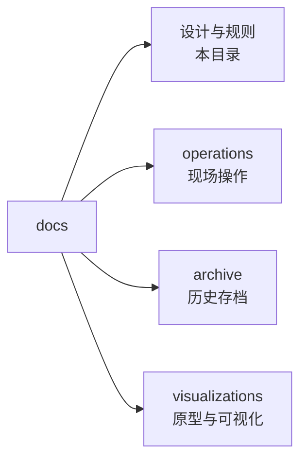

# HARNESS docs 索引

文档按用途分成三组：设计与规则放在本目录，现场操作说明放在 `operations/`，已被替代或只作存档的放在 `archive/`。`visualizations/` 是页面原型和回放可视化。

第一次了解系统先读核心设计；要在现场跑任务读 operations 下的运行说明；archive 里的内容只在追溯历史决定时才需要。

## 设计与规则（本目录）

| 文档 | 内容 |
|---|---|
| [ARCHITECTURE.md](ARCHITECTURE.md) | 核心思路、各层职责、设计取舍 |
| [FAULT_POLICY.md](FAULT_POLICY.md) | 故障分级与有界恢复 |
| [GEOMETRIC_AGENT.md](GEOMETRIC_AGENT.md) | 几何工具与固定技能接口 |
| [EXPERIENCE_PROGRAMS.md](EXPERIENCE_PROGRAMS.md) | 经验程序与晋升规则 |
| [UPSTREAM_REUSE.md](UPSTREAM_REUSE.md) | 上游来源、复用与适配边界 |
| [CONTRIBUTING.md](CONTRIBUTING.md) | 代码、实验与文档的归属细则；实现与执行边界完整条文 |
| [RELEASE_VALIDATION.md](RELEASE_VALIDATION.md) | 发布前全流程零输出验收 |
| [IMPLEMENTATION_PLAN.md](IMPLEMENTATION_PLAN.md) | 旧阅读入口的跳转页（Why&How 书签仍指向这里，不要移动） |

## 现场操作（operations/）

| 文档 | 内容 |
|---|---|
| [DIRECT_ROLLOUT.md](operations/DIRECT_ROLLOUT.md) | 在 infra 任务页运行完整任务 |
| [FIRST_RUN.md](operations/FIRST_RUN.md) | 第一次运行 |
| [RUNBOOK.md](operations/RUNBOOK.md) | 隔离模拟闭环、协议检查与测试 |
| [SITE_STARTUP.md](operations/SITE_STARTUP.md) | 现场装配与启动 |
| [OFFLINE_REPLAY.md](operations/OFFLINE_REPLAY.md) | 完整单块离线回放 |
| [SAM_RUNTIME.md](operations/SAM_RUNTIME.md) | 感知与追踪配方 |
| [SCENE_FAILURE_EVIDENCE.md](operations/SCENE_FAILURE_EVIDENCE.md) | 感知失败现场留证 |
| [CALIBRATION_HANDOFF.md](operations/CALIBRATION_HANDOFF.md) | 标定交接合同 |

## 历史存档（archive/）

| 文档 | 内容 |
|---|---|
| [EXECUTION_SAM_HANDOFF.md](archive/EXECUTION_SAM_HANDOFF.md) | 执行与 SAM 的早期交接 |
| [AGENTIC_HARNESS_QA_20261111.md](archive/AGENTIC_HARNESS_QA_20261111.md) | 2026-11-11 问答存档 |
| [TASK_WORKSPACE_DESIGN.md](archive/TASK_WORKSPACE_DESIGN.md) | 任务页设计记录（页面已上线，现状以 F1-4242 为准） |
