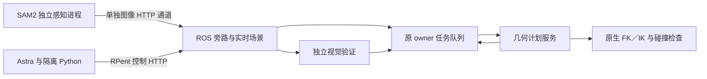

# Harness 运行与验证

当前可以运行真实 Astra medium 驱动的隔离模拟闭环，以及只读相机样本、SAM2 和故障测试。真实机器人运动尚未验收；下列 offline 命令全部使用明确标记的 synthetic 机器人。

标定由用户安排的另一位 agent 负责，格式见[交接合同](CALIBRATION_HANDOFF.md)。硬件数据接入后仍需完成原生 IK、场景更新、独立视觉后置条件与完整 shadow 联调；开发树中的入口不等于生产部署。

第一次使用建议先读[首次运行说明](FIRST_RUN.md)，其中给出已经运行验证的命令、报告和真实相机只读探针。

## 6000D：可直接运行

工作目录 `/home/user/projects/HARNESS`。使用项目解释器，避免改训练环境：

```bash
cd /home/user/projects/HARNESS
.venv/bin/python -m f1_harness.cli doctor
.venv/bin/python -m f1_harness.cli offline
.venv/bin/python -m f1_harness.cli offline --fail grasp --fail insert
.venv/bin/python -m f1_harness.cli offline --planner astra --fail insert
.venv/bin/python -m f1_harness.cli sandbox-probe
.venv/bin/python -m f1_harness.cli api-smoke
```

`api-smoke` 和 `--planner astra` 调用用户现有 API，计入 API 用量。默认只发送结构化合成场景；协议 smoke 发送程序生成的红色小图。`API.MD` 仅由 planner 认证加载器读取，worker 使用独立环境和文件挂载。模型选择固定 `gpt-6-astra / medium`，不自动回退到别的模型。

每次运行新建 `runs/<身份>/`，保存 `trace.jsonl`、`result.json` 或 `failure.json`、worker 诊断。`--run` 放在子命令之前且必须指向新目录。模拟任务未成功返回非零退出码，`synthetic=true` 始终保留。

核心环境复建：先 `python3 scripts/bootstrap_upstreams.py --fetch`，再用固定 `uv 0.13.7` 执行 `uv sync --frozen --python 3.11`，最后 `.venv/bin/python scripts/build_overlay.py`。上游原件不修改；overlay 只加 F1 registry 和知识文件路由。

## 观测与感知

```bash
.venv/bin/python -m f1_harness.cli inspect-capture artifacts/native-capture-20261104
PYTHONPATH=src perception/.venv/bin/python scripts/perception_smoke.py \
  --capture artifacts/native-capture-20261104 \
  --checkpoint models/sam2.1_hiera_tiny.pt \
  --output artifacts/sam2-new-check
```

第二条命令的输出目录必须不存在。独立感知环境用 `SAM2_BUILD_CUDA=0 uv sync --frozen --project perception --python 3.11` 复建；依赖与权重身份见 `perception/uv.lock` 和 `configs/perception.lock.json`。当前仅测试 CPU；CUDA 后处理扩展未构建，官方代码会跳过相应后处理。分割分数不代表毫米精度或任务成功。

`ros_capture.py` 由机器人原生 ROS Python 执行，不发布命令；每个主题最多保存三条样本。实时服务入口为 `serve gateway / plan / verify / numerics <config.json>`。网关与图像使用不同 loopback 端口，F1 的 owner、数值和验证服务走权限 0600 的 Unix socket；SSH 转发由现场配置指定，不使用推测端口。

## 经验与固定快照

```bash
.venv/bin/python -m f1_harness.cli memory propose artifacts/memory --input proposal.json --synthetic
.venv/bin/python -m f1_harness.cli memory verify artifacts/memory --id <候选ID> --validation-run <独立run> --scenario <场景ID> --synthetic
.venv/bin/python -m f1_harness.cli memory promote artifacts/memory --id <候选ID> --synthetic
.venv/bin/python -m f1_harness.cli memory snapshot artifacts/memory --synthetic
.venv/bin/python -m f1_harness.cli offline --planner astra --experience-snapshot <快照JSON>
```

Proposal 使用 `title, applies_when, skills, discovery_run, discovery_scene`；首版经验只组合已注册技能，不接受新运动代码或任意运动参数。去掉 `--synthetic` 即进入真实证据分区，要求 owner 的真实放置验证事件；模拟快照不能用于硬件模式。验证与晋升未暴露给 planner，失败的独立验证无法进入 RPent 发布语料。

## 控制接入与现场顺序

DAgger 开发树新增 `harness`／`harness-shadow` 和 `--harness-config`，仍由既有 `F1Owner` 发布，使用 `harness_skill` 来源；BC／RLT 不被冒用。模板 `configs/owner.example.json` 不授权硬件。真实入口保留现场 Enter 及真实 START，shadow 不创建命令 publisher，不写原始训练数据。

现场顺序：完成标定与场景配置→原生数值服务零输出检查→真实反馈 shadow→冻结控制身份与 20 个独立测试场景→启动专用隧道和现有 Windows F710 sender→现场确认后 START。不要把本文开发命令直接替换生产启动器；现有生产入口与三个终端操作仍查原任务 STARTUP。

`evaluate <manifest.json> <run目录...>` 统计固定 20 场景、至少 18 自主成功。人工辅助、待审、synthetic 和真实自主成功分开；真实经验晋升另作验收。关节跟随误差是诊断信号，本项目不将其换算成接触力。

## 测试

```bash
.venv/bin/python -m pytest -q
cd ../DAgger
../HARNESS/.venv/bin/python -m pytest -q -o cache_dir=/tmp/f1-harness-dagger-pytest \
  F1/tests/test_f1_harness.py F1/tests/test_f1_runtime.py \
  F1/tests/test_f1_shadow_recording.py F1/tests/test_f1_output.py
```

集成测试需要本机 HTTP、Unix socket 和 bwrap user namespace。受限外层 sandbox 禁止这些能力时应在允许本机隔离测试的环境执行；代码不降级为宿主 `exec`。

## 实时服务接线与配置模板

`configs/{owner,task,plan,verify,numerics,gateway,masks}.example.json` 给出完整接线字段；其中 `null`／`REPLACE_…` 必须由实测与现有模型绑定补齐，不能直接当作可运行硬件配置。`owner.planner_socket` 指向几何计划服务，计划服务的 `numerical_socket` 才指向原生 IK 服务。



服务分别用 `serve masks / numerics / plan / verify / gateway <对应JSON>` 启动。SAM2 在独立感知环境；ROS、原生 IK 与 owner 使用机器人 Python 3.12 的兼容环境。已在独立开发目录装配原生最小依赖并通过导入／只读RPC；完整控制服务及实测配置尚未联调；不要直接使用核心 3.11 venv 导入 Jazzy。原生纯数值探针已通过，完整服务启动仍待验收。

实时场景服务使用原 owner 的只读关节快照计算 FK，检查固定头部／身体参考、CameraInfo 身份、深度尺度、源帧递增、图像与反馈时差及处理延迟。缺失、迟到或无法确认时撤销可用场景。原始相机帧在有界内存缓存，选定场景证据按配置配额落盘；配额耗尽要求新建 run，不删除旧证据或无限写盘。示例配额与时限是开发合同，不能当作实测通过。

`masks` 与控制通道分离，仅接收固定 ROI 尺寸的图像；提示框需现场指定。初版使用框传播重新分割，低置信、边界截断或实例重叠返回待审；不能宣传为已解决任意遮挡下的跟踪。若 SAM2 在 6000D 运行，用专用 SSH loopback 转发连接图像端口；图像传输与控制请求不能复用阻塞队列。

原生环境及全链 shadow 通过后，复制 planner 示例为私有 `configs/planner.local.toml`，仅将 `execution.mode` 设置为 `hardware` 选择远程传输；`allow_robot_actions=false` 继续表示配置本身不能授予运动权。然后才使用：

```bash
.venv/bin/python -m f1_harness.cli --config configs/planner.local.toml \
  run-task configs/task.local.json --gateway http://127.0.0.1:19840 --planner astra
```

该入口登记当前任务、续租并等待 owner 的实际 START；默认等待最长 300 秒，超时退出。命令、配置、经验文本均不能生成 START。服务端标定与集成准入未通过时立即拒绝。真实模式只读取真实验证快照；记录仍以 owner 原始执行 trace 为权威。
