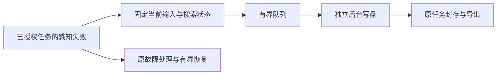

# 感知失败现场如何留证

“网页有画面，但动作后一直等不到有效场景”需要失败当时的原始 RGB-D 和处理状态来解释。现在增加了独立的诊断快照：它保存被拒绝的输入，随原任务归档，不会把这份输入变成有效位姿或成功证据。

该能力已完成离线检查并进入未部署候选，尚无新增真机采样。旧运行缺失的深度不能从视频补造；离线重放入口已接通录制、归档和实际分割/几何代码，单帧结果不代表动态恢复。实际部署与当前进度见 [STATUS](../agent/STATUS.md)。



## 保存什么

- 原始 RGB、Depth 和 CameraInfo 的字节及摘要；各路源时间、接收时间、序号、配对信息保持原样。
- 当时的 owner、session、task、epoch、阶段和失败原因。
- 取得的相机时刻反馈、当前反馈及末端变换；未取得的项目保持缺失。
- 分割前的本地搜索框、所用视图、旧测量搜索提示和几何配置。远程分割器不支持读取搜索状态时明确为空。

快照保留“原始输入”和“匹配反馈”两份信息，不把后者的时间写回前者。重放还需该次运行的 mask 配置、标定和代码身份；快照不包含完整时间序列，也不包含模型权重或 API 凭据。

## 怎样限制开销

每个网关实例最多接受8份快照，同一 owner/session/task 和失败原因最多2份，总预留容量64 MiB，包含元数据余量；队列最多1份等待写入。尚未授权的预热故障及正常阶段切换不消耗这一预算。

提交只保留缓存中不可变字节的引用，写盘在独立线程。诊断使用独立blob目录，避免与正常观测的同名文件写入竞争。队列忙、缓存淘汰、磁盘错误、目录创建失败或预算耗尽，都只减少诊断证据，不产生动作中断条件；状态计数随`scene_timing`记录。关闭时最多等待后台线程1秒，未完成项不冒充已封存。

## 在哪里找

仍归入同一次 infra 运行的数据包，不新增任务入口。导出包中的路径为：

- `owner/scene/failures/<snapshot_id>.json`：快照、失败原因和缺失说明。
- `owner/scene/failures/blobs/<sha256>`：对应原始字节。
- `owner/scene/manifest.json`的`diagnostics`：本次导出的快照列表、遗漏和完整性。

导出核对 owner、session、task ID和task hash，优先保留原 owner 必需证据。只收录封存时已经完整写完元数据的快照；后台尚未完成的文件不会被当作完整快照。封存后内容变化仍按原归档完整性规则拒绝，不静默替换。

`capture_complete`表示该快照引用的字节保存齐全，`export_complete`表示这些已保存字节完成导出；两者都不意味着观测可用于运动，也不代表整个运行的RGB-D连续录制完整。原`scene.complete`继续只描述 owner 已引用场景的完整性，诊断缺口单独报告。

## 如何用于修复与经验

先用原输入和搜索状态复现分割/几何失败，再改变实现或配置做对照。若证明是工程错误，修代码并记录反例；若得到可复用恢复策略，才生成形式化候选，进入既有独立验证流程。不能把保存了一张故障图、模型写了一段总结或一次离线恢复，直接当成真实经验晋升。

当前检查覆盖后台阻塞、缓存淘汰、写盘失败、预算和授权范围、真实导出脚本、跨任务隔离、部分文件与封存后篡改。它们不代替真实相机动态重放或真机闭环，回执见[本轮汇总](../artifacts/scene-failure-capture-20261109/summary.json)。

## 离线重放入口

维护工具 `scripts/replay_scene_failure.py` 接受原快照及本次运行对应的固定颜色分割配置。它不启动 owner、ROS、机器人连接或模型请求；不需要改变 infra 的任务操作。以下在6000D的 Projects 根目录执行，路径替换为已导出的快照和配置：

```bash
PYTHONPATH=HARNESS/src HARNESS/.venv/bin/python HARNESS/scripts/replay_scene_failure.py \
  --snapshot /绝对路径/owner/scene/failures/快照ID.json \
  --mask-config /绝对路径/本次运行mask配置.json \
  --output /绝对路径/新建的诊断结果.json
```

工具逐个校验RGB、深度和CameraInfo原始字节的SHA，恢复保存的各视图搜索框，用实际预处理、分割和几何代码分别给出结果。输出记录原始时间、匹配反馈、代码/输入摘要及库版本；已有输出文件不覆盖。提供的mask配置没有旧快照中的摘要可供比对，因此始终标明`mask_config_identity_verified=false`，由运行装配身份核对其来源。

- `input_incomplete`：引用字节缺失，不计算几何，不从JPEG补深度。
- `views`：各相机分割像素数或原始拒绝原因，可以与下游几何失败区分。
- `geometry`：只报告单帧几何计算、拒绝或缺少反馈/末端；不输出已抓住、已停稳、已放置等时序结论。
- `replayed_with_incomplete_temporal_state`：已尝试重放，但未恢复历史帧、缓存和阶段切换；即使几何算出也不是完整线上复现。旧物体搜索提示仅记录，不在缺少历史作用域证明时应用。

工具当前只接固定颜色方案；遇到SAM配置直接拒绝，不隐式加载权重或访问网络。输出固定标注不能用于运动准入或经验晋升。它是查因和修复对照的输入，真实策略有效性仍由独立验证流程判定。

17项新增检查及既有捕获/导出/分割/几何检查共42项通过，含真实导出脚本往返、缺深度、字节篡改、错误搜索身份、无效反馈、模型后端拒绝和禁止覆盖。另保存了CLI运行的[解析构造样例结果](../artifacts/scene-failure-replay-20261109/analytic-report.json)，它不是机器人记录；[回执](../artifacts/scene-failure-replay-20261109/checks.txt)。本轮仅新增维护工具和检查，运行包仍为之前冻结、未部署的候选。
