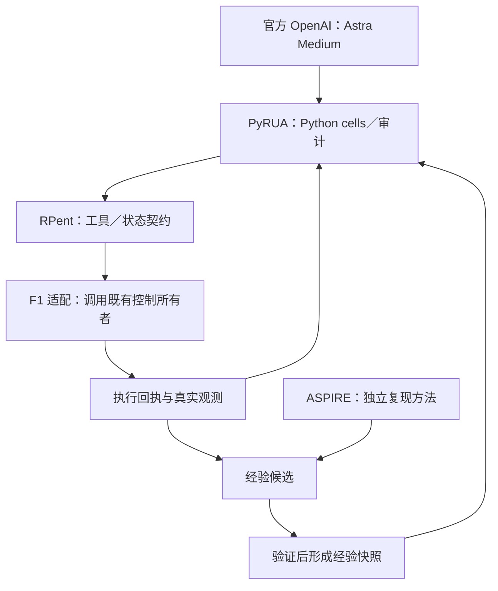

<!-- doc_type: design; status: proposed; updated: 2026-11-04 -->

# HARNESS：上游复用与适配边界

**主运行链采用 RPent＋PyRUA-Lean，ASPIRE 提供经验整理与独立验证的方法。** RPent 承担工具和状态契约，PyRUA 让规划模型通过 Python 组合这些工具；F1 的执行仍交给现有控制与推理服务，HARNESS 只补任务适配。

**源码来源已经核查，运行兼容性尚待验收。** 三个上游分别保留独立 Git 身份；源码是否完成检出、实际提交与本轮回执查[锁定清单](../configs/upstreams.lock.json)和[当前状态](../agent/STATUS.md)。本页不把文档支持的组合写成已运行通过，也不把 ASPIRE 的仿真结果视为 F1 能力证据。

实施前用本页确认哪些直接调用、哪些需要适配；执行顺序和阶段门槛见[实施方案](IMPLEMENTATION_PLAN.md)。规划模型已确定为官方 OpenAI API 的 `gpt-6-astra`、推理强度 `medium`；具体装配以[规划配置示例](../configs/planner.example.toml)为准。



## 1. 固定来源与选择依据

| 上游 | 本方案固定提交 | 用途与选择依据 |
|---|---|---|
| [RLinf/RPent](https://github.com/RLinf/RPent) | [`886b3b274d3dd30bbc15615ea512d65ae90bc8b3`](https://github.com/RLinf/RPent/commit/886b3b274d3dd30bbc15615ea512d65ae90bc8b3) | PyRUA 官方快速开始明确使用的 RPent 提交；作为初始兼容基线 |
| [DAGroup-PKU/PyRUA-Lean](https://github.com/DAGroup-PKU/PyRUA-Lean) | [`e8f01dca744421d70684adbbc1713fd4d92f8aca`](https://github.com/DAGroup-PKU/PyRUA-Lean/commit/e8f01dca744421d70684adbbc1713fd4d92f8aca) | 本轮核查的 main；包版本为 `0.2.0`，复用机器人对象、cells、MCP 与规划循环 |
| [NVlabs/ASPIRE](https://github.com/NVlabs/ASPIRE) | [`fa00f0ef2bc1d91d594b9aa502c22133c9f538f7`](https://github.com/NVlabs/ASPIRE/commit/fa00f0ef2bc1d91d594b9aa502c22133c9f538f7) | 本轮核查的 main；固定参考源码，首期不安装其运行环境 |

[PyRUA 快速开始](https://github.com/DAGroup-PKU/PyRUA-Lean/blob/e8f01dca744421d70684adbbc1713fd4d92f8aca/docs/getting-started/quickstart.md)给出了 RPent 的上述固定点，但没有证明本项目的 F1 适配、当前传递依赖和官方 API 已联合通过。首轮验收通过后才能把组合标为“已验证”。

本轮同时看到 RPent main 为 `0fa63c5a191df7665b03a1569d7a46d85df6b175`，仅登记为后续升级参考，不自动代替初始基线。升级必须更新锁定清单，并复验受影响的 API、取消语义和产物格式。

源码预定位置分别为 `third_party/RPent`、`third_party/PyRUA-Lean`、`third_party/ASPIRE`。各自保留原始远端；HARNESS 的锁定清单记录来源和适配关系。后续必要补丁在 HARNESS 单独留存来源、用途与适用提交，不把修改后的代码冒充原始上游。主运行环境只装前两者及 F1 适配所需依赖。

## 2. 直接复用与最小新增

| 层 | 直接复用 | HARNESS 待实现部分 |
|---|---|---|
| RPent | `Toolkit` 注册与调用、状态封装、工具结果、取消信号、`MemoryManager` | `F1Toolkit`，把有限工具调用转交既有 F1 服务并核验回执 |
| PyRUA | `RobotBase`、`Backend`、`ArmToolkit`、MCP、规划循环、调用 ledger、自动 API 文档 | `F1Robot`、host、F1 知识说明，以及可审查的注册适配 |
| ASPIRE | 失败分类、经验提案、独立 verifier、验证后入库、冻结评测与证据关联方法 | 面向 F1 的经验字段、判据与门禁；不能直接执行其仿真脚本 |
| 现有 F1 | 已登记的模型、RTC、IK、控制所有权、真实 START、通信保护、录制和反馈 | 经原控制所有者承认的任务调用边界；具体接口仍待设计与验收 |

F1 当前合同从[任务推理主文档](../../tasks/F1_ComplexyToys/INFERENCE_RECIPE.md)与[任务状态](../../tasks/F1_ComplexyToys/STATUS.md)读取。HARNESS 不复制一套 VLA 推理、轨迹执行或训练框架，也不因安装 RPent 而启动它的 LIBERO、Franka 或其他机器人服务。

### RPent 的确切扩展接口

固定版 [`rpent/tools/toolkit.py`](https://github.com/RLinf/RPent/blob/886b3b274d3dd30bbc15615ea512d65ae90bc8b3/rpent/tools/toolkit.py)提供：

```python
Toolkit(*, dashboard_events, state=None, memory)
Toolkit.add_tool(name, spec, handler)
Toolkit.execute_tool(name, input_dict) -> ToolResult
Toolkit.get_env_state(*, command, result, elapsed_s) -> dict
Toolkit.cancel_active_and_wait() -> None
Toolkit.solved() -> bool
Toolkit.close() -> None
```

工具 schema 使用 `name/description/input_schema`；只读 handler 用 `@readonly` 标记，其他工具执行后捕获状态。F1 适配须提供真实状态、调用身份与结束原因，工具完成不能仅由 HTTP 请求返回或模型自述判断。

[`RobotSpec`](https://github.com/RLinf/RPent/blob/886b3b274d3dd30bbc15615ea512d65ae90bc8b3/rpent/robots/robot_spec.py)描述机器人名称、prompt、CLI 参数、运行配置和初始化钩子，也有 `is_real_robot` 与交互探索能力字段。[注册器](https://github.com/RLinf/RPent/blob/886b3b274d3dd30bbc15615ea512d65ae90bc8b3/rpent/robots/base.py)通过 `robots.<name>` 调用 `get_robot_spec()`／`get_toolkit()`。这些是复用点，不能据此声称 F1 注册已经存在。

### PyRUA 的确切扩展接口

[`Backend`](https://github.com/DAGroup-PKU/PyRUA-Lean/blob/e8f01dca744421d70684adbbc1713fd4d92f8aca/src/pyrualean/_backend.py)是机器人对象与执行者之间的小契约：

```python
execute_tool(name: str, input_dict: dict) -> Any
solved() -> bool
artifact(name: str, step: int = -1) -> bytes
env_steps() -> int | None
cancel() -> None
```

[`RobotBase(backend, *, ledger=None, primitives="full")`](https://github.com/DAGroup-PKU/PyRUA-Lean/blob/e8f01dca744421d70684adbbc1713fd4d92f8aca/src/pyrualean/_robot.py)负责公共状态、调用 ledger 和结束防护；子类定义相机、图像产物、状态工具和结果类型，实现 `_state_from_envelope()` 与 `_summary_dict()`，通过 `_readonly()`／`_stateful()` 调用工具。公开方法的签名和 docstring 会生成给模型的 API 文档。[官方扩展说明](https://github.com/DAGroup-PKU/PyRUA-Lean/blob/e8f01dca744421d70684adbbc1713fd4d92f8aca/docs/robots/adding-a-robot.md)要求不能支持的成员显式列入 `ABSENT_MEMBERS`；F1 若还没有可信在线成功判据，就不能伪造一个 `done` 值。

`RobotAdapter(name, robot_cls, host, knowledge, blurb, ...)` 连接机器人对象与宿主；host 提供 `Cell/add_cell_args/cell_from_args/boot_options/boot/dump_card`。现有 `RpentBackend` 已把 Toolkit 转为上述 Backend，`cancel()` 调用 `cancel_active_and_wait()`。参考[注册定义](https://github.com/DAGroup-PKU/PyRUA-Lean/blob/e8f01dca744421d70684adbbc1713fd4d92f8aca/src/pyrualean/robots.py)和[宿主公共适配](https://github.com/DAGroup-PKU/PyRUA-Lean/blob/e8f01dca744421d70684adbbc1713fd4d92f8aca/src/pyrualean/hosts/common.py)。

**当前没有第三方机器人 entry-point。** `ROBOTS` 是固定 tuple，`get_adapter()` 只接受名单内名称并导入 `pyrualean.<name>`；现有 CLI 不能直接使用 `--robot f1`。初始实现需要小型注册补丁或显式装配适配，保留补丁和固定点的对应关系；不以运行时随意改内部对象替代可追查的适配。官方新增机器人教程主要面向 XPolicyLab，README 中 AF8 真机集成仍标记 coming soon，不能作为现成 F1 驱动。

## 3. 官方 OpenAI 与固定 Astra Medium

已确认的产品选择是**官方 OpenAI API、`gpt-6-astra`、`medium`**。[规划配置](../configs/planner.example.toml)明确选择 `codex` runtime 的 Responses 路径，仍待实现参数映射并验收。下面同时登记上游两种 runtime 的协议差异，避免把参数名相似误当成请求相同：

| PyRUA runtime | 实际请求路径 | 固定 Medium 的方式 |
|---|---|---|
| `codex` | Codex CLI，通过自定义 provider 使用 Responses API | `--model gpt-6-astra --reasoning medium`；官方 API base URL 传给 `--base-url`，密钥仅由 `--api-key-env` 指向的环境变量提供 |
| `openai` | PyRUA 自带的 Chat Completions 循环 | `--model gpt-6-astra --openai-extra-body '{"reasoning_effort":"medium"}'`；该路径不能把 `--reasoning` 当作请求参数已经生效的证据 |

PyRUA 默认 reasoning 为 `xhigh`，需要显式覆盖；不因一次失败自动换模型或强度。上游参考 Codex CLI 为 `0.155.1`，其 Astra catalog 关闭 code mode 以保持直接工具调用。`provider_overrides()` 会规范化 `/v1` 并设置 `wire_api="responses"`，因此 API base URL 与完整 `/responses` 请求 URL 不能混填。证据见[Agent 配置](https://github.com/DAGroup-PKU/PyRUA-Lean/blob/e8f01dca744421d70684adbbc1713fd4d92f8aca/docs/guide/agents.md)、[provider_overrides](https://github.com/DAGroup-PKU/PyRUA-Lean/blob/e8f01dca744421d70684adbbc1713fd4d92f8aca/src/pyrualean/generate.py)与[play_episode](https://github.com/DAGroup-PKU/PyRUA-Lean/blob/e8f01dca744421d70684adbbc1713fd4d92f8aca/src/pyrualean/play.py)。

首次协议验收只用离线观测和无运动工具，核对实际 endpoint、模型、推理强度、图像输入、工具参数、错误处理及使用量记录。源码支持配置不等于账户可调用或请求已经通过。私密文件仅由授权认证组件读取，不写入 prompt、工具输出、经验库或网页；本页没有读取其内容。

## 4. 进程隔离、取消与物理执行

[PyRUA sandbox](https://github.com/DAGroup-PKU/PyRUA-Lean/blob/e8f01dca744421d70684adbbc1713fd4d92f8aca/src/pyrualean/sandbox.py)限制 imports、把 `open()` 约束在工作目录、屏蔽部分 introspection，并记录 `sandbox_flags`；源码也明确说明进程内 Python 无法完全封闭。审计标记中有些仅用于记录，并非全部阻止执行。[`cells`](https://github.com/DAGroup-PKU/PyRUA-Lean/blob/e8f01dca744421d70684adbbc1713fd4d92f8aca/src/pyrualean/arms.py)在宿主进程中直接 `exec`，不是每 cell 独立进程的硬隔离。

[`runner.py`](https://github.com/DAGroup-PKU/PyRUA-Lean/blob/e8f01dca744421d70684adbbc1713fd4d92f8aca/src/pyrualean/runner.py)的 watchdog 会请求结束 episode 并取消工具，但 RPent 固定版 `cancel_active_and_wait()` 是设置 `cancel_event` 后无超时等待 `done_event`。它依赖 primitive 在安全取消点检查信号，不能保证阻塞或失联服务已停止。ASPIRE 的[README](https://github.com/NVlabs/ASPIRE/blob/fa00f0ef2bc1d91d594b9aa502c22133c9f538f7/README.md)也明确指出 trial/watchdog 不是安全沙箱。

F1 适配因此至少需要以下可验收边界，当前均为待实现：

1. 每 episode 独立进程与外部期限监督；只开放明确的 F1 服务能力，不向生成代码暴露驱动、私密配置或生产目录。
2. 指令带会话、所有权、有效期与取消身份，继续服从实际控制所有者的状态机；旧请求重放、超时迟回复和重复提交不能继续动作。
3. 取消结果区分“已请求”“执行者已确认”“物理状态未确认”。父进程退出或 planner 超时不能冒充机器人已停；失联由原控制保护处理。
4. 真实运动须取得实际控制所有者下的新鲜本地真实 START 授权。HARNESS 不远程生成按键、恢复旧授权或改变原碰撞与反馈保护。

## 5. 记忆存储复用与经验晋升

RPent 的 [`MemoryManager`](https://github.com/RLinf/RPent/blob/886b3b274d3dd30bbc15615ea512d65ae90bc8b3/rpent/memory/manager.py)可以直接复用本地语料管理：

```python
MemoryManager(root, *, memory_access="read_only", inbox_cell_tag=None)
validate() -> list[str]
rebuild_index() -> Path | None
merge_memory(*, cell_tag, run_state_dir, solved) -> dict
```

它提供 global/suite/task_only 分层、YAML metadata、evidence、confidence、合并锁和冲突留存。[内存文件工具](https://github.com/RLinf/RPent/blob/886b3b274d3dd30bbc15615ea512d65ae90bc8b3/rpent/memory/tools.py)区分 published 只读与当前 inbox 可写，但对 memory namespace 之外的文件不提供完整文件系统隔离；仍需遵守前述进程和目录边界。

**PyRUA 尚未自动接通该跨回合记忆。** 其 [LIBERO host](https://github.com/DAGroup-PKU/PyRUA-Lean/blob/e8f01dca744421d70684adbbc1713fd4d92f8aca/src/pyrualean/hosts/rpent_libero.py)默认建立本次运行的空 `_memory`，prompt 使用静态 knowledge 或复制的 guides。初期可把已验证的 F1 经验快照交给现有 `--guides-dir` 注入，并保留内容 hash；后续再评估是否需要单独检索工具，不先实现通用向量数据库。

RPent 的 `merge_memory()` 对 global/suite 草稿完成 schema 校验后即可合并，`solved` 仅门控 task audit/recipe 的复制。因此 **`solved=True` 或 `confidence=verified` 字符串本身不是独立验证**；HARNESS 必须在调用 merge 前增加经验晋升门禁。

ASPIRE 的[canonical iterative-debugging skill](https://github.com/NVlabs/ASPIRE/blob/fa00f0ef2bc1d91d594b9aa502c22133c9f538f7/.claude/skills/iterative-debugging/SKILL.md)与[协调者说明](https://github.com/NVlabs/ASPIRE/blob/fa00f0ef2bc1d91d594b9aa502c22133c9f538f7/.claude/skills/iterative-debugging/main-agent-prompt.md)提供了可复用的门禁方法：

| 步骤 | F1 适配时保留的要求 |
|---|---|
| 提案 | 从实际失败与修复证据提取适用条件、工作片段、退出条件及反例；保留来源运行与版本 |
| 独立验证 | verifier 只得到经验说明和允许的输入，不读取提案者的完整解法；重新复现其声称的效果 |
| 判定 | `verified/refuted/void` 分开；只晋升 verified，运行无效不算反证也不算成功 |
| 入库 | 写入固定经验快照，记录 verifier 回执、内容 hash 与适用机器人／合同 |
| 后续检验 | 能传达原任务的修复不等于能泛化；跨任务效果必须增加新的独立证据 |

ASPIRE 的 Codex skill 只是指向上述 canonical 文件；其评测脚本调用 `cap-harness`，内置技能片段使用其机器人 API。首期只改造工作流与记录合同，不能直接把仿真种子、坐标、脚本或现有经验标题搬成 F1 已验证技能。开发样本、独立检查与最终评测保持分开，最终评测失败不回灌用于同轮调参。

## 6. 依赖、模型服务与许可证

### 环境与传递依赖

建议为 HARNESS 核心新建 Python 3.11 环境。固定 [RPent pyproject](https://github.com/RLinf/RPent/blob/886b3b274d3dd30bbc15615ea512d65ae90bc8b3/pyproject.toml)要求 Python `>=3.10,<3.13`；[PyRUA pyproject](https://github.com/DAGroup-PKU/PyRUA-Lean/blob/e8f01dca744421d70684adbbc1713fd4d92f8aca/pyproject.toml)要求 `>=3.10`，基础 `dependencies=[]`。后者的 numpy、Pillow、mcp 1.x、uvicorn、httpx 等实际运行依赖需要由明确环境提供，不能将空依赖表理解为无依赖。

RPent 固定版包含 `pydantic-ai-slim>=2.1` 等开放范围，机器人 extras 又引用浮动 Git 分支。两个主仓库 SHA 只固定源码，未固定完整环境；后续首次解析必须记录所有传递版本和 Git 提交，再进行导入与接口验收。不同机器人 extras 的 Torch／Transformers 等约束冲突，上游也要求分环境。

官方 LIBERO-PRO 示例的 Torch `2.7.1`／torchvision `0.22.1`、CUDA、仿真器与权重不作为 F1 核心环境的默认安装项。ASPIRE 的[依赖配置](https://github.com/NVlabs/ASPIRE/blob/fa00f0ef2bc1d91d594b9aa502c22133c9f538f7/pyproject.toml)与[模型来源锁](https://github.com/NVlabs/ASPIRE/blob/fa00f0ef2bc1d91d594b9aa502c22133c9f538f7/configs/dependency-lock.json)保留在其自身边界；需要运行其基准时再单独准备环境。

### SAM3 同名服务不能默认互换

| 使用方 | 来源与已核查约束 | 本项目处理 |
|---|---|---|
| RPent | `RLinf/sam3`；固定 RPent 的 extra 指向该仓库 main | 若确需该服务，再补固定来源与协议验收 |
| PyRUA RoboDojo installer | `RLinf/sam3@c1f6b1e83967c912f675d8975d437ccdc41e17d8`；保留已有 torch，numpy `<2`、opencv-headless `<4.12` | 仅作为该机器人经过测量的来源，不自动安装到 F1 |
| ASPIRE | `Max-Fu/sam3@6fe87d64a5beb9084923d7a9e002741178635b09`；provider 使用 torch `2.9.1`／torchvision `0.24.1`，整体另有 numpy `1.26.4` 等覆盖 | 独立环境与服务；首期仅参考其经验方法 |

证据见 [PyRUA installer](https://github.com/DAGroup-PKU/PyRUA-Lean/blob/e8f01dca744421d70684adbbc1713fd4d92f8aca/integrations/xpolicylab/PyRUA_Lean/install.sh)、[ASPIRE submodules](https://github.com/NVlabs/ASPIRE/blob/fa00f0ef2bc1d91d594b9aa502c22133c9f538f7/.gitmodules)与上述依赖锁。PyRUA 有现成 [`Sam3Http`](https://github.com/DAGroup-PKU/PyRUA-Lean/blob/e8f01dca744421d70684adbbc1713fd4d92f8aca/src/pyrualean/hosts/sam3_http.py)分离模型进程，但它不是 ASPIRE 服务协议兼容的证明。复用感知服务前要核对图像、mask、相机身份、坐标语义和返回类型，不能只按端口或 `sam3` 包名判定。

### 许可证与第三方边界

三个主项目均声明 Apache-2.0；再分发派生文件时保留相应许可证、NOTICE 和修改归属。该声明不覆盖全部模型、子模块与数据。

| 材料 | 已核查的独立边界 |
|---|---|
| RPent 与 PyRUA 主源码 | Apache-2.0；PyRUA NOTICE 记录部分 MCP／knowledge／工具 schema 来源于 RPent |
| ASPIRE 主源码与经验流程 | Apache-2.0；第三方仍按各自许可 |
| ASPIRE Contact-GraspNet | dependency-lock 标注 NVIDIA Source Code License，限制为非商业研究与评估 |
| PyRUA RoboColiseum IK 描述 | NOTICE 标注所带 GenieSim 描述文件为 MPL-2.0；不是 F1 首期必需组件 |
| SAM3 权重 | gated 下载及独立使用条件；源码许可证不替代权重条件 |

来源：[RPent LICENSE](https://github.com/RLinf/RPent/blob/886b3b274d3dd30bbc15615ea512d65ae90bc8b3/LICENSE)、[PyRUA NOTICE](https://github.com/DAGroup-PKU/PyRUA-Lean/blob/e8f01dca744421d70684adbbc1713fd4d92f8aca/NOTICE)、[ASPIRE LICENSE](https://github.com/NVlabs/ASPIRE/blob/fa00f0ef2bc1d91d594b9aa502c22133c9f538f7/LICENSE)、[ASPIRE NOTICE](https://github.com/NVlabs/ASPIRE/blob/fa00f0ef2bc1d91d594b9aa502c22133c9f538f7/NOTICE)及其依赖锁。上游使用的其他 fork 只登记来源与必要性；首期不批量检出它们，也不改写其远端。

## 7. 首轮待验收清单

| 门槛 | 最小证据 | 完成后才能声称 |
|---|---|---|
| 核心环境 | 固定传递依赖、模块导入、所用 API 与上游固定点一致 | RPent＋PyRUA 在本环境可装配 |
| F1 最小适配 | fake backend 下观测、拒绝、结束、重复调用与取消回执测试 | F1 适配合同在离线条件下工作 |
| 官方 API | Astra Medium 的实际请求身份、图像与无运动工具调用、错误与使用量记录 | 规划服务链路已接通 |
| 原控制端接口 | 只读身份校验、过期／取消／失联检查、零输出证据 | 具备进入下一阶段的接口基础 |
| 经验晋升 | 候选隔离、独立 verifier、拒绝未验证提案、快照 hash | 经验流程已接通，不代表真机泛化 |

上述门槛通过后，物理执行仍按[实施方案](IMPLEMENTATION_PLAN.md)和 F1 现场合同单独验收。源码检出、文档完整或一个仿真示例成功，都不能替代真机授权、闭环效果与失败恢复证据。
