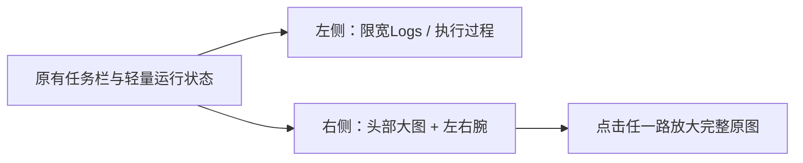

# F1 Infra：任务运行台设计与候选

**11月9日 F1infra 任务计时与布局 V44 已部署，只修改任务页；全站精简未采纳。** 正式页面沿用原配色、字体和控件风格，将状态与大号计时并入任务操作栏，移除重复说明与主视区运行元信息，保留窄Logs和三路完整视野。其他页面保持原样，未采纳的全站候选见[工作台布局](../../../F1-4242/docs/WORKSPACE_LAYOUT.md)。

[打开正式任务页](http://192.0.2.7:4242/#tasks)，刷新加载新版。[已确认布局原型](../visualizations/task-density/index.html)保留审阅时的8条历史关键事件与各自注明日期的参考图，正式页面使用真实记录和三路实时相机，未引入原型数据。

当前正式执行已由后续Harness线程接通，实际运行与故障调查以[任务STATUS](../../agent/STATUS.md)为准。V44只调整任务页布局与计时显示；下方原型、11月5日方案和最早的复杂方案保留各自的历史身份，不作为真机运行结果。

## 11月9日已部署：任务计时与布局 V44

[交互预览](../visualizations/task-timer/index.html)保留已认可的布局，仓内副本用占位图展示三路画面。原型可在本地浏览器中独立打开。正式任务页已按此范围实施并部署V44，验收与发布回执以[工作台STATUS](../../../F1-4242/docs/STATUS.md)为准。页面顶部明确标记示意状态与历史参考画面；照片复用上一候选，头部／右腕来自11月5日，左腕来自10月30日，非同步录像。

- 将状态、35–38px等宽数字计时、配置和开始／停止置于同一任务栏，取消单独运行元信息行。
- 移除标题旁说明句、单方块副标题、执行模式／单次运行摘要与“当前动作”辅助标签。执行方式和任务说明收进配置；运行名称、编号、来源收进最近运行及详情；当前动作直接放画面标题右侧。
- 保留实际状态与有意义的故障信息，异常时提供定位入口；V44没有改造控制恢复逻辑，也不以开始按钮可点证明真机可恢复。
- 原页面每2500ms拉取状态并直接显示elapsed_s，是时间跳动的原因。V44以服务端elapsed_s为锚点，使用performance.now()单调时钟独立更新数字，按秒显示；准备／运行／等待／停止收尾计算任务总时长，终态和历史固定。断连冻结最后确认值并提示状态待更新，不增加API轮询频率，不每秒重绘日志。
- 运行身份切换、当前／历史切换、页面恢复、退出清理与服务端最终耗时校正已接入；25项隔离计时检查、57项相关回归及四种桌面尺寸的候选浏览器检查通过。两份任务静态资源已发布并核对HTTP哈希，后端V43及其他页面资源保持；线上浏览器复验结果统一见工作台STATUS。

实际Why&How入口完成1280×800、1440×900、1920×1080浏览器检查，覆盖运行／结束布局、配置／历史展开、Logs、异常定位和画面放大；连续秒更新及终态冻结通过，无页面脚本异常或机器人请求。原始截图仅在本地 `docs/visualizations/task-timer/` 保存，浏览器回执在`artifacts/task-timer-preview-20261109/`。用户提出的“Let the layout do the explaining!”已写入Projects根AGENTS的UI规则。

## 11月6日已确认并部署：字号、Logs宽度与三路画面

用户明确回复“可以的部署吧”后实施。F1infra V42只发布两份前端资源，57项相关回归及四种桌面尺寸的候选／线上浏览器验收通过；服务进程、控制配置与数据保持，实际发布证据以[工作台STATUS](../../../F1-4242/docs/STATUS.md)为准。下文的原型证据保持其历史参考性质。

- 正文与按钮约16px，Logs在桌面尺寸间使用14–16px，区块标题18–20px；不通过缩小文字强行塞入一屏。
- Logs宽度限制在360–540px，宽屏不再按大于一半的比例不断加宽。右侧获得其余宽度，左右间距缩至14–20px。
- 正式任务页此前仅头部／右腕切换；候选按用户要求展示头部、左腕、右腕三路。头部在左，两腕在右上下排列，利用16:9与4:3原始比例组成约22:9的画面区域。
- 图像宽满自身容器、高度跟随原图，容器无内边距；不使用裁切或拉伸来隐藏边条。各路可单独放大。没有技能记录时，仅在画面下方显示简短最后进度，取消空的大时间线卡片。
- 保留白底、细边框、原有按钮风格；异常只用轻量图标和加大的状态字强调，完整原因仍在日志。导航可收起，Why&How保持侧栏底部。

头部／右腕使用11月5日参考帧，左腕使用10月30日参考帧；不混称同次或同步录制。网页只演示布局与本页交互，来源和浏览器证据保存于 `HARNESS/artifacts/task-density-design-20261106/`。

浏览器验收已覆盖1280×800、1440×900、1920×1080和2464×1138：默认状态无主区滚动或页面溢出，Logs实际宽360／378／480／540px，字号14／15／16／16px。三路及各自放大窗口保持完整比例，无容器侧边留白；超宽窗口收起导航后允许工作区纵向滚动，状态行和底注可完整到达。日志、搜索筛选、配置及状态切换通过，Why&How固定底部，未发现脚本异常或写请求。见[1920效果图](../../artifacts/task-density-design-20261106/logs-1920.png)、[1440效果图](../../artifacts/task-density-design-20261106/logs-1440.png)及[浏览器回执](../../artifacts/task-density-design-20261106/browser-report.json)。

## 11月6日旧候选：结果层级与排错（未采纳）

用户明确认为下述大块结果区不如原版；不作为正式实现要求。保留[旧候选](../visualizations/task-feedback/index.html)及截图用于追溯，后续按上节的字号与空间调整继续。

| 调整 | 具体设计 | 解决的问题 |
|---|---|---|
| 任务结果 | 20–22px标题、状态图标、浅红结果区；结果、原因、运行身份在同一处 | 异常结束不再与普通小提示同级 |
| 异常解释 | 先显示“头部相机时间戳异常，接近方块前未取得可用场景”；完整错误链展开查看 | 不需要先读RuntimeError才能理解失败 |
| 顶部空间 | 固定机制说明收进任务说明和配置抽屉 | 避免长期说明挤占当前结果和日志 |
| 日志阅读 | 正文14px、异常条单独强调，明确筛选数量和被收起的事件；定位按钮展开错误 | 区分“只显示异常”和“整次只有一条事件” |
| 右侧布局 | 无技能记录时改为紧凑的最后进度区域，释放空间给画面 | 结束后不继续显示“任务开始后……”的空时间线 |
| 状态一致 | 失败红、等待琥珀、运行绿、主动停止灰；结果区位置和高度稳定 | 同样突出当前状态，不能把等待误当失败 |

异常卡主操作为“定位异常”，次操作为“本次配置”；新运行仍是任务栏的一次独立点击，没有自动重试。候选中操作只切换本页展示，不创建模型或机器人请求。

本次失败原因来自 `source_time_reversed:head` 与观测等待超时。文案不能进一步猜测具体RGB／Depth流、驱动损坏或碰撞；“没有技能事件”不等同“机器人没有移动”。任务终态与控制端保持／实测停稳分别呈现，原始证据仍在所属运行目录维护。

本候选内联字段仅为工作台事件的时间、类型、标题、级别和原因，以及该次四项配置；不读取私密配置。正文Logs及下载明确是8条关键事件摘录，未冒充截图中的完整119条事件。来源清单、截图和浏览器回执位于 `HARNESS/artifacts/task-feedback-design-20261106/`。

2026-11-06，候选在实际Why&How入口通过1280×800、1440×900、1920×1080浏览器检查：页面无溢出，同一尺寸下四种状态的结果区高度一致，Why&How入口保持底部。异常定位、筛选与搜索、配置抽屉、相机切换与放大均通过，未发现脚本异常或非GET请求。此检查仅验证候选交互，不代表真机任务验收。见[1440效果图](../../artifacts/task-feedback-design-20261106/error-1440.png)、[1280效果图](../../artifacts/task-feedback-design-20261106/error-1280.png)及[浏览器回执](../../artifacts/task-feedback-design-20261106/browser-report.json)。

## 11月5日已确认方案及当时接入范围

以下保留11月5日原型审阅及V40首次落地时的说明；其中“执行未接入”是当时事实，当前执行状态以页首链接的STATUS为准。

**2026-11-05：用户已确认采用这版单页方案，正式任务页已随 F1infra 任务运行台 V40 部署。** 参考 RPent 的单页交互，保留现有 Infra 外壳；首页只呈现任务入口、配置摘要、日志、相机和动作时间线。此前首版偏复杂，保留在文末作为历史材料，不作为当前实现范围。

[正式任务页](http://192.0.2.7:4242/#tasks)已接入真实相机、待用配置持久化与已登记任务记录读取；网页开始／停止尚未接入 Harness 所有者，保存配置尚未应用现场命令行。Why&How 的[已确认交互原型](../visualizations/infra-tasks/index.html)继续保留模拟运行与历史静帧，不能将原型事件当作现场结果。

下一步接入实际任务服务，按任务合同检查准备状态并取得现场 START；缺项给出一行原因与按需详情，完整检查不需要占据首页。Harness 实际进度仍以 [STATUS](../../agent/STATUS.md) 为准，正式界面行为见[任务运行台说明](../../../F1-4242/docs/TASKS.md)。下文运行中配置冻结等描述为设计合同，当前真机执行尚未接线。

## 已确认方案：一页完成一次研发循环

| 区域 | 用户在这里做什么 | 收起的内容 |
|---|---|---|
| 顶部运行栏 | 选择抓积木任务、看本次执行方案、打开配置、开始或停止 | 具体技术身份、底层控制参数 |
| 左侧执行区 | 默认看简洁事件，切到 Logs 搜索、筛选异常、导出或复制 | 工具输入、输出与错误字段按条展开 |
| 右侧现场区 | 头部／右腕切换、放大画面、看当前动作与动作顺序 | 点击动作才定位对应日志 |
| 配置抽屉 | 修改执行方式、任务指令、局部纠偏次数和运行备注 | 只读方案参数折叠展示 |
| 最近运行 | 查看旧日志、复用某次配置，再独立启动下一次运行 | 不另开复杂记录、经验或统计页面 |

## 配置与运行身份

开始时为本次运行保存一份配置快照。运行中的修改只写入下一次配置，明确提示“保存为下次配置”；本次记录里的执行方式、任务指令和预算不随之改变。只看历史记录或复用配置不会自动重跑，也不会切换当前执行。

首版常用配置只有四项：固定技能／Astra 规划、任务指令、局部纠偏次数、运行备注。日志、配置快照与视频随实际运行保存；底层标定与控制身份由服务绑定，框架版本、模型身份、日志路径和全部技术参数不堆在首页。任务指令的正式变化仍需服务端校验允许范围，不将文本直接当成任意运动授权。

## Logs 与异常后的工作流

默认事件说明发生了什么：找到目标、确认持物、到孔口上方、需要纠偏、执行结束。具体工具结果可展开；原始 Logs、搜索、异常筛选与导出用于定位问题。动作时间线可反向定位到对应日志，不需要重复浏览两套内容。

异常结束时给出简短原因与“复用配置”入口；用户改配置后自行点击开始下一次运行。生命周期、物理任务结果与人工辅助仍分别保存，结束不自动等同成功。候选的完成状态显示“待审核”，不能把模拟计时或页面动画当作物理证据。

当前预览仅在浏览器内模拟，不读取私密配置，不创建模型调用、录制、训练或机器人请求。相机保持历史帧标识；正式接线时才显示真实时效、等待授权和断连状态。网页取消须等待实际 owner 与反馈确认，不以按钮点击代表停稳。

## 参考与验证

**正式落地：** 11月5日按用户确认实施并部署F1infra任务运行台V40。正式页使用真实API，候选中的模拟事件与静帧没有进入正式界面；实际部署、三桌面线上检查与未接入边界见[工作台状态](../../../F1-4242/docs/STATUS.md)和[页面说明](../../../F1-4242/docs/TASKS.md)。本节以下保留原型审阅证据。

2026-11-05，当前运行台候选已在实际 Why&How 入口完成 1280×800、1440×900、1920×1080 的浏览器检查。开始／停止、运行配置快照、查看历史与复用配置、Logs 搜索与筛选、动作定位日志、相机切换与放大均通过；Why&How 入口保持底部，历史查看状态无页面溢出。浏览器无脚本异常，网络请求均为读取 4243 页面资源；本次验证不代表真实任务服务接入。

- [当前候选验收回执](../../artifacts/infra-tasks-console/browser-report.json) · [运行界面](../../artifacts/infra-tasks-console/running-1440.png) · [配置抽屉](../../artifacts/infra-tasks-console/config-1440.png)。
- [RPent 原版前端隔离展示](../visualizations/upstream-ui/index.html)：左执行输出、右相机与动作时间线，细节折叠。
- [PyRUA-Lean 官方逐步回放](https://dagroup-pku.github.io/PyRUA-Lean/#episode)：按调用查看代码、反馈与画面。
- 本轮候选的脚本、截图、上一版备份与浏览器回执统一保存于 `HARNESS/artifacts/infra-tasks-console/`。

## 历史首版：概览／记录／技能经验（未采纳）

以下保留此前设计的完整分析与接线边界。用户认为首页偏复杂；当前以本文上方的一页运行台为准，下方准备大卡、统计与经验页不作为首期界面要求。第一版 HTML 与原设计全文已备份，历史截图未覆盖。

### 1. 入口与信息架构

沿用现有桌面 Infra 的 236px 全局侧栏、颜色、卡片与按钮风格，在「总览」后新增「任务」。只设计桌面端，审阅 1920×1080、1440×900 与 1280×800 的阅读顺序和展开状态。

当前侧栏列出唯一任务「抓积木 · 单块入孔」，首版直接进入详情。后续增加任务时扩展此列表或使用任务选择器，首版不添加空泛的项目列表、日历或任务管理看板。任务下有三个页内入口：

| 页内入口 | 用户需要知道什么 | 首版内容 |
|---|---|---|
| 任务概览 | 当前目标、能否开始、正在发生什么 | 真实当前状态、场景观测、准备卡、阶段流程与任务设置 |
| 运行记录 | 哪次运行发生了什么、结论能否追证 | 结果列表、失败阶段、人工辅助、耗时及视频／观测／反馈证据 |
| 技能与经验 | 任务会调用哪些能力、经验依据是什么 | 技能清单、适用范围与验证状态；真实经验为空时如实展示 |

### 2. 任务概览

#### 2.1 首屏阅读顺序

1. **任务标题与目标。** 「抓积木 · 单块入孔」，副文案说明固定方块、固定匹配方孔、固定小工作区；身份、标定与模式进入可展开详情。
2. **当前状态。** 使用「待现场联调」，摘要为「粗标定已交付 · 真实联调待完成 · 尚无完整任务结果」。分别呈现已有证据与下一步，不能用百分比进度暗示真机完成度。
3. **主观测区域。** 主要展示头部相机场景，辅助展示右腕局部图；当前原型使用历史静帧，明确注明「历史静帧」及来源，不显示 LIVE、虚假帧率或虚假在线心跳。
4. **右侧准备卡。** 汇总相机／反馈、任务场景、标定接入、控制服务、现场授权。缺项给出可理解的原因与查看入口，详情再呈现技术身份。
5. **阶段流程。** 观察 → 抓取与确认持物 → 转移 → 对准插入 → 释放验证。每阶段可查看结果证据；当前未运行时不点亮为已完成。

准备卡应区分「已交付」「待接入」「待验证」「不适用」「未知」，避免把文件存在或历史探针成功统一渲染成绿色就绪。最新状态缺失、超时或无法核对时明确显示未知及采样时间，不沿用旧的可执行状态。

#### 2.2 任务设置抽屉

由顶部「任务设置」打开右侧抽屉，将低频配置从首屏移出。首版包含：

- 目标对象与孔口、固定场景适用范围、成功判据。
- 执行模式：「固定技能基线」与「Astra 规划对照」。先以固定技能通路跑通，再在相同场景比较规划收益。
- 恢复预算：最多两次局部修正、一次重抓；只有经过验证的恢复分支才可执行，预算存在不代表恢复能力已真机验收。
- 标定级别、实际绑定状态、场景／控制／模型身份的只读摘要。

候选原型中的设置只影响演示。正式接入后，配置变化必须生成明确的任务身份，运行中不能悄悄替换任务、标定或恢复预算。首版不提供任意数值运动参数、任意脚本编辑器或流程拖拽。

#### 2.3 当前／运行中／需介入的演示

原型提供独立的演示切换器，不混入真实执行按钮：

| 状态 | 展示重点 | 不得暗示的事实 |
|---|---|---|
| 当前状态 | 粗标定交付、联调缺项、历史静帧、真机结果空状态 | 已获得动作授权、实时在线或完整可运行 |
| 运行中演示 | 当前阶段、任务耗时、近期事件、观测和技能结果 | 本项目已经发生该次真机运行 |
| 需介入演示 | 失败原因、保持状态、证据、后续现场操作提示 | 仅发送取消请求就已停稳，或网页可自动恢复已撤销权限 |

所有演示状态持续展示「交互演示」标识。任务动作仍由实际 owner 处理，并取得新鲜现场真实 START；浏览器打开、刷新、切换任务或查看预览不产生动作。页面呈现取消时，应区分「已请求」「控制端已保持」「实测已停稳」。

### 3. 运行记录与复盘

真机记录默认展示真实空状态：「尚无完整任务结果」。可显式切换「模拟示例」理解列表与详情布局，模拟记录始终带来源标记，并与真机数量、成功率和人工介入统计分开。

每次运行至少关联任务与场景、执行模式、控制／模型／标定身份、阶段时间线、终态、人工辅助、观测／视频及实际反馈证据。列表优先显示结论、失败阶段、模式、耗时与人工介入；技术身份和原始事件放入详情。

结果分三层表达：

| 层级 | 例子 | 页面含义 |
|---|---|---|
| 执行生命周期 | 运行中、已结束、已取消、被接管、被拒绝 | 程序与控制请求走到哪一步 |
| 任务结论 | 成功、失败、待复核、中断 | 积木任务是否满足后置判据 |
| 辅助与数据用途 | 自主、人工辅助、奖励未知、未准入训练 | 结果如何统计、能否进入后续学习 |

调用完成、动作发布、机械到位和积木入孔分别保留。成功须有匹配孔口、进入、释放后稳定与夹爪空置的证据；观测不足则待复核。人工接管后完成单列，不改写为自主成功。首批五条开发尝试用于发现问题，不能等同后续二十场景至少十八次自主完成的正式验收。

### 4. 技能与经验

技能清单围绕观察、抓取、在手检查、转移、对准插入、释放验证与有界恢复呈现，标注源码实现、离线验证、真实联调、真机验证等实际层级。卡片可以解释作用和后置条件，不能仅因接口存在就显示「可在真机执行」。

程序性经验与运动技能代码、BC／RLT 模型权重分别表示。首版显示真实经验空状态与验证规则；后续再加入「候选 → 独立验证 → 收录／驳回」，保留来源、适用范围、正反例和固定快照身份。未经验证的总结不能自动成为下一次执行指南。

### 5. 与现有页面的职责边界

| 入口 | 继续承担的职责 | 与任务页的连接 |
|---|---|---|
| 总览 | 整机、服务与公共资源的运行概况 | 任务页引用相关准备状态，异常可跳转查看 |
| 采集 | 录制与数据采集的现有操作、来源分类 | 任务运行引用录制身份与产物，不重建一套采集控制 |
| 数据 | 原始记录、视频与既有审核浏览 | 任务页提供阶段和结论索引，打开原记录追证 |
| Why&How | 原理、操作说明与人类阅读材料 | 任务页链接对应说明，教学与候选预览统一使用 4243 |
| 任务 | 目标、场景合同、准备状态、阶段执行和任务结果 | 将上述能力组织为可复用方案与可复看的运行 |

全局控制所有权、真实反馈、保护与录制来源仍遵循原合同。任务页不复制控制后台，不把普通 BC／RLT rollout 重新标为 Harness 成果，也不自动将 Harness 记录纳入训练。

### 6. 真实接入还需要什么

现有 Harness 已有 `capabilities`、`observe`、`status/events`、`prepare_skill`、`submit_skill`、`cancel_skill`、`skill_result` 的合同与软件实现；这不等于 Infra 已有可用浏览器接口。正式页面需要对实际服务进行只读接入、身份核对与错误处理，再单独验证有动作的生命周期。

| 所需接口 | 最小信息 | 接入边界 |
|---|---|---|
| 任务目录与合同 | task_id、目标、模式、场景、恢复预算、成功判据、内容身份 | 任务定义与单次 run 分开；不得将当前占位配置显示为已生效 |
| 准备状态聚合 | 能力、设备、观测时间质量、标定绑定、场景验证、owner 与授权状态 | 明确各项来源和采样时间，失败或缺失返回未知／未就绪 |
| 一致观测 | observation_id、源时间、scene_version、图像引用、对象／孔口／持物证据 | 独立 JPG GET 不能冒充同步观测；历史画面与实时观测分开 |
| 执行事件 | run／session／epoch、当前技能、提交／接受／发布／测量、恢复与接管 | 顺序可追溯；断连后查询原请求，不重放旧动作 |
| 任务结果与证据索引 | 生命周期、任务结论、人工辅助、阶段耗时、录制与关键帧引用 | 自动判定与人工复核分开，缺证据不能算自主成功 |
| 设置与执行入口 | 校验后的任务变更、现场启动指引、有界请求及取消结果 | 准备不产生动作；动作继续受现场 START 和原 owner 约束 |
| 技能与经验目录 | 能力状态、适用条件、验证证据、候选／收录状态 | 当前先只读，经验晋升与多任务调度后置 |

当前标定数据是 `coarse/development` 交付，站点任务配置仍有待绑定字段。真实相机与检测区域、固定桶参照、头部源时间质量、完整反馈 shadow 及现场结果封存也需继续验收，不能把本设计的绿色演示状态当作准入依据。

### 7. 实施优先级与候选验收

**第一步实现任务定义、准备检查、观测与阶段进度、结果证据四件事。** 任务设置保持最少字段，复用现有相机、数据与说明入口。后续有真实任务记录后再建设经验晋升、多任务切换与调度；复杂堆叠、多形状、BC／RLT 技能接入仍遵循原任务计划。

候选审阅重点为：新增入口能否自然融入现有侧栏，首屏能否看清当前不能开始的原因，主观测与准备卡是否易读，阶段与结果是否区分清楚，抽屉展开是否保留工作上下文，以及模拟示例是否始终可辨。正式实现前按 F1-4242 的 UI 流程确认候选图；本次设计不分配产品 V 号，也不更新已部署身份。

#### 本次原型验证

2026-11-05，独立原型已登记到 Why&How 4243；正式 Infra 源码与机器人部署未修改。实际阅读站浏览器检查覆盖 1920×1080、1440×900、1280×800，以及当前／运行中／需介入、准备详情、设置抽屉、相机切换、阶段证据、记录与复盘。三个尺寸均无水平溢出，抽屉保存按钮可见，浏览器没有脚本异常或写请求。

截图与检查回执保存在 `HARNESS/artifacts/infra-tasks-design/`；相机图来自11月5日现场复核静帧，标注框和运行记录仅为示意。原型不轮询机器人，也不读取私密配置；设置只影响当前页面。此验收仅说明候选交互可审阅，不代表真实接口或任务闭环已验收。

### 上游参考验证

上游预览使用项目锁定的 RPent `886b3b2` 前端，保留原 HTML／CSS／JS 布局与交互；仅将资源内联，并以本页虚构事件和 F1 历史静帧替换后端输入。不是官方运行日志，也没有启动机器人或模型。原版空状态、工具展开、相机切换和分栏拖动已在实际4243入口的三个桌面尺寸验证，原文件身份、适配说明与截图保存在 `HARNESS/artifacts/upstream-ui-review/`。PyRUA-Lean 当前锁定源码以 CLI、逐次代码输出及运行产物为主；官网的逐步回放和真机视频属于展示／复盘界面，不是另一套在线控制台。

### 依据

- [Harness 当前状态](../../agent/STATUS.md)：实际完成、阻塞与未验收边界。
- 单块 baseline、执行合同、恢复预算与正式验收见[当时的实施方案](../../agent/experiments/20261112-implementation-plan.md)。
- [标定接入合同](../operations/CALIBRATION_HANDOFF.md)：粗标定适用范围与后续运行接入。
- [F1 Infra 协作规则](../../../F1-4242/AGENTS.md)：桌面布局候选先审阅、后正式实现。
