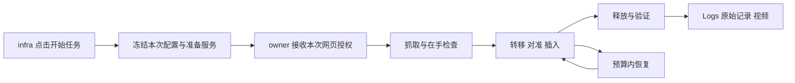

# F1 Harness：在 infra 运行完整任务

使用 [F1infra 任务页](http://192.0.2.7:4242/#tasks)开始、停止和查看单块分拣结果。新配置默认「Harness Agentic」，已有配置沿用上一次保存的选择。部署版本、模型身份及最近的现场验证见[项目状态](../../agent/STATUS.md)。

「配置 → 执行方式」还列有「Harness＋VLA」。这条路线另需独立 VLA 服务就绪。开始前核对本次所选路线及页面的执行服务提示，使用可用路线完成测试。操作授权由用户在任务页点击「开始任务」给出。

停止未确认后，页面允许再次点击开始，先重新准备并核对新控制端的连续实测停稳，再授权本次任务；旧运行仍保留停止未确认。每次网页运行使用独立通信路径，避免异常残留文件阻止下一次启动；现有控制锁继续独占。

启动时会复用只读设备连接，减少重复发现设备的等待；每次任务仍重新核对当前设备和反馈。页面打开或后台预热不会启动机械臂，也不需要额外操作。只读服务未就绪时可以使用原冷启动路径；若复核结果未知，页面会报告原因。

## 开始一次运行

核对本次[现场验收项](../../agent/STATUS.md)，按需记录首次实际动作、抓稳到运输的耗时，以及放置后的避桶和复位结果。部分物体观测可用于持物复核，但缺桶体／孔口信息时不会冒充完整放置场景；Logs保留具体缺失原因。

打开[正式任务页](http://192.0.2.7:4242/#tasks)，选择「抓积木」。保持登记时的头身姿态、相机安装和桶的位置；摆放约30×30×60mm的竖直方块，使右腕能看到积木、头部能看到方孔和桶上的参照。正常结束仍在运行的BC／RLT／遥操会话，共同控制锁会阻止同时接管。

开始前会自动只读核对相机身份、参数、模型和头身姿态，机器人重启后生成独立复核记录；不会改写原标定。如果设备或姿态与登记条件不符，Logs会显示具体原因。

核对配置中的执行方式和任务指令。执行服务可用时点击「开始任务」，页面先显示准备，再显示实际执行状态和技能日志。同一次任务内的局部恢复由程序处理。感知配方见 [SAM 运行说明](SAM_RUNTIME.md)。

配置中的局部纠偏可选0、1、2次。开始时会保存本次配置快照，运行中修改仅用于下一次。当前注册范围仍是单方块与对应方孔；更改任务文字不会自动增加其他物体、任意运动或训练权限。

## 本轮泛化测试怎么做

1. 在配置中选择 Harness Agentic；说明可写“抓取当前方块，放入对应方孔，确认释放后先右移避桶再复位；规划被拒绝时根据原因换抓取倾角或方向”。保留默认两次局部纠偏。
2. 先用当前能清楚看到的单竖直方块跑完整流程；成功后，下一次只改变平面朝向，再下一次只改变桌面位置。无需手动输入角度，当前观测会计算物体坐标。
3. 检查 Logs 中实际使用的 `parameters`、候选拒绝原因、选中抓姿、验证与返程结果。抓住之后正常情况会连续执行固定运输宏，不应等待模型逐段指挥。
4. 结束后从“最近运行”与原数据入口查看本次原件／视频；模型图片请求、原始源帧身份及参数选择和原owner记录绑定同一run。候选经验自动整理，经过独立验证的快照才会进入下一轮；首次没有经验时用默认程序。

当前覆盖范围为同一方块／方孔、既有相机与标定、单物体竖直摆放。翻倒、完全遮挡、其他形状和混乱多块仍需后续感知与技能扩展；这次不要求先通过20组验收才允许启动。

如果出现 `registered_candidates_exhausted` 且 `no_motion=true`，代表规划没有执行动作，Astra可以看具体障碍、换参数再试。已执行但验证不足使用 `recheck`，已知停滞用owner给出的 `resume`；不能靠重复点击开始重放未知动作。

## 停止与失败

点击「停止运行」会请求撤销任务并由原owner保持。页面区分已请求停止、控制端确认保持和实测停稳；连接中断或反馈不充分时显示未确认，不能把按钮点击当作已经停住。硬件急停独立于网页。

已确认抓空会重新观察并按预算重新抓取；插入失败会撤离、复看和重新对准。无法确认是否在手时保留待审，不会把遮挡当成抓空。数值不可达会尝试已注册的方块等价姿态并完整复检；候选耗尽或无法判定成功返回待处理。实际碰撞、限位或反馈故障仍撤权，并保存原始原因。不要靠重复点击重发状态未知的动作；看当前运行的实际状态再决定下一次。

短时缺帧或正在积累停稳证据时，程序等待新观测，页面显示等待原因；30秒只作提醒，整个执行共用300秒预算。源时间倒退的坏帧被丢弃，合格新帧可以恢复，旧帧不会被重标为新图。接近／转移候选若因纯时效过期或首发前候选拒绝，只有owner确认该请求没有实际发布，才会在原授权和总预算内重新观察、规划，最多追加两次；已经执行或状态未知的动作不会自动重发。限位、碰撞、真实反馈或身份异常仍按硬保护处理，具体分级见[故障处理规则](../FAULT_POLICY.md)。

静止保持中的50ms时序波动只告警，覆盖轨迹计算以及失败／结束后的保持；该周期不发布新命令。运动中纯50ms输出时序超限也按故障规则丢弃本周期输出、保持最后命令，并在新反馈及原安全检查通过后继续同一当前路径点；反馈失联、目标过期、限位／碰撞和不明发布仍停止后续动作。停止按本次运行身份处理，先记录真实停稳，再关闭会话；若只是清理回执失败，页面单独告警，不覆盖已有停稳结果。

方块的90°等价姿态在感知和复核中统一解释。零发布的候选因过期或新场景变化失效时，系统废弃旧路径、重新观察并有限重算；每项技能最多追加两次，原技能预算不重置。日志保留原／新观测、几何差值和实际发布次数；工具调用记录本身不代表机器人已经执行。

控制端在授权后撤权时，任务会退出并在Logs保留首次故障原因；历史“已授权”回执不代表当前仍有执行权限。清理阶段的“会话关闭”不会覆盖原故障，停止未确认仍单独显示。

## 看结果和日志

「执行」查看当前技能与动作顺序，「Logs」查看工具输入、输出和失败原因；可搜索、筛选异常与导出。最近运行保留每次配置和结果，复用配置后仍需自行点击开始，不会自动重跑。

任务服务收集同一次运行绑定的owner原始录制、planner trace、图像和视频，并核对来源。即使程序正常结束，页面也保留结果审核状态；失败和未完整封存的记录不会自动变成自主成功，更不会进入BC／RLT训练。

记录现在统一位于 infra 的「数据 → 真机Rollout → Harness」。原始三路 RGB 图像包复用原播放器和视频生成队列；新任务另外保存技能、停止状态、被实际引用的 RGB-D 与内参证据。视频在后台生成，失败运行只要原件完整也可以回放；不完整原件标为恢复记录。备注和审核复用原有入口，Harness 数据不会自动进入 BC／RLT。

任务页“最近运行”用于查看编排和首次失败原因，数据页用于看同一次原生录制。两者通过 task_id／owner run 身份关联，不将 planner 日志、每个技能或者派生视频算成额外一条采集。

## 两种执行方式

「Harness Agentic」运行本地技能程序，需要新判断时调用 Astra。「Harness＋VLA」由 VLA 执行前段动作，停稳交权后复用 Harness 的后续程序。完整职责见[职责与交权](../ARCHITECTURE.md#职责与交权)，体验固定程序的离线对照见[首次运行](FIRST_RUN.md)。

## 当前几何参数的边界

抓取时以右腕 RGB-D 观察积木。运输到桶上方后，优先用头部 RGB-D 测孔；右手遮住方孔时，固定左腕可从侧面找到形状，使用两路都看得见的桶盖参照和头部新鲜深度求孔位。Astra 可读取带来源的孔位数值并按需索取左腕原图。当前工具控制右臂，左腕保持操作者设定的姿态。

对准完成后重新观测，再求插入路径。几何检查包含工具、相机支架、桌面、桶、目标及在手物体。抓取姿态依据物体法向规划，方块的四个等价朝向会结合后续插入空间选择。

积木尺寸、孔口边长、闭合开度和工具几何的来源在冻结站点中区分实测、估计与配置。12mm是当前插入总进给目标，不是已测有效孔深；接收时配对也不冒充曝光同步认证。真实在手偏移及最终任务是否完成，以每次新观测和实际日志为准。

本页对应完整开发任务入口。维护者的装配与排障信息见[SITE_STARTUP](SITE_STARTUP.md)；原始验证与部署身份见[当前状态](../../agent/STATUS.md)，不需要操作者照抄命令。

## 历史开发记录

V5 在 Astra 标准档和 medium 强度下接入运动目标视频跟踪及同程序接续，发布前完成零输出回放。当时整条真机任务仍待验收。V22 的两条路线随后共用同一 Harness 与订阅入口，混合路线由 B1250 承担前段。验收范围和当时使用的配方见[V22 复盘](../../agent/experiments/20261111-vla-astra.md#v22共享harness双路线部署2026-11-12)。

下列内容记录当时恢复与经验候选的设计和待验边界。后续现场接续请从[项目状态](../../agent/STATUS.md)进入。

自由空间没有满足严格关节到位时，先检查实际末端与指尖误差和路径。连续新鲜反馈显示2秒无进展，会先保持并确认停稳，再用当前场景重规划接近、转移或撤离；默认与局部插入纠偏共用两次预算。不能证明停稳、未知发布、STOP或控制故障不会自动继续。

历史成功BC记录影响候选尝试顺序和IK软姿态偏好，旧绝对关节与位置不会直接下发。头部相机可补充腕部丢失目标后的重捕获；预估视野只是候选排序信息，真实目标证据仍来自新RGB-D。

记录结束先封存机器人原件，再后台复制和生成视频。后台复制可以与下一任务并行；原始停止结果、任务结果与导出状态分开保留。每条运行新增`experience-review.json`事实复盘，候选及独立验证回执使用JSON，晋升后的RPent指南为Markdown，运行读取固定JSON快照。未验证候选不会影响动作；当前已登记的baseline经验模板与默认插入恢复序列一致，实际学习收益需后续真实对照。
