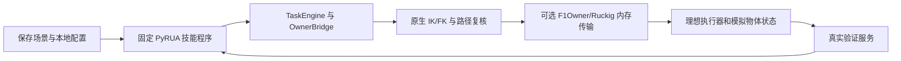

# 完整单块程序的离线回放

机器人关闭时，可以用同一份固定技能程序、任务引擎、owner、规划服务和原生数值栈，检查从接近到放置后复位的阶段衔接。入口是 `scripts/replay_full_owner.py`，不连接机器人、不调用模型、不修改部署配置；它补充整链路证据，不能代替真实抓持与相机验收。

回放用保存场景初始化，随后由理想执行器、刚性夹持和模拟观测推动程序。可选接入真实 F1Owner/Ruckig 输出后再模拟执行器跟随，覆盖平滑造成的阶段衔接和耗时变化；传输仍为内存假实现。可注入验证器收不到场景、积木平移和桶/孔口平移。当前结果以 [STATUS](../../agent/STATUS.md) 为准，新增输出模式见 [回执汇总](../../artifacts/output-replay-20261109/summary.json)。

当前参考40试验配方完整模拟15.70虚拟秒，单条同步计算另约1.67秒；原控制profile仍限速30°/s。参考50/60虽然程序完成，但实际模拟输出切入桶模型，已否决。零位移对准、补验证交接和准入留证保持；计算与真实感知等待另计，不能据此承诺真实15秒。[最新对照与输出证据](../../artifacts/reference-lead-20261109/summary.json)。历史记录保留，不改写旧方案结果。



## 运行方式

维护人员在 6000D 的 Projects 根目录执行。现场操作者仍使用 infra 页面，不需要改用这个入口。

```bash
OPENBLAS_NUM_THREADS=1 OMP_NUM_THREADS=1 \
PYTHONPATH=HARNESS/src:DAgger/F1/src:DAgger/shared/src:HARNESS/third_party/RPent \
HARNESS/.venv-numerics/bin/python HARNESS/scripts/replay_full_owner.py \
  --site HARNESS/artifacts/projection-reuse-20261109/local-inspection \
  --scene HARNESS/artifacts/fixture-relocalization-20261109/chain-inputs.json \
  --output HARNESS/artifacts/full-owner-replay-20261109/maintained
```

`--site` 必须是已准备的本地检查配置，包含可读取的粗标定、模型和包身份引用；不能直接把机器人路径当作本地文件。脚本仅在内存中重定位 frame chain 的 owner 配置入口和纯数值模型路径，报告记录重定位内容，原配置/历史标定回执不改写。任务必须显式包含放置和 `withdraw_reset`。

上述标准站点没有打开试验运动优化，默认follower也只是ideal。要复现15.70虚拟秒的已检查配方，使用`--site HARNESS/artifacts/reference-lead-20261109/reference-40/site`并追加`--follower approved-output`；结果仍只属内存假传输，输出审计和真实物理验收另行进行。不要把50/60失败配方当作更快可用配置。

报告中的`all_results_synthetic`现按原生结果实际字段计算，失败结果默认false不会被覆盖；另由`simulation_provenance`核对FAKE engine、模拟事件与输出。`all_results_synthetic=false`不等于真机执行。旧报告汇总硬编码问题保留为历史限制，既不回写原件，也不允许模拟证据晋升真实经验。

在上述命令末尾附加以下参数，可分别运行故障或布局对照：

| 参数 | 检查内容 |
|---|---|
| `--follower approved-output` | 原 F1Owner/Ruckig、本地速度/加速度/jerk 配置与内存传输；执行器仍理想跟随。默认 `ideal` 直接跟随参考 |
| `--missing-scene-at approach_grasp --missing-scene-calls 2` | 接近完成后验证器两次拿不到场景，随后恢复 |
| `--missing-scene-at verify_placed --missing-scene-calls 2` | 已释放后的放置验证恢复，不重复释放 |
| `--missing-scene-at withdraw_reset --missing-scene-calls 2` | 已返程后的验证恢复，不重复返程 |
| `--missing-scene-at grasp --missing-scene-calls 100 --expect-outcome pending_review` | 抓取后持续缺场景，使用完恢复预算后退出，不继续转移 |
| `--object-offset-mm 2 0 0` | 保存原生坐标系中，将模拟积木平移 2 mm |
| `--hole-offset-mm 10 0 0` | 将模拟孔口平移 10 mm，桶体按现有几何规则跟随 |

故障只作用于验证器的场景交付通道，owner 的 live scene 仍可用。它不模拟相机掉线、RGB-D 错帧或真实目标分割失败；这些需要对应感知回放。平移是单份保存场景的参数化变体，不是新增实测场景。

## 结果如何阅读

每次运行创建独立 `sim-*/`，保存源文件摘要、配置、场景与原生数值调用时间，以及以下产物：

- `report.json`：每次技能请求、结果、虚拟耗时、实际计算耗时和自动断言。
- `plans.json`：完整候选路径、阶段、参考时间表与停稳点。
- `mock-publications.json`：OwnerBridge 返回的新运动参考，不包含保持周期，也不是机器人发布记录。
- `mock-owner-outputs.json`：`approved-output` 模式的每周期参考、平滑后提交、模拟测量及原 F1Owner 发布回执；内存传输不访问 ROS。
- `collected/owner/harness/trace.jsonl`：真实状态机生成的事件，逐行标记 `simulation=true`。

成功场景要求程序完成所有阶段；每个请求最多两次验证等待。`recheck` 请求必须没有规划调用，也没有新运动参考；输出端仍发送保持指令，不能把保持发布误算成动作重放。持续缺场景应得到 `pending_review`，不能作为任务成功。断言失败时进程非零退出；失败回执保留。

## 检查平滑后的输出

维护入口 `scripts/audit_replay_output.py --report <实际report.json> --output <独立审计.json>` 使用相同数值环境/PYTHONPATH。它检查实际模拟发布是否完整、左臂是否保持、采样速度是否满足该本地配置，以及重新验证期间有无新参考或保持指令变化；源文件摘要必须与报告一致。

它还从规划时的场景重建**转移和空爪返程**，对平滑后提交路径按不大于0.1°关节间隔检查原生映射/保护与工具、夹持物环境扫掠。抓取、离桌、插入等有独立接触语义，不在这个附加环境审计的覆盖范围；它不能代替那些阶段的原验证器。全 ControlLoop、物理执行器与连续时间跟踪也未被模拟。

已完成名义、接近后短暂缺场景、接近后持续缺场景、返程后短暂缺场景四例。短暂缺场景经一次 recheck 完成；持续缺场景六次验证等待合计约12秒、两次 recheck 后待审，未进入抓取。名义案例2,811个转移/返程输出细分点通过，三个完成案例合计8,434点，来自同一保存场景，不是三种实测布局。

## 证据边界与计时

虚拟时钟在数值计算/验证等待期间暂停，因此虚拟周期不是运行耗时，更不是真机速度。`wall_s` 是这次本机回放的计算/等待时间，也不是机器人周期；二者不能当作两个实测部分简单相加。图像分割、RPC、ROS、真实关节跟随、接触/滑落、会话 finish/STOP 和完整封存不在此入口覆盖范围。控制平滑仅在 `approved-output` 中覆盖，本地控制配置与当前机器人配置是否一致尚未重新验证。

任务引擎固定为 FAKE，所有结果标记 synthetic。为了执行未修改的硬件几何验证器，模拟 Observation 使用硬件合同的 `synthetic=false` 字段；报告明确声明所有几何观测均为 mock，采集身份和时间为虚拟值。这不构成真实采集证据，也不能用来晋升真实经验或申报物理验收。

当前名义回放的转移与返程占主要虚拟时间。优化应优先比较完整转移/返程路径及冗余姿态，并保留原实际 FK 扫掠与反馈检查；不能把提高参考速度、删除停稳或跳过验证直接称为达到 15 秒。

当前登记短返程已将名义虚拟周期从22.42降到20.60秒，转移与返程仍是主要耗时。新候选与变体回执见[返程对照](../../artifacts/return-candidates-20261109/summary.json)；前文七例汇总保留优化前的证据。修改运行源码后，需要新的配套manifest/local-inspection，旧包身份检查失败不能通过关闭校验解决。

同一候选接入真实软件输出后，名义虚拟周期为23.60秒，其中转移6.12秒、返程9.18秒。增加的3秒说明理想参考跟随低估输出开销，并不是本轮改变了控制限速；15秒目标仍未达到。新增回放/审计工具未修改或重新部署运行包。


## 整周期候选与15秒预算（2026-11-09）

以最新未部署运行包的同一保存场景，分别调整接近和转移的四种登记候选顺序，共8次完整回放，最终都选接近候选3、转移候选1，周期均23.60虚拟秒。逐候选原生复算确认：接近其他候选被场景扫掠拒绝；转移0/2/3分别在右腕J6、肩部J2、右腕J7到达限位后不可解。改变尝试顺序不等于找到了另一条可行姿态，也不能把限位错误降成警告。

已准备仅改变软排序的离线配置：接近`[3,0,1,2]`、转移`[1,0,2,3]`，其他候选、原限速、几何、任务和控制身份全部保留。单次名义对照中，转移规划1.886→1.172秒，节省约0.714秒；名义模拟输出的时间、关节指令、测量与新参考标记逐帧一致。该结果只说明减少无效候选计算，不是机器人运动速度改善，也不是统计性能基准。

名义、积木+2mm、孔口±10mm四个模拟场景均完成；它们来自同一保存场景，不是四次独立实测。名义实际模拟输出另经2,811个0.1°细分原生/环境检查（只覆盖转移与空爪返程），最大采样速度约22.21°/s。配置仅保存在[离线候选目录](../../artifacts/cycle-branches-20261109/preferred-order-site)，未激活、未部署、未晋升真实经验；完整[汇总与范围](../../artifacts/cycle-branches-20261109/summary.json)。

现有名义路径的参考运动时间合计14.382秒，13个登记停稳点合计3.9秒，尚未计软件平滑滞后、真实视觉/夹爪或计算等待。由此，保持这些路径与停稳合同，仅省规划计算不能实现15秒。仅按各技能首末关节差计算的理想速度下界为8.857秒，但它忽略碰撞、加减速、中间路点和夹爪，绝不是可执行路线。

下一轮优先联合设计抓姿、持物转移及右移返程，而不是继续排列这四个既有候选。还需区分必须取得新观测的接触/释放边界与纯绕行中间点；任何连续化调整都须复核实际平滑输出，不能把所有停稳统一删除。工程优化所得配置先作有来源的候选，后续真实独立验证才可成为经验快照；本轮不自动更改控制代码或训练权重。


## 可选连续返程（2026-11-09）

新运行代码允许显式登记`fixture.return_route.continuous_transit=true`，默认false且仅支持timed_reference。它使“桶右侧”和“返程折点”成为连续路径点；离孔、最终就绪、夹爪变化保持停稳确认，接触技能没有变化。原配置和未开启的任务行为不变。标记经过计划、owner和独立重验证绑定，不允许随意把其他阶段改为连续。

冻结候选0772826a91d1的标准站点仍关闭此项，供后续现场整合。启用实验配置在`artifacts/continuous-return-20261109/preferred-order-site`，只用于离线回放；同名关节参考路点与之前完全一致，返程停稳索引从[2,7,14,21]变为[2,21]。名义返程9.18→7.72虚拟秒、整周期23.60→22.14；四组同源模拟的转移/返程平滑输出共10,891个0.1°细分检查通过。全部原几何/限位/反馈规则仍执行。

连续化会改变实际平滑输出，不能说只是“删等待、动作完全相同”。最大采样输出速度约29.92°/s，仍在本地30°/s profile内；没有重验该profile与现场身份，也没有覆盖实际抓持、接触、动态误差或所有环境布局。该能力未部署，不能把回放速度写成真机性能。

在返程验证器丢失两次场景时，一次recheck后完成；持续丢失经两次recheck和约12秒验证等待返回待审。两者均保持输出不变，没有再次生成返程参考；放置成功不因返程待审而被冒充为全程成功。这不是相机断流实验。软件回归1033项、原生假传输60项、解包检查370项通过，[完整回执与限制](../../artifacts/continuous-return-20261109/summary.json)。


## 协调持物抬升与转腕

`fixture.transfer_lift_rotation_fraction`默认0，可显式登记为0.33。启用时，在原抬升段提前完成目标旋转的一部分，同时补偿末端平移，使夹持积木的原计划抬升端点保持不变；随后仍将示教曲线重定向到同一孔口目标。它不是放松到位误差或跳过检查，也不能与旧固定staging转腕路线混用。独立重验证重建同一配方，修改配方后旧提案失效。

试验配置为`artifacts/coordinated-transfer-20261109/coordinated/site`，包含候选顺序、连续返程与协调转移；仅供本机维护回放，不能原样部署其本地路径。标准冻结站点两个运动选项均关闭。转移参考5.311→3.885秒，经过真实F1Owner/Ruckig后的模拟转移6.12→4.70秒，完整20.72虚拟秒；25度抓姿原先不可转移，启用后完成20.78秒，因此继续优先保留示教抓姿。

三种合成平移周期20.74/20.82/20.50秒，缺观测短故障补验证后完成；持续故障两次recheck后待审，不继续插入/释放。8条输出审计18,396点通过，局部profile仍30度/秒；接触、动态RGB-D及物理跟随未验证。默认关闭的23.60秒回放时刻不变，返程原生数值极小差异经平滑后出现最大0.000302度输出差，不能称默认逐字节相同。


## 阶段参考速度与平滑输出的区别

`fixture.reference_velocity_by_skill_deg_s`只允许对`transfer_above_hole`与`withdraw_reset`设置有限正数。省略时沿用`reference_velocity_deg_s`，接近、抓取、插入、释放始终沿用base；不是修改原控制器速度/加速度/jerk，也不跳过夹爪和语义边界。规划、到位复核、独立重验证使用同一速度配方；旧提案不能带着不同参考速度或anchor继续执行。

该阶段历史试验副本`artifacts/phase-speed-20261109/mixed/site`使用转移30、返程25度/秒参考，仍由30度/秒、100度/秒²、600度/秒³的原本地F1Owner/Ruckig约束。名义转移4.70→3.54秒、返程7.72→6.52秒，完整20.72→18.36虚拟秒；当时同步函数另约3.46秒，不等于真实墙钟耗时。当前缓存候选副本在`artifacts/geometry-cache-20261109/mixed/site`。标准冻结站点未开启这些覆盖，本地试验路径不能原样部署。

30/30方案名义17.92秒且程序成功，但返程有183个细分输出未通过桶模型，故明确不采用。混合方案名义及三种布局、短缺/持续缺观测共6条输出11,706点通过。由此确定的工程经验是：参考路线、速度合规和终点成功均不能替代实际平滑输出的环境检查；不是“所有机器人返程只能25度/秒”的普遍规则。决定按任务、代码、配方和profile保存于[JSON](../../artifacts/phase-speed-20261109/decision.json)，没有晋升真实经验。

当前线上规划侧尚未普遍预测平滑输出扫掠；维护审计只能证明受测配方与场景。下一步补候选规划阶段的输出预测/配方回退，保留原实时控制，避免用任意执行阈值掩盖路径问题。

## 原输出器的离线预览

`scripts/output_preview.py`复用原F1Owner/Ruckig，以内存传输计算给定参考时序的输出。输入只有明确的静止初始化、完整机器人参考、有效状态维与时间化参考指令；不会读取未来实测或已发布输出。禁用动作参考时保持它自己预测的上一输出。原始时间不重新归零，避免浮点时间变化影响有状态平滑器；原限位/机器人碰撞检查保留。

`scripts/preview_replay_output.py`是维护验证入口：核对保存模拟及源码/配置身份，提取参考输入，预测后才与原输出比较；另用共用`output_sweeps.py`检查转移和空爪返程。它只接受可还原静止初始化且无中途恢复的完整模拟，缺失保持历史不能猜测补全。12项边界检查和两条真实原生脚本验证通过：30/25配方918点、30/30配方896点的输出差均为0，前者2180个细分点通过，后者2113点中复现原有183个桶边失败。[回执](../../artifacts/output-preview-20261109/summary.json)。

**这仍是参考时序回放的预测一致性，不是在线前瞻规划。** 时刻和阶段场景来自保存模拟，没有预测未来观测或阶段推进；理想跟随不代表真实执行器。单条预览2.61–2.66秒、独立扫掠5.13–5.40秒，不能直接加入每次启动。最多5000样本与默认15秒协作式计算预算限制维护工作量，不是新增的真机动作门槛，也不是可强制终止阻塞原生函数的外部超时。

在线接入前需要三项工作：忠实绑定当前平滑器位置/速度/加速度/滤波与制动状态；从候选计划及原阶段推进规则生成未来参考时序；复用/加速检查后提供候选配方回退。不能将正在运动的状态清零来让预测通过，也不能因为旧场景配方通过就免检新布局。这些维护工具没有发布动作或晋升真实经验的能力，当前运行候选与部署保持。

## 运动中途的数值分支

`scripts/output_branch.py`的`fork_output`在原平滑器完成一个sample之后建立独立数值分支，保留内部弧度坐标、速度、加速度、滤波、限位与原制动轨迹；不调用reset/hold，不从末端位置猜测内部状态。所有可变Python/numpy数据复制，原生Ruckig制动轨迹通过只读视图使用：原F1适配器每次提案新建轨迹，不原地改写已有证书。该机制只适用于同进程、同线程取样边界，不能直接pickle后通过RPC发给规划服务，也不是通用并发快照协议。

`check_output_branches.py`将前轮给定参考时序继续输入分支，之后才与归档比较。两条完整模拟的抓取/转移/返程各两个切点，共12个分支、10个运动状态，后续5503点输出与原件完全一致，源状态保持。8项原生数值检查覆盖原制动fallback、分支隔离、未提交状态和故障；此处没有新机器人碰撞/任务环境验收，30/30失败配方不会因此变为可用。[完整回执](../../artifacts/output-branch-20261109/summary.json)。

一次分支复制约0.045–0.069ms，纯平滑器计算后续序列约5.5–44.3ms，不包含原owner发布、机器人碰撞与几何检查，不能与前文全owner/环境约8秒当同口径对照。它让离线候选能复用同一个运动状态，省去每次重放全部前缀；真实首动/总任务提速仍未测。在线状态传递、前瞻阶段时序和候选回退继续按TODO推进。

## 精确几何验证复用

当前`geometry.transform`按矩阵全部float64字节缓存“是否为有限、合法的齐次刚体变换”这一纯检查，最多256项。没有缓存返回矩阵、目标位置、传感器证据或碰撞结果；输入被原位修改、发生1e-12变化或失效时都会重新检查。它减少工具/桶/相机坐标在大量扫掠点上的重复验证，不放宽任何容差。

三次交替固定输入对照中，混合配方2180个纯任务几何检查中位1.870→0.790秒；失败配方2113点为1.735→0.741秒，所有判定和原183处失败完全保持。新混合整链模拟输出逐点相同；失败配方独立重算输出最大差0.000449度，但失败位置仍相同，不宣称全运行逐字节一致。单条同步规划/验证合计约2.03秒，动作仍18.36虚拟秒；没有实际启动、网络、感知或物理耗时改善证明。

新候选只改geometry，原控制/任务/粗标定保持，1127项回归与461项解包检查通过，尚未部署。[计时、身份与限制](../../artifacts/geometry-cache-20261109/summary.json)。历史报告仍对应当时源码；不要用当前工作树执行旧身份站点后绕开身份检查，维护命令已指向新候选。

## 离孔后的协调返程

`fixture.return_route.rotation_fraction`默认0，登记值为0、0.33、0.5。先按原姿态离开孔口，随后向机器人右侧移动时完成部分朝就绪方向的旋转；旋转可能增大工具外沿，因此重新计算并补足向右距离。原离孔目标、就绪目标、工具余量、原控制profile均保持。全部段仍经几何/IK检查，重验证会重建同一配方；不能把新配方应用到旧提案上。

比例0.5配转移/返程各30度/秒参考时，完整模拟16.62虚拟秒、返程4.78秒；原混合方案分别18.36/6.52。三个小幅平移布局16.60–16.70秒；短缺观测补验证后完成，持续缺观测两次recheck后待审。选定6条输出9782个细分点通过，不代表混乱堆叠或真实插孔已经验收。标准冻结站点仍关闭此项，启用副本为`artifacts/return-coordination-20261109/rotate50-fast/site`，其本机路径不能直接部署。

单条同步计算另约1.91秒，虚拟时钟不含感知/模型/网络等费用。默认几何保持，但独立原生重算和平滑输出有最大0.000271度差，不宣称所有默认输出逐字节一致。当前这项改进是工程实现与离线证据，尚未形成真实经验晋升或在线自动配方选择。

后续补齐了协调后的登记返程候选对照：现有排序已经选直接回位，无需新增优先开关。5条完整模拟与9132点输出检查通过；折点候选最好16.58秒，只比原方案少两帧，尚不足以替换配方。参考路径最短与平滑周期最短并不一致，后续以完整输出和阶段耗时决定优化，不以规划长度单独排名。[对照及保留原配方的理由](../../artifacts/return-variants-20261109/decision.md)。

后续重查调度保持相同路径配方和停稳点：几何通过但反馈已变化时，先用新反馈判断变化是否变小，再提前重查。名义16.32秒、36次几何检查；3种平移和2条验证故障注入及9726点输出通过。立即每tick重查的首版虽然虚拟时间减少，却增加计算负担，已否决。详见[重查调度对照](../../artifacts/arrival-refresh-paced-20261109/decision.md)；这不是新的到位条件，未部署。

## 恒定对准计划的确认与恢复

已重验证的align计划若所有目标精确等于当前保持指令且尚未发布动作，owner可以使用已有实测静止窗口，再检查当前实测几何与新场景，避免重复执行零位移轨迹。非恒定指令或证据不足继续原流程；取消/缺反馈撤权保持。结果明确no_motion，对应事件为harness_stationary_alignment_verified，保持周期的发布不被说成新的运动。

名义align从0.48降至0.12秒、完整15.96虚拟秒。用`--missing-scene-at align --missing-scene-calls 2`可验证一次补验证后继续插入；100次配合pending_review预期，检查预算耗尽后不插入/释放。此案例发现并修复旧纠正状态在补验证成功后未清理的问题，不能靠跳过验证解决。8例及12335个转移/返程输出细分点通过，均为模拟。[说明与证据](../../artifacts/stationary-alignment-recovery-20261109/decision.md)。

## 不读取未来数据的计划前缀预测

在上述原控制输出回放中追加`--preview-segments`，维护工具会在转移/空爪返程每段首次参考发布前，复制当前已提交的原平滑器状态，用计划生成到下一登记参考边界的预测输出，并按当前已知场景审计。随后原模拟继续；`segment-previews.json`保存独立预测和创建时已有输出数量，可在完成后逐帧比较。预测器的输入不包含未来输出、观测或到位时刻。

该模式只在`--follower approved-output`下有效，仍是内存假传输；保留原生速度/加速度/滤波/制动状态，不reset到静止。只允许自由空间常夹爪段和声明的50Hz时序，采样/计算预算限制维护工具而非现场任务。源控制状态及完整模拟输出不应因预览而改变。

参考40/50/60的9段550个预测输出与后续模拟精确一致，50/60四个首失败提前命中。预测本身共约11–17ms，但逐点原生/场景审计还需1.37–2.13秒；不能把这项串入在线控制循环。它不覆盖参考边界后的停稳、未来观测或跨段时序，前缀通过不代表完整技能通过。[证据、测试和限制](../../artifacts/segment-preview-20261109/decision.md)。
