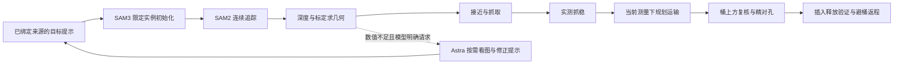

# SAM 感知与单块执行

感知选型先比较对象身份、遮挡后的追踪和可用几何，再比较处理时延。分割结果交给 RGB-D 几何估计，抓持与放置仍按动作后的实际观测验证。

**2026-11-12已按离线选型部署临时配方V24：SAM3做限定积木目标的初始化／必要重识别，SAM2.1 Tiny做连续追踪，RGB-D与几何负责测量，不额外加入生成式本地VLM。** SAM3改善了受测小块／遮挡图的候选覆盖，但孔形与实例身份仍不能直接相信文字分割；SAM3.1已实测，当前单块数据未显示足以抵消更高连续开销的质量优势。配方可替换、可回退，仍须按真机结果修订，不是全场景最优结论。

**V25补充：模型默认先读数值，只有明确说明数值不足并请求图像，才发送相应视图；旧图退出后续请求。** 这修复发送策略，不代表当前SAM已能独立初始化所有桶孔；本地完整识别、主动接近重观测与真机技能稳定性仍待补。

感知结果怎样进入抓取和放置，见[核心设计的单块分拣示例](../ARCHITECTURE.md#单块分拣示例)。历史失败与修复保留在[同一复盘](../../agent/experiments/20261110-sam-rollout.md)，本轮模型原始输出在[对照产物目录](../../artifacts/perception-selection-20261112/)。

## 当前已部署接线（临时配方V24）

V24已接入可选SAM3种子提供器，两条路线共用，保留V23的旧图初始化与全部执行合同。仅积木的首次分割／空追踪重识别使用SAM3；正常帧仍为SAM2，其他实体与显式点提示仍走原SAM2。未发送START，完整真机抓放与真实脱手恢复仍待验；当前部署以[STATUS](../../agent/STATUS.md)为准。

- 6000D同一GPU服务常驻SAM3图像模型与SAM2.1 Hiera Tiny；SAM2图像与视频predictor复用同一权重身份。模型随服务预热，不在每次开始时加载，GPU推理仍受同一服务锁串行化。生产进程显存实测约6.34GiB。
- 当前`wooden block`文字候选须在原提示框内唯一才用作SAM2种子；空候选或多候选显式回退原提示SAM2，并留存原因。框内唯一仍不是身份真值，后续几何与实例检查保持；模型加载／运行错误不会静默伪装成成功。
- F1 保留图像采集、标定、深度注册、掩码提示事务和几何计算。目标 ROI 的 RGB 通过独立 SSH 图像通道发送给 SAM；控制请求不进入模型进程。
- 当前初始化仍依赖来源明确的目标提示；缺提示时返回数值原因，Astra明确说明数值不足并请求后才通过 `show` → 定位工具补提示，不自动发图或空等完整几何。真正连接故障单独报错。提示是当前已显示图的归一化紧框，不是关节、位姿或运动授权。旧配方里的宽颜色搜索范围不会自动成为 SAM 提示。
- 移动积木使用真正的SAM2视频记忆，头部与右腕分别保留跟踪状态。V23在模型实际所见的原图初始化，再跟踪当前图；历史图不能充当当前深度或持物证明。只有积木配置streaming，不能把这一修复扩大成移动桶孔也已经验证。
- 请求与响应绑定图像 SHA 和模型 SHA，深度与关节反馈继续使用各自原始时间。图像传输失败不刷新测量时间。
- 头部六个注册实体为积木、方孔、三角孔、左槽、U槽和桶盖，当前均走SAM，`color_profiles={}`。五个静态实体共享一次图像上传／编码；孔外环深度、桶体参考、几何拟合仍由本地代码处理。现役链没有额外YOLO、GroundingDINO、CLIP识别器或生成式本地VLM。
- 相同源帧缓存、图像embedding复用和双相机请求并发已经存在；同一头图的静态批次与积木视频仍可能重复上传／编码。静态实体随新头帧重算，尚无独立慢频策略。按阶段与场景变化减少这些开销，不能直接删除支撑桶体定位的锚点。

V23基础接线证据：[冻结源码与配置审计](../../artifacts/perception-selection-20261112/v23-architecture-audit.json)。V24增量与验收如下；原日期实验不改写。

### V24部署验收与临时配方边界

38项冻结接口回归通过；实际HTTP服务输入同一100帧RGB，首次SAM3种子成功，后99帧SAM2无重置且全程非空。含PNG传输与服务开销，首次171.31ms、后续p50约50.65ms／p95约54.13ms；它与下表纯模型耗时口径不同。另用保存的静止RGB-D／反馈按请求节奏回放得到18份可用几何，处理p50约237.84ms，零命令发布。2026-11-13复核原始产物明确标注robot_connected=false、request paced，纠正此前“按原时间节奏”的表述；这不是连续在线相机或运动／滑落验收。

正式PyRUA→工具→原owner完整回放经过12次技能调用（含一次抓持补验恢复）完成，四项实际软件输出审计通过。初始RGB-D与分割真实，后续场景及机械反馈模拟；ARM只读启动、6000D／F1／infra三端、两条订阅池及生产SAM3权重身份均核验通过。没有像素GT和新真机成功证据，也尚未减少首轮Astra看图或后续历史图携带。

配方文件标记`temporary`，将识别提供器与追踪分开；V23冻结包及切换前配置保留，回退时一并恢复代码、site与SAM服务配置并核验。升级SAM3.1或其他追踪器先做同源对照、实例／几何和时序检查，再分配新发布号；不原地修改V24冻结源码。优先补遮挡后重现、多同类互换、抓空／滑落、释放验证以及真正JSON优先的模型上下文，再按实际结果决定长期配方。

证据：[发布验收](../../artifacts/sam3-recipe-20261112/release-validation.json) · [三端与双路线](../../artifacts/sam3-recipe-20261112/post-activation.json) · [生产模型身份](../../artifacts/sam3-recipe-20261112/sam-live-health.json) · [临时配方](../../artifacts/sam3-recipe-20261112/sam-service.json) · [模型来源](../../artifacts/sam3-recipe-20261112/model-provenance.json)。

## 2026-11-12：真实数据模型对照与选型

本轮使用12张保存的真实相机图，以及同一右腕约9.96秒的连续100帧，覆盖接近、闭爪、提起／手部移动及部分夹爪遮挡；保留原始图像身份和时间。另有SAM2历史681帧辅助回放。**没有独立逐像素GT，也没有完整遮挡后重现、多同类互换、毫米姿态或本轮真机成功标签。** 以下非空帧数与抽样审核是连续性证据，不是准确率；人工审核框、SAM2输出及不同模型间IoU均不当真值。

SAM3与SAM3.1从用户指定的ModelScope下载原始`.pt`文件，完整SHA256匹配固定版本元数据；未用FP16重打包或随机权重替代。下载首次受代理路径拖慢，改服务器直连CDN并续传后完成。代码来自Meta固定提交，依赖置于隔离目录，三个测试GPU均已释放。[SAM3权重来源](../../artifacts/perception-selection-20261112/weights/sam3/provenance.json) · [SAM3.1权重来源](../../artifacts/perception-selection-20261112/weights/sam31/provenance.json)

### 实测结果

硬件为RTX 6000D；SAM用BF16 autocast，YOLOE用FP32。下表分别测模型阶段，**不包含双相机采集、传输、深度注册、位姿拟合与控制，不是整条机器人JSON闭环时延**；分辨率和接口也不同，不能直接按数字排列总体准确性。

| 方案与测量范围 | 实测耗时 | 真实数据中看到的行为 |
|---|---|---|
| SAM3图像模式：RGB→mask面积／质心等CPU数值→JSON | 暖态p50 **71.15ms**，p95 **72.07ms**；加载4.36秒另计 | 找到两处YOLOE部分模式漏掉的头部小块，历史手持块也有覆盖；额外背景／桶件候选仍存在 |
| SAM2.1 Tiny：给定首帧框后的连续追踪 | 后99帧p50 **27.50ms**，p95 **29.24ms** | 100帧非空，抽查12帧未见明显身份跳变；头部持物静态反例仍有夹爪污染 |
| SAM3一次文字识别→SAM2连续追踪 | 后99帧p50 **27.48ms**，p95 **29.90ms** | 100帧非空、0重置，后续不调用SAM3；首帧保留4个低阈值候选，预先固定0.2下唯一，不是人工框／argmax挑选 |
| SAM3.1官方multiplex默认离线传播 | 摊销 **91.35ms／帧**；首传播输出 **2.905秒** | 100帧非空、同一ID；返回第0帧时已处理到第29帧，不能接成无延迟实时观测 |
| SAM3.1关闭未来帧缓冲的前向实验 | 后99帧p50 **89.52ms**，p95 **95.71ms** | 100帧非空，抽样覆盖稳定；逐次输出时没有越过当前帧的推理。仍是已加载真实序列的离线测试，尚未接在线增量相机 |
| YOLOE-26s：连续文字检测／数字JSON补测 | 文字检测p50 **4.43ms**；另测RGB→CPU数值JSON p50 **4.90ms** | 文字模式100帧都有候选；视觉参考模式95帧有候选。部分mask漏可见侧面，静态图有明显错类 |

SAM3→SAM2模型对照的两段分别在GPU2／6执行；后续V24同GPU服务接线已另行完成，见上节。YOLOE→SAM2也完成100帧对照；YOLOE文字模式本身已是100帧有候选，不能宣称组合修复了5帧文字漏检，那5帧来自视觉参考模式。SAM2同图多实体额外解码中位3.59ms，共享编码已经有实际收益。

SAM3数值JSON暖态补测10次、YOLOE补测20次，追踪统计为同一序列后续99帧；小样本分位数不代表所有场景的稳定长尾。SAM3.1本轮未启用torch.compile／FlashAttention3，也未量化；这些是当前隔离配方实测，不是模型的优化极限。

SAM3.1的默认模式有15帧hotstart和16帧后处理／grounding批次；瞬时连续吐出结果会令每次yield中位仅0.03ms，**这个数不能当推理延迟或FPS**。前向实验显式关闭这些批次及masklet未来确认，峰值allocated从默认22.02GiB变为6.72GiB；算法设置不同，不能声称已经无损替代默认模式。加载约7.5～7.9秒，100帧预处理和首提示约1.38～1.60秒另计，首输出19ms主要复用已计算的首帧，不能当首次识别耗时。

本次SAM3.1默认单图会话漏掉两处头部小块，孔类也有误报；将内部检测／新对象阈值降至0.2的独立诊断未改变这36项输出。它与SAM3图像入口的过滤、权重和路径不同，不能用此小样本断言3.1总体精度下降。该固定源码另有默认`offload_state_to_cpu=False`与multiplex接口不匹配，评测适配仅移除此无效参数；64项RoPE实／虚缓存均与权重中的复数精确一致，缺失的训练参数为0，未忽略未初始化权重。

证据：[数据清单](../../artifacts/perception-selection-20261112/fixtures.json) · [连续序列](../../artifacts/perception-selection-20261112/tracking-sequence.json) · [SAM3结论](../../artifacts/perception-selection-20261112/sam3-image/summary.json) · [SAM3→SAM2](../../artifacts/perception-selection-20261112/sam3-text-sam2-combined/report.json) · [SAM3.1两种传播汇总](../../artifacts/perception-selection-20261112/sam31-summary.json) · [SAM3.1阈值诊断](../../artifacts/perception-selection-20261112/sam31-detection-02/report.json) · [YOLOE结论](../../artifacts/perception-selection-20261112/yoloe/summary.json) · [独立可视审核](../../artifacts/perception-selection-20261112/sam3-visual-review.json)。逐次mask、候选与运行源码身份保存在相邻产物中。

### 采用什么，保留什么

**V24临时配方已采用SAM3图像识别＋现役SAM2时序追踪的限定实例接线。** SAM3在初始化、确需重新识别或出现新对象时参与；同一目标正常移动时只跑追踪，避免每帧重复做两套分割。SAM3.1保留为多对象／更复杂遮挡的后续对照，当前证据不足以把整条链换掉；YOLOE保留速度对照或候选定位备选，不叠加成每帧必跑组件。

这里“不增加本地VLM”指不另部署Qwen-VL／InternVL一类生成式模型逐图写描述；SAM3自身包含文字条件视觉能力。当前简单任务需要的是对象与测量，新语义／新策略可按需交Astra。SAM2单独仍缺首次语义识别，SAM3单独仍不能提供可靠三维位姿、抓持证明或放置成功。

**孔型不能靠一句`square hole`自动认定。** SAM3把棋盘方格、长槽、U孔与三角孔也纳入候选；`shape sorter toy`这条固定提示在本轮12图没有检出。这不证明其他提示无效，却足以否定“文字标签＋最高分就是可信对象”。桶体／孔口继续复用已注册几何、来源明确的视觉提示和必要的Astra看图；候选只有经过实例关联、轮廓／深度与已知形状解释后才进入任务几何。

### 什么信息交给Astra

| 本地输出 | 给Astra的表达 | 不得推导成什么 |
|---|---|---|
| 检测、分割与时序关联 | 当前实例ID、类别候选、可见／遮挡、源帧ID；歧义时保留候选 | 最高分不等于指定实例，非空不等于正确 |
| RGB-D、标定和几何 | 带单位／坐标系的位置、可用姿态分量、孔口边界／法向、测量来源与不确定性 | mask分数不等于毫米精度，不强制积木直立 |
| 连续物体与实际手部反馈 | 当前held成立／未知／明确脱离、对应证据、当前阶段 | 夹爪闭合或两指间有物体不等于已离桌抓稳 |
| 规划及执行ledger | 可行性、具体碰撞／限位、是否实际发布、原回执、已试策略与可续跑位置 | 预览通过、命令到位不等于物理任务成功 |

常规阶段由PyRUA直接消费这些数值，必要调用Astra时投影成简短JSON；详细mask、点云和完整诊断保留本地。只有新场景、身份／几何歧义或策略确实需要视觉信息时，附带来源明确的当前局部图；必要时扩大视野。未知字段如实保留，不靠另一个模型写出看似完整的JSON。

**“现在每次互动都给图片”需要分两层看：** V23 worker已经按需采图，但模型对话保留的旧图仍在后续完整请求中携带。V20两条实际请求中分别3轮／2轮都带原来的两图，等待9.48～31.20秒；其中终轮只返回stuck。该历史请求量不能当V23新现场统计，但已部署相关源码仍相同。应减少无必要回合、让常规请求只含当前结构化证据，并保留原图按ID调取；纯数值拒绝不自动附新图。图像本身只是等待的一部分，不能承诺删图即可把Astra变为毫秒响应。

### 下一步验证与升级

沿现有提示、观测与ledger接入的V24已完成同源候选、正常SAM2续接与连续RGB-D零输出检查。下一步补目标丢失／同类歧义的真实恢复与必要看图，并在现场测首次可信几何、持续观测年龄及全部开销。完整遮挡、多物交换、抓空／滑落、释放前后需独立标注与现场验证；未验部分不称能力已通过。

冗余优化限于重复上传／编码、不必要的静态精测、反复发送历史图和无行动价值的模型回合。深度注册、完整坐标链、当前持物与放置证明、控制保护仍承担不同职责。静态桶孔按阶段或场景变化降频是候选方案，不能永久缓存移动后的桶，也不能删除定位锚点。

## 已实现的提示与跟踪合同及历史离线边界

规划器在初始上下文获得每路相机的注册实体ID与角色；这些是可查找对象，不是已经检测到的对象。`locate_entities`可在一次调用中为孔口及锚点提供紧框和正负点，坐标绑定模型实际看到的图像，再映射回原分辨率与去畸变ROI。提示不生成位姿，也不授权运动；单独恢复孔口提示不会清掉已有抓持随动证据。

同一画面的多个静态SAM提示共享一次图像上传和图像编码，避免逐孔请求。移动积木继续使用视频记忆；像素搜索状态不因深度／几何失败回滚。孔外环只用于测量桶盖表面深度，下一帧搜索仍跟随原孔掩码；桶盖属于包含孔口的上下文区域，其重叠不会将孔口当作重复身份并冻结搜索。

已有静止真实RGB-D回放50份、47份有效场景、45份同时包含物体和孔口；这是正式感知组件与真实SAM的接线检查，提示由人工审核保存图给出。它尚不证明Astra会自动正确提示、运动期间持物证据完整、桶位移动泛化或真实全流程成功。桶盖掩码目前不等同于可独立替代孔口的桶体碰撞位姿；此解耦仍待完成。

## 执行与恢复

`verify_grasp` 成功后，`place_held_block()` 在同一 Python 程序内完成运输、桶上方在手复核、对准、插入、释放、放置验证和右移返程；正常运输不需要再次调用模型。运输与插孔姿态分别处理，运输不提前要求已经精对孔。

闭爪保持原8mm捕获判据，自由提起复用已有15mm空间到位容差，超过8mm记录粗到位告警；原限位、实际扫掠、反馈与停止保护保持。该容差不是插孔精度承诺，精对孔和插入依然按孔口实际几何判断。插入深度边界使用1µm绝对数值等价处理IK/FK舍入；不会把毫米级深度不足判作已插入。

已经通过物体跟随建立的抓持证明，遇到已分类的短暂视觉坏帧时进入隔离。最多在原2秒恢复窗内，用三份不同源时间、与旧在手变换和夹爪一致的新测量恢复；连续失败不会续期。身份变化、松爪或反馈失效会清除证明；无法复核则返回缺证据，不能伪报抓稳。一次恢复完成后，后续独立坏帧可开启新的恢复窗。

## 从网页使用

刷新 F1infra 后，新任务统一使用 Astra。保持目标在有效相机视野内，从任务页点击开始；模型首次看图给出紧框，之后观察技能阶段推进。历史 baseline 记录按原模式展示，不改写历史。

若没有进入动作，先看第一条具体原因和模型交互中的目标框；若抓起后停止，区分抓持证据恢复、运输规划和孔口对准，不能把所有待处理都解释成 SAM 没识别。原始运行记录、图像和视频继续走已有 infra 数据合同。

## V25数值优先与能力验收（2026-11-13）

V25补齐默认无图、显式视觉理由、已消费图像退出后续请求；失败不再自动附图。精确重复的反馈结构改为JSON指针引用，旧回执摘要保留调用ID、未知执行与恢复检查点，原件保存在本地；未实现完全只保留当前状态，早期独有计算输出仍保留。初次缺几何时Astra可能明确请求一次图像，本地全场景零图初始化尚未完成。

默认抓取预览拒绝后，同一个本地程序消费当前几何已有的至多6个候选，复用原预览与执行检查；纯搜索不再由提示词解释为一次物理修正。候选全拒仍不等于物理无解；主动选观察中间位置、接近阶段通用路径搜索与误拒修复未在本版实现。

### 验收与边界

- 冻结源码132项回归通过，包括默认无图、未说明理由不发图、明确请求后仅供下一轮、停止／未知执行不重放、隔离PyRUA与本地完整技能链。
- 实际旧三轮请求转换保留工具对应关系；第三轮上下文字符数80,660→45,972。图像为日志引用，不能把字符数降幅当真实tokens／时间降幅；没有新Astra生成或真机成功验证。
- 正式完整零输出与四项实际软件输出审计、ARM只读启动通过。初始RGB-D／SAM真实，模型程序保存回放，后续场景及机械反馈模拟。
- [发布验收](../../artifacts/numeric-first-20261113/release-validation.json) · [保存请求对照](../../artifacts/numeric-first-20261113/saved-context-review.json) · [部署核验](../../artifacts/numeric-first-20261113/post-activation.json)。

### 原子能力审查

2026-11-13后续实测补充：V25新条已完成接近、抓取、抓稳验证；运输卡点经同输入对照定位到精确目标及冗余姿态搜索，不能归为SAM低置信度。原参考点改桶中心或保留原目标修seed，各有一条原生平滑输出通过；另一条中心候选输出扫掠失败，完整对准仍未通过。下表中的旧“7预览全拒”是V24历史条，不覆盖这次进展；当前事实见[运输复算](../../agent/experiments/20261110-sam-rollout.md#v25运输目标与搜索复算2026-11-13)。

| 能力 | 目前可证明 | 仍缺／下一步 |
|---|---|---|
| 首次实例识别 | SAM3限定积木初始化已接入；已有点框与几何合同 | 桶盖／孔型仍依赖提示，文字孔型有反例；需本地实例与注册几何共同确认，不能承诺零图完成 |
| 移动追踪与数值化 | 100帧RGB与静止连续RGB-D通过 | 完整遮挡、多同类交换、运动RGB-D与实际SAM3种子采纳归档不足 |
| 接近／抓取 | 本地候选及原owner完整合同存在 | 最新真机7次预览全拒、零抓取；复算几何／接触语义／扫掠边界，再接安全观察子目标 |
| 抓稳验证与运输 | 有当前持物证明、补验、搜索与续跑实现 | 脱手恢复和多摆放运输未证明稳定，不能仅凭历史一次抓起或回放通过认证 |
| 对准／插入／释放／返程 | 完整零输出和阶段检查通过 | 缺可重复真机完整成功与失败恢复对照，放置证据不足仍需调查 |
| 上层编排 | 默认无图、历史图退出、反馈去重、本地候选接续已交付 | 完整当前摘要＋变化、全场景自主初始化及主动观测仍未完成 |

按顺序接续：先补全场景本地初始化与识别来源留证，减少首轮请求图像的必要性；并用最新失败输入复算碰撞拒绝，再实现安全接近→新观测→后续重规划。最终以真实抓放成功、误拒／误认、首动时间、总耗时与发图次数验收；不把任一模型置信度称为抓取成功概率。
