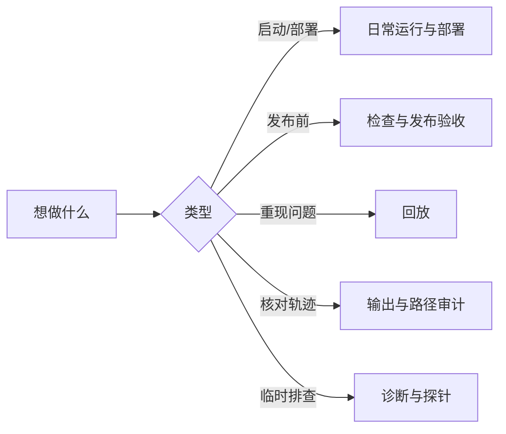

# HARNESS scripts 索引

这个目录有 76 个脚本，都平铺在一层。为了不破坏文档里的命令、测试引用和已冻结的发布清单，这次整理没有移动任何脚本，只在这里按用途分类，方便查找。

日常最常用的是第一、二类。回放、审计和探针多数是某一轮排查留下的，用之前先看脚本开头的说明和它引用的实验复盘。分类按文件名前缀自动生成，个别归类可能不准，以脚本自身说明为准。

## 日常运行与部署（8）

- `bootstrap_upstreams.py`
- `collect_rollout.py`
- `install_native_bundle.py`
- `login_chatgpt.py`
- `package_native.py`
- `prepare_development_controller.py`
- `serve_workspace.py`
- `start_development.py`

## 检查与发布验收（8）

- `audit_replay_output.py`
- `check_native_integration.py`
- `check_output_branches.py`
- `check_project_layout.py`
- `check_scene_evidence_ipc.py`
- `check_warm_grasp_reuse.py`
- `replay_full_owner.py`
- `replay_release_validation.py`

## 回放（用保存的数据重跑某一段）（20）

- `consume_simulated_segments.py`
- `prepared_grasp.py`
- `prepared_transfer.py`
- `replay_capture_identity.py`
- `replay_evidence.py`
- `replay_gc_watch.py`
- `replay_grasp_prefetch.py`
- `replay_hint_pipeline.py`
- `replay_local_observation_output.py`
- `replay_perception_worker.py`
- `replay_planning_process.py`
- `replay_rpc_client.py`
- `replay_rpc_session.py`
- `replay_sam_identity.py`
- `replay_sam_video_identity.py`
- `replay_scene_failure.py`
- `replay_transfer_prefetch.py`
- `replay_warm_sequence.py`
- `wall_clock_replay.py`
- `warm_grasp_process.py`

## 输出与路径审计（21）

- `audit_asset_watch.py`
- `audit_assets.py`
- `audit_cycle_output.py`
- `audit_grasp_observation_output.py`
- `audit_grasp_output.py`
- `audit_partial_anchor_pixels.py`
- `audit_recorded_surface_support.py`
- `audit_saved_transfer.py`
- `audit_worker_launch.py`
- `audit_workers.py`
- `grasp_output_sweeps.py`
- `offline_audit_scope.py`
- `ordinary_output_sweeps.py`
- `output_branch.py`
- `output_preview.py`
- `output_sweeps.py`
- `segment_candidates.py`
- `segment_preferences.py`
- `segment_preview.py`
- `stationary_output_snapshot.py`
- `sweep_blocks.py`

## 诊断与探针（一次性排查）（17）

- `build_overlay.py`
- `build_partial_interface_probe.py`
- `camera_timing_probe.py`
- `compare_grasp_previews.py`
- `compare_planning_order.py`
- `diagnose_grasp_departure.py`
- `diagnose_saved_sweep.py`
- `native_numerics_probe.py`
- `perception_smoke.py`
- `prepare_perception_worker_partial_probe.py`
- `preview_replay_output.py`
- `preview_saved_scene.py`
- `probe_model_connection.py`
- `probe_recorded_entity_hints.py`
- `probe_recorded_replanning.py`
- `probe_saved_alignment_endpoints.py`
- `support_plane_diagnostic.py`

## 采集与标定（2）

- `calibration_capture.py`
- `ros_capture.py`
