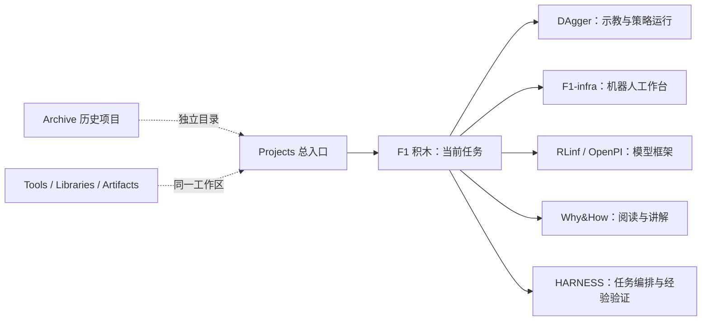

# Projects：当前 F1 研发工作区

**GitHub 更新（2026-11-04）：** 本仓库汇总多个工作区的脱敏源码。数据、模型、密钥和现场连接材料不随源码上传；目录对应关系、依赖恢复和配置限制见[源码快照说明](workspace/SOURCE_SNAPSHOT.md)。GitHub 克隆可打开[合并工作区](github.code-workspace)。

当前主线是 **F1 积木分拣**。日常从任务首页进入，按需要打开机器人工作台、运行代码、模型框架和阅读站；其他任务与历史产物放在后面的分类中。DM0.5 是其中一套模型和任务代码，GitHub 仓库名不代表整个工作区只做 DM0.5。

**2026-10-23：按用户要求，历史项目、独立工具和上游依赖已经实际搬出 Projects。** 它们位于当前6000D用户主目录 `/home/user/` 下，与 `projects` 同级，并加入同一个编辑器工作区；Projects 中不保留同名软链接。Whereweare继续搁置，当前进度直接读取所属任务STATUS。

F1积木模型包与官方基础模型完整保留。这里只保留当前F1工程、任务和基础设施；历史报告移到Artifacts，具体迁移、Git管理和校验见[整理记录](../Artifacts/project-reorganization-20261023/README.md)。

**F1 RLT（2026-11-03）**：V43版本显示已部署；有线已启用，同轮零输出B／RLT推理中位降低71%／80%。下一步验现场连续操作、手柄ACK及候选效果，自主改善仍未证明；见[任务状态](tasks/F1_ComplexyToys/STATUS.md)。

**F1 Harness（2026-11-04）**：已在用户指定的 [HARNESS](HARNESS/README.md) 建立固定上游源码和架构方案，规划 RPent＋PyRUA 编排、ASPIRE 经验验证与现有 F1 控制复用。下一步是只读回放与标定准备，完成边界见 [HARNESS 状态](HARNESS/agent/STATUS.md)。



## 日常从这里进入

- [F1 任务首页](tasks/F1_ComplexyToys/README.md) → [当前状态](tasks/F1_ComplexyToys/STATUS.md) → [现场命令](tasks/F1_ComplexyToys/inference/STARTUP.md)。
- [Why&How 在线阅读](http://192.0.2.1:4243/?doc=f1-home)：读取任务原件；机器人工作台仍使用 4242。
- 编辑器使用[完整工作区](projects.code-workspace)，并列打开 Projects、Archive、Tools、Libraries、Artifacts；[F1 专用工作区](f1.code-workspace)用于只查看当前任务与支撑工程。

## 用户主目录的实际分工

| 同级目录 | 内容 |
|---|---|
| `projects/` | 当前 F1：DAgger、F1、F1-4242、HARNESS、RLinf、tasks、infra |
| `Archive/` | DM0.5、g2_robot、已搁置 Whereweare；Projects-Hub历史别名随迁 |
| `Tools/` | WhyHow 阅读站源码、REA 独立工具 |
| `Libraries/` | PI0.5（含官方基模）、third_party（LeRobot和本地补丁） |
| `Artifacts/` | 既有部署、交付包；WorkspaceReports维护报告及本次整理回执 |

## 项目地图（2026-10-23）

| 分类 | 入口 / 目录 | 职责与状态 |
|---|---|---|
| 当前任务 | [F1 积木](tasks/F1_ComplexyToys/README.md) | 数据合同、训练、推理、现场评测；唯一任务进度见 STATUS |
| 任务编排工程 | [HARNESS](HARNESS/README.md) | RPent＋PyRUA、F1 技能适配与经验验证；人类方案在 docs，agent 状态和实验在 agent |
| 共享运行能力 | [DAgger](DAgger/README.md) | F1/G2 遥操、人工接管、纠正采集与导出；公共代码在 shared |
| 机器人工作台 | [F1-infra](F1-4242/README.md) | 相机、调姿、Pico、录制、回放与审阅；源码目录 F1-4242 与产品名指同一工程 |
| 机器人档案 | [F1](F1/README.md) | 机器台账、连接、接口与来源证据；任务结论回到所属任务 |
| 阅读工具 | [Why&How](tools/WhyHow/README.md) | Markdown 和交互教学的固定阅读入口，保留 4243 |
| 模型与数据依赖 | [RLinf](https://github.com/RLinf/RLinf/blob/d00fe72060a5aa1554e92fe7bf72846d43d48c1c/README.md)、[OpenPI](https://github.com/Physical-Intelligence/openpi/blob/15a9616a00943ada6c20a0f158e3adb39df2ccac/README.md)、[LeRobot](https://github.com/huggingface/lerobot/blob/713a409faedd73bb5597481b8885f17fbee23330/README.md) | 独立上游子模块；按任务引用固定版本，本地补丁保留 |
| 共享基础设施 | [6000D ↔ H20](infra/h20/README.md)、`infra/6000d/` | 连接、环境、同步与主机事故；不绑定单个任务 |
| 其他任务 | [G2 饮料瓶分拣](DM0.5/docs/CURRENT_STATUS.md) | DM0.5 负责训练/模型，g2_robot 负责现场运行；共用一个任务状态入口，再次现场运行前核对现场与服务 |
| 历史任务 | [F1 泡沫棉](F1/foam_sort_whole_body/docs/training_plan.md) | 用户不再推进；10-23清理51.64 GiB派生图像/灰度缓存，代码、标签、评测证据与外盘原件保留 |
| 候选任务 | [G2 手机装盒](tasks/g2_phone_packaging_pi05_rl/README.md) | 数采设计与 pilot 前检查；不再列为当前 Demo |
| 早期任务 | [G2 Book](tasks/g2_book/README.md) | 已有原始数据入口，验收目标待明确 |
| 已搁置工具 | [Whereweare](Whereweare/docs/STATUS.md) | 10-23 用户搁置；历史记录保留，恢复需用户明确提出 |
| 外部工具 | `../Tools/rea/` | 已实际移出Projects；保留独立Git、远端与原文件，不参与机器人主线 |
| 历史产物 | [本机存储说明](../Artifacts/WorkspaceReports/storage-audit-20261023/README.md) | 模型、训练导出、原始副本、视频缓存与部署证据分类核对 |

`Archive/Projects-Hub` 是 Whereweare 的历史兼容软链。跨项目报告现放 `../Artifacts/WorkspaceReports/`；根回放证据已归入`F1-4242/results/video-sync-fix-20261023/workspace-root-evidence/`，H20探针归入`infra/h20/experiments/20261008-access-check/`。`.artifacts/h20-bootstrap/`仍为既有基础设施缓存，保持原引用。

## 新内容放哪里

- **任务放 tasks：** 新任务用 `tasks/<任务>/`，保存任务状态、配置、适配和实验。已有泡沫任务沿用旧路径，导航统一归任务；不为目录一致性搬动冻结版本。
- **共享能力保留各自工程，独立工具和依赖放同级目录：** DAgger、F1-infra、模型框架与机器人运行时按职责复用，不复制进每个任务。模型通过明确的观测/动作合同调用机器人，安全逻辑归机器人运行端。
- **状态只维护一处：** 本页只作分类导航，AGENTS 放规则，任务 STATUS 放当前事实，日期报告放证据。搁置期间不要求先读 Whereweare。
- **产物跟随所属任务：** 新结果不散落根目录；源码只随 Git 保存小型清单和索引。现有大文件的来源、用途和保留条件先见存储说明，不能把目录名 artifacts/results 等同于可删除缓存。

## 数据与缓存分工

| 位置 | 当前约定 |
|---|---|
| F1 机器人 | 保存原始录制、审核与回放派生视频；数据目录见 [工作台数据说明](F1-4242/docs/DATA.md) |
| H20 | 保存训练数据、训练日志和 checkpoint；具体版本见 [任务协作说明](tasks/F1_ComplexyToys/H20_TASK.md) |
| 6000D | 开发、推理、诊断和定向数据准备；现存模型、训练导出及原始数据副本均需登记，不能笼统称为临时缓存 |

视频 worker 的临时来源与编码结果，只有 F1 确认发布成功后才自动清理；失败或未完成的任务暂存以便重试。这条生命周期不自动清理训练数据、模型和历史实验副本。实际占用与本次核查见[存储说明](../Artifacts/WorkspaceReports/storage-audit-20261023/README.md)。

## Git 内容边界

以下内容适合进入 Git：

- 源码和小型配置；
- 设计、运行和复现文档；
- 自动化测试；
- 数据、模型及实验产物的不可变清单或引用。

以下内容不进入 Git：

- 原始或转换后的数据集；
- 模型权重和 checkpoint；
- 机器人日志和训练日志；
- 生成的视频、评测输出及其他大体积产物；
- 部署压缩包、本地缓存和临时文件；
- 凭据及机器私有环境文件。

大文件应保存到对应的数据集、模型或产物存储中，仓库只记录可复现的标识与说明。

## Git 与克隆

当前6000D的 Archive、Libraries 是原仓库的稀疏工作树，保留原历史和各自未提交修改；Projects工作树不展开已迁出的目录。上游子模块的Git和本地补丁完整保留，不改远端、不新建提交；不要在Projects执行 `git sparse-checkout disable` 重新展开旧项目。日常在文件实际所在的工作树查看diff和维护，完整说明见[迁移记录](../Artifacts/project-reorganization-20261023/README.md)。

下面是**全新完整克隆**的初始化方式；当前6000D无需重新克隆或下载模型：

OpenPI 和 RLinf 保留各自的官方上游历史。克隆本工作区后执行：

```bash
git submodule update --init --recursive
```

OpenPI 自身还包含 ALOHA 和 LIBERO 子模块，递归初始化会一并获取。
`third_party/lerobot/` 同样固定到上游提交，由上述命令初始化。
6000D 上的 OpenPI 本地改动另外保存在
[`third_party/patches/`](third_party/patches/README.md)，可按说明恢复。

## 当前 PI0.5 基础模型

官方 `pi05_base` 存放在本机：

```text
/home/user/Libraries/PI0.5/checkpoints/pi05_base/
```

该目录被 Git 忽略，不会上传到 GitHub。可以使用下面的任务脚本进行首次下载、
断点续传或完整性复核：

```bash
./tasks/g2_phone_packaging_pi05_rl/scripts/download_pi05_base.sh
```

新任务按上面的 `tasks/<任务>/` 约定组织；OpenPI在Libraries、RLinf在Projects、DM0.5在Archive，按任务实际需要引用。旧实验中的路径保留为当时证据，不能直接当成当前启动命令。

## 文件归位

- G2/DM0.5 控制根因、待办和交接统一从 [DM0.5 机器人文档](DM0.5/docs/robot/README.md)进入；带日期的旧交接是历史快照。
- F1 泡沫棉的结果统一放在 [任务 results](F1/foam_sort_whole_body/results/README.md)，包括 09-11 FTP 盘点和 09-14 数据审查。
- 工作区根目录只放项目、共享组件和工作区说明；临时导出包、缓存和任务产物不另占顶层目录。
- 原始数据、模型、实验日志和冻结基线按所属项目保留；DM0.5 的历史部署包仍在 `../Archive/DM0.5/artifacts/`，其他工程的发布证据各归所属目录。


### 2026-10-14 源码快照与本地资产

本仓库保存代码、文档、小型配置、测试与审阅记录；机器人STL网格、模型权重、采集数据、运行数据库、缓存与交付归档不进入新版本。文件仅从Git跟踪范围排除，本机原件保留，不重写已有提交历史。

机器人网格的路径、大小与SHA256见 [LOCAL_ASSETS.json](LOCAL_ASSETS.json)。新克隆在运行3D显示、碰撞检查或相关测试前，须从原工作站或原机器人资产来源补齐对应文件，并核验清单；保留的URDF/manifest不能替代网格本体。小型网页依赖、提示音、文档配图仍随源码保存。

PI0.5、RLinf、LeRobot沿用子模块引用，不在根仓库代替其提交或改远端；本地独立rea检出不加入根仓库。

### 本地存储报告

- [2026-10-23 存储核查与整理回执](../Artifacts/WorkspaceReports/storage-audit-20261023/README.md)：泡沫派生载荷清理51.64 GiB，Projects约170.8→119.2 GiB；模型保留、目录归位与后续轻量打包均已核验。
- [2026-10-14 Projects 存储审计](../Artifacts/WorkspaceReports/storage-audit-20261014/index.html)：项目用途、清理前后占用与饼图；已按用户授权仅清理泡沫任务 740 条 reader 的 `.image` 载荷，详情及恢复条件见报告和执行回执。
