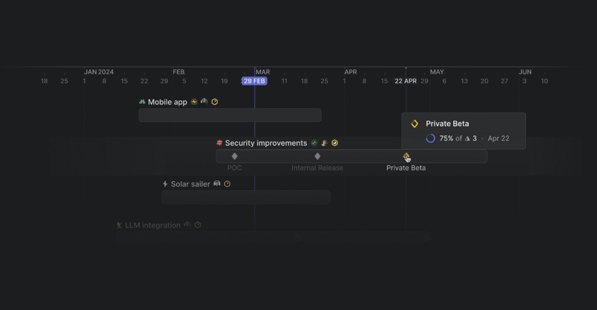
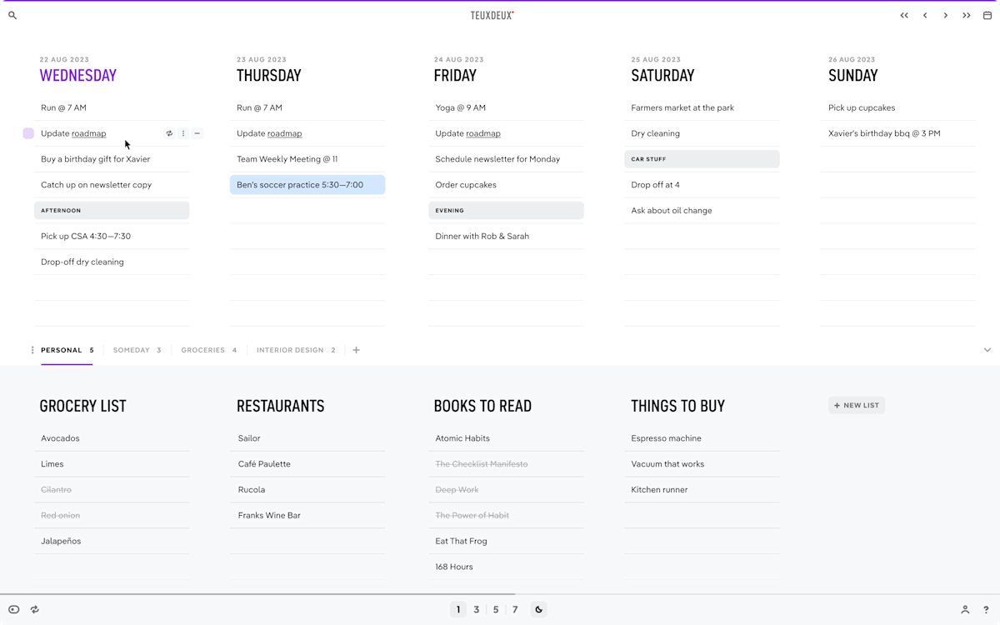
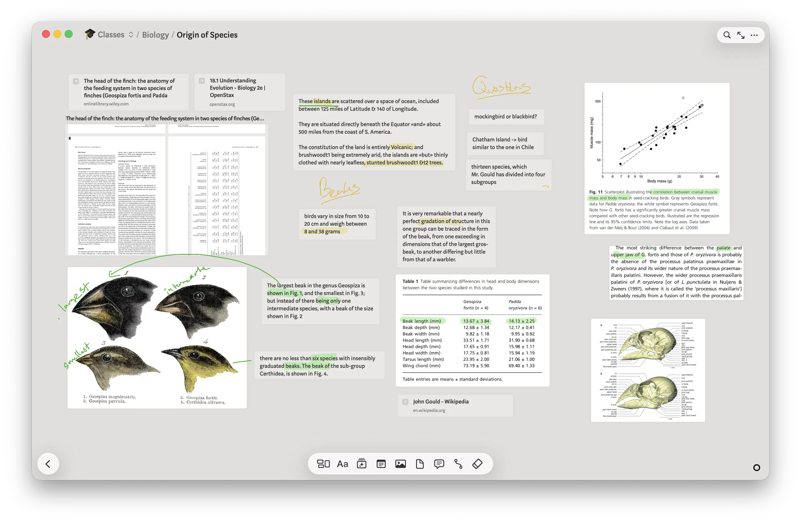

# Whereweare：真实桌面产品参考

2026-10-13 · 用户已选 Linear 桌面时间线方向，视觉稿待评审

**只做桌面网页。用户已选择 Linear 的桌面时间线作为主视觉方向；保留米白背景与朱红主线。** TeuxDeux 与 Allume 仅作补充参考。以下是已查看的官方产品截图，可能早于产品当前版本，不是本项目生成图，也不是登录后的实测。审美取舍是设计判断。

## 1. Linear：已选定的桌面时间线方向

[官方时间线说明与示例](https://linear.app/docs/project-milestones) · [官方原图](https://webassets.linear.app/images/ornj730p/production/59f96a11448bfb1bc23d25979f45975cfe8a8f28-1046x545.png?fm=png&w=1440)

**值得借鉴：** 多行共用日期轴；线上保留少量里程碑，悬停或点击才展开进度详情。

**用于 Whereweare：** 以 Linear 的桌面时间线组织三条并行工作线。米白纸面上保留朱红主线，同日垂直对齐，节点位置不被文本宽度挤走，详情不常驻。过去记录、当前状态、下一步分别有清楚的时间语义。

**不照搬：** 深色皮肤、紧密的管理字段与工单完成百分比。Whereweare 的验收状态来自证据，不能换算成好看的假百分比。

## 2. TeuxDeux：补充参考低装饰的时间排版

[真实网站](https://teuxdeux.com/) · [官方原图](https://images.ctfassets.net/1to65ibrgcn6/6m3y9ZN8ws4lhY05OFW15B/43770340ca1c129fd11a1d53880f1ab4/Dashboard-2.png?fm=png&w=1200)

**值得借鉴：** 日期直接建立阅读顺序，细线分隔，任务直接落在页面上，当前日用局部强调色。内容不需要每项包成一张悬浮卡片。标题与正文的字形有区别。

**用于 Whereweare：** 补充参考细线、局部强调和文字直接排布的处理，不替代已选定的 Linear 时间线结构。

**不照搬：** 它是按天排列的待办清单；Whereweare 仍需项目轨迹、历史证据与未排期建议。官方示例的强调色是紫色，小字号也不适合直接照搬。

## 3. Allume（原 Muse）：补充参考详情中的真实资料

[真实产品网站](https://allume.com/) · [官方 Mac 浅色原图](https://media.allume.com/website/2026/v4.0/screenshots/Mac%20-%20Darwin%20-%20light.webp)

**值得借鉴：** 暖灰画布里放真实文献、图像、摘录与局部标注；资料大小不同，关系可以直接看见。工具集中到边缘，不替每一段内容添加装饰。

**用于 Whereweare：** 点开一个实验或数据批次后，展示原始对象、验证结论与来源的关系。有可引用的现场图或曲线时使用真实资料；没有就保留短文字，不生成装饰配图。

**不照搬：** 研究板的信息量和自由摆放不进入首页，也不采用其设备手势或新建移动端。这里只参考官方 Mac 界面。

## 另外看过，暂不作为主方向

- [Are.na 官方频道示例](https://help.are.na/docs/getting-started/channels)：内容与字体很克制，但元数据区、网格和大块留白不适合直接用作本项目首页。
- [Sublime](https://sublime.app/)：个人知识空间的定位值得参考；首页是营销页面，其平板包装图不能当桌面界面验证。
- [Kinopio 公开画布](https://kinopio.club/hello-kinopio-v6-xNHa754zrJ46R1sAR5D5u)：可以探索关联与分支；自由画布和强烈色彩容易加重首页负担。
- [Cosmos 制作方案例](https://www.airnauts.com/works/cosmos)：真实图像主导的界面值得看，但它的黑色收藏图库不适合作为 Whereweare 的整体皮肤。

## 下一稿的约束

以用户选定的 Linear 桌面时间线作为主要视觉参考；TeuxDeux 的低装饰排版与 Allume 的资料详情仅作补充。继续保留用户要求的米白、朱红主线、并行时间与短结论，不把多个产品的控件拼成新皮肤。

下一稿用真实项目内容做可操作的桌面原型：1440×900 为主，补验1920×1080；呈现默认页、一个节点打开、回顾空状态。先验证这三个场景，再修改运行网站。记忆与审阅重构见[当前方案](EXTERNAL_BRAIN_UIUX_PROPOSAL.md)。

截图版权归各产品及其原作者所有；本地副本未修改，仅供本项目内部设计评审，并保留原始出处。其内容不代表 Whereweare 的项目事实。
