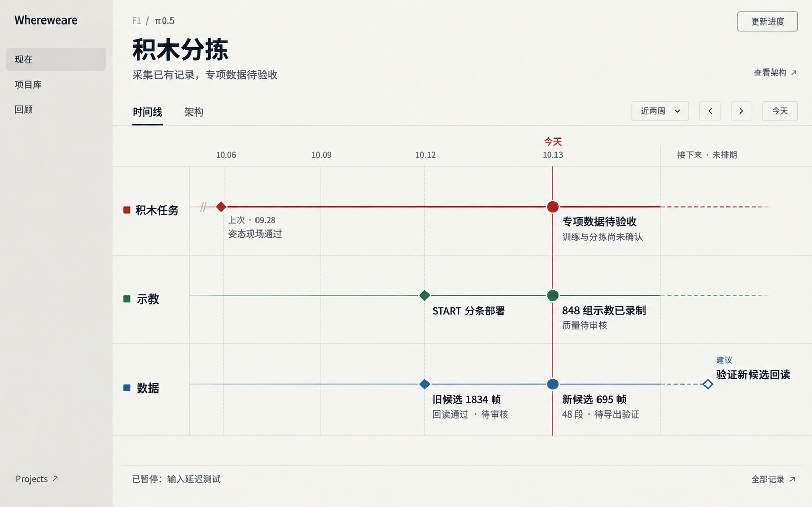

# Whereweare：桌面界面与外置大脑方案

2026-10-13 · 用户已选 Linear 桌面时间线方向 · 已获授权并实施，实际验证见 STATUS

**只做桌面网页。打开就知道：做到哪，哪里变了，接下来做什么。**

上一版圆角画布、渐变标签和悬浮卡片的生成视觉稿已被用户否决，见[历史记录](history/20261013_rejected_visual_v2.md)。不再以“Apple 风格”作为视觉验收标准；不设计手机端、底部导航或移动手势。本轮实施桌面网站与审阅重构，只更新本机 Whereweare。

先看[真实产品参考与官方截图](DESKTOP_DESIGN_REFERENCES.md)。用户已选定 Linear 的桌面时间线作为主视觉方向；生成图作为方向参考，落地以真实数据与浏览器验收为准。实际已实现内容仍以 [STATUS](STATUS.md) 为准。

## Linear 方向桌面效果图



2026-10-13：按用户选择生成，仅供视觉评审，尚未实施。采用已有设计用例，非实时项目快照；生成图中的日期间距不作为实际布局验收。正式实现仍须真实日期坐标、同日对齐与历史断轴校验。[生成提示词与修正记录](assets/linear-desktop-v1-prompts.md)

## 视觉重新从哪里出发

**主要参考用户选择的 [Linear 桌面时间线](https://linear.app/docs/project-milestones)：多条工作线共用日期轴，少量里程碑与按需展开的详情。** 保留米白背景与朱红主线，用文字大小、位置和线条建立层级。不要把每个短句包装成同样的悬浮卡片，也不要为抽象“示教”“数据”添加抢眼装饰图标。

[TeuxDeux](https://teuxdeux.com/) 的低装饰排版与 [Allume 的 Mac 界面](https://allume.com/)中的资料关联仅作补充参考。主视觉保持 Linear 的桌面时间线方向，不照搬其深色皮肤、密集管理字段或完成百分比。

页面辨识度应来自 F1 的真实工作：一次示教、一个候选批次、一项现场验证。若来源中有可直接引用的现场图、曲线或架构图，可在详情中展示；没有就用短结论，不生成假素材。不为视觉丰富去扫描整个数据目录。

## 首页保留什么

首页唯一主线仍是 **F1 · π0.5 积木分拣**。示教、数据两条支撑线同时可见；4242、DAgger 的原始归属留在详情。其他项目进入项目库，不因文件更新抢占首页。

| 位置 | 看见什么 | 展开后看什么 |
| --- | --- | --- |
| 页头 | 项目名、当前阶段、项目库／回顾／更新入口 | 目标、场景到实机的能力与验收关系 |
| 三条并行线 | 对象与动作、真实日期、必要验证边界 | 变化、影响、证据和决定 |
| 现在附近 | 每条线当前已具备什么，尚缺哪项确认 | 阻塞依据、用户暂停决定 |
| 线的右侧 | 一项最相关的下一步，明确是否为建议 | 依赖、验收条件和其他待办 |

时间线直接排在米白页面上。当前区域形成稳定重心，主线的对比和线宽高于两条支撑线。标题可较大，核心节点与验证限制不小于18px；日期和来源层级较轻。文字保留自然宽度，信息较多时进入详情，不靠缩小字号或省略“未验收”压缩。

内容不强行整齐：普通变化是短标题，里程碑可以有较大的结论，有证据图的实验在详情中展示图。同日多项用一个入口展开，不让三条线都套上相同的“历史卡片→现在卡片→建议卡片”。只为明确子目标或实验路线分叉。

首页常驻场景、示教、数据、训练、实机五阶段及简短状态；点开查看能力、支撑项目、依赖与验收条件。姿态通过不能把整个场景标为完成，通用候选数据不能把积木训练标为完成。

## 时间与桌面交互

- 默认最近14天与未来7天，日期共用坐标；“现在”约在六成处。更旧的最后记录注明真实日期，未排期建议放在断轴后的无日期区域。
- 普通滚轮自然滚页；横向触控板、Shift＋滚轮、空白拖动查看历史，也提供可见前后按钮。保留浏览器缩放，不采用滚轮缩放或缩放阈值钻入。
- 点线名进入完整历史，点节点打开单个详情侧栏。变化、影响、下一步在前，证据按需展开；关闭恢复原位置。
- 查看历史时保留线名和“回到现在”。切换范围与同页返回保持各自位置；重新打开首页回到近期。
- 后台新结论不替换正在看的证据版本、不移动视口；需要重排时提示“有新进展”，用户点击载入。

详情可以展示资料关系，但保持固定阅读顺序与返回路径，不要求用户先学自由画布操作。

## 日常使用应当很直接

1. 打开首页，读近期变化、当前关口和一个下一步。
2. 点节点查依据，或者补一句决定，例如“延迟测试先暂停”。
3. 点回顾只阅读已有记录；明确点生成才生成指定一期。

更新模型、扫描日志、源指纹、GitHub入口收进菜单或详情。用户不必理解后台术语才能判断项目进度。错误只保留一处简短提示，展开可查原因与重试。

## 回顾只读与生成分开

打开回顾、切换今日／本周、选择历史日期，仅执行读取，不触发扫描、模型或发布。

| 场景 | 展示与处理 |
| --- | --- |
| 本期已有报告 | 显示真实日期、截至时间与正文 |
| 本期尚未生成 | 显示「尚未生成」和「生成今日回顾／生成本周回顾」 |
| 同期同一事实版本再次生成 | 返回既有报告，不再次调用模型 |
| 生成期间切换标签 | 仅切换阅读内容，不追加任务；准确标明正在生成哪一期 |
| 生成失败 | 保留原报告，在本报告内提示重试；不污染其他报告 |
| 资料有变化尚待核对 | 显示内容截止范围，提供「先更新进度」入口，不暗中串联执行 |

日报最多三条变化、一项明日建议；周报最多三个成果或阻塞、三项下周建议。没有新变化就直说，不重复旧成果凑字数。报告按发生日期、报告时区与周期归档，不把后来发现的历史成果记作今日完成。

「更新进度」负责项目记忆；「生成回顾」读取指定事实版本生成报告，不能反向修改首页。尚不设置周五自动生成或定时通知。

## 外置大脑怎样记住项目

沿用现有文档为事实入口。Whereweare 保存关联和审阅结果，不要求每个项目再维护一份状态文档。

| 记忆 | 必须保存的关系 | 对用户的作用 |
| --- | --- | --- |
| 目标与能力 | 目标、验收条件、支撑工作线、确认状态 | 理解整体架构走到哪 |
| 事实与产物 | 对象、改变、发生日期、机器和任务、验证范围、证据版本 | 知道最近真正得到什么 |
| 决定与行动 | 用户决定、建议、依赖、计划／进行／暂停／完成状态 | 防止暂停事项反复出现 |
| 变化与更正 | 稳定ID、替代／解除关系、原始归属 | 记得为什么这样做，保留旧结论 |

代码实现、离线测试、部署、数据审核、现场验收分别记录，不能串成一个通用“已完成”。项目主次与归档由人工维护；未知状态不会自动变成阻塞，建议不会自动变成承诺。

用户说“暂停”后，系统保留原因与范围。恢复需要明确决定；新证据最多产生“建议重新评估”。上游文档与人工记录冲突时显示待核对，不暗自选一个覆盖另一个。

## 增量审阅怎样工作

```text
DOC变更／Git差异／验证记录／用户决定
                  ↓
发现变化并确定对象与影响范围
                  ↓
读取相关章节，按需补读代码和验证依据
                  ↓
核对事实、验证边界与既有决定
                  ↓
按依赖范围更新项目记忆
                  ↓
首页、时间线、回顾读取同一份记忆
```

1. **发现。** 记录源内容的变化版本。Git 提交、未提交和未跟踪代码只是待核对线索；独立仓库分别定位，不用修改时间判断完成。
2. **取证。** 优先唯一状态页、相关章节差异、事故和实验记录；涉及实现时读取登记范围内的代码 diff 与必要上下文。排除模型、数据集、凭据和无关第三方源码。
3. **覆盖。** 分开“已发现版本”与“已审阅版本”。未读章节、截断正文持续待处理。新增结论必须引用确实读取过的证据；路径和行号存在只是基础校验。
4. **理解。** 判断对象、变化、影响与验收范围。测试代码存在不代表测试执行过；DOC中的部署记录不证明此刻服务在线。
5. **发布。** 按实际读取来源及依赖校验。相关来源中途变化则相应结论待重审，依赖它的主线结论一并保持待核对；无关项目不因此全部失败。
6. **展示。** 每个结论保留自己的发生日期、审核时间与证据版本。无语义变化不制造新成果节点，真正更正保留前后关系。

网页与聊天 skill 使用同一证据读取器、覆盖记录与校验器。面向 Agent 的 briefing 默认返回这份已审阅记忆；原始规则摘录作为来源索引，避免两套“当前状态”竞争。

## 自动更新与用户控制

已提供默认关闭的「自动更新当前项目」设置：只覆盖人工选定主线及支撑工作线，合并连续变更，稳定约2分钟后增量审阅；沿用已确认的 high 推理强度。用户可关闭，也可按「更新进度」立即执行。

任务按证据版本去重，单次运行时只合并一次后续待办；无变化不调用模型，失败不无限重试。每日调用上限可配置，达到上限后仅提示待更新。模型名称、调用记录和错误细节在更新状态内查看。

这里的自动更新指本机资料理解的持续更新。机器人、远端服务器的新变化需要先同步到登记来源，系统不会据旧文档假定设备实时状态。默认不创建自动审阅任务；用户开启后由本机服务调度。

## 用真实记录检验语义

以下仅是2026-10-13读取时的设计用例，当前事实仍回到原项目。后续桌面原型只选取其中几项，不宣称是完整最新快照。

| 输入证据 | 系统应该记住 | 不能推导 |
| --- | --- | --- |
| START分条现场记录848组三图，技术候选695帧／48段 | 同一新录制的原始量与筛选量，待质量审核和正式v3导出验证 | 已批准训练、零丢帧 |
| 旧录制1834帧／74段已完成v3回读 | 另一候选对象，保留原日期与待审核状态 | 用695替换1834，或两者直接合并成训练集 |
| 用户要求暂停输入延迟测试 | 暂停决定约束后续行动 | 自动推荐继续现场测试 |
| 最新用户确认调音试听与保存成功，连续shadow复验通过 | 分别更新可闻性确认与shadow证据；旧“待试听”被替代 | 现场运动录制全部验收、训练就绪 |

来源：[DAgger F1 当前状态](../../DAgger/docs/F1/STATUS.md)、[DAgger F1 TODO](../../DAgger/docs/F1/TODO.md)、[4242 当前状态](../../F1-4242/docs/STATUS.md)。机器身份与任务适用范围保留在每条事实详情；支撑成果关联主线，不重复计算成积木任务成果。

## 实现顺序

| 顺序 | 改动 | 完成条件 |
| --- | --- | --- |
| 1 | 修复回顾副作用、报告周期和去重 | 打开与切换零审阅请求，旧报告不会冒充本期 |
| 2 | 阅读覆盖、对象身份、决定与行动状态 | 不漏读、不混批次、暂停不复活，更正可追溯 |
| 3 | 统一briefing和局部发布 | 同一份记忆支撑网页与Agent，冲突按依赖处理 |
| 4 | 桌面首页与节点详情 | 用真实内容验证默认页、节点打开和回顾空状态，用户能找到当前关口、变化和下一步 |
| 5 | 可控自动更新 | 变更合并、限额、失败保留和阅读位置稳定 |

保留 Python、SQLite、项目ID、人工设置、历史快照与原证据。新增结构通过迁移和兼容读取接入，旧快照来源不得自动视为完整已读；先补核当前主线。只调整本机 Whereweare 服务。

本轮方案范围不含 Git提交／push、自动改写上游DOC、时间统计或学习路线。已登记的GitHub地址保留；这些能力可在事实与决定可靠后接入。

## 验收看能否理解与是否可信

- **首次使用**：不给操作教程，10秒内找到当前关口、最近一次实质变化、下一步和依据入口；结果通过实际试用记录，不以截图好看代替。
- **回顾无副作用**：打开、切周期、重开页面均无审阅POST、模型调用和新快照；跨日跨周不串报告，失败保留正确一期内容。
- **记忆正确**：暂停行动不会复活；新旧录制不混；文档末尾新增结果能被读到；未读部分持续待核对；共享部署不冒充任务验收。
- **更新稳定**：相关来源变动不能发布为最新事实；无关变动不阻断其他工作线；后台更新不移动视口或替换正在看的证据版本。
- **布局**：1440×900与1920×1080默认字号下，三条线及当前关口和主要下一步首屏可读；20个历史项目不改变首页结构。
- **桌面可访问性**：核心文字18px；200%文字缩放可重排和纵向滚动；键盘、可见焦点、屏幕阅读器条目视图和减少动态效果可用。
- **视觉检查**：浅背景正文对比度目标至少4.5:1，颜色之外有状态文字；重要操作有可见按钮，原生滚动、缩放和返回行为通过实际浏览器验证。

## 当前代码问题入口

[回顾触发动作](../web/app.js)将查看与runReview绑定；[浏览器测试](../tests/browser_smoke.cjs)原先将auto-review作为成功条件；[审阅worker](../review_jobs.py)只读证据包；[发布器](../review_store.py)将全来源manifest随快照保存。这些是重构对象，不是本次已完成的修复。


## 本轮实现边界

实际通过的检查见 STATUS。代码只采样登记目录的有界本地diff/未跟踪片段，不能声称全仓库代码已审计，也不会据此证明部署成功。超限或未读取文档保留待审；模型通过证据判断语义更正，发布器负责同项目更正关系、哈希、行号和日期校验。当前没有自动回写上游DOC或Git提交/push。

真人首次使用测试、屏幕阅读器专项与200%文字缩放验收尚未完成，不以截图代替这些验证。
