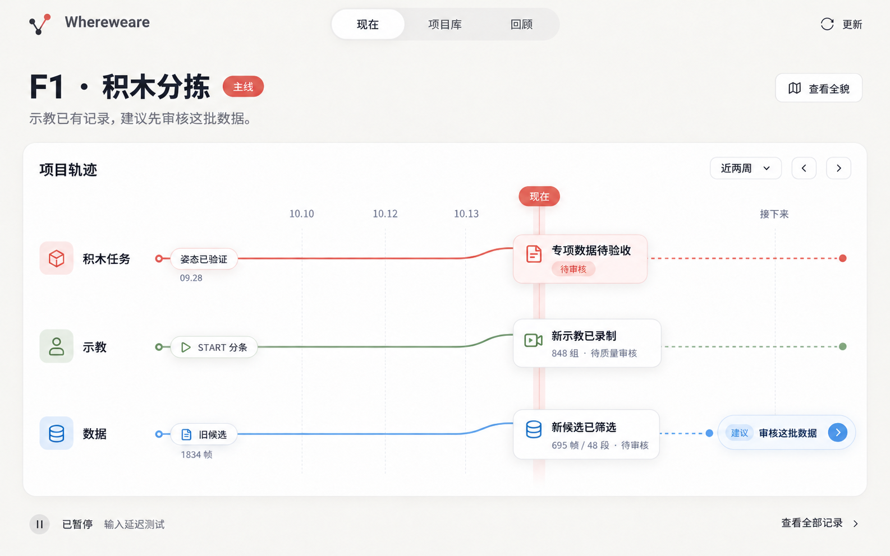
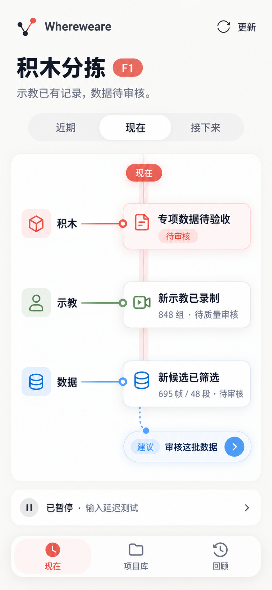

> 已否决的历史视觉稿。2026-10-13 用户明确取消手机端并要求参考真实产品。本文不再作为实施依据；当前方案见 [桌面方案](../EXTERNAL_BRAIN_UIUX_PROPOSAL.md)。

# Whereweare 外置大脑与 Apple 风格界面方案

2026-10-13 · 第二版视觉方案 · 待评审

**打开就知道：做到哪，哪里变了，接下来做什么。**

采用暖白背景、一张白色圆角画布和三条彩色轨道。**当前节点集中成一组，下一步只突出一项建议。** 历史是较轻的沿途标记；最新结果是可点击的节点；证据与操作进入详情。底层仍维护可追溯的项目记忆。

本次交付为方案和高保真概念图，尚未改动运行网站、审阅任务或项目状态。本文拟替代旧版[设计](../DESIGN.md)中的回顾自动生成规则；实际已实现内容仍以 [STATUS](../STATUS.md) 为准。

## 先看产品样子

首页唯一主线仍是 **F1 · π0.5 积木分拣**。示教、数据两条支撑线同时可见；4242、DAgger 的原始归属保存在详情。其他项目在项目库，不因最近改过文件而抢占首页。



[打开桌面大图](../assets/brain-ios-v2-desktop.png) · [打开手机大图](../assets/brain-ios-v2-mobile.png)

图片由内置 imagegen 生成，用于评审视觉方向，不是运行截图或新发布的项目状态。尺寸、点击范围与时间坐标在实现时按本文验证。示例沿用2026-10-13已读取记录；右侧动作是建议，主线红色表示归属，完成与否由文字状态表达。[生成提示词](../assets/brain-ios-v2-image-prompts.md)

## 这一版的视觉重心

1. **先看到项目和当前节点。** 项目名提供上下文，珊瑚红的当前节点是画布中最强的内容；顶栏更新按钮降为轻量操作。
2. **三条线放进一个共同空间。** 圆角白色画布统一承载时间、工作线和节点，页面外保留安静的暖白留白。
3. **节点有明确边界。** 过去用轻量标签，现在用短卡片，建议用带箭头的目的地按钮。用户能直接识别哪里可以点。
4. **首页只突出一个下一步。** 建议挂在所属工作线上；其余路线的后续动作进详情，不要求每条线填满建议。

首屏不再放五段阶段导航、三项范围切换或重复验收说明。整体架构由「查看全貌」进入；时间范围收成「近两周」菜单。848组、695帧保留为节点次要证据，不做统计大数字。

## 一天怎样使用

1. **打开「现在」**：先看到当前目标，再沿三条线读最近结果、当前关口和下一步。
2. **点一个节点**：看到变化、影响和验证边界；需要时展开依据。关掉后回到原位置。
3. **点「回顾」**：只查看今天或本周的已有回顾。想生成时再按「生成今日回顾」。
4. **补一句决定**：如“延迟测试先暂停”。系统记住这项决定，后续建议遵守它。

目标是 10 秒内能找到答案，不要求用户知道仓库、模型、源指纹或审阅流程。

## 页面各自负责什么

| 页面 | 首先看到 | 可继续查看 |
| --- | --- | --- |
| 现在 | 当前目标、三条并行线、当前验收关口 | 阶段详情、变化、建议 |
| 项目库 | 当前、构想、暂停、归档的项目 | 人工主次设置、来源、Projects GitHub |
| 回顾 | 指定日期的已有日报或周报 | 生成按钮、历史版本、明日或下周建议 |
| 节点详情 | 发生了什么、影响什么、还缺什么 | DOC 段落、代码差异、验证记录 |

桌面顶栏使用「现在／项目库／回顾」分段导航，右侧是轻量「更新」。手机底部使用同样三个入口，图标同时带文字；更新放在页头。模型、日志、扫描细节收进更新状态。

## 首页怎样组织

**目标区。** 一行大项目名和一句关键变化，右侧提供「查看全貌」。点开后才呈现场景、示教、数据、训练、实机的依赖关系与验收条件；仅有姿态通过时显示“部分验证”，不能将整个场景标成完成。

**时间线区。** 三条工作线共用日期坐标，在一张白色圆角画布中呈现。桌面“现在”位于约六成处，当前节点在这里对齐成组。每条线默认一个关键历史标签、一个当前节点；同日多项用数量入口展开。轨道有明确粗细，转弯只为连接节点，不表示额外分支或依赖。

**当前状态。** 显示已具备的能力和验收缺口；没有明确阻塞就不硬填阻塞。来源改变时在相关结论旁显示“待核对”，旧结论带自己的截止日期，不把一次全局刷新伪装成全部已审阅。

**接下来。** 首页最多突出一项最有用的动作，作为所属工作线末端的目的地按钮。已采纳行动与 AI 建议分别标记，其他行动在详情。未排期区域不标日期、与日期轴明确分开；建议按钮带“建议”，打开后说明依赖与未排期状态。明确排期的行动才落到真实日期轴上。

最近14天与未来7天是默认可浏览范围，允许切换近一月、全部。实际数据稀疏时保留日期间距，不伪造节点填空；窗外最后记录单列“上次记录＋真实日期”，不移到近期刻度。分叉仅表达明确的子目标、实验路线或人工决定，普通更新沿原线排列。

## Apple 风格如何落到这个网站

采用 Apple 指南强调的清楚分组、重要信息优先、逐层展开和设备适配；具体配色与尺寸是 Whereweare 的网页设计选择。[Apple Layout](https://developer.apple.com/design/human-interface-guidelines/layout)

| 项目 | 本方案选择 |
| --- | --- |
| 背景与层次 | 暖白 `#F6F5F1`；白色画布 `#FFFFFF`；深灰正文 `#242631`；一层极轻阴影区分空间 |
| 颜色 | 主线珊瑚红 `#D9574A`；示教鼠尾草绿、数据低饱和蓝；状态仍带文字，不依赖颜色 |
| 字体 | 系统无衬线与中文系统回退；桌面项目标题44px、手机32px，节点20px、核心边界说明18px、日期14px |
| 轻重 | 标题600、关键对象600、正文400；用字重与位置区分重要性，避免全屏同样粗大 |
| 控件 | 文字标签、分段选择器、圆角按钮；44×44 CSS px点击区域，不依赖小圆点命中 |
| 材质 | 主画布约28px圆角、节点约16px圆角；内容实色、阴影极轻，导航最多一层轻透明 |
| 动效 | 开合约180–220ms，保持对象位置；不闪烁、不自动移动视口，支持减少动态效果 |
| 图标 | 配文字的简单 SVG 图标；不将 SF Symbols 或 Apple 字体文件作为网站自带资源 |

字体层级服务于可读性，优先使用系统字形与一致的文本样式。[Apple UI Typography](https://developer.apple.com/videos/play/wwdc2020/10175/)

Apple 将 Liquid Glass 主要用于导航与控件层，并建议克制使用。因此时间线节点不铺玻璃效果，关键文字不叠在动态透明背景上。[Apple Materials](https://developer.apple.com/design/human-interface-guidelines/materials)

Apple 原生触控建议使用至少44×44pt目标；本方案的44×44 CSS px是网页实现目标，需在实际设备检查。字号、对比度和对齐同样是验收项。[Apple UI Design Tips](https://developer.apple.com/design/tips/)

## 手机保持相同认知



390px宽度先完整呈现三条线的「现在」。固定短线名，右侧为共享的内部横向视口；「近期／现在／接下来」是可见的位置选择器，移动同一组工作线，不创建三套内容。

- 横滑查看历史或下一步，上下滑自然滚页面，浏览器缩放保持原生。
- 默认无需横滑就能读到当前关口；下一步通过一个可见按钮到达。
- 每个位置完整显示文字，不用半截句子提示可滚动；边缘箭头表示还有内容。
- 阶段关系通过「查看全貌」进入；当前节点可增长高度，不缩小核心字号以挤进首屏。
- 一个建议按钮沿对应轨道延伸到当前节点下方，避免同时挤入三列；更大字号下允许页面纵向滚动。
- 详情使用单个 sheet，内容较多时扩为完整页面；始终有关闭或返回按钮，不要求下滑手势。
- 桌面节点使用侧栏；一层依据展开在同一侧栏内，避免抽屉套抽屉。

## 点击规则保持一致

| 用户动作 | 系统行为 |
| --- | --- |
| 点击线名 | 进入该工作线的目标、能力与完整历史 |
| 点击节点 | 打开事实或行动详情；不顺带运行 AI |
| 点击「查看全貌」 | 查看阶段、依赖和验收边界；选择阶段可突出相关节点，返回保持原位置 |
| 上下滚轮 | 自然滚页面 |
| 横滑、Shift滚轮、空白拖动 | 浏览历史；始终有可见前后按钮作为替代 |
| 返回或关闭详情 | 恢复日期范围、横向位置和页面位置 |
| 查看历史 | 保留工作线名称，显示「回到现在」；当前区仍显示已审阅状态及其截止时间 |
| 新结论抵达 | 保持阅读位置；若会改变布局，显示「有新进展」，用户点击后载入 |

默认重开首页回到现在。自动刷新不改变已经打开的证据版本；旧版详情可提示“有更新”。

## 回顾只读与生成分开

打开回顾、切换今日／本周、选择历史日期，仅执行读取，不触发扫描、模型或发布。

| 场景 | 展示与处理 |
| --- | --- |
| 本期已有报告 | 显示真实日期、截至时间与正文 |
| 本期尚未生成 | 显示「尚未生成」和「生成今日回顾／生成本周回顾」 |
| 同期同一事实版本再次生成 | 返回既有报告，不再次调用模型 |
| 生成期间切换标签 | 仅切换阅读内容，不追加任务；准确标明正在生成哪一期 |
| 生成失败 | 保留原报告，在本报告内提示重试；不污染其他报告 |
| 资料有变化尚待核对 | 显示内容截止范围，提供「先更新进度」入口，不暗中串联执行 |

日报最多三条变化、一项明日建议；周报最多三个成果或阻塞、三项下周建议。没有新变化就直说，不重复旧成果凑字数。报告按发生日期、报告时区与周期归档，不把后来发现的历史成果记作今日完成。

「更新进度」负责项目记忆；「生成回顾」读取指定事实版本生成报告，不能反向修改首页。尚不设置周五自动生成或定时通知。

## 外置大脑怎样记住项目

沿用现有文档为事实入口。Whereweare 保存关联和审阅结果，不要求每个项目再维护一份状态文档。

| 记忆 | 必须保存的关系 | 对用户的作用 |
| --- | --- | --- |
| 目标与能力 | 目标、验收条件、支撑工作线、确认状态 | 理解整体架构走到哪 |
| 事实与产物 | 对象、改变、发生日期、机器和任务、验证范围、证据版本 | 知道最近真正得到什么 |
| 决定与行动 | 用户决定、建议、依赖、计划／进行／暂停／完成状态 | 防止暂停事项反复出现 |
| 变化与更正 | 稳定ID、替代／解除关系、原始归属 | 记得为什么这样做，保留旧结论 |

代码实现、离线测试、部署、数据审核、现场验收分别记录，不能串成一个通用“已完成”。项目主次与归档由人工维护；未知状态不会自动变成阻塞，建议不会自动变成承诺。

用户说“暂停”后，系统保留原因与范围。恢复需要明确决定；新证据最多产生“建议重新评估”。上游文档与人工记录冲突时显示待核对，不暗自选一个覆盖另一个。

## 增量审阅怎样工作

```text
DOC变更／Git差异／验证记录／用户决定
                  ↓
发现变化并确定对象与影响范围
                  ↓
读取相关章节，按需补读代码和验证依据
                  ↓
核对事实、验证边界与既有决定
                  ↓
按依赖范围更新项目记忆
                  ↓
首页、时间线、回顾读取同一份记忆
```

1. **发现。** 记录源内容的变化版本。Git 提交、未提交和未跟踪代码只是待核对线索；独立仓库分别定位，不用修改时间判断完成。
2. **取证。** 优先唯一状态页、相关章节差异、事故和实验记录；涉及实现时读取登记范围内的代码 diff 与必要上下文。排除模型、数据集、凭据和无关第三方源码。
3. **覆盖。** 分开“已发现版本”与“已审阅版本”。未读章节、截断正文持续待处理。新增结论必须引用确实读取过的证据；路径和行号存在只是基础校验。
4. **理解。** 判断对象、变化、影响与验收范围。测试代码存在不代表测试执行过；DOC中的部署记录不证明此刻服务在线。
5. **发布。** 按实际读取来源及依赖校验。相关来源中途变化则相应结论待重审，依赖它的主线结论一并保持待核对；无关项目不因此全部失败。
6. **展示。** 每个结论保留自己的发生日期、审核时间与证据版本。无语义变化不制造新成果节点，真正更正保留前后关系。

网页与聊天 skill 使用同一证据读取器、覆盖记录与校验器。面向 Agent 的 briefing 默认返回这份已审阅记忆；原始规则摘录作为来源索引，避免两套“当前状态”竞争。

## 自动更新与用户控制

建议提供「自动更新当前项目」设置：只覆盖人工选定主线及支撑工作线，合并连续变更，稳定约2分钟后增量审阅；沿用已确认的 high 推理强度。用户可关闭，也可按「更新进度」立即执行。

任务按证据版本去重，单次运行时只合并一次后续待办；无变化不调用模型，失败不无限重试。每日调用上限可配置，达到上限后仅提示待更新。模型名称、调用记录和错误细节在更新状态内查看。

这里的自动更新指本机资料理解的持续更新。机器人、远端服务器的新变化需要先同步到登记来源，系统不会据旧文档假定设备实时状态。本次方案不创建任何自动任务。

## 用真实记录检验语义

以下仅是2026-10-13读取时的设计用例，当前事实仍回到原项目。草图只选取其中几项，不宣称是完整最新快照。

| 输入证据 | 系统应该记住 | 不能推导 |
| --- | --- | --- |
| START分条现场记录848组三图，技术候选695帧／48段 | 同一新录制的原始量与筛选量，待质量审核和正式v3导出验证 | 已批准训练、零丢帧 |
| 旧录制1834帧／74段已完成v3回读 | 另一候选对象，保留原日期与待审核状态 | 用695替换1834，或两者直接合并成训练集 |
| 用户要求暂停输入延迟测试 | 暂停决定约束后续行动 | 自动推荐继续现场测试 |
| 最新用户确认调音试听与保存成功，连续shadow复验通过 | 分别更新可闻性确认与shadow证据；旧“待试听”被替代 | 现场运动录制全部验收、训练就绪 |

来源：[DAgger F1 当前状态](../../../DAgger/docs/F1/STATUS.md)、[DAgger F1 TODO](../../../DAgger/docs/F1/TODO.md)、[4242 当前状态](../../../F1-4242/docs/STATUS.md)。机器身份与任务适用范围保留在每条事实详情；支撑成果关联主线，不重复计算成积木任务成果。

## 实现顺序

| 顺序 | 改动 | 完成条件 |
| --- | --- | --- |
| 1 | 修复回顾副作用、报告周期和去重 | 打开与切换零审阅请求，旧报告不会冒充本期 |
| 2 | 阅读覆盖、对象身份、决定与行动状态 | 不漏读、不混批次、暂停不复活，更正可追溯 |
| 3 | 统一briefing和局部发布 | 同一份记忆支撑网页与Agent，冲突按依赖处理 |
| 4 | 新首页、详情和手机布局 | 真实数据下用户能找到当前关口、变化和下一步 |
| 5 | 可控自动更新 | 变更合并、限额、失败保留和阅读位置稳定 |

保留 Python、SQLite、项目ID、人工设置、历史快照与原证据。新增结构通过迁移和兼容读取接入，旧快照来源不得自动视为完整已读；先补核当前主线。只调整本机 Whereweare 服务。

本轮方案范围不含 Git提交／push、自动改写上游DOC、时间统计或学习路线。已登记的GitHub地址保留；这些能力可在事实与决定可靠后接入。

## 验收看能否理解与是否可信

- **首次使用**：不给操作教程，10秒内找到当前关口、最近一次实质变化、下一步和依据入口；结果通过实际试用记录，不以截图好看代替。
- **回顾无副作用**：打开、切周期、重开页面均无审阅POST、模型调用和新快照；跨日跨周不串报告，失败保留正确一期内容。
- **记忆正确**：暂停行动不会复活；新旧录制不混；文档末尾新增结果能被读到；未读部分持续待核对；共享部署不冒充任务验收。
- **更新稳定**：相关来源变动不能发布为最新事实；无关变动不阻断其他工作线；后台更新不移动视口或替换正在看的证据版本。
- **布局**：1440×900与1920×1080默认字号下，三条线及当前关口和主要下一步首屏可读；20个历史项目不改变首页结构。
- **手机与可访问性**：390px页面不横向溢出；核心18px，200%文字缩放可重排和纵向滚动；键盘、可见焦点、屏幕阅读器条目视图和减少动态效果可用。
- **视觉检查**：浅背景正文对比度目标至少4.5:1，颜色之外有状态文字；重要操作有可见按钮，原生滚动、缩放和返回行为通过实际浏览器验证。

## 当前代码问题入口

[回顾触发动作](../../web/app.js)将查看与runReview绑定；[浏览器测试](../../tests/browser_smoke.cjs)原先将auto-review作为成功条件；[审阅worker](../../review_jobs.py)只读证据包；[发布器](../../review_store.py)将全来源manifest随快照保存。这些是重构对象，不是本次已完成的修复。

