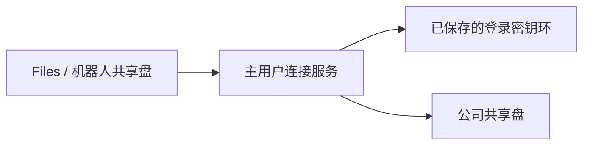

# 6000D 个人桌面与共享盘固定入口

这里维护当前账号的 NoMachine 桌面和公司共享盘入口。问题出在文件管理器可能进入另一条桌面会话总线，无法复用已经保存的登录；修复让普通 Files 按钮、新窗口和“机器人共享盘”快捷方式使用同一条主用户总线。

平时直接打开 Files 左侧的共享盘，或在应用列表打开“机器人共享盘”。NoMachine 断开连接时保留桌面，不要选择注销 Linux 桌面；已保存的密码不需要每次填写。服务器整机重启后，登录密钥环仍可能需要解锁一次。

这些配置仅属于 6000D 当前账号，不进入 F1-infra 发布 ZIP，也不改变机器人配置、4242 端口或用户部署文案。以下供维护和回退时查阅。



## 持久配置

| 文件 | 用途 |
| --- | --- |
| `~/.local/bin/hq-files` | 用主用户 D-Bus 启动文件管理器；仅导入显示环境 |
| `~/.local/share/applications/org.gnome.Nautilus.desktop` | 覆盖本账号的普通 Files 和新窗口入口；关闭跨总线的 D-Bus 激活 |
| `~/.local/share/applications/hq-company-share.desktop` | “机器人共享盘”应用快捷方式 |
| `~/.config/autostart/hq-desktop-binding.desktop` | 图形登录后更新显示环境、启动共享盘检查定时器 |
| `~/.config/systemd/user/hq-share-autoconnect.{service,timer}` | 每两分钟检查一次；已有挂载直接保留 |
| `~/.local/bin/hq-share-autoconnect` | 只使用已保存、已解锁的凭据自动连接；失败后暂停 |
| `~/.config/systemd/user/hq-desktop.service` | 下次开机启动本账号 `:8` 桌面；安装时不接管或重启当前桌面 |

自动连接不弹出密码窗口、不读取或保存密码、不卸载已有挂载。网络不可达时跳过；挂载尝试失败后，记录一次失败状态并停止自动认证，直到凭据元数据变化或用户主动打开专用快捷方式。它不会在密码错误时每两分钟重复登录。

保留 TurboVNC 原有的独立 GNOME 会话总线。只修正文件入口，不把整个桌面改接主总线，也不修改全机 NoMachine 或其他人的桌面。其他程序若绕过桌面入口、直接调用私有 D-Bus 的 FileManager1，仍可能启动独立文件进程，需按下面方式检查，不能笼统宣称所有调用路径已统一。

## 检查与使用

在 6000D 本账号的图形桌面终端运行：

```bash
~/.local/bin/hq-files --share
~/.local/bin/hq-share-autoconnect --status
systemctl --user status hq-share-autoconnect.timer --no-pager
systemctl --user is-enabled hq-desktop.service
```

`--status` 只返回挂载、密钥环锁定状态、保存条数及失败枚举，不读取密码。普通 SSH 终端没有 DISPLAY 时，状态中的 display=false 是正常的；图形登录启动的定时服务使用当前显示环境。

密钥环锁定时，在桌面打开共享盘并按系统窗口解锁。公司共享盘用户名为工号、域为 `company.example.invalid`，不要沿用 Linux 用户名或 WORKGROUP。系统“登录密钥环”密码与公司共享盘密码是不同用途，均不写入脚本或文档。

## 安装与回退

维护源为本目录；安装入口 `install.py` 仅创建当前账号下尚不存在的配置，遇到已有同名配置先退出，不覆盖未知定制。运行前核对本账号 `:8` 归属以及本地 TurboVNC/GNOME 的安装状态。安装只 enable 桌面自启服务，不启动它；已有桌面保持原样。

安装清单与文件 SHA 在 `~/.local/state/hq-desktop-binding/installation.json`，自动连接失败状态在 `~/.local/state/hq-share-autoconnect.json`。这些都不是凭据文件。

回退先执行以下命令，再按安装清单逐项比对 SHA，仅移除本工具创建且未被用户修改的文件，最后运行 `systemctl --user daemon-reload` 和 `update-desktop-database ~/.local/share/applications`。不删除密钥环或共享盘数据。

```bash
systemctl --user stop hq-share-autoconnect.timer hq-share-autoconnect.service
systemctl --user disable hq-desktop.service
```

不要对桌面服务使用 `disable --now`，也不要重启全机 NoMachine 或批量杀掉 GVFS；冷启动后此服务可能正在托管本人桌面。

## 验证边界

本次验证以现有登录连接和桌面为基础，不重启整机，不主动卸载正在使用的共享盘。安装后的实测记录见本目录 `verification.json`；桌面开机自启与真实断网恢复需后续在合适窗口验收，不能把配置校验当作冷启动成功。若 Xvnc 异常退出后留下 X8 socket，服务会保守跳过，不会删除未知锁或强占显示编号。

2026-10-23 实测普通 Files 与共享盘快捷方式从原桌面启动后，可见窗口均复用主总线既有实例；定时服务返回 success，保存登录条数为 1，共享盘 ZIP 哈希与上传回执一致。GNOME 可能短暂启动无窗口的私有总线 `--gapplication-service` 后自行退出，具体触发源未确认；这不等于新建了错误的可见文件窗口，不需要批量杀进程。
