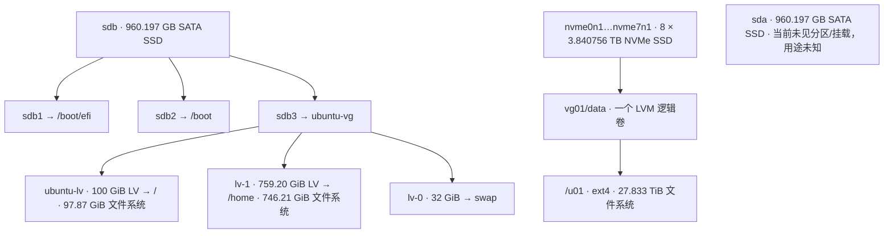

# H20 系统与资源档案：后续 Agent 阅读入口

> 更新：**2026-10-15，北京时间**。主采样 10:50:47—10:52:02，补充检查约 10:54。
> 通过 6000D 的 `h20-train`，以个人账号 `user` 只读采集；没有 sudo、系统修改、训练、GPU 分配或磁盘压测。
> 本页维护当前硬件、存储和软件画像；连接与同步操作见 [通信说明](README.md)，原始证据见 [本次盘点记录](experiments/20261015-inventory/README.md)。

同日后续账号核查见 [多人使用与环境准备](MULTIUSER_AND_SETUP.md)，**已部署的训练/数据双环境、base模型及当前软件状态见 [H20 任务环境](ENVIRONMENT.md)**。本页容量和“为空”等描述对应上面的原始资源采样时间；之后个人 Projects 和 /u01 已新增环境、模型、缓存及文档，不能继续把这些目录视为空。

## 1. 先理解用途和当前状态

**6000D 运行 Codex、开发代码、准备训练配置、做推理；H20 保存数据集、运行训练、保存日志与 checkpoint。H20 不部署 Codex。** 数据与代码由 6000D 通过 SSH/rsync 直接传输，不经过笔记本。

这台 H20 已有可工作的 NVIDIA 驱动和 8 张 GPU。**原始盘点时**个人默认 Python 无 pip、PyTorch、NumPy；同日已在个人 /u01 建立独立环境，使用方法见上方任务环境入口，不再依赖系统默认解释器。其他同事的环境不作为本人的运行环境；本次未扫描其他用户的 HOME。

| 资源 | 实际发现 | 对后续任务的含义 |
| --- | --- | --- |
| GPU | **8 × NVIDIA H20-3e** | 必须按实际型号评估，不能套用其他 H20 版本的显存规格 |
| 单卡显存 | **143,771 MiB ≈ 140.40 GiB** | 当时每卡 free 143,167 MiB ≈ 139.81 GiB；不是全部容量都可分配 |
| GPU 互联 | 所有 GPU 对之间显示 `NV18` | 存在 NVLink 互联；未做 NCCL 带宽或训练吞吐测试 |
| CPU | **2 × Intel Xeon Platinum 8558P** | 每颗 48 核，合计 **96 物理核 / 192 逻辑线程** |
| 内存 | OS 可见 **2,015.49 GiB ≈ 1.968 TiB** | 属于约 2 TiB 内存规模；未读取 DIMM 装机清单 |
| 系统根文件系统 `/` | **97.87 GiB**，当时可用 **77.24 GiB** | 不存 TB 数据，不把模型缓存和大临时文件放这里 |
| 用户文件系统 `/home` | **746.21 GiB**，当时可用 **556.97 GiB** | 全体用户共享；与根分区在同一块 SATA SSD 上 |
| 数据文件系统 `/u01` | **27.833 TiB**，普通用户当时可用 **26.436 TiB** | 8 块约 3.84 TB NVMe SSD 支撑，用于数据与训练产物 |
| 日常账号 | `user`，UID/GID `1004:1004` | 有个人 HOME 和 `/u01/user` 写权限 |
| 默认软件环境 | Ubuntu 22.04.1，Python 3.10.12，驱动 570.133.20 | 训练环境需单独确认/配置，不能把驱动等同于训练框架 |

容量单位：GB/TB 按十进制，GiB/TiB 按二进制。`df -h` 的 `G/T` 是按 1024 换算并取整的显示值；因此用户此前看到的 `98G / 747G / 28T` 与这里的精确换算一致。

所有空闲量、占用率、进程和链路状态都是上述时间的快照，不是资源预留。

## 2. 身份、系统和连接

| 项目 | 值 |
| --- | --- |
| 6000D 上的入口 | `ssh h20-train` |
| 地址 / 端口 | `192.0.2.27:6622` |
| H20 hostname | `local`；这个名字不唯一，不单独用它判断身份 |
| 操作系统 | `/etc/os-release` 报告 Ubuntu 22.04.1 LTS / Jammy |
| 当前内核 | `5.15.0-140-generic`，x86_64 |
| SSH 软件包 | `openssh-server 1:8.9p1-3` |
| 监听 | IPv4 `0.0.0.0:6622`、IPv6 `[::]:6622`；本次查询未见 22 端口监听 |
| 当前用户 | `user`；组仅 `user` |
| 权限背景 | 先前确认个人账号不在 sudoers；本次未重新调用 sudo 或尝试 root 登录 |
| 运行时间快照 | uptime 约 9 天 10 小时；load average `0.08 / 0.12 / 0.05` |
| 机箱品牌 / 整机型号 | DMI 厂商和产品名为空，产品版本是 OEM 占位文字；**无法确认** |

严格主机校验和个人密钥配置已建立，指纹、凭据位置及旧堡垒机入口的区别见 [通信说明](README.md#主机身份与凭据位置)。本页不存密码、私钥或令牌。

之前对“未安装驱动”“只有堡垒机交互终端”的历史判断已不能代表当前状态。当前 6622 直连能执行远程命令和 rsync；2026-10-14 的传输验收仍作为独立历史证据保留。

## 3. 系统盘与数据盘的真实结构

### 3.1 文件系统容量、使用量和位置

下表来自 `df -B1 -T`，不是根据设备标称容量猜测。

| 挂载点 | 文件系统 / 来源 | 总容量 | 已用 | 普通用户可用 | `df` 使用率 |
| --- | --- | ---: | ---: | ---: | ---: |
| `/` | ext4，`ubuntu-vg/ubuntu-lv` | 97.87 GiB | 15.61 GiB | 77.24 GiB | 17% |
| `/home` | ext4，`ubuntu-vg/lv-1` | 746.21 GiB | 151.26 GiB | 556.97 GiB | 22% |
| `/u01` | ext4，`vg01/data` | 27.833 TiB | 44 KiB | 26.436 TiB | 1%（取整） |
| `/boot` | ext4，`/dev/sdb2` | 1.90 GiB | 0.38 GiB | 1.41 GiB | 22% |
| `/boot/efi` | vfat，`/dev/sdb1` | 1.05 GiB | 约 5.24 MiB | 1.04 GiB | 1% |
| `/tmp` | **与 `/` 同一个文件系统** | 不另计 | 不另计 | 使用根分区余量 | 不另计 |
| `/dev/shm` | tmpfs，使用内存 | 上限 1,007.75 GiB | 0 | 当时 1,007.75 GiB | 0% |

`/u01` 普通用户可用空间为 **29,066,356,195,328 字节**（约 29.07 TB / 26.436 TiB）。这是共享文件系统的空间，不是给当前账号独占分配的配额。
`total - used` 与 `available` 不同，不能把差值当成丢失文件；文件系统保留空间等会影响普通用户可用量，本次未调整相关参数。

inode 快照：根分区使用 3%，`/home` 和 `/u01` 均显示 1%；未见 inode 接近耗尽。

### 3.2 物理设备、分区、LVM 与挂载点



| 设备 | 型号（系统报告值） | 单设备原始容量 | 角色 |
| --- | --- | ---: | --- |
| `/dev/sdb` | `SAMSUNG MZ7L3960`，SATA，ROTA=0 | 960,197,124,096 B，约 960.197 GB / 894.25 GiB | 系统、HOME 和一部分 swap 的实际承载盘 |
| `/dev/sda` | 同上，SATA，ROTA=0 | 同上 | 当前 `lsblk` 无子分区、文件系统或挂载点；用途未确认 |
| `/dev/nvme0n1` 至 `/dev/nvme7n1` | `SAMSUNG MZQL23T8HCLS-00B7C`，NVMe，ROTA=0 | 每块 3,840,755,982,336 B，约 3.840756 TB / 3.493 TiB | 全部作为 LVM 成员，关联同一个 `vg01-data` |

需要区分三个层次：**系统物理盘约 960 GB、根逻辑卷 100 GiB、根文件系统约 97.87 GiB**。不是“整台机器只有 98 GB 系统硬盘”，也不是“根目录可以使用整个 960 GB”。`/home` 是同盘另一个逻辑卷，空间不会自动借给根分区。

数据 LV 的块设备大小是 **30,726,028,263,424 B**；上面的 ext4 文件系统报告大小略小。
`lsblk` 在八个 NVMe 父设备下重复展示同一个 `vg01-data`，**不能把这一个逻辑卷重复相加八次**。

### 3.3 已知限制与未确认项

- `/u01` 是本机 NVMe 支撑的 ext4/LVM 卷。当前相关挂载中没有发现 NFS/CIFS；它没有自动成为 6000D 的共享挂载。
- 挂载参数为 `rw,relatime,stripe=32`。**这不足以判定 RAID 级别、镜像或容错能力。**
- 普通账号执行 `pvs/vgs/lvs --readonly` 时虽然退出码为 0，但 stderr 报 `/dev/mapper/control: Permission denied`，结果为空；所以卷组剩余空间、LV segment 布局和冗余方式均未确认。
- 同一错误中的 “Incompatible libdevmapper …” 出现在权限不足上下文，不能据此断言系统 LVM 驱动损坏。
- `/proc/mdstat` 没有活动的 md 阵列；它也不能排除其他层次的存储机制。
- `/dev/sda` 当前未挂载，不代表可以格式化或作为“空盘”使用。本次未读写其原始内容。
- SMART/NVMe 健康、耐久度、磁盘读写实测、备份策略、用户配额与恢复能力均未验收。

## 4. CPU、内存、NUMA 与会话限制

### CPU 和内存

| 项目 | 现场值 |
| --- | --- |
| CPU | 2 × Intel Xeon Platinum 8558P |
| 核心 / 线程 | 每颗 48 核、每核 2 线程；共 96 核、192 线程 |
| 在线逻辑 CPU | `0-191`；当前进程 CPU affinity 同样可见 192 个 CPU |
| NUMA | 2 个节点 |
| NUMA 0 CPU | `0-47,96-143` |
| NUMA 1 CPU | `48-95,144-191` |
| 指令集现场标记 | AVX2、AVX-512、BF16/AMX 相关标记可见；不等于框架已启用对应优化 |
| OS 可见内存 | 2,164,117,745,664 B，约 2,015.49 GiB |
| `MemAvailable` 快照 | 约 1,999.80 GiB；会变化，不能作为独占额度 |
| swap | 合计约 40 GiB，当时已用 0；根文件系统上的 `/swap.img` 约 8 GiB，加 LVM swap 32 GiB |
| `/dev/shm` | 容量上限约 1,007.75 GiB，当时已用 0；属于内存，不是额外物理 RAM |

数据加载线程数要按实际 CPU、I/O 和同机任务设置，不能默认每个 GPU 进程都各自占满 192 个逻辑线程。NUMA 与 GPU 亲和关系见下一节；本次没有绑定 CPU、修改线程数或性能模式。

### 当前个人 SSH 进程的限制

| 项目 | 软限制 / 硬限制或观察值 |
| --- | --- |
| 打开文件数 `RLIMIT_NOFILE` | **1,024 / 1,048,576**；高并发读文件遇到 `Too many open files` 时需关注 |
| 进程数 `RLIMIT_NPROC` | 8,254,451 / 8,254,451 |
| 锁页内存 `RLIMIT_MEMLOCK` | 约 251.94 GiB / 251.94 GiB |
| 地址空间 `RLIMIT_AS` | unlimited |
| core dump `RLIMIT_CORE` | 0 / unlimited |
| cgroup v2 CPU | 读取到的祖先层 `cpu.max=max 100000`，effective CPU 为 `0-191` |
| cgroup v2 内存 | 读取到的会话/用户/祖先层 `memory.max=max`，未发现数值型硬上限 |
| 用户 cgroup 进程上限 | `pids.max=1384119` |
| 用户 linger | `Linger=no` |

这些是当前 SSH 会话的观察值，不是未来容器、调度任务或其他账号的保证。未修改任何系统级限制。
2026-10-14 已实测 tmux 心跳在启动 SSH 退出后继续执行；`Linger=no` 不能推导出所有 tmux 会话都会立即退出，也不保证 user systemd 服务或重启恢复可用。

## 5. GPU 资源、拓扑和状态

### 5.1 每卡资源

8 张卡均报告：`NVIDIA H20-3e`、Compute Capability **9.0**、驱动 **570.133.20**、显存 **143,771 MiB**、功率上限 **500 W/卡**、Compute Mode `Default`、MIG `Disabled`。

| GPU 索引 | PCI Bus ID | NUMA 节点 | CPU affinity | UUID |
| --- | --- | --- | --- | --- |
| 0 | `00000000:18:00.0` | 0 | `0-47,96-143` | `GPU-edebfcda-0f84-3bbb-e112-5ed619ba049e` |
| 1 | `00000000:38:00.0` | 0 | 同上 | `GPU-c7a62320-b617-f888-961c-65321c24bc2f` |
| 2 | `00000000:49:00.0` | 0 | 同上 | `GPU-3672880b-9236-5290-b9e6-289d37b8f738` |
| 3 | `00000000:59:00.0` | 0 | 同上 | `GPU-7af76ffb-4298-2e98-9452-959b8aab2196` |
| 4 | `00000000:9B:00.0` | 1 | `48-95,144-191` | `GPU-128a192b-e641-3d04-1dea-7eccb0fa60f5` |
| 5 | `00000000:BB:00.0` | 1 | 同上 | `GPU-c5f97246-b1d8-5d07-cd4d-ba8cf90d61cb` |
| 6 | `00000000:CA:00.0` | 1 | 同上 | `GPU-71ef8b9e-7410-3d10-b0e8-75eab4f862a3` |
| 7 | `00000000:DA:00.0` | 1 | 同上 | `GPU-023683b6-ff05-eada-62a0-fa4cff1c49a7` |

补充查询每卡 `memory.reserved` 报告约 **605 MiB**，`memory.used=0 MiB`、`memory.free=143167 MiB`。字段以 MiB 分别取整，不能强求显示数值相加逐 MiB 相等，也不能用 `total-used` 代替实际 free。

8 卡报告显存合计约 **1,123.21 GiB / 1.097 TiB**。这不是一个连续的大显存池；能训练多大模型取决于框架、精度、优化器、激活、并行与分片方式，本次没有验证模型容量上限。

### 5.2 NVLink、NUMA 和服务

- `nvidia-smi topo -m` 显示所有不同 GPU 对之间都是 **NV18**，没有把跨 NUMA 的 GPU 对显示成仅走 SYS 的互联。
- `nvidia-smi nvlink -s` 每卡列出 18 条链路，每条状态报告 `26.562 GB/s`。这是链路状态信息，**不是每对 GPU 的实际可用带宽或 NCCL all-reduce 性能**。
- `NV#` 表示路径经过由若干 NVLink 组成的连接；拓扑字段语义见 [NVIDIA 官方 nvidia-smi 文档](https://docs.nvidia.com/deploy/nvidia-smi/index.html)。
- `nvidia-fabricmanager.service` 与 `nvidia-persistenced.service` 均为 active/running；但各 GPU 的 `Persistence Mode` 字段仍是 Disabled。服务存在和 GPU 模式是两条不同观察，不要互相替代。
- GPU 0–3 靠近 NUMA 0，GPU 4–7 靠近 NUMA 1；可供后续排查 CPU 数据搬运瓶颈参考，本次未做绑核或通信调优。

### 5.3 当时负载与健康信号

- 8 卡 GPU-Util 均为 0%，显存 used 均为 0 MiB，未发现正在运行的 compute process。
- 温度约 29–37°C，瞬时功耗约 113–122 W/卡；功率上限不是实时功耗。
- ECC 当前为 Enabled；此次输出中可读取的 ECC 错误计数和 remapped row 错误计数为 0，未报告待处理 row remap 或 remapping failure。
- Retired Pages 若显示 N/A，只能记为该字段不可用；不能当成健康检测值 0。

**空闲快照不等于可独占 8 卡。** 正式训练前重新检查占用和团队分配；本次没有进行 GPU 压测、NCCL 测试或训练复现，也不报告未经验证的 TFLOPS。

## 6. 软件环境：哪些已能复用，哪些没有确认

### 已确认

| 软件 / 能力 | 当前值或状态 |
| --- | --- |
| NVIDIA 驱动 | `570.133.20`；`nvidia-driver-570-server` 已安装 |
| Fabric Manager | `nvidia-fabricmanager-570` 已安装并运行，包版本与驱动同为 `570.133.20-0ubuntu0.22.04.1` |
| `nvidia-smi` 报告 CUDA | **12.8，表示驱动支持的 CUDA 版本信息** |
| 系统 Python | `/usr/bin/python3`，3.10.12；未发现 `python` 命令 |
| GCC / G++ | 命令存在，GCC 11.4.0 |
| glibc | 2.35 |
| Git | 2.34.1 |
| rsync | 3.2.3，protocol 31；与 6000D 传输已验证 |
| tmux | 3.2a；断开 SSH 后任务存活已做轻量验收 |
| RDMA 查询工具 | `/usr/bin/rdma`；设备存在，端口状态见网络一节 |

**驱动、Toolkit、框架自带 CUDA runtime 分开判断**：`nvidia-smi` 的 CUDA 12.8 不能证明安装了 CUDA Toolkit 12.8，也不能证明 PyTorch 的 CUDA 构建可用。[NVIDIA 官方说明](https://docs.nvidia.com/deploy/nvidia-smi/index.html)明确该字段反映驱动支持的 CUDA 版本。

### 当前个人环境未发现

- 默认 Python 的包元数据中没有 pip、torch、torchvision、torchaudio、NumPy、transformers、accelerate、DeepSpeed、JAX/jaxlib、TensorFlow。`python3 -m pip --version` 明确返回 `No module named pip`。
- 非交互 SSH 和 `bash -lc` 登录 shell 均未找到 pip、Conda、mamba、uv、nvcc、docker 或 torchrun。
- 常见位置 `/opt/conda`、`/opt/miniconda3`、`/opt/anaconda3`、个人 HOME 下的 miniconda3/anaconda3/.conda/.venv 均未发现；`/opt` 当前为空。
- `/usr/local/cuda` 不存在，未发现 `/usr/local/cuda*/bin/nvcc`；dpkg 查询无 `cuda-*`、`libcudnn*`、`libnccl*` 包匹配。不能据此排除其他路径的手工安装或其他用户环境自带 runtime。
- PATH 中没有 docker、podman、apptainer、singularity；docker/containerd 的标准 systemd unit 为 not-found。
- PATH 中没有 Slurm 的 srun/sbatch/squeue，slurmd 标准 unit 为 not-found。当前没有可确认的调度器使用入口。
- PATH 中没有 CMake、numactl、ibstat、ibv_devinfo；不能直接照搬依赖这些命令的启动脚本。
- PATH 中没有 node/npm/codex；这与“Codex 留在 6000D”的既定分工一致。

“未发现”限定于本次账号、PATH、系统包数据库和列出的常见位置。**没有遍历其他人的环境，也没有断言整个服务器未安装过这些软件。** `/home` 上已有约 151 GiB 使用量，也不能算到当前个人账号名下。

下一次训练任务应先定位可复用的项目环境及其解释器路径；如果需新建个人环境，再按任务选版本。不要为匹配 `nvidia-smi` 的显示值而盲目重装驱动、全局安装工具包或覆盖系统 Python。

## 7. 网络、存储访问与传输边界

### 业务网络

- `bond0` 地址：`192.0.2.27/28`，MTU 1500。
- Bond 模式：IEEE 802.3ad / LACP；成员 `ens13f0np0`、`ens13f1np1`，均 UP、full duplex、**10,000 Mbps**。
- 发送 hash policy 为 `layer2`。两条 10Gbps 链路不能直接当成一条 SSH 连接可获得 20Gbps。
- 去 6000D `192.0.2.1` 的路由经 `192.0.2.37 dev bond0`。**路由存在不等于 H20 主动连 6000D:22 已成功**；当前工作流由 6000D 发起，上传和下载都能完成。
- 2026-10-14 的 1 GiB rsync 样本上传 38.58 MiB/s、下载 22.86 MiB/s，见 [通信验收](experiments/20261014/README.md)。这是端到端文件传输速度，不是 NVMe 磁盘速度或网卡额定速度。

### 高速 RDMA 网络

PCI 和 sysfs 可见 4 个 Mellanox ConnectX-7 设备：`mlx5_0` 至 `mlx5_3`。
补充检查中，四个端口均为 **InfiniBand / DOWN / physical_state DISABLED**。
sysfs 的 `rate` 在该状态下显示 `10 Gb/sec (4X SDR)`，不能用它宣称已协商成可用的 10Gbps 链路，也不代表设备最高规格。

因此目前可以确认单机 GPU NVLink 拓扑，但**不能声称跨机 RDMA、多机 NCCL 或高速存储网络已打通**。本次未启用端口、改变网络设置或探测其他主机。

### 外网与代理

本次非交互 SSH 进程中，六个常用 HTTP/HTTPS/ALL_PROXY 大小写变量均未设置；没有做外网连通性测试。
旧会话里出现过 `192.0.2.34:3128` 代理超时，那是历史记录，不能套到当前会话。依赖、模型下载是否能出网仍需按具体任务验证；不默认给 H20 转发笔记本 VPN。

## 8. 个人目录、缓存与训练产物约定

| 路径 | 权限 / 当前状态 | 用途 |
| --- | --- | --- |
| `/home/user` | 所有者 1004:1004，`700` | 个人 shell 配置与 SSH；不与同事共用账号配置 |
| `/home/user/projects` | `775`，受 HOME 的 `700` 限制；当前为空 | 任务代码、配置、按版本冻结的源码 |
| `/u01/user` | 所有者 1004:1004，`750`，可写 | 个人数据根目录 |
| `.../datasets` | `750`，当前为空 | 冻结版本的数据集 |
| `.../runs` | `750`，当前为空 | 每个 run 的日志、配置、checkpoint、版本记录 |
| `.../cache` | `750`，当前为空 | 下载缓存、框架缓存；需按框架明确配置 |
| `.../staging` | `750`，当前为空 | 接收区、临时文件、传输中的内容 |

`/u01` 顶层为 root 所有、当前账号不可写；写入已分配的个人子目录即可，不需要修改整个数据盘权限。

后续 Agent 应遵循：

1. 大数据、大模型、checkpoint、下载缓存和解压临时文件使用 `/u01/user`。尤其 `/tmp` 在系统根分区，默认解压 TB 数据会挤占系统空间。
2. 已提供显式加载的 [job_env.sh](scripts/job_env.sh) 设置个人缓存与 TMPDIR；没有自动加载到 shell，也未改变系统默认设置。训练终端需按 [说明](MULTIUSER_AND_SETUP.md#4-个人任务缓存配置) source，项目产物路径另行配置。
3. 训练用独立代码版本与 `runs/<run-id>`，保留参数、环境版本、源码版本/未提交补丁、数据版本和日志路径。不要覆盖正在运行的代码或正在写入的 checkpoint。
4. 传输使用既有 rsync 断点续传方法；启动训练前确认数据版本完整、目标盘仍挂载、可用空间足够。
5. 长任务运行在 H20 的独立 tmux 会话；6000D 负责启动、监控和取回所需结果。不要清理其他用户进程或默认 tmux server。
6. 数据盘未验证备份和冗余，重要数据应按项目已有备份策略保留来源；不要把“用了 LVM”当成备份。

## 9. 后续 Agent 的只读复核命令

以下在 **6000D 的 Bash**、Projects 根目录执行。输出直接在终端；不修改 H20 文件。

```bash
cd /home/user/projects

# 身份、挂载与可用空间
ssh -o BatchMode=yes h20-train 'id; hostname; uname -r; mountpoint /u01; df -hT / /home /u01 /tmp /dev/shm'

# CPU、内存、文件系统设备关系
ssh -o BatchMode=yes h20-train 'lscpu; free -h; lsblk -o NAME,TYPE,SIZE,FSTYPE,MOUNTPOINTS,MODEL'

# GPU当前占用及拓扑；查询本身可能需数秒
ssh -o BatchMode=yes h20-train 'nvidia-smi; nvidia-smi topo -m'

# 当前个人默认解释器环境；若不存在pip会如实报错
ssh -o BatchMode=yes h20-train 'python3 --version; python3 -m pip --version'

# RDMA当前链路
ssh -o BatchMode=yes h20-train 'rdma link show'
```

需要新的完整只读快照时，输出放 6000D `/tmp`，避免覆盖历史证据：

```bash
cd /home/user/projects
H20_INVENTORY_JSON="/tmp/h20-inventory-$(date -u +%Y%m%dT%H%M%SZ).json"
python3 infra/h20/experiments/20261015-inventory/collect_inventory.py --output "$H20_INVENTORY_JSON"
```

完整脚本执行几十项只读命令，本次主采集约 75 秒；保存 stdout、stderr 和退出码。不包含 sudo，也不读取 shell 历史、密钥内容、令牌或其他用户环境。
它不会运行 GPU 工作负载；单次 `nvidia-smi` 查询可能持续数秒，不能把多次查询时间当成训练性能结果。

## 10. 尚未验证与文档维护

尚未验证：实际项目环境、PyTorch CUDA 可用性、单/多卡训练吞吐、模型大小上限、NCCL 带宽、跨机 RDMA、磁盘吞吐和耐久、LVM 段/冗余、备份恢复、目录配额、外网访问、主机重启后的任务恢复。

当前证据入口：

- [盘点方法、限制与证据索引](experiments/20261015-inventory/README.md)
- [主采集 JSON](experiments/20261015-inventory/inventory.json)
- [补充采集 JSON：RDMA、显存保留量、登录环境、目录状态](experiments/20261015-inventory/supplement.json)
- [6000D ↔ H20 连接和同步说明](README.md)
- [2026-10-14 文件传输与后台任务验收](experiments/20261014/README.md)

硬件、驱动、账号、挂载或训练环境变化后，更新本页的采样日期和结论，并新增日期证据；不要覆盖旧快照。旧通信记录不是最新资源状态证明，未来任务执行前仍需检查当前占用。
