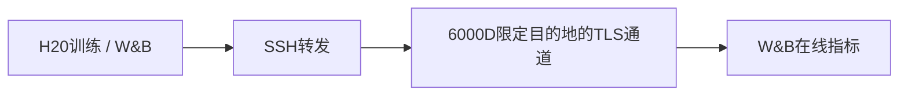

# H20 训练的 W&B 监控

每次训练都接入 W&B。2026-10-16 已按用户授权复用6000D历史训练凭据，在H20验证登录并同步积木任务指标；密钥不进入项目文件或日志。

H20公司代理访问W&B返回503，目前通过6000D专用SSH转发联网。启动训练前先确认链路和在线run，断网时明确保留offline记录并随后同步。

2026-11-02 已定位新一轮 HTML 403：专用转发器直连出站失败，通过6000D既有 loopback 7890 代理则正常。relay 已接入该上游，H20认证查询恢复200；F1原run缺失1041～1776共736行真实历史已逐步补回并在线核实，生产logger恢复1776／444；没有重跑训练，具体源SHA与后续写入以[整改验收](../../tasks/F1_ComplexyToys/inference/experiments/20261102-framework-repair.md)为准。



## 凭据与链路

- 历史来源：6000D Docker卷 `NewLora-wandb-credentials` 的 `.netrc`。迁移只读取W&B条目，经SSH标准输入写入H20个人 `~/.netrc`，权限0600；没有输出密钥、修改其他用户或复制到仓库。
- H20训练进程使用 `http://127.0.0.1:18096` 作为HTTPS代理。6000D也仅监听loopback同端口；SSH只反向绑定H20 loopback。
- [通道实现](scripts/wandb_connect_proxy.py)仅允许W&B API/文件及GCS的443端口，不解密TLS，不记录请求内容。证书校验仍开启。
- 两个tmux会话为 `h20-wandb-proxy`、`h20-wandb-tunnel`；进程退出后重新执行启动脚本。没有安装系统服务或更改全局代理。
- `WANDB_UPSTREAM_PROXY=http://127.0.0.1:7890` 复用本机现有出站代理；启动脚本默认从 `HTTPS_PROXY` 取得配置。仅允许无认证的 loopback HTTP CONNECT 上游，W&B目的地允许列表仍生效，不解密TLS。现有tmux会话不会被启动脚本隐式重启。

6000D Bash：

```bash
cd /home/user/projects
bash infra/h20/scripts/start_wandb_tunnel.sh
ssh h20-train 'HTTPS_PROXY=http://127.0.0.1:18096 HTTP_PROXY=http://127.0.0.1:18096 /u01/user/envs/f1-jimu-pi05-v1/bin/python -c "import wandb; print(bool(wandb.Api().viewer))"'
```

H20任务的logger设为 `[tensorboard, wandb]`，`wandb_proxy: http://127.0.0.1:18096`，并使用 `WANDB_MODE=online`。续训沿用原run-id和连续step；独立恢复验收使用新run。

## 本次补录的边界

积木1000步训练最初只记录TensorBoard，后由任务 `scripts/wandb_backfill.py` 回填真实loss、学习率、梯度及时间指标。原始时间保留在 `source_wall_time`，TensorBoard的step为0–999。历史GPU系统指标没有记录，不能事后重建；回填进程禁用自身系统指标，避免冒充训练资源曲线。

在线项目及实际指标核对结果归 [积木任务状态](../../tasks/F1_ComplexyToys/STATUS.md)。后续训练从启动即接入原生W&B logger，不以补录替代。
