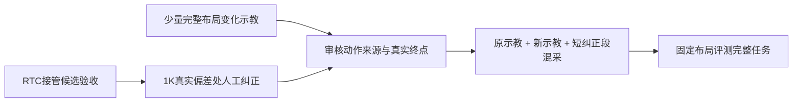

# V1下一批数据：布局变化与DAgger纠正计划

**下一步同时补两类数据：完整任务的布局变化示教，以及模型真实走偏后的人工纠正。** 暂定以Full 1K作为纠正数据的采集基线；这只是便于固定实验条件，不代表已证明它的完整任务成功率优于625。重点补“对孔→插入→松爪→撤离→回位”，不能只把积木送到桶上方就结束。

**现已完成r6九条标准布局纠正，用户确认全部成功且全程手柄操作。** 原件及来源审计通过，候选6,288窗，正式包／新reader尚待完成；旧首条700窗保留独立验证。下一轮建议按[V1＋DAgger配方](../V1_DAgger_FullSFT.md)做75∶25采样、单臂Full重训，本页继续维护采什么与监督原则。原独立continuous入口仍不能手柄接管；完整布局变化示教继续沿示教路线采集。分层证据见[接入验收](../inference/experiments/20261021-rtc-hil.md)。

用户保留H20 GPU0/1推理和GPU2独立IK工作；随后新授权空闲GPU4–7续原数据到2K、保留1.5K，已独立启动。这不改变本页DAgger准备边界，也不混入新数据。当前事实以[STATUS](../STATUS.md)为准；现有失败与诊断见[同版本评测报告](../Eval/V1_FullSFT_20261021_ANALYSIS.md)。更新：2026-10-21，北京时间。

## 先采什么

两类数据互补：完整示教教模型在不同布局下把整件事做完；纠正段教它从已经遇到的偏差恢复。**不必先把所有位置覆盖完才能做DAgger。** 首批以小范围、有记录的变化为主，审核后再扩大。

| 数据类型 | 首批变化或起点 | 一条有效记录应覆盖什么 |
|---|---|---|
| 完整示教：移动桶 | 桶在可用工作区内改变XY，先不旋转；木块起点尽量固定 | 重新视觉对孔、插入释放、撤离回位 |
| 完整示教：移动木块 | 木块位置变化，先保持姿态；桶固定 | 抓取、持物运输、插入释放、撤离回位 |
| 孔口纠正 | 到孔口但偏位、姿态不合适或长期停滞 | 必要时先退出接触，再调整、插入；不要只示范原地微抖 |
| 释放纠正 | 已确认插入，模型仍夹紧 | 明确松爪，确认物体留在目标位置，撤离孔口 |
| 撤离／回位纠正 | 松爪后没有向上撤离，或回位方向开始错误 | 在危险运动形成之前接管，演示安全撤离及回到起始末端位姿 |

先分别改变桶和木块，记录各自布局，便于知道改善来自哪里；之后再组合变化。所有位置须处于现场已确认的可用范围，不为了采失败而故意接近桌面碰撞或关节边界。

**完整示教和末段纠正都要记录到真实回稳。** 释放后沿现场可行路径向上撤离，确认脱离孔口后回到起始末端位姿，保持夹爪张开；实际反馈和画面稳定后，再继续录制2–3秒，最后结束。不能只记录“发出了Home命令”就停止，也不要在回程仍运动时结束录制。这个停留用于提供真实的终点保持示教，不等于给推理新增固定计时松爪或自动复位规则。

**多录2–3秒不代表这段一定进入训练。** 必须确认录制没有在Home完成或原有停止流程处自动收尾，并为这段真实保持明确记录、审核允许监督的控制来源和时间区间；生成索引后逐项核对保持标签实际保留、有效时间mask为真。新增完整示教和末段纠正都执行这项检查，不能用padding或复制末帧伪造停留。

当前r6同一条纠正从孔口继续完成释放、撤离和回位，停稳至少2秒后↑保存；人工阶段START不交还。下一条必须保存完成后重新START，以新观测启动策略。旧r1允许同条交还的证据保留，旧交还后的模型动作不自动标为人工。连续同进程分条共享process_run_id，后续划分按场次/原会话分组，不能分到训练和验证两侧。

## 怎样保留错误状态，又不学习错误动作

完整会话保留三路原始图像和日志，训练时按已审核的人工来源与时间范围选择监督。当前图像仍是“已经走偏”的真实状态，标签是从该状态开始实际发布的正确人工恢复动作。

| 原始记录 | 是否进入专家监督 |
|---|---|
| 模型把夹爪带偏的动作 | 保留作诊断证据，不自动当作专家标签 |
| 接管后仍处于偏差位置的观测 | 保留，正是需要学习恢复的输入 |
| 审核通过的人工后退、调整、插入、释放和回位 | 使用真实有效的`submitted`动作作为标签 |
| 人手移动积木桶、扶住物体 | 标注为环境干预；不把同时发生的模型动作改标成人工纠正 |
| 无效发布、断连、未知来源、未审核Home | 不参与相应动作监督，并保留边界 |

每条至少记录checkpoint身份、起始布局、接管原因／任务阶段、干预ID和最终结果。机器人控制来源需要能追溯到操作者session／序号、`intervention_id`和`policy_epoch`；人工候选、策略预测、最终发布及实测反馈分别保存。只操作左手的片段和长时间人工犹豫，需要审核后决定是否适合右手任务监督。

## RTC接管的最小隔离候选

实际实施与验收交接见[HIL-DAgger Agent完整prompt](HIL_DAGGER_AGENT_PROMPT.md)，保留原始要求；实际完成项以[STATUS](../STATUS.md)和接入验收报告为准，下文描述实现合同与现场门槛。

实现复用同步HIL的手柄、监督状态机和唯一输出owner；`rtc_hil.py`通过显式`--rtc-hil`分发，使用冻结release和独立runtime。真实相机/F710已完成同会话策略→人工→交还→新RTC零输出及一次真机验收。原continuous及独立IK候选保留。当前已部署r6连续分条，旧接管/交还现场证据不替代新版↑与下一条验收；新条首个reader审核待现场，命令见STARTUP。

| 环节 | 候选必须满足的行为 |
|---|---|
| 启动 | 使用真实操作者连接与既有START授权；不伪造手柄心跳。绑定1K的模型、prompt、统计和D14/S16参数 |
| 接管 | 由既有START切入人工，RB／手柄控制沿现有约定；保留唯一发布owner，立即废弃旧策略后缀 |
| 旧请求 | epoch变化后，迟到的成功回复、IK异常和恢复回调都不能重新取得人工控制权 |
| 人工期间 | 连续录制，明确人工动作来源，不继续发布或采纳旧RTC计划 |
| 新条边界（r6） | ↑保存当前条，保存完成且场景恢复后START开新条；等待新观测和反馈，空前缀启动RTC。同条人工START不交还 |
| 故障 | 保留原限位、碰撞、反馈新鲜度、断连和watchdog规则；不因加入HIL自动启用新的IK恢复策略 |

具体函数、复用位置和测试案例集中在[接入审查清单](../Eval/artifacts/20261021-assisted-release-home/continuation-review/hil-readiness.json)。后续命令必须同时给出操作者sender、输入通道及F1现场入口，不能把当前`--continuous`命令换个名字就称为DAgger。

## 从候选到正式采集的验收顺序

以下是完整验收顺序；CPU/传输回归、隔离部署、真实F710零输出已完成。一次真机接管与首条数据审核/reader也已完成；证据来自当前RTC组合，不以旧同步HIL测试替代。

1. **CPU状态与控制测试。** 覆盖执行中接管、在途请求迟到、旧IK错误、接管与恢复回调交错、手柄断连、交还后新观测等情况，确认旧计划不再发布。
2. **真实相机＋真实手柄shadow。** 完整走启动、接管、人工、交还，核验模型身份、epoch及日志，确认零动作发布。
3. **现场一条短接管。** 用户从安全状态执行，检查接管／交还没有目标跳变或意外夹爪动作，再验证孔口纠正和撤离回位。不能仅凭shadow宣布真机通过。
4. **先审核这一条数据。** 检查全量图像、来源边界、人工发布标签及短窗口；确认没有混入错误模型动作后，再批量采集。

## 训练前仍要补齐的配方

当前时间mask支持每个观测起点的连续有效前缀L=1–50；训练96窗口门槛已取消，可以复用到短纠正段。保持输入有效性与标签连续性分别判断，遇来源／epoch／发布边界停止监督，不把删除错误后的两侧拼接；padding不参与输入噪声、attention、loss或统计。详见[预处理SOP](README.md)与[当前训练recipe](../TRAINING_RECIPE.md)。

| 待办 | 本轮准备原则 |
|---|---|
| 审核与冻结 | 逐条冻结原件；明确接受的干预ID和时间范围，自动Home需另有完成证据与审核 |
| 三类数据混采 | 原完整V1、新完整示教、人工纠正分别登记并显式采样；不能让短纠正被长轨迹淹没。具体比例待首批有效窗和阶段分布统计后确定 |
| 短验证片段 | 已实现min(96,N)真实互异窗口、精确rank分片及真实样本分母；记录阶段计数，原V1验证清单保持。FSDP不足批次仅做不计分同步前向，不复制计分样本；离线通过，未启动训练 |
| 防止泄漏 | 原12／3划分保留；新增数据按原会话／场次隔离，相关布局与同一干预的窗口不能跨训练验证 |
| 统计与版本 | 新数据生成新索引、训练统计和模型包；保留ROI、EEF与夹爪语义，重新核验状态覆盖和归一化边界 |
| 评估 | 固定布局和阶段观测，分别记录插入、释放时机、撤离方向、回位、完整成功及首次拒绝；不以loss或“预测过张开”代替任务成功 |

2026-10-21已整理[V1＋DAgger配方草案](../V1_DAgger_FullSFT.md)：官方base、单臂Full/global128，V1／纠正75∶25，先1K检查；待实现与冻结，未启动新训练。1K是采集基线，不规定必须从1K任务权重续训。旧15条的1K→2K属于原数据独立对照，不代表DAgger已接入，也不改变当前推理和IK服务。
