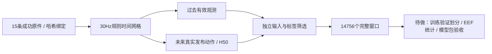

# 15条V1：30Hz时间索引与配组诊断

15条成功V1已生成逐窗口时间索引，原件前后审计全部通过。保留14,756个完整H50窗口、14,245组不同的输入观测；普通采集抖动不会导致整条示教报废。

这是时间预处理阶段的交付，尚不是发布训练包。三路图片仍使用当前线上一致的整组输入；逐路重配仅做诊断，曝光同步、延迟补偿和训练/验证reader验收没有冒称完成。



## 本轮方法与结果

日期：2026-10-16。成功确认来自用户“15条都成功，物体和任务相同”，与每条manifest绑定；未篡改工作台review或虚构人工审核时间范围。

- 规则时间点独立计算 `t0 + round(k*1e9/30)`，不把原件第k行冒充固定30Hz。
- 输入选择 `available <= t` 的最近整组观测，保留各帧、状态与组装时间；不选择未来最近帧。允许短暂沿用并计数，过旧起点剔除。
- 标签使用每个动作网格点之前最近一次**完成发布**的有效submitted；不插值生成假发布，不用反馈补动作。
- 对整个未来动作区间检查Home、控制来源、epoch/接管、发布有效性、序列与控制缺口；不只检查50个采样点。
- 未来缺图不截断已有有效起点的动作监督。Home等真实标签边界仍不可跨越；缺口两侧不拼接，不补齐尾部。
- 明确三路必需图片。质量阈值仍为既有显式基线：观测50ms、相机200ms、状态250ms、命令年龄/控制缺口50ms，独立于FPS；这些不是已优化的最优阈值。

| 项目 | 实测 |
|---|---:|
| 原始示教 / 原始观测 | 15 / 17,241 |
| 30Hz候选网格点 | 17,273 |
| 完整H50窗口 | 14,756（85.43%网格点） |
| 不同来源输入观测 | 14,245（82.62%原始观测） |
| 沿用同一输入带来的额外起点 | 511；不是新增拍摄帧 |
| 观测过旧拒绝 | 213个起点 |
| 合格标签的命令年龄最大值 | 20.044ms |
| 各条合格标签命令年龄P99 | 11.35～14.34ms |

其余拒绝原因全部保存在逐条`rejections.jsonl`及集合摘要中。非人工控制、Home和窗口不足不等价于坏采集；“有效窗口比例”也不是任务成功率。窗口高度重叠。

## 按优先级检查配组

第一优先级的代码事实：采集队列从每一路队头取图，只在三路接收时差超过配置门槛时丢最老帧；满足100ms上限并不意味着取到最接近当前时刻的组合。

本轮在相同14,756个有效起点，比较整组基线与“每路最近过去接收帧”的诊断候选：

| 指标（每条的中位数范围） | 当前整组 | 逐路候选 |
|---|---:|---:|
| 主图接收→训练起点年龄 | 23.1～87.2ms | 12.0～21.3ms |
| 三路接收时间差 | 11.8～68.5ms | 7.8～19.0ms |

这是每条中位数的范围，不是合并全数据后的P50。候选中有16,295次所选相机帧的原整组在该网格点尚未就绪；证明当前整组接口不能原样供应这些候选。它显示队列/组装存在优化空间，**不能证明全部偏差来自队列，也不能把这些数值称为曝光延迟**。

下一步若采用逐路缓存，必须同时改离线输入与在线可用时间/缓存选择，检查丢帧、Home/epoch边界及实际画面；不只改离线索引。当前已知主图759对相同header对应不同JPEG字节，header不能直接用于去重或曝光补偿。传输/回调/调度与源时钟校准仍需额外测量。

当前先保留30Hz基线。20Hz不会消除多相机错位；已有20Hz/H50计数9,564个窗口，但预测首尾跨度变为2.45s，不能直接与30Hz/H50的1.633s比较质量。

## 代码、证据与复现

- [集合预处理入口](../prepare_collection_indexes.py)、[三图30Hz配置](../../configs/preprocess_v1_formal_30hz.json)。底层仍复用已验证的独立输入/动作索引，未改生产采集与在线推理。
- [集合结果JSON](../../artifacts/20261016-v1-formal-audit/time-index-summary.json)、[逐条日志](../../artifacts/20261016-v1-formal-audit/time-index-build.log)。15条均PASS；新增来源绑定测试与已有时序测试合计23项通过。6000D另逐条回读压缩包：60个索引文件hash一致，检查14,756窗口/737,800动作点，全部满足过去因果选择、三图及规则网格约束，见`time-index-readback.json`。
- F1输出：`/home/user/Bruno/DAgger-runtime/f1-toys-20261016/v1-preprocess-r1/time-indexes-30hz/`。只读处理原件，使用nice降低CPU优先级，没有ROS/发布器/动作输出。
- 索引压缩包SHA256：`dfe16b5b0ecee13bbdaafedc411cbb9fa5ac554d5a2e9194979c6754727ecbcd`；6000D保存到本任务`artifacts/20261016-v1-formal-audit/`。每条保存原件、索引、拒绝原因、时间质量与文件hash。
- 原件副本传输：6000D的tmux `f1-v1-raw-transfer`；结束后对全部日志、payload与图片包核hash，成功凭据为`raw-transfer-verification.json`，不存在时不得称完成。

6000D原件副本验收完成后，在已验证Python环境运行，输出使用新目录：

```bash
cd /home/user/projects
python tasks/F1_ComplexyToys/DataPrehandle/prepare_collection_indexes.py \
  --catalog tasks/F1_ComplexyToys/artifacts/20261016-v1-formal-audit/catalog.json \
  --confirmation tasks/F1_ComplexyToys/artifacts/20261016-v1-formal-audit/user-confirmation.json \
  --config tasks/F1_ComplexyToys/configs/preprocess_v1_formal_30hz.json \
  --raw-root tasks/F1_ComplexyToys/artifacts/20261016-v1-formal-audit/raw-copies \
  --output tasks/F1_ComplexyToys/artifacts/20261016-v1-formal-audit/time-indexes-reproduction
```

下一阶段：按原episode冻结split，训练部分计算EEF/state统计，验证复用统计，打包多条reader并核对图像/标签与真实batch，再做H20预检。新训练未启动；训练预算只见[根recipe](../../TRAINING_RECIPE.md)。IK边界研究继续暂停。
