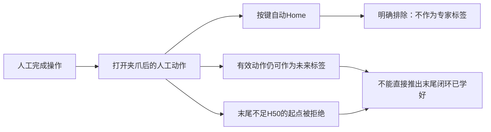

# 为什么任务末尾不能直接等同于“模型学会复位”

这份说明回答：H50要求完整未来动作，导致末尾一些时刻不能独立当训练起点，这是不是policy收尾后IK拒绝的原因？**它确实造成末尾观测覆盖不足，但目前不能认定为本次拒绝的根因。**

真实V1的自动Home原本就不作为专家动作训练；人工打开夹爪后的动作则仍有保留。需要分别看“自动复位有没有教”“末尾动作有没有当标签”“末尾状态有没有独立训练样本”，不能混成一件事。

本文保留旧LoRA数据的只读核查。**后续Full版本已加入经审核的V1 Home和短时间mask**，解决了相应监督缺口，但任务收益仍需现场评估；新规则见[Home/mask验收](20261020-home-time-mask.md)和[当前SOP](../README.md)。下文的排除统计与流程图只适用于旧版本。



## 1. 已确认：自动Home没有进入专家标签

日期：2026-10-20，北京时间。此次核查对象是当前冻结的15条V1，包含12条训练及3条验证。

| 实际检查 | 结果 |
|---|---:|
| 记录的Home区间 | 15段，每条各1段 |
| Home总时长 | 40.808012962秒 |
| 完整H50窗口 | 14,756 |
| 窗口内动作标签出现次数，含重叠 | 737,800 |
| 动作网格时间位于Home中的标签 | 0 |
| 所选发布记录时间位于Home中的标签 | 0 |
| 跨过Home的完整窗口 | 0 |

全部保留标签来源都是 `human_hold`、`human_arm`、`human_hand` 或 `human_arm_and_hand`。代码同时检查人工来源和整个Home区间；即使某一条控制记录的来源字段没有及时变化，也不能跨过已记录的Home事件。

因此，**采集结束时按键自动回Home，不等于给视觉policy示范了复位。** 当前数据合同没有把这段自动控制轨迹当专家动作，也不能要求模型仅凭这批标签自然学会相同Home过程。

规则依据：[人工来源检查](../build_training_index.py)、同文件的 `_event_intervals` 与 `validate_interval`。后者检查完整时间区间，不只抽查50个动作点。

## 2. 已确认：人工末尾动作没有被整体删掉

为避免把“尾部起点被拒绝”误解成“尾部动作全部消失”，本次额外检查了夹爪目标先大于80、随后小于20之后，直到第一次Home前的人工动作。

- 15条都保留了这段时期的动作标签，每条有32–249个不同网格动作点。
- 合计2,396个不同网格动作点，其中训练集12条有1,895个；没有将验证标签算作训练。
- 14条在这段时期仍有非零右臂目标变化；旧单条 `88a4ad17` 主要保持不动。
- 最短训练示教 `fa14b5c2` 保留128个这样的动作点；从目标重新打开到Home相隔4.249秒，右臂目标相对打开时刻的最大单关节变化为17.110°。

这些数字证明“打开夹爪后的人工动作仍参与监督”。**夹爪目标变化和关节目标变化本身不能证明插入成功、实物已经释放、安全撤离或完整人工复位**；这些语义仍需结合画面审核。

较早的观测可以把随后这些真实动作作为未来标签。因此，末尾某一时刻不再作为独立输入，不代表这个时刻的动作从所有训练窗口中消失。

## 3. 需要保留的局限：学到末尾动作，不等于覆盖末尾闭环状态

继续使用真实示教 `f1_hil_20261016T055737Z_fa14b5c2`，其中 `g` 为从0开始的30Hz规则网格编号：

| 项目 | 真实范围 |
|---|---|
| Home前最后保留的完整窗口起点 | g618 |
| 这个窗口的50个标签 | g618…g667 |
| 按当前“预测50、执行前20”的约定，其执行前缀 | g618…g637 |
| 这一人工段末尾，没有各自完整H50起点的时刻 | g619…g667 |
| 仅出现在训练窗口offset≥20处的最后30个动作 | g638…g667 |

例如，g667的动作可以是g618窗口的第50个标签，但没有“以g667的当前图片、状态为输入，再预测其后50步”的训练样本。g619的完整窗口要求延伸到g668，而g668已进入Home，所以被拒绝。

**可能影响：**末尾这些状态下的重新观察、纠偏、保持等行为，缺少相应起点的直接监督。只执行前20步时，这种远端标签与近端闭环输入的覆盖差异尤其值得检查。

**不能据此推出：**最后30个动作完全没学到，或补上时间mask就一定消除IK拒绝。模型参数共享，较早窗口仍监督这些动作；是否影响真实收尾，需要后续保持其他条件一致的对照验证。当前短时间步mask尚未实施，也没有宣称修复。

逐动作来源及交互讲解见：[窗口核查摘要](../../artifacts/20261020-window-walkthrough/walkthrough-summary.json)、[桌面交互讲解](../../artifacts/20261020-window-walkthrough/window-explorer.html)。

## 4. 本次2K现场拒绝，已经知道什么

现有[真机分析](../../Eval/V1_20261019_ANALYSIS.md)记录：

- 三次都是打开夹爪后，policy继续运动，约80–104秒首次IK拒绝。
- 画面显示空夹爪已离开箱子，手臂向远处运动；至少两次木块横倒在盖面，不能改记为成功插入。
- 控制来源是 `policy`、`hold`、`ik_recovery_hold`，没有证据表明4242显式Home控制器正在执行。
- 21个未执行的失败候选接近运动学奇异姿态，位置残差超出现有验收容差；失败候选没有被下发。

**已确认的是“策略继续运动时发生IK拒绝”。** 目前无法从这些日志单独证明是末尾起点不足、模型偏差积累、连续IK分支，还是几项因素共同造成。也不能将它称为“4242复位脚本失败”。

现阶段可将任务终点定义为“插入、释放并安全撤离”，之后用独立流程复位，并分别评价。若未来要求policy自主完成复位，需要明确该阶段的示教、终止条件和验收，不能仅靠延长同一条continuous推理自动获得这项能力。

## 5. 可复核证据与复现

- [本轮核查JSON](../../artifacts/20261020-reset-label-audit/reset-label-audit.json)：包含逐episode区间、计数、训练/验证身份、统计局限及来源文件SHA256。
- [只读生成脚本](../../artifacts/20261020-reset-label-audit/audit_reset_labels.py)：核对冻结索引与控制日志哈希，并核对每条完整窗口数与正式打包结果一致。
- [15条时间索引原始报告](20261016-v1-formal-time-indexes.md)、[逐条窗口数量](../../artifacts/20261020-window-walkthrough/episode-counts.csv)。

在Projects根目录执行：

```bash
python3 tasks/F1_ComplexyToys/artifacts/20261020-reset-label-audit/audit_reset_labels.py
```

脚本只读取已有原件、索引和包，生成本轮核查JSON，不重建数据、不启动训练、也不连接机器人发布动作。统计中的重复标签出现次数、去重网格数、人工目标变化和语义成功分别记录，不互相代替。
