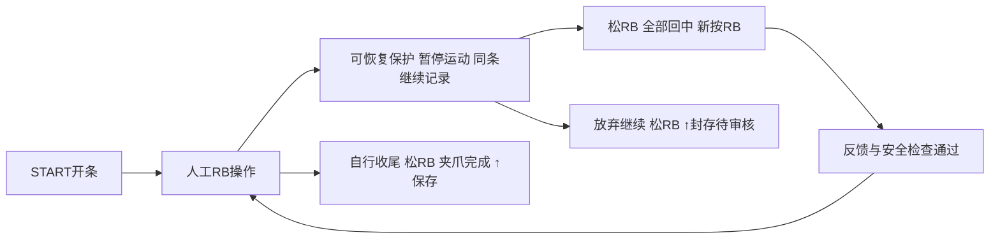

# 人工示教保护暂停：2026-10-23断段核查与恢复修复

**这次任务完成，但旧入口遇保护后封存成三段；三条采集记录现已按用户要求删除。** 删除覆盖对应原件及工作台派生预览，其他记录未变；本页保留当时核查结果和分析证据，不再把这三条列为待审核训练数据。见[删除回执](../../artifacts/20261023-manual-recovery/data-deletion.json)。

**人工暂停恢复已实现并部署：可恢复保护保持同一条录制，松RB、全部回中，等提示再新按RB继续。** START仍负责开条或策略接管，↑统一保存。暂停期间保留原始记录供排查，训练窗口排除暂停及不可信输入范围；离线、ARM和等待START的真实反馈零输出检查已通过，实际手柄恢复与首条新数据审核仍待现场。

**用户随后要求收尾由操作者决定：人工示教与RTC-HIL均取消保存前的回位／两秒门槛，保留Y为可选快捷回位。** 松RB、等夹爪操作完成后可按↑保存；若正在执行Y，须等动作结束后再↑，无需额外计时。此项修订已部署，离线与ARM通过，真实手柄保存及首条新数据待现场；验收单独记录，不沿用下面人工暂停修复的通过结论。左夹爪适配仍按用户决定留给后续数据处理，不启动训练；批量录制前按[现场入口](../../inference/STARTUP.md)核验新行为。

## 修复后的操作语义与验收边界

| 操作者遇到的状态 | 操作 | 录制与输出行为 |
|---|---|---|
| 等待开条 | 全部回中，按一次START | 建立新条；人工示教直接进入右臂人工模式，策略HIL先运行策略 |
| 正常人工操作或短暂停顿 | 按住RB移动；松RB或摇杆回中停住 | 保持同一条；普通等待仍录为人工保持 |
| IK关节边界阻止继续向外 | 松RB回中，再按RB向可行方向退回；原边界内也允许直接反向 | 保留原有限位与反向退出逻辑，不靠START解除 |
| 人工新候选被碰撞模型拒绝，或手柄／网络暂时断续 | 松RB，摇杆、扳机和按键全部回中；恢复连接与新鲜反馈后，新按一次RB | 丢弃旧目标与暂停期间输入，安全检查通过后从实测姿态重新锚定；同条继续 |
| 暂停中按START | 无需重复按 | 人工暂停中不会重新授权、开新条或返回策略；提示用RB恢复或↑保存 |
| 暂停中不再继续 | 松RB及其他动作键，按↑ | 封存当前条，保留暂停标记并要求审核；不会伪称已完成任务 |
| 正常完成 | 操作者自行收尾，松RB、等夹爪操作完成后按↑；Y为可选快捷回位，执行中须等动作结束 | 不要求先回位或保持两秒；保存完成后再START开下一条，未满足其余操作条件的↑不排队 |
| 策略自身推理／IK／RTC故障，尚未进入人工 | 按START显式接管到人工 | 这是策略接管的保留例外；不能把“人工暂停不用START”理解为取消策略接管键 |

可恢复暂停只处理**尚未进入输出队列的新人工候选**，以及健康协议下的输入断续。已发布目标和当前真实姿态仍须安全；恢复时使用新鲜实测反馈，保持夹爪和非操作臂的目标，先设置合法锚点，再接受新的人工运动。按住RB等待恢复、重复旧包、重连时携带的按钮，以及暂停期间的RT/Y都不能自动获得运动授权或事后重放。

真实反馈越限、当前姿态不安全、协议错误、发布失败仍保留硬故障处理，不能承诺按RB就能继续。Home停止也保留原有保护语义；不得用START、裁剪反馈或放宽限位绕过检查。出现这些状态应按界面具体原因停止本次操作，封存或退出处理。

**同条记录不等于整段都可训练。** 可恢复暂停期间图像、控制保持和事件仍写入原始条目，明确保留时间空隙与状态变化。训练index从最后可信输入到明确恢复之间排除监督；未恢复则排除尾部，部分动作窗口只保留暂停前的真实前缀，不能跨暂停拼接。恢复后轮询到的、实际在暂停中接收的图像也不能冒充新专家输入，Home审核或人工时间范围不能绕过这条边界。

独立验证共**60项通过**：29项人工／RTC人工阶段恢复测试，以及31项数据预处理测试。覆盖同条保存、旧目标和夹爪不重放、断线重连、无效证明不能恢复、硬故障不降级，以及两次真实停止姿态的合法映射与恢复边界；碰撞生命周期测试使用受控拒绝，不等于真机碰撞安全认证。核查中修正了默认全有效mask被误拒，以及错误将Home的1°到位容差用于人工恢复的问题。证据见[独立审查](../../artifacts/20261023-manual-recovery/independent-review.json)。

**以下是人工暂停恢复修复的验收：已实现、离线通过、ARM通过、隔离部署完成；真实反馈等待START的shadow通过，实际F710恢复待现场。** 这些证据早于本页新增的保存门槛修订，不替代该修订的验收。已有Windows连续分条版本包含所需恢复协议，不必重新安装sender。此次三条已删除，不记为“首条数据已审核”；旧九条／首条历史验收与此次修复后的新录制分别记录。

| 验收层 | 本次证据 | 实际边界 |
|---|---|---|
| 源码与数据边界 | 独立60项；UI后端19项、反馈5项、终端7项；浏览器63种暂停组合及硬停／限位／策略接管检查 | 碰撞故障为受控注入；两组真实末帧用于映射与恢复回归 |
| ARM冻结包 | 人工95项，HIL123项（含2项实际WebSocket测试）通过 | 人工包不包含RTC组件，18项相关参数例被明确排除；原硬件与数据格式保持 |
| 真实反馈shadow | 人工237组、HIL241组观测；0提交／0发布，无新增录制，正常退出 | 未伪造手柄输入；停在等待START，未验真实F710恢复 |
| 部署 | 人工／HIL客户端`20261023-f1-{manual,hil}-recovery-r1`；统一装配`unified-ab-full-recovery-20261023-r2`；工作台`20261023-manual-recovery-r1` | 空闲持共用锁切换，清单与网页HTTP哈希核验；只重启网页服务，四模型与普通推理／独立IK保持 |
| 现场与新数据 | 等待操作者验证恢复无突跳、同run连续采集、夹爪不重放、↑正常保存 | 尚无修复后新条审核，不启动训练 |

完整[分层验收回执](../../artifacts/20261023-manual-recovery/acceptance.json)、[ARM测试](../../artifacts/20261023-manual-recovery/arm-tests.json)、[部署回执](../../artifacts/20261023-manual-recovery/activate-receipt.json)可追查。回退材料在F1的`/home/user/Bruno/DAgger-runtime/manual-recovery-20261023/activation-backup/`，保留旧手动入口、两条current指针、路线登记与网页文件。回退仍须空闲持锁；代码回退不恢复姿态或重放输入。

## 后续保存门槛修订验收（2026-10-23）

用户明确只取消保存前的回位／两秒限制，保留Y。运行逻辑仅去掉终点计时拒绝分支；RB、START、正在回位与夹爪操作中的保存保护保留。没有修改Home轨迹、IK、恢复边界或两端数据格式。没按Y、Home完成不足两秒、已离开Home姿态均允许↑；被动作中条件拒绝的↑仍不排队，条件满足后重新按一次。

本地48项保存／恢复、5项反馈、13项工作台测试通过；浏览器6个新显示场景与63项既有恢复回归通过，无机器人API或写请求。ARM冻结人工包43项通过、23项RTC相关未选；HIL66项通过，重新以刚上线的优化HIL为基线复测亦66项通过。真实硬件输入、实际任务成功与新数据审核不在此结果内。

已部署人工`20261023-f1-manual-save-r1`、优化HIL`20261023-f1-hil-save-optimized-r1`，统一装配`unified-rlinf-save-20261023-r1`。首次切换因并发推理上线被版本校验挡住、未改入口；随后基于实际优化版本重建，只叠加保存逻辑／提示，原推理优化、模型与普通rollout配置保留。F1infra只热更新四个静态文件及路线文字，后台仍用Replay版本；无服务重启、无真机动作、无新训练。Windows无需更新，新启动运行端生效。

本修订**已实现、离线及ARM通过、隔离部署完成；未另跑shadow、等待现场，尚无新首条数据审核**。完整[分层回执](../../artifacts/20261023-manual-finish/acceptance.json)、[部署回执](../../artifacts/20261023-manual-finish/activate-optimized-receipt.json)、[最新HIL ARM检查](../../artifacts/20261023-manual-finish/arm-tests-optimized.json)可追查。F1备份在`/home/user/Bruno/DAgger-runtime/manual-save-20261023/activation-backup/`；回退需空闲持锁，不恢复姿态。

## 旧版本实际记录与停顿语义

以下为删除前对旧冻结入口的历史核查；其“保护封存／START新段”行为由上述修复替代，旧数据和现场事实不作改写。

此次同一进程`f1_hil_20261023T064218Z_f7bf5797`产生三段人工示教，使用`20261021-f1-hil-v33-continuous-episodes-shadow-off-20261022`，不是已适配缺左夹爪的策略客户端。下表时间为北京时间；时长按开始/结束事件，文件封存时长稍长。

| 开始／原件后缀 | 事件时长 | 实际内容 | 结束原因 |
|---|---:|---|---|
| 14:43:19／064319Z_f1774ce1 | 20.656秒 | 从桌面抓取木方，持物接近桶 | 碰撞风险保护，`interrupted` |
| 14:43:53／064353Z_1c1d2ee1 | 4.365秒 | 从持物姿态继续接近桶 | 再次碰撞风险保护，`interrupted` |
| 14:44:00／064400Z_ebfb7fc5 | 30.362秒 | 持物对孔、插入释放、撤离、Home和保持 | ↑正常保存 |

前两段的`manifest.complete=true`表示文件完整封存；`binding.termination.outcome=interrupted`明确说明任务轨迹中断。不能只看“completed／已保存”就判定成功完整示教。

两次`demonstration_stopped`到下一次`demonstration_started`相隔13.915、1.775秒，图像组边界间隔约13.953、1.796秒。期间内部取图及安全保持循环仍运行，但没有活动episode recorder；没有图像payload与逐帧动作落入这三段。普通程序日志可留诊断，不能代替丢失的专家时间序列。

正常松RB、摇杆回中、人工等待会记录`human_hold`。第三段Home在开始后17.573秒完成，↑在30.362秒，实际末尾保持12.7886秒；其中连续末尾human_hold约12.759秒、379帧。期间12个START事件都被`use_up_to_save`忽略，录制持续，最后一次↑正常保存。因此“停顿不录制”只适用于此次保护已封存后的空隙，不适用于正常人工保持。

## 旧版本为什么必须重新START

两个中断点的最后已发布右J2目标均约−93.99990°，约束`active_planes=[8]`对应右J2下界，确实处在限位附近。但终止原因是随后候选目标被右臂Link5／躯干Link5碰撞模型拒绝，模型净距分别−2.5、−2.4mm。

冻结代码在输出入队前做碰撞检查；被拒候选没有送入输出队列。日志证明模型判定风险，不证明真机已经发生碰撞。该错误进入`safe_hold`并调用`episodes.finish(..., interrupted=True)`，当前条被封存；后续START新建episode，而不是恢复同一条。不能通过取消碰撞保护或放宽关节限位来解决录制连续性。

源码位置、事件时间与输入编号记录在[停止原因证据](../../artifacts/20261023-manual-demo-review/stop-cause.json)。最初核查仅分析；随后用户要求删除和修复，新增行为见上文。

随后独立复核发现，三段右J2实测最小值分别为−93.69775°、−93.74295°、−93.74082°，均在−94°下界内；贴边的是已发布目标，不能把它和实测越界混为一谈。前两次末尾实测与已发布关节最大差分别约1.77°、1.59°，Home的1°到位容差不能据此变成人工恢复的新故障门槛。修复保留真实映射与碰撞检查，没有修改关节限位。

## 数据和任务质量

**文件校验通过。** 三段冻结运行时原生audit均为valid：1649组观测、4947张图像、11376条控制记录；三相机pack整包及逐帧字节SHA、journal计数与哈希通过，零缺失payload、零writer丢弃/错误。原件完整不等于缺失硬件语义或训练审核通过。

**任务完成有直接画面支持。** 逐条检查约每秒头图/右腕，并加密释放附近，共核验162张JPEG、实际查看11张接触表。第三段相对首帧6.790秒时方块顶面位于方孔内、夹爪打开，6.886秒已穿孔落入，随后空爪撤离。14.781秒开始Home，17.558秒反馈完成；这些相对首帧时间与上文相对episode开始时间差约15ms。

用户现场确认“任务完成，期间没有手扶或挪动”。断段前后画面均持块、桶和桌面布局未见变化；但未录区间没有图像，不能用两端相似代替期间逐帧证据。用户声明见[user-confirmation.json](../../artifacts/20261023-manual-demo-review/user-confirmation.json)，逐段视觉结论见[visual_review.json](../../artifacts/20261023-manual-demo-review/visual/visual_review.json)。

## 人工入口的缺左夹爪记录：本轮不改

本节保留删除前发现的硬件语义事实。用户随后明确“这个后面数据处理我来弄”，因此本轮不适配左夹爪，不以该项阻止本次暂停恢复修复和现场采集；后续训练包仍须按其真实硬件含义处理。

本次原件为旧schema3，没有`hardware_capabilities`及缺失状态mask。全部观测的左夹爪值都是0，同时继续刷新接收时间；旧反馈代码直接采用驱动话题中的夹爪状态。由于左夹爪已拆除，这些“新鲜0值”不能当作真实硬件测量。

三段还分别有2、1、1次`left_gripper_command`发布，值均为0。这里有实际ROS发布证据，不是仅在数组中占位；也不能把ROS发布解释为不存在的硬件执行了动作。此前缺左夹爪适配完成于策略/HIL新客户端，并未覆盖此次旧人工示教入口。

因此，这类旧格式可通过结构audit，却不能把不存在的左夹爪0值解释为真实测量。后续数据处理应保留来源并明确缺失语义；通用`F1 upper-body human correction`原始prompt也需在任务审核时明确映射到积木指令。此次三条已经删除，不再从它们构建训练包。

## 使用结论与下一步

本次可认定“人完成了一次任务”，但数据是两条中断前缀加一条成功收尾，第三段开始时已经持物；不能直接计为一条从抓取到回位的完整V2成功示教，更不能算三条完整成功示教。

用户已要求删除这三条，工作台删除回执确认目标记录消失、其余记录未变，共删除约666MB原始数据；本页分析证据仍保留。最初“保留原件作分段审核”的建议已被用户决定取代，这三条不进入V2数量或训练数据清单。两个未录空隙仍是历史事实，不能用本次修复补造数据。

下一步在保存门槛修订完成切换后，由现场操作者分别核验人工示教与RTC-HIL：自行收尾后松RB、等夹爪完成即可↑保存，不需先Y或固定等待；可选Y正在执行时仍拒绝保存，动作结束即可重新↑。完整任务还需检查可恢复暂停后run身份不变、松RB回中后新RB恢复无突跳、夹爪不重放；保护期间的原始记录和训练窗口排除需对应审核。无需故意推动到碰撞位置；自然遇到受限方向时按网页状态退离。左夹爪的数据处理依用户决定后续另做，不属于本次改动。

历史分析证据集中在[原核查目录](../../artifacts/20261023-manual-demo-review/)；删除、源码与本轮验证回执集中在[暂停恢复目录](../../artifacts/20261023-manual-recovery/)。本次未生成这三条的正式训练审核清单，未跑其实际训练reader，未启动训练。
