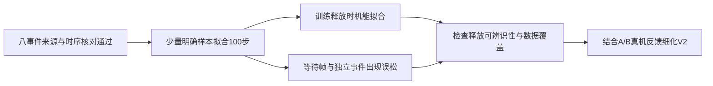

# 松手为何犹豫：监督链路与小样本拟合

**这次排查支持：学习链路能拟合明确的松手动作，但模型还没有学稳“何时该松”。** 八个真实释放事件未见错帧、夹爪反号或约一秒固定标签错位；100步小样本训练后，选定的训练释放观测全部达到时机容差。

**拟合成功没有变成可靠的释放判断。** 专家常在孔口静止等待一两秒，近似画面/状态却对应不同等待时长；小样本模型在这些帧和独立示教中更容易提前松手。因此不能只增加释放权重或训练步数，也不能据此认定DAgger本身有问题。

A1250／B1250已供用户真机对照；本页100步模型仅用于诊断，不部署。下一步结合现场结果，讨论V2中清晰连续的放入→释放→撤离示教、布局覆盖与独立验证；原始标签不自动改写，RTC和控制逻辑未修改。

## 核查了什么

训练四事件（两条V1、两条纠正）和原验证四事件，保持原split；审计各释放前后约2.5秒，共**1,143个观测起点、55,105个有效动作标签**。它们不是新的八次真机成功测试。

原始manifest和journal/payload索引哈希通过；每张输入JPEG与原payload实际字节一致，打包state与原观测逐值一致。所选输入是锚点前最近已可用整组观测；每个有效动作来自网格前最近已完成发布，submitted和夹爪转换逐项一致。八次释放都能定位真实人工右夹爪发布；没有用反馈回填标签。

下面的图片年龄是**接收到训练锚点**，不代表曝光年龄。相机header时钟仍未标定；该审计不能宣称曝光同步或传输延迟已全部解决。

## 精确时间对照

`h`从0计数。主图/右腕年龄取各自host_received；“目标不变”指松手前连续右臂submitted七关节目标差≤10⁻⁶度，且policy_epoch不变，不等同实物绝对静止。

| 集合 / 起点index | 首次张开标签h | 真发布距锚点ms | 发布到标签网格ms | 主图年龄ms | 右腕年龄ms | 松手前右臂目标不变s |
|---|---:|---:|---:|---:|---:|---:|
| train / 919 | 8 | 246.54 | 20.13 | 104.25 | 38.64 | 0.417 |
| train / 1772 | 7 | 218.28 | 15.05 | 39.96 | 5.14 | 1.987 |
| train / 13508 | 9 | 293.96 | 6.04 | 24.13 | 9.33 | 2.426 |
| train / 14393 | 7 | 217.92 | 15.42 | 46.22 | 10.14 | 1.607 |
| validation / 1361 | 8 | 260.77 | 5.90 | 45.11 | 39.80 | 1.611 |
| validation / 2364 | 8 | 236.31 | 30.36 | 100.79 | 26.78 | 2.684 |
| validation / 3132 | 8 | 247.60 | 19.07 | 22.79 | 23.58 | 1.104 |
| validation / 3722 | 8 | 254.01 | 12.65 | 82.53 | 42.25 | 2.065 |

例如train13508，锚点为`28703011100335 ns`，原观测1743在锚点前7.665ms已可用。右夹爪人工发布为`28703305058169 ns`，第9格标签为`28703311100335 ns`，只晚6.042ms；当前夹爪100，标签h0–8保持100、h9起为0。第9格选中的后续control正确沿用实际松手发布及其源时间，不是伪造一次新命令。

该事件发布后约33ms，收到ROS夹爪字段≤10；**字段变0不证明夹爪已物理全开、物体已落下或插入成功**。后续图片仍能看到手指和木块变化。绝对时间、原始control、state和逐帧来源见[审计JSON](../artifacts/20261023-release-chain/release-chain-audit.json)。

## 为什么怀疑静止等待影响触发

同一13508事件中，两条真实训练起点形成了下面的对照：

| 起点 | 相对真实松手发布 | 当前夹爪 | 未来监督 |
|---|---:|---:|---|
| train13456 | −2.027秒 | 100 | H50全程保持夹住 |
| train13513 | −0.027秒 | 100 | h0夹住，h1起松手 |

两者的**八个有效状态离散bin完全相同**，右臂实测最大差约0.0242度；当前ROI/resize后主图、右腕平均绝对RGB差约0.81、0.97（0–255量级）。1772和14393在松手前约1秒与发布前也有相同八个bin、极小关节变化和图像差。

这支持“输入缺少专家等待计时或触发判断”的假设：每次重看一个近似静止状态，都可能继续预测先等待。它也可能解释阶段加权为何同时带来更多松手和更早误松。但这些图片不是完全相同，平均像素差不是模型感知等价证明；**尚未证明它是闭环犹豫的唯一根因**。

这项发现不授权自动删等待帧、把两侧动作拼接或提前改松手标签。先区分必要的对准/接触等待与操作者停顿，再通过独立实验验证；当前原件和时间轴完整保留。

图中使用当前确定性处理的预览，无随机增强；左腕按模型合同不参与。释放前能看到持握木块接近孔口，释放后继续下落；单帧不能确定接触、插入深度或受力。验证事件见[同格式对照图](../artifacts/20261023-release-chain/validation-release-contact.png)。

## 对下一步实验的约束

少量样本拟合采用原train四事件及独立validation四事件；各集合16个基础观测，每事件两个持物、一个释放、一个松后，另留12个临近时序探针不参与拟合。基础持物样本通过状态bin差异降低近似输入冲突，但这并不保证视觉完全可辨；松后标签是ROS状态/发布代理，仍不是物理成功标签。

原诊断顺序是先看明确样本拟合，再看独立事件和静止等待探针；同时检查持物误松、EEF和mask，防止靠恒松手通过。100步已完成，结果如下，诊断模型不作为部署策略。

原始产物：[时序审计脚本](../artifacts/20261023-release-chain/audit_release_chain.py) · [可辨识性对照](../artifacts/20261023-release-chain/observability-comparisons.json) · [拟合冻结协议](../../training/artifacts/20261023-release-fit/dataset/protocol.json)。只审核了这些事件，不代表所有数据语义无误；新schema4导出/reader适配仍需独立完成。

## 100步拟合：会学选定标签，不等于会判断时机

从新DAgger1K权重开始，原统计与真实动作/time mask不变，关闭随机图像增强；使用新Adam、恒定LR=1e-5、global16、H20四卡4–7，共100次更新。四个训练事件各选两个有状态差异的持物观测、一个约7–9帧后释放的观测、一个松后观测；独立验证同构16窗。两个相邻持物观测不会变成两次独立示教。

以下数字为固定观测×3个相同噪声种子的离线预测；**每集合仅4个独立事件**。“准时”指首次完全张开预测距专家≤3帧（0.1秒），不是插入成功率。

| 检查 | 父1K | 拟合100步后 |
|---|---:|---:|
| 训练基础释放准时 | 2/12 | **12/12** |
| 训练明确持物H50误松 | 0/24 | 0/24 |
| 训练松后前16步再次闭合 | 0/12 | 0/12 |
| 同训练事件、未参加本次拟合的等待释放探针提前松 | 3/24 | **24/24** |
| 同训练事件、等待持物探针前16步误松 | 0/12 | **6/12** |
| 独立验证基础释放准时 | 0/12 | 9/12 |
| 独立验证明确持物前16步误松 | 0/24 | **12/24** |

基础拟合达到了事前规定的“至少10/12次准时、持物不误松、松后不再闭合”检查线。实际flow loss按10个有效动作维和真实时间前缀复算一致；改变padding与无效维后，有效loss差为0。未发现该面板上的loss/time mask错误，且夹爪监督能推动参数学会指定动作；这不能证明所有实现细节永无错误。

反例同样必须保留：未纳入小样本训练、专家需再等16或28帧的观测，模型却在第6–10帧松手，均值7.75帧。验证释放准时提升伴随持物误松，不满足可靠策略要求。按事件合并检查，训练4/4事件通过，而验证的持物＋释放＋松后仅1/4事件整体通过。基础释放点集中在约8帧，即使这组验证通过，也可能只学到“识别一种场景后固定短等”；不能宣称获得通用定时能力。静止近似帧的冲突、视觉/状态可辨识性和覆盖仍需分开研究。

固定噪声基础训练flow loss均值0.005666→0.002415，基础验证0.04462→0.11561，训练事件等待探针0.02187→0.18045。随机训练loss下降与这些结果并不矛盾：模型对选定小样本记得更准，同时对未选的近似输入/新事件变差；这是本次有意的小样本诊断，不能把该诊断的退化直接当正式DAgger训练的唯一根因。

## 当前决定

1. **不把这100步诊断权重接入真机，不自动续训或扩大释放权重。** 用户现场测试仍是A1250/B1250及父1K。
2. **保留原始等待数据与标签，不能自动删静止帧、压缩时间或提前写松手标签。** 新示教尽量让有效对准/放入→释放→撤离连续、清晰；需要真实调整时继续夹持，不能为了不等待而强行提早松手。
3. **V2的布局多样性值得补，但数量不是本次唯一结论。** 20条候选及验证集划分待结合现场反馈讨论；九条纠正与完整示教分别保留来源。验证集仍用于发现本次这样的“训练好、持物泛化差”，不因数据少而取消；新schema4导出仍需适配。

运行目录为H20 `/u01/user/runs/f1-toys-release-fit-20261023-r1`，冻结代码为`f1-toys-20261023-release-fit-r1`；模型核心与trainer沿用父release。完整流水线约7分33秒，100步训练计算累计约153秒；100步保存完成，前后336次生成预测及分维loss检查结束，流水线退出0，GPU4–7已释放。W&B：[小样本诊断](https://wandb.ai/robotics-example/f1_complexytoys/runs/f1releasefit20261023r1)，group=`06_LearningChain_Diagnostics`、job=`diagnostic`，已finished；最后日志99对应checkpoint100。

[前后评估与回执](../../training/artifacts/20261023-release-fit/final) · [事前检查线](../../training/artifacts/20261023-release-fit/decision-rules.json)。
