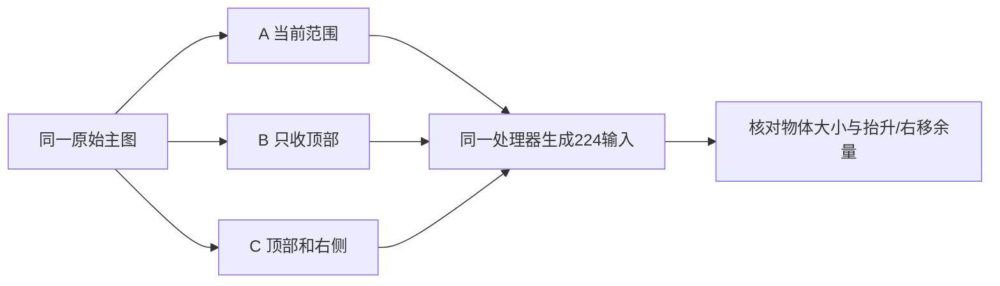

# 主图 ROI 对照：先保留当前范围

实际看过裁剪和模型输入后，建议首轮继续使用当前ROI。只收紧顶部会减少背景，却不会增加积木/孔位的像素；同时收紧右侧只有约6%的放大收益，却减少了右移余量。

这里同时展示普通抓取和边缘位置，避免只用一张好看的图片决定配方。两个候选没有替换生产配置，也没有改变原始录制或训练数据；图片对照不等于训练效果消融。



## 看图

- [抓住木块：裁剪画面与实际模型输入](revised/v1-crops-comparison.png)：上排为裁剪画面，下排为224×224输入的展示放大。
- [V1四个关键时刻](revised/v1-model-comparison.png)：约5.20、15.19、17.05、22.28秒，同图三候选。
- [V1右移位置](revised/v1-right-edge-comparison.png)：观察右侧余量；C开始切到右前臂外轮廓和电缆。
- [历史抬升位置](revised/history-top-edge-comparison.png)、[历史两时刻](revised/history-model-comparison.png)：B/C额外裁掉顶部腕相机机体及周围上下文，不能把这里一直当无关背景。
- V1全原录制均匀抽查：[第1页](revised/contact-00.png)、[第2页](revised/contact-01.png)、[第3页](revised/contact-02.png)、[第4页](revised/contact-03.png)。含原始录制的非监督阶段；不把这些帧都称作训练样本。

## 配比与结论

坐标均针对1280×720主图，顺序为`[x0,y0,x1,y1)`。归一化值由共享处理器按floor/ceil转换；三种方案均保持宽高比，不做随机增强，以便单独比较ROI。

| 候选 | 归一化框 | 实际像素框 | 224输出中的有效画面 | 相对物体线性尺度 |
|---|---|---|---|---|
| A 当前 | `[.24,.04,.96,1]` | `[307,28,1229,720)` | 224×168 | 1.000× |
| B 顶部 | `[.24,.12,.96,1]` | `[307,86,1229,720)` | 224×154 | 1.000× |
| C 顶部＋右侧 | `[.24,.12,.92,1]` | `[307,86,1178,720)` | 224×163 | 1.059× |

B的宽度仍是922，决定缩放倍率，所以没有放大物体；上下黑边从各28变为各35。C宽871，倍率增加约5.9%，但右边界从1229缩到1178。

本次V1原始行510（约17.05秒）比先前展示的普通抓取位置更靠右。C没有在该样例中裁掉整个夹爪或木块，但可用右侧余量变少；不能把裁掉前臂说成已经裁掉木块，也不能凭静态画面认定完全无损。

历史`f1_hil_20261013T073200Z_17800fe8`原始行450/540（约14.99/17.98秒）有更高抬升。B/C会比A额外裁掉腕相机机体/周围上下文，木块靠近上边界；本次没有证据宣称木块已被B裁掉。A在历史高抬升时也已接近上界，不是所有姿态的全覆盖保证。

**本轮判断：保留A作为训练/推理共享基线。** B可以作为固定低抬升场景的背景裁切候选，但未证明值得替换；C的轻微放大暂不足以交换工作范围余量。若未来改变相机位姿、物体分布或任务动作范围，需要重新检查，不以本次抽样包办未来覆盖。

## 来源和复现

日期：2026-10-16，北京时间。V1全段均匀取样并补充关键位置，共36个原始时刻；另取2个历史抬升时刻。原始pack按offset读取，逐帧校验payload SHA。A/B/C都调用现有`process_image()`，只在进程内复制配置并改变ROI；生产配置和处理器哈希前后相同。

[manifest](revised/manifest.json)保存原件身份、帧号、时间、候选配置、实际尺寸、代码身份和PNG哈希；[pixels](revised/pixels/)保留精确裁剪和224像素图。时间相对该原件第一组available时间，不等于先前按训练anchor起点标注的时间。三路中的左右腕图保持不变，此次只比较主图。

推荐查看`revised/`：仅缩短了抽查图的列标题，解决文字重叠；ROI和真实像素不变，首版产物保留在本目录。

生成脚本：[compare_roi_candidates.py](../../scripts/compare_roi_candidates.py)。6000D系统Pillow过旧，首次CPU调用在`Image.Resampling`处失败；只清理该次新建的不完整预览，随后复用已有DM镜像成功，无包安装、网络或GPU使用。

在**6000D Bash**、Projects根目录复现到新输出目录，图片和`manifest.json`即结果记录：

```bash
cd /home/user/projects
sg docker -c 'docker run --rm --network none --user 1006:1008 \
  -e USER=user -e PYTHONDONTWRITEBYTECODE=1 \
  -v /home/user/projects:/home/user/projects:ro \
  -v /home/user/projects/tasks/F1_ComplexyToys/DataPrehandle/visualizations:/home/user/projects/tasks/F1_ComplexyToys/DataPrehandle/visualizations:rw \
  -v /usr/share/fonts:/usr/share/fonts:ro \
  --entrypoint /opt/conda/envs/opendm/bin/python opendm:g2-34d-fa2 \
  /home/user/projects/tasks/F1_ComplexyToys/DataPrehandle/scripts/compare_roi_candidates.py \
  --output /home/user/projects/tasks/F1_ComplexyToys/DataPrehandle/visualizations/20261016-roi-reproduction-01'
```

脚本拒绝覆盖已有输出。机器变化时核对UID/GID、现有镜像、源数据和字体；不为预览修改生产处理器。
