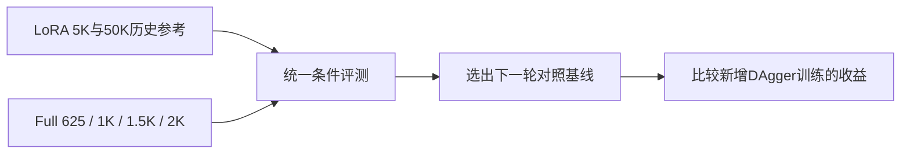

<!-- doc_type: experiment_register; updated: 2026-10-22 -->

# F1模型实验表：历史基线与下一轮Full选模

**四个旧Full本轮已复测：15次真实会话、13条文字反馈，仍没有合格全流程冠军。** 孔口停滞、释放时机及危险回位未随步数稳定改善；旧Full1K保留为工作基线，LoRA 5K／50K仅作历史参考。原文、逐条日志和归因边界见[本轮复盘](V1fullSFT/README.md)。

**新V1＋DAgger四版已替换旧Full服务并各跑一条无辅助真机，均未完成任务。** 250发生28次IK拒绝；500／1K停滞；625错位释放。暂不选冠军或自动续训，见[新模型复盘](V1_DAgger/README.md)；资源与部署只看STATUS。

本页只维护实验定位与保留口径；现场命令仍见[STARTUP](../inference/STARTUP.md)，当前状态见[STATUS](../STATUS.md)。历史部署回放属于工程验收，不能代替下面的任务结果。

## 目前有哪些候选

| 模型 | 已有证据 | 下一步定位 | 当前服务 |
|---|---|---|---|
| LoRA 5K | 用户评价较好；旧19条比较中的5K有12条不同条件会话，精对齐与泛化仍有限 | **必须保留的history checkpoint** | 已暂停 |
| LoRA 50K | 用户评价较好；IK恢复专项有两次用户确认任务成功，配置与旧5K/Full不同 | 保留历史参考包及恢复实验记录，不直接与不同配置排成功率 | 已暂停，包含IK研究服务 |
| Full 625 | 本日5次日志/4条反馈：插入后不松或孔口停滞 | 插入阶段参考，非完整任务冠军 | 旧服务已停止，权重保留 |
| Full 1K | 本日3次日志/3条反馈：停滞或提前松手，回位撞桌 | 继续作旧模型工作基线 | 旧服务已停止，权重保留 |
| Full 1.5K | 本日4次日志/3条反馈：停滞、提前释放、低位回程与第二块偏差 | 未显示稳定改善 | 旧服务已停止，权重保留 |
| Full 2K | 本日3次日志/3条反馈：均为孔口微调停滞 | 不以步数更多优先选择 | 旧服务已停止，权重保留 |
| 新V1＋DAgger Full | 单臂输入、75∶25混采，已到1K；250/500/625/1K包齐全 | 四次首轮均未完成；优先模型／RTC及阶段监督诊断 | 四版已部署，实时核对STATUS |

历史证据：[LoRA现场分析](V1_20261019_ANALYSIS.md)、[50K与IK恢复](README.md#2026-10-21-软件恢复候选与验收边界)、[Full现场分析](V1_FullSFT_20261021_ANALYSIS.md)。旧记录不填入下面新实验的分母。

## 本轮实测记录与下一轮对照

本轮没有严格逐条阶段标签，因此不伪造成功率。下表分别记录现场笔记与日志事实；无法匹配的会话保留未知，不补写用户未观察到的结果。

| 候选 | 实际会话 | 现场文字反馈 | 抓后持续重新张开（非正确释放率） | 现场主要缺口 |
|---|---:|---:|---:|---|
| Full 625 | 5 | 4 | 0/5 | 插入后不松、倾斜/孔口微调 |
| Full 1K | 3 | 3 | 1/3 | 未插入停滞或提前释放，回位撞桌 |
| Full 1.5K | 4 | 3 | 1/4 | 孔口微调、提前释放、低位回位，第二块偏差 |
| Full 2K | 3 | 3 | 0/3 | 孔口微调，不继续插入 |

13条文字反馈没有报告一次无辅助全流程完成；15条日志不能独立确认插入或碰撞，不能写成0/15成功率。持续张开的审计定义、时间与源哈希见[本轮完整报告](V1fullSFT/README.md)。

首轮新DAgger四次结果已收录到[独立报告](V1_DAgger/README.md)，当前优先定位失败，不再要求反复测试250。后续正式对照应轮换顺序、统一硬件／物体／桶位置、起始Home及测试时限；左夹爪硬件／画面已变化，旧模型历史成绩不能直接作同条件对照。有稳定完整成功后，再单独比较XY变化。
记录约定：各阶段填成功次数／实际测试次数；抓取失败后的未到达阶段单独标记，不伪装为成功。完整成功要求不挪桶、不手动扶物、不HIL代操作，并完成插入、释放、安全撤离、回位后真实停稳至少2秒。辅助后的阶段进展可记录，但不计无辅助完整成功。另存会话ID、模型/bundle身份、RTC及恢复参数、耗时、IK恢复事件与是否提前终止。

选模优先看无辅助完整成功，其次看人工协助、安全撤离/回位和重复失败模式；不按最低训练loss或最少IK拒绝直接选冠军。若全部未完成完整任务，就明确仍无合格冠军，根据阶段表现选择“工作基线”，继续纠正对应缺口。LoRA与Full的历史配置不同，不用于单独归因Full微调优劣。

## checkpoint保留口径

“训练断点”就是checkpoint目录，但它通常比纯模型权重大：除模型参数，还保存优化器、学习率进度、随机数和数据游标，以便原地续训。已导出的推理包只保留运行模型必需的权重、配置、归一化、tokenizer和身份资料，不能替代完整续训状态。

| 对象 | 建议 | 当前操作 |
|---|---|---|
| LoRA 5K推理包＋完整训练断点＋配方/冻结代码/评测记录 | **保留为history**，同时保留推理和续训能力 | 已登记保留，未移动或删除 |
| LoRA 50K完整训练断点、推理包及匹配配置/恢复记录 | 保留最终恢复点和历史对照；不常驻GPU | 已暂停服务，权重保留 |
| 其余旧LoRA中间断点与重复推理包 | 10月22日用户授权清理H20中间断点；推理包另外盘点 | 已删除H20的98个中间断点，释放2.424TiB；6000D另删16个旧包，释放200.014GiB；H20推理包保留 |
| Full 625／1K／1.5K／2K及新DAgger训练 | 本轮选模所需，保留 | 未删 |

清理前H20旧LoRA全系列训练断点约2.5TiB；10月22日按授权删除98个，仅保留5K／50K，现约50.65GiB。单个5K完整断点约25.33GiB，包含一份约13.50GB的`full_weights.pt`以及分布式训练状态文件；5K合并推理包约13GiB。保留这一历史版本不需要保留全部100个中间断点。H20清理后约25TiB空闲。

5K权威位置均位于H20：

- 推理包：`/u01/user/runs/f1-toys-v1-formal-20261016-r3/bundle-5000`。
- 完整断点：同run下`train/v1_formal_eef_lora/checkpoints/global_step_5000`。
- 模型ID：`f1-toys-eef-ff1263050a8b6846`；匹配冻结核心：`/home/user/projects/task-releases/f1-toys-20261016-v1-formal-r3/RLinf`。
- bundle内的`bundle.json`保留权重/统计/合同等文件哈希；删除其他版本不能连带删除共享模型base、冻结核心或原始数据。

## 服务暂停证据

2026-10-22北京时间10:28左右，H20四个已核对RTC服务收到SIGTERM后退出，GPU0–3归零；6000D六个F1推理容器停止，容器/权重/日志仍保留。H20 GPU4–7训练进程继续运行。本次没有修改机器人驱动、原始数据或训练配方，也没有启动真机动作。

暂停回执集中在[本轮产物](artifacts/20261022-checkpoint-register/)。随后用户授权同时部署四个Full：已恢复625／1K／1.5K并新增2K，LoRA50K IK研究服务仍暂停；其H20 8160端口改用于Full2K，统一入口只登记四个Full，历史入口因身份校验不会误用新模型。部署验收见[本轮回执目录](../artifacts/20261022-full-four-h20/)。

## 6000D空间盘点与导出关系（2026-10-22）

可明确计入本人HOME的占用约380GiB，占整盘已用约3.2TiB的12%；其中Projects约369GiB，F1积木产物约268GiB。Docker为共享存储，镜像层与构建缓存也可能共享，不按Docker总数全归本人，不能简单相加。这是清理前快照；本轮6000D清理后约281GiB可用。

优先清理候选为：旧V1 LoRA推理包除5K外的13份约162.5GiB；早期单条LoRA 250／1000及关节smoke推理包三份约37.5GiB，合计约200GiB。清单见[6000D候选](artifacts/20261022-checkpoint-register/6000d-cleanup-candidates.json)，本轮已按这份精确清单删除16个目录，实际释放200.014GiB；小型JSON元数据另行归档，见[清理回执](artifacts/20261022-checkpoint-register/6000d-cleanup-receipt.json)。保留5K、Full与新DAgger产物、原始录制、评测日志以及共享base/环境。

训练checkpoint每500步保存一次，共100份（500到50000）。它包含矩阵、向量等权重张量，以及优化器/随机数/数据进度；没有必要把它理解成100份新数据集。推理包来自这些checkpoint的确定性导出：Full直接提取模型权重，LoRA将增量合并到基础权重，再附上匹配配置、归一化、tokenizer与身份哈希。它不是通过一次新的训练或动作推理“推算”出来的，也不是量化压缩。已导出的独立推理包保留后，删除对应训练断点不会改变包内参数，但失去从该步原状态续训的能力。

H20清理已完成：保留5K／50K完整断点及全部推理包，保留包和checkpoint在删除前逐文件哈希通过；98个中间断点释放2.4239TiB，清理时新DAgger训练推进至222步（历史快照；现已完成1K）。详细[清理回执](artifacts/20261022-checkpoint-register/h20-checkpoint-cleanup-receipt.json)包含删除清单、大小和保留哈希。6000D这16个候选现已删除，LoRA5K保留。
