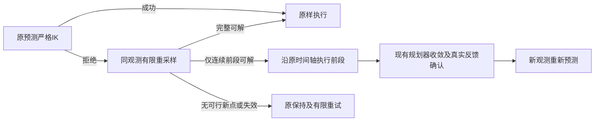
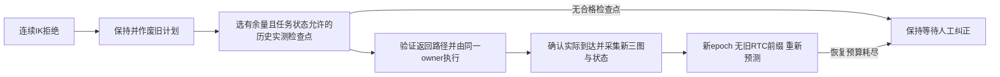

# F1积木真机评估：先看结论

**2026-10-22新DAgger四版各一条无辅助真机，均未完成任务。** 优先看[DAgger首轮复盘](V1_DAgger/README.md)：250拒绝前已走向边界，500／1K孔口停滞，625错位松手；下调250优先级，不用低loss选冠军。旧Full的15次会话／13条反馈保留在[旧Full复盘](V1fullSFT/README.md)，不混入新模型分母。

[模型实验表](CHECKPOINT_COMPARISON.md)保留版本定位；当前资源以任务STATUS为准，下方为历史诊断，不能代替本日评测。

旧V1现场记录支持5K作为后续对照基线：能完成部分抓取与接近，但插入精度、稳定抓持和摆放变化仍有明显缺口。实际会话数与逐阶段结果以日志和画面为准；现场笔记不要求你逐条补齐，也不能把请求成功率当任务成功率。

Full最新1K经人工挪桶协助后释放，却靠近Home后继续走偏。释放阶段396次对照未发现RTC直接压住松手；新增回位48次对照则显示模型自身不收敛、RTC后段放大偏离。以1K暂作采集基线，纠正与小范围完整示教并行；详见[Full孔口、释放与回位分析](V1_FullSFT_20261021_ANALYSIS.md)、[DAgger准备](../DataPrehandle/DAgger_V1_PLAN.md)。当前部署看[STATUS](../STATUS.md)，命令看[STARTUP](../inference/STARTUP.md)。

IK专项属于另一条证据线：用户确认暂时拿不到整机范围/驱动源码，先推进原限位下的软件恢复。两次现场运行已由用户确认任务成功，重采样分别救回12/4个首次IK拒绝请求；可行前段后的自动接续仍卡在停止/到位确认，不能称整体恢复已解决。见下方专项最新一节。

2026-10-22存储清理：LoRA5K原始评测保留；用户授权删除其余45条旧LoRA（含50K 17条）及36条shadow。既有报告/统计保留，被删原件的链接无法再用于完整重放；逐条范围见[删除清单](../artifacts/20261022-rollout-cleanup/authorized-plan.json)。模型权重未删除。


- [D14/S16首次真机时序验证](../inference/experiments/20261019-rtc.md#2026-10-20-d14s16首次真机延迟验收)：正常接续222/255ms、实际重规划533ms，零RTC超时，后续推荐性能基线。
- [D14/S20首次真机时序验证](../inference/experiments/20261019-rtc.md#2026-10-20-d14s20首次真机延迟验收)：实际新后缀参与发布提前约200ms，零RTC超时；14/16后续结果见上条。
- [V1现场记录与19条会话](V1_20261019_ROLLOUTS.md)：用户反馈、实际数量、逐条画面核对；未确认结果保留未知。
- [V1分析与下一步](V1_20261019_ANALYSIS.md)：拒绝类型、抓持/插入/复位、延迟干扰与建议。
- [原始快照及可复算结果](artifacts/20261019-v1/)：客户端journal、服务端请求、图像及哈希、统计脚本。
- [当前任务状态](../STATUS.md)、[当前推理配方](../INFERENCE_RECIPE.md)。评估记录不另造一套运行配方。

## 统计约定

一条会话指一次现场启动并授权的运行，可能包含IK重试、暂停和恢复，不等于一次独立抓取尝试。只有客户端绑定为powered、存在实际ROS控制发布记录的完整会话进入本轮数量统计；ROS发布不等于下位受理或实物任务成功。

后续分别记录抓住并抬起、稳定抓持、接近正确孔口、插入并释放、末端安全撤离和复位。仅抓起、停在孔上方、IK通过、夹爪闭合都不能自动记为完整任务成功。统一使用北京时间，原始目录继续保留UTC命名。

<details markdown="1">
<summary>按需展开：IK执行容错研究、数值结果与完整证据</summary>

以下为2026-10-20至21的专项记录；旧推荐保留原证据，但以页首撤回说明和后续复核为准。它们不是当前运行配置。

## 2026-10-21 软件恢复候选与验收边界

用户已明确暂时没有F1-09电机驱动源码或厂家确认范围，先推进软件恢复。新候选保留原限位、严格IK容差和现有输出规划器；正常成功路径不重采样。仅在IK拒绝时，使用同一观测最多追加3次模型预测，优先取完整严格可解窗口；仍无完整解时，客户端可以执行一个候选的连续有效前段。这里**选择了另一个模型输出**，但不对所选输出做位置、朝向或夹爪后处理。

前段结束后持续提交其原终点，让已有有界Ruckig自然收敛；同一owner的实际零速度/加速度发布证据与新鲜反馈满足原到位容差后，才进入既有保持、新epoch和新观测重试。部分前进不重置原3次恢复计数，不倒放历史动作，也不伪造planner停止。独立候选默认不接入旧入口；后续现场已确认重采样被使用，前段自动接续仍未通过，详见本节末的现场补证。



| 验收 | 本轮事实 | 不能推出什么 |
|---|---|---|
| 原限位重解 | 原49失败输出加最多3个固定seed新候选，16完整窗＋33非零前段；833个候选共11,520点独立FK通过 | 无时间预算的候选存在性，不是49次任务成功 |
| seed变化 | 4组各4个连续seed，完整窗分别32/23/13/34；非零下一段分别49/43/49/49 | 不是独立随机试验或闭环成功率，不能声称所有噪声都覆盖49窗 |
| 客户端合同 | 517个真实非完整非零候选全部被正确重建，关节/夹爪/EEF/已承诺前缀逐位一致；90个guided迟到边界正确拒绝 | 接收时间和身份为明确的测试fixture，不是实际网络期限验收 |
| 真实50K wrapper | 预热两分支后49窗得到32完整＋17非零前段；本地服务计算P50/P95/max=317.1/444.2/503.9ms，5次超预算末候选正确丢弃 | 400ms是候选采纳预算，不能取消在途计算或保证RPC硬上限；未含网络和机器人 |
| ARM规划器 | 原限位真实Ruckig，45/45数值案例自然停止；主案例尾端收敛最大0.871秒，原3秒上限内 | 主案例初始v/a为0；没有ROS发布或真实反馈，不是机械停止验收 |
| 独立代码 | 客户端59项、服务wrapper12项局部测试通过；F1包inspect通过、hardware_initialized=false | 未证明现场后续观测会让模型回正或完成插孔 |
| r2真实相机shadow | 20秒、30请求、598观测，零控制发布/RTC超时；journal确认恢复ControlLoop启用 | 静止场景未触发部分恢复，停止及后续推进仍待现场 |

证据：[严格重解与seed检查](artifacts/20261021-ik-recovery-next/strict-candidates/summary.json)、[seed分组](artifacts/20261021-ik-recovery-next/strict-candidates/seed-block-check.json)、[客户端真实候选合同](artifacts/20261021-ik-recovery-next/client-proposal-contract/summary.json)、[ARM数值汇总](artifacts/20261021-ik-recovery-next/arm-prefix-numerics/results/summary.json)、[server验收](artifacts/20261021-ik-recovery-next/server-wrapper/validation.json)。所有原始输入、输出、来源哈希保留在同一日期目录。

真实GPU证据：[暖态49窗](artifacts/20261021-ik-recovery-next/actual-wrapper-warm-gpu49/summary.json)、[同进程缓存配对](artifacts/20261021-ik-recovery-next/actual-wrapper-cache-pair/)。原成功控制原tuple及输出不变；两个拒绝案例共8个seed，与同进程无cache前/后复测的raw、EEF、关节逐位一致。本轮冷/暖两进程同seed48窗一致，但与较早guided16跨进程结果不逐位一致，差异未归因，不混算为同一配对实验。首次只预热guided导致bootstrap出现19.75秒冷启动，已保留在cold记录；服务交付必须预热两分支并做真实相机shadow。

独立候选已放在H20 GPU2/8160与F1 r2目录；Full625/1K服务身份仍保持。用户明确批准仅为既有专用受限钥匙增加回环8160，变更有备份及逐字保留其他限制的校验。首轮shadow发现入口只改`cli.ControlLoop`，而`cli.main`局部导入覆盖了它，故没有实际启用新循环；修正为绑定`runtime.ControlLoop`，新增入口测试，保留r1证据后在新r2目录重做验收。r2请求总耗时P50/P95/max为229.3/256.9/404.8ms（含首个bootstrap），不是失败重采样的延迟估计。见[交付回执](artifacts/20261021-ik-recovery-next/deployment/acceptance.json)及[唯一现场命令](../inference/STARTUP.md#旧50k软件恢复独立候选2026-10-21)。

以下旧时序结论已被更严格检查修正：原“14/49立即重规划机会”漏计RTC的D≤S条件；按400ms推理、33ms新帧与2 tick余量，D20仅2窗、D14仅5窗有时间机会。因此本轮采用“前进→规划器自然停止→新观测”，不依赖在短前段耗尽前获得下一次模型结果。有限重采样不能解决所有几何问题：59/60/61三个历史窗口在64个seed中仍无完整解。有效前段可能很短，也可能包含真实预测的开合爪变化；没有冻结夹爪，接触与阶段收益必须现场确认。

扩限证据仍保留：原失败后J2−97°候选40/49完整K42通过，并沿各自关节解继续到H50，40/40尾段通过；297原成功路径保持。驱动−94°固定裁剪、缺失匹配源码和未绑定F1-09的±120°材料仍是实际阻碍。`setJointLimitA/B`参数是速度/加速度比例，不是可用位置扩限接口；本轮不修改驱动或限位。见[连续性复核](artifacts/20261021-ik-recovery-next/sequence/summary.json)、[驱动查证](artifacts/20261021-ik-recovery-next/driver/findings.json)。

### 13:07与13:08现场补证：重采样有效，停止确认尚未通过

用户报告这两次积木任务均成功，之后出现界面所称“RTC响应超时”。客户端与服务器逐请求关联确认：两次均为原50K权重、r2候选、现场新三图/state的在线推理，没有回放历史失败动作，也没有扩限或EEF投影。前面的13:05另有一条15秒短试跑，22个请求无拒绝，不与用户所说的两次长会话混算。

| 现场会话（北京时间） | 已核对请求 | 首次预测IK拒绝 | 重采样后完整可解且客户端采纳 | 仍拒绝 | 执行可行前段 / 停止确认通过 |
|---|---:|---:|---:|---:|---:|
| 13:07，4ffb474b | 62 | 17 | 12 | 5 | 3 / 0 |
| 13:08，a79c99a1 | 62 | 7 | 4 | 3 | 2 / 0 |

这16个完整窗口的改善来自同一现场请求中“首次失败→选中新采样成功”的直接记录；它不是任务成功率，也不能反推旧控制器的完整反事实任务一定失败。两次任务成功目前依据用户现场反馈；尚未通过逐帧画面独立判定成功时刻。最新会话采集时仍处保持状态，因此该会话journal保存为运行中只读快照。

**5次暂停全部是`prefix_recovery_stop_timeout`，没有`inference_deadline`。** 新恢复沿用了基类统一的“RTC响应超时或计划耗尽”提示，文案误导了故障类别。两条长会话的5个可行前段，规划器日志均在尾端后约0.32–0.46秒出现`remaining_s=0`，提交值最终与目标差小于0.0001°；但每个尾端等待窗口都没有一帧满足右臂全部关节≤1°的原到位条件。

主要阻断是J6实测跟随差：第一条3个终点目标为56.976°/57.606°/58.616°，实测均约54.926–54.927°；第二条目标58.155°/57.327°，实测约54.864°/54.871°。等待窗有连续新鲜反馈（最大age约20–24ms），不能归为重复读取旧反馈。日志未保存stop_probe完整中间判定或下位受理目标，因此目前只能确认真实到位条件未满足，不能断言驱动截断或机械硬限位，也不能声称其余停止证据逐项通过。

`--continuous`尚无任务成功自动结束判定，用户观察到积木放好后仍继续预测；后续恢复暂停不等于前面的插入失败。本次不修改1°门槛或线上控制。下一步应区分响应超时与停止确认提示，并处理J6跟随差下如何明确保持、从实测状态恢复及任务完成后的收尾；不能仅靠延长网络超时解决。

证据：[现场请求关联](artifacts/20261021-ik-recovery-onsite/live-recovery-analysis.json)、[五段停止门槛分析](artifacts/20261021-ik-recovery-onsite/stop-timeout-analysis.json)。原始server、完整journal和运行中journal快照均在同目录，带来源哈希；没有发送机器人命令或更改在线版本。

### Full1.5K新增16次拒绝：同类边界问题，恢复是框架能力

13:47会话`f1_hil_20261021T054754Z_e11beff0`已与实际Full1500服务逐请求对齐：196请求中180成功、16拒绝，约95.14秒首次进入拒绝恢复；该入口没有启用新版重采样/可行前段恢复。16次失败的候选均同时贴J2 −94°和腕部组合限位，位置残差0.0131–1.4166mm。对应请求J6实测48.015–49.467°，提交—反馈差最大0.174°，因此属于旧50K相似的边界型IK拒绝，不能混同此前约55°的J6跟随平台。局部求解失败仍不是全局不可达证明。

对这16个完整原始预测和其已承诺前缀进行了新对照：

| 路线 | 本轮结果 | 边界 |
|---|---|---|
| 原限位、原EEF，6组局部参考构型 | 0/16完整窗口通过 | 只是否定本组局部换解，不否定所有冗余路径 |
| 原EEF，仅离线J2下限−95° | 16/16完整窗口通过，所选J2最低−94.927°；−96/−97°亦16/16 | 原腕部组合约束和严格FK门槛保持；驱动仍−94°，没有部署扩限或验证碰撞/跟随 |
| 同一历史三图/state/前缀，原限位追加3次Full1500预测 | 48次真实模型调用，救回6/16完整窗口；另8个有可行前段，2个仍无可行新点 | 使用原模型的新采样，不是原首次噪声复现；未测缓存wrapper的400ms预算，非闭环任务成功 |

因此重采样值得保留，但不能单独覆盖这批边界问题。扩限对新模型也有数值价值，仍缺整机/驱动依据；软件下一步重点是可行前段之后的真实保持与重规划。来源：[逐窗口IK对照](artifacts/20261021-full1500-feedback/ik-comparison/summary.json)、[Full1500重采样](artifacts/20261021-full1500-feedback/resampling/summary.json)；同目录保留完整候选、原始journal、服务快照和首次环境依赖失败日志。没有改变Full模型、服务、限位或默认入口。

### r3：明确放弃未到位目标，确认实测保持后再预测

r2把“原终点到位”作为继续条件，实际J6平台会使恢复等待失败。r3新增显式恢复分支：原命令轨迹必须先自然达到零速度/加速度且有同owner实际发布、新鲜反馈；原目标仍未到位时，记录**原目标未完成**，走已有`hold_measured_right`，作废旧epoch。实际HOLD发布后，还需其证书和更新反馈满足原1°到位条件，才取新观测重新预测。它不把原EEF改成另一个EEF后谎称完成；这是单独标记的保持动作，原模型剩余轨迹被放弃。原重试计数继续累计，保持确认失败仍暂停。

基础引擎默认关闭该分支；独立r3入口显式启用。停止失败文案不再统称RTC响应超时，journal增加逐轴目标/实测差、反馈新鲜度、发布/证书阻断诊断。原限位、腕组合约束、1°到位门槛、3秒等待与原3次重试上限未改。

本轮79项客户端回归通过；F1上用真实有界规划器和F1Owner验证五个历史目标/反馈快照，5/5可产生自然命令停止及后续实测保持证据。**该数值检查使用假传输、冻结反馈、模拟时钟和碰撞stub，不是真机跟随或碰撞验收。** 独立r3随后20秒真实相机shadow完成30请求、601观测、4564条shadow控制记录，零发布/IK拒绝/RTC暂停；功能启用已从journal核对。尚未现场验证J6平台后的自动接续或任务完成。见[候选验收与限制](artifacts/20261021-ik-recovery-onsite/tracking-hold-prototype/acceptance.json)、[ARM保持证据](artifacts/20261021-ik-recovery-onsite/tracking-hold-prototype/owner-result.json)。

恢复算法没有checkpoint分支；服务wrapper接受任意合规Policy，客户端按恢复模式选择同一状态机。此前只部署50K的隔离候选，却未统一入口和能力标识，容易误认为Full也已使用。现在统一入口把`--model`和`--recovery`分开，启动时核对实际模型与server能力并打印；不支持的组合明确拒绝，不静默降级。当前已登记50K/ik和Full625/1000/1500/standard，**Full尚未部署新恢复**；迁入仍须核验各自RTC时序，而无需为每个ckpt重写算法。10项能力校验通过，实际50K/ik与Full1500/standard只读health核对通过。操作只看[统一现场入口](../inference/STARTUP.md)。

## 2026-10-20 执行层容错目标（最新用户决策）

用户明确本轮以模型存在一定输出误差为前提，主要目标是让推理继续并给后续纠偏机会，DAgger人工接管属于配套能力，不是本轮首要修复。成功示教证明任务存在可行路径；不要求模型逐点复制示教，也不把改进模型作为执行层容错研究的前置条件。此前优先开发固定方向“最小朝向修正”的建议被此方向替代，固定朝向扰动仅作敏感性诊断保留。用户随后要求各方向对照并新增回退历史chunk后重新预测，实测结果见下一节。

分开评估以下两条改进，避免把“IK通过”当作“任务完成”：

1. **合理扩大可执行范围，保留原模型EEF目标。** 首选查证J2下限−94°→−95°/−96°/−97°，既有离线完整窗口分别通过23/49、36/49、40/49。驱动的−94°目前为二进制固定值，单改上层IK不足以获得实际执行能力；需要确认F1-09集成范围及对应驱动实现，再统一驱动、手柄、策略IK与执行校验。以上角度是离线研究候选，尚未获得真机可用结论。
2. **拒绝后的继续与纠正。** 现有独立策略已保持新鲜反馈、最多额外3次新观测重试、耗尽同会话暂停/Enter恢复；这不是新方案，也不是手柄接管。独立RTC继承的`StandalonePolicyEngine.operator()`明确拒绝operator包。下一步需核查并设计该策略与已有HIL人工接管/交还的衔接，保持同会话记录、单一输出owner、旧epoch作废，并区分原模型proposal、实际submitted和human纠正标签。仅按Enter原地重试不能代替DAgger纠正。

“执行可行前段、在不可行点前重新规划”可独立研究，但目前RTC要求轨迹覆盖下一次推理延迟，不能直接截短回复或越过失败点拼接。候选需验证可用前段的时间余量、停止/接管过渡和已提交前缀；覆盖不足时进入可接管保持。位姿残差容差属于另一项近似执行实验，意味着实际EEF可以偏离原目标，必须单独报告偏差，不能写成保持完整位姿不变。

验收以固定模型和现场布置分别比较：原拒绝数、连续执行与后续回正、人工接管/交还及完整任务成功，保留实际反馈与跟随差。既有49个历史拒绝请求只用于离线候选筛选，不能推算闭环成功率；现有6个超几何伸展目标也不能仅靠J2扩限解决。本节最初只核对源码并更新研究决策；随后已新增下节离线工具，线上控制代码、驱动、限位和容差仍未改。

## 2026-10-21 独立审查与优先级

按用户要求派生四个独立审查分支：扩限、保持完整EEF的关节路径、恢复调度与真实回退、投影代价。共比较五条路线，仍使用旧50K六次会话的346个请求（49拒绝、297成功）。新增结果是CPU离线数值验证或日志时序筛查，不是当前Full模型验证，没有机器人动作、模型/GPU调用或生产修改。49是请求窗口，不能把通过数换成任务成功率。

| 路线 | 独立审查结果 | 优先级与实际缺口 |
|---|---|---|
| 原IK失败后小幅扩限 | J2−97°仍通过40/49；297原成功窗保持原关节解；完整EEF与原容差不变 | 最强数值候选；先确认整机范围及匹配驱动，不能直接上线−97° |
| 可行前段＋立即重规划 | 假设下一次总延迟400ms并留2 tick，14/49有时间机会，其中6接续、8 bootstrap | 不依赖扩限的软件原型优先；不是14窗已恢复，须验证新观测预测和停止/接续 |
| 真实回退后重预测 | 三次首次拒绝前5秒，只有一条找到达到诊断余量的快照；10秒内也有一条没有 | 合理的第二层恢复；需要连续实测路径及任务状态，不能固定倒放几个chunk |
| 保持EEF换关节构型 | 三次首次拒绝均找到覆盖42点的其他分支，共8个；接回原前缀最小观测跳变约189°/191°/55° | 中期研究提前选择构型；这些远处分支不能直接作为拒绝时的替换动作 |
| 有界可达投影 | 2mm/2°通过43/49，但通过窗47%的未提交点偏离原严格EEF，最长连续42点 | 保留为明确允许任务误差后的实验；不能仅凭43大于40列为首选 |

### 扩限应作为失败后的候选，而不是全程扩大优化范围

独立重跑全部297个原成功窗口发现：全局把J2下限设为−97°虽然都通过，却有76窗改变关节路径，41窗差值超过1°，6窗超过5°，最大7.063°。因此更合适的算法是先按原范围求完整所需窗口；成功即返回原解；失败则丢弃临时后缀，从**同一不可变已提交前缀**重新求整个未提交后缀，只使用已获整机确认的扩展范围。绝不改位置、朝向或夹爪proposal，也不把先前失败求解的临时点拼入结果。

新增FastArmModel配对实验实现了这一离线选择逻辑：49窗严格拒绝、40窗扩限通过；297成功对照只走严格分支，最大关节差4.83e−13°。参考ArmModel FK验证通过窗保持原0.01mm/0.001°门槛。49失败窗两段IK总耗时P50/P95/max为37.24/71.10/85.08ms；这是6000D单线程低优先级CPU单轮解码，不含模型、网络及独立核验，也没有线上硬耗时上限。逐窗仍从历史原前缀重置，不能称为候选自身前缀的连续闭环。

−95°/−96°/−97°分别通过23/36/40窗；−120°仍为40窗，没有支持大幅扩限的增益。腕耦合单独放到112.5°为36窗，联合J2−96°为42窗；J6上限加2°仅2窗且跟随平台仍未解释，优先级低于J2单变量。J2−97°剩余9窗中6窗违反冻结几何的伸展上界，另3窗受腕/J6约束，不能用单一J2扩限包办。

驱动只读证据仍是固定−94°裁剪，尚未找到匹配源码或已验证的运行时限位参数。机械臂名义范围不能代替F1整机安装、线缆和碰撞范围的确认。下一步先取得该整机−94°来源和匹配驱动实现；通过后统一底层、手柄、IK与执行校验的真实范围。现场前还需携带候选自身前缀检查连续性、速度/加速度、跟随及当前RTC总时序。

### 提前重规划与真实回退是两个不同机制

按日志逐事件核对13段拒绝：6段无Enter的自动重试后出现可行请求，5段Enter恢复和重试后出现可行请求，2段结束仍拒绝。实际后继均已使用hold之后的新观测、清旧前缀和新epoch；11段恢复中6段只成功一个请求又拒绝。故“清旧chunk再预测”已经存在，不能重新包装成新功能，也不能把11/13称为任务恢复率。

原“可行前段0/49”只是否定D20/S20固定调度下直接截短。改为部分结果一到就重新请求，按真实回复时间估算剩余有效时间：`(plan_origin_ns−reply_ns)/1e6 + (valid_total−1)×1000/30`，并留2 tick；下一次总延迟假设300/400/467ms时，分别19/14/13窗满足时间必要条件。旧请求最大延迟448.9ms，400ms不是最坏保证；当前Full D14/S16也不是本次历史输入。必须另验协议、部分窗口停靠、前缀衔接和下一次真实模型输出，不能宣称这些窗口已获救。

用户提出的真实回退可以改变重试起点，值得保留。按J2余量≥1°、腕余量≥3°且未观察到夹爪跨半程筛查（仅诊断线，不是安全阈值），三次首次失败前2/5/10秒的候选数量分别为0/0/2、0/1/8、0/0/0。第一条至少回看5.35秒、第二条4.67秒出现候选；第三条10秒仍没有。快照相隔约0.7秒，缺少本地连续实测返回路径；夹爪数值稳定不证明无接触或滑动。

回退原型应保存真实measured路径和抓持/任务状态，失败保持并作废旧epoch，选择同阶段有余量的检查点，验证返回路径后由同一owner执行；保持当前抓持语义，不能倒放夹爪开合。到位后用新的三视图和state重新预测，并设恢复次数与循环检测。完整任务恢复能力仍待实证。

### 精确构型与投影的边界

精确构型审查从8个已知其他分支出发，全部覆盖三次首次拒绝对应的42点，336点经独立FK验证。其已提交段使用原关节FK得到的EEF作为目标，但替换了已提交关节本身，所以是反事实路径；接回真实不可变前缀时最小观测跳变189.23°/191.08°/55.16°，不是可直接执行的解。这证明三次首次窗口并非全局EEF无解，但没有证明存在从当时状态连续接入的路径。后续价值在更早安排冗余构型。

投影1mm/0.5°、2mm/2°通过窗分别有387/1120、736/1566个后缀点超出原严格EEF容差；单窗改值中位数9/16，最长连续26/42点，后者时间样本跨度1.367秒。对快速模式880个直接投影且实际改值的点，从相同前一点重跑严格IK，成功0；目前不能指控快速模式无谓改变了同参考可解点，但有限局部求解不证明全局无解。

投影没有任务阶段隔离，含夹爪proposal变化的窗口，无法统一称为搬运；18个原成功对照不变也不能证明投影后图像、后续预测及插孔不受影响。D14截止为466.7ms，S16的533.3ms是重规划周期；按旧总延迟扣旧IK加新IK粗筛，两预算9/49、8/49超过D14，仅为旧环境风险估计，不能当作当前线上测量。投影仍需任务允许误差、自身前缀连续性、完整时序和闭环结果。

完整证据：[综合判断及来源哈希](artifacts/20261021-independent-ik/comparison.json)、[扩限结论](artifacts/20261021-independent-ik/range/review-conclusions.json)、[条件扩限时序](artifacts/20261021-independent-ik/range/conditional-timing-summary.json)、[精确构型核验](artifacts/20261021-independent-ik/exact-ik/validation.json)、[恢复与重规划](artifacts/20261021-independent-ik/recovery/results.json)、[投影审查](artifacts/20261021-independent-ik/projection/review.json)。各目录保存脚本或脚本位置、逐窗/逐点结果及来源manifest。此次结论是后续验证优先级，尚未证明任何候选完成实物任务。

## 2026-10-20 执行容错对照与回退

同一批六次有动作50K会话共346个请求，49个原拒绝窗口作为主要筛选集；原始D20/S20、K42、目标、观测和已提交前缀冻结。本轮新增离线CPU数值实验，复用既有扩限结果；没有重新调用模型，没有生成反事实真实反馈，没有机器人命令。分母49是请求而非49次独立任务；某窗口获救不证明后续模型会回正或插孔成功。

**本节最初推荐有界投影作为软件首选，该推荐已于2026-10-21撤回；上节独立审查已完成并替代旧排序。** 该实验允许实际EEF偏离原目标，不能仅凭通过数比保持完整EEF的扩限更高就排在前面；18个成功对照未变化也不能证明纠偏后的后续阶段不受影响。J2小幅扩限保留原EEF，但匹配驱动源码与整机允许范围尚缺。原数值结果继续保留；回退仍未实现实际返回或新观测重预测。

### 同批失败请求的对照

| 方向 | 结果 | 本轮判断 |
|---|---:|---|
| J2下限−94°→−95°/−96°/−97° | 23/49、36/49、40/49 | 原EEF/容差不变；驱动仍−94°，整机范围待确认 |
| 腕耦合上界110.5°→112.5° | 36/49 | 原EEF不变；没有已确认的整机扩限依据 |
| J2−96°加腕耦合112.5° | 42/49 | 双变量敏感性；不能把两个未确认范围直接合并上线 |
| J6上界60°→62° | 2/49 | 收益小；约55°跟随平台原因仍未知，不优先 |
| 单纯提高残差验收到0.5mm/0.1°（此前实验） | 7/49 | 接受原候选，不重新分配位置/朝向误差，收益有限 |
| 有界投影0.5mm/0.1° | 9/49 | 保留原关节范围，重新优化实际EEF |
| 有界投影1mm/0.5° | 30/49 | 已通过窗口实际最大误差0.921mm/0.460° |
| 有界投影2mm/2° | 43/49 | 已通过窗口实际最大误差1.138mm/1.138° |
| 截短为可行前段，保留原D20/S20和两点覆盖余量 | 0/49满足原42点覆盖 | 不改调度直接截短没有收益；若忽略两点余量，只有2/49达到40点必要覆盖 |
| 整段关节优化：固定已提交前缀 | 三次首次失败均未救回 | 有限局部SLSQP候选阴性，不是全局无解证明 |
| 整段关节优化：允许提前一个chunk布局，使用未来目标的乐观对照 | 三次首次失败均未救回 | 需要在线不可获得的未来信息，仍未找到解 |
| 回退1–3个成功请求附近的实测姿态 | 仅完成检查点筛查 | 未验证真实返回轨迹、重新预测或任务恢复 |

扩限结果来源为上方范围研究，不是本轮再次运行。所有“通过”均要求完整所需窗口；不拿通过一个点与通过整个窗口混比。腕耦合是`1.025|J6|+|J7|≤上界`，不是单独增加J6最大角度。

### 有界投影的实际实现与计算预算

先按原精确IK求解；拒绝后才在原关节范围及腕耦合约束下，最小化位置/朝向误差相对各自预算的最大值，并以很小的关节参考项打破同等解。没有固定旋转方向，没有逐chunk累加偏置。预算是本次实验设置，不是已经确认的积木插孔公差。原已提交前缀逐项保留；未来真正执行的轨迹必须继续记录原proposal和实际目标之间的差异。

原版每个后缀点先精确求解，再投影；2mm/2°对照的窗口IK耗时P50/P95约263/810ms。r2在进入近似执行后直接延续投影，达到原精确容差时重新使用严格求解；r3将每次投影上限从150次迭代降到30次。r3仍为30/49、43/49，与r1/r2通过ID相同：

| r3预算 | 窗口IK P50/P95 | 已通过窗口最大单点关节变化 |
|---|---:|---:|
| 1mm/0.5° | 107/398ms | 4.257° |
| 2mm/2° | 163/331ms | 5.995° |

以上是6000D已有容器、单CPU线程、低优先级离线时间，包含首次精确求解失败，不含模型与通信；r1/r2部分实验并行运行，耗时不能当严格性能消融。30次是优化迭代上限，不是硬实时截止；仍须实际环境的总时延、最坏情况、前缀过渡及速度/加速度验证。成功窗口关节变化也不是实物速度证书。

剩余6个仍为`3dd2babb`请求58–63：第一失败点的几何超伸展虽只有亚毫米，继续到后面的预测点后，2mm/2°投影仍在第16–33点遭拒，位置偏差约2.05–2.67mm。不能以第一点可逼近就宣称整个窗口可执行。

各预算均加入六条会话首/中/末共18个已知成功窗口，严格路径输出与原关节值一致；多预算反复使用同18个，不称为144个独立成功例。原拒绝基线重现49/49。独立参考FK复核14,972个累计接受点、已提交前缀、范围/腕耦合、EEF误差及七份manifest来源，全部通过；累计点数包含对照之间重复，不作样本量收益。

### 为什么前段和整段规划暂不作为主线

49个拒绝窗口中11个在第一个新点就失败；只有2个拥有至少40点可行总覆盖，全部少于原42点要求。即使用旧目标假设D14/S16，只有5个达到30点必要覆盖，这并非真实D14/S16候选重预测，不冒充当前新入口的结果。可变前缀需要更早发请求和重新证明覆盖，直接缩短返回数组没有足够收益。

整段优化同时对22个未提交目标优化关节路径；另一组乐观对照把前一chunk的20个点一起优化，固定更早的边界，允许使用后来才出现的目标。六组均未救回三次首次拒绝，失败包含迭代耗尽和线搜索失败；不可据此证明所有远处分支不可行。三条前一成功窗口作为正对照均通过，目标函数梯度经有限差分核对。失败组耗时约40ms–9.55s，目前没有进入在线候选的收益依据。

### 回退检查点：用户新方向

这个方向有实际价值：机器人退回一个余量较好的已到达状态，再从新观测重新接近，可以给模型不同于原地重试的恢复机会。当前无状态图像/状态推理加RTC前缀，不能靠恢复旧图片或旧请求ID撤销物理环境；现有保持后新观测重试也不包含机器人实际回退。

对三次首次失败，回看约2秒、三个成功请求附近的实测姿态：

| 会话首次失败 | 当前→旧检查点腕余量 | EEF返回距离 | J2旧检查点下限余量 |
|---|---:|---:|---:|
| `3dd2babb` req38 | 3.75°→5.86° | 1.03mm | 0.51° |
| `977a65ff` req28 | 10.90°→31.75° | 45.47mm | 0.71° |
| `64184400` req68 | 2.52°→6.75° | 1.89mm | 0.34° |

因此固定“退三个chunk”不一定解决：第二条可能显著释放腕部余量，另两条主要仍停留在相近边界；三条J2都没有明显离开下限。应按关节/腕部余量、距离、检查点年龄及抓持/接触状态选点。全部49个拒绝中，最近三个成功请求附近只有9个至少有一处达到试探筛选线J2余量1°且腕余量3°；这只是诊断筛选线，不是返回动作的安全或任务有效性认证。重试期间“往前几个成功请求”可能已相隔很久，需按时间而非请求数量定义窗口。

三路关键帧显示首次拒绝时木块仍在夹爪附近、靠近容器，但不能确认接触力或插入深度。实测请求快照未见这几个候选区间跨夹爪半程，仍不能证明没有释放/滑移；req38待执行前缀自身含夹爪开合切换，更不能直接倒放整个16维动作。当前本地只有稀疏观测姿态，尚不足以认证连续实测回程路径。

计划中的回退流程（尚未实现或发送动作）：



返回时不能倒放历史夹爪开合，也不能跨越物体已释放/插入后的不可逆任务变化。恢复次数需要有界，并记录检查点及失败原因，避免退回后重复生成同一坏轨迹形成循环。旧记录13段连续拒绝中11段后面再次出现可行窗口，期间可能含Enter恢复；这是重新预测有时可恢复的观察，不是回退收益或完整任务成功率。

### 证据与下一步

工具：[离线审计](../scripts/audit_execution_tolerance.py)、[独立验证](../scripts/verify_execution_tolerance.py)。完整[比较汇总](artifacts/20261020-execution-tolerance/comparison.json)、[独立核验](artifacts/20261020-execution-tolerance/verification.json)、[投影r1](artifacts/20261020-execution-tolerance/projection-r1/summary.json)、[投影r3](artifacts/20261020-execution-tolerance/projection-fast-r3/summary.json)、[整段优化](artifacts/20261020-execution-tolerance/horizon-r1/summary.json)、[正对照](artifacts/20261020-execution-tolerance/horizon-controls-r2/summary.json)、[前缀与回退检查点](artifacts/20261020-execution-tolerance/history-r2/results.json)。各目录有完整逐点数据和manifest，r1/r2/r3源文件快照已按SHA留存；r1快照从版本差异精确复原并与原manifest SHA一致。

本节原定优先推进有界投影，2026-10-21已改为先完成各路线独立审查，不预设投影胜出。扩限仍需获得整机允许范围与对应驱动实现；投影仍需证明任务可接受的EEF偏差和实际时序；回退仍需连续实测路径、场景状态判定和返回后新模型预测验证。本轮仅新增离线脚本和证据，不修改生产求解器、驱动、训练、服务、硬件限位或现场入口。

## 2026-10-20 近身放置与驱动范围对照

本任务实测：上午6次有动作的50K会话共346个请求、49次IK拒绝。原拒绝候选均在现有限位内，但未通过位姿残差判定；其中40次同时贴J2下界和腕耦合边界，3次同时贴J6上界和腕耦合边界，6次候选接近奇异构型。三视图与关节反馈支持“当前近身构型可用余量小”，不能由此断言目标超出整机物理能力，或完全排除模型路径选择的影响。

以下为固定原目标、原容差、原已提交前缀的离线反事实，分母均为原来的49个拒绝请求；通过要求整个所需RTC窗口通过，不能当作实机任务成功率。

| 只修改J2下限 | 完整请求通过数 |
|---|---:|
| −95° | 23/49 |
| −96° | 36/49 |
| −97° | 40/49 |
| −120° | 40/49 |

−120°对照中通过请求实际最深只使用−96.7524°。因此约3°的小范围修正值得查证；没有必要根据这批结果直接放到−120°。有限多起点搜索也为三个首次拒绝目标找到了原限位内的其他构型，但所找到的解需要大幅改变关节姿态，不能接到当前已提交前缀上直接执行，也未验证碰撞。

本机驱动的−94°是二进制内固定值，当前工作区没有对应源码。现有SDK运动学配置与[厂商CCS产品规格](https://en.tianjizn.com/products/marvin-series/)中J2标称为±120°，不等于F1-09集成机身允许该范围。执行前仍需匹配驱动源码、解释−94°来源并确认整机碰撞/线缆余量；若确认可用，应一起更新驱动、手柄、策略IK和执行校验的范围合同。手柄与策略目前硬范围已一致，差异在手柄可行增量运动与策略精确位姿/整段拒绝的处理方式。

14:16现场会话`f1_hil_20261020T061600Z_60a03953`共87次请求、21次IK拒绝，末次J2候选为−94°。被动采证确实收到有效反馈且发送0个报文，但环形缓冲在取回前覆盖了运动段；保存的第一份快照从14:17:13.986开始，会话已于14:17:12.667结束。此次返回的策略段J6最高54.5774°，不能回答此前约55°平台的根因。用户结束采证后，本轮临时留存进程也已停止；无需仅为本次J2结论立即重跑。

完整证据：[原会话审计](artifacts/20261020-50k-ik/audit.json)、[离线范围与分支对照](artifacts/20261020-driver-range-study/results/summary.json)、[J2小范围细化](artifacts/20261020-driver-range-study/results-j2-refinement/summary.json)、[候选修改条件及现场采证限制](artifacts/20261020-driver-range-study/driver-change-proposal.json)。本轮没有修改线上限位、驱动、IK容差或发送机器人动作。

## 2026-10-20 示教回译与目标几何诊断

本轮按用户授权继续验证独立假说：先确认成功示教经过模型采用的EEF表示与IK后是否仍可行，再检查连续构型、目标朝向和几何伸展上界。新增工具均为6000D离线CPU诊断；没有调用模型、训练、GPU或机器人命令，没有修改线上控制。本节针对上午旧50K的D20/S20、K42合同；不把结果冒充另一路正在验证的D14/S20或D14/S16现场结果。

### 示教完整区间回译

输入为冻结12训练/3验证、14,756个窗口。按真实时间网格合并重叠标签，逐项验证控制序号和关节指令一致，保留缺口，不跨Home/被剔除区间拼接。共得到17个连续标签区间、15,776个时间点；“全部区间”指数据包内可用标签，不等于整个原始录制的所有控制动作。

| 对照 | 结果 |
|---|---:|
| 原示教关节作为几何见证：限位与float32 EEF位姿误差 | 15,776/15,776通过 |
| 从区间首个实测状态起步，逐点传播前一个IK解，不按窗口重置 | 17/17区间、15,776/15,776点通过 |
| 每20步抽取并补末起点，独立从实测状态求42点窗口 | 768/768通过 |
| 同一调度携带重建出的20点已提交前缀，求后续42点覆盖 | 768/768通过，其中727次带前缀 |

原示教腕耦合余量最低6.4854°，连续回译后最低6.4890°；部分J2贴−94°，但没有同时耗尽腕部余量。重建关节相对原示教最大差8.9012°，说明EEF确实不能唯一恢复冗余构型，但本批漂移没有造成数值不可行。

窗口检查不是穷举14,756个起点；连续流检查覆盖所有合并标签点。RTC因输入网格缺口或末起点不足20步而重新bootstrap的次数明确计入；没有假装机器人真实执行或模拟实际恢复等候。所有观测仍为原录制反馈，不是重建关节产生的反事实反馈。通过只证明当前原生数学解码在这些示教目标上可行，不证明J6目标实际到位、碰撞或任务成功。

工具：[audit_teacher_ik.py](../scripts/audit_teacher_ik.py)。证据：[汇总](artifacts/20261020-teacher-roundtrip/aggregate.json)、[逐条结果](artifacts/20261020-teacher-roundtrip/summary.json)、[输入/实现SHA与限制](artifacts/20261020-teacher-roundtrip/manifest.json)，同目录保留逐点原关节与重建关节。

### 原限位下的连续局部避边候选

对三条首次拒绝轨迹，从各自第1个请求开始重放，固定原模型绝对EEF目标；后续严格携带候选自己的已提交关节前缀，不能每窗口偷偷恢复原关节。原求解器对照的三个首次拒绝请求分别仍为38、28、68，成功窗口关节与原记录最大差小于1.6×10⁻¹³°。

对比三种仅改变当前点优化目标的软惩罚：腕余量6°/权重1、腕余量6°/权重10、J2余量5°加腕余量6°/权重10。硬限位和原位姿容差均未变，梯度经独立有限差分检查。三种候选在三条路径上均于原首次拒绝处失败，没有得到可部署修复。这些是有限的局部候选，不是完整时域最优规划，也不能证明不存在另一条连续路径。

工具：[audit_margin_paths.py](../scripts/audit_margin_paths.py)。证据：[12组对照](artifacts/20261020-margin-paths/summary.json)、[限制与SHA](artifacts/20261020-margin-paths/manifest.json)。

### 目标朝向敏感性与示教构型对照

从每条示教中选择一组接近首次拒绝目标的已示教构型作离线初值，共15组×3个原目标，均未找到通过的解。距离选择使用10mm/5°的显式诊断尺度，不是物体对齐误差；场景摆放不同，不能据最近示教差值直接给模型定错。此前随机多起点找到的远构型仍保留，不把本轮有限初值失败写成全局无解。

位置/朝向独立扰动显示三个首次拒绝窗口都对末端局部Y轴正向旋转敏感，随后扩展到全部49个原拒绝请求。保持原已提交前缀，改变整个未提交后缀的目标朝向，原关节范围与数值位姿门槛不变：

| 目标末端局部Y轴旋转 | 完整窗口通过 |
|---|---:|
| −2° / −1° / 0° | 各0/49 |
| +0.5° | 22/49 |
| +1° | 37/49 |
| +2° | 43/49 |

**这里改的是目标，不是仅提高IK精度或证明原任务成功。** 原生末端局部轴尚未绑定木块/孔口坐标；后缀常量偏置也未通过前缀衔接、速度、加速度、碰撞和插孔间隙验证。不能直接上线全程加2°。此前“保持原目标而扩大J2到−97°通过40/49”与这里改变目标的43/49不是同一个实验，不能据数字直接选线上方案。

工具：[audit_target_context.py](../scripts/audit_target_context.py)、[audit_orientation_sensitivity.py](../scripts/audit_orientation_sensitivity.py)。证据：[位置/朝向及示教初值](artifacts/20261020-target-context/summary.json)、[49请求朝向扫描](artifacts/20261020-orientation-sensitivity/summary.json)，各目录有逐请求结果及限制。几何上下文脚本首轮因重复解压数组性能不合理而停止，改为一次载入后r2完成；没有把未完成首轮算入结果。

### 剩余6个目标的几何不可达证明

剩余恰为`3dd2babb`请求58–63。冻结DH中，肩部中心S为`[0,0,174.5]mm`，第5–7轴相交的腕心W距输出末端沿其Z轴95mm。两段刚性长度分别为：

```text
L1 = sqrt(287² + 18²) = 287.563906 mm
L2 = sqrt(314² + 18²) = 314.515500 mm
W = p_target − 95 × R_target[:,2]
必要条件：||W − S|| ≤ L1 + L2 = 602.079406 mm
```

6个原目标超出这个上界0.089109–0.782329mm。原0.01mm/0.001°位姿容差最多允许腕心变化0.011658mm，因此即使计入原容差也无解。该必要条件不依赖J2下限，扩大J2不能修复这些原目标。

推导经1,000组随机正解检查，并用原限位内J4=−6.869644°的构型验证最大半径可达到；原失败候选也均停在这一伸展角附近。结论严格限于当前冻结运动学模型，不冒充实物尺寸/标定认证。工具：[audit_wrist_reach.py](../scripts/audit_wrist_reach.py)；[推导参数与检查](artifacts/20261020-wrist-reach/manifest.json)、[49目标逐项结果](artifacts/20261020-wrist-reach/results.json)。

### 底层核查与修复方向

本机已检查的`motor_ctl/share/motor_ctl`、`tj_sdk/share/tj_sdk`目录只找到现有运动学配置，未找到可直接修改的关节限位INI；不能因此声称全机或下位固件不存在此配置。接口历史示例同时存在−94°和−120°，整机限制的理由、源码及安装余量仍未确认。

已有静止报文确认state=3、impedance=1；J6的K原始值非零。SDK头文件没有保证该模式下`m_FB_Joint_Cmd`就是受理的阻抗目标，不能凭它接近反馈断言发生55°截断。原平台运动段仍未捕获，J6根因未解决。[静止字段与来源](artifacts/20261020-teacher-roundtrip/lowlevel-context.json)。

本轮诊断区分了43个肩/腕联合约束拒绝与6个超几何可达目标；后者不能指望增加IK迭代或J2范围解决。此前由此提出优先研究搬运/接近朝向调整，随后用户明确应优先解耦模型误差与执行层容错；该旧建议已被上方[最新决策](#2026-10-20-执行层容错目标最新用户决策)替代。朝向扰动只保留为诊断证据，后续优先查证合理扩限和DAgger纠正通路，现有限位与线上行为未改。

</details>
