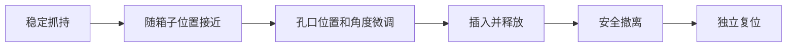

# V1真机评估：2026-10-19分析

这批记录支持继续把5K作为现场基线：它能够接近孔口，但精对齐和稳定抓持还没有可靠完成。14K在这批自己的闭环轨迹中更早、更频繁触发拒绝；继续增加相同数据的训练步数，尚无证据能解决这些缺口。

IK拒绝有不同原因。2K末尾主要是失败候选接近运动学奇异姿态；14K主要是J2和腕部约束耗尽。模型预测、实际跟随和连续IK分支共同形成闭环，当前证据不支持把全部责任归到某一方。

## 1. 依据与统计边界

本轮为比较入口部署之后、北京时间15:33:32至16:07:40开始的19条真实会话；逐条清单和现场笔记见[rollout记录](V1_20261019_ROLLOUTS.md)。三模型分别2K/5K/14K，合同保持三图、ROI A、右EEF10、同步H50/执行20/30Hz、5步去噪和受限连续IK。现场仍由用户操作。

客户端完整journal、模型绑定和发布行数决定是否真机运行；使用session/request/epoch/model_version精确关联906次服务端请求，无缺失匹配。客户端收到790次成功、110次IK拒绝、6次error；服务端完成794次成功、112次IK拒绝。不能混用两端口径，退出时请求可能已在服务端完成而客户端没有正常收齐。

| checkpoint | 有动作会话 | 有服务端IK拒绝的会话 | 服务端请求 | IK拒绝请求 | 首次拒绝距首观测 |
|---|---:|---:|---:|---:|---|
| 2K | 3 | 3 | 294 | 21（7.14%） | 79.90–104.13秒，中位87.79秒 |
| 5K | 12 | 6 | 429 | 44（10.26%） | 23.27–58.55秒，中位32.47秒 |
| 14K | 4 | 4 | 183 | 47（25.68%） | 25.69–32.10秒，中位27.41秒 |

拒绝占比是**请求级统计，不是任务失败率**；恢复重试相关，同一会话可以重复拒绝。5K包含不同场景和很短的抓取测试，不可拿6/12与其他模型直接计算成功率。19条最终均记录SIGINT；共18次进入恢复暂停，不能写成19次程序因IK崩溃。

## 2. 2K：放置之后的继续运动与奇异候选

三条2K的夹爪反馈均先从大于80变成小于20，之后才首次拒绝。打开阶段画面显示木块在箱盖附近，至少两张可见木块横倒在盖面；首次拒绝画面均是空夹爪离开箱子、手臂伸向远端。这与现场“放置偏差，回去时拒绝”一致，不能改记为插入成功。

21个失败候选均未贴住七关节盒限或腕部耦合限，但J4集中在 **−6.86971至−6.86964°**。用冻结原生FK解析雅可比复算，平移行除以0.3米后，最小奇异值为 **2.97e−9至4.76e−7**，条件数约6.4e6至1.0e9；同请求的真实反馈最小奇异值为0.076–0.204。这是**未执行的失败候选**接近运动学奇异姿态的证据，不是实际手臂已经进入同样奇异姿态的证据。尺度只用于本模型内对照，不作通用阈值。

首次拒绝的候选位置残差分别1.252、0.080、0.574mm；21次范围0.059–2.731mm，全部超过现有0.01mm验收容差。求解器显示优化终止成功，也不等于满足IK验收。首次失败位于拟执行20步中的第18/8/19步，整个前缀被拒绝，不是这些失败候选已下发。

这些会话的控制来源是policy、hold及ik_recovery_hold，没有证据表明是4242的显式复位控制器在执行。准确说法是“策略释放后继续运动时拒绝”，不能据此指责4242复位脚本。

**当前demo可以把复位独立出来。** 任务终点建议为插入、释放并安全撤离；之后由用户按已有入口复位，并把复位结果单列。并不要求同一个视觉policy必须学会复位，也不能在仅抓起或尚未插准时提前宣布任务成功。未来如果目标是无人连续循环，复位仍需单独验收。这里是建议，本轮没有改入口或训练终点。

## 3. 5K：接近孔口后的停滞有实测支持

15:44和15:47两条首次拒绝前，最后10次观测跨度约8.63/9.11秒，实测EEF累计移动仅 **10.78/21.69mm**，净位移9.33/16.41mm；同期腕图显示夹着木块停在孔口附近。支持“接近后小幅调整、没有推进插入”，但这几个数本身不证明反复旋转或心理意义的犹豫。

15:48这条首次拒绝前10次观测仍移动192mm，不能把所有5K都说成同一种停滞。16:07末次箱子变化测试，结束前10次观测约12.05秒，累计位移14.57mm、净位移8.73mm，最后腕图仍夹着木块停在孔边，没有提供插入释放的证据。

5K的44次失败中，41次候选J2到下限，33次同时碰腕部耦合边界，8次碰J6上限；这些计数重叠。另3次为15:58会话的近奇异候选，当时首次拒绝画面木块仍在桌上。不同失败必须分别标注抓取前、接近/对齐、释放后。

## 4. 14K：本批更早拒绝，但主要不是普通运动学奇异

四条首次拒绝分别在约27.0、32.1、27.9、25.7秒。首条腕图可见已夹住木块但仍离孔口较远；其他首次拒绝图在箱盖附近，仍未见插入释放。因此不能将现场“后来抬得高”的印象一律套到每条的首次拒绝时刻。

**全部47次失败候选同时位于J2下限−94°和腕部耦合边界**。按与2K相同尺度复算，候选最小奇异值0.535–0.571、条件数约4.10–4.45，没有2K那种雅可比退化。它们是受约束后的可行动作方向不足，不能仅因“动不了”就叫普通运动学奇异。

这与模型更容易把自己的闭环轨迹推向边界的假设相容，也说明现有局部连续IK没有提前规划冗余姿态来保留余量；但没有排除跟随偏差、观测时延和示教偏置。**不能据此宣布“完全是模型”或“放宽IK就好”。** 本轮未改变容差、限位或恢复机制。

之前[同观测同噪声的810次离线对照](../inference/experiments/20261019-prerejection-paired-replay.md)来自更早的两次14K会话：两模型在相同输入下的通过/拒绝逐对一致。它回答的是条件于那些状态的局部差异；本轮回答各自真机轨迹何时出问题。两个结果不矛盾。本轮没有冒称已完成这19条的双向模型重放。

## 5. 抓持不稳是重要反馈；箱子泛化不足也不能直接等同于没有用视觉

即使夹爪EEF到达同样姿态，木块在夹爪里夹偏、转动或滑落，木块相对孔口仍会偏。末端相对动作建模不会自动消除这部分误差。因此“两次差点没抓住”必须保留，不能只记抓取成功。后续应分别评价稳定抓起、运输中保持、孔口对齐和插入。

画面中16:01/16:02多条结束时木块被夹起，16:03结束时木块在夹爪外侧，16:05结束时木块在桌面。这些支持增加稳定抓持诊断；仅凭选出的关键帧，还不能确定每次是从未夹稳、运输掉落还是人为撤下，不能编造逐条原因。

用户移动箱子后明显变差，支持**目的地位置泛化和末端视觉纠偏不足**。这不等于网络完全没利用视觉：选择固定常见终点、视觉特征分辨率不足、物体在夹爪里的偏差和训练场景覆盖不足都可能贡献。此次照片还显示部分箱盖朝向变化、箱子在会话内移动，无法严格当成只改变XY的受控实验；具体见逐条记录。

后续优先在模型真实224输入中核对孔口和木块是否清楚可见，再用位置标记和固定初始关节，做同一箱子姿态下的XY变化对照。这里没有据此进一步缩ROI或修改图像处理。

## 6. 新发现的延迟干扰

此前模型调用的会话中位耗时大多115–121ms；16:03、16:05、16:06、16:07四条上升到253、195、265、305ms，对应客户端请求总耗时中位461、424、404、487ms。早期三条5K中位分别232、228、309ms。

同步框架在执行20步后等待新结果，新增延迟改变了闭环纠偏节奏。后几次测试需要标注这个干扰，不能把全部表现变化都算在箱子平移上。这里只证明耗时变化，尚未用逐时资源记录确认具体竞争进程；它也不能解释较早14K所有拒绝。后续受控复测先核对GPU资源和实际模型/通信耗时，不在本轮擅停他人进程。

## 7. 建议的下一阶段

1. **固定5K作为复测基线。** 保存2K/14K和现有三端口。先用相同初始场景完成分阶段记录，不因更晚checkpoint就自动替换。训练继续到更多步是否有收益，仍以真机评估判断；本轮不停止已授权训练。
2. **补针对性的成功示教。** 先分开变化木块位置、箱子XY、箱盖朝向；在训练覆盖中加入稳定抓持、最后几厘米的平移/角度调整、插入释放和安全撤离。可先用少量固定位置网格，每个位置做重复，不直接扩到大量新形状来混淆原因。图像随机增强不能代替目标在真实空间的位置变化。
3. **在5K实际遇到的偏差状态采DAgger纠正。** 从抓偏、到孔附近但不准等状态接管，记录如何修正并成功插入；不要只演示又一条理想起点全流程。接管应在仍可安全操作时，不能靠反复碰IK拒绝边界收集数据。现有rollout没有专家纠正动作，不能直接当成功监督数据混入。
4. **当前先不转向RL。** 先让稳定抓持和插入终点可测、数据覆盖可控；之后再决定是否需要RL精调接触。这里是基于本任务实测缺口的优先级建议，不宣称RL无效或某个固定示教条数足够。
5. **IK继续做首次拒绝之前的诊断。** 优先对本轮5K/14K相同阶段做双向同观测同噪声重放，结合实际反馈和完整预测，检查何时失去关节余量；另单列2K释放后的近奇异分支。不会以关闭拒绝保护来验证模型能力。

## 8. Telemetry够用的地方与缺口

已能判断模型身份、实际ROS发布、请求动作、拒绝位置、失败候选、关节反馈、恢复和退出、通信耗时，并可找回完全相同的相机输入。67个选帧条目、134张原始head/right_wrist图片已校验状态、时间戳与图像哈希。

仍不能自动判断每次是否成功插入、木块是否滑动、谁移动了箱子、下位是否实际受理每个目标。3条部署shadow在服务端也记`shadow_only=false`，因此这个字段不能单独证明真实动作；本轮用客户端mode和发布计数排除了它们。已加入TODO，未更改在线协议。

## 复算与证据

- [统计JSON](artifacts/20261019-v1/audit.json)、[逐会话CSV](artifacts/20261019-v1/rollouts.csv)、[全部拒绝数值](artifacts/20261019-v1/ik-rejection-detail.json)。
- [关键帧来源/哈希](artifacts/20261019-v1/image-index.jsonl)、[19条首帧总览](artifacts/20261019-v1/contact-start.jpg)、[释放阶段](artifacts/20261019-v1/contact-reopened.jpg)。
- `fetch_journals.py` / `fetch_images.py` 仅只读原始记录，原件不改写；`audit.py`、`ik_details.py`、`plot_images.py`提供计算方法。`audit.py`会重新快照仍在写入的服务日志，已归档结果需保留后另开输出目录做新批次。
- 数值复算使用本任务冻结DH/FK；没有运行新的真机动作或模型GPU推理，没有改变线上部署。
