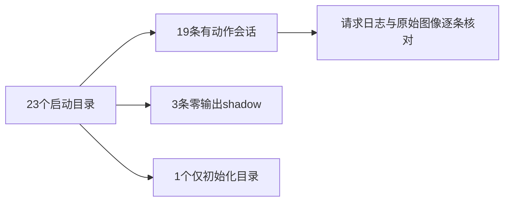

# V1真机rollout记录：2026-10-19

这份记录按真实日志统计，不按用户写下的条目数量补齐或删减。比较入口部署后，本批快照包含19条实际发布动作的会话：2K三条、5K十二条、14K四条。

现场笔记是重要但不完整的补充。下表逐条列出真实会话和已查看的关键帧；测试意图、完整插入结果没有证据的地方保留未知，不把推测的时间分组当成事实。

## 用户现场反馈原意存档

以下是用户本次汇报，保留重复次数和近似表述；没有逐会话标签的句子不强行绑定episode：

- **2K三次**：抓取成功、接近流程成功、放置有偏差而失败，回去复位的时候IK拒绝。用户询问复位是否必须由policy学会，是否可以末尾手动复位。
- **抓持质量**：抓取木块姿态不稳定，有两次差点没抓住；用户询问这类反馈是否重要。
- **5K**：放置偏差更小、非常接近；随后犹豫、小幅原地打转，再IK拒绝。笔记写了两次，但日志有三条早期5K会话。
- **14K四次**：第一、三、四次抓取后接近过程中IK拒绝，观察到手臂抬得高；第二次离孔口很近，后续打转、IK问题。用户认为14K更容易遇到IK问题。
- **5K改变木块位置、位姿不变**：用户记“ 五次成功了两次吧，总的来说有一定的泛化性 ”。这是近似现场总结，不能自动换算为完整插入成功率40%。
- **5K木块不变、箱子XY变化、不旋转的测试意图**：用户记多次IK失败，唯一接近的一次也偏差明显，推测模型背轨迹、没有学到视觉信息。
- 用户随后明确：**“你看真实记录啊，我不是每一条都写下来的。”** 因此不再要求用户回忆逐条对应，按原始日志和画面审计。

## 实际会话清单

所有时间为**北京时间UTC+8**，2026-10-19；目录中的`T07...Z`是UTC。时长从本地授权至SIGINT，首次拒绝耗时从第一个模型观测起算。拒绝次数取服务端完成记录，含重试。最后一列是关键帧观察，不是完整视频自动判定。

| # | 开始 | ckpt | 运行秒 | 请求/IK拒绝 | 首次拒绝秒 | 画面与阶段证据 |
|---:|---|---:|---:|---:|---:|---|
| 1 | 15:33:32 | 2000 | 94.7 | 92/10 | 79.9 | 释放阶段木块在箱盖附近；首次拒绝为空夹爪远离箱子。 |
| 2 | 15:38:04 | 2000 | 109.1 | 110/6 | 104.1 | 释放阶段木块横倒在盖面；首次拒绝为空夹爪远离箱子。 |
| 3 | 15:41:46 | 2000 | 103.1 | 92/5 | 87.8 | 释放阶段木块横倒在盖面；首次拒绝为空夹爪远离箱子。 |
| 4 | 15:44:22 | 5000 | 80.6 | 77/11 | 58.6 | 首次拒绝时持物停在孔口附近；此前约8.6秒仅移动10.8mm。 |
| 5 | 15:47:05 | 5000 | 59.5 | 51/7 | 39.8 | 首次拒绝时持物停在孔口附近；此前约9.1秒仅移动21.7mm。 |
| 6 | 15:48:55 | 5000 | 83.6 | 40/6 | 34.3 | 首次拒绝时持物接近箱盖；不能仅按用户写下的两次删掉本条。 |
| 7 | 15:51:10 | 14000 | 45.6 | 33/5 | 27.0 | 首次拒绝时持物抬高、仍离孔口较远。 |
| 8 | 15:52:30 | 14000 | 106.0 | 71/16 | 32.1 | 首次拒绝时持物在箱盖附近；后续有多次恢复。 |
| 9 | 15:54:50 | 14000 | 55.7 | 41/14 | 27.9 | 首次拒绝时持物接近箱盖，尚无插入释放证据。 |
| 10 | 15:56:17 | 14000 | 38.4 | 38/12 | 25.7 | 首次拒绝时持物接近箱盖，尚无插入释放证据。 |
| 11 | 15:58:20 | 5000 | 48.8 | 48/3 | 23.3 | 初始木块位置变化；首次拒绝时木块仍在桌上。 |
| 12 | 15:59:58 | 5000 | 48.0 | 39/9 | 30.6 | 初始木块位置变化；首次拒绝时持物在箱盖附近。 |
| 13 | 16:01:14 | 5000 | 21.0 | 20/0 | — | 箱盖朝向相对早先已变化；结束选帧仍持物，约21秒终止。 |
| 14 | 16:02:20 | 5000 | 11.4 | 10/0 | — | 箱盖朝向同前一条；木块位置又变；结束选帧仍持物，约11秒终止。 |
| 15 | 16:02:58 | 5000 | 14.1 | 13/0 | — | 箱盖朝向同前两条；木块位置又变；结束选帧仍持物，约14秒终止。 |
| 16 | 16:03:40 | 5000 | 27.1 | 22/0 | — | 箱盖朝向仍与早期不同；结束选帧木块在夹爪外侧。 |
| 17 | 16:05:40 | 5000 | 32.0 | 27/0 | — | 箱子初始偏右前；结束已移到更靠左后，木块在桌面；移动原因未判定。 |
| 18 | 16:06:35 | 5000 | 41.2 | 34/8 | 30.2 | 箱子初始偏左后；首次拒绝和结束选帧均持物抬高。 |
| 19 | 16:07:40 | 5000 | 61.7 | 48/0 | — | 箱子初始偏前；结束选帧持物在孔边，小位移停留，未见释放。 |

“没有IK拒绝”不代表成功；特别是第13–16条很短，结束选帧仍处在抓取/运输阶段。也不能把19条会话等同于19次完整插入尝试，暂停恢复可能让同一次会话包含多个尝试。

## 对先前时间分组的修正

先前仅按顺序猜测“15:58–16:02移动木块五条、16:03–16:07移动箱子四条”，**不再作为分组结论**。实际图像显示：

- 16:01:14至16:03:40几条中，箱盖孔形整体朝向与早先不同；不能将这些都视为只有木块XY变化。
- 16:03:40的起始箱盖与前几条相近，木块又换了位置；没有依据仅凭时间将它划入移动箱子组。
- 16:05:40那条的箱子在首尾帧位置发生变化；尚未确定发生时刻、主动移动还是接触导致，不能直接当成固定场景的独立试次。
- 16:05:40、16:06:35、16:07:40的箱子初始位置确有明显差别。原始画面只支持视觉上的变化，未标定精确XY/角度，不给出虚构厘米数。

这里保留用户测试意图，同时以实际记录限制因果结论；没有要求补记遗漏条目。

## 图像证据入口

67个选帧条目包含19条首帧、19条末次请求帧、13条首次拒绝及其前一次请求、3条2K首次重新打开夹爪的帧。每项保存head与right_wrist两路原图，共134张。记录的“end”是最后一次已匹配请求的输入图，不保证等于机器人完全停止后的最后视频帧。

- [所有首帧总览](artifacts/20261019-v1/contact-start.jpg)
- 首帧双视角：[1–4](artifacts/20261019-v1/contact-start-1.jpg)、[5–8](artifacts/20261019-v1/contact-start-2.jpg)、[9–12](artifacts/20261019-v1/contact-start-3.jpg)、[13–16](artifacts/20261019-v1/contact-start-4.jpg)、[17–19](artifacts/20261019-v1/contact-start-5.jpg)。
- 首次拒绝：[第1页](artifacts/20261019-v1/contact-first_ik-1.jpg)、[第2页](artifacts/20261019-v1/contact-first_ik-2.jpg)、[第3页](artifacts/20261019-v1/contact-first_ik-3.jpg)、[第4页](artifacts/20261019-v1/contact-first_ik-4.jpg)。
- 末次请求：[1–4](artifacts/20261019-v1/contact-end-1.jpg)、[5–8](artifacts/20261019-v1/contact-end-2.jpg)、[9–12](artifacts/20261019-v1/contact-end-3.jpg)、[13–16](artifacts/20261019-v1/contact-end-4.jpg)、[17–19](artifacts/20261019-v1/contact-end-5.jpg)。
- [2K重新打开夹爪时](artifacts/20261019-v1/contact-reopened.jpg)。

## 目录与身份映射

以下均位于F1 `/home/user/Bruno/data/hil_data/policy_hil/`；已保存本轮journal快照，原始大体积payload继续保留在F1。模型id与model_version在906次请求连接中核对一致。

| # | episode |
|---:|---|
| 1 | `f1_hil_20261019T073332Z_000c3122` |
| 2 | `f1_hil_20261019T073804Z_fc46f385` |
| 3 | `f1_hil_20261019T074146Z_980ab3f3` |
| 4 | `f1_hil_20261019T074422Z_81334c9d` |
| 5 | `f1_hil_20261019T074705Z_5f482cd4` |
| 6 | `f1_hil_20261019T074855Z_8c5567a7` |
| 7 | `f1_hil_20261019T075110Z_836d8923` |
| 8 | `f1_hil_20261019T075230Z_3548e27c` |
| 9 | `f1_hil_20261019T075450Z_be034780` |
| 10 | `f1_hil_20261019T075617Z_c9f55947` |
| 11 | `f1_hil_20261019T075820Z_2c717a2a` |
| 12 | `f1_hil_20261019T075958Z_424e8e3f` |
| 13 | `f1_hil_20261019T080114Z_4468d757` |
| 14 | `f1_hil_20261019T080220Z_8866cda5` |
| 15 | `f1_hil_20261019T080258Z_385b19ca` |
| 16 | `f1_hil_20261019T080340Z_48fa431c` |
| 17 | `f1_hil_20261019T080540Z_1ff4f67f` |
| 18 | `f1_hil_20261019T080635Z_b64695dc` |
| 19 | `f1_hil_20261019T080740Z_0b67a7f3` |

| ckpt | 模型身份 | 6000D服务端口 |
|---|---|---:|
| 2K | `f1-toys-eef-453c88a3fbb1dcb7` | 8122 |
| 5K | `f1-toys-eef-ff1263050a8b6846` | 8125 |
| 14K | `f1-toys-eef-4a2043b6ea09823f` | 8134 |

不计入19条的目录：

- `f1_hil_20261019T073052Z_04817d4f`、`f1_hil_20261019T073105Z_0a5132e3`、`f1_hil_20261019T073117Z_fbebe0ed`：部署时shadow，各5次模型请求，客户端零控制发布。
- `f1_hil_20261019T075934Z_49300ae5`：只有preflight、camera_diagnostics、model_runtime、ik_warmup，未找到journal/telemetry会话证明，列为初始化尝试。没有根据目录名猜测具体故障原因。

[统计原表CSV](artifacts/20261019-v1/rollouts.csv)保留自动统计字段，场景列保持`unreviewed`以免将本页人工关键帧观察冒充机器自动标签。完整成功率尚未按逐帧人工标注重建；本轮交付是会话数量、关键阶段证据和数值拒绝诊断，不能宣称已做19条全视频成功率验收。

[分析、归因边界与后续建议](V1_20261019_ANALYSIS.md)。
