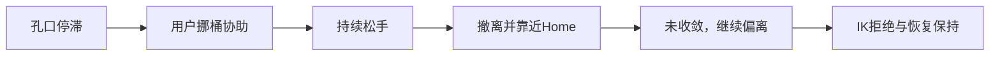
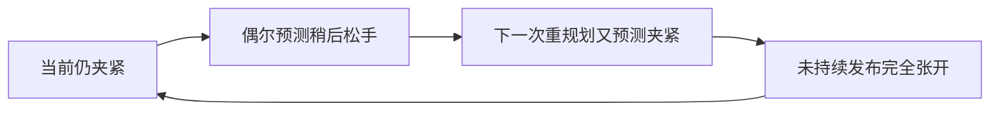

# Full625、1K与1.5K现场：孔口停滞、释放与回位偏离

后续记录：10月22日四个Full的15次会话与13条反馈已汇入[新一轮复盘](V1fullSFT/README.md)。本页保留10月21日诊断事实，不混入新会话分母。

**1.5K首轮现场反馈仍是孔口长时间停滞、人工协助后迟松手、回位明显错误，暂未显示核心问题改善。** 新日志确认两条1.5K会话：一条后段持续张开且没有IK恢复，另一条持续夹紧、后段进入IK恢复。样本不足以排名，但下一阶段应优先补真实偏差处的纠正和完整回位停稳示教；既定2K作为原数据对照完成，是否再延长另行决定。

**此前1K在用户挪桶协助后终于松手，但回位接近起始位置后继续偏离，随后触发IK拒绝。** 新的同输入、同噪声对照显示：模型不用RTC也没有可靠收敛Home；RTC在这次回位后段进一步放大了偏离。不能把责任全归给IK，也不能据此直接关闭RTC上线。此前396次诊断只说明“在当时选取的孔口卡住状态，关闭RTC没有恢复释放”，不代表RTC对整个任务无影响。数据中释放和回位监督确实存在；这次另外发现，训练示教回到Home后记录的稳定保持很短，值得和现场偏差纠正一起补充。

当前保留推理与独立IK工作，使用1K准备DAgger采集；这是工作基线选择，不是已证明1K整体优于625。孔口纠偏、释放后撤离和回位停稳，与小范围位置变化完整示教并行；[DAgger计划](../DataPrehandle/DAgger_V1_PLAN.md)集中维护具体方案。用户随后新授权GPU4–7续原数据到2K、保留1.5K，已独立启动，运行以[STATUS](../STATUS.md)为准。

## 1.5K首次现场反馈与下一阶段建议

北京时间2026-10-21 13:45、13:47的两条会话均绑定Full1500 `f1-toys-eef-e312de43fa3875a8`，执行模式为powered。用户反馈首次在孔口边缘长时间停滞、经帮助后迟松手，随后回位仍有重大错误。帮助的准确时刻和回位几何轨迹尚未逐帧重建，不把1K的同噪声结论直接当作1.5K已验证归因。

| 会话 | 日志直接支持的事实 | 不能由此推断 |
|---|---|---|
| `f1_hil_20261021T054528Z_b66dd6cb`，94.515秒 | 176次计划采纳；4.845–76.587秒发布夹紧目标，77.351秒起持续发布张开目标；没有IK恢复事件 | 77秒不是已标定的插入后释放延迟；无IK拒绝不证明回位正确 |
| `f1_hil_20261021T054754Z_e11beff0`，107.387秒 | 180次计划采纳；4.319秒后持续夹紧至结束；95.136秒首次IK重试，后续3次恢复暂停 | 用户对第一条的“已放手后回位失败”不能套到这条未松手会话 |

**IK专项补证：** 后一条196次请求中16次拒绝均贴J2 −94°及腕组合边界，J6实测48–49°，不是旧50K恢复中的约55°跟随平台。原限位追加3次采样救回6/16完整窗口；保持原EEF、仅离线J2下限−95°则16/16可解，驱动范围未变。该Full入口没有使用新版恢复，详见[框架恢复对照](README.md#full15k新增16次拒绝同类边界问题恢复是框架能力)。

两条均无人工机器人控制来源，人工帮助不能自动生成专家动作标签。完整统计见[会话汇总](artifacts/20261021-full1500-feedback/session-summaries.json)。本轮仅核对日志并记录反馈，没有更改模型、RTC、IK或训练。

建议将工作重点转到RTC/HIL接管验收，以及孔口纠偏、确认插入后的释放、撤离和Home停稳数据。保留1K作为已诊断的固定采集基线；1.5K没有明显改善的现场信号不足以要求更换采集基线。建议先做约10–12条小范围布局变化完整示教、约12–18次有效接管，第一条先审计，数量是小批迭代起点，不是保证成功的数据门槛。待用户确认后推进实现；现有2K续训继续按既定授权。

## 最新1K：辅助插入后释放，回位未收敛

北京时间2026-10-21约10:55开始，会话`f1_hil_20261021T025503Z_84525fb3`，Full1K模型`f1-toys-eef-efe3e5fa54ed0fb2`，服务session `032568746bb74fe3aba800b1dbccfde6`。当前RTC D14/S16未变。298次请求中288次成功、10次IK拒绝；最终Ctrl+C结束。以下时间统一相对第一条控制记录，不能把请求观测时间当作客户端收到拒绝的时间。

| 相对时间 | 可核验的发生过程 | 对判断的影响 |
|---|---|---|
| 前段至约140秒 | 孔口附近长时间停滞；用户报告挪桶帮助积木入孔 | 这是环境协助，不能记为无人干预插入成功；日志不能单独精确定位挪桶时刻 |
| 141.27秒首次张开，141.38秒起持续张开 | 夹爪发布目标持续低于20，之后没有重新夹紧；0为开、100为合 | 这次真实发布了释放命令，不是上一条1K持续闭合的问题 |
| 约143–148秒 | 末端撤离；148秒头图可见空夹爪抬离容器 | 回位失败不能描述成松手后立即一直向下 |
| 149.67／149.82秒 | 发布目标／反馈分别最接近固定Home，但仍有位置和朝向误差，见下表 | 没有完成Home并稳定停住，之后继续越过目标 |
| 151.86秒观测；152.18秒恢复保持 | 请求285为首次被拒绝的预测；客户端随后进入`ik_retrying`保持 | 偏离先发生，IK拒绝是后续结果；151.86不是拒绝接收时刻 |
| 156.53秒后 | 多次拒绝后进入暂停；165.58秒恢复后又重试，最终退出 | 恢复状态机实际运行，并非第一处IK拒绝直接结束程序 |

这里的“回位”是策略继续生成的动作，不是固定Home程序替模型执行。记录来源是`policy`及后续恢复/保持，不能把预测偏离归为自动Home预设本身执行错误。

首次拒绝发生在H50索引14，即已提交14点之后的第一个新点。求解器候选仍在关节限位内，但位置残差1.270mm、朝向残差0.00572°，未满足当前0.01mm／0.001°数值验收；优化器返回成功不等于IK验收通过。该记录不能独自证明发生了数学奇异点，也不是检测到桌面碰撞；现场出现错误下行时应提前停止或经已验收入口接管，不能等IK拒绝代替防碰撞。

### 接近Home不等于已经回位

使用与训练相同的原生FK，目标固定为V1 Home末端位姿。误差比较区分真实发布的关节目标`submitted`与记录的关节反馈`measured`：前者不是机械臂已经到达的位置。

| 时刻／口径 | 距Home位置误差 | 朝向误差 | 解读 |
|---|---:|---:|---|
| 149.666秒，发布目标最近点 | 23.22mm | 4.71° | 目标曾靠近，但仍未到位 |
| 149.822秒，反馈最近点 | 23.55mm | 5.87° | 实测反馈同样没有完成Home |
| 151.850秒，发布目标 | 172.80mm | 不用位置值代替朝向 | 命令已经继续偏离 |
| 请求285，151.857秒观测反馈 | 108.30mm | 10.61° | 与上行不同采样口径；反馈没有瞬间达到172.80mm目标偏差 |

原始[148秒头图](artifacts/20261021-assisted-release-home/frames/4427-head.jpg)与[151秒头图](artifacts/20261021-assisted-release-home/frames/4517-head.jpg)显示先抬离、随后降低到桌面附近，与用户报告一致。上述XYZ来自原生右臂SDK坐标系；未标定桌面/世界高度，不能把native-Y位移直接说成下降多少厘米，也没有由单目图片计算离桌距离。[会话汇总](artifacts/20261021-assisted-release-home/session-summary.json)区分请求观测、拒绝接收与进入保持三种时间，并保留请求/发布计数。

约150秒后，反馈J6开始越出训练状态范围；151.85秒时已低于训练min约29.44°。模型状态编码会在范围外饱和，这可能使后期纠正更难，但不是已证明的最初原因。FK和IK依然使用原始物理反馈，不能把状态token的clip误说成对实际关节或末端目标做了裁剪。

## 新对照：回位后段模型继续偏离，RTC又放大了它

新诊断共48次生成：6个释放/撤离/回位观测×3个固定噪声×有无RTC，共36次eager对照；再对最后两个关键观测做12次与生产编译路径一致的复核。全部使用Full1K、原始三图/反馈和真实旧计划前缀，没有向机器人发布动作。以下数字取编译复核，不把离线采样次数当作真机成功率。

| 固定输入 | 当前反馈距Home | 无RTC：预测索引31距Home | 当前RTC：预测索引31距Home |
|---|---:|---:|---:|
| 请求284，151.32秒观测 | 102.6mm | 137.6–158.6mm | 192.6–209.5mm |
| 请求285，151.86秒观测 | 108.3mm | 160.4–182.1mm | 230.6–246.2mm |

每个范围来自3个相同噪声的配对结果，索引31是30Hz窗口中约1.03秒的位置。更远的索引49也没有回到Home：例如请求285无RTC为207.2–213.4mm，RTC为241.1–254.5mm。编译与eager对照的位置分量最大差约1.0mm，未改变结论。

**能确认的是：此状态下模型本身的无引导预测仍继续远离Home，当前RTC条件又加大了偏离。** RTC保留/引导旧计划的连续性，也可能延续已经走错的方向；这解释了为何“模型能力欠缺”和“RTC放大后段错误”可以同时成立。它没有推翻旧释放诊断，两个实验检查的是不同阶段和不同状态。

**不能直接据此关闭RTC上线。** 无RTC预测不是完整可执行替代轨迹，未验收与已有已提交前缀的连续性、整段IK或反事实闭环；同一历史状态下的输出变化，也不等于机器人重新运行时一定沿同一条路到达这里。当前保持线上参数，把回位阶段的RTC影响留给独立对照与验收。

证据：[编译路径汇总](artifacts/20261021-assisted-release-home/post-release-rtc/compiled-summary.json)、[编译/eager一致性](artifacts/20261021-assisted-release-home/post-release-rtc/compiled-comparison.json)、[六个阶段观测对照](artifacts/20261021-assisted-release-home/post-release-rtc/summary.json)。旧396次实验保留在后文，结论只适用于其选取的孔口/释放状态。

## 这次数据审核发现什么

**释放与撤离/回位监督没有缺失；薄弱处是覆盖和终点保持。** 训练包12条都有释放标签，夹爪编码反变换与原发布值逐项一致。释放后共有2599个起点，占训练池19.84%，其中1933个是人工撤离/保持，666个是批准Home过程。不能只看Home的5.08%就说整个后半程没有训练。这些都是重叠窗口，不是2599次独立示教。

本次释放位姿与最近训练释放点的位置差只有9.52mm，但朝向差11.06°、最大关节差14.38°；加上桶被移动，完整状态并不是“训练已经见过”。这支持从现场真实偏差状态采纠正，而非只重复原摆放的成功示教。[逐示教位姿差](artifacts/20261021-assisted-release-home/data-review/release-pose-distances.json)采用持续张开起点的发布目标作比较，不把位置接近等同于完整状态相同。

训练中的10条完成Home记录，在完成事件后只继续录约0.04–0.46秒，共留下57个有效起点；Home命令在到达固定目标后的原始平台也只有约0.15–0.17秒。这里按Home事件和发布目标统计，不代表已经确认机械稳定。唯一较长的约2.51秒末尾保持在验证集。短时间mask正确保留已有标签，但不会凭空补出H50未来稳定保持的监督。因此下一批需真实演示“撤离→靠近Home减速→停稳保持”，建议到位后再录2–3秒，审核来源并确认进入训练索引，不通过复制末动作伪造监督。

这只是明确的数据覆盖隐患，不是已证明造成此次事故的唯一原因。现有单块示教也没有覆盖回位后选择下一块；“return to the starting pose”通过固定V1数据学习，没有额外把任意一轮的起始姿态作为动态目标输入。连续多块任务需另采完整序列，不能用这次单块回位结果证明已经具备。

可复算证据：[标签与路径审核](artifacts/20261021-assisted-release-home/data-review/summary.json)、[发布/反馈与Home对照](artifacts/20261021-assisted-release-home/data-review/rollout-comparison.json)、[末尾保持监督](artifacts/20261021-assisted-release-home/data-review/terminal-review.json)；同目录`review.py`、`compare_rollout.py`、`terminal_review.py`只读原件并生成统计。

## 当前决定：1K采集基线，先补纠正与停稳

1K在训练释放点和部分现场固定观测上好于625，但留出释放覆盖没有提高，整任务成功率也未证明更好。当前选择1K便于围绕已经定位的失败采集，不是一次全面选模结论。下面历史章节中“625可暂作候选”是上一阶段建议，已由本轮采集决定替代。

按[DAgger计划](../DataPrehandle/DAgger_V1_PLAN.md)先接通并验收真实接管/交还，重点补孔口纠偏、释放后撤离、回位附近减速与稳定保持；并行补小批适度变化桶/木块位置的完整示教。保留15条原始成功数据，新增人工纠正与完整示教分来源审核、混采，不能把自主动作长段直接当专家。

用户挪桶属于环境协助，并没有提供专家机器人动作。此次完整会话可保留为失败分析与待纠正状态来源，但不能因为最后松手，就把此前自主停滞和后续偏离都当成成功BC/DAgger标签。下一批更适合从偏差处接管机器人完成正确恢复，并保存场景被人工移动的标记。

诊断时已准备1K→1.5K入口，原计划保留服务、等GPU0–3空出。用户随后明确授权已空闲GPU4–7继续到2K并保留1.5K，11:33已启动，同一W&B run及原恢复状态，不自动部署新模型。此前[只读审核](artifacts/20261021-assisted-release-home/continuation-review/review.json)仍是历史恢复证据，最新安排见[续训记录](../training/experiments/20261020-v1-fullsft.md)。

## 先前两条现场记录与释放诊断

以下保留本轮最新辅助插入实验之前的原始证据和当时判断；涉及“当前/下一步”的历史文字，应结合上面的最新决定阅读。625现场“已插入却不释放”和第一条1K“未插入而停滞”均无IK拒绝；它们与本次已经释放后发生的回位失败不是同一事件。

下图只示意625的一次局部接续现象；不能据此把所有释放或回位问题归为同一原因。

## 已确认的现场事实

本节为625；后续1K核对与归因边界见文末。两次不是同观测、同噪声的受控对照。

北京时间2026-10-21约10:16开始，会话`f1_hil_20261021T021626Z_cbb21ab0`；从首末控制日志计算279.072秒，最终Ctrl+C退出。绑定Full625模型`f1-toys-eef-9a66d2024a181fd4`，服务会话`2b0052bf8d0641c7b0cc71cedc1a1e74`；RTC D14/S16、模型H50，正常回复覆盖K32。

- 523次服务请求全部成功，522个计划采纳；末次退出前在途请求未采纳。无IK拒绝、RTC超时或恢复暂停。
- 55,562条控制发布记录，开始105条hold，其余policy。请求成功和ROS发布只证明链路行为，不等于物体任务成功。
- 夹爪语义为0张开、100闭合。抓住以后发布值通常约99–100；全程没有持续完全张开。约258秒有一次局部张开，发布最小45.424，随即又闭合。
- 现场“已经插入”由用户确认；抽取25、60、257、258、275秒原始腕图可见木块仍被夹持、停留孔口区域。单帧不量化插入深度。
- 开始10秒以后有13次预测包含夹爪<20，首次出现位于H50索引30–48，即约1.0–1.6秒后的远期。不是13次实物松手，也不能说模型从未预测松手。

## 一个精确到动作点的例子

以下索引从0开始。请求482观测在约257.039秒；请求483在约257.572秒。模型原始夹爪从归一化值转换回0–100，执行解码对越界值裁剪。

| 位置 | 请求482的预测 | 下一次请求483如何接续 |
|---|---:|---|
| 原索引28 | 98.7，夹紧 | 移到索引12，保留为已提交前缀 |
| 原索引29 | 44.6，部分张开 | 移到索引13，保留为已提交前缀 |
| 原索引30 | 0.3，接近全开 | 对应新索引14，已进入可重规划后缀；新预测裁剪后为100 |
| 原索引31及以后 | 大部分接近0 | 新预测又接近99–100 |

因此这次是“保住了半开前缀，却把接下来的全开改回夹紧”。客户端随后实际发布的最小值45.424也印证了局部张开。不能简单说RTC完全丢掉所有旧动作；已提交前缀确实保留，但未来后缀允许重算，当前释放预测跨请求不稳定。

这解释了执行层为什么没有完成松手，却尚未区分：模型对当前任务阶段判断不稳、训练释放转换覆盖不足，或RTC软前缀条件化使后缀偏向原来的闭合状态。以上需要受控生成对照，不能凭这条记录给出单因素结论。

## 排除了哪些数据疑点

直接读取本轮Full训练的`arrays.npz`，结合有效时间mask核对：

| 检查 | 结果 |
|---|---:|
| 训练窗口总数 | 13,102 |
| 当前夹爪>80且未来有效标签出现<20的窗口 | 586 |
| 上述释放出现在前16个动作点 | 183 |
| 上述释放出现在前32个动作点 | 375 |
| 含此类释放监督的训练episode | 12/12 |
| 有效标签的夹爪编码反变换与submitted最大差 | 0 |

这些是重叠窗口，不能把586理解成586次独立示教。阈值只用于诊断统计，不是新控制规则。结果证明释放标签存在且编码匹配，不证明其数量、视觉覆盖和学习效果已经足够；也没有证明每个Home边界均无问题。

## 下一步与证据边界

以下为日志诊断时提出的对照计划；其中固定输入生成对照已在文末完成，连续闭环与现场干预效果仍未验证。

1. 固定孔口前后观测与噪声，对比625/1K完整H50夹爪输出，特别看何时开始松手、下一次观测是否继续松手；增加训练示教释放阶段的对照点。
2. 相同观测分别检查无RTC条件与当前RTC条件的预测，再做带真实前缀的连续重放；离线对照只能比较预测，不能伪造反事实机器人反馈或替代现场成功率。
3. 现场1K沿相同设置评估，单独记录插入、松爪和回位。若也反复保持闭合，再据生成对照决定补释放/恢复示教或修正RTC转换，不直接以续到2K作为答案。

日志中的夹爪反馈跟随发布值，但缺少下位电流、力及独立行程测量，因此不能全面排除机械因素。不过本次已经在上游看到“没有持续全开目标”，它足以解释为什么没有完成释放。未改模型、RTC参数、IK或真机控制。

可复算证据：[统计脚本](artifacts/20261021-full625-release/analyze.py)、[汇总JSON](artifacts/20261021-full625-release/summary.json)、[逐请求夹爪表](artifacts/20261021-full625-release/request-gripper.csv)。同目录保存客户端journal快照、服务端请求快照、原始图像与带来源偏移/哈希的帧清单。

## 1K后续：未插入、保持夹紧（2026-10-21）

会话`f1_hil_20261021T023244Z_a84ff42d`，北京时间约10:32开始；服务session为`a6b90706029b4552974da67455915a56`，模型`f1-toys-eef-efe3e5fa54ed0fb2`。首末控制记录跨度112.266秒，210次服务请求全成功，209个计划采纳；22,739条发布记录。Ctrl+C终止，无IK拒绝、RTC超时或恢复暂停。

| 证据 | 结果 | 解读 |
|---|---|---|
| 10秒后实际夹爪发布 | 最小99.243，通常约100 | 持续要求夹紧，未发布释放 |
| 10秒后完整H50预测 | 无任何夹爪<20；最小27.203仅是局部张开 | 不同于625有13次远期接近全开；不能说1K完全没有任何局部张开预测 |
| 最后30秒每个窗口索引14→49的预测位置位移 | 中位1.93mm | 模型未来后缀也以小幅动作为主；不是实测末端位移，也不涵盖朝向 |
| 30秒、100秒原始腕图 | 木块仍夹在孔口附近 | 与现场“未塞进去”反馈一致；不由图像量化插入深度 |

当前更合理的工作假设是：策略停滞在对孔/插入阶段，没有可靠转入释放。未插入时保持夹紧本身可能符合示教；需要解决的是它为什么没有继续对准/插入，不能只提高松手概率或直接强制张开。

不能由这两条推出“FullSFT必然更不爱松手”：旧LoRA与新Full同时改变了Home监督、短窗样本与时间mask、prompt、batch/优化配方，当前RTC也不能与早期同步评测直接等同。625与1K还是同一训练run内的不同步数，并非两个独立训练实验。此次1K客户端release为v6参数读取版，625为v5，绑定source SHA一致但config/infra SHA不同；两次D14/S16相同，也不应宣称所有部署条件严格一致。

下一步仍先做固定孔口观测/噪声的模型与RTC条件对照，补上训练示教释放转换点。若示教观测也不能预测释放，优先查拟合、采样和监督；若示教能释放、现场不行，优先查现场状态覆盖与纠偏；若无RTC能预测释放、加RTC后稳定消失，再重点查前缀引导。三种结果均需实测，当前未开展该模型推理对照，不自动续2K。

上段记录的是此次对照前的判断；后续结果如下，取代“尚未开展”的当前状态。

证据：[1K汇总](artifacts/20261021-full1000-release/summary.json)、[复算脚本](artifacts/20261021-full1000-release/analyze.py)、[30秒腕图](artifacts/20261021-full1000-release/frames/897-right_wrist.jpg)、[100秒腕图](artifacts/20261021-full1000-release/frames/2995-right_wrist.jpg)。同目录保留原始服务/控制日志和图像来源偏移/哈希。

## 固定观测与噪声：RTC是否直接抑制释放

2026-10-21，在H20空闲GPU2/3独立加载相同Full625/1K bundle及冻结推理代码，使用同生产的精度保留suffix编译、完整VJP、5步采样、相同预处理与统计。原GPU0/1服务保留；无ROS连接或动作发布，未训练、未修改生产参数。结束后GPU2/3显存释放，原两服务health/身份通过。

现场输入取625请求60/71/72/394/482/483、1K请求55/56/130/131/185/186，包含连续请求及已观察到释放计划改变的位置。逐相机从原始pack核验图像SHA、接收时间、观测ID、状态和观测时间，沿冻结处理器重建模型输入。每个输入用3个固定噪声种子；两模型及三模式共享同一初始噪声，198个跨模型组合的噪声哈希逐个一致。新噪声不是原现场未保存的随机状态，因此不是逐位重现当时动作。

三种模式只在独立实验中改变引导：

1. **无RTC引导**：同采样器，target为None；仍预测H50。
2. **完整RTC**：使用日志中的真实旧预测尾部与已提交前缀，D14/S16、beta5。
3. **去掉夹爪引导**：保留原手臂目标，仅令引导误差的夹爪维权重为0；其余VJP不变。网络耦合仍可能使手臂引导影响夹爪，不能叫“夹爪完全独立”。

统计“预测释放”定义为：相应区间有连续至少3个动作点夹爪<20。现场比较未提交区间索引14–49，示教比较其真实有效时间mask。阈值只用于统计，没有加入机器人控制；以下分母为输入×噪声组合，不是独立真机试验或任务成功率。

| 现场固定输入预测释放 | Full625（36组） | Full1K（36组） |
|---|---:|---:|
| 无RTC引导 | 0 | 5 |
| 完整RTC | 1 | 6 |
| 去掉夹爪引导 | 0 | 5 |

逐对核查，两模型均没有出现“完整RTC不释放、去掉RTC却释放”的组合；只有各1组反过来。1K的5组无RTC释放均来自625现场观测；对于1K自身卡住的6个观测×3噪声，两模型三模式均未预测释放。去掉夹爪引导也未救回释放。因而**当前没有证据支持先关闭RTC来解决这次不松手**。

去掉夹爪引导还会改变手臂预测：索引14–29平均位置差的跨组合最大值，625约1.615mm、1K约3.269mm。这是输出对照，不是实物轨迹误差；不能认为单改夹爪权重对插孔位置毫无影响。实验未求反事实全段IK、未模拟执行，也未部署此模式。

## 模型在示教释放点会不会松手

从12条训练示教和3条留出验证示教，每条选择两个当前仍夹紧、标签首次接近全开分别在第8/25索引的起点。全部30个起点均有真实释放标签，每点3个噪声；模型输入不含标签、不作随机增强，此部分只测无RTC。短窗按有效40/50点统计，不计padding。

| 无RTC，预测释放 | Full625 | Full1K |
|---|---:|---:|
| 训练示教释放点：24个观测×3噪声 | 68/72 | 72/72 |
| 留出验证释放点：6个观测×3噪声 | 6/18 | 6/18 |
| 训练示教夹爪平均绝对误差，0–100量程 | 17.54 | 12.84 |
| 验证示教夹爪平均绝对误差，0–100量程 | 53.82 | 58.38 |

验证的6组释放来自同一条episode，另两条的两个起点、三个噪声全部未释放。这是有限的3条验证示教，不能把6/18宣传成泛化成功率。不过训练点明显优于留出点，且1K训练误差改善、留出误差没有改善，支持“已学到熟悉释放状态，但迁移到其他孔口状态不可靠”的判断。

“预测过释放”仍不等于释放时机正确。例如验证中标签第8点就松手的那组，1K预测首次张开在26/40/41点，存在明显延后。后续评估需同时看时机、插入位置与跨请求连续性，不能仅奖励任何时刻张开。

## 结论如何影响DAgger

**保留当前RTC作为采集基线，优先补纠偏与阶段转换，不把关闭RTC或盲续2K当作修复。** 这是针对本次固定状态的直接抑制诊断；RTC可能更早改变到达姿态、历史前缀分布及后续闭环，仍未被排除。未重新做同数据同优化器的LoRA/Full对照，也不能把问题解释为Full方法天然更差。

采集分两类，先做小批并回看，不给固定条数承诺：

- **未插入、孔口停滞**：模型出现反复小幅调整却无进展时接管，从真实偏差状态演示必要的后退/抬高、调整位置和朝向、重新插入。保留正确恢复动作，即使短时间离孔更远。
- **已插入、仍然夹持**：现场确认已到可释放状态后接管，演示松爪、撤离、张开夹爪回位；不要在未插入状态为了“教松手”而直接掉块。

原始整条混合会话完整保存，训练监督按人工接管与有效发布区间审核：保留失败后的输入状态，仅以有效人工恢复动作作为纠正标签；不将此前导致走偏的policy动作自动标为专家。人工段末尾使用现有短窗时间mask，不跳过坏点拼接；不要求每段凑96窗口。与原完整成功示教混采，按来源/episode/干预段分组，避免长自主运行淹没短人工段；具体混采比例在新数据审计后确定。

**上一阶段建议，已被本轮1K采集决定替代：** 625当时已有现场插入反馈，被列为首批纠正数据候选，但不是经过足够真机次数的最优模型排名。当前采用1K继续采集；每条仍须保留checkpoint、起始布局、接管原因和干预ID，不能把采集基线选择解释为整体能力排名。

**入口还需补齐：** 当前`RTCPolicyEngine`继承独立模式，`operator()`拒绝操作者包，CLI的`--rtc`只允许独立sync/sync-shadow；不能直接在现有continuous命令中拿手柄接管。接入验收必须覆盖单一输出owner、接管时旧epoch/在途回复失效、从实际反馈进入人工、交还后新观测重新规划，以及policy/human/submitted分别记录。停止策略后另启示教可以采“恢复示教”，但必须明确是跨会话补充数据，不能伪称已打通同会话DAgger。本轮只完成诊断与接入审查，未部署接管。

证据集中在[对照产物目录](artifacts/20261021-rtc-release-ablation/)：[汇总](artifacts/20261021-rtc-release-ablation/summary.json)、[输入清单](artifacts/20261021-rtc-release-ablation/inputs/manifest.json)、[来源与噪声核验](artifacts/20261021-rtc-release-ablation/provenance.json)、[诊断脚本](artifacts/20261021-rtc-release-ablation/run.py)、[统计脚本](artifacts/20261021-rtc-release-ablation/summarize.py)。H20独立运行目录为`/u01/user/runs/f1-rtc-release-ablation-20261021`，原始输出已取回6000D。
