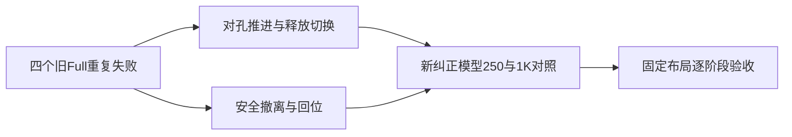

<!-- doc_type: evaluation; updated: 2026-10-23; scope: V1 Full625/1000/1500/2000 -->

# V1 FullSFT真机复盘：孔口停滞、释放与回位

**10月23日恢复旧Full1K后的两次现场反馈：仍在孔口未对准时犹豫，但没有用户在新DAgger中多次看到的低位碰桶问题。** 两条真实模型身份与记录完整性已核验，动作效果来自用户现场观察；这支持暂留旧Full1K作工作对照，不代表完整任务已通过。

**接下来优先补V2的完整、多布局成功示教，覆盖抬升接近、插入、释放和安全撤离。** 新DAgger及A/B尚未显示完整任务收益，不能只增加松手采样；下一轮建议先建立V1＋V2成功示教基线，再单独验证纠正数据的增益。数量划分、混采及初始化仍待确定，本轮未开训。

本页保留历史事实：10月22日四Full为**13条文字反馈、15次真实会话**，与本日新增两条分开计数。旧Full曾有提前释放和危险回位，不能用本日两次未碰桶覆盖历史弱项；完整新DAgger/A/B分析见[对应复盘](../V1_DAgger/README.md)。

## 10月23日旧Full1K复测

| 北京时间授权 | 原始run ID | 授权至末次控制 | 核验 |
|---|---|---:|---|
| 14:21:41 | f1_hil_20261023T062135Z_c313b964 | 75.106秒 | 旧Full1K、powered、D14/S16 |
| 14:25:00 | f1_hil_20261023T062455Z_94290778 | 65.599秒 | 旧Full1K、powered、D14/S16 |

两条model ID均为`f1-toys-eef-efe3e5fa54ed0fb2`，complete、drop=0、writer_error为空，8个journal流SHA通过。[身份与完整性原件](artifacts/20261023-recheck/identity-audit.json)。本轮没有重新逐帧审阅图像，不把现场反馈改写成已测得碰撞高度或接触力。

用户反馈两次Full主要仍是孔口未对准、犹豫；相比之下，新DAgger出现过多次高度不足碰桶。应将“接近阶段高度/路径退化”与“孔口精细对准不足”分别列为失败项，不能仅统计松手。两次不是稳定成功率估计，输入、统计、采样差异仍使历史对照无法单独归因DAgger。

V2首批20条建议覆盖：6条木块XY变化（桶固定）、6条桶XY变化（木块固定）、8条两者组合；先保持同物体、同朝向、相机与任务不变，在已能人工稳定完成的范围内逐步扩展。每条完整演示抓稳、足够越桶净空、到孔口上方再下降、必要调整、插入释放、安全撤离与Home停稳2–3秒；不靠移动桶帮助完成。可预留4条整段独立验证（上述三类各1/1/2条），其余16条训练；这是采集建议，尚未登记为已采数据或正式训练配方。

## 10月22日四Full历史复盘

以下流程、计数与判断对应10月22日，后续新DAgger和A/B已实际评测，当前进度以STATUS及上文为准。

## 先看这一张表

| 旧模型 | 本日真实会话 / 文字反馈 | 用户观察到的主要现象 | 日志中的持续重新张开¹ | 当前结论 |
|---|---:|---|---:|---|
| Full625 | 5 / 4 | 两次已插入却迟迟不松；另有倾斜和孔口微调 | 0 / 5 | 有插入能力线索，释放不可靠 |
| Full1K | 3 / 3 | 孔口停滞；一次未完全插入就松手，回位撞桌 | 1 / 3 | 保留采集/对比基线，不称最优 |
| Full1.5K | 4 / 3 | 孔口停滞；一次提前松手、低位回程，第二块抓放偏差 | 1 / 4 | 没有稳定改善，连续任务未学会 |
| Full2K | 3 / 3 | 三条反馈均为孔口反复微调、不插入 | 0 / 3 | 没有支持继续旧数据续训的现场证据 |

¹“张开”只是命令和位置反馈发生变化，**不是正确释放、插入成功或任务成功率**。13条文字反馈没有一条描述无辅助完成插入→释放→安全撤离→Home停稳；额外两次会话没有独立现场结果标签，不能写成“0/15完整成功”。测试未证明布局、运行时长和外部帮助严格相同，不能据此排精确成功率。

用户已明确：**“625对应V1-5K”指训练抽样量相当**。Full625 × global128 = 80,000次窗口抽取；旧LoRA5K × global16也为80,000。它们不是同一模型，抽样次数也不代表独立数据量或相同训练效果。

## 现场反馈原文：按模型保留，不臆造会话对应

下列序号只代表用户笔记顺序，不是日志的episode序号。原文另存[operator-notes.txt](artifacts/20261022/operator-notes.txt)。

| 笔记 | 用户原文 |
|---|---|
| 625-1 | 插进去了过了很久很久还不松手 |
| 625-2 | 插进去了过了很久很久还不松手 |
| 625-3 | 在洞口附件倾斜不松手 |
| 625-4 | 洞口面前不动了 还没插进去 一直在小幅度微调 犹豫 |
| 1K-1 | 洞口面前不动了 还没插进去 |
| 1K-2 | 洞口面前非常接近 但是没完全进去就松手了 复位home撞桌子了 是不是之前没有维持两秒的原因是吧 |
| 1K-3 | 洞口面前不动了 还没插进去 一直在小幅度微调 犹豫 |
| 1.5K-1 | 洞口面前不动了 还没插进去 一直在小幅度微调 犹豫 |
| 1.5K-2 | 洞口面前不动了 还没插进去 就松手了 然后回位home过于低了 然后我放第二个积木想让他完成连续抓取 第二次抓取位姿很偏 并且第二次放置的位置也有问题 |
| 1.5K-3 | 洞口面前不动了 还没插进去 一直在小幅度微调 犹豫 |
| 2K-1 | 洞口面前不动了 还没插进去 一直在小幅度微调 犹豫 |
| 2K-2 | 洞口面前不动了 还没插进去 一直在小幅度微调 犹豫 |
| 2K-3 | 洞口面前不动了 还没插进去 一直在小幅度微调 犹豫 |

## 日志能确认什么

本日归档范围是2026-10-22北京时间11:11–14:13启动的15次powered会话，模型身份由journal绑定读取。它们均为旧三图/state16模型、D14/S16；发生在统一入口切换之前，**不能代替新统一入口的powered验收**。

- 15份manifest均完整，记录器drop=0、writer_error为空；15份control流重新计算SHA256，均与manifest一致。完整日志留在机器人，本地保存清单、事件计数、控制抽样和来源哈希；本轮没有批量下载/观看视频。
- 15次均由SIGINT退出，事件中没有IK拒绝/恢复或RTC超时。请求持续产生并接纳动作块，所以这批孔口停滞不能解释为“最后一直被IK拒绝”。这不等于已排除所有执行误差、RTC影响或硬件因素。
- 控制来源只有初始hold与policy，**没有原生Home控制来源**。现场所说“自动复位”在这些会话中是模型输出的回程，不是调用已验证的固定Home脚本。
- 右夹爪0为张开、100为闭合。本次按10Hz抽样审计：首次反馈≥40之后，提交值与反馈同时≤10且持续≥0.5秒，记为一次“持续重新张开”。时间以授权时刻为零，边界精度约0.1秒；这是离线统计口径，没有修改控制阈值。

| 北京时间启动 | checkpoint | episode ID（原件不改名） | 授权至末条控制 / 秒 | 持续重新张开区间 / 秒 |
|---|---|---|---:|---|
| 11:11:10 | 625 | f1_hil_20261022T031110Z_ab7442fc | 282.4 | 无 |
| 11:17:36 | 625 | f1_hil_20261022T031736Z_8b24d937 | 133.7 | 无 |
| 11:20:53 | 625 | f1_hil_20261022T032053Z_794fb092 | 127.7 | 无 |
| 11:26:36 | 1000 | f1_hil_20261022T032636Z_27c85abb | 127.0 | 无 |
| 11:34:26 | 1000 | f1_hil_20261022T033426Z_7ce9a87a | 47.6 | 37.51–47.51 |
| 11:36:18 | 1000 | f1_hil_20261022T033618Z_7f1d6768 | 95.3 | 无 |
| 13:55:32 | 1500 | f1_hil_20261022T055532Z_3cc35df7 | 81.7 | 无 |
| 13:57:30 | 1500 | f1_hil_20261022T055730Z_0a27fe2e | 112.1 | 无 |
| 14:00:11 | 1500 | f1_hil_20261022T060011Z_ffb34e97 | 99.5 | 44.04–63.78，之后再次闭合 |
| 14:02:47 | 1500 | f1_hil_20261022T060247Z_3511dcf2 | 101.8 | 无 |
| 14:05:17 | 2000 | f1_hil_20261022T060517Z_77d25402 | 109.8 | 无 |
| 14:07:45 | 2000 | f1_hil_20261022T060745Z_b1b7d760 | 99.3 | 无 |
| 14:09:59 | 2000 | f1_hil_20261022T060959Z_647749e6 | 84.6 | 无 |
| 14:11:59 | 625 | f1_hil_20261022T061159Z_e336c2d6 | 49.7 | 无 |
| 14:13:20 | 625 | f1_hil_20261022T061320Z_12f18e67 | 38.8 | 无 |

启动时间取episode名称中的UTC加8小时，不等于Enter授权时间。机器可读表见[rollouts.csv](artifacts/20261022/rollouts.csv)。1K的重新张开、1.5K的张开后再闭合与用户两条特殊反馈一致，但未逐帧视觉核实，暂不强行认定对应关系。短暂低夹爪提交可能发生在初次夹紧过渡，不能凭最小提交值判定已正确放手。

## 原因判断与接下来重点

**第一，对孔推进与阶段切换同时不足。** 没插进去时继续夹紧并非错误，关键是模型没有有效修正位置/姿态；已插入仍不释放则是另一种失败。另有提前释放，说明不能用统一“强制张开”解决。优先对照模型从接近→接触→插入→释放的完整过程，而不是只看某一帧夹爪值。

**第二，不能把撞桌单独归因于Home末尾少录两秒。** 旧数据终点保持短是已确认弱项，补真实停稳有助于学会停住；但回程过低还涉及撤离路径、起始姿态分布及执行反馈。安全撤离与最终停稳必须分别验收。用户的撞桌描述按现场事实保留；本轮没有用未标定的FK轴推算桌面高度，也没有证明具体碰撞时间。

**第三，加步数没有显示单调收益。** 625→2K仍反复停在孔口，现有证据不足以选冠军，也不支持继续旧配方等“自然学会”。旧1K只是已有纠正数据的采集基线。第二块偏差也不能只靠延长终点画面解决：连续第二/第三块需要覆盖真实跨任务转换和新观测分布。

10月21日已有固定观测/噪声对照：关RTC未救回释放；无RTC也存在回位偏离，RTC后段可能放大。它支持优先补监督，但属于历史离线证据，**不是对今天15条逐条复做的归因**。详见[前一轮诊断](../V1_FullSFT_20261021_ANALYSIS.md)。

## 新DAgger训练：现在能比较到哪一步

H20新run已完成1K，退出码0，按计划写入复盘停止标记；不是训练异常中断。250／500／625／1000四份推理包与生成报告齐全，每125步完整断点仍保留；本轮快照GPU4–7均为0MiB，GPU0–3仍占用四个旧Full服务。[W&B正式run](https://wandb.ai/robotics-example/f1_complexytoys/runs/f1dagger20261022main1)，分组`04_RightOnly_FullSFT`。

| 新DAgger步数 | 当步训练loss² | 验证总loss | 纠正验证loss | 前20步位置误差/mm³ | 旋转误差/度³ | 夹爪误差/百分点³ |
|---|---:|---:|---:|---:|---:|---:|
| 250 | 0.03084 | 0.08740 | 0.11484 | 9.541 | 1.562 | 0.500 |
| 500 | 0.01740 | 0.11666 | 0.18100 | 9.259 | 1.224 | 0.465 |
| 625 | 0.01798 | 0.12708 | 0.19347 | 8.681 | 0.980 | 0.405 |
| 1000 | 0.01262 | 0.15762 | 0.23912 | 8.683 | 0.924 | 0.266 |

²取各导出段W&B summary末步真实值，不是平滑训练均值；验证共384个固定起点。训练loss下降、验证loss上升是过拟合/留出泛化退化信号，不能单独判定哪个上机更好。

³固定18个留出观测×2个噪声种子，5步去噪；短窗按有效步数计，最多前20步。四个模型该检查IK均通过，但不是闭环任务成功。新1K部分生成误差更小，250验证loss更低，因此**建议先比较这两个端点**，500/625保留备用，暂不自动续2K。

**评估缺口：这36条生成结果的“保持当前夹爪”基线误差全部为0。** 所选前缀没有需要改变夹爪的标签，较低夹爪误差只能说明这些保持段更接近标签，不能证明学会松手。上机选模前补选释放转折前后、撤离起点、Home途中及停稳边界的固定观测，用相同噪声生成；现有检查不能替代这些关键阶段。纠正验证集中释放只有4个起点、原生Home只有10个，也不宜据单项分数下定论。

本轮从官方base重训，使用12条V1训练示教＋九条纠正、75∶25混采、新单臂输入和新统计；3条V1与此前首条纠正留出验证。旧1K并非新模型权重起点。九条纠正来自同场次、标准布局，验证和现场结论仍限于这一任务，不证明布局泛化。

## 下一轮最小对照

1. **候选：旧Full1K、新DAgger250、新DAgger1K。** 先补上述关键阶段离线生成检查，再以新合同登记到共用推理框架。不要把旧`full1000`别名静默指向新1K，不仅换权重路径。
2. 新合同需核对双有效图片、左侧隔离、归一化、实际RTC路径、身份及零输出验收。当前只有训练预检/导出与离线生成证据，**尚未部署新模型或取得新模型真机成绩**。
3. 三个候选先各5次固定标准布局，轮换测试顺序、统一起始状态和时限。记录抓取、插入、释放、撤离、Home停稳，以及辅助和提前终止；小样本只作筛选。当前左夹爪硬件/画面已变，旧模型的新对照应在同一现状重新测，不能把本日历史结果当严格同条件分母。
4. 完整成功必须无外部帮助且回位真实停稳≥2秒；未到达阶段单列。不要为等成功延长到几分钟；保留现有现场停止/保护，先确认安全回位再测连续第二块。

本轮只整理和诊断：没有改机器人控制、RTC/IK参数、训练配方，没有启动新训练或真机动作。

## 原件与可复核产物

- [session-inventory.json](artifacts/20261022/session-inventory.json)：15份manifest、telemetry摘要、文件身份与原件目录。物理路径仍在F1的`/home/user/Bruno/data/hil_data/policy_hil/<episode>/journal/`；旧目录名不代表这些普通评测属于专家HIL训练。
- [control-audit.json](artifacts/20261022/control-audit.json)：完整control流SHA校验、事件/来源计数和10Hz抽样；[夹爪衍生分析](artifacts/20261022/control-audit-with-gripper.json)、[汇总](artifacts/20261022/summary.json)、[复算脚本](artifacts/20261022/summarize.py)。
- [dagger-training.json](artifacts/20261022/dagger-training.json)：H20退出码、停止标记、断点/推理包、W&B summary和资源快照；[固定生成结果](artifacts/20261022/dagger-generation.json)。
- 新训练run：`/u01/user/runs/f1-toys-v1-dagger-20261022-r3`。数据监督和实施详情沿用[训练配方](../../V1_DAgger_FullSFT.md)、[实施验收](../../training/experiments/20261021-v1-dagger-fullsft.md)。
