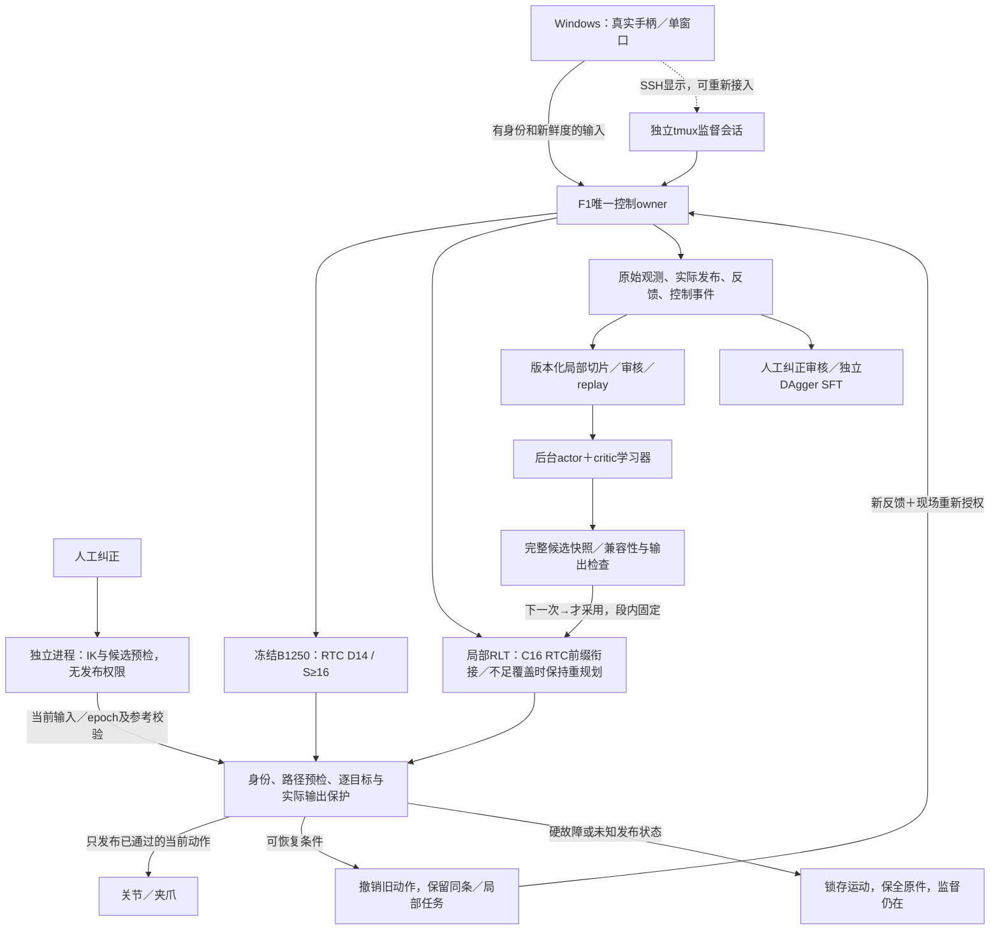
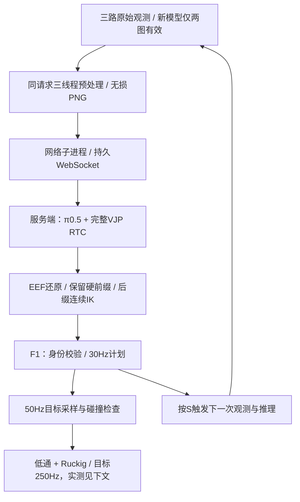
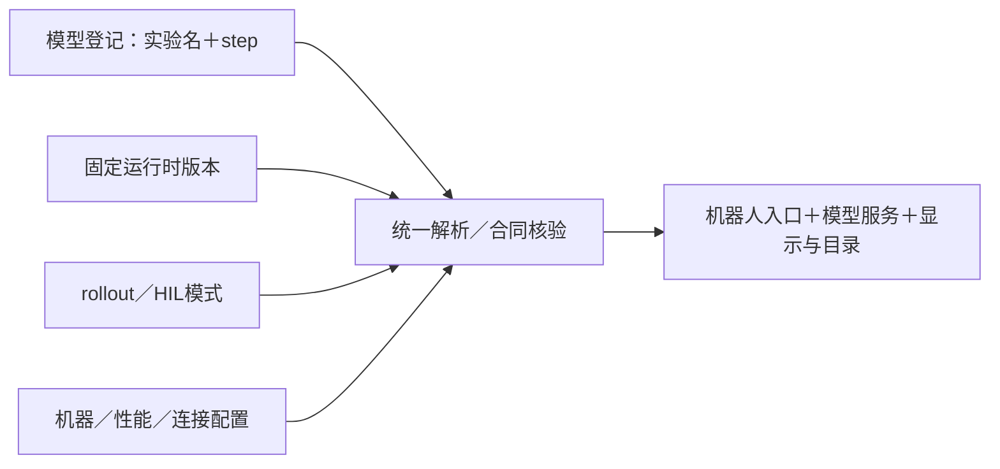

<!-- doc_type: recipe; status: canonical; tags: F1_INFERENCE_CURRENT; updated: 2026-11-03 -->

# F1积木分拣：当前推理框架、RTC参数与执行平滑

**11月4日控制V47已上线四条豆包短语音，Windows沿用V46。** 原六音不变，短时输入抖动、RTC等待与RB恢复确认不播异常；具体处理看终端。[发布与剩余框架问题](inference/experiments/20261104-voice-V47.md)。

**11月3日16:21现场复验未通过连续性验收。** Windows V45实际使用已确认；自动恢复漏发令牌已在V46源码修复，但RLT预取预算与人工边界恢复仍待处理。新↑成功／↓失败协议与恢复令牌修复已随V46正式激活，Windows V46配套安装及现场验证待完成；[现场复盘](inference/experiments/20261103-continuity-validation-V44.md#onsite-v45)。

V45将包迟到、推理过期与机械危险分开处理：不重放旧目标，不因单个ACK迟到重连；自动阶段允许固定1秒资格内的同会话重新规划。手柄整包、录制失败监督、中文异常提示和评测固定版本一并验收。

ARM与正式零输出已通过；Windows安装及现场确认仍待完成；12次局部对照、6条全链路和30分钟运行不能由单元测试替代。[本轮实现与验收账本](inference/experiments/20261103-continuity-validation-V44.md)记录具体状态。

## V45：保持动作保护，减少控制断链

适用范围：2026-11-03已部署控制V45／独立学习组件V46，Windows操控包待现场安装。下文带日期的旧数据量、模型和操作语义均为历史证据，当前事实以STATUS为准。


当前主线是B1250 RTC、局部RLT和人工接管共用动作与故障监督。暂时失联或推理延迟先暂停动作、保留任务；碰撞和未知发布状态仍锁存。在线学习独立运行，候选只在下一次局部任务开始时采用。

本轮技术路线、每类门槛、恢复方式和训练数据边界见下节。运行事实以[STATUS](STATUS.md)为准，现场安装和按键以[STARTUP](inference/STARTUP.md)为准；软件验收不能替代短条真机闭环。

**11月3日有线完整shadow：RTC请求中位173ms／P95 188ms，旧原生同步参考280／297ms；观测到返回中位229／313ms。** 两组各45秒、84／45次规划，均零动作／录制，RTC零暂停。同步虽同B1250权重，但使用旧eager及原图传输，不能将差额归因于RTC开关；原生同步没有同权重的旧无线实测基线。RTC较10月28日平稳无线的请求182–184ms、观测到返回246–247ms有所下降，跨日期并非单变量对照。D14／S最小16、30Hz动作网格保持；见[完整shadow与手柄路径](inference/experiments/20261023-rlinf-offline.md#rtc-sync-shadow-20261103)。

同日另一组网络探针B／RLT客户端中位534／611→154／125ms，P95 940／832→156／128ms，测的是bootstrap／模拟前缀RPC，不是上面的两种完整运行模式。真实出口已核对，原维护地址／Wi-Fi保留；收益以本轮卡顿无线窗为基准，长期、真实运动与手柄ACK仍待验，见[网络实测](inference/experiments/20261023-rlinf-offline.md#network-wired-20261103)。

用户已指定本任务统一有线优先、Wi-Fi仅备用；路由／DNS及工作台已生效，Windows旧包的一次性设置见[STARTUP](inference/STARTUP.md#wired-preferred)。当前生产RTC主要计算为模型93ms、IK41ms，通信及相关残差约12ms；D/S的预留覆盖期间仍在执行旧动作，不能当作停等或按网络降幅推算任务时长。[完整组件预算与40秒示例](inference/experiments/20261023-rlinf-offline.md#wired-preference-budget-20261103)。 同一隔离服务的D14/S16、D12/S14、D10/S12各60秒shadow均零输出／零暂停，候选更新约2.13／2.50Hz、最小采用余量199／136ms；可进入短条真机对照，当前B默认仍D14/S16，局部RLT参数不随之更改。

**11月3日V43已部署局部RLT版本显示。** 运行端使用实际manifest显示控制技术＋V号，每个局部段显示真正锁定的actor身份；Windows V43需本地安装，启动器和sender分别维护。动作／RTC／网络期限沿用V42，异常音仅网页候选。[V43范围与验收](inference/experiments/20261103-terminal-identity-V43.md)。12:44实录中VLA超时自动恢复已工作，后续200毫秒输入watchdog和500毫秒ACK重连仍打断流程，待分别处理；不将控制版本升级视为所有暂停已解决。

**11月3日V42已部署，通过ARM 219项及正式真实反馈零输出，现场连续性待验。** V41最新条中没有自动HIL，三次候选碰撞暂停被误播接管音；V42修正提示。十次RLT有前缀请求剩余预算仅103～140ms，完整请求需202～319ms，全部迟到。V42保留实测耗时并在覆盖允许时自适应D，否则按原有效期运行后保持重规划，不延长旧动作寿命。该条曾产生27条转移和108／27次critic／Q更新，已撤回至干净1024／256状态；见[V42现场复盘与验收边界](inference/experiments/20261103-rlt-rtc-V42.md)。

**此前V41于11月3日部署F1及H20 GPU3。** 局部C16采用D6／S8预取，已承诺前缀固定，只解码新后缀；B阶段仍H50／D14／S16。保留同一owner、epoch取消、人工优先、碰撞保护与原平滑器。ARM 201项、正式真实反馈零输出和候选读取通过；F1真实图像RPC两个原配置窗口中位239／150ms、P95 331／194ms，均为零输出、模拟承诺，尚非机器人连续运动。详见[V41部署与网络边界](training/experiments/20261102-rlt-rtc-V41.md#deployment-20261103)。

RTC replay同时校验原始请求观测、旧计划承诺前缀、新计划实际发布及终态，扣除观测之前已经消耗的首段插值比例。控制高频记录保留轻量坐标，完整上下文仅在事件落盘；不会逐拍复制整块动作。纯时序迟到撤销旧轨迹、保持后重新观测，不结束录制；真实接管／↑／Y撤销旧epoch。新数据分支已实际触发学习与候选发布，但最新条按用户决定排除，仍需合格现场短条验证连续性及能力；无线长尾不能靠取消保护隐藏。以下日期段落保留升级前事实。

**V40计算加速候选已完成真实输入验收，未部署。** 39个真实观测上，原eager模型中位207.6ms、prefix图185.8ms、完整图75.6ms；完整图最大平移差0.024mm、姿态差0.0013°，没有新增IK拒绝。12次VLA RTC／快速RLT／冻结特征交替调用保持VLA输出和训练特征一致。装配与服务新增显式`rlt-reference-compute`身份校验，默认旧路径；线上仍同步C16，不能把计算加速或异步训练称为连续RTC。数据与执行合同、物理差异、适用权重及后续见[V40报告](training/experiments/20261102-rlt-decision-V40.md#推理优化与-rtc-边界)。

**11月2日V34：C16取样与执行完成已解耦部署。** 末点继续经过原平滑器与保护，发布及真实反馈到位后才保持末点、读取下一轮观测；既有3秒settle超时仅暂停策略，保留录制／局部任务，START仍可接管。原七个动作块复现了旧版上翘中途截断；153项双端及正式零输出通过，真实方向与接管仍待现场。局部优先上传已接通，训练新动作语义尚未生产切换，详见[V34整改](inference/experiments/20261102-framework-repair.md)。

<a id="fault-supervision"></a>

V37机器人端新增常驻PCM提示音，启动时预热、空闲输出静音，原音色和音量保持；首PCM提交有时间戳，但不等于扬声器先于动作的证据。

**11月2日现场补充：启动恢复已由V39修复部署，局部RLT仍非RTC。** 首START已接受却因220ms输入间隔进入人工恢复；V39已分离首动作前的启动意图与人工恢复；真实断连／会话变化仍撤销自动路径，见[V39实现及验收](inference/experiments/20261102-rlt-repair-V39.md)。RLT三个块实际各执行约1秒、保持到新计划约0.54～0.66秒，异步训练不会消除该停顿；姿态整体变化约21°，仅看Z位移不足以评估方向。详见[实际数据与整改边界](inference/experiments/20261102-latest-rollout-audit.md#用户确认后的终点修订与姿态补充)。

## Windows会话退出与诊断日志（V38）

V38本地显示采用Windows原生Unicode，远端UTF-8增量解码；不依赖或修改系统代码页。SSH日志由启动器持有句柄，单文件读取失败仅该文件待补，不阻断状态轮询或其他日志。操作端会话层单独跟踪START前建立的真实F1 run身份。实际Ctrl+C或F1进入stopping／failed后停止本次sender重连；确认接收端已退出则释放本次SSH，保存超出本地等待预算也仅退出本地连接并报告未确认，不强杀机器人、不改变保存结果。退出恢复Windows控制台，日志同步不进入控制线程。

手柄使用独立SSH隧道，终端读取／完整日志落盘／就绪解析不等待显示队列；诊断线程不依赖控制台打印。sender、终端SSH、手柄SSH、生命周期和远端控制台日志经独立免密SSH校验续传到F1，再由6000D定时只读镜像。日志失败只标记待补；不记录键盘／密码／私钥。包已发布、Windows现场安装待验，具体流程、目录和证据见[V37会话及提示音修复](inference/experiments/20261102-session-audio-V37.md)。

## 10月30日：运行职责解耦

终端是观察与输入通道，不承担运动状态判断。RLT就绪信号由同一tmux会话内、PID与启动时间匹配的新鲜status生成，再在屏幕渲染外通知Windows sender；真实START仍是唯一开条授权。Windows控制台装饰、尺寸和选择模式不得成为判断机器人是否开始的依据。当前已部署范围与后续进度见[整改记录](inference/experiments/20261030-runtime-decoupling.md)。

人工IK及候选预检现已移出动作发布循环：无发布权限的数值worker一次处理一个快照，主循环保留唯一owner、最新反馈与最终输出保护。接管、松RB、反向、新session／epoch和参考变化撤销旧结果；幅值变化按有界延迟处理并记录原输入来源，不机械等待完全相同的摇杆浮点值。动作有效期、硬限位和碰撞保护数值保持。实现与验证边界见[本轮报告](inference/experiments/20261030-runtime-decoupling.md)。

RLinf复用异步runner、worker分工和完整快照同步；本地驱动保持／停止与高频保护仍在F1适配中，不通过Ray远程调用。观测、录制依赖解耦和RLT连续执行尚未完成，现有运动中50ms锁存仍有效。

10月30日四条现场数据的reader兼容和真实特征缓存已修复，纠正分支已训练到1040／260。VLA迟回复新增撤旧轨迹、保持后新观测重规划，手柄接收与ACK非阻塞发送解耦；本地109项检查通过，部署及现场边界按[四步修复记录](inference/experiments/20261030-four-rollouts.md#loop-repair-20261030)逐项验收。碰撞、反馈、输出与输入新鲜度保护保持，不能说已消除所有暂停。


## 故障监督、恢复与训练边界（2026-10-29）

当前B1250的普通RTC、HIL、局部RLT沿用统一客户端的故障合同，通过 `f1_fault_lifecycle_v1` 显式启用；最新控制部署身份以STATUS和装配manifest为准，不能把此前`manual-compute-r3`当作当前部署。旧冻结release保持原意；本节替代旧门槛表中“反馈陈旧／显示错误直接退出”的运行后果，不改变硬件保护数值。具体部署验收见[版本报告](inference/experiments/20261027-rlt-local-v2.md#fault-recovery-20261029)。

**故障首先撤销动作权限，再决定能否恢复、如何保存数据。** 监督进程存活不代表机器人有运动权限；未知发布状态、碰撞或非法反馈不能靠RB解锁。普通rollout使用原来的Enter恢复，HIL/RLT使用真实START、回中和新RB；RLT开条仍不需要Enter。



### 故障类别与操作

| 条件／预算 | 新版处理 | 现场恢复及数据后果 |
|---|---|---|
| 单帧超过200ms、同步偏差超过100ms | 拒收该组，记录丢帧；不直接结束任务 | 不能拿重复图像补帧；训练按真实可用观测切片 |
| 连续2秒无完整相机组、临时缺少或陈旧关节反馈 | 等待有效观测／反馈，撤销旧动作；保持监督与逻辑任务 | 条件恢复也不会自动运动；策略先START接管，人工松RB回中再新RB；完整记录保留缺口 |
| 手柄200ms watchdog、断连、换session | 第一次故障就进入暂停，不提前结算RLT | 新session丢弃带入的按键，重新取得挑战握手；START/RB旧边沿不重放 |
| 纯RTC衔接期限／计划耗尽，输入和反馈健康 | RLT装配撤销旧epoch，实测保持后以新观测自动重规划；局部录制继续 | 不自动进入人工；START可随时接管。V42预算不足可不预取，原计划仍只执行到原有效期 |
| VLA／actor请求异常或不满足纯时序恢复条件 | 策略暂停，废弃旧结果；RLT局部仍可由人工完成 | 普通rollout等Enter；HIL/RLT等START接管。推理变慢不等于任务失败0 |
| 人工IK积分时间步超过50ms、身体／头参考变化超过0.5° | 拒绝这次积分，检查真实姿态与保持目标后暂停、重建参考 | 不按旧时间步继续积分，不自动结束整条；松RB回中、新RB恢复 |
| 已批准目标超过150ms | 丢弃目标，等待安全反馈并重新授权 | 不能靠延长超时执行旧目标 |
| 输出采样间隔超过50ms | 已验证的静止状态可同条恢复；运动中／证据不完整则锁存输出 | 门槛保留。后者监督继续，但需退出后排查，不能宣称所有50ms事件都可RB恢复 |
| 新候选触及关节／碰撞预防边界，当前姿态和保持目标均安全 | 拒绝候选、进入已有前置暂停 | 策略START接管后新RB；人工回中后新RB。持续按住不能反复重试危险候选 |
| 实际姿态碰撞、非法数值、所有权冲突、部分topic发布、未知输出异常 | 禁止后续发布，锁存原因；尽力封存中断前缀，保留状态与退出入口 | Y不绕过保护。先按现场安全流程解除问题，再启动新会话；不是自动失败奖励 |
| 路径预检子进程超时（请求2秒，启动45秒） | 未检查的路径不执行；坏worker不能复用 | 下一次新授权epoch才创建新worker；旧请求不自动重试，关闭过程中不能新建孤儿worker |
| 原始payload队列256项／192MiB、journal8192项拒收或写盘故障 | 停止新动作并锁存数据故障，尽力封存可保存前缀；监督仍在 | 不丢帧后声称完整，不自动入buffer；修复存储后重启会话 |
| 局部派生receipt失败 | 不污染原始journal，记录错误，后续写入及最终封存重试 | 最终仍失败则待修复／补建派生数据，不伪造训练就绪 |
| 保存提示、last-session派生索引、音效、视频任务、状态显示失败 | 与原件提交状态隔离；保留错误供诊断 | 两个原始writer已成功提交就不能因打印失败改称写盘失败 |
| Y的Home路径或右夹爪到位超时 | 停止该次Home，保持录制并进入重新授权流程 | 不虚报到位／封存；条件恢复后重新操作。已确认局部成功不被Home失败覆盖 |
| Windows显示失败或sender子进程退出 | 显示失败继续排空SSH；sender退出后重启本启动器的sender | 新sender必须重新握手；不终止其他任务或重放按键 |
| SSH断开 | F1在独立tmux会话中保留监督；手柄断流仍暂停动作 | 网络恢复后重开同一入口，接回原会话；不是后台继续自动运动。Ctrl+C仍显式退出并封存 |

相机的**源时钟倒退／回调身份损坏**属于数据身份异常，不能删除旧时间戳后假装连续。当前保持锁存及记录证据，需要排查后新会话；没有实现跨相机重启的自动时钟epoch迁移。当前原始合同仍要求三路同步图像，虽然B1250只使用主图和右腕，左腕掉线仍可造成等待；两路原始图合同尚未部署，不能伪造左图解决。

`SupervisedControlLoop`只对明确的反馈暂缺和目标过期恢复安全等待；其他未分类异常保留运动锁存。捕获异常后不会继续发布动作。进程退出、掉电、操作系统杀进程和硬件故障不在软件“保证永不退出”的范围内。

### 人工IK领先目标触边时的小步处理（2026-10-30）

人工目标可能先于实测姿态触碰代理模型边界。当前RLT人工控臂先独立核对新鲜反馈、保持目标和物理姿态，再对**已明确的有限碰撞边界拒绝**最多尝试原方向1/2、1/4步；端点及中点均通过原保护后，仍经owner批准、平滑和实际发布检查。仅缩短活动臂增量，不改夹爪意图、另一臂、保护数值或自主策略。

接受后同步丢弃IK虚拟参考中未执行的领先量，防止下一次输入继续追赶旧越界目标。没有安全替代仍暂停，按原流程松RB回中、新RB；未知距离、硬碰撞／CoM／当前姿态异常不通过此路径恢复。原候选与缩步后实际命令分别记录，replay仍用真实发布。RB恢复只显示恢复提示，不再误播START接管音。数值筛查不是实物间隙保证；[15例复算与部署边界](inference/experiments/20261027-rlt-local-v2.md#manual-step-20261030)。

### 数据和恢复为什么必须分开

完整episode仍由START开条、Y完成Home及右夹爪张开并反馈稳定两秒后封存。一次局部放置由→开始；↑既是成功标签也是实际局部终点。人工按↑后保持人工，START才交VLA；正常交还／Y前未↑仍是失败0。临时通信、相机或反馈故障不自动提供失败奖励；硬故障中断待审。

暂停同时撤销策略epoch、ready/chunk及旧目标；恢复前以真实反馈检查当前和保持姿态。恢复过程中的输入先消耗、不排队，只有新鲜握手与新的现场操作能重新授权。局部任务身份可以连续，但动作与观测不能跨缺口连续：

- RL reader排除 `input_pause_hold`、`input_recovery_anchor`、`ik_recovery_hold`、`rtc_timing_hold` 和通用 `hold`，按真实发布／观测缺口分段；不填充未执行的C16尾段。
- 当前部署的reader漏了新增`human_compute_wait`：应有真实发布证明并作为等待／切片边界，不能当人工专家动作。隔离诊断已确认四条可恢复构建，但生产适配及完整图像特征入库尚未实施。
- 质量切断不是任务失败。使用实际执行时长和因果终点观测，局部真实成功／失败才终止价值自举；Home、↑之后的撤离和收尾不进入放置RL。
- 人工动作必须来自实际发布记录，不能用未执行的actor提案或测量反馈冒充。人工辅助成功与自主成功分别统计；同段人工纠正经审核也可用于DAgger SFT。
- 原件不改写；review、receipt、adapter源码SHA共同决定派生缓存身份。旧缓存不能只换标签继续用；涉及切片变化必须重新生成实际转移与张量。

本轮重建旧局部缓存：训练转移142→127，验证48→47，成功终点与奖励保持；新边界会改变30Hz采样网格，所以部分策略采样序号也变化，并非只删除若干行。每个新样本均核对原始实际发布动作。示范种子179／22保持。actor、critic、target、优化器和RNG从128／32步精确保留；历史已记账额度仍保留142，不把重建缓存当新数据重复发放训练额度。

### 异步在线更新及验收口径

F1控制和原始记录不等待学习器。局部receipt及关联图像可用、校验通过后，F1 Env／Rollout适配器经RLinf异步通道送给CPU小头学习器；B1250和token encoder冻结，GPU3服务承担推理。SFT是独立消费者，不因RL成功标签自动批准人工数据。

新合格训练转移按现有配方增加更新额度；actor／critic后台更新，按快照周期做评估并发布完整候选。推理端轮询失败保留旧版本；**只在下一次→进入局部时采用最新可用候选，段内固定。** 没有“每条必换一次”或“换了就更好”的保证。持续采集30分钟也不能预先保证成功率，需看自主完成率、人工介入时间、动作变化、critic校准和推理延迟。

异步训练和RLT RTC分别验收：V41已接入C16前缀衔接，但最新现场十次有前缀请求全部迟到；V42修正真实预算与估计保留，无法容纳时仍保持后重新观测，不能称为流畅连续。VLA维持RTC D14/S≥16。提示音在操作受理时提交，保存音在原件提交完成后；V42把候选暂停与真实START接管提示分开。音效不阻塞控制，也不作为动作已执行的证据。

当前声音可在[六种提示音与按键演示](http://192.0.2.1:4243/?html=f1-rlt-controls)试听；该页按V42冻结WAV与事件核对，不再混用旧r4、400ms静音或“交还后等新计划才响”的旧语义。开条录制就绪响started；真实START接管响takeover；→受理响rlt_started；↑受理响local_success；START交VLA受理响resumed；Y真正封存完成才响saved。自主↑自动交VLA时成功音优先。候选保护暂停、RTC重规划、RB重新使能和拒绝按键不播放接管／成功音。音量及不同路线的实现边界见[音频资产说明](../../DAgger/F1/src/f1dagger/audio/README.md)。 11月3日另按用户要求加入一种“需要人工处理”的异常音网页候选，仅供试听，尚未进入机器人V42；现有六段WAV和按键／奖励协议保持。候选预览区可关闭，不把普通RTC等待当报警。

**失败0不由↓输入，↓当前没有评分作用。** 局部已开始后，正常交回VLA／Y且未↑，才按既定协议结束为失败；START接管本身只改变控制权，人工救回后↑仍是辅助成功。所有非终止转移中间奖励也是0，但保留后续价值自举，不能把中间0解释为“这一帧失败”。成功却漏↑属于标签误差，需源绑定审核，不能拿它充当真实失败样本；用户废弃与硬故障中断分别排除／待审。


部署、离线故障注入和SHADOW只能证明软件合同与零输出。连续采集前仍需一条现场完整短任务核对：按键→实际动作→↑终点→Y封存→buffer增量→W&B续训→下一次→采用候选。具体命令、Windows升级和故障操作以[STARTUP](inference/STARTUP.md#single-window)为准。


## 此前性能优化与框架背景

**2026-10-26：当前推理与HIL仅开放B1250，保留前缀Graph＋固定无效左图；用户已确认首次完整任务成功。** 稳态客户端中位232→213ms、采集到返回302→270ms。新增Graph＋视觉缓存组合已完成162组精确对照和72组服务回放，模型再降4.3%，默认关闭、未切线上。10月28日补齐当前RLT v2的B／actor／特征轮转和分进程生产预热验收，B模型中位再降约2.3%～6.1%，actor无稳定收益，见[缓存兼容与计时边界](inference/experiments/20261023-rlinf-offline.md#cache-rlt-20261028)。相机关同步降低发布断档，但真实输入shadow遇到RTC超时／计划耗尽，原配置已恢复；SDK升级无充分收益。底层证据将重复身份限定为元数据重复，网络长尾与元数据异常仍待处理；10月27日480次零模型对照未支持关闭SSH QoS，保持生产配置；后续ICMP已在本地网关复现数百毫秒延迟，H20权限已恢复；晚间720次热点四窗未支持关闭热点（开启／关闭RTT P95 40.82／46.53ms），已恢复原配置，严重长尾仍需在复现窗口定位；10月28日经用户确认完成相机三窗252请求零输出对照，关同步减少断档但采集到返回246／250／247ms未见提速，元数据异常仍在，已恢复原配置、暂不替换，见[最新相机对照](inference/experiments/20261023-rlinf-offline.md#camera-result-20261028)，详见[网络优先排查](inference/experiments/20261023-rlinf-offline.md#network-priority-20261027)。见[累计指标、候选与剩余缺口](inference/experiments/20261023-rlinf-offline.md#optimization-final-20261026)；运行状态以[STATUS](STATUS.md)为准。

新版已绑定右侧8维有效状态＋主图/右腕，新处理器、统计和权重成套部署。左夹爪拆除用显式有效性mask表示，禁止缓存值冒充测量或向不存在设备发布；新录制schema4的训练导出仍待实现，不影响当前已训练模型推理。

RLT启动现由真实START唯一授权，不再等待Enter。静止保持的输出时序超时，经真实反馈／保持目标安全核验，可同条暂停；策略需先START接管，人工在输出稳定后回中、新RB恢复。整段路径预检已隔离到独立数值进程，完整检查保留；活动输出及发布硬故障仍停止，50ms门槛不变。详见[10月29日复现与修复](inference/experiments/20261027-rlt-local-v2.md#process-guard-20261029)。

10月29日音效修复取消逐次400ms静音，并在操作受理时提交阶段提示；音频独立处理，不引入动作等待门槛。实际扬声器起点仍待现场听验。当前各时序、反馈、保护及训练准入的数值与故障后果统一见[门槛清单](inference/experiments/20261027-rlt-local-v2.md#runtime-gates-20261029)，不能将“暂停动作”与“退出程序”混为一谈。 后续[完整故障传播审计](inference/experiments/20261027-rlt-local-v2.md#fault-lifecycle-20261029)已确认多个耦合缺口和三个入口差异，对应修复和剩余边界现见[故障监督](#fault-supervision)；原审计保留为当时事实。

本文是 **`F1_INFERENCE_CURRENT`** 唯一主文档。当前事实见[STATUS](STATUS.md)，本轮版本与验收见[DAgger部署报告](inference/experiments/20261022-dagger-deployment.md)；下文旧Full/LoRA时序表保留历史适用范围。倍速、新后缀平滑与训练时RTC仍未部署。



## 局部 RLT v2（2026-10-29核对，已部署）

当前装配 `unified-rlt-cue-order-20261029-r1`，控制客户端为 `20261029-f1-rlt-cue-order-r1`。10月28日17:49将唯一B1250／RLT服务从与其他训练共用的GPU1迁到当时空闲GPU3；8138→F1 8153、模型及actor版本保持。45秒普通RTC零输出84请求、另30秒现行保护负载56请求，均0暂停；后者实测循环约188Hz，未达到标称250Hz，且不含真实运动／录制／HIL状态机。见[迁移记录](inference/experiments/20261027-rlt-local-v2.md#gpu3-20261028)。保留RTC旧请求撤销、RLT切入／VLA就绪音效、↑两声确认及“奖励1已记录”。START人工交还统一VLA；人工↑后保持人工；Y复位稳定两秒封存。

当前RLT运行时同时覆盖VLA、actor与人工的前置约束：独立数值进程使用冻结模型检查：VLA只预检第一个新衔接点／中点，RLT检查完整C16；后续选定目标及实际平滑输出发布前分别检查。原VLA整段检查造成RTC超时，已修复，见[现场回归](inference/experiments/20261027-rlt-local-v2.md#rtc-guard-latency-20261028)。候选越界且保持／实测姿态均安全时，同条暂停；策略经START接管，再松键回中、等待新ACK并重新RB，人工直接按回中／新RB流程恢复。旧动作及在途结果失效。代理几何间隙须为正，硬门槛不放宽；采样预检不是连续碰撞证明，正间隙也不是实物制动余量保证。

当前姿态不安全、接触或发布故障仍中断并锁存，不能反复START开新B条或用Y绕过。201项ARM及正式零输出通过，未验真实恢复动作；单次ARM碰撞检查约3.47ms，运动中实际频率和停止距离待现场。正常Y收尾后下一条START仍可用。右腕USB复发的运动稳定性尚待核验，见[前置保护与Q结果](inference/experiments/20261027-rlt-local-v2.md#q-safety-20261028)及[USB证据](../../DAgger/docs/F1/incidents/20261013-right-wrist-usb-interruption.md#usb-recurrence-20261028)。

已开启 `allow_boundary_updates`：启动显示“下一次→采用通过检查的候选，段内固定”，下一次局部开始选择完整兼容快照。后台训练和原件上传独立，合格快照才推进latest，加载异常保持可用版本。真实服务已验证同段拒绝换版本、下段可采用／回退，ARM客户端已验接收和在途请求锁；正式入口SHADOW零发布、零新增录制通过。首次末轮检查遇到motor_ctl参数服务超时，未创建发布端；重试正常，未放宽保护或重启驱动，失败证据保留。

10月29日Y收尾增加右夹爪反馈门槛：右臂Home完成后向同一输出owner提交右夹爪0（全开），使用profile既有gripper_tolerance／settle_timeout_s；确认新鲜反馈及实际发布，再计两秒稳定。Home全段继续排除局部RL／专家SFT。左夹爪保持，普通示教／DAgger路线不改变，详见[Y修订验收](inference/experiments/20261027-rlt-local-v2.md#y-gripper-20261029)。

B1250与encoder冻结；10月29日已切到显式监督在线Q试用，最新软件通过候选在下一次→采用、段内固定，可回退旧actor。固定std=0.002探索分布及种子进入版本／请求记录；真实服务种子复算精确一致。Q不由critic直接输出机器人动作，所有候选仍受原IK、限位和碰撞检查。RLT仍同步C16；异步训练不消除执行后的等待。30秒VLA RTC＋保护负载零输出55请求通过，实测控制循环约187Hz，不代替真实运动验收。原Windows命令不变，详见[本轮证据及回退](inference/experiments/20261027-rlt-local-v2.md#online-q-20261029)。

## 历史：10月27日 RLT BC400 全手柄部署（按键已被 v2 替代）

2026-10-27正式装配现为`unified-rlt-record-20261027-r1`，RLT客户端已修单右爪首帧录制门槛并拒绝空control的完整保存；[验收与现场边界](inference/experiments/20261026-rlt-runtime.md#record-fix-20261027)。START前连接准备、恢复握手／协商提示及此前权限故障修订见[当前状态](STATUS.md)，模型和控制语义保持。显式`rlt400`模式先跑B1250 RTC，十字键→撤销旧epoch计划、发布保持，再用新观测生成C16 actor；每约0.53秒执行后保持再推理。START人工接管／交还当前阶段，↑保存、下一条回B；没有自动阶段检测或全程actor。旧B模式保留，RLT首次使用需全手柄Windows sender，已更新者无需重复安装，见[完整命令](inference/STARTUP.md#rlt-gamepad)。

RLT参考与token沿用训练时相同eager计算，B请求继续原Graph／编译路径；三观测精确对照及B前后一致通过。actor固定BC400，B和encoder冻结，critic不参与控制，没有在线更新；RLT阶段有推理等待，不是D14/S16/H50连续RTC。修复后的新原件应记录B／actor／human和版本，现场短条仍待验；旧4条RLT原件control为空，不直接入训。reader仍需适配实际保持时间、截断与人工复位。

ARM168项及装配／显示58项通过，真实输入产生有效actor提案，正式入口等待START的shadow零提交／发布、无新录制；现场手柄闭环和成功率仍待用户检验。↑不是成功奖励，↓未分配评分。H20／机器人身份与工作台登记已核对，详见[接入报告](inference/experiments/20261026-rlt-runtime.md#gamepad-20261027)。

<a id="stable-inference-base"></a>

## 稳定推理底座：统一装配与发布（2026-10-22）

**统一运行包已启用，B1250沿用同一装配器。** 2026-10-22最初收口没有重启旧Full，随后按授权停止旧服务、启动四个DAgger并更新输入/硬件合同；2026-10-26活动登记进一步收敛为仅B1250。RTC、IK与控制算法继续固定。

**同合同新checkpoint只增加登记和资产，无需新写Python/Bash。** 模型身份、机器性能、运行模式、端口及显示信息来自一份目录；旧命令仅作薄转发，仍须解析到活动登记。以下为10月22日装配首轮验收：53项离线检查通过，包含新旧真实shell展开后的参数/环境一致性、HIL控制模式、健康身份拒绝和终端交互；四模型及旧1K HIL的五种在线身份检查通过；五秒真实相机shadow完成149次观测、9个策略chunk，零提交/发布、无新增录制；切换后七项公开命令检查通过。这些历史模型数量不代表当前开放范围，现场动作确认仍由用户执行。



### 唯一来源与职责

| 内容 | 维护位置 | 规则 |
|---|---|---|
| 模型、别名、合同、模式、GPU/端口、机器与连接预设 | `configs/inference_runtime_f1_09.json` | 唯一人工维护的当前装配登记；别名不得随新实验漂移 |
| 解析、生成、健康/哈希核验、隧道、启动 | `scripts/inference_runtime.py` | 共用实现，无checkpoint白名单；不替代RLinf或机器人控制算法 |
| 上传与受控切换 | `scripts/deploy_inference_runtime.py` | 不启动动作；机器人共享锁空闲才切换；备份、并发修改检查与失败回退 |
| 终端显示 | `scripts/inference_console.{py,sh}` | 从最终解析身份读取标签/GPU；完整原文、TTY与退出码保留 |
| 旧命令 | `start_f1_{inference,full_h20,rtc_hil}.sh` | 仅转发，不保存另一份prompt、D/S、模型列表或环境 |
| 机器产物 | assembly内`catalog.json`、`configs/`、`servers/`、`rollout_models.json` | 自动生成且哈希绑定；不要手工修改实例文件 |

新名字采用“实验＋step”，当前模型键为`v1_dagger_stage_b_1250`，唯一活动别名为`stageb1250`，同时开放rollout与HIL。2026-10-26按用户后续要求，`stagea1250`、`dagger1000`和`full1000`均退出活动目录，父1K的HIL选择暂停；此前已归档的250／500／625及其他旧别名继续停用。未知或停用别名明确拒绝，不能映射成B1250。

机器人固定装配为`/home/user/Bruno/DAgger-runtime/unified-b1250-only-20261026-r1`，`inference-current`指向它。B1250仍使用H20 GPU1、8138→F1 8153；模型进程及启动身份、rollout／HIL配置保持，工作台未重启。A、父1K和旧Full的GPU服务与各自隧道已停止，权重、日志、旧装配及历史数据标签保留。B服务仍沿用`unified-rlinf-optimized-20261023-r1`冻结组件；6000D旧服务继续停止。见[仅B配置回执](artifacts/20261026-b1250-only/robot-activation.json)与[服务停止回执](artifacts/20261026-b1250-only/h20-stop.json)；早先[B／父1K双模型HIL部署](artifacts/20261026-hil-b1250/activation.json)和[原优化部署](inference/experiments/20261023-rlinf-offline.md#用户授权恢复上线2026-10-23)保留为历史。

已停止的旧Full使用原三图/state16处理器、权重和归一化，以下保留其配置合同。可选通用服务参数`--state-input-profile legacy_left_gripper_zero_v1`当时只在旧Full开启：校验bundle绑定训练包的13,102个锚点左爪全0；每请求验证缺失mask、占位0及无测量时间戳，仅在模型输入副本补训练常量。原物理状态、FK、held目标和硬件有效性不变，不向缺失左爪发布。health／响应／replay记录显式profile；默认关闭不影响其他服务。拆除后主图和左腕外观仍有变化，不能称完全复现历史硬件。

### 保持哪些行为

- rollout与HIL共用装配器，但继续引用各自已验收的固定客户端：前者现场Enter，后者Enter授权后真实START开条/接管。没有把两种控制权语义强行合并。
- D14/S≥16、H50、30Hz模型网格、5步去噪、图像三worker、完整VJP、WebSocket/PNG、原IK、滤波/Ruckig均保持旧值。原框架迁移时五份JSON参数一致；本次新增输入与硬件合同另行验收。
- H20性能预设继续固定RLinf core和服务组件SHA，保留suffix精度编译、CUDA Graph及FastArmModel；右单臂新增经过等价验收的prefix Graph，关闭prefix AMP权重缓存，并启用固定无效左图传输。未升级RLinf，未切approx/ApxInf，预热D15/S20不变；已停止的旧Full组件保留作历史。
- 服务校验实际模型版本、RTC能力、输入处理哈希及完整合同；机器人核验固定客户端manifest与文件，以及真实processor/contract。standard拒绝连接已开启候选IK的服务，不静默改变恢复行为。
- 普通推理仍按checkpoint归入4242“真机rollout”；HIL独立。shadow仍不生成录制、journal和视频。生成的4242模型标签保留全部历史登记；停止模型服务不删除其数据分类。当前策略HIL路由及安装runtime白名单只保留B1250。

### 新模型／新版本发布顺序

1. 导出并核验模型包。**同合同**可复用已绑定的processor资产；合同改变则先新建合同与输入验收，不能给旧ckpt换预处理器。仅改变权重时新增`models`项，明确实验名、别名、model/version、bundle、GPU/端口、runtime和允许模式。
2. 为本次装配使用新release ID及双机release目录，执行离线`--build`。若使用新机器，登记其环境、服务组件、连接及已验收性能预设；不把H20优化自动视作6000D已验收。
3. 审阅生成配置、旧模型别名、服务参数与4242标签。新标签从assembly的`rollout_models.json`发布到F1-4242的配置发布流程，不能另写模型映射逻辑；旧目录与原数据身份保留。同时核对HIL面板session身份和runtime白名单。
4. 定向上传资产和新assembly；按原infra规则准备服务/端口，再运行`--check`核对真实身份。新端口所需SSH权限单独处理，不因登记模型自动扩大授权。
5. `deploy_inference_runtime.py --activate`在控制锁空闲时检查旧入口未被并发修改，备份并切换。H20的`--machine h20 --activate`仅替换后续启动文件，不杀GPU服务；新服务的资源分配/启动仍须单独明确执行。
6. 同合同纯换ckpt做身份/输入检查；通信、控制生命周期变化才做针对性零输出验收。现场动作由用户执行，工程验收不等于任务成功。停止会话后才能回退指针与备份入口；回退不发Home或重放数据。

开发侧生成命令（6000D、Projects根目录；OUTPUT必须为新目录）：

```bash
python3 tasks/F1_ComplexyToys/scripts/inference_runtime.py \
  --catalog tasks/F1_ComplexyToys/configs/inference_runtime_f1_09.json \
  --build /tmp/f1-inference-assembly-NEW_VERSION
```

部署工具需要本次旧入口快照`--before`与回执目录`--receipts`；默认只stage，`--activate`才切换。快照中的`files`必须是目标实际文本，新建服务入口明确记为`null`；不能用预想内容覆盖并发改动。完整实例和验收回执在[本轮产物](artifacts/20261022-unified-runtime/)，现场操作命令只维护在[STARTUP](inference/STARTUP.md)。

### 后续独立实验

统一框架不等于改进模型能力。本轮切换已完成；用户已授权先离线评估RLinf RTC实现、完整VJP/approx、压缩协议、预热配置统一和编译加速，再集中现场验收，每次对照只变一项。结果见下方离线专项。IK候选独立验收后才登记，当前统一入口只开放standard。

原审阅发现的硬编码选择器、HIL固定脚本、逐checkpoint服务脚本和UI静态映射已在新装配器收口；旧冻结release和一次性部署脚本仍保留作历史证据，不再作为新模型模板。改造前快照见[架构审阅](artifacts/20261022-framework-audit/live-registry.json)。

### RLinf上游复用审阅（2026-10-22，实施前补充）

**RLinf已有RTC、编译加速和机器人接口分层；本次统一的范围收敛为F1的部署与适配层。** 通用能力先查上游接口，继续复用RLinf模型核心；现有F1的相对EEF、受限IK、控制权/录制/现场UI仍需保留。用户已授权统一底座；此次先完成上游核对，下面是实施依据，不代表已升级或部署新后端。

本地RLinf为`d00fe720`（2026-08-10），本次独立下载官方`44418454146c1d89e428d3d1b2c1ac5928258238`（2026-10-22）相关源码审阅，未git pull或变更训练/推理依赖。新版已重排旧`openpi_rlinf`至`openpi`的modules/tasks，不能只因类名相似或不同判断兼容；固定提交与逐文件哈希见[审阅产物](artifacts/20261022-framework-audit/rlinf-upstream/conclusion.json)。

| 能力 | 上游实际已有内容 | F1采用边界 |
|---|---|---|
| RTC异步调度 | Env/Rollout Worker重叠执行、历史延迟估计、动作chunk衔接；[官方RTC](https://rlinf.readthedocs.io/en/latest/rst_source/guides/rtc.html) | 调度思路重叠；我们的已提交关节前缀、相对EEF重锚定、epoch与现场接管不可省略。隐藏等待不等于减少单次模型计算时间 |
| RTC引导数学 | 最新`Pi0Eval`只接受approx，sampler在no_grad下对预测作重叠修正；[固定提交源码](https://github.com/RLinf/RLinf/blob/44418454146c1d89e428d3d1b2c1ac5928258238/rlinf/models/embodiment/openpi/sampling/rtc_guidance.py) | 当前F1对噪声动作求完整VJP，二者不数值等价。换approx应单独比较模型行为，不能算成纯性能重构；不预判哪一种任务效果更好 |
| 模型编译 | 本地上游openpi已有`enable_torch_compile`，最新有模块级编译开关；[官方v0.3说明](https://rlinf.readthedocs.io/en/latest/rst_source/resources/release_v0.3.html) | 保留当前经过检查的H20精度编译/Graph与完整VJP组合；是否能替换需按实际后端验证，不能将LLM吞吐或其他模型的CUDA Graph能力直接套F1 |
| 观测压缩 | 无损LZ4/Zstd、可选消息内batch轴XOR；单帧跳过XOR；[官方说明](https://rlinf.readthedocs.io/en/latest/rst_source/guides/obs_compression.html) | 我们已有ROI＋224PNG1并行。可用同批真实帧比较编码/字节数/解码/RTT，不改成有损压缩，也不把同一时刻不同相机当连续视频帧获得虚假收益 |
| 机器人/任务分层 | Robot/Part/Connection、注册式后端、共享连接与生命周期；[官方架构](https://rlinf.readthedocs.io/en/latest/rst_source/concepts/robotics_architecture.html) | 借鉴并为后续RL保留适配接口；核查内置注册表没有F1，不能用Franka控制替换F1驱动/限位/锁。此次不再建设另一套通用机器人资源调度系统 |
| 新加速后端ApxInf | Rust/CUDA裸模型L1接口，官方当前支持π0.5 LIBERO评测；[官方范围](https://rlinf.readthedocs.io/en/latest/rst_source/guides/apxinf.html) | 尚未验证F1 bundle、单臂mask、H50和完整VJP；已读worker走普通eval通道。保留后端适配位置，不直接替换H20服务或承诺提速倍数 |

还应吸收的细节：配置组合与部署资源分离；模型/环境分别计时；真实模式不注入模拟延迟；预热和运行参数共源；明确控制与推理停止握手。官方示例的`rewrite_chunk_gripper`会重写整段夹爪命令，不能照搬到我们绝对连续夹爪标签；固定旧采样器和任务代码均有对应开关/行为证据。

**实施策略：先消除按checkpoint复制的注册/部署脚本；将现有已验收运行时包装成明确版本。** 不重写RLinf的模型、Ray调度或通用机器人接口。待独立比较证明兼容和收益，再将上游压缩/编译/后端接入统一接口；不得在配置收口时同时更换模型算法、输入合同和控制语义。延迟分别看图像预处理/传输、模型、IK、排队与动作采纳，采用同ckpt/输入/噪声、相同录制负载和P50/P95/P99/max；上游演示的毫秒级剩余等待不是F1端到端推理耗时。

### RLinf优化筛选与局部上线（2026-10-23；10月26日补现场对照）

**整框架替换NO；保持当前完整VJP，优先等价局部优化。** 最新A/B真实带电稳态623请求的客户端总时间P50/P95为232.21/271.43ms，主机观测开始到返回300.61/357.28ms；恢复旧Full1K另有444次稳态为231.15/282.15ms，两种场景不混合排名。模型、IK、图像、IPC和网络剩余量的P50/P95/P99/max集中在[本轮数据表与候选结论](inference/experiments/20261023-rlinf-offline.md)。

右单臂父1K/A1250/B1250的prefix Graph关闭AMP权重缓存后，486对输出全一致、零新增拒绝，policy P50约152→138ms，最终复验无诊断同步；无效左图视觉缓存当时另有486对全一致、约省8–9ms，与Graph是分别测量，不能直接相加。10月26日已实现两者组合并在B1250验证：相对当前Graph模型中位再降4.3%，162组完全一致、72组服务回放通过；`F1_RTC_PREFIX_MASKED_CACHE`默认关闭，生产未切，详见[组合候选](inference/experiments/20261023-rlinf-offline.md#optimization-final-20261026)。固定左图PNG使请求减少27%，实际零模型echo配对平均省13.04ms，但P95改善未确认。Graph＋固定左图完成联合回放及54次真实相机零输出验收后上线；旧Full三图有效，禁止套用无效左图优化，其模型Graph也未在本轮验证。

10月26日首次真实带录制B1250对照已补齐：旧443条/新82条稳态成功请求，模型P50为133.42→112.38ms，封包20.43→16.40ms，客户端总计232.29/271.75→213.37/244.58ms（P50/P95），主机采集到返回301.54/359.13→269.63/339.09ms。图像PNG载荷中位减少28.4%，不等于完整请求包比例；网络/调度剩余P95约73ms未变、IK中位30.84→34.90ms。用户确认该条完整任务成功，83/83请求成功采纳；跨场次结果不全归因于优化，一次不足45秒不证明长期长尾已解决。完整分组及边界见[现场对照](inference/experiments/20261023-rlinf-offline.md#onsite-20261026)。

同日后续诊断完成：525份保存输出×3轮纯CPU IK回放1575次全部数值一致，同环境新旧中位24.53/25.37ms，不支持换IK。83次请求均取最新已就绪观测，worker启动P95仅2.19ms；最慢观测对应头图callback间隔157.61ms而header仅前进33.37ms。171秒历史图片echo 320/320成功，但三次279–404ms长尾出现在上传前段，同窗口TCP重传增加；无线省电已off，底层具体丢包/积压原因未完全确定。保留算法和D/S，下一步查上传链路与头图交付并集中现场复验；[诊断、限制及批次](inference/experiments/20261023-rlinf-offline.md#followup-20261026)。

近似雅可比/上游approx分别在54个真实RTC对照新增1/6次IK拒绝，不能作为纯性能替换。prefix编译改变输出及两个bootstrap释放窗口，ApxInf缺当前完整RTC接口，LZ4/Zstd增大包且没有完整链路收益证据，均不切换。原始回执和其余前缀候选结论以专项报告为准；通过项集中一次真实相机零输出及现场任务验收，无需每个离线实验都由用户在线操作。

### 首次框架实施顺序与完成标准（已实施，后续算法优化独立）

1. **先统一注册与配置生成**：动态模型清单、单一解析器、共用启动/隧道模板；旧现场命令保留薄转发兼容。先迁移四个Full，明确最终参数与现有逐项一致。
2. **再统一框架装配**：从已验收客户端及H20包装器提取明确模块/预设，保留冻结源码合同；HIL作为同框架的模式适配，候选IK独立登记。每次只改一个层面。
3. **用行为验证完成，而非数脚本数量**：新增任意测试模型别名无需改源码；误配bundle/processor/框架能力必须拒绝；同观测/噪声/RTC前缀的数值与时间轴保持；Enter/START/退出/录制语义保持；核对带录制负载下的真实延迟与长尾。仅架构装配变化做针对性零输出检查，同合同换ckpt不再逐次shadow。

<a id="inference-console"></a>

## 真机rollout目录与Ctrl+C（2026-10-22）

4242的**数据 → 真机rollout → checkpoint**与LXL、DAgger同级；独立推理自动归类，RTC-HIL留在DAgger；shadow不生成录制、逐帧journal或视频，只保留普通程序日志。每条显示北京时间录制起点＋执行时长，原图、telemetry、原始路径、run ID、审核和回放签名保持。评测不自动成为专家标签；真实rollout/HIL视频策略保持，shadow强制关闭视频。

执行时长取本地授权到结束事件，含运行中暂停，不等同机械运动时间；缺事件明确标注未记录。首次整理89条历史rollout，历史15条缺时长；随后按用户授权清理45条旧LoRA及36条shadow，目前保留44条rollout（5K 28条、Full 16条），另有10条HIL。模型目录按真实model ID映射；新增checkpoint时同步维护`F1-4242/configs/rollout_models.json`，区分实验和步数。未知模型按ID独立归组，不猜步数；用户自建目录仍优先。

Ctrl+C由主进程停止与保存，IPC网络子进程忽略终端SIGINT，由管道关闭或父进程有界终止退出。SIGINT修复最初绑定六个`-sigint-20261022`冻结客户端；当前十个推理入口已继承该修复并切至`-shadow-off-20261022`版本，人工示教独立入口也已补齐；模型、D/S、IK及授权不变。六个客户端ARM退出测试、Full625真实相机Ctrl+C零输出保存通过。旧版本保留，回退映射见[安装回执](artifacts/20261022-rollout-catalog/sigint-activation.json)，[shadow验收](artifacts/20261022-rollout-catalog/shadow-ctrlc.json)。此修复不靠过滤堆栈实现。

## 什么时候需要shadow（2026-10-22起）

**稳定版本下，日常真机启动不必先单独跑shadow。** infra显示机器状态；真实入口仍在使用时核对驱动合同、控制锁、反馈新鲜度、模型身份及响应有效性。页面此前显示正常不能代替入口的即时检查，也不需要人为重复跑一整轮。

| 变化 | 最小必要检查 |
|---|---|
| 同一已验收框架再次运行 | 现有启动/运行检查＋现场Enter，直接执行 |
| 仅更换同输入/动作合同checkpoint | 核对真实模型身份、处理器/统计与固定输入输出；无异常可现场评测，不机械地逐ckpt跑shadow |
| 改相机、ROI/动作适配、RTC调度、通信、IK/控制生命周期 | 针对变更做离线检查，必要时一次真实相机零输出shadow，再由用户现场验收 |
| 驱动/相机/通信异常或未知版本 | 先定位异常，状态恢复后按受影响链路复验 |

shadow能验证实时输入→模型→动作适配链路，**不能证明接触、夹持、释放或回位正确，也不能模拟实际运动后的反馈闭环**。没有录制写盘的shadow延迟也不能代表带录制的真机性能；后者看真实rollout telemetry。历史“完整录制shadow”计时仍保留当时口径。

当前shadow强制使用空录制器，只在内存保留固定大小计数；临时模型资源位于runtime并在正常/可处理异常退出时清理，不更新last-session、不提交episode、不排视频任务。普通控制台错误日志保留；SIGKILL/掉电无法执行清理，可能留下临时模型文件，但不会产生录制。真实rollout及HIL继续保存。

本轮七组ARM录制隔离检查通过（六组推理＋人工示教）；Full625真实相机5秒检查完成150次观测、9个动作块、零提交/发布，无新增原件、视频或残留临时目录，上一条会话回执未变。本地录制/运行相关50通过、3项依赖跳过，显示7项通过；未执行机器人动作。证据见[不录制验收](artifacts/20261022-shadow-no-recording/)。

清理按4242来源签名精确删除81条，含LoRA50K 17条；实际释放约82.43GB。LoRA5K、Full、原始示教/HIL、模型权重与分析报告保留。历史被删会话的原图不可再回放，来源与删除回执见[清单](artifacts/20261022-rollout-cleanup/authorized-plan.json)和[回执](artifacts/20261022-rollout-cleanup/deletion-receipt.json)；不把历史报告重写成新测量。

## 终端输出规范：所有F1推理入口共用

**默认终端只显示配置摘要、状态变化、需要处理的异常和结束回执；完整原始输出继续落盘。** Full／LoRA、6000D／H20、同步／RTC／RTC-HIL及IK实验入口统一采用这一规则，切模型不再改变阅读方式。显示整理不改变动作、限位、RTC配置或授权方式。

启动摘要从实际命令参数、配置与health读取：模型身份、服务器、真机/SHADOW、时限、有效相机/ROI、模型动作频率、RTC初始D/S、恢复模式及任务文本。health未取得或身份不匹配时明确提示；不把配置加载成功写成相机就绪或任务成功。正常交互终端原位更新观测年龄、已写数量与写盘队列；非TTY每10秒至多一条状态摘要，不输出终端控制字符。

| 信息 | 默认终端 | 完整原始日志 |
|---|---|---|
| 模型、运行模式、实际参数、原始日志位置 | 启动展示一次 | 原控制回执与配置照常保留 |
| CycloneDDS缺少type hash且USER_DATA为空的固定警告 | 首次提示，结束汇总次数；不等于已证明通信正常 | 每一条原文保留 |
| 身份SHA、成功启动合同、成功加载的资源路径 | 简短结论 | JSON、SHA和原路径完整保留 |
| 状态JSON | 正常运行原位刷新；状态变化独立留行 | 每条原文保留 |
| IK/RTC暂停、连接/反馈故障、相机异常、写盘错误、丢帧增加 | 立即显示；暂停提示不会被状态刷新覆盖 | 完整保留 |
| 未识别警告、未知JSON、异常栈 | 原文显示，不做全局WARN过滤 | 完整保留 |
| 退出与保存 | 只据真实停止/保存回执显示；失败明确保留 | 完整保留 |

Enter仍由原控制程序直接从现场TTY读取；独立策略暂停恢复与HIL的START接管文案分别保留。Ctrl+C仍直接到达原控制程序；显示进程与tee在SIGINT后继续排空退出日志，保持原命令失败退出码。没有伪造输入、自动Enter、手柄心跳或新增动作发布器；不自动判定抓取/插入/回Home成功。

需要原始终端输出时，在**F1现场Bash**给原命令加环境变量即可，其他参数不变：

```bash
F1_CONSOLE_VERBOSE=1 bash /home/user/Bruno/DAgger/start_f1_toys_inference.sh --model stageb1250 --continuous
```

共用实现：[显示器](scripts/inference_console.py)、[Shell接入](scripts/inference_console.sh)；F1当前独立发布目录`/home/user/Bruno/DAgger-runtime/console-20261022-r2`。十个实际入口均已切换，两个旧RTC别名与统一选择器经原转调自然接入；未重启已暂停模型、未改冻结控制核心。原`onsite-policy-console.log`或HIL的`onsite-powered-console.log`仍是完整原始日志。回退可使用上面的verbose变量，恢复旧入口文件则依安装回执的before备份执行。

本地16项相关测试通过，ARM六项显示/PTY测试通过，覆盖无换行Enter提示、输入仅授权一次、Ctrl+C到达控制子进程、退出清理与原退出码。历史1K日志1760行压缩至70行（首次回放口径），IK暂停和真实错误保留。Full625真实相机8秒shadow为15次请求全部有效、零submitted/发布并正常保存；其余分支未启动新真机动作。实际相机shadow与安装回执统一归[本轮产物](artifacts/20261022-inference-console/)，工程验收不等于任务成功。

<a id="right-only-input-fix"></a>

## 0. 单臂输入修正：已配套训练与部署，待现场任务评估

问题、数据证据和唯一模型输入定义见[训练recipe第0节](TRAINING_RECIPE.md#right-only-input-fix)。旧冻结服务代码能正常运行但没有实现“模型不依赖左侧观测”；共享adapter、真实GPU隔离、新模型部署与回放已完成；动作mask不会自动屏蔽state文本token或左腕视觉token。新版本采用仅8个右侧有效状态槽位、主图/右腕两路有效图，不改变右EEF10目标与执行时间尺度。

| 环节 | 必须修改 | 沿用的边界 |
|---|---|---|
| 共享观测处理 | 右侧状态归一化后，模型32维中非右侧槽位置0，再生成state文本token；左腕固定占位且image_mask=false | 原始实测state独立保留，FK/IK不能读模型占位状态 |
| 两条服务输入路径 | 普通图像入口与`observation_from_pixels`共用相同状态/相机处理；审查server校验、预处理与Graph缓存mask | 不只改训练reader或某一个HTTP/RTC入口 |
| 模型包与握手 | 新输入合同/processor/统计/权重身份一并绑定；启动、warmup、health和客户端核对新身份 | 旧Full/LoRA仅沿原处理器继续使用或回退，不热替换旧bundle |
| 客户端与录制 | 模型请求由新版adapter生成两路有效图加固定左腕占位；明确原始记录、物理反馈与模型所需字段的区别 | 现有三图采集、state16检查、记录来源不能因模型mask被静默删掉；硬件缺失适配另见下文 |
| 动作和RTC | 输入身份变化后清空旧epoch、旧计划和prefix，以新观测bootstrap | 右EEF10、原始右FK锚点、受限IK、H50/30Hz、D14/S最小16自适应、5步去噪及完整VJP语义沿用 |
| 控制与保护 | 正确区分模型不使用左状态和控制器仍需要左臂反馈/保持 | 单owner、限位、碰撞、反馈新鲜度、现场授权、50Hz采样/约250Hz输出继续生效 |

新旧模型不能复用尚未重新验证的输入缓存或编译/Graph实例。相机mask必须在实际attention路径生效；基础库即使mask=false仍可能执行占位图视觉编码，因此“删一路输入”不等于已经省掉三分之一计算或降低同等延迟。

上线顺序为：共享处理与左输入扰动不变性 → 新模型训练/导出 → 固定观测回放与RTC硬前缀检查 → 针对新输入合同的真实相机零输出shadow（不录制） → 操作者现场完整任务验收。无需追加旧输入训练A/B；回放和现场评测属于新版本能否使用的验收，不能省略。新任务效果不能单独归因于删除左侧，尤其同时补入新示教/HIL时。

### 整套左夹爪拆除的附加条件

**左夹爪已拆，本次软件适配已上线；左腕相机仍必需。** 能力配置显式声明左夹爪不存在；原始16D第14项用无效存储占位0、时间戳0和false mask表示，不能当作实测。模型侧占位独立由adapter生成。控制边界检查只等待存在的15字段，左臂及全身反馈仍严格检查。

owner不创建/调用左夹爪publisher，缺失项无发布时间戳；schema4同时记录state/action有效性和来源，payload/journal一致审计。10月26日B1250首条实际录制完整，用户确认任务成功；这不覆盖人工/HIL保存恢复或新schema训练验收。下一轮训练须补validity-aware exporter/reader，旧导出器已明确拒绝schema4，不能用旧16字段规则静默丢窗。

本次没有改变厂商驱动、机械负载模型、相机安装或原IK限位。若后续也移除左腕相机，需要另行更新采集/录制合同；不能因模型已mask就直接拔相机。

### 拆卸核查历史（适配前快照）

**2026-10-22左夹爪拆除后核查：用户报告已拆除，实时主图确认左腕保留相机支架、夹爪总成不在原位；接线是否完全断开及相机是否移位待现场确认。** 三次只读采样中关节反馈、双夹爪消息和三路相机均持续更新；左夹爪一直报0且时间戳递增，这仅证明驱动仍发布该字段，不能证明不存在的设备有真实有效反馈。未改驱动或填充数据。

适配前核查时，四个旧服务health均ready、绑定三图/state16处理器。统一Full1K入口在此拆卸现场通过5秒不录制shadow：147观测、9动作块，submitted/published均0，errors为空，正常退出。只证明当前观测及零输出推理链路可运行，未启动实际录制或真机动作，未验证左夹爪命令的下位行为、机械影响与任务成功率。旧模型的主图/左腕图外观已变化；单臂新版虽屏蔽左侧状态及左腕图，主图外观变化仍需现场验收。已保存数据的离线训练不受物理拆卸直接影响。

本次证据：[核查摘要](artifacts/20261022-left-gripper-removed/summary.json)、[真实反馈与服务身份](artifacts/20261022-left-gripper-removed/live-readonly.json)、[主图](artifacts/20261022-left-gripper-removed/head.jpg)、[左腕图](artifacts/20261022-left-gripper-removed/left.jpg)。后续拆后示教须标记硬件配置，不能将左夹爪恒0直接认证为真实测量。

**同日驱动追查已确认缓存重发机制。** 对正在运行的已绑定驱动二进制只读审阅：`OmniPickerGripper`位置初值为0，`updateState()`在CAN读取无数据时直接返回、不失效缓存；`getPosition()`仅返回缓存；`publishGripperStates()`仍用`Node::now()`为消息打新时间戳。因此ROS接收年龄与消息源时间戳均不等于硬件最后一次反馈年龄，拆后“0且新鲜”可能为缓存持续重发，不能作为设备在线证据。此为驱动已有反馈时效语义缺口，本次未改动驱动。

启动日志将左爪映射为can0/0x200、反馈0x300，右爪can1/0x201、反馈0x301。5秒被动监听中两路均无帧；由于正常右爪在静止时也没有回包，此结果不能单独证明左爪电源/通信线是否拔除。画面能确认总成不在腕部、相机仍出图，不能据此认证相机安装位姿完全没变。后续按左夹爪不可用配置设计兼容，缺失状态显式标注，不把缓存0当实测；本次未发送CAN请求或动作来试探接线。证据见[驱动与被动监听结论](artifacts/20261022-left-gripper-removed/driver-conclusion.json)。

## RTC-HIL控制权与恢复合同

原Full1K建立的RTC-HIL控制语义继续沿用；2026-10-26当前仅开放B1250，父DAgger1K选择已暂停。B绑定右单臂输入合同，HIL沿用已验证的`20261023-f1-hil-save-optimized-r1`客户端和缺左夹爪schema4，D14/S16、H50/30Hz/5步与右EEF10保持。F1infra策略HIL路线已同步，完整三端命令见[STARTUP](inference/STARTUP.md#rtc-hilfull1k真实手柄接管)。

<a id="hil-model-selection"></a>

### HIL模型选择与端口（2026-10-26）

现有统一入口接受`--model`，当前只接受B1250，省略参数也默认B；父1K及其他停用别名明确拒绝。通用机制是在每次启动会话时选择已登记模型，不是在活动轨迹或录制中途替换权重。以后恢复其他模型，须先完成登记、服务部署和身份核验，再保存当前条并退出HIL进程、启动所选模型；新进程重新核验processor、model_id/model_version并清空RTC上下文。仅↑保存下一条不会切模型。新增同合同checkpoint补catalog与HIL模式登记后生成配置，不复制控制入口；异合同模型另行适配和验收。

| HIL模型 | F1本地endpoint | H20服务 | GPU |
|---|---|---|---|
| 默认B1250 / `stageb1250` | `http://127.0.0.1:8153` | `127.0.0.1:8138` | 1 |

端口由catalog生成，HIL与rollout复用B模型服务；Windows手柄通道仍是7907→F1:7906，独立于模型端口。工作台`hil-routes.json`顶层`installed_policy_models`当前仅登记B的runtime及会话配置，policy路由保持B；活动进程只允许绑定显式安装的runtime，未知路径仍拒绝。多模型白名单机制保留，暂停父1K时只移除其活动登记。

本轮仅B装配38项测试、B的rollout／HIL公开入口检查与真实端口身份核对通过，旧别名查询拒绝；B模型进程和两份运行配置保持，工作台未重启，无机器人动作。机器人只保留8153，H20只保留本任务B服务8138，另外三组转发与服务端口关闭；见[仅B装配与备份](artifacts/20261026-b1250-only/robot-activation.json)及[H20回执](artifacts/20261026-b1250-only/h20-stop.json)。首次B1250 HIL现场接管和新条审核仍待用户操作。

同日较早的双模型HIL部署另有38项装配、19项工作台状态、22项数据/HTTP与ARM19项通过，6组模型/模式及默认B、显式B、显式父1K检查通过；当时仅重启工作台，115条目录身份/备注、页面、配置与预设保持，机器人动作0。该记录保留历史验收，不表示父1K当前仍可启动。[较早部署与备份](artifacts/20261026-hil-b1250/activation.json)。

首次真实START授权策略，随后START接管。接管递增epoch、清空RTC计划/EEF后缀与待发目标；同一owner以实测右臂接入人工，保留已有效提交的左侧和夹爪。旧epoch成功、异常和恢复回调都仅记录，不取得发布权。当前连续分条保留人工阶段START不交还；2026-10-23按用户决定取消保存前的回位／两秒限制。收尾由操作者决定，松RB与START、等夹爪操作完成后↑保存；Y仍为可选快捷回位，正在执行时等结束，无额外保持计时。保存完成、整理现场后START开新条，等待新边界后的三图及全部存在字段反馈（本次缺左爪为15字段），以空前缀重新bootstrap并重置延迟历史。空闲和保存期间不请求策略、不写训练三图；迟到的旧epoch回复不进入新条。

这一HIL分支遇当前epoch IK/RTC故障保持后，保留当前录制，需真实START进入人工纠正，随后↑保存；不会通过standalone Enter或后台重试重新获得策略权限。人工阶段手柄／网络断续或新人工候选碰撞拒绝按可恢复暂停处理：同条继续原始录制，松RB、全部回中，等新鲜输入和合法实测起点后新按RB恢复；START不能解除人工暂停。相机／真实反馈／发布／协议等硬故障保留原保护，不能据此承诺RB必可继续；见[当前恢复及保存验收](DataPrehandle/reports/20261023-manual-demo.md)。原standalone与独立IK恢复分支保持原行为。本模式不增加Home或退出动作；每条录制直到↑或显式退出/到时；保存与训练审核分开。实现、离线、真实shadow与现场边界见[接入验收](inference/experiments/20261021-rtc-hil.md)。

## 1. 按模型分支识别配置

当前活动目录仅保留B1250，身份以实时health和固定bundle为准；GPU资源看[STATUS](STATUS.md)。

| 当前模型 | GPU | H20 → F1端口 | 入口别名 |
|---|---|---|---|
| B1250 | 1 | 8138 → 8153 | stageb1250 |

A1250原8137→8152、父DAgger1K原8139→8154、旧Full1K原8160→8155均已停止服务和转发，退出当前入口。完整旧catalog、日志与模型包保留作历史与回退依据，不能直接运行旧别名。

### 以下旧Full/LoRA部署快照（不代表当前端口）

下表保留当时版本、延迟和验收证据；端口现已重新分配，不能照旧命令直接连接。旧Full最新现场结论见[Eval](Eval/V1fullSFT/README.md)。

| 分支 | 服务与F1端口 | RTC初值/下限 | 加速配置 | 本次可核实的验收范围 |
|---|---|---|---|---|
| **Full625 / H20 GPU0** | H20 8137 → F1 8152 | **D14 / S最小16** | H20 suffix精度编译、CUDA Graph、FastArmModel；F1 v5三图并行 | 安装、真实health、24次回放及40秒完整录制shadow；现场任务效果待验 |
| **Full1000 / H20 GPU1** | H20 8138 → F1 8153 | **D14 / S最小16** | 同上 | 安装、真实health、24次回放及40秒完整录制shadow；现场任务效果待验 |
| **Full1500 / H20 GPU3** | H20 8139 → F1 8154 | **D14 / S最小16** | 同一H20运行时；当前F1 v6-param-read-r2、三图并行 | 24次回放、40秒真实相机shadow，74请求全部有效；零输出，实物效果待验 |
| **Full2000 / H20 GPU2** | H20 8160 → F1 8155 | **D14 / S最小16** | 与前三个Full相同冻结运行时与客户端 | 权重逐张量导出一致；本轮回放/shadow证据见`artifacts/20261022-full-four-h20/` |
| Full250 / 6000D GPU2 | 6000D 8150 → F1 8151 | D20 / S最小20 | 6000D suffix精度编译、F1 v5三图并行；未沿用H20专用Graph/FastArmModel配置 | 24次回放、30秒完整录制shadow；实际任务效果另验 |
| 旧LoRA50K软件恢复候选（已暂停） | 原H20 8160 → F1 8161；现端口用于2K | D20/S最小20 | 同一50K冻结模型；仅IK失败重采样、有效前段＋到位后新观测；原限位 | 暖态49窗32完整＋17前段；r2现场重采样有效；r3实测保持恢复30请求零发布shadow，实物接续待验 |
| 旧LoRA50K / H20 | 原F1 8148 → H20 8138 | 原默认20/20；独立性能入口14/16 | H20完整加速 + F1 v5 | 14/16已有单轮真机时序；该旧H20服务已让位，不能直接复用原命令 |
| 旧LoRA5K / 6000D | 6000D 8135 → F1 8136 | D20/S20 | 6000D RTC回退版本 | 保留回退资料，启动前核对health；不是本轮新Full成绩 |

历史Full625/1000/1500/2000曾共用入口选择步数；10月23日恢复的Full1000也已于10月26日停止，当前没有活动Full模型。历史命令、日志、隧道与回退依据集中在[STARTUP](inference/STARTUP.md)。这些Full绑定Home监督的新prompt、新train-only统计及新合同，**不能只替换旧LoRA的权重文件而沿用旧统计与prompt**。推理仍输出H50，不需要输入训练用的未来时间mask。

可复核身份：Full2000为`f1-toys-eef-56f4e837c8ffd7e3`（[本轮安装](artifacts/20261022-full-four-h20/installation.json)），Full1500为`f1-toys-eef-e312de43fa3875a8`（[部署证据](artifacts/20261021-full1500-h20/installation.json)），Full625为`f1-toys-eef-9a66d2024a181fd4`，Full1000为`f1-toys-eef-efe3e5fa54ed0fb2`，Full250为`f1-toys-eef-42f3a7078d8d4fbb`。完整SHA、端口与配置见[新Full安装回执](artifacts/20261021-full-h20/installation.json)、[新Full health与回放](artifacts/20261021-full-h20/replay-console.log)、[Full250记录](inference/experiments/20261020-full-250-6000d.md)。

## 2. 模型与输入输出合同

| 项目 | 当前合同 |
|---|---|
| 推理框架 | 保留RLinf `openpi_rlinf` 的PyTorch π0.5核心；LoRA分支合并后部署，Full分支直接导出Full权重 |
| RTC算法 | 按官方推理时inpainting语义实现完整VJP；没有改成近似梯度或训练时RTC |
| 输入 | 原始三路相机/state16＋硬件有效性mask；新版模型仅主图/右腕和右侧8维有效，左腕image_mask=false，其他模型槽位固定占位 |
| 图像 | 主图固定ROI A，腕图全图；冻结双线性等比缩放、黑边224×224、RGB；推理不做随机增强 |
| ROI | 原1280×720主图的`[307,28,1229,720)`；处理器和合同SHA随bundle绑定 |
| 模型时域 | H=50、模型动作网格30Hz、5步去噪；内部32维，仅右EEF10有效；固定token预算200 |
| EEF10 | 相对位置3 + rotation6D的矩阵前两行6 + 绝对右夹爪1；布局/单位与训练一致 |
| 绝对还原 | `T_target[k] = T_anchor @ DeltaT[k]`；anchor使用本次请求的原始反馈，不用归一化/量化状态，不换成回复时刻反馈 |
| 输出 | 右臂7关节＋右夹爪；左臂仍按原保持规则，缺失左夹爪不发布，并记录无效mask/无时间戳 |
| IK | 原生DH/FK、ContinuousIK/SLSQP，连续参考已接受解；保持原约束、初值规则和失败恢复 |
| 数值容差 | 严格基线0.01mm / 0.001°；这是求解数值容差，不代表机器人机械精度 |

预处理已经移至F1，同一请求用3个worker并行生成三张224 RGB无损PNG，PNG level1。按固定相机顺序返回，不跨请求复用旧帧。服务器验证processor/contract身份后只解码，不再次ROI/resize；原图、原分辨率和来源时间仍写入录制，224图不冒充相机原图。

三图像素一致性、模型mask和还原合同见[训练recipe](TRAINING_RECIPE.md)与[RTC实验](inference/experiments/20261019-rtc.md)。Full的新任务文本是“抓取、插入匹配开口、释放、张开夹爪回起始姿态”；退出命令不会额外发送Home，模型是否学会回位仍须现场验证。

### 三相机物理接口与性能取舍（2026-10-28核对）

**头相机已走GMSL2，只有双腕属于USB链路；当前模式满足30Hz目标，但尚未使用双腕支持的USB3带宽和更高分辨率模式。** 首轮只读核对后，用户授权尝试USB3对照：双腕各定向复位一次，仍为480Mbps，前后45秒均约30.03Hz、无>80ms腕图回调间隔。模式和进程身份保持；USB3收益未测得，因暂不能现场换线，待物理链路具备后继续。[尝试与恢复证据](../../DAgger/docs/F1/incidents/20261013-right-wrist-usb-interruption.md#usb3-comparison-20261028)。

| 相机 | 实际型号与接口 | 当前开启的视频流 |
|---|---|---|
| 头部 | Orbbec Gemini 335Lg，GMSL2，设备ID `gmsl2-3` | Color 1280×720@30 YUYV；Depth 848×480@30 Y16 |
| 右腕 | RealSense D405，USB2速率480Mbps，SDK显示2.1 | Color BGR8及Depth Z16，均640×480@30 |
| 左腕 | RealSense D405，USB2速率480Mbps，SDK显示2.1，经集线器 | Color BGR8及Depth Z16，均640×480@30 |

现场进程日志与sysfs见[接口清单](artifacts/20261028-right-wrist-usb/camera-interface-inventory.json)。头部不是`lsusb`中另一个Realtek USB RGB设备。13:51的30秒被动订阅双腕均约30.03Hz；头部约29.96Hz但最长回调间隔约156ms，平均帧率不能证明连续性最佳，见[短窗指标](artifacts/20261028-right-wrist-usb/summary.json)。

[D405官方规格](https://www.realsenseai.com/product-family/d405-series/)支持USB3.1及1280×720@30彩色模式；[335Lg官方规格](https://www.orbbec.com/gemini-335lg/)列有1280×720@60彩色模式。这些是硬件支持范围，不是本机所有流同时开启时已经验证的模式。当前模型仅使用主图／右腕RGB并处理到224×224，深度未进入模型视觉输入、左图mask关闭；采集仍要求三路实际图像。因此不以开启全部流或拉满FPS作为优化目标。

双腕改USB3须相机、数据线、转接、集线器和主机端口整条链路支持；不能靠软件参数强制，也不能从USB2枚举树反推物理集线器仅支持USB2。先维持640×480@30、格式、曝光及预处理合同做对照，比较新帧间隔、观测年龄和端到端延迟；USB名义带宽增加不等于推理同比提速，也不能代替修复松动接头。左腕可随后处理。头部维持GMSL2，其同步／元数据长尾按[既有对照](inference/experiments/20261023-rlinf-offline.md#camera-result-20261028)继续定位。提高分辨率、改变视场或FPS另做版本化输入验收，不直接替换当前模型配方。

## 3. RTC参数、预算与接续

### 当前参数表

| 参数 | 当前B1250（历史DAgger／Full四候选同值） | 历史Full250/20-20基线 | 含义 |
|---|---:|---:|---|
| H / 模型网格 | 50 / 30Hz | 50 / 30Hz | 预测长度与动作时间标尺，不是每秒推理30次 |
| 去噪 / VJP | 5步 / 完整 | 5步 / 完整 | 没有通过减步或近似梯度提速 |
| beta / 软掩码 | 5 / exponential | 5 / exponential | RTC软衔接引导 |
| D初值兼下限 | **14步** | 20步 | 新观测后承诺沿用的硬前缀，亦是推理截止预算 |
| S最小值 | **16步** | 20步 | 两次计划origin之间的最小推进量 |
| 延迟缓存 | 最近10次 | 最近10次 | 以已采纳延迟最大值自适应，不使用均值掩盖尖峰 |
| 余量 | 向上取整后加1步 | 同左 | 计时含等待、网络、模型、IK及采纳调度 |
| 固定参数下D预算 | 466.67ms | 666.67ms | `D / 30`，当前1.0×时间标尺 |
| 固定参数下重规划周期 | 533.33ms，约1.875Hz | 666.67ms，约1.5Hz | `S / 30`；实际还受调度、暂停和自适应影响 |
| 关节计划覆盖K | 32点 | 42点 | `min(H, S + D + 2)`，另见下文 |
| guided新求IK点数 | 18点 | 22点 | 保留D点后仅求新后缀；bootstrap单独计时 |

D14/S20是已验证的中间对照：D预算466.67ms、重规划666.67ms、K36、新后缀22点。当前B1250显式采用14/16；历史DAgger／Full四候选也使用该值，旧50K为20/20，不能混写为所有模型的全局默认。

### 自适应与窗口条件

采纳一次结果时记录 `ceil(从新plan origin到采纳的秒数 × 30) + 1` 步。下一次D取配置下限与最近10次缓存的最大值；实际S至少覆盖配置`s_min`、D下限和近期延迟最大值。**D14/S16是初始/最低配置，不承诺运行中始终等于14/16。**

必须满足 `D ≤ S < H − D`，且旧关节窗口覆盖下一次硬前缀。实现覆盖为 `K = min(50, max(S,D) + D + 2)`；合法时等价于表中的公式。多留2点用于接续采样覆盖，不是把H50缩短成32点模型输出。服务health中通用`execute_steps=20`、`chunk_steps=20`不能代替实际RTC请求context判定S；现场脚本和采纳日志才说明实际D/S。

H50不要求50步全执行。同步20/50是“推理完再执行20步”；RTC在旧计划继续执行时生成下一计划，旧完整预测保留绝对EEF语义，再用新观测anchor重表达给模型。已经承诺的关节前缀原样保留，不重新求IK；只对未来后缀求连续IK。采纳时沿原plan origin时间网格推进，anchor取旧计划`shift-1`点，不把整块从0重播。

截止前没有可采纳结果、计划耗尽或回复迟到时，清除待发计划、使旧epoch失效并进入保持/暂停；不播放过期后缀，也不无限等待。保持确认后现场Enter取新观测bootstrap；已在途的旧回复完成后丢弃。可信IK拒绝仍走原有额外最多3次新观测重试、耗尽后Enter恢复，本次不改变该机制。

### 当前选择

当前DAgger沿用14/16做评估，20/20保留为独立基线。**暂不继续压到D12，也不直接降低S。** 现有短轮零RTC超时不等于长尾消失；切换模型、网络或倍速时间轴后，必须重新核对真实录制负载下的deadline最大值与余量。

实现依据：[F1 RTC调度](../../DAgger/F1/src/f1dagger/rtc.py)、[RTC客户端合同](../../DAgger/F1/src/f1dagger/rtc_policy.py)、[服务端RTC](src/f1_toys/rtc.py)、[现场Full脚本](scripts/start_f1_full_h20.sh)。

## 4. 已实施的加速，及未采用的候选

| 环节 | 实际改动 | 验证或收益 | 使用范围 |
|---|---|---|---|
| 模型suffix | 只编译action expert，保持完整VJP与5步，预热后服务 | 固定输入及前缀核验；不能把冷启动或bootstrap混入guided | 6000D与H20各自独立版本 |
| H20图执行 | torch2.7.1兼容的等价tuple修正、精度保留CUDA Graph、显式请求边界 | 同机96组eager/Graph均IK通过、硬前缀一致；Graph与原编译固定输入raw逐位一致 | H20 wrapper；Full250没有直接复用该配置 |
| FK/Jacobian | FastArmModel缓存DH常量、减少临时数组；保留标量三角函数和矩阵乘法顺序 | 842历史预测配对一致，另376条有重叠补证；2000随机双臂运动学一致；配对IK约省6–7ms | H20 wrapper；没有换IK求解器 |
| F1图像封包 | 同请求三图并行、3worker、PNG1；无跨请求缓存 | ARM150组三图字节一致；旧50K真机封包中位约34→18–19ms | v5-fastpixels客户端，包括新Full入口 |
| 输入传输 | 发送冻结预处理的224无损图，服务器不重复缩放 | 早期ARM/x86共144幅历史图像逐像素一致、完整模型输入一致 | RTC v2 |
| 网络 | 独立SSH隧道、禁用ControlMaster复用、守护重连；H20使用F1直连路径 | 分段记录Pipe/WS/校验、排队和发送；仍须观察无线长尾 | 以各入口实际路由为准；Full250经6000D独立路径 |
| 调度 | 从旧50K 20/20试验到14/20、14/16，新Full选14/16 | 更早允许新后缀参与、更频繁重规划；不改变轨迹1.0×时间尺度 | 见分支表 |

H20完整优化标记为`compiled_suffix_precision_cudagraphs_v1_torch27_tuple_compat_native_math_v1`；Full250是`compiled_suffix_precision_v1`。当前Full客户端冻结release为`20261021-f1-toys-rtc-v6-param-read-r2`，保留v5三图加速；1500直接复制当前1000配置，仅改变模型身份、端口和处理器目录。标记说明加载路径，不能代替该模型的现场质量验收。

**没有上线的优化：** 模型prefix编译固定输入约118.62→94.92ms，但raw最大差0.11436677，数值一致性未通过；eager prefix CUDA capture也未成功。原图JPEG传输交错实验只改善中位约9ms且P99更差，PNG0没有总体收益，均未据此替换PNG1。没有减少相机、降图像分辨率、缩短模型H、减少去噪或放松IK来取得上述成绩。

跨机器数值也不是已解决问题：H20/6000D的48组输入哈希相同、16组固定噪声均可解IK，但夹爪过渡最大差68.38点；**不能把同机优化逐位一致写成跨GPU/软件栈等价**。无线省电关闭曾作为对照，重启可能恢复；持久配置未验收。有线对照按用户决定暂缓，不动机器人内部有线口。

细节与原始证据：[RTC完整实验](inference/experiments/20261019-rtc.md)、[H20 Full打包脚本](scripts/stage_full_rtc_h20.py)、[6000D Full启动实现](scripts/start_6000d_full.sh)。

## 5. 延迟：分开报告模型、负载和时间口径

### 5.1 已发生的改善

| 对照 | 客户端guided P50/P95，ms | 可以得出的结论 |
|---|---:|---|
| B1250、H20、D14/S≥16：10月23日4条 → 10月26日优化后1条真机 | **232.29/271.75 → 213.37/244.58** | 443→82次稳态成功请求；用户确认新条完整成功，跨场次差异不能全归因于优化，见[本次分段对照](inference/experiments/20261023-rlinf-offline.md#onsite-20261026) |
| 旧LoRA50K、H20、D20/S20：优化前6次真机 → 优化后4次 | **269/306 → 240/272** | 同任务工程改善约29/34ms；各轮场景不同，不是同输入配对 |
| 同50K候选：D14/S20一轮 → D14/S16一轮真机 | **232.44/266.22 → 222.07/255.20** | 重规划更频繁；同时现场和网络不同，不能把10ms全归因于S |
| Full250、6000D、D20/S20、30秒完整录制shadow | **235.57/254.86** | 42个验证guided计时，max257.47；不是运动中的任务成绩 |
| Full625、H20、D14/S16、40秒完整录制shadow | **222.95/252.41** | 74个guided全部成功；max366.62ms，零动作，非闭环 |
| Full1000、H20、D14/S16、40秒完整录制shadow | **224.83/254.85** | 74个guided全部成功；max261.94ms，零动作，非闭环 |
| Full1500、H20、D14/S16、40秒完整录制shadow | **247.09/290.89** | 73个guided全部成功，max345.68ms；同期GPU4–7训练，不是同输入性能对照 |
| Full625、H20、D14/S16、历史观测回放 | **199.39/207.44** | 20个guided；不含实时录制负载，不是闭环 |
| Full1000、H20、D14/S16、历史观测回放 | **201.33/211.28** | 同上；不同模型/噪声，不能据2ms差做选模 |

最新Full625/1000完整录制shadow各75个总请求、74个guided全部有效，40秒、零RTC超时/零发布、journal完整；两轮分别为`f1_hil_20261021T015100Z_74beab05`、`f1_hil_20261021T015209Z_4270b09e`。625的guided最大耗时仍为366.62ms，不能仅据P95认为长尾消失。

Full625/1000各24个回放总请求全部有效，硬前缀exact、零deadline exceeded、零机器人命令；不由此推断新Full已经在真机稳定低于200ms。Full250 shadow共46请求、899观测、零发布/零RTC超时，3次IK拒绝恢复；guided计时包括39成功和3拒绝，应与任务成功率分开。

来源：[优化前后真机汇总](Eval/artifacts/20261020-rtc-powered/analysis.json)、[D/S真机对比CSV](Eval/artifacts/20261020-d14s16-powered/comparison.csv)、[Full250 shadow](artifacts/20261020-v1-full-training/deployment-250/shadow-summary.json)、[新Full回放原始摘要](artifacts/20261021-full-h20/replay-console.log)、[新Full完整录制shadow](artifacts/20261021-full-h20/acceptance.json)。

Full1500新增验收：24次历史回放全部有效、硬前缀exact；40秒真实相机shadow共74请求，零发布/IK拒绝/RTC超时。客户端沿用当前v6-param-read-r2，未合入独立IK候选；[完整回执](artifacts/20261021-full1500-h20/acceptance.json)。

### 5.2 旧LoRA50K真机组件表

全部为P50 / P95，单位ms。两个会话分别约58/57秒；左列69个、右列104个已验证guided回复。部分拒绝也有完整计时，因此“完成计时”不等于任务成功。新后缀参与发布只统计成功并满足来源条件的计划，样本分别66/103。

| 指标 | D14/S20 | D14/S16 |
|---|---:|---:|
| 客户端请求总耗时 | 232.44 / 266.22 | **222.07 / 255.20** |
| F1图像封包 | 17.36 / 23.23 | 19.27 / 25.12 |
| WebSocket RTT | 212.23 / 242.22 | 199.52 / 229.31 |
| 服务器图片decode | 5.60 / 6.01 | 5.59 / 6.03 |
| 服务器preprocess | 3.40 / 4.01 | 3.52 / 4.27 |
| 模型计时字段`model_h2d_d2h` | 127.01 / 133.83 | 126.39 / 133.91 |
| 服务worker总耗时 | 175.09 / 185.20 | 168.03 / 178.63 |
| 逐请求RTT−worker | 31.21 / 64.48 | 28.62 / 59.99 |
| 观测开始→回复 | 304.21 / 337.83 | 279.67 / 312.38 |
| 连续重规划间隔 | 666.73 / 670.23 | **533.47 / 537.46** |
| 观测开始→新后缀参与发布 | 546.96 / 577.20 | 534.94 / 553.73 |
| 请求→新后缀参与发布 | 481.33 / 490.83 | 482.42 / 492.40 |
| deadline起点→采纳/失败通知 | 238.88 / 271.58 | 229.71 / 262.26 |

14/16会话为`f1_hil_20261020T070026Z_e6231226`：108请求、107个验证回复、105个guided attempts、104个验证guided，其中103成功；最后request108退出时未验证且无RTT/server计时，单列而非补零或推定RTC超时。全会话零RTC超时、完整封存；最大deadline消耗273.46ms，对D14的466.67ms预算最小余量193.21ms。对应14/20最小余量99.78ms。

组件不能逐列分位数相加：它们存在嵌套且P50/P95来自不同请求。`model_h2d_d2h`沿用日志字段名，当前输入H2D实际在preprocess边界内，不能把它当纯GPU前向或重复记入。`RTT−worker`先逐请求相减再统计，仍包含协议、事件循环与传输，**不是纯网络耗时**。观测开始不是已校准的相机曝光时刻，两机monotonic不能直接相减。

新后缀参与发布要求记录为`publication_complete`、来源policy、采样origin等于该plan origin、`upper_index ≥ D`且`alpha > 0`，不能只按request_id关联。它证明新命令开始参与，不证明机械开始移动或到位。当前尚无系统性的“选中目标→实际submitted→实测到位”跟随滞后统计，也不能用这些表断言已更丝滑。

### 5.3 不同部署的组件参考

下表均使用完整录制、零动作shadow的guided请求；三列分别42/74/74个，仍然是不同模型与场景。

| 指标P50/P95，ms | Full250 / 6000D | Full625 / H20 | Full1000 / H20 |
|---|---:|---:|---:|
| F1封包 | 14.98 / 21.39 | 15.30 / 19.93 | 14.73 / 19.28 |
| 服务图片decode | 3.74 / 4.43 | 5.42 / 6.13 | 5.48 / 6.05 |
| 服务preprocess | 2.28 / 2.45 | 3.62 / 4.31 | 4.01 / 4.50 |
| 模型计时 | 146.82 / 147.62 | 136.17 / 137.21 | 136.27 / 138.35 |
| 服务IK阶段 | 19.99 / 21.63 | 31.03 / 32.84 | 31.69 / 33.21 |
| 服务worker | 174.51 / 176.97 | 178.32 / 183.46 | 179.39 / 183.82 |
| 逐请求RTT−worker | 38.81 / 65.10 | 25.26 / 59.04 | 27.18 / 56.07 |
| 客户端总耗时 | 235.57 / 254.86 | 222.95 / 252.41 | 224.83 / 254.85 |
| 观测开始→回复 | 295.73 / 323.76 | 274.96 / 318.31 | 278.27 / 318.97 |

回放负载另列：625/1000模型计时分别128.86/130.30、128.95/131.35ms，IK分别30.22/30.76、31.54/31.74ms，不混入上表。

该表用于定位各分支预算，不是H20与6000D的公平硬件排名。checkpoint、求解目标、D/S、网络路由、录制负载和机器共享情况均不同；CPU上的解码/IK也不会因GPU峰值算力更高自动变快。Full250其余组件及所有分位数看上述shadow原始摘要，不把回放约200ms当上线承诺。

## 6. 执行频率与平滑：实际在哪一层发生

### 频率不是同一个参数

| 层 | 已核实实现 | 对速度的含义 |
|---|---|---|
| 模型动作时间网格 | **30Hz**，H50 | 每个预测点相隔33.33ms；不是每秒30次推理 |
| RTC重规划 | S16名义**1.875Hz**；S20名义1.5Hz | 提高观测与规划更新频率；D不变时，单次新观测的承诺等待不自动缩短 |
| 目标采样/碰撞检查 | **50Hz**，20ms一次 | 在30Hz计划上按当前时间取目标 |
| 最终输出循环 | 目标周期4ms，约**250Hz** | 连续跟踪目标，受实际调度抖动影响，不是硬实时保证 |
| 电机内部伺服 | 本次未从当前链路确认1kHz | 不据聊天假设写成已核验参数，不作为当前加速开关 |

共享采样器里“owner 100Hz”的旧docstring来自G2语境；F1实际由runtime每20ms调用。配置中的1000Hz属于未启用的torso_pitch配置，不能拿来证明双臂输出1kHz。当前F1链路不是“30→100→1000Hz”。

### chunk内部与接缝

1. **chunk内部：** 当前为`linear_anchor`线性采样，不外推。首个1/30秒从anchor过渡到第一个waypoint，之后相邻点线性插值；H50的50个执行周期包含anchor→首点这一段，首尾49个点间隔不能误当全部执行时长。
2. **chunk之间：** RTC保留硬前缀关节和旧时间轴，接续anchor来自旧`shift-1`点，避免将新chunk从0重播。硬前缀位置连续不等于接缝速度/加速度连续；当前没有F1的C1/C2样条接缝保证。
3. **输出端：** 目标低通后交给Ruckig，以已有q/v/a连续推进；不会每个waypoint或新chunk都把速度、加速度归零。每次重规划的终端目标v/a为0，是规划边界条件，可能产生跟随滞后，但不等于机械每点停车。

### 最终输出的有效参数

| 参数 | 当前值 | 来源/说明 |
|---|---:|---|
| Ruckig速度上限V | 30°/s | 现有最终arm_output配置 |
| 加速度上限A | **100°/s²** | arm_output覆盖上游顶层75 |
| jerk上限J | **600°/s³** | arm_output覆盖上游顶层300 |
| 输出目标低通 | **30Hz** | ApprovedArmOutput构造值；不是顶层遥操cutoff5Hz |
| deadband | **0.0001°** | 最终输出构造值；不是上游0.0002 |
| 目标最大age | 150ms | 既有输出时效保护 |
| 输出间隔故障界限 | 50ms | 超出进入故障保持；不是放宽推理deadline |

最终连续轨迹仍检查位置/耦合腕界限，保留认证制动路径；不会用硬裁剪关节掩盖越界。低通、Ruckig限速以及目标终端v/a会影响跟随相位，因此进一步“丝滑/快”需要先对齐selected、submitted、measured，再判断是目标不连续还是跟踪延迟。**当前未为追求顺滑叠加新滤波、放宽限值或替换IK。**

代码依据：[F1运行调度](../../DAgger/F1/src/f1dagger/runtime.py)、[主循环](../../DAgger/F1/src/f1dagger/cli.py)、[线性采样](../../DAgger/shared/src/dagger_core/powered_hil_policy.py)、[F1输出轨迹检查](../../DAgger/F1/src/f1dagger/arm_output.py)、[输出适配与频率核对](../../DAgger/F1/src/f1dagger/robot_io.py)、[有效arm_output配置](../../F1-4242/integrations/pico_upper/config/control.json)、[配置覆盖逻辑](../../F1-4242/integrations/pico_upper/src/pico_f1/config.py)、[输出低通](../../F1-4242/integrations/pico_upper/src/pico_f1/arm_output.py)、[Ruckig状态推进](../../F1-4242/integrations/pico_upper/src/pico_f1/trajectory.py)。

## 7. 通信、录制与失败边界

RTC协议为`f1_eef_rtc_v2`，持久binary WebSocket、关闭compression；每客户端最多1个inflight，服务端有界队列和明确busy。独立网络子进程已经存在，**完整Control/Policy双进程分离尚未实现**；采集和图片封包仍在现有F1进程内，处理后图片经Pipe发送。

请求与回复核对request_id、observation_id、session/epoch、模型版本、合同/processor SHA、频率、长度和有效维。断线导致当前请求失败，不自动重发旧观测；Home/复位/控制权变化使旧epoch失效。健康检查必须在模型加载、预热、合同检查后才ready。启动检查失败要报具体阶段，不能用另一个checkpoint或旧响应填补。

现场入口使用唯一Control owner、现场Enter授权、Ctrl+C停止；可选持续或定时运行。`--shadow`使用真实相机，但不写图片、逐帧journal或视频，且零命令publisher；以下完整逐请求计时/预测留证指真实录制与既有历史实验。成功、拒绝、协议错误均保留可用计时；服务保存H50预测和模型/输入身份，结束状态、journal完整性和退出原因单列。采样、ROS发布、下位受理与实物到位是不同证据层级；未采集的下位目标/电流不能推断存在。

IK容错、限位候选和回退研究由独立工作推进，完整历史见[Eval](Eval/README.md)；这里不把离线投影或扩限写成当前线上能力。同步兼容服务及旧20/50协议保留在历史资料，不与RTC能力字段混用。

2026-10-21按用户最新决定，暂缺驱动资料时先推进软件恢复，扩限保留为取得整机依据后的研究。已实现独立实验候选：仅原IK失败后让模型重采样，优先完整严格可解窗口；否则保留原已承诺前缀，沿原时间轴执行选中候选的连续严格可行前段及其原夹爪序列。末端持续提交最后目标，让现有认证轨迹自然收敛；同一owner实际发布零速度/加速度命令、取得更新反馈并满足明确的跟随门槛后，才走原保持、新epoch和新观测bootstrap。失败次数持续累计，完整成功窗才清零；不投影、不扩限、不通过重置v/a伪造停止。

该候选与当前默认配方分开，最初部署到独立H20 GPU2与F1 r2入口，真实相机20秒/30请求shadow零发布/RTC超时，恢复ControlLoop启用已留证。随后两次现场由用户确认任务成功，重采样分别救回12/4请求；但5次前段恢复均未通过1°到位条件，J6实测约54.9°而目标约57–59°。实际暂停原因是prefix_recovery_stop_timeout，统一RTC超时提示不准确；前段自动接续尚未验收。已确认客户端59项、服务wrapper12项局部测试，517个候选合同重建，以及45例ARM真实Ruckig纯数值停止验证；这些不是实物任务成功率。完整实现、原值边界、计时及证据见[软件恢复候选与验收边界](Eval/README.md#2026-10-21-软件恢复候选与验收边界)、[合同回执](Eval/artifacts/20261021-ik-recovery-next/client-proposal-contract/summary.json)和[ARM数值回执](Eval/artifacts/20261021-ik-recovery-next/arm-prefix-numerics/results/summary.json)。


2026-10-21后续r3在原命令自然停稳而跟随未到位时，显式放弃未到位目标，调用已有实测HOLD；同owner实际发布及更新反馈再次通过原1°条件后才重新观测。79项回归、5例假传输ARM数值和30请求真实相机零发布shadow通过，现场接续未验。模型与恢复模式现由[统一入口](inference/STARTUP.md)分开选择，实际启用状态由health/客户端登记校验；该次50K候选登记为ik模式；当前四个Full为standard，50K服务已暂停，实时分配以STATUS为准。算法无ckpt分支，Full1.5K新增16窗的重采样仅6窗完整可解，不能把上线候选或离线结果写成全覆盖，见[新增对照与验收](Eval/README.md#full15k新增16次拒绝同类边界问题恢复是框架能力)。

## 8. 待做事项与倍速设计边界

此前顺序“历史轨迹验证IK数学加速 → 图像处理优化 → 有线对照 → 模型热点 → 完整录制shadow → 现场验证”已有前两项和多轮shadow/现场时序证据；有线按用户决定暂缓。后续优先顺序如下，不把设计当已部署：

| 事项 | 当前状态与下一步 |
|---|---|
| 新Full评估 | 各自40秒完整录制shadow已通过；下一步沿14/16采集真机时序与任务效果，按STATUS记录；不能借用旧50K验收替代 |
| 模型热点 | 优先寻找保持当前数值结果的prefix/输入路径优化；此前约24ms候选因数值变化被拒，不能把它写成可兑现收益 |
| 观测调度/IPC/无线长尾 | 旧50K观测开始→请求中位约56ms，需分清选帧年龄、处理与调度；目标是减少真实旧观测，不靠改日志起点“提速” |
| 执行倍速 | 已讨论并有动画，未编码/部署；先独立1.1×，再评估1.2×或只加速自由移动段，接触/插孔/释放保留1.0× |
| 平滑 | 先量化目标与反馈滞后、接缝q/v/a；需要时才评估G2后缀正则/C1/C2，不直接再叠滤波 |
| 训练时RTC | 继续TODO；新Full的短时间mask/Home监督不是训练时RTC |
| 有线对照 | 现场暂不接线；不改变机器人内网端口用途 |

倍速应改变执行相位 `τ(t) = τ₀ + ∫r(t)dt`，按 `q_ref(t)=q(τ(t))` 采样，**保持30Hz训练合同、50Hz取目标和250Hz输出调度不变**。1.2×意味着每20ms采样推进24ms的原轨迹，不把关节角乘1.2，也不靠将模型调用频率改为30Hz实现。当前协议校验30Hz，未来需要独立的执行相位/速度字段，不能偷改模型频率。

已有承诺轨迹及其真实时间不可被新倍率追溯改写；从承诺区间后平滑改变倍率，按真实执行日历生成新RTC前缀。wall-clock、曝光/接收时间和watchdog不缩放。恒定倍率r使速度/加速度/jerk需求分别变为r/r²/r³；1.2×即1.2/1.44/1.728。倍率渐变时还存在r的一阶、二阶导数项，不能只对位置插值而忽略动态约束。

D14/S16直接以1.2×消费会把墙钟预算压至389/444ms。若保持原最低时间预算，示例需`ceil(14×1.2)=17`、`ceil(16×1.2)=20`，实际约472/556ms，并重验`D≤S<H−D`、IK覆盖、延迟和接缝；**17/20是设计示例，不是当前建议上线参数**。

任务秒数仅可作理想估算：假设同步每执行20/30秒就等待250ms，总任务60秒，则纯执行约43.6秒；RTC完全隐藏等待后约43.6秒，全程1.2×约36.4秒，仅70%执行时间提速则约38.5秒。忽略启动、末尾收敛、限速、接触和错误，未实测。RTC已隐藏的模型时间再省20ms，不会每个chunk再累加省20ms任务时长。

教学动画：[Why&How倍速与RTC](http://192.0.2.1:4243/?html=rtc-speed)（[HTML原件](inference/visualizations/rtc-speed.html)）。G2参考：[后缀平滑](../../g2_robot/g2_sort/deployment/g2_client/trajectory_smoothing.py)、[插值](../../g2_robot/g2_sort/deployment/g2_client/interpolation.py)、[控制循环](../../g2_robot/g2_sort/deployment/g2_client/control_loop.py)。G2的34D/100Hz、手部限速与120ms blend不直接复制到F1，稳态RTC还需避免每个chunk重复blend带来拖延。

## 9. 维护规则与历史证据

修改本任务推理框架、checkpoint分支、RTC参数、图像链路、执行频率或平滑时，先更新本文相应表格，再更新STATUS的验收状态和STARTUP的命令。每个成绩至少标注模型、机器、D/S、是否录制/运动、样本数与计时口径；“已部署”“回放通过”“shadow通过”“真机时序”“任务成功”分别记录。

- [STATUS](STATUS.md)：唯一运行与验收状态；[STARTUP](inference/STARTUP.md)：唯一完整启动/回退说明。
- [RTC实验记录](inference/experiments/20261019-rtc.md)：实现、跨机迁移、组件优化、D/S回放/shadow/现场时序的完整演进。
- [Full250部署](inference/experiments/20261020-full-250-6000d.md)：6000D独立分支证据。
- [新Full安装](artifacts/20261021-full-h20/installation.json)、[回放](artifacts/20261021-full-h20/replay-console.log)及[完整录制shadow](artifacts/20261021-full-h20/acceptance.json)：截至本次整理可核对的625/1000事实；后续进展查STATUS。
- [旧50K D14/S16分析](Eval/artifacts/20261020-d14s16-powered/analysis.json)、[组件CSV](Eval/artifacts/20261020-d14s16-powered/comparison.csv)：旧模型真机性能基线。
- [整理前recipe完整快照](inference/experiments/20261021-inference-recipe-snapshot.md)：保存早期同步/HTTP、原始DM对照、IK恢复与各次决定，不能作为当前默认配置。
