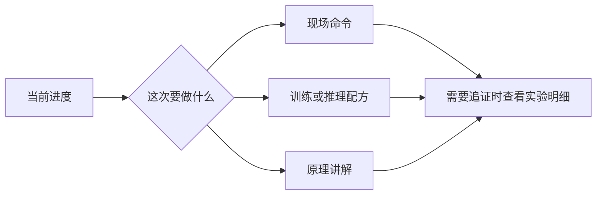

# F1积木任务：从这里开始

**最新：11月3日V42已部署，修正误接管提示与RTC预取调度。** 首条真实RTC已触发训练，但用户废弃后已完整回到干净检查点；下一步验V42短条、候选采用与实际连续性，自主能力仍未证明改善。见[V42复盘](inference/experiments/20261103-rlt-rtc-V42.md)与[当前状态](STATUS.md)。

这个任务要让F1用右手抓住积木、插入匹配开口、松爪并回位，逐步走向连续多物体操作。这里集中管理数据、训练、推理和现场评测，机器人工作台与通用代码仍在各自项目维护。

**日常先看“当前进度”；要跑机器人再看“现场命令”。** 当前重心是冻结B1250的局部RLT执行／学习合同整改和短条验证，V2暂缓；在线模型与最新决定只看[STATUS](STATUS.md)，输入合同见[最终方案](TRAINING_RECIPE.md#right-only-input-fix)，其余原理与实验明细按需阅读。

[在Why&How阅读本页](http://192.0.2.1:4243/?doc=f1-home)。页面读取这里的同一份原件，4242页脚也能进入阅读站。

## 优先阅读

| 你现在想做什么 | 打开哪一页 | 看多少 |
|---|---|---|
| 快速回顾V1及接下来重心 | [V1阶段总结](V1_Summry.md) | 一页结论；阶段快照，实时事实看STATUS |
| 知道做到哪里、下一步决定什么 | [当前进度](STATUS.md) | 先读前两段和下一步 |
| 比较模型、选择下一轮DAgger基线 | [模型实验表](Eval/CHECKPOINT_COMPARISON.md) | 历史选模；最新现场差异见Full与DAgger复盘 |
| 在现场运行模型 | [现场命令](inference/STARTUP.md) | 当前可用模型与完整命令；RLT按真实START开始，Y封存后Ctrl+C退出 |
| 确认训练怎么做、为什么 | [训练配方](TRAINING_RECIPE.md) | 先读结论，参数按需展开 |
| 查看局部RLT整改与在线学习 | [V42实录复盘与修复](inference/experiments/20261103-rlt-rtc-V42.md) | 暂停根因、废弃条撤回、RTC调度修复与四步进展 |
| 讨论新九条纠正怎么加入V1 | [V1＋DAgger配方](V1_DAgger_FullSFT.md) | 75∶25采样与监督边界；Full已到1K，候选待对照 |
| 确认推理、RTC和延迟 | [推理配方](INFERENCE_RECIPE.md) | 先看模型分支，深入再读机制 |
| 看最新分段延迟与优化取舍 | [RLinf离线对照](inference/experiments/20261023-rlinf-offline.md) | 基线、候选YES/NO及集中现场验收边界 |
| 判断本轮Full训练效果 | [Full训练复盘](training/experiments/20261020-v1-fullsft.md) | 结论、限制与是否续训 |
| 看本轮四个Full的真实表现 | [V1 FullSFT复盘](Eval/V1fullSFT/README.md) | 15次日志、13条反馈与新DAgger对比建议 |
| 准备下一批示教与DAgger | [DAgger准备](DataPrehandle/DAgger_V1_PLAN.md) | 先看采什么、如何验收接管与标签 |

## 需要时再看

- 数据怎么变成样本：[预处理SOP](DataPrehandle/README.md)、[逐帧窗口讲解](http://192.0.2.1:4243/?html=action-windows)、[真实三图处理预览](DataPrehandle/visualizations/20261016-recipe-preview/README.md)。
- 下一轮具体计划：[V1＋DAgger](V1_DAgger_FullSFT.md)；旧版已执行合同：[V1_FullSFT](V1_FullSFT.md)；后续工作与暂缓项：[TODO](TODO.md)。
- 回查旧结果：[训练记录索引](training/README.md)、[推理记录索引](inference/README.md)。日期实验是当时的证据，不能当作当前默认。
- 维护机器与查原始证据：[H20协作](H20_TASK.md)、[产物位置](artifacts/README.md)。这些通常由Codex读取。

## 每次协作怎样接续

你可以直接说“继续F1积木，先核对当前状态，再处理……”。Codex按[任务AGENTS](AGENTS.md)先读STATUS，再按问题选读一份主文档；交付时把新结论回写到原处，把实验依据留在对应报告。

这是一套持续维护的交接方式，不能仅靠文件名保证上下文永远准确。现场反馈、最新用户决定与实际日志出现差异时，先核对再更新；过期项目摘要和历史计划不覆盖新证据。

## 文件归属

| 目录或文件 | 放什么 | 不放什么 |
|---|---|---|
| 根AGENTS / 本任务AGENTS | 全局习惯 / 任务读取与维护规则 | 实验流水账 |
| STATUS / TODO | 当前进度 / 未完成事项与启动条件 | 全部历史日志 |
| 根两份recipe | 当前做法、理由、合同 | 多份相互冲突的“最新版” |
| DataPrehandle | 数据SOP、原理、诊断与图像预览 | 上游训练库副本 |
| training / inference / Eval | 版本实验、运行说明、现场结果 | 每次工具调用一份报告 |
| configs / src / scripts / tests | 任务适配、可执行配置与验证 | 手动修改后的冻结线上版本 |
| artifacts | 原始结果、图像、JSON/CSV与校验回执 | 需要你逐项阅读的日报 |

跨项目代码继续复用[DAgger/F1](../../DAgger/F1)、[F1-4242工作台](../../F1-4242)、[RLinf](https://github.com/RLinf/RLinf/tree/d00fe72060a5aa1554e92fe7bf72846d43d48c1c)和[OpenPI](https://github.com/Physical-Intelligence/openpi/tree/15a9616a00943ada6c20a0f158e3adb39df2ccac)。修改这些目录时同时遵守其规则；本任务是训练/评测事实入口，DAgger的STATUS负责机器人运行端事实。
