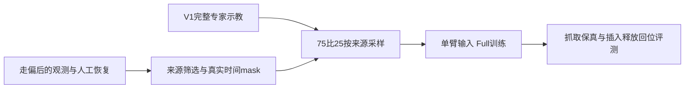

<!-- doc_type: recipe; status: review_at_1000; updated: 2026-10-22 -->

# V1＋DAgger：标准布局纠正的Full训练配方

**已批准将V1完整示教与新九条人工纠正一起训练，起始采样比例75%∶25%，每条样本的loss系数仍为1。** V1负责保住抓取和完整流程，纠正数据重点补孔口调整、释放、撤离和回位。这批是标准布局恢复数据，不作为木块／桶XY范围扩大的V2。

**纠正数据沿用π0.5的监督训练损失，但整条混合轨迹不能全部当专家答案。** 保留走偏后的真实观测，只监督有效人工恢复、单独批准的原生Home和真实停稳；策略走偏动作留作诊断。用户已确认本批成功且全程手柄纠正，后续由程序完成来源绑定和reader验收，不要求重复人工审片。

本轮沿已确定的单臂方案，从官方base做Full/global128，先到1K检查；四版首轮真机均未完成任务，250不再优先；1K旧模型只是本批数据的采集基线。**2026-10-22正式数据包已完成：训练18,899窗、验证4,084窗；H20 GPU4–7正式Full已完成1K、退出码0，250／500／625／1K包与生成检查齐全，按计划停查。四版已部署并各完成一条无辅助真机；停滞、拒绝与错位释放的证据见[DAgger首轮复盘](Eval/V1_DAgger/README.md)。** [正式W&B](https://wandb.ai/robotics-example/f1_complexytoys/runs/f1dagger20261022main1)已上线，见[实施验收](training/experiments/20261021-v1-dagger-fullsft.md)。共同合同只维护在[训练recipe](TRAINING_RECIPE.md)。

[Why&How阅读](http://192.0.2.1:4243/?doc=v1-dagger-fullsft) · [当前状态](STATUS.md) · [本批采集证据](inference/experiments/20261021-rtc-hil.md#九条连续纠正分析与保存反馈2026-10-21)

## 数据范围与划分

| 来源 | 本轮用途 | 当前计数与限制 |
|---|---|---|
| V1原15条完整成功示教 | 沿冻结12训练／3验证 | 旧合同训练13,102窗、验证3,384窗；新输入版本重新核验，不悄悄重分来源 |
| r6同进程九条成功纠正 | 整个场次进入训练 | 正式新合同包5,797窗，含742短窗；旧6,288为筛选前候选。主要覆盖持物后的孔口恢复，不等同九条完整抓取示教 |
| 旧r1首条成功纠正 | 保留独立纠正验证来源 | 新合同已回读通过700窗。它与九条为不同进程会话，但仍属同日同布置，不能当成跨布局泛化验证 |
| 其他策略评测、shadow或未登记记录 | 不自动加入训练 | 数据页文件夹和purpose不是专家标签；新增条目须明确纳入manifest |

九条共享`process_run_id=f1_hil_20261021T093218Z_1eb32b6e`，按整体场次隔离，不随机抽两条或相邻窗口充当独立验证。保留原V1固定288个验证起点；旧首条纠正的固定96个验证起点沿用，不能因新模型重抽更容易的样本。短验证轨迹取min(96,N)个互异起点，不重复凑96。

用户成功确认见[确认记录](artifacts/20261021-nine-hil-review/user-success-confirmation.json)，原件完整性和来源隔离已有全量审计。正式manifest已绑定各条源哈希、审核区间、Home完成证据、split及输入合同；原始manifest保留采集模型身份。数据包与模型GPU预检分别验收。

## 怎样处理这批纠正

| 时段 | 作为模型输入／监督的规则 |
|---|---|
| 模型先前走偏 | 原件保留，不把这些模型动作作为专家标签；本轮也不做自主成功前段的伪标签 |
| 人工开始恢复，夹爪仍偏位 | 保留当前真实图像和反馈状态，标签取随后真实有效的人工submitted动作 |
| 对孔、插入、松爪、撤离 | 保留有效人工动作；有目的的接触停顿、夹持等待和释放保持不能按“运动小”误删 |
| 按Y的原生Home | 独立来源批准，要求预设、发布连续性和完成反馈；不能冒充手柄动作。审核允许的人工→Home交接可连续监督 |
| Home已到位且张爪稳定 | 保留真实终点监督；本批各条实际保持约2.09–6.48秒，不复制末帧延长 |
| 接管后尚未开始操作的准备等待 | 本批约0.65–1.73秒；按已记录的人工操作边界排除纯准备等待起点，保留第一次有效纠正时的偏差状态 |
| 交还策略、未知来源、失效发布或日志间断 | 截断对应标签连续前缀，不能删掉中间再把两边接起来 |

为防止少数长时间终点等待占据过多采样，本轮终点只选择Home完成后前3秒内的有效观测起点；不足3秒就使用已有真实部分。**这是起点选择规则：不缩短已批准的真实标签范围。** 前3秒内的起点仍可用之后连续、合法的真实保持动作构造H50；不把起点筛选误写成动作断点。该规则已实现，审核文件分别保存anchor范围和label范围；合成录制→索引→实际reader已验证起点上限不会截断合法未来动作。九条真实包及合并数据集均已逐样本回读通过。

每个样本仍为“当前有效图像＋右侧状态＋原prompt → 相对当前锚点的未来动作序列”。30Hz/H50，实际合法前缀L=1–50，末尾padding在噪声、attention、loss和统计中均屏蔽；最少1个有效窗口即可入池。训练不要求把完整会话作为一个序列输入，窗口内部动作顺序与真实时间保留。

原始数据保留三图及真实state16。模型只用主图／右腕与右侧8维状态信息；采集审计仍可查看左图。候选6,288窗基于旧三图门槛，新版模型必需输入检查与原件完整性检查需分开，本轮新版最终为5,797个纠正窗口；与旧候选的差值不能作为训练期间丢样本的证据。

## 为什么先用75∶25

按正式窗口直接拼池，纠正占`5797 / 18899 ≈ 30.7%`，已经不低（旧候选口径为32.4%）。九条集中在同一布局的后半程，V1虽只有15条，却提供本轮主要的完整抓取与持物运输监督；不能因为数量少就降低V1的重要性。

本轮每次global128更新抽取**96个V1窗口＋32个纠正窗口**。这是相对自然窗口混合小幅降低纠正占比的起点假设，不是通用最优值；75∶25描述抽样机会，不是人为把纠正标签变得“不可信”。标准布局也有价值：模型诱发的偏差姿态与人工恢复方向，是完整顺利示教未充分覆盖的状态。

采样顺序：先分配来源配额，再在该来源内均匀选episode，最后均匀选该episode的合格起点。这样一条录得更久不会仅凭长度独占训练。各样本按有效L和10维求均值后统一平均，**不再对纠正loss乘2或其他阶段倍率**。先不叠加释放／Home额外加权，以免多个机制同时改变有效权重。

按正式计数，1K步约抽96,000次V1窗口和32,000次纠正窗口，分别是对应池大小的7.3倍和5.5倍；按episode均匀后每个窗口实际重复率不相等。重复窗口不是新增独立场景。

只有同版评测表明抓取保持、而纠正阶段仍明显学不足，才考虑下一次将纠正提高到约1/3；若出现抓取退化或过早停住，先检查来源／阶段采样与数据覆盖，不直接继续加权或堆训练步数。首轮不自动启动比例A/B。

## 模型与优化计划

| 项目 | 已批准配方 |
|---|---|
| 配方名 | `V1_DAgger_FullSFT`，数据标签`dagger_r1_standard`；不命名为XY泛化V2 |
| 初始化 | 已验证的官方π0.5 base；RLinf PyTorch Full，无LoRA；新优化器、RNG与数据游标 |
| 输入 | 按[单臂合同](TRAINING_RECIPE.md#right-only-input-fix)：仅右侧8维有效状态、主图＋右腕；左腕固定占位且image_mask=false，其他状态槽位在tokenizer前固定0 |
| 图像与动作 | 沿用ROI A、224等比补边和训练随机增强；右EEF10、原生FK／IK、30Hz/H50和独立维度／时间mask |
| prompt | 保留含抓取、匹配孔插入、释放、张爪回位的现Full原文，训练／推理一致，不新增“纠正”或阶段提示 |
| 归一化 | 仅新训练来源拟合，排除验证及padding；不按重复抽样次数复制数据拟合统计。记录去重基数、状态范围和有效相对动作分布 |
| global batch | 128；参考四卡×micro2×累积16，每个optimizer update全局96∶32。用户已授权H20 GPU4–7，启动前仍复查；不停止0–3服务 |
| 优化器 | 沿用已验收AdamW：betas(0.9,0.95)、eps1e-8、weight decay0、clip1.0；FP32主参数／BF16计算 |
| 学习率 | 峰值2.5e-5，warmup100，2K cosine日程到2.5e-6；1K为首轮review点，不因提前检查而重设日程 |
| 预算与保存 | 先到1K检查；每125步完整保存，250作早期检查，主要比较500／625／1K。继续到2K取决于收益，不自动跑长训 |
| 耗时 | 旧四卡Full128约10.37秒／更新，1K含开销约3小时17分；新单臂＋混采需预检实测，不承诺输入变少就同比提速 |
| W&B | 沿已确定group=`04_RightOnly_FullSFT`，新run／job_type=`train`，标签加`v1_dagger`、`dagger_r1_standard`、`mix75_25`；工程检查独立归`00_Engineering_Checks` |

1K是纠正数据的采集策略身份，不要求由1K任务权重续训。此次换输入合同并重算统计，沿已确定决定从官方预训练base重新微调；不能把旧任务Adam状态当作新实验恢复。旧V1_FullSFT及1K→2K原数据续训保留独立身份。

## 怎样判断有没有收益

离线分别报告V1验证与纠正验证，不能只展示一个混合loss。按抓取／运输、对孔插入、释放、撤离／Home、终点保持拆开报告，补充有效L和人工／Home／保持的实际采样比例；同一观测使用固定噪声做生成对比。相对EEF及夹爪指标须在新统计反变换后比较，不能将不同统计下的标准化loss直接排名。

现场先保持当前RTC参数和执行框架，比较标准布局完整成功率、人工协助次数、孔口停滞时长、插入后松爪、撤离和回位停稳；同时检查抓取是否退化。建议候选先各做5次同条件试验，用于淘汰明显差者，不据5次给精确成功率。再对较好的候选做小幅木块／桶XY扰动，作为局部外推检查；本批数据不支持宣称大范围或多物体泛化。

本轮同时改变输入选择和训练数据，因此只能报告整套配方收益；用户已决定不做额外左输入A/B，不能把改善全归因于DAgger或mask。

2026-10-22现场及固定观测检查已完成：无RTC引导仍停滞，抽查训练示教的释放也明显偏晚，增加去噪无明显改善。下一轮优先讨论保持数据／输入／RTC／来源75∶25不变的阶段采样对照，并用独立episode验证转折时机；本页原配方保留历史事实，不据此直接修改已训练数据或启动续训。详见[同观测对照](Eval/V1_DAgger/README.md#同观测同噪声对照进一步定位2026-10-22)。

## 实施状态与后续入口

| 已实现／已验收 | 当前边界 |
|---|---|
| 九份源哈希绑定监督清单、Home完成和用户成功确认 | 已取回5.88GB原件，九条5,797窗、合并train18,899/val4,084全部reader通过 |
| `right_only_v1`共享Processor，普通和prepared-pixels路径一致；CPU左输入扰动隔离通过 | 实际模型eager／suffix编译RTC同噪声隔离与attention检查已过；部署完成，但四次首轮现场未完成任务 |
| 来源→episode→起点采样及每次全局96∶32；H20 CPU游标、跨epoch、增强RNG恢复通过 | 真实四rank、Full两步→第三步恢复、Adam／导出已过；W&B实测纠正0.25 |
| 起点范围与标签范围分离；真实时间mask沿用，短于96窗可入reader | 已完成训练集统计、源/场次隔离、数据和代码冻结；四卡GPU预检门槛已通过 |
| `run_v1_dagger.sh`串接预检、恢复、导出、分阶段训练与验证；W&B在线认证通过 | 正式新run已完成1K、退出码0；四份候选包及生成报告齐全，停查，不自动续到2K |

实现入口：[打包器](scripts/prepare_v1_dagger.py)、[采样器](src/f1_toys/sampling.py)、[新配置](configs/sft_eef_v1_dagger_full.yaml)、[四卡流水线](scripts/run_v1_dagger.sh)。运行证据只汇入[本轮报告](training/experiments/20261021-v1-dagger-fullsft.md)，当前阻塞看STATUS；没有启动机器人动作；H20预检全部通过、正式run已到1K正常结束，部署与现场边界看STATUS。

方法依据：DAgger强调在策略诱发的状态上获得专家监督并聚合训练数据，可复用监督学习；不规定本任务的75∶25、H50或训练步数。本项目是人工接管式纠正采集，不声称满足经典DAgger所有状态标注的理论条件。[原论文](https://proceedings.mlr.press/v15/ross11a/ross11a.pdf)
