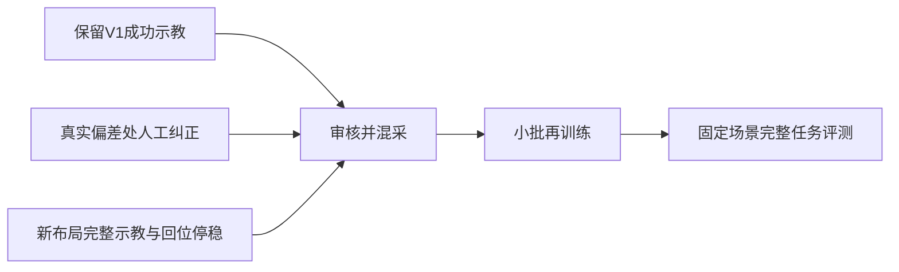

# V1阶段总结：保留数据，转向纠正与完整收尾

**V1没有作废：15条成功示教已经打通训练—推理，并学到部分抓取和运输能力；当前主要短板是孔口纠偏、及时释放、回位停稳和布局泛化。** 继续重复原数据尚未带来稳定的完整任务成功，不能把低loss或IK通过当成完成任务。

**下一阶段以补数据为主：接通RTC/HIL，用1K暂作固定采集基线，补真实偏差恢复与小范围布局变化完整示教。** 让已授权的2K续训按计划完成，作为对照，之后不自动延长；基线选择不代表1K已被证明最优，也不锁定下一轮训练初始化。

阶段快照：2026-10-21 14:15，北京时间。实时状态看[STATUS](STATUS.md)，本文只保存V1结论与下一阶段方向。

## 训练与实验结论

| 项目 | 已完成 / 当前结论 |
|---|---|
| 数据 | 15条成功，按episode冻结12训练／3验证；三图、ROI A、右EEF10，训练随机增强；Full纳入审核Home和短窗口时间mask |
| 数据修复 | 训练96窗口门槛已取消，旧15条原本都超过门槛，未因此丢弃；短HIL验证仍需取消固定96采样假设 |
| 旧LoRA | 已到50K；5K保留现场基线，后期步数没有可靠转化为更好泛化；旧配方与Full不能只按步数比较 |
| Full / global128 | 已完成1K，续训至1865/2000；1.5K已保存部署。原四rank、数据、优化器和W&B run延续 |
| 现场 | 625／1K／1.5K均有孔口停滞、迟松手或回位失败；1.5K首轮未显示核心改善，样本不足以排名 |
| 训练曲线 | 1K前训练loss下降、固定验证FM loss升高，有过拟合信号；部分生成动作误差仍改善，不能仅靠loss选模 |
| RTC与IK | 1K离线对照中，无RTC也回位走偏，RTC后段会放大；IK拒绝不是全部根因。此归因未在1.5K复做 |

## 接下来只抓这三件事

1. **接通并验收RTC/HIL。** 当前continuous不能手柄接管；先验证控制权、旧请求失效、交还新观测及标签，再采第一条真实纠正。给另一个agent的[完整实施prompt](DataPrehandle/HIL_DAGGER_AGENT_PROMPT.md)。
2. **补薄弱阶段与温和布局变化。** 孔口调整→插入→松爪→撤离→回位减速停稳；实际回稳后录2–3秒并核验进入索引。首批建议10–12条完整示教、12–18次有效接管，先审核第一条；数量是迭代起点，不是成功保证。
3. **小批训练、固定条件评测。** 原示教／新示教／纠正段明确混采，按会话与场次隔离。分别记录插入、释放时延、撤离、回位停稳和无人协助完整成功。先闭合单物体任务，再扩大布局、形状、多块与RL。

## V1末尾短，怎样补

- **保留V1，不重采全部。** 已有抓取、运输、释放和部分Home监督仍有价值；不足是现场偏差覆盖及终点保持，短保持尚未被证明是唯一原因。
- **复制末帧不等于增加真实数据。** mask为假的padding不提供停稳监督；让复制段参与loss属于新的合成监督假设。若试验，仅对已审核完成、反馈与图像确认稳定的训练段另建版本，标明合成来源并控制采样占比，不能更改原件或混入真实验证。
- **真实补采优先。** 合成停稳只教“已经到位后保持”，不能补“从走偏处撤离并回Home”。维持30Hz／H50；不能把旧锚点下的相对EEF动作chunk直接搬到新起点。

进一步核对：[训练复盘](training/experiments/20261020-v1-fullsft.md) · [现场诊断](Eval/V1_FullSFT_20261021_ANALYSIS.md) · [下一批数据计划](DataPrehandle/DAgger_V1_PLAN.md)。[W&B正式run](https://wandb.ai/robotics-example/f1_complexytoys/runs/f1full20261020main1)归组`03_V1_FullSFT`。
