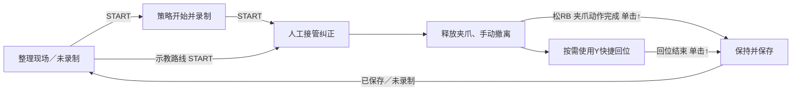
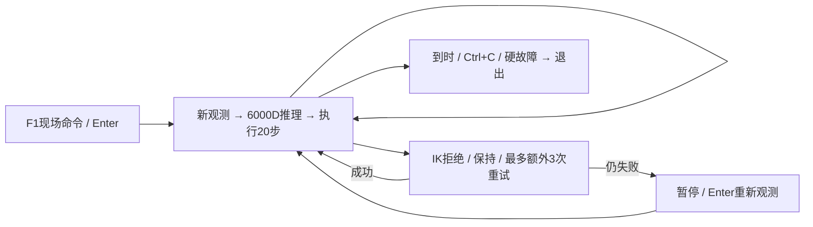

# F1积木推理：启动与现场操作

**当前局部RLT正式入口为 F1 RTC＋局部RLT V47，11月4日14:52激活，保留V46回退。** 继续使用下方完整Windows V46包，无需为语音重装；已安装V46者用原单窗口启动命令即可。终端控制版本应显示V47，真实START开条，无需Enter。

操作为 `START → VLA → →局部RLT → 必要时START接管 → ↑成功或↓失败 → START交VLA或Y复位封存`。未评分时START仍可立即接管，但人工交回VLA和正常Y会被拒绝并提示；评分后须重新按START或Y，被拒绝操作不排队。人工评分后保持人工；自主↓失败先停止，等待明确START接管或Y，不能把失败评分当解除保护。异常退出保存待审。

已通过176项本地、175项ARM与正式SHADOW零输出，真实恢复及连续性待现场验证。RLT预取预算和人工边界恢复仍有待办，不能据此宣布30分钟采集就绪；[完整发布与限制](experiments/20261103-continuity-validation-V44.md#activation-v46)。四条豆包短语音已部署：请评分／连接中断／动作受限／系统故障；[密钥配置](../../../DAgger/docs/F1/VOICE_PACK.md)。

## 网络默认：有线优先，Wi-Fi仅备用（2026-11-03）

F1当前有线地址为`192.0.2.7`；路由／DNS优先有线，Wi-Fi `192.0.2.3`保留备用。H20推理、6000D管理及数据上传都遵循机器人路由，不需要逐服务改模型endpoint；内部驱动网络保持。以下日常SSH、安装和网页入口统一使用有线地址。

**网络偏好只需配置一次；操控软件仍须单独升级V46。** 在准备启动的Windows PowerShell执行以下两行；第一行设置以后新开的终端，第二行立即设置当前终端。配置本身不会启动机器人或改变sender版本：

```powershell
[Environment]::SetEnvironmentVariable('F1_SSH_HOST', 'user@192.0.2.7', 'User')
$env:F1_SSH_HOST = 'user@192.0.2.7'
```

首次使用这个有线地址时，先完成一次只读SSH连接，让独立手柄隧道能复用已核对的主机身份：

```powershell
ssh -F NUL -i "$HOME\.ssh\f1_operator_ed25519" -o IdentitiesOnly=yes user@192.0.2.7 true
```

F1当前ED25519指纹为`SHA256:REDACTED_HOST_FINGERPRINT`，与6000D既有可信连接一致。若提示首次主机确认，核对该指纹后接受；已有地址密钥冲突不自动删除或绕过检查。该命令只执行`true`，不启动控制。

然后沿用下方`start_f1_rlt.cmd`单命令。已有运行连接保持原路径，须正常结束后重新打开。也可使用已发布的仅配置脚本`/home/user/Bruno/DAgger/updates/network-wired-20261103/set_f1_network_preference.ps1`；它不会替换控制包。6000D无法替操作者写入Windows用户环境，当前安装是否生效以本地连接日志为准。

有线不可达时，在新的现场会话显式选择Wi-Fi：

```powershell
& "$HOME\DAgger-F1\start_f1_rlt.cmd" --robot-host user@192.0.2.3
```

这仅选择本次备用地址，不改变持久默认；也不代表运行中无缝切换。断连仍按原保护停止旧输入，恢复遵守现场授权。V46完整包包含启动前地址候补；只有Windows实际安装V46后才生效，V38／V43不能据此宣称已具备。`.142`是当前DHCP地址，路由器保留尚未配置；重启、拔线和无DHCP维护直连仍须独立验收。网络证据及当前性能见[有线与shadow复盘](experiments/20261023-rlinf-offline.md#rtc-sync-shadow-20261103)。

<a id="single-window"></a>

## 推荐：Windows 单窗口启动 RLT

**先正常退出旧操控窗口，再安装完整V46包。** 不只换启动器：14个清单文件包括sender、协议、ACK处理、会话与日志组件；校验后原子切换，保留旧包和回退备份。安装不启动机器人。

Windows PowerShell任意目录，按顺序执行；第一行下载成功后再执行第二行：

```powershell
scp -F NUL -i "$HOME\.ssh\f1_operator_ed25519" -o IdentitiesOnly=yes user@192.0.2.7:/home/user/Bruno/DAgger/updates/f1-ssh-session-V46/install_single_window.ps1 "$env:TEMP\f1_operator_V46.ps1"
powershell -NoProfile -ExecutionPolicy Bypass -File "$env:TEMP\f1_operator_V46.ps1" -RobotHost user@192.0.2.7
```

安装应显示“操控包与sender V46已安装”。然后启动：

```powershell
& "$HOME\DAgger-F1\start_f1_rlt.cmd"
```

窗口必须分别显示本地操控包／sender V46、机器人“F1 RTC＋局部RLT V46”，→时再显示实际actor。版本不一致先退出核对；不能用安装成功代替实际运行身份。本地Python沿用原配置，没有重新安装环境。

同一窗口显示F1推理状态，真实START开条。先在等待START时测试Ctrl+C返回当前PowerShell，再运行同一命令；退出等待有上限，只清理本次sender／SSH，远端保存未确认会明确提示。正常任务仍先Y封存，再Ctrl+C；不以关闭窗口代替保存。连接断开时F1沿用原watchdog暂停，重连需真实重新授权。端口被其他实例占用时拒绝，不抢占别的进程。

默认为 B1250＋局部RLT在线Q试用（保留历史入口别名rlt400），可追加 `--model stageb1250` 使用 B1250 HIL，或 `--shadow` 做零输出；这些都引用现有正式入口。自定义机器人连接用 `--robot-host user@地址`；Python 沿用 `F1_SENDER_PYTHON`，未设置时为 `$HOME\.venv\Scripts\python.exe`。上面的安装命令复用已配置的专用密钥；首次设置可单独执行 `start_f1_rlt.cmd --setup-key`，设置时可能提示SSH密码，以后启动器自动使用私钥，不存储密码。若免密验证失败，主连接仍可按原密码登录，但日志后台同步会保留待补，不能视作上传成功。也可稍后单独运行 `start_f1_rlt.cmd --setup-key`。

本地日志：`$HOME\DAgger-F1\runtime\operator-sessions\<session>`，分别保存sender、终端SSH、手柄隧道SSH、生命周期与远端控制台，后台校验续传到F1，再镜像到6000D的`/home/user/Artifacts/F1/operator-logs`。网络或认证不可用时本地待补，不阻塞控制、不在后台询问密码。[V38显示与日志修复](experiments/20261102-session-unicode-V38.md)。

<a id="rlt-gamepad"></a>

## 历史：局部任务v2安装说明（V46用户不要执行）

当前先 B1250，手动 →进入一次局部RLT，并采用最新通过检查的actor候选；START 人工交还始终回 VLA。↑确认放置并释放成功，Y 完成右臂及右夹爪复位、反馈稳定两秒后保存整条。后台Q更新已接通，局部段内版本固定；尚未证明优于基线，仍可能停滞或不松手。采集时按局部终点及时确认↑。

**以下仅保留旧v2的迁移证据；当前请安装上方V45整包，不运行本节旧安装器。** 先退出 sender，正常隧道可保留。Windows PowerShell 任意目录执行：

```powershell
scp -F NUL user@192.0.2.7:/home/user/Bruno/DAgger/updates/20261027-rlt-local-r2/update_rlt_gamepad.ps1 "$env:TEMP\f1_update_rlt.ps1"; if ($LASTEXITCODE -eq 0) { powershell -NoProfile -ExecutionPolicy Bypass -File "$env:TEMP\f1_update_rlt.ps1" -RobotHost user@192.0.2.7 } else { throw '下载失败' }
```

安装器备份并校验 9 个文件，应提示“Windows sender RLT 局部任务 v2”。沿用现有 Python；若路径不同，用安装器 `-PythonExe` 指定现有 sender 解释器，不另装环境。更新本身不会启动动作。

**终端1：Windows PowerShell，任意目录；保持隧道打开。** 已有同端口正常隧道则复用。

```powershell
ssh -F NUL -N -o ExitOnForwardFailure=yes -o ServerAliveInterval=15 -L 127.0.0.1:7907:127.0.0.1:7906 user@192.0.2.7
```

**终端2：Windows 另一个 PowerShell，启动 sender。** F710 使用 X 模式。

```powershell
cd "$HOME/DAgger-F1"
.\scripts\windows_f1_sender.cmd
```

**终端3：F1 本机现场 Bash，任意目录。** 其他控制会话结束后运行；无需Enter，等“B／actor通信连接已准备”，再按真实 START。

```bash
bash /home/user/Bruno/DAgger/start_f1_toys_inference.sh --model rlt400 --continuous
```

| 按键／阶段 | 当前行为 |
|---|---|
| 等待时 START | 新建整条，B1250 RTC 开始 |
| VLA 时 → | 本条唯一一次进入局部 RLT；已使用后再按拒绝 |
| VLA／RLT 时 START | 人工接管，保持同条；RB控臂、RT夹爪 |
| 人工时 START | 松RB、等夹爪完成后交 VLA；局部未↑则本次失败0 |
| RLT 自主时 ↑ | 确认局部成功，关闭局部并交 VLA |
| 人工时 ↑ | 确认局部人工辅助成功，保持人工；再START才交VLA |
| Y | 关闭尚未完成局部任务，再Home；反馈稳定两秒后封存整条 |
| ↓／← | 不评分、不切策略 |

↑在正确放入、松爪后保持时按，不等撤离；局部已关闭后不能补用回位画面作为成功终态。人工接管本身不记失败，断网／急停／异常为中断待审。人工暂停仍须松RB回中、等“输入已确认”后再RB，START不解除暂停。Y后下一次START重新开条，从VLA开始。

首条建议按：**START → VLA → →进入RLT → START人工纠正 → ↑成功 → START交VLA → 必要时再次START纠正／交还 → Y**。若RLT自主成功，直接↑交VLA后Y。Y是复位与封存，不是成功评分。

日志：`/home/user/Bruno/DAgger-runtime/rlt-local-20261027-r2/runtime/onsite-rlt-hil-console.log`；原件：`/home/user/Bruno/data/hil_data/policy_hil/`。装配与控制版本以上方当前说明为准。→受理响三声上行，交回VLA在操作受理时响两声上行；**↑成功受理响两声同音，并显示“↑已确认：局部放置成功，奖励1已记录”**，人工此时仍保持控制。未受理↑会显示拒绝提示，不响成功音。Y完成封存才响整条保存音。已有局部v2 sender无需重装，正常结束后重新启动推理即可加载新版；现场听验尚待操作者确认。

以下为10月28日历史验收（当前Q已开启，以STATUS为准）：10:42和11:11条已确认右臂实际移动，后者↑原始记录为成功。replay切片修复及119转移的八步训练预检通过，W&B offline；持续学习器仍暂停，旧故障条132步不恢复，Q及自动发布关闭，线上actor仍BC400。RLT仍为同步C16，并未增加RTC。完整[验收与回退记录](experiments/20261027-rlt-local-v2.md#replay-success-20261028)。

## 当前B1250：continuous

```bash
# 当前H20 GPU3：B1250，冻结权重，增加释放临近窗口采样的原检查点
bash /home/user/Bruno/DAgger/start_f1_toys_inference.sh --model stageb1250 --continuous
```

`--list`查看活动模型登记，当前只有B；`--model stageb1250 --check`核对真实身份，不发机器人动作。定时用`--duration-seconds 30`替代`--continuous`。B使用H20 GPU3，H20 8138→F1 8153；A、父1K和旧Full的服务及转发已停止，旧别名查询会拒绝，不会静默映射到B。

B与actor当前共享服务目录为`/u01/user/runs/f1-rlt-rtc-V41/service`，重启入口为该目录`start.sh`；不使用旧日期目录中的历史启动脚本。公开装配为`f1-rtc-rlt-V41`，普通rollout／HIL保留显式旧客户端绑定；机器人普通B日志仍在`/home/user/Bruno/DAgger-runtime/stage-ab-20261023/B-1250/rollout/runtime/onsite-policy-console.log`。B权重未变，当前部署回执见[V41报告](../training/experiments/20261102-rlt-rtc-V41.md#deployment-20261103)。

普通B推理记录在4242“真机rollout”的`V1_DAgger_StageSampling_B_1250`分类，历史其他模型分类保留；HIL仍在“DAgger/策略HIL”，当前仅B1250。shadow不保留录制。需要完整终端输出时，在命令前加`F1_CONSOLE_VERBOSE=1`。

<a id="onsite-b1250-batch-20261026"></a>

### B1250：先复用现有记录，按需补录

**用户清理后剩五条B1250记录，五条均已保存备注；当前不要求再跑重复rollout或改变位置。** 其中2条为优化运行版本、3条为旧版本，保持分组；一条明确完整成功，其余有释放延迟、中止及单run两次尝试，不能将五条文件直接当成五个完整任务。先按备注回看、划分真实尝试，核对局部起止与执行转移。[最新备注快照](../artifacts/20261026-b1250-only/five-rollout-notes.json) · [备注解读](../artifacts/20261026-b1250-only/rlt-five-record-assessment.json) · [RLT分析与下一步](../training/experiments/20261026-rlt-frozen-b1250.md#rlt-existing-rollout-notes)。

下一步由代理先核对已有备注与原始记录；数据页只回看视频，不执行机器人Replay。保留操作者原备注，补充经画面确认的局部开始、实际释放／结束、物体结果和介入原因；一条中两次尝试必须查明重置边界，不能跨重置拼接next observation。中止保留为截断候选，没有统一时限时不自动标超时失败；未进入孔口或时刻不明则明确标注，不猜起止，也不凭张爪或程序结束认定任务成功。现有备注尚未形成奖励或训练准入结论，仅在核对后有明确缺口时再请操作者补充。

早先[六条目录快照](../training/artifacts/20261026-rlt/catalog-review-20261026T061028Z/summary.json)和[原空白批次清单](../artifacts/20261026-rlinf-followup/onsite-batch.csv)保留历史。原“同布局3条＋位置变化3条”是复验建议，已取消为RLT前提；不将后来五条记录冒充该批次已完成。

只有现有记录缺少关键画面、结果或阶段时才定向补录。届时使用上方B1250原命令，在**F1本机现场Bash、任意目录**运行，Enter开始；每条任务自然完成、明确失败或需要中止后Ctrl+C保存退出，再整理下一条。保留成功、失败和中止，不为累计时长继续运动或凑成功数。日志仍在上方B1250运行目录，会话原件在`/home/user/Bruno/data/hil_data/policy_hil/`；代理统一读取分析，现阶段不要求另填CSV。普通B1250入口不是手柄HIL入口；HIL记录作为独立恢复证据，核对真实模型与接管点。

<a id="rtc-hilfull1k真实手柄接管"></a>

## RTC-HIL：当前仅B1250

**现在示教与策略HIL统一为：START开始，十字键↑结束保存。** 策略运行中再按START接管；进入人工后START不再交还策略，也不结束录制。保存完成后可整理现场，再START开下一条，无需重启三端。默认右臂，直接RB控臂。

**收尾由操作者决定，不要求先回位或等待两秒。** 松RB并等夹爪操作完成后按↑保存；Y保留为可选快捷回位。若正在执行Y，等动作结束即可保存，没有额外保持计时。

模型在启动HIL进程时绑定，省略`--model`默认B1250；当前只接受B，父1K选择已暂停。通用选模机制保留，以后恢复其他checkpoint须先完成登记、部署和身份核验，再保存当前条、退出HIL进程并启动新会话；不支持活动录制或RTC轨迹中途热换。本轮38项装配测试、B的rollout／HIL入口及真实端口身份检查通过，无机器人动作；首次B1250现场接管仍待操作。[模型与端口说明](../INFERENCE_RECIPE.md#hil-model-selection)。

F1infra统一提供启动指引、状态与手柄教程：[策略HIL](http://192.0.2.7:4242/#hil?route=policy) · [人工示教](http://192.0.2.7:4242/#hil?route=demonstration)。10月23日新增人工暂停恢复：**可恢复保护／网络暂停后松RB、全部回中，等提示再新按RB；同条继续录制。** 已完成的九条纠正审核保留；本次修复的现场恢复效果另验，不能沿用旧验收。部署与验证见[暂停恢复报告](../DataPrehandle/reports/20261023-manual-demo.md)。

### Windows sender：已更新者直接复用

本机已由用户确认安装“连续分条20261021”，它已包含恢复握手；**仅使用原B／人工入口无需更新；RLT必须使用上节新版**。以下命令仅供仍使用更旧版本或新电脑时安装。

先退出旧sender；正常隧道可以保留。Windows PowerShell、任意目录执行。安装器备份9个文件、校验哈希和加载检查，不启动机器人。旧sender不提供↑事件，新分条入口会拒绝开始。回退时sender与接收端应成套回退。

```powershell
scp -F NUL user@192.0.2.7:/home/user/Bruno/DAgger/updates/20261021-continuous-episodes/update_episodes.ps1 "$env:TEMP\f1_update_episodes.ps1"; if ($LASTEXITCODE -eq 0) { powershell -NoProfile -ExecutionPolicy Bypass -File "$env:TEMP\f1_update_episodes.ps1" -RobotHost user@192.0.2.7 } else { throw '下载失败' }
```

更新时整行复制执行；应下载`windows-episodes-20261021.zip`并显示“Windows sender 连续分条 20261021”。如果仍下载`windows-right-arm-20261021.zip`、显示“默认右臂”，执行的是旧更新器，不能用于本次连续分条。

### 三端启动

**终端1：F1本机现场Bash，任意目录。** 结束上一控制会话，按原流程启动基础服务，准备姿态与净空。以下按路线只运行一条，真机入口需现场按Enter；尚未按START时不录制。

```bash
# B1250策略HIL：需要调试手柄分条时可选零输出演练
bash /home/user/Bruno/DAgger/start_f1_toys_rtc_hil.sh --model stageb1250 --shadow --continuous

# B1250策略HIL真机：正常使用直接执行；先退出其他控制会话
bash /home/user/Bruno/DAgger/start_f1_toys_rtc_hil.sh --model stageb1250 --continuous

# 人工示教：同样的START/↑，首次START直接进入人工
bash /home/user/Bruno/DAgger/start_f1_hil_route.sh demonstration

# 人工示教零输出演练（需要时选择）
bash /home/user/Bruno/DAgger/start_f1_hil_route.sh demonstration --shadow

# 自由接入：不录制，START仍切换人工/保持；↑不分条
bash /home/user/Bruno/DAgger/start_f1_hil_route.sh play
```

**终端2：Windows PowerShell，任意目录。** 已有同端口正常隧道则复用，保持此窗口打开。

```powershell
ssh -F NUL -N -o ExitOnForwardFailure=yes -o ServerAliveInterval=15 -L 127.0.0.1:7907:127.0.0.1:7906 user@192.0.2.7
```

**终端3：Windows另一个PowerShell，sender目录。** F710背面X模式，确认左摇杆控制X/Y；若变成视角头盔，按MODE切回。收到F1的SHADOW/POWERED回执后再操作。

```powershell
cd "$HOME/DAgger-F1"
.\scripts\windows_f1_sender.cmd
```

### 每条完整流程



1. **准备与开始：** 松开全部控制、摇杆回中，单击并释放START。听到原开始音、看到正在录制后继续；策略路线运行启动时选定的模型（默认B1250），示教路线直接人工。
2. **接管：** 策略偏离时单击并释放START，听到C下行双音。无需十字键选右臂，直接按住RB操作。人工阶段再按START只提示，不交还、不保存。
3. **收尾：** 您自行决定完成插入、RT松爪、撤离及是否回位。需要快捷回位时，先确认路径无障碍，松RB、单击Y；Y不会自动避箱，夹爪保持原状态，不是保存前提。
4. **分条：** 松RB、等夹爪操作及正在执行的Y结束，单击并释放十字键↑；不检查是否回位，也不要求两秒保持。等保存音和网页“已保存／未录制”，再恢复桶与积木、变化布局。**保存中不要提前START；提前按键不会排队。**
5. **下一条：** 整理完后再START，使用新观测、新RTC空前缀。三端一直保持打开。全部结束时在F1终端Ctrl+C并等退出，再关闭sender和隧道；网页“结束运行端”同样结束整个进程。

↑在RB按住、Home进行中、夹爪命令未完成或START仍按住时不结束；条件满足后重新按↑。保存不检查Home终点或固定保持时长。**保存成功不等于任务成功或训练采纳**，需逐条审核。Ctrl+C保留当前截断条并标待审，不自动Home；暂停中放弃继续时，松开控制后可↑封存待审。

### 卡住时怎样恢复

1. **松开RB，摇杆、扳机和其他按键全部回中。** 不要连按START，也不要一直按住RB等它自动恢复。
2. **看F1infra或F1终端状态。** 网络断续先等重连；看到“重新按RB”后，新按一次RB。限位附近向可行方向退离，继续推向受限方向仍会被保护拦住。原有限位内直接反向退离也保留。
3. **同条继续完成任务。** 正常暂停、恢复期间原始数据继续记录；故障区间单独标记，训练窗口会排除，不能跨暂停拼接。暂停中的RT、Y和旧运动不会事后重放，需要恢复后重新操作。
4. **如果显示实测姿态未通过检查或硬故障，按具体原因处理。** 真实越限、当前姿态碰撞、发布／协议错误与Home失败保留原保护；不能靠START或重复RB绕过。可保存的暂停条用↑封存，无法继续则退出并处理原因。

策略尚未交给人工时，策略／IK／RTC故障仍可用START显式接管纠正；这是策略接管，不是人工恢复。本次不改左夹爪硬件或数据格式，按用户决定留待后续数据处理。旧入口两次保护封存三段的行为及删除记录见[核查与修复](../DataPrehandle/reports/20261023-manual-demo.md)。

### 手柄摇操速查

| 控件 | 当前动作 |
|---|---|
| START | 空闲时开新条；策略中接管；人工阶段不交还、不结束 |
| 十字键↑ | 结束并保存本条；松开后下次才形成新按键事件 |
| RB | 按住才使能右臂运动，松开保持；可恢复暂停时松开、全部回中、等提示后重新按；无需先选臂 |
| 左摇杆＋RB | 前后/左右平移：前推为机器人+X，左推为+Y |
| 右摇杆＋RB | 上下俯仰，左右偏航 |
| LB＋RB / LT＋RB | 末端上移 / 下移；LT深度影响下移速度 |
| X＋RB / B＋RB | 负向 / 正向滚转 |
| RT | 人工中每按下并释放一次切换右夹爪开合；无需RB |
| A | 切换1×/2×速度 |
| Y | 可选快捷回积木demo-V1；先手动避障、松RB，夹爪保持；不作为保存前提 |
| 十字键左/右/下 | 不选臂；不承担录制边界 |
| Ctrl+C（F1终端） | 保存已采前缀并退出进程，不额外Home |

新版三阶段声音是**开始原音→C人工接管音→原B保存音**，响度沿用现场确认档位。示教没有策略接管阶段，因此通常只有开始/保存两次声音。新版不再交还策略，上行交还音不在此流程触发；shadow不播放真机提示音。

### 本次现场验收与日志

若要单独验收手柄接管，可在shadow走两次 `START→START接管→松开控制→↑保存`，第二条必须等已保存后重新START；无Home的shadow测试条不进入训练。验证人工中额外按START不会回策略，且现场始终无动作。Ctrl+C结束shadow，再启动真机；先做短幅自由空间确认，再完成两条正常纠正。每条保留布局、接管原因、是否环境协助和Home结果，不能用手挪桶/扶物的片段直接标专家动作。

| 路线 | 冻结版本 | 控制台与状态 |
|---|---|---|
| 默认B1250 RTC-HIL | `20261023-f1-hil-save-optimized-r1` | `/home/user/Bruno/DAgger-runtime/stage-ab-20261023/B-1250/hil/runtime/onsite-powered-console.log` |
| 示教/自由接入 | `20261021-f1-hil-v33-continuous-episodes` | `/home/user/Bruno/DAgger-runtime/continuous-episodes-20261021/manual/runtime/onsite-powered-console.log` |

每个runtime的`last-session.json`定位最近已保存条；原件分别在`/home/user/Bruno/data/hil_data/policy_hil/<run_id>`和`demonstration/<run_id>`。进程诊断放runtime/sessions，换场景空闲期不写训练图像。当前唯一活动模型B1250的model_id为`f1-toys-eef-81444e7071723c1f`；D14/S16自适应、H50/30Hz/5步不变，rollout与HIL均已身份核对。[本次模型切换验收](../INFERENCE_RECIPE.md#hil-model-selection) · [连续分条历史](experiments/20261021-rtc-hil.md#统一连续分条2026-10-21)。

可选定时入口仍支持`--duration-seconds 30`替代`--continuous`，以当前条首次START开始计时，到时保留截断数据并退出；批量采集用continuous。

## 以下为旧服务历史命令（已停止，不能直接使用）

以下全部保留追溯与回退说明，其中“当前／本轮”均指各段的历史时点。2026-10-26活动目录仅B1250；A、父1K、旧Full和LoRA命令现在不可用，旧端口可能关闭或被复用，不能绕过身份检查连接B。需要恢复其他模型时，须重新登记、部署完整服务并核对合同，不能直接照抄历史启动命令。

### 2026-10-23至26日的A／父1K／旧Full1K（已停止）

以下是收敛为仅B之前的命令，保留原模型含义；当前别名解析会拒绝，不会转指B：

```bash
# 历史旧V1 FullSFT 1K：当时GPU2，H20 8160→F1 8155
bash /home/user/Bruno/DAgger/start_f1_toys_inference.sh --model full1000 --continuous

# 历史A1250：当时GPU0，H20 8137→F1 8152
bash /home/user/Bruno/DAgger/start_f1_toys_inference.sh --model stagea1250 --continuous

# 历史父DAgger1K：当时GPU3，H20 8139→F1 8154
bash /home/user/Bruno/DAgger/start_f1_toys_inference.sh --model dagger1000 --continuous
bash /home/user/Bruno/DAgger/start_f1_toys_rtc_hil.sh --model dagger1000 --continuous
```

Full1K服务目录为`/u01/user/runs/f1-toys-full-1000-rtc-20261023`，机器人日志在`/home/user/Bruno/DAgger-runtime/full-restore-20261023/1000/rollout/runtime/onsite-policy-console.log`。A和父模型服务在`/u01/user/runs/f1-rlinf-optimized-20261023-r1/{stagea1250,dagger1000}`；A日志为`/home/user/Bruno/DAgger-runtime/stage-ab-20261023/A-1250/rollout/runtime/onsite-policy-console.log`，父模型rollout日志在`/home/user/Bruno/DAgger-runtime/dagger-rightonly-20261022/1000/rollout/runtime/onsite-policy-console.log`。父HIL日志在同根`1000/hil/runtime/onsite-powered-console.log`，model_id为`f1-toys-eef-0ff87ec17ddfae2e`。这些路径、权重及历史数据分类保持。

当时公开装配先为`unified-rlinf-save-20261023-r1`，10月26日较早切到`unified-hil-b1250-20261026-r1`以开放B／父1K HIL；随后已由当前仅B装配替代。较早的双模型身份与软件验收见[部署回执](../artifacts/20261026-hil-b1250/activation.json)。

### 旧Full 625 / 1K / 1.5K / 2K

**F1本机Bash，任意目录**。本轮部署时基础驱动未运行（motor_ctl_node=0）；先按4242原流程启动基础服务，结束上一条控制会话，准备起始姿态和物体。四个服务已通过各24次历史回放，2K真实相机shadow尚未完成；可先执行下面零输出检查：

```bash
bash /home/user/Bruno/DAgger/start_f1_toys_inference.sh --model full2000 --shadow --duration-seconds 40
```

检查完成后，真机四条任选一条：

```bash
# Full 625，H20 GPU0
bash /home/user/Bruno/DAgger/start_f1_toys_inference.sh --model full625 --recovery standard --continuous

# Full 1K，H20 GPU1
bash /home/user/Bruno/DAgger/start_f1_toys_inference.sh --model full1000 --recovery standard --continuous

# Full 1.5K，H20 GPU3
bash /home/user/Bruno/DAgger/start_f1_toys_inference.sh --model full1500 --recovery standard --continuous

# Full 2K，H20 GPU2
bash /home/user/Bruno/DAgger/start_f1_toys_inference.sh --model full2000 --recovery standard --continuous
```

四条任选一条；切换先Ctrl+C退出，再启动另一条。短测将`--continuous`改为`--duration-seconds 20`；额外加`--shadow`为零输出检查。保留完整telemetry和录制，退出不额外发送Home。

四者都是本轮Full/Home/时间mask模型，三图ROI A、224、右EEF10、H50/30Hz/5步，新prompt与统计随bundle绑定。采用当前v6-param-read-r2客户端，保留v5三图并行、无损PNG、F1→H20独立直连、精度保留CUDA Graph、完整VJP和原生数学加速。D初值/下限14、S最小16，仍有既有自适应延迟；IK限位/容差/有界恢复不变。

| 模型 | F1→H20端口 | H20 tmux | 服务日志根目录 |
|---|---|---|---|
| Full625 | 8152→8137 | f1-full-625-rtc | `/u01/user/runs/f1-toys-full-625-rtc-20261021` |
| Full1000 | 8153→8138 | f1-full-1000-rtc | `/u01/user/runs/f1-toys-full-1000-rtc-20261021` |
| Full1500 | 8154→8139 | f1-full-1500-rtc | `/u01/user/runs/f1-toys-full-1500-rtc-20261021` |
| Full2000 | 8155→8160 | f1-full-2000-rtc | `/u01/user/runs/f1-toys-full-2000-rtc-20261022` |

F1控制台位于`/home/user/Bruno/DAgger-runtime/f1-toys-20261016/full-h20/startup-read-v2/<步数>/runtime/onsite-policy-console.log`。会话仍在`/home/user/Bruno/data/hil_data/policy_hil/`，切换只改变新入口选择，不覆盖原入口。冻结H20运行时`f1-toys-20261021-full-rtc`；625/1K证据在任务`artifacts/20261021-full-h20/`，1.5K在`artifacts/20261021-full1500-h20/`；本轮四模型恢复与2K新增验收在`artifacts/20261022-full-four-h20/`。2K复用已授权的H20 8160，无需新增SSH权限。

服务恢复在6000D维护终端使用SSH，先确认所选GPU没有其他任务；对625执行以下命令，1K/1.5K将625分别改成1000/1500：

```bash
ssh h20-train 'tmux new-session -d -s f1-full-625-rtc "exec bash /u01/user/runs/f1-toys-full-625-rtc-20261021/start.sh >> /u01/user/runs/f1-toys-full-625-rtc-20261021/restart-console.log 2>&1"'
```

2K恢复脚本位于上表20261022目录，不能仅替换625数字而沿用旧日期。若tmux已存在，不重复启动；等待模型与Graph预热后再现场调用。此维护命令不发送机器人动作。

## 旧50K软件恢复独立候选（历史，现已暂停）

**以下为历史操作记录，不可直接运行：50K/ik已从统一活动菜单归档，H20 8160现为Full2K。** 恢复研究需重新分配并核验服务身份，不能与本轮Full共用端口。

这是针对历史IK拒绝的独立实验：原限位，失败后有限重采样；若只得到连续可行前段，沿原序列执行后确认规划器停止与真实反馈到位，再重新观测。没有EEF投影或夹爪冻结。真实50K固定输入回放为32完整窗＋17可行前段，不能称49次任务成功；[验收与限制](../Eval/README.md#2026-10-21-软件恢复候选与验收边界)。

**F1本机Bash，任意目录**；结束上一条控制会话，按原流程准备起始姿态和积木。Enter开始，Ctrl+C结束，不自动回位：

```bash
bash /home/user/Bruno/DAgger/start_f1_toys_inference.sh --model 50k --recovery ik --continuous
```

保留原50K的D20/S20与旧prompt。需要定时则用既有`--duration-seconds`，追加`--shadow`零发布。专用隧道随脚本检查，无需Windows sender或手柄；该独立入口尚不是HIL接管入口。20秒真实相机shadow已完成30请求、598观测、零发布/RTC超时，并确认新ControlLoop已启用；后续两次现场由用户确认任务成功，重采样分别救回12/4请求；5次前段恢复均卡在J6到位差。这些是r2历史结果。现独立r3已修正文案：原命令自然停稳但目标未到位时，明确放弃原目标，发布实测保持并等待更新反馈确认，才重新观测；不放宽1°门槛。r3新增20秒shadow为30请求/601观测、零发布，现场自动接续仍待验。

| 用途 | 位置 |
|---|---|
| 推理服务 | H20 GPU2，tmux `f1-ik-recovery-20261021`；F1 8161→H20 8160 |
| F1控制台 | `/home/user/Bruno/DAgger-runtime/ik-recovery-20261021-r3/runtime/onsite-policy-console.log` |
| 会话与telemetry | `/home/user/Bruno/data/hil_data/policy_hil/` |
| H20请求与候选选择 | `/u01/user/runs/f1-ik-recovery-20261021/logs/` |

用户已授权仅为原F1专用受限SSH钥匙增加回环8160，其他限制保留；Full625/1K仍用GPU0/1与原端口。原入口不变，退出本候选后可选原入口，代码回退不恢复实物姿态。r1/r2原包与证据保留；统一入口当前指向r3，原直接入口仍可用于回退。见[r3验收回执](../Eval/artifacts/20261021-ik-recovery-onsite/tracking-hold-prototype/acceptance.json)。统一入口回执在`/home/user/Bruno/DAgger-runtime/rtc-framework-20261021/runtime/`。

## Full SFT 250在6000D上推理（2026-10-20）

**F1本机Bash，任意目录**；结束其他控制会话，按原流程准备起始姿态与物体，Enter开始、Ctrl+C停止：

```bash
bash /home/user/Bruno/DAgger/start_f1_toys_full_250.sh --continuous
```

短测将`--continuous`替换成`--duration-seconds 20`；追加`--shadow`只观察、不发布动作。该入口是本轮Full 250，使用新prompt、统计、Home合同，6000D GPU2/8150，经F1本地8151连接；H20的当前用途见STATUS。RTC沿6000D D20/S20，5步采样，三图并行；旧入口和IK规则不变。

24次历史回放通过；30秒真实相机shadow完成46请求、零发布/零RTC超时，3次IK拒绝均恢复。完整任务效果待现场验证。模型尝试学到的回位，退出脚本不会强制发送Home。控制台在`/home/user/Bruno/DAgger-runtime/f1-toys-20261016/full-rtc/250/runtime/onsite-policy-console.log`；会话telemetry仍归`/home/user/Bruno/data/hil_data/policy_hil/`。[部署、验收与服务恢复](experiments/20261020-full-250-6000d.md)。

## 6000D旧5K RTC回退

仅在需要旧LoRA基线时使用。**F1本机Bash，任意目录**，先结束当前会话；启动前核对6000D服务health和模型身份。Enter开始、Ctrl+C停止：

```bash
bash /home/user/Bruno/DAgger/start_f1_toys_rtc_6000d.sh --continuous
```

回退的D20/S20与Full625/1K的D14/S16不同，不能把配置变化归因于模型。旧服务恢复及证据见[RTC记录](experiments/20261019-rtc.md)。

## 历史入口，仅供维护追溯

下列旧H20 LoRA端口已被Full服务复用，原命令当前不适用；旧sync/500步/activate说明也不是本轮Full入口。只有核对对应版本和在线身份后才可维护，日常优先使用页首命令。

<details markdown="1">
<summary>展开旧LoRA、同步基线和早期部署命令</summary>

## 50K RTC低延迟参数候选（2026-10-20）

默认20/20保持。14/20与14/16已完成历史回放与完整录制shadow，零RTC超时/零发布；14/20已有58秒真机验证：零RTC超时、最小余量约100ms，新后缀参与发布提前约200ms；14/16也已完成首轮57秒真机：正常接续222/255ms，零RTC超时、最小余量193ms；后续推荐沿用14/16独立入口。默认仍20/20，单轮不代表长期稳定。按用户分工只处理推理与RTC参数，不改IK算法和保护。先测14/20，再单独对照14/16；只有50K验证了本轮候选。

**F1本机Bash，任意目录**；结束当前控制会话、按既有流程准备后执行，Enter开始、Ctrl+C结束，不自动复位：

```bash
# 首测：新观测后的硬前缀由667ms降至467ms
bash /home/user/Bruno/DAgger/start_f1_toys_rtc_h20_d14s20.sh 50000 --duration-seconds 20
# 后续推荐性能基线：重规划间隔由667ms降至533ms
bash /home/user/Bruno/DAgger/start_f1_toys_rtc_h20_d14s16.sh 50000 --duration-seconds 20
# 原20/20基线
bash /home/user/Bruno/DAgger/start_f1_toys_rtc_h20.sh 50000 --duration-seconds 20
```

同负载静止shadow请求中位约226/222/222ms，14/16的P95未改善，主要目标是响应更及时；没有证明整体动作更快或更丝滑。候选日志在`/home/user/Bruno/DAgger-runtime/f1-toys-20261016/h20-rtc/ds-20261020/{d14s20,d14s16}/50000/runtime/onsite-policy-console.log`；[完整验收](experiments/20261019-rtc.md#2026-10-20-只推进推理加速与rtc参数配合)。

## H20上的5K / 50K RTC（2026-10-20）

5K默认入口已迁H20 GPU0，50K独立入口使用GPU1；6000D保留回退。两者均为client-v5（三路图像并行）、原IK数学实现加速、精度保留CUDA Graph、完整VJP、H50/30Hz/5步、d初值/下限20与s_min20。只选择checkpoint即可，脚本会同时核验端口与完整模型身份；不需要改训练配置。当前实测与局限见[STATUS](../STATUS.md)。

**F1现场Bash终端，任意工作目录**；结束自己的其他控制会话，按既有流程复位并摆好物体后，先做短时现场验证。按Enter开始，Ctrl+C结束，不自动复位：

```bash
# 5K，H20；原命令现在指向这里
bash /home/user/Bruno/DAgger/start_f1_toys_rtc.sh --duration-seconds 20

# 50K，同一RTC配置，H20独立服务
bash /home/user/Bruno/DAgger/start_f1_toys_rtc_50000.sh --duration-seconds 20
```

持续运行把`--duration-seconds 20`替换为`--continuous`。也可直接选择参数：

```bash
bash /home/user/Bruno/DAgger/start_f1_toys_rtc_h20.sh 5000 --continuous
bash /home/user/Bruno/DAgger/start_f1_toys_rtc_h20.sh 50000 --continuous
```

**6000D 5K RTC回退**（先结束当前会话）：

```bash
bash /home/user/Bruno/DAgger/start_f1_toys_rtc_6000d.sh --continuous
```

2026-10-20后续真机：新版4次50K正常接续P50/P95=240/272ms、零RTC超时，但87次IK拒绝与15次暂停仍存在；当前D20/S20，D14/S20和D14/S16仅待验候选，未改变下方命令。见[真机对照](experiments/20261019-rtc.md#2026-10-20-新版四次真机与rtc参数预算)。

此前shadow与现场边界：H20与6000D固定输入/显式噪声存在夹爪开合过渡差异。新版50K完整录制180秒464请求（338次IK拒绝），5K90秒250请求（199次IK拒绝），均零RTC超时、零发布并正常封存；当前静止场景旧版50K也有193/234次拒绝，不能据不同随机请求比较成功率。正常RTC接续客户端P50/P95分别225/258ms与222/259ms。按既有流程复位、摆好物体后现场短测；零动作回放不能证明抓取/插孔/释放成功。

RTC迟到/计划耗尽仍保持暂停，现场Enter后用新观测重新规划；旧回复不执行。IK拒绝沿原有界重试/暂停恢复。零动作检查在任一命令后加`--shadow`，不创建命令publisher；使用同样hil-record负载，启动不用Enter。无需手柄或Windows sender。

| 入口 | F1端口→H20端口 | H20 GPU | F1控制台日志 |
|---|---|---|---|
| 5K |8147→8137|0|`/home/user/Bruno/DAgger-runtime/f1-toys-20261016/h20-rtc/fast-candidate/5000/runtime/onsite-policy-console.log`|
| 50K |8148→8138|1|`/home/user/Bruno/DAgger-runtime/f1-toys-20261016/h20-rtc/fast-candidate/50000/runtime/onsite-policy-console.log`|

原始会话/telemetry统一在`/home/user/Bruno/data/hil_data/policy_hil/`。入口自动检查/启动`ensure_h20_rtc_tunnel.py`；两条独立SSH断线后约3.2秒恢复已测试，严格校验主机指纹和模型SHA。普通SSH断线不结束H20 tmux服务；H20主机重启后的服务自启动尚未配置。

**6000D维护终端，Projects工作目录**：若H20主机重启/服务退出，先确认我们GPU0/1可用及端口无原服务，再按需要启动对应服务（不发机器人动作）：

```bash
cd /home/user/projects
ssh h20-train 'nvidia-smi; tmux ls'
ssh h20-train 'tmux new-session -d -s f1-rtc-h20-5000-fast "bash /u01/user/runs/f1-toys-rtc-h20-5000-fast-20261020/start.sh >> /u01/user/runs/f1-toys-rtc-h20-5000-fast-20261020/restart-console.log 2>&1"'
ssh h20-train 'tmux new-session -d -s f1-rtc-h20-50000-fast "bash /u01/user/runs/f1-toys-rtc-h20-50000-fast-20261020/start.sh >> /u01/user/runs/f1-toys-rtc-h20-50000-fast-20261020/restart-console.log 2>&1"'
```

当前F1冻结release为`20261020-f1-toys-rtc-v5-fastpixels`，配置在`h20-rtc/fast-candidate/config-{5000,50000}.json`；目录名沿用候选验收路径，但正式入口已切换。旧入口已备份，完整路径和回退条件见[本轮验收](experiments/20261019-rtc.md#2026-10-20-保留ik结果的进一步加速)。

等待模型与Graph预热后核验`http://127.0.0.1:8137/health`、8138对应身份；F1入口会再次核验。H20模型/传输日志在上述每模型run的`logs/requests.jsonl`、`requests.transport.jsonl`。旧`deploy_rtc.py`是6000D部署器，会恢复6000D默认入口，**不用于维护H20入口**。6000D回退服务仍为容器`f1-toys-rtc-5000-v3`、loopback8135，F1独立隧道8136。

无线省电当前为off，但重启可能恢复；持久关闭仍需F1现场sudo：

```bash
sudo nmcli connection modify "example-wifi" 802-11-wireless.powersave 2
```

持久操作尚未核验。当前不用为写配置重连网络；重启后用实际接口核对`iw dev wlP1p1s0 get power_save`。省电关闭不能保证全部链路长尾消失。

## 同步基线：三checkpoint独立入口（F1现场Bash）

以下任选一条，Enter开始、Ctrl+C结束。结束当前会话、复位并摆好物体后再运行下一条；三模型常驻，但机器人控制仍互斥。无需在6000D执行activate，也不修改默认入口。

```bash
# 2K
bash /home/user/Bruno/DAgger/start_f1_toys_compare.sh 2000 --continuous
# 5K
bash /home/user/Bruno/DAgger/start_f1_toys_compare.sh 5000 --continuous
# 14K
bash /home/user/Bruno/DAgger/start_f1_toys_compare.sh 14000 --continuous
```

| checkpoint | F1与6000D loopback端口 | 6000D容器 |
|---|---|---|
| 2000 | 8122 | `f1-toys-compare-2000` |
| 5000 | 8125 | `f1-toys-compare-5000` |
| 14000 | 8134 | `f1-toys-compare-14000` |

三个服务均使用6000D GPU1，只需运行一个现场客户端。F1控制台分别保存到 `/home/user/Bruno/DAgger-runtime/f1-toys-20261016/compare-<步数>-runtime/onsite-policy-console.log`；会话原始记录和telemetry仍在 `/home/user/Bruno/data/hil_data/policy_hil/`，模型身份随会话记录。服务日志分别为任务 `artifacts/20261016-v1-eef/service-f1-toys-compare-<步数>/requests.jsonl`。

每模型10个录制验证观测与5秒真实相机shadow均通过；shadow每模型5次请求、零发布。部署记录见[本轮验收](experiments/20261019-comparison-and-ik.md)。6000D后台恢复命令：

```bash
cd /home/user/projects
sg docker -c 'bash tasks/F1_ComplexyToys/scripts/start_comparison_services.sh'
```

恢复后检查F1上8122/8125/8134的`/health`身份；隧道tmux为`f1-toys-comparison-tunnel`。下面默认8096入口和早期500步验收保留为历史维护说明；当前默认8096为14K，固定对比入口不依赖它。



> 2026-10-16恢复更新：v4已正式切换、102项回归通过。F1真实反馈注入四次拒绝后暂停/Enter恢复通过；真实模型20秒20次调用、596观测通过，两轮均零动作发布。现场运动恢复与J6跟随偏差仍待验证。见 [恢复记录](experiments/20261016-ik-recovery.md)。

> 最新v5仅补telemetry，入口命令不变；每次会话结束生成 `telemetry-summary.json`。73项回归及真实模型shadow通过，详见[telemetry](experiments/20261016-telemetry.md)。

## F1现场Bash终端

先结束自己的数采/遥操会话，按平常流程启动基础服务；恢复V1起始姿态并按示教摆放物体。共用控制锁被占用时会拒绝启动，不强抢。

运行20秒：

```bash
bash /home/user/Bruno/DAgger/start_f1_toys_policy.sh --duration-seconds 20
```

持续运行，Ctrl+C停止：

```bash
bash /home/user/Bruno/DAgger/start_f1_toys_policy.sh --continuous
```

不带时长参数默认60秒。`--duration-seconds`与`--continuous`互斥；时长按本地Enter后的策略循环墙钟计算，包含推理等待，不是纯动作时间。初始化、合同检查和模型health在Enter之前完成。到时检查覆盖每轮循环和动作计算后的发布边界；正常退出释放本进程端点和锁，不发送Home。

零输出检查同一入口加 `--shadow`，无需Enter，不创建命令publisher：

```bash
bash /home/user/Bruno/DAgger/start_f1_toys_policy.sh --shadow --duration-seconds 20
```

控制台日志：`/home/user/Bruno/DAgger-runtime/f1-toys-20261016/standalone-runtime/onsite-policy-console.log`。每次会话日志/图像在 `/home/user/Bruno/data/hil_data/policy_hil/` 下新建目录，绑定powered/shadow身份。现场注意物理急停；Ctrl+C是软件正常退出。IK重试耗尽时同一会话保持并提示Enter；暂停计入运行时长。网络、反馈、相机、碰撞等硬故障仍结束本次会话。

## 6000D维护：服务、模型隧道与部署

这些后台服务已准备好，现场无需重复启动Windows终端。6000D重启或服务退出时，由6000D Bash恢复：

```bash
cd /home/user/projects
sg docker -c 'bash /home/user/projects/tasks/F1_ComplexyToys/scripts/start_6000d.sh'
bash tasks/F1_ComplexyToys/scripts/start_policy_tunnel.sh
```

当前服务为 `f1-toys-v1-formal-500-5step`，GPU1，localhost8096；H50预测、前20步执行、30Hz、5步采样、RTC关闭。任务推理包 `artifacts/20261016-v1-formal-training/bundle-500/`；服务逐请求日志在 `service-f1-toys-eef-1000-5step/requests.jsonl`。模型隧道是F1↔6000D推理通信，和已取消的手柄输入隧道不同。

部署工具 `python3 tasks/F1_ComplexyToys/scripts/finish_f1_deployment.py` 仅安装不可变 `20261016-f1-toys-eef-v5-telemetry`、新配置 `config-standalone.json` 和入口；持共享锁，先备份旧入口，校验模型与文件清单，不执行动作。回执见 `artifacts/20261016-v1-eef/telemetry-deployment.json`。原v2配置、备份中的HIL入口及v32数采入口保留。

## 设计与验收边界

参考G2的 `--duration-seconds` / `--continuous` 命令形式，F1明确使用墙钟时长，未移植G2的动作计数时长或运动滤波。独立模式以现场Enter授权；不伪造手柄包，不开IntentServer。旧HIL路径仍要求START并保留200ms手柄watchdog。

共享F1唯一owner、反馈新鲜度、模型超时/观测年龄、epoch、关节/腕耦合/碰撞检查和既有输出规划。网络中断、相机中断与非IK动作拒绝仍结束本次独立会话；只有经完整身份和协议校验的IK拒绝进入有界恢复。新入口测试结果以 [STATUS](../STATUS.md) 和 [实验记录](../training/experiments/20261016-v1-eef-lora.md) 为准；shadow成功不代表实际运动或插孔成功。

历史v2采用Windows隧道＋sender＋F710 START；该操作方式已由用户要求的独立入口替代，历史部署和验收记录保留在实验中。需要人工接管采集时继续使用原有数采/HIL入口。

## 之后只改checkpoint数字（6000D终端）

先结束F1当前推理/数采会话，在6000D执行：

```bash
python3 /home/user/projects/tasks/F1_ComplexyToys/scripts/checkpoint.py activate 1000
```

将1000改成500、1500、2000等即可。看到`ACTIVE checkpoint=...`后，F1现场仍运行本页原来的命令；未保存的checkpoint会拒绝切换。后台`f1-v1-checkpoint-prep`自动导出并增量同步每500步模型包，日志在`artifacts/20261016-v1-formal-training/checkpoint-preparation.log`。只准备不自动切换。切换保持原ROI、prompt、5步采样、IK/恢复/telemetry，只更换绑定的权重和train-only统计；占用控制锁时拒绝切换，加载失败恢复旧服务。

2026-10-16：500步已完成10个录制验证观测通信/动作检查（10/10有效），F1真实相机10秒shadow正常到时退出、299观测、零命令publisher。现场插孔效果由用户测试。

50K续训后，切换命令支持500的倍数直到50000；6000以上按需自动导出和下载，第一次切换需等待准备完成。后台预取仍到6000，避免填满6000D磁盘。

2026-10-19当前已切到7000步。`checkpoint.py activate N`会自动启动缺失的推理反向隧道，先核对F1与6000D模型身份，再切换服务。遇到tunnel_health错误检查推理隧道；只有control_lock错误才表示控制锁阶段失败，不再把所有绑定错误归为会话占用。见[记录](experiments/20261019-checkpoint-binding-tunnel.md)。

</details>
