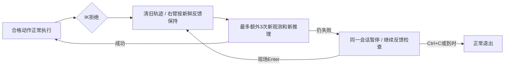

# IK拒绝后的保持、重试与暂停恢复

2026-10-16：首次现场持续推理在约35.45秒因IK拒绝退出。新恢复状态机已完成102项离线/真实socket回归；用户退出teleop后已空闲持锁切换v4，并完成真实反馈故障注入与真实模型零输出shadow。现场运动恢复效果尚待验证。

本轮只恢复“保持→重新观测重试→暂停/Enter继续”，暂不引入可变动作前缀、不放宽IK容差。J6约54.8°跟随平台仍未解决，恢复机制不等于解决物理跟随问题。

## 已确认的故障与旧版差异

现场会话 `f1_hil_20261016T043835Z_b851ef19`，服务session `79f6115413ee4ed4977c3344ff56ffa1`：前36次请求成功，第37次的第18个执行点IK失败；前17点也被整段丢弃。候选J2=-94°、J6=60°，位置残差3.008235mm、旋转残差0.064635°；主求解失败后备用优化收敛，但不满足原0.01mm/0.001°验收。不能据此证明全局不可达。

旧F1/DM0.5在 `F1/foam_sort_whole_body/robot/f1_policy_client/native.py` 已实现类型化IK失败、最多额外3次新观测重采、失败暂停/Enter恢复；独立demo还有显式可变前缀合同。这次新入口此前没有迁入恢复分支，而将所有policy_failed直接升级为退出，属于框架遗漏。数值求解本身已经做主/备用求解，不能把“再请求模型”写成同一IK无限重算。

## 新实现与保护

- WebSocket客户端先核验身份、model/version、request/epoch/observation、时间、动作mask/RTC和完整拒绝结构，只有合格的`ik_rejected`转为`IKRejected`。保持原持久网络子进程；无效响应/网络错误不伪装为可重试IK。
- 保持固定H20合同：失败整段丢弃，无可变前缀、无关节裁剪、无容差修改。
- 唯一Control owner清空旧规划状态，取新鲜右臂反馈作为保持目标；左臂/夹爪保留上次有效submitted。经原映射/碰撞检查和发布路径执行保持，只有真实publish成功才更新submitted，不提前伪造发布证据。
- 每次拒绝递增epoch；保持已提交后才启用新请求。图片、状态和观测起点必须越过保持边界；旧epoch回复不可恢复执行。
- 首次失败后最多额外3次重试，四次连续拒绝后暂停。Enter才开始新一轮有界重试，同一个run/owner/录制不重建，不Home。Enter前已有输入被丢弃，不作为未来恢复许可。
- 暂停期间非阻塞轮询Enter，继续真实反馈、相机、输出、独占控制权和记录检查。Ctrl+C、SIGTERM、定时deadline仍有效；暂停计入墙钟时长。其他故障沿原退出路径，不自动重试。
- 保持动作的意义是取消旧的未到达目标，不让“暂停”继续追57°；不是证明J6硬件可以稳定达到所有模型目标。

## 验证与部署状态

102项通过：99项F1状态机/WS/owner/原HIL及G2公共调度回归，3项任务真实socket/独立网络子进程测试。覆盖四次拒绝→不自动续试→Enter→新观测/新epoch成功、同owner不重建、保持右反馈且左/夹爪不变、过期/错误身份不能重试、暂停期间停止/到时/相机和反馈故障仍阻止发布、真实socket拒绝后复用连接成功。

F1候选 `20261016-f1-toys-eef-v4-ik-recovery`，147文件，manifest `862b872f1e81340ebb3015f9ccf4f076cf2e0d46b293d1038e4a53587377b126`；候选配置 `config-ik-recovery-candidate.json`。ARM inspect通过，hardware_initialized=false。首次正式部署因共享控制锁被PID2065226的v32示教teleop占用而拒绝，未切换入口、未终止会话。暂存回执 `artifacts/20261016-v1-eef/ik-recovery-staging.json`，inspect输出 `ik-recovery-arm-inspect.log`。

后续补证：用户确认退出后，05:38:25 UTC执行部署工具正式切换，备份保存在F1 runtime的 `backups/standalone-20261016T053825.944224Z`；回执 `artifacts/20261016-v1-eef/ik-recovery-deployment.json`。服务重载且health确认同一model/version，失败原始预测日志已启用。`scripts/verify_f1_ik_recovery.py`强制sync-shadow，注入四次IK拒绝、只在暂停提示后输入Enter，再用实测保持轨迹验证恢复；测试必须标注synthetic_policy，不冒充真实模型或物理动作成功。实际结果：

- 注入shadow `f1_hil_20261016T054145Z_9baab519`：150观测、1140控制计算、7个成功保持chunk；3次retrying、1次paused、1次resumed、1次succeeded，按5秒deadline退出。此首次脚本继承site默认data-root，记录在 `/home/user/lxl/dagger_data/policy_hil/`；原件保留且明确synthetic/shadow/training_ready=false，不作为示教。脚本后续已显式指定runtime下独立synthetic-shadow-data。
- 实际模型shadow `f1_hil_20261016T054219Z_0cf47f7d`：20秒20次推理、596观测、4440控制计算，IK无拒绝，按时退出。记录在Bruno原policy_hil目录。相机队列曾丢少量待配帧及出现head重复源时间戳，writer丢弃0；本轮未改变时间对齐规则，不将验收写成相机零丢帧。
- 两轮逐条审计：submitted全部null、publication_complete全部false、publications全部空，journal complete=true、writer_error=null；不是物理动作验收。汇总 `artifacts/20261016-v1-eef/ik-recovery-shadow-audit.json`，控制台为同目录 `ik-recovery-arm-shadow.log` / `ik-recovery-model-shadow.log`。

## 继续排查J6的证据

该rollout的34–35秒，实测J6在54.80875～54.80999°，已发布目标55.871～56.889°；停止前实测54.82026°、submitted57.71443°。与历史10月13/15日的平台相似，但没有下位实际受理目标证据，尚不能确认硬件55°限幅。

只读检查本轮训练数组：J6 state范围-1.30055～54.86050°、submitted标签范围-1.52572～57.03421°。14个anchor同时满足state>54.7°、首标签>56.5°，观测1025～1038；该现象也存在于示教，不能单凭这一短区间区分正常跟随延迟与真实平台。原件/统计/训练权重未改，详见 `artifacts/20261016-v1-eef/rollout-b851ef19-audit/training-j6-comparison.json`。

已有机器人采证 `right-home-audit/20261015T075913Z-295926` 仅24字节pcap、0报文，不能提供内部受理目标。当前任务服务新增失败时记录原始H50×32预测、state16与held16用于精确离线复现；代码与socket测试通过，现运行服务已重载此补充日志。历史请求缺少原始失败EEF，重新随机推理不能称为精确复现。

## 用户现场运行补证（05:43～05:46 UTC）

用户自行启动的v4会话 `f1_hil_20261016T054342Z_91caca60` 运行约58.11秒，58/58次推理成功、1740观测、12784控制记录，journal complete=true、writer_error=null；第二轮 `f1_hil_20261016T054509Z_38de124a` 约22.42秒、23/23次推理成功、journal complete=true。两轮均无IK拒绝/恢复事件，无failure.txt；它们验证v4现场运行，不能代替真实IK拒绝后的物理保持/重试验收，也不说明插孔成功。快照为任务artifacts中 `ik-recovery-onsite-{91caca60,38de124a}-snapshot.json`。

两轮J6实测最高34.4068°/33.6765°，submitted最高34.7385°/33.8062°，未进入此前约54.8°平台区，不能由此次正常推理推断平台消失。服务日志另显示超出单条示教state统计范围：首轮37次右J5超范围，最大3.031°；第二轮右J1最多超17.298°，另有右J2/J7超范围。这是训练覆盖不足与状态离散编码饱和的具体证据，但不是证明某次IK失败由此单独引起。本轮不改状态统计、动作、权重或保护；扩充示教后应重新估计统计并评估闭环偏离。汇总 `ik-recovery-onsite-state-range.json`。

## 13:47:27北京时间最新现场恢复补证：4f5bdb65

用户指出最新会话已进入问题区后，重新读取 `f1_hil_20261016T054727Z_4f5bdb65`；此前两轮结论只覆盖91caca60/38de124a，不能用于这次。最新会话v4、约72.78秒，2178观测、14884控制记录、64请求=47成功+17IK拒绝，journal完整且逐流SHA验证通过。

- +35.478秒同一control记录：J6 submitted59.630503°、measured54.920311°，偏差4.710192°，确认本轮再次进入约54.9°反馈平台。
- +46.693秒请求47拒绝；保持到实测54.932343°且publication_complete=true；+46.955秒请求48重试成功。
- 请求49～52连续拒绝，+49.033秒暂停；+54.354/+66.339/+69.099秒记录3次Enter恢复，后续各轮仍拒绝；合计4次暂停，暂停区间无自动policy请求。20次恢复保持提交均有发布证据，右臂保持目标取新鲜反馈。没有因IK拒绝异常退出，journal complete=true。
- 本轮17次失败候选全部J4=-145°，位置残差0.050329～1.409898mm，均高于原0.01mm位置验收。这说明本轮拒绝同时涉及J4约束边界，不能只归因J6；也不能用局部求解结果证明全局不可达。尚未定位造成J6跟随平台的下位原因。

证据集中在 `artifacts/20261016-v1-eef/rollout-4f5bdb65-audit/`：原始journal副本、同session服务日志、summary.json。17次失败均保存normalized H50×32原始预测、state16和last_submitted16，可离线重建目标；没有改数据、容差或运行代码。

Telemetry覆盖：观测/三图索引与时钟/关节状态、policy chunk、selected/submitted/measured/发布证据、request/epoch/状态机事件、服务预处理/推理/IK分项时延。当前缺口：47个成功请求有客户端打包/RTT/观测到响应时延，17个拒绝请求没有独立client timing事件（服务64条分项时延齐全，客户端仍有请求/拒绝时间）；控制日志未接入下位受理目标、驱动内部指令和电流/力矩，不能将ROS发布成功当作电机已受理。结构化日志已具备，统一实时telemetry面板未实现。
