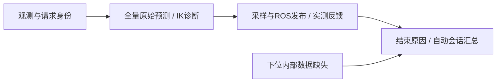

# 推理telemetry补全

本轮只完善记录与复盘，不改变模型动作、IK、恢复策略或运动保护。目标是把已观察的证据与尚未采集的证据清楚分开，不能承诺所有物理故障都能从上层日志定位。

运行入口和模型身份沿用当前任务。实际部署、测试与shadow结果见本文后续补证及[STATUS](../../STATUS.md)。

## 新增证据

- 服务每个成功/IK拒绝请求均保存H50×32原始预测、raw state16、held16、图像元数据、payload哈希、模型身份、服务接收/完成wall时间；失败旧字段兼容保留。错误/繁忙额外记录原因与payload哈希；未验证报文不伪装成已校验身份。
- 逐IK候选记录关节上下界余量和腕耦合余量，仅诊断，不改解。
- 客户端在成功、可信IK拒绝和网络/协议错误时均结算本次时延，避免复用上一请求的last_timing；可信身份与错误分别记录。真实网络调用记录RTT，网络层未返回时为null。
- 退出增加session_termination：区分SIGINT/SIGTERM、deadline、异常和初始化阶段；原failure.txt保留。
- 会话收尾生成 `telemetry-summary.json`：按epoch/request汇总计划waypoint数、控制采样引用到哪里、ROS发布计数、同时刻目标/反馈最大误差、缺失请求时延、结束原因、原始绑定。采样/发布不能称为物理执行完毕。
- 汇总在owner/网络资源关闭与journal收尾后生成，不加重控制周期；摘要失败单独报告，不能掩盖原始故障。

## 尚未覆盖的物理证据

控制器受理目标、内部指令、电流/力矩目前没有进入普通policy journal；summary.coverage明确false。现有 `DAgger/F1/scripts/69_capture_arm_udp_readonly.py` 与 `70_decode_arm_udp.py` 可独立被动采证/解码，不创建SDK控制连接；现场原始套接字权限与连续有效FX反馈验收仍需完成。空pcap不能记成成功，本轮不为此改变SDK或驱动，不继续研究IK。

图像源时间仍是未认证header域；主机单调时钟用于客户端时延，服务器wall仅做服务器内记录，不直接相减冒充跨机单向时延。任务成功需要场景审核，telemetry不自动给训练样本打成功标签。

## 验证

本机73项通过：状态机、WS身份/失败、控制循环、会话汇总及真实socket/网络子进程测试。新增覆盖拒绝也保留时延、错误不复用成功时延、成功和失败均保留原始预测、采样/发布/实物到位语义分离。

F1 v5包从已验证v4归档派生，仅覆盖 `cli.py`、`policy.py`、`websocket_policy.py` 并新增 `telemetry.py`；避免带入工作区其他未发布改动。148文件，manifest `b93d3c201fdbec093c01a89b3a06e230f9c36d997253576b65d4bcf6ad2a46fe`。ARM inspect通过，hardware_initialized=false；已在空闲持锁切换，部署回执 `artifacts/20261016-v1-eef/telemetry-deployment.json`。真实模型10秒shadow `f1_hil_20261016T063908Z_3e72db14`：9请求/9时延事件、296观测、2250控制记录；全部submitted=null/publications=[]，按duration_elapsed退出。自动摘要完整、缺失时延列表为空；服务9次预测均完整H50×32并有20点限位余量。证据 `telemetry-shadow-summary.json` / `telemetry-server-shadow.json` / `telemetry-model-shadow.log`。
