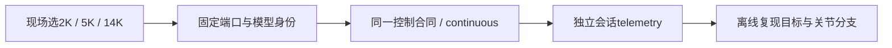

# 2026-10-19 三checkpoint固定入口与IK离线复现

2K、5K、14K已分别常驻6000D，现场用一条continuous命令选择模型，不再重启服务或重绑默认配置。三者保持相同的推理与控制合同；启动命令统一见[STARTUP](../STARTUP.md)。

14K历史20个拒绝目标按原条件全部复现失败；换初值后，在相同关节/腕耦合限制和精度要求下全部找到其他数值解。它们不能直接作为安全轨迹执行：多数解离当前关节姿态很远，连续路径、速度和碰撞尚未验证。线上求解器保持原样，现场测评与离线诊断分开。

## 部署与验收

三服务均使用6000D GPU1：`f1-toys-compare-2000:8122`、`f1-toys-compare-5000:8125`、`f1-toys-compare-14000:8134`。旧默认14K/8096保持；三个对比模型包逐文件SHA核验，norm_stats与训练集统计一致。固定模型ID分别为`f1-toys-eef-453c88a3fbb1dcb7`、`f1-toys-eef-ff1263050a8b6846`、`f1-toys-eef-4a2043b6ea09823f`。

专用tmux `f1-toys-comparison-tunnel`将三个端口反向转发至F1 loopback；F1和6000D health逐项一致。现场新增`start_f1_toys_compare.sh`和三个`config-compare-<步数>.json`，配置只改变policy endpoint/model_id；独立runtime与console日志。共享的机器人控制锁、原v5客户端和release身份校验保持。未改默认配置，也未远程执行真机动作。

| checkpoint | 录制验证观测 | 5秒真实相机shadow | 采集观测 | 实际发布控制行 |
|---|---|---|---|---|
| 2000 | 10/10有效动作与身份通过 | 5请求，正常到时退出 | 150 | 0 |
| 5000 | 10/10有效动作与身份通过 | 5请求，正常到时退出 | 149 | 0 |
| 14000 | 10/10有效动作与身份通过 | 5请求，正常到时退出 | 149 | 0 |

shadow运行ID：`f1_hil_20261019T073052Z_04817d4f`、`f1_hil_20261019T073105Z_0a5132e3`、`f1_hil_20261019T073117Z_fbebe0ed`。它们是零输出通信/运行验收，不是抓取或插入成功率。

本地证据目录：[comparison artifacts](../../artifacts/20261019-checkpoint-comparison)，包括`health.json`、`deployment.json`、三个`recorded-*.json`、`f1-shadow.log`和`f1-shadow-summary.json`。现场旧配置备份为`f1-toys-20261016/backups/comparison-20261019T073033.777605Z/`；本轮新增文件有逐文件哈希，未覆盖旧入口。恢复服务脚本：[start_comparison_services.sh](../../scripts/start_comparison_services.sh)；现场入口源码：[start_f1_compare.sh](../../scripts/start_f1_compare.sh)。

## IK实验与结果

来源是旧14K服务的110条powered请求，其中20条IK拒绝；包含恢复重试，不能当作20次独立rollout。日志SHA256为`75641c880b16a6951b25857ebed35c1cf7db3b4168e0562aa20cf003b5d32753`。本轮将20条输入另存快照，原日志保持只读。

实验使用保存的H50归一化预测、bundle统计和原始实测锚点，重建第一个失败点的绝对EEF目标。逐目标验证保存候选的FK误差与原日志相符，然后重跑原求解器；20/20再次拒绝。

每目标再做14次诊断：原参考/失败候选各一次，5°与20°标准差局部扰动各4次，全关节范围初值4次；随机种子20261019。仅增加离线计算预算至主求解300次、fallback500次迭代，关节限位、腕耦合、0.01mm/0.001°验收不变。初值可投影进入限位，求解结果没有裁剪修补。初值同时用作该次求解的参考，因此改变了冗余解偏好；这是分支存在性探测，不是线上最近解算法的候选性能证明。

| 指标 | 结果 |
|---|---|
| 原条件复现拒绝 | 20/20 |
| 原参考仅增加迭代后通过 | 0/20 |
| 从原失败候选增加迭代后通过 | 0/20 |
| 至少找到一个满足原数值验收的其他解 | 20/20 |
| 各目标所找到解中，最小“相对原参考的最大单关节变化” | 4.07–194.23° |

这个角度范围是有限搜索结果，**不是全局最近距离，也不是保证必须移动这么多**。角度按有界关节坐标直接相减，不擅自做绕圈捷径。所有替代解仅证明冻结运动学及数值约束下单点有解；尚未做完整前缀、动态约束或碰撞认证。

原拒绝候选中19个触及J2下限、17个触及腕耦合、4个触及J6上限，存在重叠；几何Jacobian都为满行秩6。因此目前证据更支持“局部关节构型/约束边界限制了连续解路径”，不能直接称为Jacobian降秩奇异，也不能称为目标全局不可达。模型的EEF目标可能将当前构型持续推向边界，但本实验不单独证明模型训练是根因。

复现脚本：[diagnose_saved_ik.py](../../scripts/diagnose_saved_ik.py)。完整输入、280次尝试和汇总：[IK evidence](../../artifacts/20261016-v1-eef/service-f1-toys-compare-14000/ik-multistart-20261019)。执行只用CPU，未重新跑模型、未改服务配置。

## 下一步与现场对照边界

优先对比三个checkpoint在同一初始摆放下，抓取、搬运、对孔、插入各阶段的成功/失败与首个IK拒绝。现有110请求统计不能代替公平CKPT对比，也不能凭新shadow验收判断哪个模型更好。

离线继续检查是否能在更早的轨迹阶段调整冗余自由度、保留J2与腕部余量；候选必须整段验证连续性、速度/加速度和碰撞，不能到拒绝时突然切换远处分支。EEF目标与7轴关节构型不是一一对应，今后若修改姿态参考或动作合同需另做对照。

J6跟随证据仍独立存在：历史14K有约2.06秒上层目标≥57°、反馈约54.65–54.81°，峰值目标59.50°而反馈54.80°。当前缺下位实际受理目标/电流，不能据此确认硬件限位、饱和或机械卡阻；继续区分模型、IK、上层发布和下位实际执行。

不自动部署多初值结果、不放宽限制、不改变20点整段拒绝与原恢复状态机。任何新算法候选先离线验收，以免现场模型对比同时混入控制算法变量。
