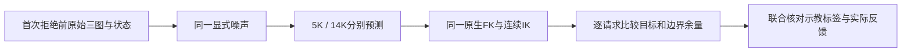

# 首次IK拒绝前：5K与14K同观测、同噪声对照

2026-10-19，按用户要求把诊断从“最后卡住的姿态”前移到首次拒绝之前。两次历史14K会话从开始到首次拒绝共81个真实观测，每个使用5份共享噪声分别跑5K与14K，共810次离线推理。图像、状态、确定性预处理、动作解码和IK一致，只有checkpoint不同。

结果不支持“14K在这些相同状态上明显更容易拒绝”：首次拒绝前两模型均395/395通过；两个首次拒绝观测各重复5次，两模型同样4/10拒绝，逐噪声结果一致。14K有小幅J2/腕部余量劣化，但两者趋势接近，不能据此证明或排除毫米级差异在真实闭环中被放大。

另发现训练数据本身存在持续J6目标—反馈差距：最长索引连续16.6秒，实测约54.87–54.93°，同期首动作标签56.67–60°。这使“示教标签/实际执行/模型共性”成为下一步重点；现有证据不足以把根因单独归给模型或IK。线上算法、参数和控制保护均未改动。

## 输入与可复现性

| 历史会话 | 首次拒绝请求 | 从首次请求到拒绝 | 选取范围 |
|---|---|---|---|
| `f1_hil_20261019T064304Z_9502da58` | 31 | 30.05秒 | 请求1–31 |
| `f1_hil_20261019T064449Z_44f941af` | 50 | 53.33秒 | 请求1–50 |

服务日志来源SHA为`75641c880b16a6951b25857ebed35c1cf7db3b4168e0562aa20cf003b5d32753`。提取时用observation ID与原单调时钟时间定位payload索引，逐项核对state16、状态时间戳、相机身份、分辨率、接收时间、压缩长度和图片SHA256。保存243张原始压缩图片与选取清单，原件未改。

两bundle的contract、norm_stats、model_config和tokenizer逐字节相同；模型文件按bundle清单校验。每个观测两模型送入网络的预处理结果哈希相同。显式保存5份`1×50×32`初始噪声，种子20261019–20261023；两模型每次使用同一张量副本。首样本相同噪声重复推理逐位一致。采样5步、bf16 autocast、H50/执行20、原IK限位与容差保持。

**原现场请求的初始噪声没有被保存**，因此本实验是受控重采样，不声称逐位复现当时的模型输出。所有观测来自14K实际走过的路径；5K没有真的执行这些动作，下一时刻仍用原14K观测，不能把曲线称为5K反事实闭环轨迹。

实验位于隔离GPU2、无网络容器`f1-toys-prerejection-ab-20261019-r3`，完整退出码0，GPU1现场服务未重启或修改。前两次启动分别因UID/目录权限和缺USER环境退出，均未完成推理；补齐现有镜像环境后使用新输出目录运行。原启动日志保留，不算实验样本。

## 配对结果

| 范围 | 每模型次数 | 5K IK拒绝 | 14K IK拒绝 |
|---|---:|---:|---:|
| 会话1首次拒绝前30个观测 | 150 | 0 | 0 |
| 会话2首次拒绝前49个观测 | 245 | 0 | 0 |
| 会话1首次拒绝观测，5份噪声 | 5 | 1 | 1 |
| 会话2首次拒绝观测，5份噪声 | 5 | 3 | 3 |

405对的成功/拒绝标签逐对一致；这些是两个历史会话上的条件重放，**不是405次独立真机试验，也不是任务成功率**。

首次拒绝前最后10个观测，每会话各50对：

| 同输入差异 | 会话1 | 会话2 |
|---|---:|---:|
| 第20点EEF目标位置差，中位数 | 1.23mm | 1.10mm |
| 第20点EEF目标朝向差，中位数 | 0.50° | 0.45° |
| 14K−5K：前20点最小J2下限余量，中位数 | 0.00° | −0.063° |
| 14K−5K：前20点最小J6上限余量，中位数 | +0.015° | +0.062° |
| 14K−5K：前20点最小腕耦合余量，中位数 | −0.475° | −0.088° |

负余量差表示14K更贴近相应限制，不表示违反限制。J2相等的情况很多已同时贴边；其他指标不能混为一个优劣分数。上述最后10个观测的比较均为完整20点成功前缀，避免把拒绝后未计算的点当成正常轨迹。

噪声影响也可见：相同观测下，5K不同噪声之间第20点目标位置差中位数分别4.04/3.69mm，大于本次同噪声跨checkpoint的1.23/1.10mm。这是5份噪声的小样本描述，不是证明噪声是主因，也不应据此直接固定线上seed。

蓝色5K、橙色14K，阴影为5份噪声范围；黑虚线为历史实测状态余量，灰点线为历史14K实际预测前缀，红竖线为首次拒绝。曲线为每个观测内已计算IK候选的最小余量；首次拒绝点可能只计算了部分前缀，失败候选没有下发。图中距离0更近表示余量更小，不能把前缀目标与当前反馈的差自动称为跟随误差。

## 原轨迹在拒绝前发生了什么

会话1原第26次请求开始有J2=-94°的可接受解，第31次才拒绝；期间J6预测余量逐步收紧。首次拒绝时实测J6为54.77°、上一已提交目标57.81°。会话2原第48次开始J2贴边，第50次拒绝；首次拒绝时实测J6为54.55°、上一目标55.78°。

可见关节余量消耗早于最终拒绝，且J2贴边早于明显J6跟随平台，不能把全部因果压缩成“J6卡住→一切失败”。画面抽查显示首次拒绝时两条均已夹住木块，重点应放在抓取后的搬运/转向阶段；仅凭画面不能定量断定目标相对桶口的偏差。

第二条会话有27次请求的右J4超出训练状态归一化范围并被编码截断，最大超出约11.58°；第一条首次拒绝前没有此现象。真实原始关节仍用于FK锚点，因此不是把裁剪后的角度拿去做FK；该问题可能削弱状态区分，但不是两条失败的共同必要条件。

## IK范围、求解路径与数据分别有哪些证据

现场profile SHA为`9d921978148c375e79a40aa3f4c0cee6f303616bac68d394c5c45b9ac0f9f5f5`，右臂七个关节范围逐一与IK一致：J2为[-94,120]°、J6为[-60,60]°等，没有额外缩窄。腕耦合继承冻结原生配置`1.025*abs(J6)+abs(J7)<=110.5°`。这不证明下位实际受理范围一定与上层配置一致。

原连续IK选择接近参考的局部解，没有跨整段规划冗余自由度。此前20个失败目标虽能找到其他满足原数值约束的解，多数远离当前姿态且未通过整段动态/碰撞验证。因此“数学上有解”与“从当前位置可以连续、安全执行”要分开。

本轮再对12条训练示教分别选择J6标签最大、J6目标反馈差最大、J2标签最低的样本，共36次/34个独立窗口，将真实动作做joint→FK→float32相对EEF→同一IK，前20点**36/36通过**。这是边界样本上的可行性检查，不是所有数据或实物到位的保证。

训练包共有11,791个窗口（重叠窗口不能当独立示教）。J2首动作标签在下限1°以内的窗口有4,533个，标签确实包含-94°；J6反馈最高54.925°，首动作标签最高约60°。其中793个窗口满足“J6反馈>54.7°且首动作标签>56.5°”，分布在3条训练示教：

| 训练示教 | 最长连续索引区间 | 同期J6实测范围 | 同期首动作标签范围 |
|---|---:|---:|---:|
| `20261014T091553Z_88a4ad17` | 0.433秒 | 54.780–54.859° | 56.588–57.034° |
| `20261016T024951Z_b2e7b6ad` | 16.6秒 | 54.874–54.925° | 56.666–60.000° |
| `20261016T053019Z_a8f084d1` | 6.2秒 | 54.806–54.900° | 56.524–59.569° |

这里统计的是通过既有时序索引的同期反馈和首发布标签，不是模型预测。长时间差距值得优先追查；缺下位受理目标/电流，暂不能确认为硬件限幅、碰撞、机械阻力或某种控制策略。原始数据、归一化和训练没有因本次审计而改动。

## 当前判断与下一步

1. 不支持直接归因“14K更过拟合，所以先触边”。在同观测同噪声下，5K并未表现出明显不同的避边行为。毫米级/小角度差异仍可能在真实闭环中累积，需双方自身路径与相同摆放的重复试验验证。
2. IK边界是最终拒绝机制，不等于整个失败的最早原因；当前范围未额外缩窄，局部冗余分支选择确实有局限。优先追查前段动作与执行，不先放宽范围或数值容差。
3. 两模型共享的示教标签/状态编码，以及J6持续目标反馈差距，是已有实测支持的共同风险。先核对下位实际受理目标，再判断哪些示教区间需要处理；不能直接把标签全部换成反馈、裁成55°或删除所有贴边数据。
4. 现场下一批保留5K与14K各自的完整前段日志，按抓取完成后的相同任务阶段做双向重放；若拿到相同初始摆放的真实重复试验，再判断偏差是否逐轮放大。现有恢复/保护与在线服务保持。

## 证据与复现入口

- [输入、manifest、逐请求结果与曲线](../../artifacts/20261019-prerejection-ab)：`inputs.jsonl`、243张图片、`selected-requests.jsonl`、`run-r3/manifest.json`、`initial-noise.npz`、`results.jsonl`、`raw-predictions.npz`、`summary.json`、`noise-sensitivity.json`。
- 范围/训练旁证：同目录`runtime-limit-audit.json`、`train-boundary-context.json`、`teacher-probes.json`、`teacher-probe-results.json`。训练数组SHA为`0470b2879c564477ff52c1538dc9a05dd6bd6910c1c5877f98ac33ccc809eaf0`。
- [配对推理脚本](../../scripts/compare_prerejection.py)、[汇总与绘图脚本](../../scripts/summarize_prerejection.py)。需使用既有推理镜像；绘图依赖另装在临时目录，不修改推理/训练环境。
- [上一轮：最后拒绝点多初值诊断](20261019-comparison-and-ik.md)。本轮补的是拒绝之前的证据，不将两个实验混为因果证明。
