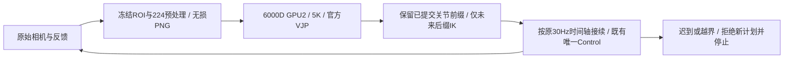

# 5K 推理时 RTC：实现与离线验收

2026-10-19用户授权按延迟诊断、接口接线、历史rollout回放、真实链路零动作shadow、现场对照五步推进。当前实现保留原RLinf模型核心、5K合并权重与同步入口，新增独立RTC服务和现场入口。训练时RTC仍暂缓。

2026-10-20最新：H20的5K/50K已上线原IK数学加速与F1三图并行。正常RTC接续客户端约222/225ms，完整录制零动作通过；当前静止场景仍多IK拒绝，现场效果待验。分组件、精度检查与未采用候选见文末。

本文分别记录实现、离线结果、链路测试与现场边界。模型输入一致和IK通过不能代替闭环任务成功；现场动作必须由操作者执行。真实链路验收结果持续补在下文，当前可用入口以[STARTUP](../STARTUP.md)和[STATUS](../../STATUS.md)为准。

10月19日用户报告RTC任务成功后多次超时，原shadow未覆盖完整录制负载。10月20日已部署编译加速service-v3/client-v4、独立SSH与超时暂停恢复；真实相机800ms迟到注入通过，完整录制长测与当次资源证据见文末。新版实物任务效果仍由现场操作者验证。



## 算法与接线

- 使用官方推理时RTC Eq.2–5：完整VJP、beta=5、指数软掩码；本地模型时间从噪声t=1到t=0，与论文tau相反，使用clean=x-t*v、core velocity=v-gain*VJP。权重不训练，前缀KV在no_grad中生成，每个去噪步只对动作求导。
- H50、有效EEF10/内部32、30Hz、5步Euler保持不变。无引导新采样路径与原采样路径同噪声逐位一致。
- Control拥有已提交关节目标。旧完整EEF预测以绝对位姿保存，再用新观测锚点重表达；硬前缀由实际计划关节FK重建，服务端逐点原样保留这些关节目标。只为后续窗口求连续IK，不重新求解已提交前缀。
- 最终候选s_min=20、d_init=20，最近10次延迟估计加一个动作周期余量，同时不低于已校准初始预算。IK覆盖K=s+d+2（至多50），请求必须满足d<=s<H-d且旧窗口能覆盖承诺前缀。
- 新请求从旧计划原始30Hz网格切出，响应保持同一网格并跳过已经过去的时间；不从第0点重新播放。最多一个在途请求，使用新观测，session/epoch/model/base_plan_id全部核对。
- 首次与IK恢复后的bootstrap在保持状态生成计划。沿用既有IK拒绝有界重试/Enter恢复、唯一控制锁、左右侧掩码、反馈新鲜度、速度/加速度/碰撞保护。推理超过承诺窗口或计划耗尽，拒绝新结果并结束本次会话；现场重新启动，不能自动播放迟到轨迹。
- 复用现有采集/策略线程、网络子进程和Control owner。**尚未改成完整Control/Policy双进程**；本轮以实际Control零动作运行验证隔离边界，不能宣称硬实时保证。

依据：[官方论文](https://arxiv.org/html/2506.07339v2)，本地实现[采样器](../../src/f1_toys/rtc.py)、[调度](../../../../DAgger/F1/src/f1dagger/rtc.py)、[传输](../../../../DAgger/F1/src/f1dagger/rtc_policy.py)。

## 历史5K rollout配对回放

原件为`f1_hil_20261019T080740Z_0b67a7f3`，48个历史请求每4个选1个，共12个起点。每个起点按15/20/25个动作周期选择截止时已经可用的最近观测，得到36组配对、144幅唯一图像；原始图像/状态/请求身份和哈希核对后另存，不改原件。

5K bundle SHA256：`ff1263050a8b684686fba44022e4075cafc37eb6997b5d3cbbba912685e4da98`。种子20261019、20261020；d=12/15/18，仅比较合法d<=s组合。每组同噪声比较完整VJP与不带引导的异步后缀，二者均保留相同已提交前缀并使用原IK。

192个引导、192个无引导结果全部通过IK，bootstrap无拒绝。s20/d15的24对：

| 指标 | 无引导 | 官方VJP |
|---|---:|---:|
| 交接处最大关节步变中位 | 1.886° | 0.866° |
| 同指标P95 | 4.931° | 2.436° |
| 同指标最大 | 5.461° | 4.010° |
| 夹爪交接步变P95（0..100） | 13.274 | 1.112 |
| 夹爪交接步变最大 | 81.786 | 16.608 |
| 本地完整policy耗时中位 | 140.72ms | 236.44ms |
| 本地完整policy耗时P95 | 142.20ms | 246.59ms |

这是**交接连续性数值对照**，不是同步真实成功率对照。输入来自历史同步闭环，不会响应新的RTC动作；不能据此判定RTC插孔成功率或宣布某组参数全局最优。夹爪仍有离群变化，没有通过额外滤波或冻结夹爪掩盖。

完整记录：[输入清单](../../artifacts/20261019-rtc/inputs/manifest.json)、[结果](../../artifacts/20261019-rtc/replay-r1/summary.json)、[逐请求结果](../../artifacts/20261019-rtc/replay-r1/results.jsonl)。复现入口：[prepare_rtc_replay.py](../../scripts/prepare_rtc_replay.py)、[evaluate_rtc_replay.py](../../scripts/evaluate_rtc_replay.py)。

## 延迟诊断与无损传输优化

最新历史48请求排除首包后，client_total中位485ms、P95约767ms、最大1272ms。d20/667ms不足覆盖8/47请求。历史负载来源未定位，不能认定GPU争用是唯一原因。

RTC独立服务放到当时空闲GPU2。第一个真实Control shadow `f1_hil_20261019T090708Z_b3db2165` 在第3请求触发d15/500ms截止：服务器处理236.6ms，客户端536.2ms，未采纳迟到计划，零动作。失败原始journal.partial保留。

随后真实相机连续取帧、零owner/零publisher探针：

| 原图传输测量 | 次数 | RTT P50 | P95 | P99 |
|---|---:|---:|---:|---:|
| echo（无模型） | 50 | 157.91ms | 374.67ms | 538.79ms |
| 完整RTC | 100 | 408.29ms | 615.73ms | 868.87ms |

探针统计排除前5次，各端持续时间使用本地时钟；RTT-handler残差含网络、协议与调度，不叫纯网络耗时。模型之外的链路长尾已经实测存在。

v2协议将**完全相同的冻结确定性预处理**移到发送端，传224 RGB无损PNG，服务端不重复裁剪/缩放。预处理源文件与模型合同分别SHA绑定，模型权重、prompt、状态、图像数和有效维不变。ARM直接读取本机已有历史原件，与6000D参考哈希核对：144幅图像全部逐像素一致，PNG往返全部一致。总图像载荷18467973→7991803字节，减少56.73%。完整模型输入字典与原路径逐位一致。

最初回传原图的提议被自动审批拒绝；实际改用F1已有原件，只同步代码与哈希参考，未回传图像。测试脚本：[check_rtc_pixels.py](../../scripts/check_rtc_pixels.py)。

## 测试、部署与现场边界

初版82项相关测试通过（RTC数学/协议/调度/独立入口54项，原控制/策略/telemetry28项）。v2像素协议后29项核心RTC与同步测试通过；其他补充结果与真实链路长测待下文记录。

独立服务：GPU2、loopback8135、`f1-toys-rtc-5000-v2`，服务源码冻结于任务artifacts/20261019-rtc/service-v2。ARM不可变release为`20261019-f1-toys-rtc-v3`，独立配置`config-rtc-5000-v3.json`，原2K/5K/14K同步入口未改变。安装回执见[deployment.json](../../artifacts/20261019-rtc/deployment.json)。

现场成功率、实际抓持/接触效果、闭环碰撞与J6跟随尚未验收；这些需要现场操作者参加。离线与shadow结论不替代上述验收。

### d20补测与传输优化结果

无损像素100次完整RTC（探针分位数排除前5次）：RTT P50/P95/P99=289.21/362.67/395.76ms；最大536.76ms。发送端预处理/封包中位23.52ms，最大28.53ms；有1次RTT+封包超过500ms。因此最终d初值/下限改为20（667ms），s_min20，给源网格相位、IPC和Control采纳留余量；不是沿用先前未经实测的d20假设。

d20/s20与s25补测48组引导、48组无引导均通过原IK。最终s20/d20的24对中，关节交接步变P50 1.920→1.016°，P95 5.178→2.231°，最大5.768→3.468°；夹爪交接最大98.976→0.888点。完整policy中位235.21ms，P95 237.04ms。全部离线结果合计240个引导+240个无引导，均通过IK。补测见[结果](../../artifacts/20261019-rtc/service-v2/logs/replay-d20/summary.json)。

最终84项相关回归通过，覆盖VJP解析雅可比/符号、软mask、锚点往返、硬前缀保持、真实socket/子进程、像素合同拒绝、epoch、迟到/耗尽、延迟增长及恰好覆盖剩余窗口、独立授权/IK恢复和原同步Control/telemetry。测试环境的cache_dir警告来自关闭pytest cache插件，不是测试失败。

### 最终完整Control shadow验收

F1会话`f1_hil_20261019T092216Z_82c638be`正常以duration_elapsed结束，控制时长349.984秒。525次真实相机/反馈请求，513计划采纳（13个bootstrap、500个连续接续），12次IK拒绝均触发保持、新epoch与新观测bootstrap并恢复，无重试耗尽暂停；零RTC超时。全部采纳计划d20/s20。

| 指标 | P50 | P95 | P99 | max |
|---|---:|---:|---:|---:|
| 客户端完整请求 | 330.05ms | 402.58ms | 438.18ms | 561.66ms |
| WS RTT | 297.94ms | 368.97ms | 409.20ms | 525.75ms |
| 观测起点→响应 | 395.22ms | 478.73ms | 538.67ms | 659.62ms |
| 模型/H2D/D2H | 211.73ms | 221.01ms | 224.47ms | 239.91ms |
| 请求网格起点→Control采纳（非bootstrap） | 336.70ms | 407.62ms | 441.92ms | 564.72ms |
| Control记录间隔 | 4.09ms | 8.76ms | 10.03ms | 18.24ms |

最小截止余量101.948ms。80945条Control记录全部execution_mode=shadow、publication_complete=false、publications空、submitted=null；未创建动作publisher。控制记录间隔不是机械臂实际跟踪周期，也不是实物到位证明。

12次IK拒绝没有被算成成功，均保留原始预测、原限位/容差及恢复事件。静止shadow的真实图像和反馈不随假设动作改变，不能把拒绝率直接外推为真实RTC闭环拒绝率；现场需继续验证J6、抓持与插入。

审计脚本、逐流SHA及完整统计见[shadow报告](../../artifacts/20261019-rtc/evidence/rtc-control-shadow-v3-report.json)，[ARM像素报告](../../artifacts/20261019-rtc/evidence/rtc-pixels-arm.json)。原始journal位于上述F1会话目录，服务原始预测在独立service-v2日志。最终现场入口见[STARTUP](../STARTUP.md)。

## 现场截止超时诊断

2026-10-19只读核对F1原始journal与6000D服务日志。用户反馈首条顺利，对应`f1_hil_20261019T093319Z_efc91380`：35请求，客户端请求最大479.136ms，SIGINT正常结束；这不能单独证明任务成功。用户所贴第二条`f1_hil_20261019T093432Z_d609067a`第7请求返回有效计划，但迟于硬前缀截止，未被采纳。原件仍为`journal.partial`，不是写盘失败导致数据全部丢失。

| 第7请求分段 | 实测 |
|---|---:|
| 发送端预处理/封包 | 27.166ms |
| WS请求往返（含服务计算） | 633.670ms |
| 服务handler | 242.230ms |
| 其中模型/H2D/D2H | 216.866ms |
| 其中IK | 19.197ms |
| RTT减handler（传输及未计入handler的调度等） | 391.440ms |
| 客户端infer总计 | 663.951ms |
| 原动作网格起点到响应 | 672.712ms |

此前第2–6请求RTT约280–324ms、模型215–217ms。主要异常增量在handler之外；未采集TCP证据，不能进一步断言Wi-Fi丢包或SSH隧道为根因。控制记录最大间隔15.063ms，末尾记录保持约4ms量级夹杂约9ms间隔，不支持控制线程长时间卡死。相机与写盘摘要无drop/writer error；这些摘要不能排除共享负载对调度的影响。

精确截止使用F1 monotonic时钟：plan_origin_ns=14799862829871，d=20/30Hz，对应deadline_ns=14800529496538；response_ns=14800535541871，迟到6.045333ms。请求调度本身在网格后5.969762ms发生，worker起点还略晚，因此不能用663.951<666.667判断准时。最后一次正常发布属于计划6；计划7虽通过服务端IK与响应校验，未发生rtc_plan_adopted。保护按现行合同触发，问题是长尾及超时直接退出的恢复设计。

随后`f1_hil_20261019T093528Z_28ece51f`第37请求再次触发同一错误：client816.287ms、RTT654.859ms、handler253.735ms、model229.088ms；封包28.650ms之外还存在约133ms客户端其他耗时，须增加IPC/调度分段定位。简单多加一个动作周期不能覆盖这次长尾。

后续优先补完整录制负载的零动作测试、传输与IPC计时，并验证超时保持/旧epoch作废/现场确认后新观测重启及正常日志封存；不能执行过期后缀，也不能把恢复视为无停顿。既有350秒shadow使用inference-only，而现场使用hil-record，验证负载存在差异。本轮只保存诊断证据、更新状态及待办，未修改运行参数、部署代码或启动动作。

证据：[客户端时间与原始流SHA](../../artifacts/20261019-rtc/onsite-timeout-d609067a/client-evidence.json)、[服务端对应请求](../../artifacts/20261019-rtc/onsite-timeout-d609067a/server-evidence.json)、[随后会话末请求](../../artifacts/20261019-rtc/onsite-timeout-d609067a/following-run-evidence.json)。现场原始日志未修改。

## 重复超时、资源与优化优先级

2026-10-19 09:48–09:52 UTC只读审计：用户报告又一次RTC成功，附近`094230Z_d573c37c`有81请求、客户端中位340.09ms、最大547.06ms，SIGINT正常结束；这是用户现场成功反馈，日志本身只证明运行及退出，未另做视频逐帧验收。09:33起8条RTC会话共175请求，2条SIGINT正常结束、6条截止异常。此批是现场连续尝试，不能用这个比例估计任务成功率。

| 后续失败会话/请求 | 模型 | WS往返 | 网格起点到响应 |
|---|---:|---:|---:|
| 094352 / 2 | 228.21ms | 917.61ms | 952.07ms |
| 094408 / 9 | 209.16ms | 761.84ms | 802.99ms |
| 094449 / 2 | 209.29ms | 868.76ms | 909.91ms |
| 094505 / 2 | 210.29ms | 891.04ms | 930.01ms |

同会话相邻请求差分抵消两机固定时钟偏移：093432的6→7、093528的36→37、094408的8→9，从客户端request事件到server compute入口的相对耗时分别增加314.28、318.62、312.45ms；支持主要新增等待发生在计算入口之前，但包含封包、IPC、链路和server线程排队，不能直接当单向物理网络测量。该方法假设短间隔内无时钟跳变。

**资源实查不支持GPU争抢解释。** 6000D GPU2只有RTC进程，占15634MiB，短时采样P0/2347–2355MHz/27–28°C，无活动降频原因。宿主CPU约98–99% idle，256线程；容器与父cgroup无CPU配额、无throttled计数。6000D千兆接口短时负载很低、无新增drop/error。均为当前快照，不能倒推故障时每一毫秒负载。H20 GPU0–3正在训练，4–7已让给他人，即使快照空闲也不能占用；本轮没有运行H20推理benchmark。

**RTC端口独立，但外层网络连接仍共享。** 6000D的`f1-toys-rtc-tunnel`通过127.0.0.1:22009连接F1，再反向转发8135；22009本身来自F1进程6671到6000D的SSH反向隧道。实际路径是RTC WS→内层SSH→共享外层SSH TCP→F1 Wi-Fi。F1到6000D走wlan0，5180MHz、信号-39dBm，power save on。该外层连接累计重传约154MB，6秒被动采样重传计数仍增加且有其他流量；累计重传不是本次超时的逐请求因果证明。未改变Wi-Fi、电源或隧道设置。

另有计时盲点：server.py在完整replay构造、IK margin、同步日志写入和最终response编码/send之前结束handler计时，故RTT减handler包括这些工作及调度。正常本机纯JSON编码不足1ms，不能解释数百毫秒，但写盘尾延迟未被单独测量。客户端child RTT开始于Pipe接收之后、结束于WS响应JSON解析之后，不含父进程发送阻塞、回传和最终校验；需补对应时间戳。

后续执行顺序：

1. 补齐服务入口/排队/日志/编码/send及客户端Pipe/WS/校验/Control采纳计时。独立候选由F1使用既有认证直接SSH到6000D，以新本地端口8136转发6000D:8135，显式禁用ControlMaster复用；确认第二条真实TCP，不经过22009。旧入口保留，先相同载荷echo，再同5K真实链路交错A/B；不在现场动作运行时争用服务。
2. 用固定历史输入/噪声分解SigLIP、prefix、5次前向/VJP。当前TORCH_COMPILE_DISABLE=1；优先独立候选编译固定形状前向/VJP，再测attention融合、去掉未使用的attention weights、三图批量编码。保留完整VJP及5步，逐项验证动作/梯度/IK与接续，收益尚未实测。
3. 验证超时保持、旧epoch作废、现场确认后新观测恢复和日志封存；不执行迟到轨迹，不用放大d掩盖接近1秒长尾。
4. 在完整hil-record负载下做零动作长测，报告端到端P50/P95/P99/max、deadline miss和控制间隔，再进入现场A/B。先以模型低于200ms作为优化目标；端到端低于200ms还必须显著缩减模型以外开销，不能混用两个口径。
5. H20作为后续有空闲授权资源时的同输入/同代码对照，不先迁移。显存或训练吞吐不能证明batch1更低延迟；经6000D转发H20仍保留F1原链路问题。

官方参照：RTC论文A.3在RTX4090/bf16/5步测得纯模型97ms，普通π0.5为76ms；有线LAN端到端约109/139ms。这说明200ms不是算法下限，但硬件、实现和网络不同，不是本机性能承诺。[官方论文](https://arxiv.org/html/2506.07339v2#A3)；编译和attention候选参考[PyTorch compile](https://docs.pytorch.org/docs/2.7/generated/torch.compile.html)、[MultiheadAttention](https://docs.pytorch.org/docs/2.7/generated/torch.nn.MultiheadAttention.html)。

证据：[现场逐请求](../../artifacts/20261019-rtc/perf-audit/onsite-sessions.json)、[汇总与差分](../../artifacts/20261019-rtc/perf-audit/summary.json)、[双机资源摘要](../../artifacts/20261019-rtc/perf-audit/host-resource-summary.json)、[F1 TCP/无线采样](../../artifacts/20261019-rtc/perf-audit/f1-network-samples.json)。全部为诊断/候选计划，未修改控制代码、迁移服务或运行机器人动作。

## v4实施与分层验收

用户随后授权按上述顺序实施并部署，再现场复测。以下为本轮实施证据；历史v3结果不改写。模型仍为5K，H50/30Hz/5步、beta5、d20/s_min20、原运动保护不变，训练时RTC不实施。

### 独立连接和无线省电对照

原F1公钥只允许连接6000D回环22端口，首次候选直连8136→8135被SSH拒绝。自动审批拒绝持久修改authorized_keys后，用户明确批准仅新增`permitopen="127.0.0.1:8135"`；备份原文件，保留restrict、禁止shell及所有其他限制后完成。独立连接使用既有认证、禁用ControlMaster，不经22009；仅回环绑定，不开放公网服务。

同12份F1已有历史原图按冻结处理器转成PNG，在旧8135和新8136之间交替请求顺序，100组相同载荷echo、不跑模型、持控制锁、零动作。F1当时power save on；SSH无免密sudo权限，用户随后在本机执行关闭省电并确认，工具读回off。两轮不是同时发生，网络时变仍是混杂因素，不能把所有收益归因于省电。

| Wi-Fi/链路 | RTT P50 | P95 | P99 | max |
|---|---:|---:|---:|---:|
| 省电开/共享外层SSH | 216.25ms | 491.23ms | 540.49ms | 574.60ms |
| 省电开/独立SSH | 185.09ms | 472.90ms | 690.71ms | 748.68ms |
| 省电关/共享外层SSH | 68.54ms | 108.91ms | 126.27ms | 155.93ms |
| 省电关/独立SSH | 62.94ms | 111.01ms | 164.30ms | 207.35ms |

独立连接并未单独消除长尾，关闭省电后两条路径同时明显改善。当前选择独立连接以隔离开发/数据流量，但不宣称它在此样本的P99优于共享连接。关闭省电是运行时设置，机器/网络重启后需重新核对；未擅自写系统持久网络配置。

### 模型编译与数值检查

只编译动作专家前向/反向，保留完整VJP、固定步数及原prefix KV路径；训练核心文件和5K权重不修改。单输入候选中，eager模型P50=211.28ms；图像attention优化208.46ms、编译prefix211.40ms，无显著收益，不采用；编译suffix130.02ms，进入历史回放验证。

默认编译96组比较（24组历史观测配对、两种噪声，每组bootstrap及guided）两版IK均96/96，但少数bootstrap夹爪差达到7.47个百分点，因此未选择默认编译。最终使用`emulate_precision_casts=True, force_same_precision=True`保留低精度转换语义；再次96组比较两版IK均96/96，48组guided硬前缀逐项完全一致。

| 精度保留候选与eager差异 | P50 | P95 | max |
|---|---:|---:|---:|
| 每组最大末端位置差 | 0.141mm | 0.284mm | 0.345mm |
| 每组最大末端旋转差 | 0.240° | 0.329° | 0.481° |
| 每组最大关节目标差 | 0.231° | 0.315° | 0.512° |
| 每组最大夹爪差（0–100） | 0.259 | 0.488 | 0.537 |

精度保留候选guided模型P50/P95/max=132.72/133.40/134.18ms，编译暖态被排除。交替回放中的eager计时约268.57ms，与独立基线211.28ms不同，不能混用来宣称50%线上加速；上线真实链路另验。编译并非逐位一致，上表是明确数值差异及样本范围，不能替代现场任务效果。

候选与原始逐组数据在`service-v2/logs/optimization-v4/`（新增实验子目录，不修改原请求日志），摘要副本见[候选](../../artifacts/20261019-rtc/optimization-v4/candidates.json)、[精度回放](../../artifacts/20261019-rtc/optimization-v4/validation-precision/summary.json)。

### 计时和超时恢复

网络子进程新增parent发送/接收、child收到、WS发送/收到、解析与校验的同机monotonic时间戳；服务新增worker排队、日志构造/写入、完整worker时间，独立`requests.transport.jsonl`记录收到/工作线程返回/编码/发送完成。原预测全量日志继续保存，迟到结果仍可审计。

RTC截止/计划耗尽触发保持暂停，清旧chunk、增加epoch；Control确认实测保持提交后才接受现场Enter，用新的观测bootstrap，旧在途future完成后丢弃，不自动播放。若截止发生于选好目标后、发布前，同一周期先清除待发目标并提交保持；硬故障、Ctrl+C、总时长截止保持原语义。普通IK拒绝仍沿原有界重试。shadow默认改为hil-record，与现场相同的原图写盘负载。

86项相关回归通过，包含真实网络子进程、20ms日志延迟注入、迟到结果丢弃、保持前不能恢复、Enter后新观测、发布前最后截止检查及原同步/IK/录制路径。客户端包已隔离解包检查，只包含预期控制/通信文件及状态文档变化。编译服务源码已冻结到service-v3。实际部署与完整录制shadow结果在本节后续补记；发布前管理SSH曾连续握手超时，当时未切换原服务，并已请求现场重连管理隧道。


## 2026-10-20 v4实际部署与完整录制验收

10月19日发布前SSH超时，用户随后确认机器人/网络已经关闭；不能将该次断连当作持续网络故障证据。10月20日用户开机并授权部署后，空闲持有F1控制锁切换到service-v3，编译预热及5K健康身份核验通过；client-v4不可变包清单、ARM inspect通过，原同步服务保留。源码release日期沿用10月19日构建标识，实际部署日期为10月20日。

独立连接已实测启动：F1 localhost8136→6000D localhost8135，独立SSH TCP且禁用ControlMaster；受限公钥只增加用户已明确授权的8135 permitopen，原权限与备份保留。入口自动检查连接、按需启动重连守护，不自动启动机器人动作。当前网络走`wlP1p1s0`，开机实测power save on；此前手动关闭没有跨重启保持，已请用户按当前接口关闭，最终测试状态另记。

本次6000D八卡出现另一用户训练，各卡采样利用率约90–100%，GPU2同时有RTC和该训练进程；与10月19日仅RTC的资源快照不同。没有停止其他任务或占用H20后四卡。模型延迟不能沿用离线133ms结论，需依据本轮分层实测。

800ms迟到注入在实际CLI、真实相机与hil-record下通过：恰好一次RTC暂停、一次模拟Enter恢复，旧结果被丢弃，恢复后首次采纳为新bootstrap，2739条control均零submitted/零发布，journal正常完成。模拟Enter仅发生在强制sync-shadow测试进程内，未运行powered。报告见[故障恢复](../../artifacts/20261020-rtc-deployment/rtc-pause-verification-v4/report.json)，部署见[身份与清单](../../artifacts/20261020-rtc-deployment/deployment-verification.json)。


首轮完整录制长测未通过：`f1_hil_20261020T013547Z_b652f36f`运行202.60秒，303请求、302采纳，第303请求触发截止暂停。客户端总延迟P50/P95/P99/max=330.89/383.65/412.13/1489.09ms；该次模型/H2D/D2H段1379.85ms，worker排队0.081ms、日志1.850ms、完整worker1419.60ms，WS往返1455.25ms。新增主要延迟位于模型段，不能归因于网络或日志；相邻资源快照GPU2约95%利用率且有另一训练，但尚未用独占GPU对照隔离精确原因。该请求d20/s20/K42未变化。保护已进入safe_hold并提交shadow保持，因无交互SSH stdin关闭，恢复提示随后抛出`local input closed while IK paused`，会话保留partial，不能记正常封存或长测通过。46278条control零发布、零submitted。见[失败证据](../../artifacts/20261020-rtc-deployment/rtc-v4-first-shadow-failure.json)、[服务段与资源](../../artifacts/20261020-rtc-deployment/deadline-request-303.json)。

第二轮使用仅允许固定`--shadow`命令的测试驱动，保持stdin打开；出现暂停时仅在零输出测试内模拟Enter，所有自然超时仍单独计数。该驱动不改变现场入口，也不对powered模式自动恢复。现场仍由操作者确认。首轮失败原始数据和日志完整保留，复测不能覆盖或抹掉长尾证据。


第二轮350秒完整录制正常完成：`f1_hil_20261020T014023Z_92c9cbf1`，525请求、521采纳、4次IK拒绝均保持后自动有界恢复，零RTC截止暂停、无需模拟Enter，80062条control零发布/零submitted，日志正常封存。client总延迟P50/P95/P99/max=328.68/385.61/429.01/552.80ms；模型段212.84/237.59/241.60/245.64ms；网格→采纳最大560.12ms，最小截止余量106.55ms。控制记录间隔P50/P99/max=4.09/10.92/21.94ms，不能宣称硬实时。原图写盘无drop/writer error，相机因age/skew丢弃的数量另保存在控制台，不冒充原始相机零丢帧。完整[长测摘要](../../artifacts/20261020-rtc-deployment/rtc-full-shadow-v4-interactive/summary.json)与[分段计时](../../artifacts/20261020-rtc-deployment/rtc-full-shadow-v4-interactive/transport-summary.json)。

新计时显示该轮服务worker排队P99仅0.209ms、日志构造/写入P99约1.990ms，客户端常态IPC与JSON校验为毫秒量级。RTT减完整worker中位49.12ms、P99 155.60ms、max296.94ms，仍包括网络、服务编码/发送和调度，不能称为单向网络。首次parent→child最大126.96ms包含进程启动，不能当每次IPC成本。模型在当前共享资源中位约213ms，离线约133ms的结果未在本轮长测保持。

两轮长测起始和中途核验Wi-Fi均为on；第二轮结束附近用户回复已关闭，随后实读为off，具体切换时刻未记录，因此该轮不作为严格省电开/关对照。NetworkManager当前连接`example-wifi`的powersave仍为default，`iw`仅改变运行状态；持久设置尚未修改。关闭省电后另做独立短测，下文记录。


关闭省电后70秒短测正常到时封存，但稳定性未通过：36请求、34采纳、1次IK拒绝、1次RTC截止暂停，迟到结果丢弃后一直保持至到时，16036条control零发布/零submitted。客户端P50/P95/max=382.18/429.47/1922.27ms，模型P50/max=218.40/243.33ms；末请求36模型234.09ms、完整worker271.79ms，worker排队0.115ms、日志1.818ms、编码/发送约1.64ms，而WS RTT1892.63ms。两端相邻35→36请求时间差抵消固定时钟偏移，入口前相对增加27.49ms，**服务发送完成→客户端收到的相对等待增加1541.17ms**。定位到返回传输/端点调度路径，尚无逐请求TCP证据把它完全归因于Wi-Fi、SSH或F1调度。见[短测摘要](../../artifacts/20261020-rtc-deployment/rtc-psoff-shadow-v4-summary.json)、[分段](../../artifacts/20261020-rtc-deployment/rtc-psoff-transport-summary-v4.json)、[相邻差分](../../artifacts/20261020-rtc-deployment/psoff-timeout-localization.json)。

因此软件部署与超时恢复可交付，但持续无停顿、端到端<200ms均未验收；下一步优先保证独占推理GPU，并由现场提供有线网络对照，分别隔离计算尖峰与返回路径长尾。H20尚无公平benchmark，不直接宣称迁移会更快。不得通过放大D/S或执行过期轨迹绕过保护。

Wi-Fi持久化目前未执行。已核验连接名`example-wifi`、UUID`00000000-0000-0000-0000-000000000001`，NetworkManager powersave为default。现场有sudo权限的操作者可运行`sudo nmcli connection modify "example-wifi" 802-11-wireless.powersave 2`，保存该连接禁用省电；当前运行态已off，无需立即断网重连，下次开机再用`iw dev wlP1p1s0 get power_save`核验（接口名改变时按实际接口）。值2为disable见[NetworkManager官方说明](https://networkmanager.pages.freedesktop.org/NetworkManager/NetworkManager/nm-settings-nmcli.html)。回退属性为0/default；不改其他连接、不重启网络服务。


## 2026-10-20 H20 GPU0直接推理对照

用户要求先暂停我们GPU0–3训练，再比较H20作为推理入口；明确不操作GPU4–7。实际训练已完成50000步、退出码0、W&B finished；末次train loss0.01772、eval loss0.16199（288窗口）、LR=1e-6，最终权重/DCP/RNG/数据游标保存。没有发送停止信号，不自动恢复训练。GPU0用于推理对照，1–3空闲，4–7只读资源盘点、不分配或发信号。见[训练完成回执](../../artifacts/20261020-h20-rtc-ab/training-finished.json)。

H20复用既有5K包，bundle SHA与6000D完全一致；冻结RTC源码、H50/30Hz/5次完整VJP、d20/s20、像素和IK合同不变。H20 Python3.11/torch2.7.1/triton3.3.1，6000D Python3.10/torch2.11.0/triton3.6.0；均NumPy1.26.4/SciPy1.15.3。H20旧torch对`isinstance(kv_cache, list | tuple)`编译报错，独立候选启动器仅在内存中改为等价`isinstance(kv_cache, (list, tuple))`，原训练核心文件和权重未写入。两端都使用精度保留suffix编译，H20健康声明额外tuple兼容标识。没有在训练环境安装/升级包。

F1→H20采用直接SSH 6622，本机8137→H20 loopback8137；独立测试密钥私钥仅在F1，H20本人账号备份authorized_keys后添加受限公钥，禁止shell/PTY/agent/X11、只允许指定回环端口，主机公钥沿6000D已核验记录。6000D仍用原独立连接本机8136→6000D8135。省电实读off，未修改原现场入口、同步服务和训练任务。

过去成功rollout `f1_hil_20261019T094230Z_d573c37c`中选12组原图/状态/原RTC承诺前缀，原图SHA和状态逐项核对；每组交错改变两机发送顺序，payload SHA逐对一致。echo100组、真实RTC300组，各排除前10组预热；RTC下表每机290请求。网络子进程沿实际客户端复用，封包包含每次F1 ROI/PNG处理。服务器随机噪声未同步，IK通过率不用于两机精度或任务效果排名；该阶段无真实相机/录制并发负载。6000D GPU2仍共享其他训练，H20 GPU0独占，因此比较的是当前可部署方案，不能当成纯GPU硬件对照。

| 组件（ms，中位 / P95） | 6000D 当前入口 | H20 GPU0直接入口 |
|---|---:|---:|
| F1图像预处理/PNG封包 | 23.62 / 31.07 | 23.57 / 29.66 |
| 父进程→网络子进程 | 0.18 / 0.54 | 0.18 / 0.36 |
| 服务端输入解码 | 3.55 / 4.77 | 6.53 / 7.21 |
| 服务端状态处理/前缀重锚定 | 11.26 / 17.13 | 5.12 / 5.91 |
| 模型计算（含设备拷贝） | 221.06 / 267.04 | 251.97 / 262.59 |
| 动作解码/IK | 20.61 / 37.03 | 62.19 / 82.88 |
| 服务端日志/回放构造 | 2.00 / 2.19 | 2.60 / 2.78 |
| 服务线程排队 | 0.17 / 0.21 | 0.08 / 0.10 |
| 响应JSON编码 | 1.54 / 1.91 | 1.96 / 3.60 |
| 响应send调用 | 0.10 / 0.15 | 0.08 / 0.11 |
| 服务处理外往返等待 | 142.96 / 321.32 | 31.25 / 50.84 |
| 网络子进程→父进程 | 0.77 / 1.11 | 0.78 / 1.18 |
| 客户端结果检查 | 0.22 / 0.37 | 0.23 / 0.29 |
| WS完整往返（含服务处理） | 408.74 / 595.76 | 356.85 / 383.18 |
| 客户端总耗时 | 433.95 / 623.03 | 383.10 / 409.62 |

服务处理外等待为WS RTT减worker_total，包含网络、服务编码/发送、端点调度和部分解析，不是纯物理网络时延。总项包含子项，分位数不可逐行相加。各组件完整P50/P95/P99/max见[CSV](../../artifacts/20261020-h20-rtc-ab/comparison.csv)，原始[RTC对照](../../artifacts/20261020-h20-rtc-ab/rtc-300/summary.json)与[echo对照](../../artifacts/20261020-h20-rtc-ab/echo-100/summary.json)。

echo RTT中位/P95/P99/max：6000D 163.25/262.42/303.41/494.68ms，H20 51.29/65.49/75.81/76.34ms。真实RTC客户端P99/max：6000D 756.23/785.16ms，H20 420.53/439.69ms；超过666.67ms的请求分别11/290和0/290。这是回放请求耗时阈值，不冒充实际Control截止漏失次数。两端原前缀均逐项验证不变；IK通过287/290与289/290不能因噪声不同宣称精度提升。

H20端到端中位下降11.7%、P95下降34.3%，主要收益来自网络路径；模型中位反而约252ms（6000D221ms），动作解码/IK约62ms（6000D21ms）。两端每请求求解次数中位22、总迭代数中位69，单次求解中位H20 2.543ms、6000D0.805ms，说明本批每次CPU求解耗时更长，不只是迭代次数更多。证据见[H20 IK](../../artifacts/20261020-h20-rtc-ab/ik-profile.json)、[6000D IK](../../artifacts/20261020-h20-rtc-ab/6000d-ik-profile.json)。

H20完整hil-record真实相机350秒完成：`f1_hil_20261020T023347Z_5efd5a83`，525请求全部推理成功、524计划在到时前采纳，零IK拒绝、零RTC超时、无需模拟Enter；79672条control零发布/零submitted，10482组观测正常保存。客户端P50/P95/P99/max=409.96/440.24/473.81/556.35ms；模型257.12/262.68/266.10/271.27ms；IK中位62.64ms。网格→采纳最大561.91ms，最小截止余量104.76ms；控制记录间隔P99/max=11.04/20.41ms，不宣称硬实时。完整[长测摘要](../../artifacts/20261020-h20-rtc-ab/full-shadow-350/summary.json)与[分段计时](../../artifacts/20261020-h20-rtc-ab/full-shadow-350/transport-summary.json)。

此前6000D另一时段完整录制长测中位328.68/P95 385.61ms，比本轮H20长测低；该历史记录不是同步同观测对照，不能删去或说迁移在所有时段都更快。两次[完整负载历史参考CSV](../../artifacts/20261020-h20-rtc-ab/live-shadow-nonconcurrent.csv)明确非同期；当前部署选择优先看同轮交错回放，仍需长期/现场验证。

结论：当前网络与共享资源条件下，建议H20 GPU0作为下一轮RTC现场验证候选，主要收益是网络和尾部时延；6000D保留回退。正式现场入口尚未切换，训练不重启，GPU4–7未分配或发信号。模型/IK进一步优化、同seed跨环境数值对照与现场闭环效果仍待验证；端到端200ms目标尚未达到，不能以一次350秒通过保证长期无超时。

## 2026-10-20 H20迁移、50K与CUDA Graph加速

用户进一步授权把RTC推理迁到H20，并提供同配置50K入口。5K包原已在H20；50K从完整50000步断点在CPU导出，659个冻结张量与无效投影不变、LoRA更新审计通过。训练不重启；常驻服务使用GPU0（5K）、GPU1（50K），临时离线数值测试仅用GPU2/3，GPU4–7未分配或发送信号。最终入口与完成状态见[STARTUP](../STARTUP.md)、[STATUS](../../STATUS.md)。

### 身份与入口

- 5K bundle：`ff1263050a8b684686fba44022e4075cafc37eb6997b5d3cbbba912685e4da98`；H20 `.../f1-toys-v1-formal-20261016-r3/bundle-5000`。
- 50K bundle：`1d55a3e0017742b05750ecab6bfc3f73486b8cfd73d1dd13f6844079fd785b47`；同run的`bundle-50000`。新模型ID `f1-toys-eef-1d55a3e0017742b0`，不能只改显示名称而仍连5K。
- F1 8147→H20 8137（5K），F1 8148→H20 8138（50K）。独立checkpoint配置、模型SHA校验与SSH重连守护；保留6000D回退。H20原受限公钥只增加`permitopen="127.0.0.1:8138"`，保留禁止shell等限制，先备份为`authorized_keys.before_rtc_50k_20261020T110411`。
- F1沿用不可变client-v4；H50、30Hz、5步、完整VJP、beta5、d_init/floor20、s_min20、IK限位与容差不变。没有训练时RTC、少步数近似或放宽IK。
- H20新源码release `f1-toys-20261020-rtc-h20-v3`，健康优化标记`compiled_suffix_precision_cudagraphs_v1_torch27_tuple_compat`。每模型日志/启动脚本：`/u01/user/runs/f1-toys-rtc-h20-{5000,50000}-graph-20261020/`。

### 为什么H20原来更慢，哪些改动有效

此前同轮部署对照的模型中位252ms、解码/IK62ms，并不是纯GPU硬件比较：H20使用torch2.7.1，6000D使用2.11.0，而且F1是单请求完整RTC梯度引导。CPU数学库同为SciPy1.15.3；两边每请求求解次数中位22、总迭代次数69，但每次求解约2.543ms对0.805ms。H20主机是Xeon8558P、报告CPU最高2.701GHz；6000D是EPYC9575F、报告最高5.008GHz。这支持单核执行路径差异，不能据规格精确分摊全部差距，也没有证据表明H20 CPU当时排队拥塞。

IK在CPU运行：逐点SLSQP、多次Python/NumPy DH/FK、残差与Jacobian，并非H20上的GPU kernel。cProfile（10次，带剖析开销）记录RTC反向约1.23秒、prefix约0.83秒、IK约0.75秒，其中残差约0.40秒。它定位路径，不替代无剖析的分段计时。

实际尝试了线程数4/1/2与同NUMA节点CPU亲和性；25次各去掉5次预热，模型/IK/策略总耗时中位如下（ms）：

| 设置 | 模型 | IK | 策略总耗时 |
|---|---:|---:|---:|
| 4线程基线 |246.03|59.86|317.60|
| 1线程 |271.71|56.55|340.44|
| 2线程 |247.31|60.41|318.81|
| 4线程、CPU8–15 |251.91|56.42|320.81|
| 1线程、CPU8–15 |249.65|56.62|317.73|

没有可靠收益，未修改线上线程/系统调频/CPU绑定。有效候选是保留精度选项的suffix编译增加`triton.cudagraphs=True`，每次RTC请求显式标记graph step，保留完整VJP。CUDA Graph减少Python/CPU到GPU调度开销，特别适用于小batch，但需实测支持情况；依据[PyTorch官方compile说明](https://docs.pytorch.org/docs/stable/generated/torch.compile.html)。

| 固定真实输入、同seed、各20个暖态样本 | 原编译模型P50 | Graph模型P50 | 原策略总P50 | Graph策略总P50 | 最大raw差 |
|---|---:|---:|---:|---:|---:|
| 5K |236.75|126.13|309.58|174.23|0|
| 50K |239.42|130.92|309.46|187.23|0|

同次IK也下降，但没有改IK实现，不能把这部分单独宣称为算法加速。完整线上负载另测。未来可优化固定DH三角常数与FK/Jacobian的Python小数组开销；必须保留原限位/容差、数值与连续轨迹验证，不以换GPU代替CPU优化。

### 数值验证与迁移边界

H20 96组历史观测、48组guided：eager与Graph均96/96 IK通过，已提交关节前缀逐位不变。最大位置差0.437mm、旋转0.465°、关节0.525°、夹爪0.635点；与同机原精度编译相对eager的对应误差统计相同。Graph暖态模型P50/P95约123.90/125.88ms。固定输入的20次Graph/原编译输出逐位一致，只能代表该测试输入。

**跨机器不宣称数值等价。** 48组完整模型输入（像素、state、token/mask）哈希一致。16组相同输入/已提交前缀/seed均IK通过，但最大夹爪差23.66点；进一步显式共享噪声张量后仍16/16 IK通过，最大关节差0.715°、位置差1.174mm、夹爪差68.38点。最大夹爪差集中于bootstrap的开合过渡段（例如第33–38步），不是已提交硬前缀被修改。不能把它归因于随机seed，也不能以IK通过证明抓持/释放等价；跨设备/运行环境的浮点路径与动作过渡敏感性仍需专项分析和现场验证。保留6000D回退，先做H20短时现场对比。

### 实际失败与修正记录

1. 首次50K shadow因新日志父目录未建而失败，错误响应导致客户端身份检查拒绝；未发动作。原始会话`f1_hil_20261020T030759Z_997a7a38`保留。启动脚本补建日志目录后重跑，不覆盖失败证据。
2. 第一版Graph服务把原同步`inference_mode`预热与RTC graph capture混用，启动时触发inference tensor原地更新限制，未就绪即退出。v3启动器让仅用于预热的同步路径使用eager，RTC仍使用Graph；不修改冻结核心、权重或采样公式。
3. 原编译H20 5K的90秒新入口测试有一次1.372秒客户端尖峰：模型257.52ms、IK62.42ms、worker334.24ms，而RTT1334.03ms。约1秒额外时间在服务计算之外，不能称迁H20已消除网络尾延迟。既有暂停/保持/旧响应丢弃和shadow模拟Enter恢复有效，最终正常封存。
4. Graph前50K 180秒完整录制：278请求、247成功、31IK拒绝、3次IK耗尽暂停；客户端P50/P95/max389.60/425.39/470.66ms，零RTC超时、零发布、正常封存。静止shadow不形成真实闭环，拒绝率不能直接作为现场成功率或与5K严格质量排名。

短历史回放预热检查：两模型交错24组，前10组剔除，5K/50K客户端中位213.08/221.20ms，模型116.33/123.42ms，IK36.91/36.86ms，余下各14/14通过。该脚本由主机A/B改成checkpoint预热，报告继承的环境限制文字是历史模板；本次两端均H20，payload模型身份不同，不是相同checkpoint严格A/B，也不含实时相机/原图写盘负载。

原始证据集中在[迁移artifacts](../../artifacts/20261020-h20-migration/)：profiles、启动器、线程/Graph剖析、96组数值结果、16组跨环境输入/输出、显式噪声、实际模型输入哈希、零动作摘要。G2的“约200ms”确有依据：2026-08-25真实348请求，observation→Control P50/P95184.95/211.37ms，模型135.82ms；那次是非RTC、直接34D关节输出、原生JPEG透传，不能忽略本次完整VJP、EEF→IK与F1图像封包差异。见[G2原报告](../../../../DM0.5/docs/robot/experiments/NETWORK_TRANSPORT_AB_20260825.md)。


### 最终部署与完整负载结果

空闲控制锁内安装默认H205K、独立H2050K及原6000D回退入口，部署回执`artifacts/20261020-h20-migration/deployment.json`。两条受限SSH子进程分别主动断开，守护约3.23秒自动重连并通过模型身份核验；原始回执`reconnect-validation.json`。H20最终仅本人GPU0/1两个服务驻留，临时GPU2/3测试进程已退出；未启动机器人动作。

5K Graph完整录制350秒，`f1_hil_20261020T032450Z_929c7fc7`：526请求、516成功/采纳、10次IK拒绝全部保持后恢复，无超时/暂停耗尽；79,435条控制记录零发布/零submitted，正常封存。50K Graph90秒，`f1_hil_20261020T033135Z_a8fdbe85`：135/135请求成功、134采纳（末请求在结束边界），无IK拒绝/RTC超时，20,565条控制记录零发布，正常封存。未将这两轮作为同场景同噪声质量比较。

下表为完整hil-record负载，单位ms，P50/P95。原H205K与新H205K各350秒，50K90秒；非同时交错，场景与随机预测可能变化，不能把全部差值都归给单个开关。模型加速另外有同输入/seed对照支持。百分位不可逐行相加，网络余项按每条请求RTT−worker计算，含协议/端点等待，并非纯物理网络。

| 分项 | 原H20 5K | Graph H20 5K | Graph H20 50K |
|---|---:|---:|---:|
|F1封包|29.35 / 37.75|29.91 / 38.72|28.75 / 39.76|
|服务图片解码|6.37 / 7.10|5.60 / 5.99|4.94 / 6.10|
|状态/前缀预处理|5.06 / 5.71|4.21 / 4.85|4.08 / 5.17|
|模型及H2D/D2H|257.12 / 262.68|126.00 / 128.09|135.86 / 137.98|
|物理动作解码/IK|62.64 / 66.85|46.69 / 50.70|43.82 / 45.98|
|日志/回放信息|2.59 / 2.66|2.13 / 2.20|1.88 / 2.20|
|服务队列|0.08 / 0.09|0.09 / 0.10|0.08 / 0.09|
|网络/协议余项|43.32 / 69.09|32.67 / 68.28|30.32 / 64.73|
|WebSocket RTT|376.63 / 404.39|217.17 / 252.07|221.51 / 254.68|
|客户端总耗时|409.96 / 440.24|251.56 / 288.11|255.97 / 286.88|
|观测起点→响应|473.93 / 530.50|322.71 / 382.91|323.14 / 367.98|

5K客户端P99/max=310.35/425.95ms，50K=298.11/420.42ms。200ms目标尚未达成；当前5K观测起点→响应中位322.71ms包含相机采集/选帧年龄，不能与客户端252ms混用。

三种传输60轮交错、剔除前10轮，PNG level1/PNG level0/原JPEG客户端P50分别216.69/217.39/207.57ms，P95=228.87/239.69/226.89ms，P99=232.98/254.62/241.71ms。原JPEG删除约23ms本机封包，但服务处理增加约11ms，中位只净省约9ms且P99变差；当前仍保留已验收PNG level1，未据短回放改现场路径。后续优化优先CPU FK/Jacobian/IK，再评估图像传输与实际链路；新D/S待现场反馈和新日志离线联合筛选，保持完整VJP与既有保护。

跨平台浮点结果并无逐位保证（[PyTorch数值说明](https://docs.pytorch.org/docs/2.14/notes/numerical_accuracy.html)），但本次夹爪差异的具体kernel/过渡敏感性来源仍未隔离，不能用该一般性说明代替根因验证。下一步由操作者先做H20短时抓持/释放验证，必要时用已保留6000D入口回退。

## 2026-10-20 保留IK结果的进一步加速

按用户授权的顺序完成历史IK复核、图像优化、模型热点候选与完整录制shadow。F1外网仍走Wi-Fi；现有两条有线连接用于机器人内网，可访问H20的有线对照待现场接线，未改网络路由。现场动作未启动。

### 改动与精度证据

- `native/fast_kinematics.py`缓存常量、减少临时分配；原SLSQP、ContinuousIK、DH、约束与容差保持。2,000随机双臂FK/J/residual全等；历史842条（755成功/87拒绝）动作、绝对EEF、成功/拒绝及诊断均全等，比较只排除耗时字段。752条guided同输入CPU配对P50/P95由37.921/42.078降至31.534/34.774ms。CPU线程设置与线上不同，绝对耗时不能直接比较；配对节省约6.4ms。
- 补充当前场景376条（134成功/242拒绝）亦376/376全等；155条guided由36.420/71.090降至30.205/55.288ms。这批与前批有重叠，不合并宣称1,218独立样本，重复随机检查不计成4,000独立用例。
- F1三图同请求并行，默认workers仍1、当前RTC配置3；12个历史观测/150组旋转顺序对照，payload、metadata、顺序均一致。实际实现1线程P50/P95=21.327/22.942ms，3线程10.284/11.457ms；此为无录制的CPU配对，完整录制结果见下表。
- H20相关运动学/RTC/传输8项通过，ARM图像7项通过。更广F1测试集合因运行环境缺g2dagger测试依赖未能收集，不声称全量测试通过；没有为测试混装环境。早期离线脚本缺目录和JSON标量类型问题已修复，采用完成的r2/r3结果。

### 未采用模型候选

50K固定输入/相同噪声，编译prefix候选模型P50从118.623降至94.919ms，但raw最大绝对差0.11436677，未满足本轮保留结果的要求，未部署。保持eager算子的prefix CUDA Graph另一次实验capture失败，也未部署；不把失败实验算收益。当前线上只保留此前验收的suffix Graph，完整VJP、5步及权重未动。实验代码/输出保存在`artifacts/20261020-rtc-further/prefix-{compiled,eager}-rejected/`；源`rtc_prefix_graph.py`仅实验使用。

### 同一轮完整录制组件对照

旧50K90秒234请求：193拒绝/41成功；新50K180秒464请求：338拒绝/126成功。由于静止场景和恢复请求多，全部请求中位混入大量更快bootstrap，不能作为正常RTC延迟。下表仅按带前缀RTC接续统计，旧41条/新126条，包含IK拒绝；这是顺序执行的不同随机输入，不是同输入配对实验，不能将全部差额归因于代码。分位数不能逐项相加。

| 组件（50K正常RTC接续） | 旧P50/P95 ms | 新P50/P95 ms |
|---|---:|---:|
| 客户端请求总耗时 | 261.32 / 316.55 | 224.86 / 258.43 |
| F1图像处理/封包 | 30.85 / 40.99 | 17.69 / 23.03 |
| 模型含H2D/D2H | 131.05 / 134.51 | 127.38 / 133.47 |
| IK | 42.97 / 112.48 | 35.52 / 69.77 |
| 服务解码 | 5.65 / 6.00 | 5.57 / 5.92 |
| 服务预处理 | 4.20 / 4.79 | 3.72 / 4.37 |
| 服务日志/回放 | 2.05 / 2.27 | 2.07 / 2.16 |
| 服务worker总耗时 | 189.35 / 250.29 | 174.30 / 208.42 |
| RTT减worker（含传输/IPC等） | 28.61 / 46.15 | 27.12 / 48.15 |
| 观测起点至回复 | 336.36 / 420.00 | 287.11 / 344.47 |

只取成功guided请求：旧18条客户端P50/P95=255.23/271.54ms，新76条225.49/246.48ms；IK42.00/43.16→35.52/37.21ms。新50K所有阶段客户端中位190.52ms不能称为“RTC已低于200ms”。观测起点至回复仍比客户端请求更长，口径须分开。

新5K90秒250请求，199拒绝/51成功；guided51条客户端222.03/258.58ms，成功guided26条224.92/259.90ms。两模型共714请求均零RTC超时；50K37,474控制记录、5K见summary，全部shadow、零published/零submitted、journal完整封存。测试脚本只在shadow暂停时模拟Enter恢复，从未启动powered入口。当前拒绝比例不代表闭环任务成功率；旧版同场景也多拒绝，配对回放证明本次数学优化未改变这些历史输入的判定。

### 部署与回退

H20只在GPU0/8137与GPU1/8138替换自己的5K/50K服务。新release `f1-toys-20261020-rtc-h20-v4-fastmath`；tmux `f1-rtc-h20-{5000,50000}-fast`；run `/u01/user/runs/f1-toys-rtc-h20-{5000,50000}-fast-20261020/start.sh`。模型完整SHA与旧服务一致，健康标记增加`_native_math_v1`。实验GPU2已释放，GPU4–7未分配或发送信号。

F1持`control.lock`，核验两轮零动作summary、完整发布清单和两模型健康身份后原子切换默认generic入口。client release `20261020-f1-toys-rtc-v5-fastpixels`；清单SHA `7550ed5cc85c7c1c48569d917c8ab109a47119d7e5b1c7c91d0df8be8b69707a`。正式入口沿用已测试的`h20-rtc/fast-candidate/`配置和runtime目录；5K/50K别名命令不变。未覆盖冻结v4或原同步/数采入口。

旧F1入口备份：`/home/user/Bruno/DAgger/start_f1_toys_rtc_h20.sh.before-fast-20261020T045446Z`。仅回退图像并行时，在结束控制会话并持同一控制锁后恢复该备份；原IK数学加速仍兼容旧客户端。若需回退H20数学实现，先结束F1会话，按`activate_rtc_fast_h20.py`相同的PID/UID/release核验流程停止对应新服务，再启动保留的`/u01/user/runs/f1-toys-rtc-h20-{5000,50000}-graph-20261020/start-v3.sh`，核验模型身份。不能在原服务占端口时重复启动，也不能批量杀GPU进程。6000D一条命令回退另见STARTUP。

证据目录：[全部组件CSV](../../artifacts/20261020-rtc-further/latency-components.csv)、[旧50K](../../artifacts/20261020-rtc-further/before-50000.json)、[新50K](../../artifacts/20261020-rtc-further/after-50000.json)、[新5K](../../artifacts/20261020-rtc-further/after-5000.json)、[F1切换回执](../../artifacts/20261020-rtc-further/f1-activation.json)。IK逐请求与摘要在同目录`ik-validation/`、`ik-validation-supplemental/`，实际图像实现配对在`pixel-threads-final-20261020/`，H20切换证据在`service-switch/`。

下一步由现场复位摆放后做20秒5K/50K试跑，结合阶段视频判断抓持/释放和IK边界；有线后再做同负载对照。d20/s_min20暂不调低，训练时RTC仍TODO，不重新筛选或替换IK算法。

## 2026-10-20 新版四次真机与RTC参数预算

用户报告现场试跑后，只读审阅F1全部RTC会话清单，再按同一50K完整模型SHA选出优化前6次、优化后4次powered真机。全部有实际ROS发布、完整journal；不将shadow或5K混入此次对比。新版4次均SIGINT正常保存，不推断SIGINT代表任务失败或成功。本轮未改现场参数、模型或驱动，也未启动机器人动作。用户明确暂不接线，有线对照暂缓。

### 性能确有改善，IK暂停仍突出

旧版12:08:17–12:14:06（北京时间）6次共346请求，新版13:42:20–14:10:43共229请求。只对正常带前缀RTC接续统计，旧293条/新141条（含IK拒绝）；不同场景、轨迹与噪声，属于运行对照，不是同输入因果实验。成功/恢复bootstrap单独保存在JSON，不能混用较快bootstrap拉低中位。

| 指标 | 旧版P50/P95 ms | 新版P50/P95 ms |
|---|---:|---:|
| 客户端请求总耗时 | 268.6/305.8 | 239.9/271.5 |
| 图像处理/封包 | 34.0/43.3 | 18.3/24.5 |
| 模型含H2D/D2H | 136.6/137.9 | 133.1/135.0 |
| IK（包含拒绝） | 44.8/46.5 | 37.5/58.3 |
| RTT减worker（非纯网络） | 35.4/67.1 | 34.1/62.5 |
| 观测开始至回复 | 327.9/380.7 | 298.3/355.0 |

新客户端P50降低28.7ms（10.7%）、P95降低34.3ms（11.2%）；P99由319.4降至290.6ms，但max342.1→350.8ms，不能宣称最坏情况也改善。真实移动中的新中位240ms，高于上一轮静止shadow的225ms，两者口径明确分开。各组件分位数不能相加。

IK全体P95由46.5升至58.3ms，与本批接续拒绝更多有关（13/293→24/141）；仅成功guided的IK P50/P95由44.77/46.25降至37.52/39.36ms。该结论与前轮固定历史输入的逐项等价和约6–7ms配对收益一致。

| 北京时间 / 会话尾号 | 实际时长秒 | 请求 / IK拒绝 | IK暂停 | RTC超时 | guided客户端P50/P95 ms |
|---|---:|---:|---:|---:|---:|
| 13:42:20 / 13f99c58 | 66.4 | 86/28 | 4 | 0 | 244.6/265.3 |
| 14:09:08 / 9a690c1e | 10.2 | 15/0 | 0 | 0 | 234.0/261.8 |
| 14:09:44 / 6487bd7a | 28.5 | 38/18 | 4 | 0 | 237.9/248.9 |
| 14:10:43 / ed37ca4a | 57.8 | 90/41 | 7 | 0 | 239.9/274.3 |

新版总计87/229次IK拒绝、15次IK暂停，旧版49/346拒绝、8次暂停；不能解释成新实现导致拒绝率变差，因为任务阶段与输入不同。但这批数据也不能支持“整体成功率已经提高”。87个拒绝候选均J2=-94°，是求解器候选到达配置下限，**不是实际关节碰撞的证据**；目标残差未达到现有限制。最后一轮另有右J6目标58.27°、反馈54.90°的瞬时最大差3.37°，与历史跟随问题相关的假设需逐段核对，不能据单点判根因。

新4轮控制发布相邻间隔最大22.29ms，未见超过50ms的发布断档；旧6轮最大25.17ms。发布不中断并不等于机械运动无抖动，hold期间也继续发布保持目标。计划切换的单控制样本关节差与历史量级相近，未验证真实加速度/jerk改善；不把推理加速当物理丝滑验收。完整任务是否插入释放仍需画面或用户反馈，本次未标成功率。

### D/S建议：先14/20，再14/16，当前仍20/20

所有已观测guided请求均实际D20/S20，30Hz对应667ms硬前缀与667ms请求周期。当前模型约133ms、请求约240ms，结果虽然先到，仍保留全部20步旧关节前缀；本轮软件提速主要增加截止余量，尚未充分缩短新观测影响动作的等待。D不是机械运动速度倍率，缩小它不能保证更快完成任务。

以计划origin至成功采纳/失败通知（更接近实际截止，而非只看GPU耗时）重算，新141请求P50/P95/P99/max=245.55/279.23/295.98/354.00ms。保存历史耗时进行静态预算检查：

| 候选D/S | D截止ms | 正常请求周期ms | 新观测后的硬前缀时间变化 | 本批最小截止余量 | 建议 |
|---|---:|---:|---:|---:|---|
| 20/20 | 667 | 667 | 基线 | 313ms | 现在线上/回退 |
| 14/20 | 467 | 667 | 缩短200ms | 113ms | 首个单变量候选 |
| 14/16 | 467 | 533 | 缩短200ms | 113ms | 前项验证后再测，重规划频率+25% |
| 12/16 | 400 | 533 | 缩短267ms | 46ms | 暂不作为首选，Wi-Fi仍有长尾 |
| 10/16 | 333 | 533 | 缩短333ms | -21ms | 本批已有1请求超过，暂不选 |

以上余量复用原D20/S20的历史耗时；改变D/S会改变模型输出、IK输入、请求频率和负载，所以不是新参数已验收。D14/20与D14/16均满足当前实现的D≤S<50-D；自适应延迟仍保留最近10次最大值和1步余量，14指初值/下限。需要对候选重跑历史连续轨迹及完整录制shadow，检查拒绝、衔接与长尾后再现场A/B。

在当前实现中IK coverage=S+D+2，保留D步硬前缀，因此正常guided要新求解S+2点。仅20/20→14/20仍解22点，不能算成IK又少6点；14/16才由22降至18点，可能再省少量计算，但须实测。模型H50与5步不变。只降S且D仍20，也不会让本实现按S16请求，因为调度取两者及估计延迟的最大值。

更短执行窗口带来更快反馈，也可能增加相邻计划策略变化；不是参数越小越丝滑。该权衡与[RTC原论文第2/3节](https://arxiv.org/html/2506.07339v2)一致；这里的14/20、14/16来自本任务测量，不是论文官方默认。保留beta5/指数软掩码、30Hz、H50、5步及原IK容差，不通过时间压缩或加滤波掩盖问题。

### 下一步优先级

1. 对14/20候选做连续历史观测/前缀回放及完整录制shadow，然后现场同场景短测；再单独测14/16，保留20/20回退。本轮仅完成日志预算分析，未部署候选。
2. 针对这4轮首次IK拒绝前的轨迹检查目标、J2余量与J6跟随，判断任务阶段与示教覆盖；沿原求解器研究，不放宽约束、不直接换IK。减少多秒保持更可能改善整体顺畅度。
3. 当前观测开始至推理入口额外时间P50约58ms、P95约109ms，下一软件项是拆分取帧/配组/反馈读取/调度等待，保持同帧与新鲜度约束。这比继续只看GPU耗时更贴近反应速度；未测优化收益，不预先承诺cut值。
4. 模型prefix精度保持方案继续研究；上一轮省24ms但数值变化候选仍不采用。用户暂不接线，无有线对照或收益数字。

证据：[逐次会话CSV](../../Eval/artifacts/20261020-rtc-powered/sessions.csv)、[完整组件CSV](../../Eval/artifacts/20261020-rtc-powered/components.csv)、[分析JSON](../../Eval/artifacts/20261020-rtc-powered/analysis.json)。同目录`index.json`保存全部RTC身份清单，`raw-extract.json`保存10轮完整telemetry、精简事件和控制统计及原件SHA，`collect.py`/`analyze.py`可复算；源F1原件未改写。

## 2026-10-20 只推进推理加速与RTC参数配合

用户明确要求IK拒绝由自己处理，本轮不继续拒绝根因研究、不改求解器/约束。仅复核观测等待，完成D/S历史连续回放、真实相机完整录制shadow，并安装独立候选入口。正式入口仍20/20；有线对照按用户要求暂缓。

### 观测时间拆分

复用新版4次真机141个正常接续请求：观测begin到available中位33.76ms，available到request18.35ms；三路相机receipt跨度24.71ms，最后一路到齐到available3.00ms。P95分别83.79/36.27/80.92/6.27ms。各分位数不可相加；此前约58ms不是全在CPU计算，begin还覆盖了三路到达差。未改变FIFO、相机配组或时间戳语义，不能通过重标时间减少表观延迟。后续仅针对确实可减少的排队/调度做单变量优化。

### 历史连续观测回放

使用4次真实50K会话各自开头的历史观测，按S对应时间选择观测；上一轮实际生成的动作/绝对EEF作为下一轮前缀，每组每会话12请求。三组配置按会话轮换顺序，各48请求、其中44次guided，全部返回有效计划且硬前缀完全保留；无截止超预算。此为固定历史state的递归前缀回放，机器人不会按候选动作运动，不能称闭环；服务随机噪声未固定。脚本仅网络客户端、无ROS publisher，持F1控制锁避免现场并发。

无实时录制负载的guided客户端P50/P95：20/20=192.76/210.90ms，14/20=195.76/205.92ms，14/16=188.97/197.25ms。成功动作解码P50分别31.49/31.82/26.10ms；14/16少解4个未来点，约省6ms。该低于200ms的离线数字不能当真机端到端结果。模型约125ms、没有切换内核/权重/去噪步数。

### 完整录制shadow与交付

依次以20/20、14/20、14/16各运行60秒，均使用真实相机、hil-record、同一H20 50K服务。共356请求、196次guided，全部零RTC超时、零published/零submitted并正常封存；有保持时测试脚本仅在shadow模拟Enter，未发机器人动作。

| 参数 | 请求/正常接续 | 客户端P50/P95 ms | 成功请求解码P50 ms | 最小截止余量ms |
|---|---:|---:|---:|---:|
| d20s20 | 106/71 | 225.6/244.1 | 36.9 | 397.7 |
| d14s20 | 112/61 | 221.9/252.2 | 36.4 | 168.5 |
| d14s16 | 138/64 | 221.6/256.6 | 30.5 | 117.2 |

这些是顺序静止场景测试，模型随机输出及链路波动存在；14/16的计算减少没有转化为本轮端到端P95改善，不宣称整体更快或更丝滑。三组实际D/S分别始终20/20、14/20、14/16；新候选最差截止耗时分别298.12与349.45ms，对应至少168.54与117.22ms余量。60秒不能覆盖稀有Wi-Fi长尾。

首测建议14/20：将承诺旧前缀667ms降至467ms，理论上让新观测影响后续动作提前约200ms；这不是GPU计算快200ms，也不是提高机械运动倍率。14/16在此基础上把重规划周期667ms缩至533ms，保留为后续单变量对照。D自适应最近10次最大值与1步余量、完整VJP/5步/H50/30Hz/beta5保持，IK算法/容差原样。

持控制锁检查历史回放、完整shadow清单与实际参数后，安装以下独立入口；仅50K完成本轮验证，5K尚未验证这两个候选。默认`start_f1_toys_rtc_h20.sh`SHA仍`fc013ba7c2b24bdcc656970faee144133bfa7fe78d889b255c1b3cb4c51c7577`，没有改成新参数。

```bash
# F1本机Bash，任意目录；按既有流程准备，Enter开始
bash /home/user/Bruno/DAgger/start_f1_toys_rtc_h20_d14s20.sh 50000 --duration-seconds 20
# 后续单独对照，更频繁重规划
bash /home/user/Bruno/DAgger/start_f1_toys_rtc_h20_d14s16.sh 50000 --duration-seconds 20
# 原20/20基线/回退
bash /home/user/Bruno/DAgger/start_f1_toys_rtc_h20.sh 50000 --duration-seconds 20
```

候选控制台位于`/home/user/Bruno/DAgger-runtime/f1-toys-20261016/h20-rtc/ds-20261020/{d14s20,d14s16}/50000/runtime/onsite-policy-console.log`；源与配置仍绑定v5-fastpixels/同一50K。所有动作仍由现场Enter授权，切换需先结束当前会话；不自动复位。

首次shadow启动尝试因验收脚本未在指定路径而退出，未启动会话；同步既有脚本后完成三轮，不隐藏失败也不将其计入试验。

证据：[完整录制对比CSV](../../artifacts/20261020-rtc-ds/comparison.csv)、[离线回放摘要](../../artifacts/20261020-rtc-ds/replay-summary.json)、[实际D/S和截止余量](../../artifacts/20261020-rtc-ds/shadow-deadlines.json)、[入口安装回执](../../artifacts/20261020-rtc-ds/installation.json)。同目录保存逐请求回放、三轮shadow摘要、观测阶段原始提取、入口文件及源码哈希；源脚本为`benchmark_rtc_ds.py`、`install_rtc_ds_candidates.py`，没有修改线上推理实现。

## 2026-10-20 D14/S20首次真机延迟验收

用户反馈“跑完了”后只读核验最新会话`f1_hil_20261020T064511Z_6b2d1aab`（北京时间14:45:11），同50K/v5客户端、powered、实际D14/S20。运行58.34秒、82次请求、12,350条实际控制发布、SIGINT正常结束、完整journal。69次正常带前缀接续全部D14/S20，零RTC超时，默认入口仍20/20。本次仅分析推理、时间预算和接续，不展开IK拒绝研究。

比较对象选择更近、此前未纳入四轮统计的`f1_hil_20261020T061600Z_60a03953`（14:16:00），同50K/v5、D20/S20，64.52秒87请求、66次guided，零RTC超时。此前四次20/20聚合240/272ms仍是历史事实；本次单轮基线242/270ms，两者不混用。

| 指标 | 最近20/20 P50/P95 ms | 本次14/20 P50/P95 ms |
|---|---:|---:|
| 客户端正常接续请求 | 241.69/270.17 | 232.44/266.22 |
| 图像处理/封包 | 19.72/26.86 | 17.36/23.23 |
| 模型含搬运 | 133.40/134.93 | 127.01/133.83 |
| 观测开始到回复 | 300.68/347.32 | 304.21/337.83 |
| 请求发出到新后缀首次参与发布 | 684.90/694.08 | 481.33/490.83 |
| 观测开始到新后缀首次参与发布 | 738.73/788.61 | 546.96/577.20 |

计算延迟小幅降低，但不能归因于D减少，因为同S仍求解同样数量未来点，模型/图像/网络负载存在波动。本次P99=302.26ms、max=362.59ms，上一轮P99=280.88ms、max=284.63ms；没有证明长尾改善。计划origin至采纳/失败通知最大366.89ms，D14截止466.67ms，最小余量99.78ms；这轮零超时不等于罕见无线长尾已经覆盖。

核心收益已在命令发布侧可测：成功guided中（基线57个、本次66个），观测开始到新后缀首次参与发布中位738.73→546.96ms，提前191.78ms；请求发出到新后缀中位684.90→481.33ms，提前203.57ms。它是新后缀进入上层发布的时间，不是实物到位、传感器曝光起点或任务完成时间。发布相邻间隔最大27.24→23.55ms，无超过50ms的发布断档；不据此宣布机械jerk或任务成功率改善。

统计方法：按request_id关联请求/采纳；只在实际published且source=policy的控制行，检查sampling自身`chunk_started_monotonic_ns`等于本次`plan_origin_ns`，并且upper_index达到D、alpha>0，取第一条新后缀参与插值的记录。切换时一条记录可能显示新request_id而sampling仍属于旧origin，不能只按ID和索引统计。初版未加origin一致性过滤会误计成收到回复即新后缀生效，已修正；最终使用`collect_v2.py`和`raw-extract-v2.json`，初版留作审计，不用于结论。

结论：D14/S20通过这一轮真实运动的RTC时序检查，暂不再缩D。下一步按既有独立候选测试D14/S16，只改变重规划间隔667→533ms，观察更频繁请求下的延迟与交接；同50K、同场景，原20/20入口继续保留。单次验证不直接替换默认，也没有远程启动动作。命令见[STARTUP](../STARTUP.md)。

证据：[本次对比CSV](../../Eval/artifacts/20261020-d14s20-powered/comparison.csv)、[完整分析JSON](../../Eval/artifacts/20261020-d14s20-powered/analysis.json)；同目录保存两轮telemetry、逐请求计时、首次新后缀时间、控制间隔、源journal SHA和复算脚本。

## 2026-10-20 D14/S16首次真机延迟验收

用户反馈完成后只读核验`f1_hil_20261020T070026Z_e6231226`（北京时间15:00:26）：同50K/v5客户端、powered，实际D14/S16，57.22秒108次请求、11,618条实际控制发布、SIGINT退出、完整journal且cleanup_errors为空。105个带前缀请求全部D14/S16，零RTC超时。最后request108在结束时未获验证回复（outcome=error、无RTT/server），单列并排除完成延迟统计；不当成正常返回，也不凭此宣布RTC超时。107个请求有验证回复，其中正常guided104个。

直接与上一轮58.34秒D14/S20比较（同模型、客户端和网络路径，非同输入配对实验）：

| 指标 | D14/S20 P50/P95 ms | D14/S16 P50/P95 ms |
|---|---:|---:|
| 客户端正常接续请求 | 232.44/266.22 | 222.07/255.20 |
| 图像处理/封包 | 17.36/23.23 | 19.27/25.12 |
| 模型含数据搬运 | 127.01/133.83 | 126.39/133.91 |
| 服务worker总耗时 | 175.09/185.20 | 168.03/178.63 |
| RTT减worker（非纯网络） | 31.21/64.48 | 28.62/59.99 |
| 观测开始到回复 | 304.21/337.83 | 279.67/312.38 |
| 连续重规划请求间隔 | 666.73/670.23 | 533.47/537.46 |
| 观测开始到新后缀参与发布 | 546.96/577.20 | 534.94/553.73 |
| 请求发出到新后缀参与发布 | 481.33/490.83 | 482.42/492.40 |

正常接续客户端P50降低10.37ms（4.5%）、P95降低11.02ms（4.1%）；max由362.59降至269.49ms。当前模型P50基本相同127.01→126.39ms，worker中位175.09→168.03ms；与此前少解4个未来点、约省6ms的离线结果一致，但不同轨迹与网络噪声仍影响总差值，不能把所有收益归因于S。

实际连续请求间隔666.73→533.47ms，对应约1.50→1.87Hz（+25%），是本轮参数作用的直接证据。D仍14，request→新后缀参与发布仍约481→482ms；没有再提前200ms。观测→新后缀中位547→535ms的约12ms差值包含观测时间差，不能说降低S会使每次新观测都提前133ms进入命令。降低S主要让观测和规划更新更频繁。新后缀统计沿用采样origin一致性过滤，不把切换时旧采样诊断当作新后缀。

以计划origin至采纳/验证失败通知计，最慢273.46ms，D14截止466.67ms，本轮最小余量193.21ms（上一轮99.78ms）；控制发布最大间隔24.75ms，没有大于50ms的发布断档。单次约一分钟不能证明稀有Wi-Fi长尾消失，也不代表实体运动jerk、抓取或任务成功率已验收。本轮按用户分工不分析IK拒绝。

决定：推荐50K后续使用已安装的D14/S16独立入口作为性能测试基线，暂不进一步降低D/S；完整VJP、5步/H50/30Hz和现有保护保持。原默认入口仍20/20，14/20可独立回退，本轮没有改部署或远程发动作。后续优化回到模型/观测调度/传输的实际耗时，端到端稳定200ms以下仍未达到。

证据：[14/20→14/16对比CSV](../../Eval/artifacts/20261020-d14s16-powered/comparison.csv)、[完整分析JSON](../../Eval/artifacts/20261020-d14s16-powered/analysis.json)；同目录保存两轮精简原始提取与源journal SHA、`collect.py`/`analyze.py`。未验证的request108保留于原始提取及analysis的unverified_requests字段。
