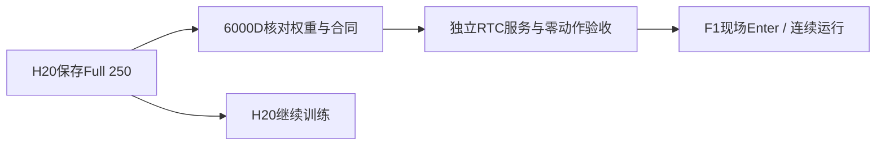

# V1 Full SFT 250：6000D现场候选

本次将含Home监督与时间mask的新Full 250模型接到6000D，供现场验证。H20继续使用GPU0–3训练；旧5K和其他checkpoint入口保留。

250已完成训练、保存和导出，6000D服务及F1独立入口已就绪。24次历史观测回放和30秒真实相机shadow已完成，零动作发布；shadow出现3次IK拒绝，均按原恢复逻辑恢复。现场抓取、插孔、释放及回位效果由用户执行验证。



## 已核对的训练结果

- run：`/u01/user/runs/f1-toys-v1-full-20261020-r1`。
- 250步训练loss 0.0297，288窗口验证loss 0.0748。
- 固定验证观测的5步采样20样本：IK成功20/20；前20步平均位置误差6.469964mm、旋转误差0.971102°、夹爪误差0.772770点。这是离线示教观测误差，不是任务成功率。
- bundle SHA256：`42f3a7078d8d4fbbd171276491829257d4243e9d7ec6cc6b34503b9e13b7af1f`。
- 权重 SHA256：`66e51c97aa2e0771f877064a062fd7ba28d057585a04a765f0a1c31a86d17387`。
- model id：`f1-toys-eef-42f3a7078d8d4fbb`。
- [在线W&B](https://wandb.ai/robotics-example/f1_complexytoys/runs/f1full20261020main1)；group `03_V1_FullSFT`。

## 推理合同与资源

从本轮冻结训练release加载核心，逐文件核对bundle的核心和预处理SHA；Full全权重，不经过LoRA合并。绑定新train-only统计、新prompt及原ROI A。三图、224、右EEF10、H50/30Hz、5步采样不变；推理无随机增强，无未来时间mask输入。

prompt：

> Use the right gripper to pick up the wooden block, insert it into the matching opening of the container, release it, and return the right arm to the starting pose with the gripper open.

6000D使用GPU2，和保留的旧5K回退服务共卡；当前只能运行一个现场控制会话。新容器`f1-toys-full-250-rtc`，loopback8150；F1 loopback8151转发至此，保持完整模型SHA核验。RTC采用6000D已有精度保留suffix编译、完整VJP和D20/S20基线；没有改IK求解器、限位、容差或拒绝恢复规则。

网络使用现有SSH授权的独立反向转发，由6000D tmux `f1-full-250-tunnel`维护。申请为现有受限F1密钥新增`permitopen`被自动审批拒绝，因此未修改`authorized_keys`；临时转发不改密钥权限。该路径仍经过既有F1反向连接，不能直接套用H20直连延迟结论。

F1复用冻结`20261020-f1-toys-rtc-v5-fastpixels`，三图并行处理。新配置/像素合同在`/home/user/Bruno/DAgger-runtime/f1-toys-20261016/full-rtc/250`，完整核对原release文件清单；只新增入口，不替换旧入口。

## 启动与日志

下方零动作验收已完成。在F1本机Bash任意目录，按既有流程准备起始姿态和物体，结束其他控制会话后执行；Enter开始、Ctrl+C停止：

```bash
bash /home/user/Bruno/DAgger/start_f1_toys_full_250.sh --continuous
```

短时运行将`--continuous`改为`--duration-seconds 20`。零动作检查加`--shadow`，不会创建命令publisher。模型已训练回位行为，但成功尚待现场验证；退出脚本不额外发送Home。

6000D服务恢复，工作目录Projects：

```bash
cd /home/user/projects
sg docker -c 'bash tasks/F1_ComplexyToys/scripts/start_6000d_full.sh'
bash tasks/F1_ComplexyToys/scripts/start_full_250_tunnel.sh
```

服务日志：任务`artifacts/20261020-v1-full-training/service-250/logs/requests.jsonl`及同目录transport日志。F1控制台：`full-rtc/250/runtime/onsite-policy-console.log`；会话/telemetry仍写`/home/user/Bruno/data/hil_data/policy_hil/`。模型绑定、恢复及RTC事件随会话保存。

## 验收

北京时间2026-10-20 17:14完成本次验收；未执行机器人动作：

- 下载文件、冻结核心、预处理逐文件SHA通过；服务健康身份与F1绑定一致，原三图并行预处理采用新合同。
- F1经真实隧道回放4段历史记录共24请求，24/24 IK通过；20次接续前缀逐项一致、零截止超时，接续请求P50/P95=213.50/223.18ms。这是录制输入回放，不是闭环。
- 真实相机shadow会话`f1_hil_20261020T091317Z_35815d6e`持续30秒、保存899观测，正常到时退出并完整封存；46次请求含43次成功/3次IK拒绝，3次均保持后以新观测恢复，未进入暂停，零RTC超时。
- 接续请求42次，P50/P95=235.57/254.86ms，max257.47ms；包含录制负载。启动请求和接续分别统计。
- 全部control记录零`publication_complete`、零`submitted`，没有机器人动作；不能由静止shadow推断实际闭环成功率。
- H20训练独立续行，部署期间核实已超过302步；没有停止或改动训练。

证据目录：[deployment-250](../../artifacts/20261020-v1-full-training/deployment-250)，含`installation.json`、`replay/summary.json`、`replay/requests.jsonl`与`shadow-summary.json`；原完整journal留在F1会话目录。服务身份见[health-250.json](../../artifacts/20261020-v1-full-training/health-250.json)。
